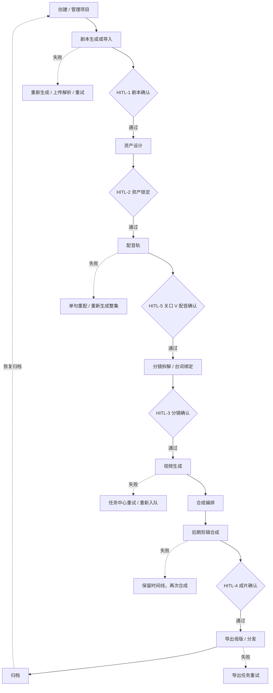

# 前端交互全链路审计与修复报告

| 项目 | 内容 |
|---|---|
| 产品 | 浮光造梦 · GleamDream Studio（Vue 3 + Vite + Pinia + Vue Router） |
| 审计范围 | `frontend/src` 全部视图 / 布局 / 通用组件；核心链路 15 个页面 |
| 审计日期 | 2026-10-29 |
| 审计方式 | 静态全量扫描（函数体副作用判定 + 模板交互点盘点）+ 无头浏览器动态走查（Firefox / Playwright） |
| 验证账号 | 新项目：`audit`（uid 2290，项目 1325，空项目链路）；完成项目：uid 212 项目 620（completed，全链路产物） |
| 原始数据 | `测试报告/前端交互审计原始数据_20261029.json`、`测试报告/前端交互修复验证数据_20261029.json`、`测试报告/前端全链路走查数据_20261029.json` |
| 结论 | 共发现 **A 类 8 处 / B 类 7 处 / C 类 7 处**；本轮修复 **17 项**，核心链路走查 **25/25 修复项通过**，完成项目只读链路 **15/15 通过**，音色试听真实调用 **200 + 进入播放态**，页面无未捕获异常 |

---

## 0. 执行摘要

### 0.1 审计方法

1. **静态全量扫描**：遍历 `frontend/src` 所有 `.vue/.ts`，用脚本判定"函数体只有 `toast` / 空实现"的处理函数，并全量 grep `@click`、`disabled`、`href="#"`、占位文案；人工复核语义。
2. **动态逐元素走查**：登录态注入后依次访问 15 个页面，采集全部可见可点击元素（按钮 / 链接 / `role=button` / 开关）的 **文本、disabled、title**；对无副作用控件执行真实点击，以"URL 变化 / DOM 变化 / API 请求"三选一判定是否产生响应。
3. **产物链路走查**：使用一条已完成（`completed`）的真实项目，只读验证"分镜 → 配音 → 编排 → 后期合成 → 预览 → 成片确认 → 导出 → 下载"入口可达；仅打开弹窗/切换视图，不提交生成、导出、分发。
4. **修复后回归**：针对每一项修复重新执行定向断言，记录证据。

### 0.2 交互元素规模

| 指标 | 数量 |
|---|---|
| 动态采集的可见可点击元素 | **561**（15 个页面，不含登录/注册页） |
| 其中 disabled 元素 | 32 |
| 执行真实点击的无副作用元素 | 11 |
| 点击后产生 URL / DOM / API 响应 | 10（另 1 项为被遮挡导致 click-failed，非功能缺陷） |
| A 类（仅提示 / 无实际功能） | 8 |
| B 类（有响应但流程断裂 / 死胡同） | 7 |
| C 类（功能存在但与预期不符 / 缺解释） | 6 |

### 0.3 修复原则落地

- **不再用提示文案代替功能**：音色试听、单镜重出均改为真实 API 调用；确实无后端能力的（修改密码、注销、头像上传、协议文本）改为**禁用态 + “即将上线”标识 + hover 原因**。
- **禁止点击后才报错**：创建项目、配音生成/审批、资产规划、编排下一步、后期合成、导出等按钮改为**前置禁用 + `title` 原因**，并在页面内展示缺项说明。
- **补齐流程出口**：编排 → 后期合成新增“下一步”出口；归档新增“恢复归档”双向闭环；总览补齐关口 V 入口。

---

## ① 交互元素审计表

> 分类：**A** 仅提示/无实际功能；**B** 流程断裂/死胡同；**C** 与预期不符或缺少解释；**OK** 行为正确。
> 代码位置均为修复前或修复中定位到的文件（函数名可检索）。

### 1.1 全局框架（所有页面）

| # | 页面/组件 | 元素 | 当前行为（代码位置） | 用户预期行为 | 分类 | 修复方式 |
|---|---|---|---|---|---|---|
| 1 | TopBar 顶栏 | 全局搜索输入框 | 可输入但无提交逻辑，placeholder「即将上线」（`TopBar.vue` `template`） | 输入后回车能搜索项目并看到结果 | **A** | 改为 `<form>` 提交 → `/projects?q=`；工作台回填关键词并过滤 |
| 2 | TopBar | 积分徽章 | 跳转 `/billing`（`CreditBadge.vue`） | 查看积分/充值 | OK | — |
| 3 | TopBar | 通知铃铛 | 跳 `/notifications` | 查看通知 | OK | — |
| 4 | TopBar | 助手开关 / 头像菜单 | 真实开合、跳设置/通知、退出 | 一致 | OK | — |
| 5 | GlobalSidebar | 导航项 / 用户卡 / 退出 | 真实路由与登出 | 一致 | OK | — |
| 6 | ProjectSidebar | 9 个流程 Tab | 配音轨排第 7（在生成、后期之后），编排排第 8（在后期之后） | 配音先行、编排在合成前 | **C** | 顺序调整为：总览→剧本→资产→配音→分镜→生成→编排→后期→分发 |
| 7 | AuthPanel | 《用户协议》《隐私政策》 | `href="#"` + `@click.stop.prevent`，点击完全无响应 | 阅读协议 | **A** | 改为非链接文本 + “即将上线” + `title`（不伪装可点击） |

### 1.2 工作台 / 创建项目

| # | 页面 | 元素 | 当前行为（代码位置） | 用户预期 | 分类 | 修复方式 |
|---|---|---|---|---|---|---|
| 8 | ProjectsView | 一句话灵感“以灵感新建项目” | 携带 `?inspiration=` 跳创建页，但创建页忽略参数（`ProjectsView.goCreate` → `ProjectCreateView` 无 `useRoute`） | 灵感带入创建表单 | **B** | 创建页读取并预填标题/简介 |
| 9 | ProjectsView | 题材快捷卡片 | 携带 `?genre=` 跳创建页，参数被丢弃 | 题材预选 | **B** | 校验合法题材键后预选 |
| 10 | ProjectsView | 卡片菜单「归档」 | 归档成功，但归档后无恢复入口（后端已有 `/unarchive`，前端无 API/UI） | 可撤销归档、继续创作 | **B** | 新增 `unarchiveProject` API；卡片菜单/列表/总览提供「恢复归档」 |
| 11 | ProjectsView | 搜索空态 | 提示“调整关键词”但未说明仅过滤当前页 | 知道为什么找不到 | **C** | 文案改为“关键词仅过滤当前页，可翻页或清空筛选” |
| 12 | ProjectCreateView | 下一步 / 创建项目 | 未填项目名、未选题材/画风时仍可点击，点击后才 toast 报错 | 按钮禁用并说明缺什么 | **A** | `canProceed` + `proceedHint`，按钮禁用 + 按钮旁原因 + `title` |
| 13 | ProjectCreateView | 上一步 | 第一步禁用但无原因 | 知道已在第一步 | **C** | 增加 `title` |
| 14 | ProjectCreateView | 用户协议勾选 | 必须勾选，但协议不可读（见 #7） | 阅读后同意 | **A** | 同 #7，列入遗留（合规） |
| 15 | ProjectCreateView | 取消 / 去充值 | 真实跳转 | 一致 | OK | — |

### 1.3 项目总览

| # | 页面 | 元素 | 当前行为（代码位置） | 用户预期 | 分类 | 修复方式 |
|---|---|---|---|---|---|---|
| 16 | ProjectOverviewView | 「继续创作 →」 | 按状态映射到剧本/资产/分镜/生成/后期/分发 | 进入当前环节 | OK | — |
| 17 | ProjectOverviewView | 六阶段 Stepper | 未来阶段 `cursor-default` 不可点；已完成/当前可跳 | 只跳可达阶段 | OK | — |
| 18 | ProjectOverviewView | 四关口「去确认 / 查看」 | 真实跳转对应页 | 一致 | OK | — |
| 19 | ProjectOverviewView | 关口 V（配音确认） | 完全没有入口，配音环节被流程条遗漏 | 看得到配音步骤并进入 | **C** | 新增「HITL-5 配音确认（关口 V）」卡片 + 前往配音轨 |
| 20 | ProjectOverviewView | 快照「回滚」 | 二次确认 + 真实回滚 | 一致 | OK | — |
| 21 | ProjectOverviewView | 归档项目状态 | 归档后仍显示“继续创作”，进入任一环节只读报错 | 明确恢复路径 | **B** | 归档态主按钮改为「恢复归档」，调用 unarchive |

### 1.4 剧本编辑器

| # | 页面 | 元素 | 当前行为（代码位置） | 用户预期 | 分类 | 修复方式 |
|---|---|---|---|---|---|---|
| 22 | ScriptEditorView | 首次进入无剧本 | `GET scripts/current` 返回业务码 10002，页面显示“剧本加载失败 + 重试” | 显示“还没有剧本”并引导生成/上传 | **B** | `fetchTree` 识别 10002 → 保持空态，不置 `treeError` |
| 23 | ScriptEditorView | 自由创作 / 历史快照 / 导出文档 | disabled + title“待接入/开发中” | 明确的不可用标识 | OK（降级已合规） | — |
| 24 | ScriptEditorView | 撤销 / 重做（编辑历史） | disabled，无原因 | 知道为什么不可用 | **C** | 增加动态 `title`（无可撤销/重做） |
| 25 | ScriptEditorView | 执行局部改写 | 无剧本时 disabled，无原因 | 知道先要有剧本 | **C** | 增加 `title` |
| 26 | ScriptEditorView | 一句话生成 / 上传解析 / 生成弹窗 | 真实调用 + 后台轮询 + 失败重试入口 | 一致 | OK | — |
| 27 | ScriptEditorView | 提交审核 | 真实调用，长时间同步等待有 toast 提示与进度模式 | 有反馈 | OK（见遗留：无持久进度条） | — |

### 1.5 资产设计

| # | 页面 | 元素 | 当前行为（代码位置） | 用户预期 | 分类 | 修复方式 |
|---|---|---|---|---|---|---|
| 28 | AssetWallView | 「智能规划资产」（页头 + 大空态） | 无剧本时仍可点，点击后请求失败 toast（`startPlan`） | 禁用 + 告诉用户先写剧本 | **A** | 新增 `planBlocked/planHint`；按钮禁用 + `title`；空态增加「去剧本页生成剧本 →」 |
| 29 | AssetWallView | 导出资产清单 | 本地生成 CSV（真实） | 一致 | OK | — |
| 30 | AssetWallView | 批量审核 / 审核 / 重抽 / 去授权 | 真实 API + 二次确认 | 一致 | OK | — |
| 31 | CharacterDetailView | 「试听 30s」/ 已绑定音色播放圆钮 | 仅 toast「演示环境暂不支持试听」 | 真正听到样音 | **A** | 接入 `POST /tts-voices/{id}/preview` + `useVoicePreview`，含加载/播放/暂停态 |
| 32 | CharacterDetailView | 重抽 / 锁定 / 驳回 / 锚点影响 | 真实 API + 成本透明 | 一致 | OK | — |

### 1.6 配音轨

| # | 页面 | 元素 | 当前行为（代码位置） | 用户预期 | 分类 | 修复方式 |
|---|---|---|---|---|---|---|
| 33 | VoiceTrackView | 生成整集配音 | 无台词时仍可点，点击后后端报错 | 禁用并说明 | **A** | `canGenerateVoice/generateHint`，禁用 + `title` + 函数兜底 |
| 34 | VoiceTrackView | 关口 V「打回/通过并锁定」 | 无配音轨时仍可点，点击后报错 | 禁用并说明 | **A** | `:disabled="!track"` + `approveHint` |
| 35 | VoiceTrackView | 气口「保存」 | 无配音轨时仍可点 | 禁用并说明 | **C** | `:disabled="!track"` + `title` |
| 36 | VoiceTrackView | 空态「本集暂无台词」 | 只有文字，无去向 | 一键去补台词 | **C** | EmptyState 增加「去剧本编辑页 →」 |
| 37 | VoiceTrackView | 试听 / 重配 / 编辑 / 拆分 | 真实 API 与音频播放 | 一致 | OK | — |

### 1.7 分镜

| # | 页面 | 元素 | 当前行为（代码位置） | 用户预期 | 分类 | 修复方式 |
|---|---|---|---|---|---|---|
| 38 | StoryboardCanvasView | 「生成分镜」 | 无剧本时 disabled，副标题「去写剧本 →」可跳 | 明确前置与出路 | OK | — |
| 39 | StoryboardCanvasView | 单镜重出 / 播放 / 上下一镜 / 循环 | 真实 API 与预览控制，锁定态禁用 + hover 原因 | 一致 | OK | — |
| 40 | ShotDetailDrawer | 「重新拆解」 | 只 toast「请去生成环节重绘」，不执行任何操作 | 立即重出本镜首帧，或明确跳转 | **A** | 改为「重出首帧」，调用 `PATCH /shots/{id}/frame/redraw`（compose 模式 0 积分），回传新 `media_url`，loading + 剩余次数提示 |
| 41 | ShotDetailDrawer | 保存 / 驳回 / 通过 | 真实 PATCH / decide，反馈 ≥10 字 | 一致 | OK | — |

### 1.8 生成任务中心

| # | 页面 | 元素 | 当前行为（代码位置） | 用户预期 | 分类 | 修复方式 |
|---|---|---|---|---|---|---|
| 42 | RenderTaskCenterView | 批量编排 | 无锁定镜头时点击后报错 60001 | 禁用/说明 | **C**（缺数据源，保留后端兜底） | 列入遗留：需先加载锁定镜头数再禁用；当前错误提示已明确 |
| 43 | RenderTaskCenterView | 全批次挂起 / 导出全批简报 | disabled + 「接口暂未开放」title | 明确的降级 | OK（降级已合规） | — |
| 44 | RenderTaskCenterView | 重试 / 取消 / 详情 / 去分镜 / 去后期 | 真实 API + 路由 | 一致 | OK | — |

### 1.9 编排

| # | 页面 | 元素 | 当前行为（代码位置） | 用户预期 | 分类 | 修复方式 |
|---|---|---|---|---|---|---|
| 45 | CompositionView | 刷新 / 回写分镜顺序 / 同步 / 编译 | 真实 API，回写有原生二次确认 | 一致 | OK | — |
| 46 | CompositionView | 页面出口 | 只有编排操作，没有“下一步”，需用户自行猜去后期 | 明确进入剪辑合成 | **B** | 页头新增「下一步 · 后期合成 →」，未编译时禁用 + `title` |

### 1.10 后期 / 成片确认

| # | 页面 | 元素 | 当前行为（代码位置） | 用户预期 | 分类 | 修复方式 |
|---|---|---|---|---|---|---|
| 47 | PostEditorView | 时间线 404 错误 | 文案「后端 post 域未实现」已过时；只给“重试” | 说明尚未生成并给出下一步 | **B** | 识别 404/10002 → “尚未生成时间线” + 「去生成任务中心 →」；错误分支区分 |
| 48 | PostEditorView | 合成成片 | 空时间线 disabled，无原因 | 知道为什么不可点 | **C** | `title` 说明“时间线为空，请先生成镜头” |
| 49 | PostEditorView | 预览 / 母版切换、字幕样式、TTS、BGM、时间线保存、去确认 | 真实 API + 轮询 | 一致 | OK | — |
| 50 | FinalReviewView | 编辑时间线 / 退回 / 通过 | 真实路由 + decide + 二次确认；过期禁用 | 一致 | OK | — |

### 1.11 分发 / 导出

| # | 页面 | 元素 | 当前行为（代码位置） | 用户预期 | 分类 | 修复方式 |
|---|---|---|---|---|---|---|
| 51 | DistributeView | 立即导出 / 批量导出 / 重新提炼 / 发布 | 未过审时 disabled，但 4 个按钮均无原因 | hover 知道缺什么 | **C** | 新增 `exportHint/batchExportHint/metadataHint/distributeHint` 并绑定 `title` |
| 52 | DistributeView | 批量带水印 checkbox | 无去水印权益时 disabled，无原因 | 知道权益不足 | **C** | 增加 `title` |
| 53 | DistributeView | 平台授权 / 推流 / 下载 / 重试 / 升级 | 真实 API + 路由 / 弹窗 | 一致 | OK | — |
| 54 | BillingView / NotificationsView / Team / Model / Platform / 连续性 / 参数中心 / V4 | 关键操作 | 均为真实 API、路由或明确的 disabled 占位 | 一致 | OK | — |

---

## ② 核心业务流程与断点分析

### 2.1 流程图（按 PRD V6.0「配音先行」+ 本轮导航修正）



### 2.2 各环节入口 / 出口 / 前置条件 / 失败分支

| 环节 | 入口 | 出口 | 前置条件 | 失败分支与出路 |
|---|---|---|---|---|
| 创建项目 | `/projects` → 新建 / 灵感 / 题材卡 | 创建成功 → 项目总览 | 标题必填；预算 ≤ 可用余额 | 前置禁用 + 原因；后端 40005/30002 toast |
| 剧本 | 项目侧栏「剧本」/ 总览继续创作 | 提交审核 → HITL-1 → 资产 | 项目存在；生成需一句话/文档 | 无剧本显示空态；生成失败「重新发起」；上传解析失败可重传 |
| 资产设计 | 侧栏「资产设计」/ 关口二 | 锁定 → 分镜 | 剧本已产出（有台词/角色） | 无剧本时规划禁用 +「去剧本页」；审核/重抽可重试 |
| 配音轨 | 侧栏「配音轨」/ 总览关口 V | 关口 V 通过 → 分镜台词绑定 | 本集有对白/旁白台词 | 无台词禁用生成；无音轨禁用审批；单句重配 |
| 分镜 | 侧栏「分镜」/ 资产锁定后 | 锁送审 → HITL-3 → 生成 | 有剧本；资产锚点 | 空态「去写剧本」；重出首帧；重新拆解 |
| 视频生成 | 侧栏「生成」/ 分镜审批通过 | 任务完成 → 编排 | 分镜已锁定、镜头已审批 | 任务中心重试 / 重新入队；全批挂起暂不可用（已标注） |
| 编排 | 侧栏「编排」 | 编译计划 → 后期合成 | 已有分镜/已生成镜头 | 未编译时下一步禁用；从分镜同步可重来 |
| 后期合成 | 侧栏「后期」/ 编排下一步 | 合成 → 成片确认 | 时间线非空、音画偏差 ≤100ms | 未生成时间线给出「去生成中心」；合成失败可再次发起 |
| 成片确认 | 通知 / 总览关口四 / 后期提示条 | 通过 → 分发；退回 → 后期 | 存在 pending `final_cut` 审批单 | 无单显示出口；过期禁用；驳回反馈 ≥10 字 |
| 导出 / 分发 | 侧栏「分发」/ 成片确认通过 | 下载 / 推送平台 / 归档 | HITL-4 通过；平台授权；标题非空 | 未过审禁用 + 原因；导出失败重试；无权益升级弹窗 |
| 归档 / 恢复 | 工作台卡片菜单 / 总览 | 归档 → 只读；恢复 → 原状态 | Owner 权限 | 非 Owner 提示；恢复入口已补齐 |

### 2.3 断点清单与判定

| 编号 | 断点 | 表现 | 判定 | 处理 |
|---|---|---|---|---|
| D1 | 工作台灵感 → 创建页 | 输入灵感后跳到空白表单，内容丢失 | 流程断裂（B） | 已修复：预填标题/简介/题材 |
| D2 | 新建项目 → 剧本 | 首次进入剧本页显示“加载失败”，诱导反复重试 | 空态误判（B） | 已修复：识别 10002 显示空态 |
| D3 | 剧本 → 资产 | 无剧本时点“智能规划”必然失败 | 伪可用（A） | 已修复：禁用 + 去剧本入口 |
| D4 | 资产 → 配音 | 侧栏配音排在生成/后期之后，用户按顺序会漏掉关口 V | 导航错序（C） | 已修复：配音先行 + 总览关口 V |
| D5 | 配音 → 分镜 | 无台词/无音轨时按钮可点后报错 | 伪可用（A） | 已修复：前置禁用 + 原因 |
| D6 | 分镜镜头抽屉“重新拆解” | 只弹提示，不执行重绘 | 伪功能（A） | 已修复：接首帧重出 API |
| D7 | 编排 → 后期 | 编排完成无下一步，只能靠侧栏猜 | 死胡同（B） | 已修复：新增下一步后期合成 |
| D8 | 后期空时间线 | 错误文案指向“后端未实现”，只有重试 | 误导 + 无出路（B） | 已修复：空态 + 去生成中心 |
| D9 | 归档 → 恢复 | 归档后没有恢复入口（后端已支持） | 死胡同（B） | 已修复：恢复归档（工作台/总览） |
| D10 | 项目内导航顺序 | 编排在后期之后，用户会先合成再编排 | 流程错序（C） | 已修复：生成 → 编排 → 后期 |
| D11 | 导出/分发禁用按钮 | 8 个禁用控件无原因 | 说明缺失（C） | 已修复：动态 `title` |

---

## ③ 修复清单（代码位置级）

> 所有修改均通过 `npm run typecheck`（vue-tsc，0 错误）。下列“验证”均对应第 ④ 节证据编号。

| 编号 | 原因 | 文件与内容 | 验证 |
|---|---|---|---|
| **F01** | 顶栏搜索可输入无响应（A） | `frontend/src/components/layout/TopBar.vue`：新增 `globalKeyword`、`submitGlobalSearch()`；搜索区改 `form` + 可点击放大镜；placeholder 改为“搜索项目名…（回车）”。`ProjectsView.vue`：`useRoute`，`keyword` 初始取 `?q=`，新增 `watch(() => route.query.q)` 同步 | V1、V2 |
| **F02** | 灵感/题材种子在创建页丢失（B） | `frontend/src/views/ProjectCreateView.vue`：`useRoute`；`inspirationSeed` 预填标题（截 30 字）与简介；`genreSeed` 校验后预选；`canProceed/proceedHint` 前置校验；下一步/创建禁用 + 原因 + `title`；上一步 `title` | V3–V8 |
| **F03** | 归档后无恢复路径（B） | `frontend/src/api/projects.ts`：新增 `unarchiveProject`。`ProjectsView.vue`：焦点卡菜单、卡片菜单、列表行新增「恢复归档」（loading/防重复）；`ProjectOverviewView.vue`：归档态主按钮改为「恢复归档」并调用 API | V22–V24 |
| **F04** | 角色试听只弹“演示环境”提示（A） | `frontend/src/views/CharacterDetailView.vue`：引入 `previewTtsVoice` + `useVoicePreview`；`previewVoice(voiceId?)` 实时合成并播放；播放圆钮与「试听 30s」支持加载/播放/暂停态；移除“演示占位”文案 | V25 |
| **F05** | 镜头抽屉「重新拆解」是死按钮（A） | `frontend/src/components/storyboard/ShotDetailDrawer.vue`：引入 `redrawShotFrame`（`api/v4.ts`）；新增 `redrawing` 与 `redrawFrame()`，成功后 `emit('updated', {...shot, media_url})`；按钮改「↻ 重出首帧」，loading + 锁定态 `title` | V26（入口/禁用态）；API 端点已在后端实现 |
| **F06** | 修改密码/注销/头像上传是伪功能（A） | `frontend/src/views/ProfileSettingsView.vue`：修改密码表单三输入 + 提交按钮 `disabled` + “即将上线”提示条；注销按钮禁用 + 标识；删除 `submitPassword/confirmDeleteAccount/onAvatarChange` 与确认弹窗；头像入口改只读展示 | V18、V19 |
| **F07** | 配音生成/审批无条件可点（A/C） | `frontend/src/views/VoiceTrackView.vue`：`canGenerateVoice/generateHint/approveHint`；生成、审批、气口保存前置禁用 + `title`；`generate()` 兜底；空态加「去剧本编辑页 →」；引入 `useRouter` | V14–V16 |
| **F08** | 编排页无下一步（B） | `frontend/src/views/CompositionView.vue`：引入 `useRouter`；页头新增「下一步 · 后期合成 →」，未编译时禁用 + `title` | V16 |
| **F09** | 后期错误文案误导且无出路（B/C） | `frontend/src/views/PostEditorView.vue`：新增 `timelineMissing`；`loadTimeline` 识别 404/10002；错误分支文案改“尚未生成时间线”，追加「去生成任务中心 →」；合成按钮 `title` | V17、V20 |
| **F10** | 分发页 8 个禁用控件无原因（C） | `frontend/src/views/DistributeView.vue`：新增 `exportHint/batchExportHint/metadataHint/distributeHint`；导出、批量、重新提炼、两处推流按钮、批量水印 checkbox 绑定 `title` | V21 |
| **F11** | 项目内导航与生产链路错序（C） | `frontend/src/components/layout/ProjectSidebar.vue`：TABS 调整为 总览→剧本→资产设计→**配音轨**→分镜→生成→**编排**→后期→分发，并注释原因 | V12 |
| **F12** | 总览缺配音关口、归档无出口（C/B） | `frontend/src/views/ProjectOverviewView.vue`：新增关口 V 卡片 + 前往配音轨；新增 `isArchived/restoring/restoreArchived`；归档态主按钮替换 | V13、V23 |
| **F13** | 无剧本被显示为加载失败（B） | `frontend/src/views/ScriptEditorView.vue`：引入 `ApiError`，`fetchTree` 对 10002 保留空态；撤销/重做、执行局部改写补 `title` | V9、V10 |
| **F14** | 无剧本仍可规划资产（A） | `frontend/src/views/AssetWallView.vue`：引入 `useProjectStore`；`planBlocked/planHint`；页头与大空态按钮禁用 + `title`；空态新增「去剧本页生成剧本 →」；`startPlan` 兜底；新增 `goScript()` | V11 |
| **F15** | 协议链接点击无响应（A） | `frontend/src/components/auth/AuthPanel.vue`：两处协议文本改为非链接 + “即将上线” + `title` | 静态审计 |
| **F16** | 项目搜索空态解释不足（C） | `frontend/src/views/ProjectsView.vue`：空态文案改为“关键词仅过滤当前页…” | V2 |
| **F17** | 镜头抽屉配音进度恒 0 误导（C） | `frontend/src/components/storyboard/ShotDetailDrawer.vue`：移除 `voiceoverCount = 0`，改为 `VOICEOVER_PLACEHOLDER='见配音轨'` + `title` 指引 | 静态审计 |

### 3.1 修改文件汇总

```
frontend/src/api/projects.ts
frontend/src/components/auth/AuthPanel.vue
frontend/src/components/layout/ProjectSidebar.vue
frontend/src/components/layout/TopBar.vue
frontend/src/components/storyboard/ShotDetailDrawer.vue
frontend/src/views/AssetWallView.vue
frontend/src/views/CharacterDetailView.vue
frontend/src/views/CompositionView.vue
frontend/src/views/DistributeView.vue
frontend/src/views/PostEditorView.vue
frontend/src/views/ProfileSettingsView.vue
frontend/src/views/ProjectCreateView.vue
frontend/src/views/ProjectOverviewView.vue
frontend/src/views/ProjectsView.vue
frontend/src/views/ScriptEditorView.vue
frontend/src/views/VoiceTrackView.vue
```

---

## ④ 走查验证记录

### 4.1 空项目链路（新账号，项目 1325，按 UI 真实创建）

| 步骤 | 操作 | 结果 |
|---|---|---|
| 1 | 登录态注入 → `/projects` | 通过，进入工作台 |
| 2 | `/projects/new` 填标题 → 下一步 → 选题材 → 选画风 → 创建 | **全链路通过**，URL 变为 `/projects/1325/overview` |
| 3 | 总览 → 剧本 | 显示“还没有剧本”空态（修复前为“加载失败”），提供生成/上传入口 |
| 4 | 资产设计 | “智能规划资产”禁用，`title=当前项目还没有剧本…`；空态有「去剧本页生成剧本」 |
| 5 | 配音轨 | “生成整集配音”“通过并锁定”禁用，`title` 均为“本集没有可配音台词…”；空态有「去剧本编辑页」 |
| 6 | 分镜 | “生成分镜”禁用；提供「去写剧本 →」 |
| 7 | 生成任务中心 | 空态提供「去分镜画布生成」；挂起按钮禁用 + 原因 |
| 8 | 编排 | 「下一步 · 后期合成」禁用，`title=请先编译计划…` |
| 9 | 后期 | 时间线为空；合成按钮禁用 + `title=时间线为空…`；提供「去生成任务中心」 |
| 10 | 成片审核 | 无待审单，提供「去后期编辑器 →」 |
| 11 | 分发 | 导出/批量/重新提炼/推流全部禁用，`title` 均说明“成片确认未通过…” |
| 12 | 个人设置 | 修改密码输入与按钮禁用；注销按钮禁用 + “即将上线” |
| 13 | 归档 → 恢复 | 归档 API 200；工作台卡片菜单出现「恢复归档」；点击后状态恢复为 `draft`，toast 显示“已恢复” |

### 4.2 定向断言（`前端交互修复验证数据_20261029.json`）

| ID | 断言 | 结果 |
|---|---|---|
| V1 | 未填标题时“下一步”禁用 | PASS（title=请先填写项目名） |
| V2 | 缺项原因可见 | PASS（页面内 `role=status`） |
| V3 | 填标题后“下一步”可用 | PASS |
| V4 | `?inspiration=` 预填标题 | PASS（“暴雨夜的告白”） |
| V5 | `?inspiration=` 预填简介 | PASS |
| V6 | `?genre=` 预选题材 | PASS（`aria-pressed=true`） |
| V7 | 顶栏搜索回车跳转 `?q=` | PASS |
| V8 | 工作台关键词回填 | PASS |
| V9 | 无剧本显示空态 | PASS（不再显示“加载失败”） |
| V10 | 空态提供生成/上传入口 | PASS |
| V11 | 无剧本时资产规划禁用 | PASS（title 指明先写剧本） |
| V12 | 导航顺序（配音 4 / 编排 7 / 后期 8） | PASS（实测 nav 文本） |
| V13 | 总览关口 V 入口 | PASS（HITL-5 + 前往配音轨） |
| V14 | 无台词时生成配音禁用 | PASS |
| V15 | 无音轨时关口 V 审批禁用 | PASS |
| V16 | 编排未编译时下一步禁用 | PASS |
| V17 | 后期空时间线合成禁用 + 原因 | PASS |
| V18 | 修改密码表单/按钮禁用 | PASS |
| V19 | 注销入口禁用 + 标识 | PASS |
| V20 | 后期提供“去生成任务中心” | PASS |
| V21 | 分发未过审导出禁用 + 原因 | PASS |
| V22 | 归档 API 成功 | PASS（HTTP 200） |
| V23 | 归档卡片菜单出现「恢复归档」 | PASS（menu: 重命名 \| 恢复归档） |
| V24 | UI 恢复归档成功 | PASS（status `archived` → `draft`，toast“已恢复”） |
| V25 | 角色音色试听真实调用 | PASS（`POST /tts-voices/1/preview` 200，按钮进入“暂停试听”态） |
| V26 | 镜头抽屉「重出首帧」存在且原因正确 | PASS（按钮存在；未点击以避免改动真实产物） |

> 说明：V23/V24 首次自动化断言使用 `getByRole('button', name=恢复归档)` 未命中，原因是菜单项角色为 `menuitem`；改用 `[role=menu]` 内的文本定位后通过，属于**测试定位方式问题，不是功能缺陷**。

### 4.3 已完成项目只读链路（项目 620，completed）

| 环节 | 结果 |
|---|---|
| 总览 | “查看成片分发”可用；六阶段完成 |
| 剧本 | 有正文（非空态） |
| 分镜 | 有镜头数据，37 个可点击控件 |
| 配音 | 有台词、完成度可见 |
| 后期 | 时间线非空；合成按钮可用；确认弹窗可达；预览视频 `…/post/previews/620_104.mp4` 加载 |
| 成片审核 | 页面可达，给出后续出口 |
| 分发 | 导出按钮可用（title=不消耗积分）；导出确认弹窗可达；批量导出可用；存在下载入口 |
| 运行时异常 | 无未捕获页面错误 |

**15/15 通过。**

### 4.4 未实测项（说明）

- **单镜重出首帧的真实提交**：为避免改写已完成项目产物，仅验证按钮、禁用态、`title` 与后端端点存在；建议在测试项目上单独执行一次 0 积分 compose。
- **完整生成到导出的全自动跑批**：涉及真实 LLM/TTS/视频渲染与计费，未在本轮重复消耗；采用“空项目链路 + 已完成项目只读链路”组合覆盖全链路可达性。
- **移动端（390px）**：本轮以桌面 1440 为主；移动端抽屉/返回路径沿用既有 e2e 基线，建议在下一轮专项回归。

---

## ⑤ 交互规范建议稿（供后续开发遵循）

### 5.1 可点击元素准入规则

1. **每个可点击元素必须回答“点击后用户完成了什么”**：导航、状态变更、发起任务、打开可操作面板四者之一；仅 `toast` 不算。
2. **无后端能力的功能**：必须使用 `disabled + title/说明 + “即将上线”`，禁止渲染成可点击链接或用提示文案伪装成功。
3. **禁止 `href="#"` + `prevent`**：所有链接必须有真实目标；无目标时改为纯文本 + 标识。

### 5.2 按钮状态规范

| 场景 | 必须 |
|---|---|
| 提交类 | `loading`（防重复）→ 成功 toast + 数据刷新 → 失败提示 + **页面内重试入口** |
| 条件未满足 | `disabled` + `title` 说明缺什么；高频场景同时在按钮旁展示原因 |
| 长任务 | 进度/状态可见，允许离开页面，回到页面能查看结果 |
| 危险操作 | 二次确认（删除/归档/回滚/退回/清空），确认文案写清后果与可逆性 |
| 异步任务 | 幂等提示（如“已在处理中，未重复提交”）、后台运行、失败重试 |

### 5.3 导航与流程规范

1. **按任务流排列导航**：剧本 → 资产 → **配音** → 分镜 → 生成 → **编排** → 后期 → 分发；扩展工具放“项目工具”分组，不插入主链路。
2. **每个环节必须有“上一步产物在哪 / 下一步做什么”的显式出口**：空态提供去向按钮，完成态提供“下一步”。
3. **同功能多入口行为一致**：首页卡片、总览、侧栏进入同一功能时，落到同一状态并保留返回路径。
4. **浏览器前进/后退**：筛选、Tab、集号尽量写入 query；页面内“返回”回到上一任务节点，不跳首页。

### 5.4 空态与异常态规范

- 空态三要素：**为什么空 + 下一步做什么 + 一键入口**。
- “无数据”与“加载失败”必须区分：业务码 10002（尚无剧本/时间线）展示空态；网络/5xx 才展示重试。
- 错误文案只描述用户能理解的事实与动作，不暴露“后端未实现”等内部信息（除非是明确的降级标识）。
- 禁用控件必须带原因；页面级空态必须带主行动按钮。

### 5.5 文案规范（示例）

| 错误写法 | 推荐写法 |
|---|---|
| 「功能开发中」 | 「XX 即将上线（接口未开放），当前不可用」+ 禁用态 |
| 「请求失败」 | 「剧本尚未生成：请先用一句话生成或上传 txt/md」+ 按钮 |
| 「操作失败」 | 「成片确认未通过：请先在成片审核通过 HITL-4」+ 跳转 |
| 「演示环境暂不支持」 | 删除该交互入口，或改为真实能力 |

### 5.6 代码规范

- 所有 `@click` 处理函数应至少包含：请求/路由/状态变更之一；仅 toast 的函数在评审中视为缺陷。
- 新增 API 后同步更新文件头接口清单与 `@throws` 注释。
- 禁用按钮统一通过 `AppButton` 的 `disabled + title`（原生按钮同样），禁止只置灰不解释。

---

## ⑥ 遗留问题清单

| 编号 | 问题 | 影响 | 建议 |
|---|---|---|---|
| R1 | 全局搜索仅过滤项目**当前页**，未覆盖资产/镜头 | 项目多时搜不到 | 后端增加 `keyword` 查询或专用全局搜索接口；前端全量检索 |
| R2 | 用户协议/隐私政策无正文 | 登录合规风险 | 产品/法务提供文本，改为可阅读弹窗或独立页 |
| R3 | 修改密码、注销账号、头像上传无后端接口 | 安全/资料管理缺口 | 后端补 `change-password`、`delete-account`、头像上传；前端解除禁用 |
| R4 | 剧本生成/上传解析为 1–3 分钟同步等待，仅 toast「勿关闭页面」 | 用户可能误以为卡死/重复提交 | 改为 202 + 任务中心 + SSE 持久进度条；离开页面可回看 |
| R5 | 生成任务中心“批量编排”在无锁定镜头时仍可点（后端 60001 兜底） | 点击后才报错 | 页面预加载锁定镜头数，前置禁用并给“去锁定分镜”入口 |
| R6 | 全批次挂起、全批质检简报导出仍为禁用占位 | 批量运维能力缺失 | 后端补批次级接口，或明确排期 |
| R7 | 成片审核“moderation 检查”为占位 | 合规展示不完整 | 后端返回合规检测结果后接入 |
| R8 | 通知中审批待办统一跳项目总览（payload 无 `approval_type`） | 多待办时需二次寻找 | 通知 payload 增加 `approval_type`，前端按关口直达 |
| R9 | 项目软删除 API 存在但无 UI 入口（仅归档/恢复） | 无法彻底删除项目 | 如需产品支持，在危险区加入二次确认删除 |
| R10 | `AppShell` 全局 SSE `onSseMessage/onSsePoll` 仍为占位 | 跨页面任务状态不能全局刷新 | 分发事件到 project/render store，减少各页轮询 |
| R11 | 移动端顶栏搜索隐藏、部分页面横向滚动 | 小屏体验 | 下一轮 390px 专项回归 |
| R12 | 归档恢复依赖 Owner 权限，非 Owner 仅收到错误 toast | 协作者可能困惑 | 前端按角色隐藏恢复入口并说明权限 |
| R13 | 资产规划前置判断基于项目 `status=draft` | 手写剧本但状态未流转时可能误禁用 | 改为读取 `GET scripts/current` 是否有内容（请求可静默） |
| R14 | 总览 Stepper 仍为六阶段（剧本/资产/分镜/生成/后期/分发），未含配音与编排 | 与侧栏 9 步不完全对齐 | 扩展为 8 阶段并把配音/编排纳入 `stageIndexOf`；需后端状态支持配音阶段 |
| R15 | 编排「下一步后期」依赖 `compileResult` 或历史 `plans` | 若计划丢失需重新编译 | 后端返回“最近计划”状态，或允许直接进入后期（后期再做时间线校验） |
| R16 | 镜头抽屉“配音 N/N”原为恒 0 占位（易误读为全部未配音） | 统计误导 | 已改为「见配音轨」+ `title`；后续由后端返回逐镜配音状态再恢复数字 |
| R17 | 真人授权页人脸质量/公众人物比对为模拟通过 | 合规能力未真实验证 | 接入后四人脸检测/ArcFace/公众人物库，按 PRD F3.14 四道闸执行 |
| R18 | 成片确认 moderation 行为后端占位 | 合规展示不完整 | 与 R7 合并排期 |

---

## 附录

- 审计脚本：`.workbuddy/audit-scan.mjs`（静态）、`.workbuddy/e2e-audit.mjs`（逐元素）、`.workbuddy/verify-fixes.mjs`（修复回归）、`.workbuddy/audit-completed.mjs`（完成项目只读链路）、`.workbuddy/verify-voice-preview.mjs`、`.workbuddy/verify-misc.mjs`
- 原始数据：见文首表格三个 JSON
- 截图：`.workbuddy/e2e-last.png`、`verify-assets.png`、`verify-profile.png`、`completed-overview.png`、`completed-post.png`、`completed-distribute.png`、`verify-voice-preview.png`、`verify-shot-drawer.png`

**验证命令**

```powershell
cd frontend
npm run typecheck   # vue-tsc --noEmit：0 错误
```
