# 01 · AI 短剧创作工具 产品需求说明书 V4.0（开发落地版）

| 项目 | 内容 |
|---|---|
| 产品名称 | 浮光造梦 · AI 短剧创作工具（GleamDream Studio） |
| 文档版本 | V4.0（开发落地版） |
| 上一版本 | V3.0（详细开发版，2026-10-08） |
| 文档状态 | 待业务方评审 |
| 编制 | 产品经理 |
| 评审方 | 业务负责人、技术负责人、法务/合规 |
| 契约依赖 | `00_文档总览与术语表.md`（术语、枚举、命名规范以该文件为准，已同步至 V4.0） |
| 配套文档 | 02 数据库设计 / 03 系统架构设计 / 04 产品原型线框图 / 05 高保真页面描述清单 / 06 API 接口文档 / 07 技术方案 / 11 细节功能清单（SF）/ 12 深度细化原始稿（已并入本版） |
| 最近更新 | 2026-10-15 |

## V4.0 相对 V3.0 的修订说明

| 编号 | 修订项 | 说明 |
|---|---|---|
| R11 | 用户故事补全 | F2–F7 新增 26 条 US（F2-08~12、F3-08~12、F4-07~10、F5-07~10、F6-07~10、F7-06~09），覆盖续写扩写、模板库、场景变体、批量重抽、节奏模式、仪表盘、逐角色调参、规格自检等关键场景 |
| R12 | 验收标准下探 | 新增 132 条 AC（全部 Given/When/Then），既有 AC 全部保留；下探至字段级（`final_prompt ≤ 500 字`、`duration_ms ∈ [1000,15000]`、字幕单句 ≤ 20 字、置信度 0.75）、数值级（退避 30s→120s、响度 -14 LUFS）与交互级（二次确认、SSE 事件） |
| R13 | 状态机细化 | F2 状态机重绘（新增 `generating/generating_failed`）；F3–F7 新增显式状态机（集级分镜、渲染任务、后期管线、导出任务、分发记录），每态含进入条件/可执行动作/出口条件，并映射 ProjectStatus 分段 |
| R14 | Agent 工作流契约 | 新增 F2.8–F7.8：六个 Agent 的输入契约（含缺失降级）、输出 JSON 关键字段、自检修正策略阶梯、human_feedback 结构化注入格式 |
| R15 | 异常决策树 | 边界六查升级为 69 个 `EX-` 编号场景（检测点→处置→用户反馈→计费影响→审计），补齐各环节超时基线与指数退避策略 |
| R16 | 数据与埋点 | 新增 35 个数据字段 + 5 张表（第 8 章 DR-9~12；字段明细见各模块与 02 文档增量）、42 个埋点（各模块 F_x.7） |
| R17 | 合规补强 | 新增 SF-F7-11/AC-F7-08-x：AI 生成内容显式标识（片尾固定嵌入，不可关闭）+ 隐式元数据标识，对接《人工智能生成合成内容标识办法》；第 7.4 节增补 NFR-C6 |
| R18 | 细节功能并入 | 文档 11 的 6 项 P0 细节功能（SF-F2-13 编辑器撤销、SF-F3-12 重抽成本透明、SF-F5-11 人工标记合格、SF-F5-13 失败原因翻译、SF-F6-03 单角色调参、SF-F7-11 AI 标识）并入 MVP 范围（2.1）；其余 SF 项见文档 11 按优先级排期 |

## V3.0 相对 V2.0 的修订说明

| 编号 | 修订项 | 说明 |
|---|---|---|
| R1 | 补齐需求前置 | 新增第 1 章产品概述（用户画像、核心问题、价值主张、成功指标），V2 直接进入架构，缺失"为谁做、做成了算不算成功" |
| R2 | 明确范围边界 | 新增第 2 章范围与非目标、分期路线（MVP/P1/P2），防止范围蔓延 |
| R3 | 需求结构化 | F1–F8 全部改写为"用户故事 + Given/When/Then 验收标准"，每条可测可验，V2 以流程描述为主、缺验收口径 |
| R4 | 补齐边界异常 | 每个功能新增"边界与异常六查"（空态/极值/并发/失败/权限/幂等），V2 仅覆盖部分异常分支 |
| R5 | 补全非功能需求 | 新增第 7 章性能、可用性、安全、合规、成本、可维护性量化目标 |
| R6 | 新增埋点与分析 | 新增第 9 章埋点清单，支撑成功指标的观测 |
| R7 | 扩写验收测试 | 第 10 章在 V2 附录 C 的 5 项基础上扩展为 12 个端到端测试场景 |
| R8 | 汇总待确认问题 | 第 12 章汇总 8 个阻塞级 + 6 个非阻塞级待拍板问题，明确未拍板前的默认取值 |
| R9 | 技术基线固化 | 承接 `00` 契约：Vue 3 + FastAPI + LangGraph + DeepAgents + PostgreSQL + Redis + Celery（**取消 Kafka**，见 ADR-01） |
| R10 | 需求追溯 | 新增附录 D 需求追溯矩阵，把需求 ID、业务目标、验收标准、测试场景、所属文档串起来 |

> **V2 内容保留策略**：V2 的「多智能体总体架构」「Agent 角色总表」「全局状态设计」「主流程图」「成本护栏」全部保留并迁入本文件第 6 章，作为非功能约束与实现约束；V2 各 Feature 的流程图与异常分支表全部保留并合并进第 5 章对应章节。

---

# 第 1 章 产品概述

## 1.1 一句话定位

**面向短剧内容生产者的一站式 AI 创作工具：从一句话创意出发，自动完成剧本、角色、分镜、视频、配音、配乐、字幕、成片与分发，把"一部短剧"的生产从"多人协作数周"压缩到"单人操作数小时"。**

## 1.2 背景与问题

短剧内容生产的现状痛点（以下为行业共识性描述，**具体量化数据待补充调研，标注为【假设待验证】**）：

| 编号 | 痛点 | 谁受影响 | 现状替代方案 | 为什么不够好 |
|---|---|---|---|---|
| PB-1 | 剧本到分镜的"翻译"高度依赖人工经验 | 编剧、导演、制片 | 人工写分镜表、导演口头交代 | 产能瓶颈，1 集 2 分钟短剧分镜耗时 2–4 小时 【假设待验证】 |
| PB-2 | AI 生成内容角色不一致 | 所有 AI 工具使用者 | 反复重抽、垫图、LoRA 训练 | 一致性靠概率，跨镜头漂移明显，返工成本高 |
| PB-3 | AI 工具链割裂 | 个人创作者 | 剧本用 A 工具、图像用 B、视频用 C、配音用 D、剪辑用 E | 文件在工具间手工搬运，元数据与资产无法复用 |
| PB-4 | 生成成本不可控 | 付费创作者 | 逐次试错，先花钱再发现问题 | 叙事错误在"视频生成"这一最贵环节才暴露 |
| PB-5 | 长流程中断即前功尽弃 | 所有使用者 | 重新开始 | 缺少断点续跑与状态持久化 |
| PB-6 | 合规风险不自知 | 面向平台分发者 | 上传后被平台拦截或封号 | 缺少前置审核与授权留痕 |

## 1.3 目标用户与画像

按"是否需要协作、产量高低"划分三类主用户，**每一类都需在 MVP 上线后通过访谈验证，当前为待验证假设**。

| 画像 | 代号 | 特征 | 核心诉求 | 付费意愿 | 关键成功体验 |
|---|---|---|---|---|---|
| 个人创作者 | P-独立 | 1 人，兼职或自由职业，月产 2–10 集，无固定团队 | 少花钱、少返工、全流程不切换工具 | 中（订阅 + 按量积分） | 一句话 → 当天能拿到成片 |
| 小型工作室 | P-工作室 | 3–10 人，有编剧/剪辑分工，月产 30–100 集 | 角色一致性、团队协作、成本可预测、可交付 | 高（团队版订阅） | 项目状态透明、成员权限清晰、成本可核算 |
| MCN / 内容运营 | P-运营 | 批量矩阵号运营，月产 100+ 集 | 批量生产、模板化、一键分发、数据回链 | 高 | 批量导出与分发效率 |

**非目标用户（本期明确不服务）**：影视级长剧制作团队、需要精细 AI 换脸/数字人直播的场景、需要离线私有化部署的机构客户。

## 1.4 要解决的核心问题（本轮产品要回答的问题）

1. 能否让**没有导演经验的个人**也能得到"叙事成立"的分镜？
2. 能否让**角色在跨 50 个镜头**后仍被识别为同一人？
3. 能否让用户在**花大钱之前**先发现"叙事错了"？
4. 能否让**长流程中断/崩溃**后不重来、不重复扣费？
5. 能否让**成本在生成前可预知**、生成后偏差可控？

> 对应解法：问题 1 → F4 智能分镜 + 草稿模式；问题 2 → F3 资产锚点 + 质检闭环；问题 3 → F4.6 草稿模式（静帧预览）；问题 4 → F8 快照与断点续跑 + 幂等；问题 5 → F1 冻结-结算 + F5 预算感知编排。

## 1.5 价值主张与差异化（待竞品验证）

产品对外可宣称的差异化主张，**上线前需完成竞品拆解验证**（对应 `lynxce-competitor-analysis` 工作项，本文档不编造竞品数据）：

| 编号 | 主张 | 支撑能力 |
|---|---|---|
| UV-1 | "先预览再付费"：叙事确认发生在最便宜环节 | F4.6 草稿模式 |
| UV-2 | "锚点一致性"：不靠 prompt 撞运气 | F3 三视图锚点 + 人脸向量比对 |
| UV-3 | "断点不重来"：任意关口可中断可恢复 | F8 快照 + Checkpoint |
| UV-4 | "成本可预知"：生成前报价、失败全额返还 | F1 冻结-结算 |
| UV-5 | "一条流水线"：剧本到分发不换工具 | F1–F8 全链路 |
| UV-6 | "合规前置"：审核在生成前，不是上传后 | F2.5 前置审核 + F3 真人授权留痕 |

## 1.6 成功衡量指标

**北极星指标**

> **创意到成片完成率（Creative-to-Cut Completion Rate，CCCR）** = 在 7 天内从创建项目走到"已下载成片"的项目数 ÷ 创建项目数
> 目标：MVP 上线后 30 天内 ≥ 35%（**取值为假设，需上线后按实测校准**）

**一级指标（决定产品是否成立）**

| 编号 | 指标 | 定义 | 目标值 | 观测方式 |
|---|---|---|---|---|
| M1 | 激活率 | 注册后 24h 内创建首个项目的用户占比 | ≥ 60% | 埋点漏斗 |
| M2 | 首次成片时长（TTFC） | 从创建项目到首次导出成片的时长中位数（10 集基准） | ≤ 3 小时 | 埋点计时 |
| M3 | HITL 一次通过率 | 四关口首次 approve 占比（剧本/资产/分镜/成片） | 55% / 60% / 50% / 70% | 审批表统计 |
| M4 | 角色一致性达标率 | 同一角色跨 50 镜头的质检通过率 | ≥ 95% | `qc_reports` 统计 |
| M5 | 成本预估偏差 | │实际 − 预估│ ÷ 预估 | ≤ 15% | `render_tasks` 对比 |
| M6 | 生成任务自动成功率 | 无需人工介入即成功（含自动重试成功） | ≥ 92% | `render_tasks` 统计 |
| M7 | 支付成功率 | 支付回调成功入账 ÷ 发起支付 | ≥ 99% | `payments` 统计 |

**二级指标（决定体验是否好用）**

| 编号 | 指标 | 目标值 |
|---|---|---|
| M8 | 非生成类接口 P95 响应时间 | ≤ 500 ms |
| M9 | 生成任务队列等待 P95 | ≤ 90 s |
| M10 | 重抽率（reject 后重新生成的比例） | ≤ 30% |
| M11 | 单集平均积分消耗 | 按模型单价基线核算，波动 ≤ 20% |
| M12 | 项目断点恢复成功率 | 100%（幂等与回滚专项测试必须全绿） |
| M13 | 内容审核拦截导致的用户流失率 | ≤ 3% |

---

# 第 2 章 范围与非目标

## 2.1 本期范围（In Scope）

| 域 | 编号 | 能力 | 分期 |
|---|---|---|---|
| 账号计费 | F1 | 手机号/微信登录、积分账户、套餐订阅、充值、冻结-结算-返还、预算与权限 | MVP 基础 + P1 团队 |
| 剧本 | F2 | 一句话生成、小说/剧本上传解析、分集、局部改写、前置审核、结构化编辑 | MVP |
| 资产 | F3 | 角色/场景/道具规划、主形象、三视图、表情集、一致性质检、音色绑定、真人授权 | MVP |
| 分镜 | F4 | 全剧策略、按集拆解、镜头参数、草稿模式预览、画布编辑、锁定 | MVP |
| 视频生成 | F5 | 批量编排、模型路由、队列、质检闭环、版本管理、失败重试与返还 | MVP |
| 后期 | F6 | TTS 配音、字幕、BGM、混音、合成、时间线 | MVP 基础 + P1 多语言 |
| 导出分发 | F7 | 母版导出、分辨率与水印策略、元数据、一键分发 | MVP 导出 + P1 分发 |
| 项目管理 | F8 | 状态流转、快照与回滚、团队成员与 ACL、审计留痕 | MVP 快照 + P1 协作 |

> **V4.0 范围补充**：以下 6 项 P0 细节功能（源自文档 11）并入 MVP 必做范围——SF-F2-13 剧本编辑器撤销/重做、SF-F3-12 重抽成本透明（本次预估 + 累计消耗）、SF-F5-11 质检人工标记合格强制通过（留痕）、SF-F5-13 失败原因用户语言翻译、SF-F6-03 单角色 TTS 试听调参、SF-F7-11 AI 生成内容标识（合规强制）。其余 SF 细节功能按文档 11 的 P1/P2 分期排期。

## 2.2 明确非目标（Out of Scope，本期不做）

| 编号 | 非目标 | 原因 | 何时重新评估 |
|---|---|---|---|
| NG-1 | 桌面客户端与移动 App | Web 优先已验证；桌面端剪辑是独立战场 | P2 之后按需求验证 |
| NG-2 | 微信小程序端 | 画布类重交互在移动端体验差 | P2 之后 |
| NG-3 | 数字人直播 / 实时换脸 | 合规风险高，与短剧生产链路不同 | 不评估 |
| NG-4 | 自研基础模型训练（如 LoRA 训练平台） | 成本极高，先用三方模型 + 锚点方案 | P2 之后按一致性实测结果决定 |
| NG-5 | 多人实时协同编辑（CRDT） | 复杂度高，P1 用"后写覆盖 + 冲突提示"替代 | P2（画布协同） |
| NG-6 | 版权音乐发行 / 收益分成 | 商业模式未验证 | 不评估 |
| NG-7 | 私有化部署 | 与 SaaS 商业模式冲突 | 视 B 端需求个案评估 |
| NG-8 | 发票与财务对账系统 | MVP 用人工处理，财务系统对接后置 | P1 |
| NG-9 | 平台内容数据分析（播放/完播回流） | 依赖平台 OpenAPI 权限，先做分发记录回链 | P2 |

## 2.3 分期路线图

| 分期 | 目标 | 范围 | 出口标准 |
|---|---|---|---|
| **MVP** | 跑通单人端到端闭环 | F1 基础、F2、F3、F4（含草稿模式）、F5、F6 基础、F7 导出、F8 快照 | 单用户可在 Web 端从一句话创意走到下载成片，且 M2/M4/M5/M12 达标 |
| **P1** | 支撑团队交付与商业化起步 | 团队与 ACL、一键分发与平台授权、多语言、通知中心、审计日志、提示词模板库、发票 | 5 人团队可协作完成项目交付，M1/M3/M7 达标 |
| **P2** | 商业化闭环与规模化 | 4K/去水印权益、剪映草稿导出、跨项目资产复用、画布多人协同、管理后台深化、路由自动调优 | 订阅转化可核算，单位算力成本可优化 |

## 2.4 前置依赖与假设

| 编号 | 依赖项 | 类型 | 影响 | 状态 |
|---|---|---|---|---|
| D1 | 三方视频/图像/TTS/BGM 模型供应商签约与配额 | 外部 | 阻塞 F3–F6 | 待确认（Q2） |
| D2 | 支付渠道开通与主体资质 | 外部 | 阻塞 F1 收费 | 待确认（Q5） |
| D3 | BGM 曲库版权授权 | 外部 | 阻塞 F6 | 待确认（Q4） |
| D4 | 内容安全审核服务接入 | 外部 | 阻塞 F2/F3/F5 | 待确认 |
| D5 | 对象存储与 CDN 开通、境内地域 | 外部 | 阻塞全部媒体能力 | 待确认（Q7） |
| D6 | 积分与人民币兑换基准 | 内部 | 阻塞计费 | 建议 1 积分 = ¥0.01（Q1） |
| D7 | 单项目集数/时长上限 | 内部 | 影响成本与性能设计 | 建议 ≤ 30 集，单集 1–3 分钟（Q6） |

## 2.5 平台与兼容性范围

| 项 | 范围 |
|---|---|
| 浏览器 | Chrome ≥ 120、Edge ≥ 120（MVP）；Safari ≥ 17 列为 P1 |
| 最小分辨率 | 1280 × 800；低分辨率下降级为单列布局 |
| 网络 | 需常联网；弱网下生成任务不中断（服务端持久化，前端可断开后回来查看） |
| 国际化 | MVP 仅简体中文界面；成片多语言为 P1 能力 |

---

# 第 3 章 角色与权限

## 3.1 用户角色

| 角色 | 场景 | 说明 |
|---|---|---|
| 未登录访客 | 营销页、模板预览 | 仅可浏览，不可创建 |
| 注册用户 | MVP 唯一使用主体 | 默认拥有个人工作空间 |
| 团队成员 | P1 | 角色 `owner` / `admin` / `member` / `guest`，详见 00 契约第七章 |
| 平台运营 | 内部 | 管理后台：模型单价、审核策略、曲库、音色库、敏感词、异常工单 |

## 3.2 权限模型

权限分两层，**先团队角色、再项目级三级权限（`view` / `edit` / `export`）**，取交集从严。完整矩阵见 `00_文档总览与术语表.md` 第七章。

**关键原则**

| 编号 | 原则 |
|---|---|
| PR-1 | 权限校验必须在**服务端**执行；前端隐藏按钮仅为体验优化，不作为安全手段 |
| PR-2 | 会员权益（4K、去水印、并发数）以**状态字段**参与服务端判定，而非前端隐藏 |
| PR-3 | Agent 的工具调用同样经过 ACL 校验，越权调用直接拒绝并写 `audit_logs` |
| PR-4 | 权限变更（成员移除、项目转让）需级联处理：项目成员关系、资产复用关系同步更新 |

---

# 第 4 章 核心用户旅程与全局业务规则

## 4.1 端到端用户旅程

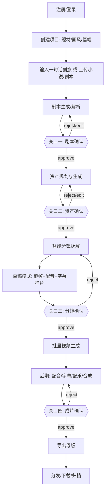

**计费发生点**（与上图对应）：`D` 剧本生成、`E` 资产生成、`G` 草稿模式、`I` 视频生成、`J` 后期合成、`K` 高清导出 —— 共 6 个消耗点，每个消耗点入口必过冻结节点。

## 4.2 四个 HITL 关口（人工介入点）

| 关口 | 编号 | 确认对象 | 用户可选动作 | 拒绝后的回流目标 | 默认超时 |
|---|---|---|---|---|---|
| 关口一 | H1 | 结构化剧本（分集大纲 + 场次 + 对白） | approve / reject(带反馈) / edit(手工编辑) | 编剧 Agent 局部改写 | 24h 提示，7 天过期 |
| 关口二 | H2 | 角色卡片墙（主形象 + 三视图 + 表情集）与场景资产 | approve / reject(带反馈) / 重抽 / 逐资产操作 | 美术 Agent 重生成 | 同上 |
| 关口三 | H3 | 分镜画布 + 草稿样片 | approve / reject(带反馈) / 画布编辑 | 导演 Agent 重新拆解 | 同上 |
| 关口四 | H4 | 成片预览（带水印） | approve / reject(带反馈) | 后期 Agent 重做 | 同上 |

**统一次关口规则**

| 编号 | 规则 |
|---|---|
| HR-1 | 一次 reject 必须携带反馈文本（≥ 10 字，前端校验），空反馈不允许提交 |
| HR-2 | reject 反馈写入 `human_feedback`，作为下一轮 Agent 的输入，不做丢弃 |
| HR-3 | 同一关口连续 reject 达 3 次，系统提示"建议修改生成参数/更换模型"，并展示历史反馈汇总 |
| HR-4 | 关口等待期间项目状态为 `*_review`，此状态下禁止进入下一阶段接口（返回 `40001`） |
| HR-5 | 审批动作幂等：同一审批单重复 approve 只生效一次（`approval_requests` 状态机守卫） |

## 4.3 全局业务规则

| 编号 | 规则 | 说明 |
|---|---|---|
| GR-1 | 项目状态机唯一性 | 项目任一时刻只能处于 `ProjectStatus` 的一个状态，状态流转必须走白名单（见 00 契约 6.1） |
| GR-2 | 上游锁定即下游解锁 | 剧本改动 → 受影响场次分镜解锁；资产锚点更换 → 受影响镜头解锁并提示"影响 N 个镜头" |
| GR-3 | 冻结上限 = 可用余额 | 并发场景下不允许冻结超过余额，防止透支 |
| GR-4 | 失败全额返还 | 因平台原因（模型失败、审核拒绝）导致的失败，冻结积分全额解冻返还 |
| GR-5 | 重试次数上限 | 单任务自动重试 ≤ 2 次；质检修正循环 ≤ 3 轮；超限转"待人工"清单 |
| GR-6 | 幂等优先于重试 | 任何重试前先查幂等键，命中则直接返回历史结果 |
| GR-7 | 审核不可绕过 | 内容安全判定为 `block` 时终止流程并明确告知，不提供"重试绕过"入口 |
| GR-8 | 一切产物可追溯 | 每次生成记录：模型、参数、单价、耗时、操作者、trace_id |
| GR-9 | 审核前置优先 | 剧本与画面审核尽量前置到生成前，降低返工成本 |
| GR-10 | 时间与金额口径统一 | 时间存 UTC、展示按用户时区；积分与金额均为整数最小单位，禁止浮点 |

---

# 第 5 章 功能需求

> **需求 ID 规范**：`US-<Feature>-<序号>` 用户故事，`AC-<Feature>-<序号>-<子号>` 验收标准，`EX-<Feature>-<序号>` 边界异常。所有验收标准采用 Given/When/Then 三段式，必须可通过测试判定。

---

## F1 账号、计费与权限

### F1.1 目标

让用户可信地进入系统，让每一次算力消耗都有账可查、有据可依、失败可退。

### F1.2 用户故事与验收标准

| ID | 用户故事 | 优先级 |
|---|---|---|
| US-F1-01 | 作为新用户，我希望用手机号 + 验证码快速注册，以便立刻开始创作 | M |
| US-F1-02 | 作为新用户，我希望微信扫码一键登录，以便免去注册流程 | M |
| US-F1-03 | 作为新用户，我希望注册即获赠积分，以便零成本体验全流程 | M |
| US-F1-04 | 作为用户，我希望在生成前看到本次消耗的预估积分，以便决定是否执行 | M |
| US-F1-05 | 作为用户，我希望生成失败时积分自动返还，以便不为无效结果付费 | M |
| US-F1-06 | 作为用户，我希望查看完整的积分流水，以便核对每一笔消耗 | M |
| US-F1-07 | 作为用户，我希望订阅套餐获得更多额度与权益，以便长期使用 | M |
| US-F1-08 | 作为团队管理员，我希望从团队池划拨预算给项目，以便控制成本（P1） | P1 |
| US-F1-09 | 作为用户，我希望为单个项目设置积分上限，以便防止误操作烧钱 | M |

**验收标准**

| ID | 验收标准（Given / When / Then） |
|---|---|
| AC-F1-01-1 | Given 未注册手机号，When 输入验证码并提交注册，Then 事务内创建用户与积分账户，账户余额 = 500 积分，且产生一条 `transaction_type = grant` 的流水 |
| AC-F1-01-2 | Given 同一手机号 60 秒内第 2 次请求验证码，When 提交，Then 返回 `10004 请求过于频繁`，且不发送短信 |
| AC-F1-01-3 | Given 同一设备 24 小时内注册请求超过阈值（默认 3 次），When 再次提交，Then 触发风控拒绝，返回明确提示且写入 `audit_logs` |
| AC-F1-02-1 | Given 微信授权成功且 unionid 未绑定，When 回调完成，Then 创建用户 + `user_identities` 记录 + 积分账户，一次性完成 |
| AC-F1-02-2 | Given unionid 已绑定既有用户，When 再次微信登录，Then 直接登录既有账号，不创建新用户 |
| AC-F1-04-1 | Given 项目余额 1000 积分，When 用户发起一次预估 1200 积分的生成请求，Then 返回 `30001 积分不足`，不扣费、不创建任务，并返回充值引导字段 |
| AC-F1-04-2 | Given 预估成本已展示，When 用户确认生成，Then 冻结积分 = 预估值，`credit_freezes` 新增记录，`credit_accounts.frozen_credits` 增加 |
| AC-F1-05-1 | Given 某任务已冻结 100 积分且执行失败（失败类型 = 模型不可用），When 结算流程执行，Then 冻结全额释放，账户可用余额恢复，产生 `unfreeze` 流水 |
| AC-F1-05-2 | Given 某任务部分镜头成功、部分失败，When 结算执行，Then 仅按成功镜头实际消耗结算，失败部分解冻返还 |
| AC-F1-06-1 | Given 用户有 137 条流水，When 按 `transaction_type = settle` 筛选并翻页，Then 返回正确分页结果且总数为筛选后数量 |
| AC-F1-07-1 | Given 用户购买 pro 套餐，When 支付回调成功，Then 订阅生效、权益位（并发数、4K、去水印）更新，且同一 `out_trade_no` 的重复回调被丢弃且仍返回成功 |
| AC-F1-09-1 | Given 项目预算 2000 积分已消耗 1900，When 发起预估 300 积分的任务，Then 拒绝执行并返回 `30002 预算超限`，同时不影响账户在其它项目的可用余额 |

### F1.3 详细流程

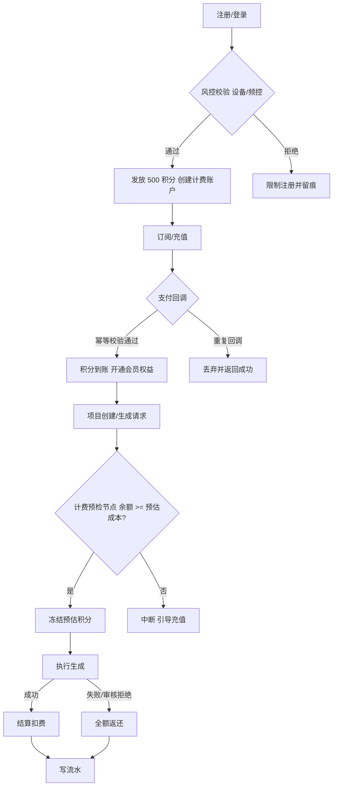

### F1.4 流程步骤

| 步骤 | 处理方 | 说明 |
|---|---|---|
| S1 | 确定性服务 | 登录风控：同设备/手机号频控；微信登录换取 unionid |
| S2 | 计费服务 | 事务内创建账户 + 发积分，杜绝并发重复发放 |
| S3 | 支付网关 + 回调 | 回调以 `out_trade_no` 幂等；到账延迟目标 < 1 分钟 |
| S4 | LangGraph 计费节点 | 每个消耗型子图入口预检 → 冻结；子图完成（或失败）后结算/返还。**LLM Agent 不接触扣费逻辑，只上报 `estimated_cost`** |
| S5 | 审计 | 流水含 `project_id`、任务类型、模型、时长、单价、消耗、冻结/结算/返还状态 |

### F1.5 状态机（订单与积分）

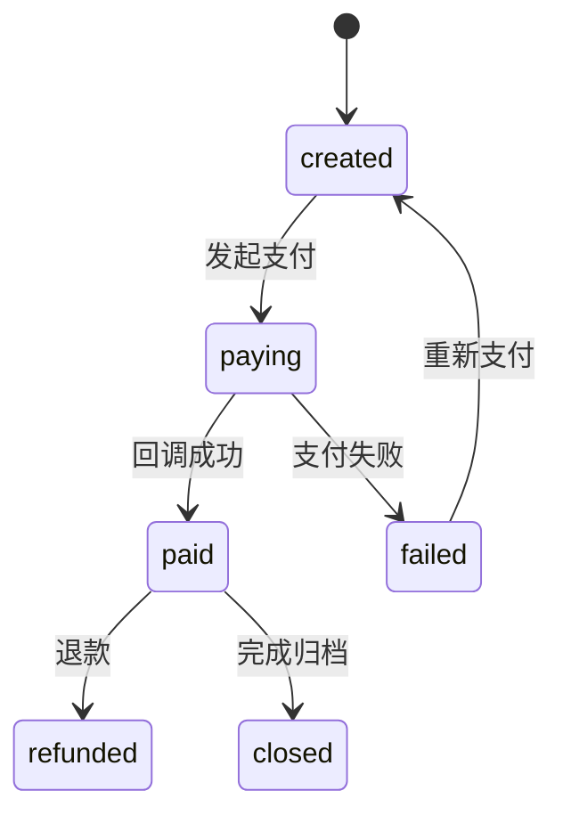

积分账户视角：`可用余额 = 总额度 - 冻结额 - 已消耗`；冻结记录的独立生命周期：`frozen → settled` 或 `frozen → unfrozen`（30 分钟未结算自动解冻并告警）。

### F1.6 边界与异常六查

| 类别 | 场景 | 期望行为 |
|---|---|---|
| 空态 | 用户无任何流水 | 展示空态文案 + "去充值"主按钮，不展示空白表格 |
| 极值 | 单笔充值金额超大 / 积分余额极大 | 金额上限与下限由 `plans` 与配置校验，超限返回 `10001`；余额使用 `BIGINT` 不受溢出影响 |
| 并发 | 同一用户同时发起 5 个生成任务 | 冻结上限 = 可用余额；超出部分返回 `30001`；并发数受套餐限制（free 2 / pro 5 / studio 10） |
| 失败 | 支付回调丢失 | T+1 主动对账任务拉取网关账单补单，补单幂等；用户端显示"到账处理中" |
| 失败 | 生成中服务重启 | 冻结记录已持久化，重启后按 `ProjectState` 恢复结算；不允许出现"扣了钱没结果" |
| 权限 | 成员 A 访问成员 B 的项目 | 编排器层拦截，返回 `20003 无权限`，Agent 工具链不得触碰该资源，写 `audit_logs` |
| 幂等 | 支付回调重复推送 | 以 `out_trade_no` 唯一索引判重，重复请求直接返回成功，不重复入账 |
| 幂等 | 同一生成请求重复提交 | `Idempotency-Key` 命中则返回首次结果，不重复冻结与生成 |

### F1.7 埋点

`user_register_success`、`user_login_success`、`sms_code_sent`、`paywall_shown`（含 trigger 来源：余额不足/权益不足）、`order_created`、`payment_succeeded`、`credit_freeze_created`、`credit_settle_finished`、`credit_refund_finished`、`budget_exceeded_blocked`。

---

## F2 剧本模块

### F2.1 目标

让用户在 10 分钟内得到"叙事成立、结构合规、可分集拍摄"的剧本，且允许以最低成本修正。

### F2.2 用户故事与验收标准

| ID | 用户故事 | 优先级 |
|---|---|---|
| US-F2-01 | 作为创作者，我希望输入一句话就生成完整剧本，以便零门槛启动 | M |
| US-F2-02 | 作为已有小说或剧本的用户，我希望直接上传文档并能被结构化解析，以便复用已有内容 | M |
| US-F2-03 | 作为用户，我希望上传的小说或剧本解析后标出"不确定的字段"，以便我重点核对 | M |
| US-F2-04 | 作为用户，我希望能逐集确认剧本，并只重写不满意的部分，以便省时省钱 | M |
| US-F2-05 | 作为用户，我希望剧本自带分集与结尾钩子建议，以便适配短剧节奏 | M |
| US-F2-06 | 作为用户，我希望在生成前就知道剧本是否有合规风险，以便避免白做 | M |
| US-F2-07 | 作为用户，我希望手工编辑剧本，以便融入我的创作意图 | M |
| US-F2-08 | 作为已有剧本的用户，我希望在已确认剧本基础上续写新集或扩写某场戏，以便系列化创作而不必从零新建项目 | M |
| US-F2-09 | 作为新用户，我希望从"题材 × 画风"组合模板库一键带入生成参数，以便不必从空白参数开始 | P1 |
| US-F2-10 | 作为用户，我希望把剧本导出为 md/docx/txt 文档，以便线下分享与备份 | M |
| US-F2-11 | 作为用户，我希望对比剧本任意两个版本并恢复历史版本，以便改乱后能回来 | M |
| US-F2-12 | 作为用户，我希望在逐集生成中途终止并保留已完成集，以便方向错了能及时止损 | M |

**验收标准**

| ID | 验收标准 |
|---|---|
| AC-F2-01-1 | Given 用户输入一句话创意并选择题材/字数/风格/结局走向，When 提交生成，Then 先产出 `write_todos` 计划并可见（大纲 → 人物 → 分集 → 对白），随后逐集写入 `/project/script/ep{n}.md` 并同步结构化 `script` 对象 |
| AC-F2-01-2 | Given 生成进行中，When 用户刷新页面，Then 进度不丢失，可继续查看（状态服务端持久化） |
| AC-F2-02-1 | Given 用户上传 10 万字小说或剧本（txt/docx/pdf），When 解析完成，Then 输出结构化"集-场-角色-对白/旁白/动作"，且每个字段带置信度 |
| AC-F2-02-2 | Given 上传的小说或剧本为扫描件图片 PDF，When 解析执行，Then 走 OCR 分支，整体置信度降档并在 UI 显式提示 |
| AC-F2-03-1 | Given 某字段置信度低于阈值（默认 0.75），When 解析完成，Then 该字段标记为"待人工校正"并高亮，剧本状态为 `needs_manual_fix` |
| AC-F2-04-1 | Given 用户 reject 第 3 集并给出反馈，When 系统执行局部改写，Then 仅重生成受影响的场次，其余集引用原版本不被改动（可通过版本 diff 验证） |
| AC-F2-05-1 | Given 剧本已确认，When 执行分集拆分，Then 每集标注预估时长（1–3 分钟）与"结尾钩子"建议，写入 `episodes` |
| AC-F2-06-1 | Given 剧本含敏感内容（涉政/色情/未成年人/侵权），When 前置审核执行，Then 返回"位置 + 风险等级 + 修改建议"；等级为 `block` 时终止流程且不提供绕过入口 |
| AC-F2-07-1 | Given 用户手工编辑某场对白并保存，When 保存成功，Then 产生新剧本版本，旧版本保留可对比 |
| AC-F2-08-1 | Given 项目剧本已确认（`confirmed`/`locked`）且总集数 < 30，When 用户选择"续写 N 集"并输入续写要点，Then 编剧 Agent 仅基于既有大纲与最后一集生成第 n+1 集起的新集，原集内容零改动（版本 diff 为空可判定） |
| AC-F2-08-2 | Given 用户选中第 3 集某场次并输入扩写指令（≤ 200 字），When 扩写完成，Then 仅该场次产生新版本，且该集预估时长变化触发"分集时长重算"提示（不自动改分集边界） |
| AC-F2-08-3 | Given 续写后总集数将 > 30，When 提交续写请求，Then 拒绝并返回 `10001`，提示当前集数与上限 |
| AC-F2-09-1 | Given 用户进入项目创建参数页，When 展开"组合模板库"，Then 展示 ≥ 8 个预设包（题材 + 画风 + 默认单集字数 + 节奏倾向 + 结局走向），每个含 1 句适用说明【假设待验证：初始模板数量与题材覆盖】 |
| AC-F2-09-2 | Given 用户点选某模板包，When 参数回填，Then 被填充字段高亮且可覆盖；任一字段被手改后显示"已偏离预设"标记 |
| AC-F2-09-3 | Given 某模板包已被下线，When 用户打开引用它的历史项目，Then 项目参数保留原值，不因模板下线而变化 |
| AC-F2-10-1 | Given 剧本存在任一版本，When 用户选择导出格式（md / docx / txt），Then 按"集-场-对白/旁白/动作"结构生成文件并触发下载，文件名 = `{项目名}-剧本-{版本号}`，导出免费 |
| AC-F2-10-2 | Given 剧本状态为 `needs_manual_fix`，When 执行导出，Then 文件首行插入"⚠ 本版本含待人工校正字段（N 处）"提示 |
| AC-F2-10-3 | Given 项目无任何剧本内容，When 用户打开导出入口，Then 入口禁用并显示空态文案"生成或上传剧本后可导出" |
| AC-F2-11-1 | Given 剧本存在 ≥ 2 个版本，When 用户任选 2 版对比，Then 展示按场次维度的 diff（新增/删除/修改三色标注）+ 两版集数与字数统计差异 |
| AC-F2-11-2 | Given 用户在历史版本上点击"设为当前"，When 二次确认通过，Then 以该版本内容生成新版本（版本号 +1），版本链不破坏，原历史版本仍可访问 |
| AC-F2-11-3 | Given 剧本版本数已达上限 30，When 保存新版本，Then 按时间淘汰最旧的未被确认为"当前"的版本并提示【假设待验证：淘汰规则与 F8 快照策略对齐】 |
| AC-F2-12-1 | Given 逐集生成进行至第 k 集，When 用户点击"终止生成"并二次确认，Then 第 k+1 集起不再生成，已完成 k 集保留为 `draft`，未执行部分预估积分解冻返还 |
| AC-F2-12-2 | Given 终止请求与"第 k 集写入完成"事件竞态，When 二者几乎同时到达，Then 以先持久化者为准，按实际完成集数结算且不重复扣费（幂等键 = `project_id + script_run_id`） |
| AC-F2-12-3 | Given 用户终止后重新发起生成，When 提交新请求，Then 必须使用新 `Idempotency-Key`，并提供"保留已完成集，只生成缺集"选项（默认勾选） |
| AC-F2-01-3 | Given 一句话创意输入框，When 用户输入，Then 字段 `creative_text` 长度限制 5–500 字，实时计数；为空或超限时生成按钮禁用并提示（空态/极值） |
| AC-F2-01-4 | Given 逐集生成进行中，When 第 n 集写入完成，Then 集列表该集即时点亮"可阅读"，用户可点开阅读并添加备注（备注写入 `human_feedback`，非必填、不阻塞生成）（交互级） |
| AC-F2-01-5 | Given 编剧 Agent `write_todos` 执行，When 每个节点完成，Then 前端以 SSE 收到 `todo_updated` 事件（字段：`todo_id / node_name / status / elapsed_ms`），计划页无请求轮询 |
| AC-F2-02-3 | Given 用户选择上传，When 文件进入解析前，Then 执行 ≤ 30s 预检：格式白名单（txt/docx/pdf）、大小 ≤ 50MB、字数 ≤ 20 万字；超限直接打回 `10001` 不进入解析不计费（数值级） |
| AC-F2-02-4 | Given 上传为扫描件 PDF 且走 OCR 分支，When 解析完成，Then 整体置信度按字段置信度均值 × 0.9 折算【假设待验证：折算系数】，UI 顶部展示"扫描件解析，建议逐场核对"横幅 |
| AC-F2-03-2 | Given 某字段置信度 < 0.75 被标记待校正，When 用户修改该字段并保存，Then 该字段置信度置为 1.0（人工确认），全部待校正字段清零后剧本状态从 `needs_manual_fix` 回到 `draft` |
| AC-F2-03-3 | Given 待校正字段 > 50 处【假设待验证：阈值】，When 解析完成，Then 追加提示"低置信度字段过多，建议检查原文质量或重新上传更清晰的文件" |
| AC-F2-04-2 | Given 用户对第 2 集发起局部改写，When 提交指令，Then 改写范围默认锁定为单集（跨集改写需逐集发起）；反馈文本长度限制 5–200 字 |
| AC-F2-04-3 | Given 局部改写提交前，When 展示确认卡片，Then 显示受影响场次列表与预估 token 成本（计入剧本生成预估），确认后执行 |
| AC-F2-05-2 | Given 分集拆分执行，When 写入 `episodes`，Then 每集字段包含 `ep_no / title / hook_suggestion（≤ 50 字）/ est_duration_sec（60–180）`，钩子建议可被用户编辑后保存 |
| AC-F2-05-3 | Given 某集预估时长 > 180s，When 拆分完成，Then 该集标记黄色警示"建议拆分"，不阻断（分集边界可由用户手动调整后重新估算） |
| AC-F2-06-2 | Given 前置审核输出，When 结果返回，Then 风险等级枚举为 `block / review / info`【假设待验证：是否需要 info 级】：`block` 终止流程无绕过入口；`review` 逐条处理后可重新提交；`info` 仅提示不阻塞 |
| AC-F2-06-3 | Given 审核服务超时，When 重试 2 次（1s / 4s 退避）仍失败，Then 流程暂停（**不默认放行**），用户看到"审核服务暂不可用，已为你保存进度，稍后可一键重试"，恢复后从暂停点续跑 |
| AC-F2-07-2 | Given 用户在编辑器内编辑，When 按下 Ctrl+Z / Ctrl+Shift+Z，Then 撤销/重做生效，会话内步骤栈 ≥ 100 步【假设待验证：内存占用】；页面崩溃后恢复到最后一次自动保存草稿（间隔 10s） |
| AC-F2-07-3 | Given 两个成员（P1 团队）同时编辑同一场次，When 后保存者提交，Then 返回冲突提示并展示双方内容对比，后写者须选择"覆盖 / 基于最新重改"，不静默覆盖 |
| AC-F2-07-4 | Given 用户编辑 `speaker` 字段，When 保存，Then 触发剧本 Schema 校验：对白归属角色必须存在于人物表，否则保存失败并定位到该行 |

### F2.3 详细流程

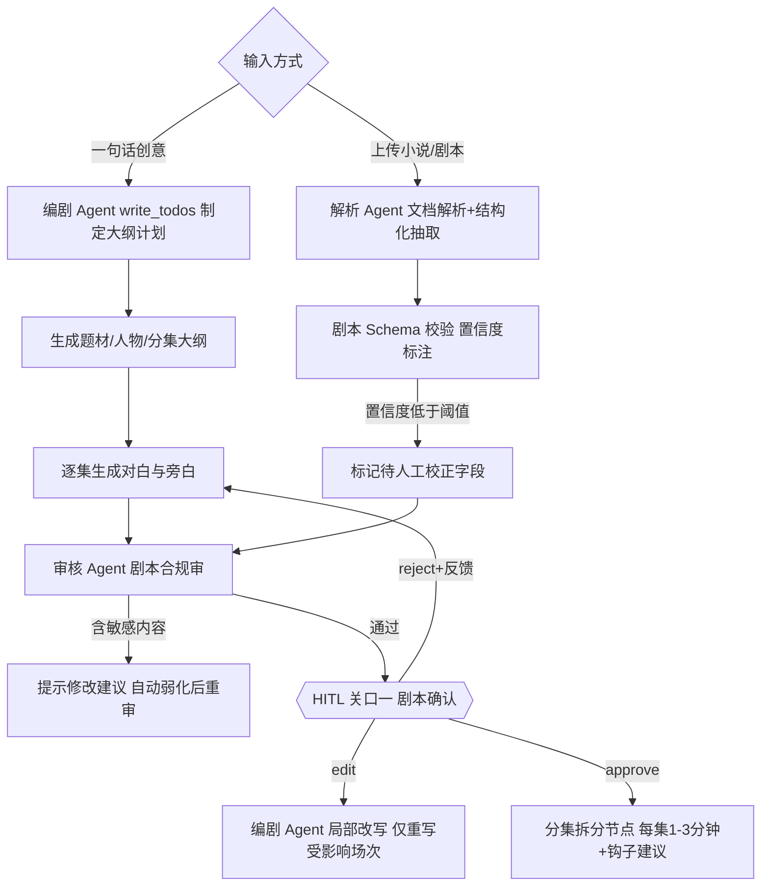

### F2.4 流程步骤

| 步骤 | Agent/节点 | 说明 |
|---|---|---|
| S1 | 编剧 Agent | 接收题材、字数、风格、结局走向。先 `write_todos`（大纲 → 人物 → 分集 → 对白），计划对用户实时可见 |
| S2 | 编剧 Agent | 逐集生成，每集写入 `/project/script/ep{n}.md`，同时维护结构化 `Script` 对象 |
| S3 | 解析 Agent | 上传 10 万字小说/剧本：分段解析 → 合并去重角色 → 场序还原；输出字段级置信度（角色归属/对白边界最易错） |
| S4 | 确定性校验节点 | 按剧本 Schema（集-场-角色-对白/旁白/动作）校验，非法结构直接打回 Agent 自修，不进入人工环节 |
| S5 | 审核 Agent | 前置审核（比生成后审省 90% 成本）：涉政/色情/未成年人/侵权要素扫描，输出"位置 + 风险等级 + 修改建议" |
| S6 | HITL 中断 | 用户可 approve / reject(反馈) / edit。LangGraph `interrupt()` 挂起，反馈写入 `human_feedback` 后从 reject 边重入 |
| S7 | 编剧 Agent | 局部改写：仅重生成受影响场次，其余内容引用原版本（省 token、保一致性） |
| S8 | 分集拆分节点 | 按目标单集时长估算场次，为每集生成"结尾钩子"建议，写入 `episodes` |

### F2.5 状态机

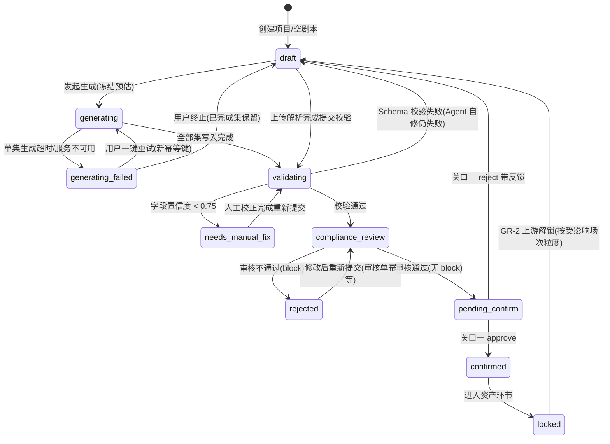

> **V4.0 细化说明**：新增 `generating`（逐集生成中，支撑 AC-F2-01-2 刷新恢复与 AC-F2-12-1 终止保留）与 `generating_failed`（单集重试耗尽）两个显式状态；`locked → draft` 解锁粒度明确为"按受影响场次"。与 ProjectStatus 映射：`draft/generating/generating_failed → SCRIPT_DRAFTING`；`validating/needs_manual_fix/rejected → SCRIPT_VALIDATING`；`compliance_review → SCRIPT_REVIEWING`；`pending_confirm → AWAITING_GATE_1`；`confirmed/locked → SCRIPT_LOCKED`【假设待验证：枚举名以 00 契约为准】。

### F2.6 边界与异常六查

| 类别 | 场景 | 期望行为 |
|---|---|---|
| 空态 | 用户未输入创意也未上传小说/剧本 | 生成按钮禁用，提示两种输入方式；不允许空提交 |
| 极值 | 生成分集超长/超字数（如要求 20 集 × 5 万字） | 校验节点打回，编剧 Agent 按场次裁剪；单项目 > 30 集返回 `10001`（Q6） |
| 极值 | 上传文件超限（> 50MB 或 > 20 万字） | 前置校验打回 `10001`，提示拆分上传 |
| 并发 | 用户连续点击"生成剧本" | `Idempotency-Key` 去重，仅一个任务生效 |
| 失败 | 解析文档为乱码/加密 PDF | 返回明确失败原因，不进入人工环节，不扣费 |
| 失败 | 审核服务超时不可用 | 重试 ≤ 2 次；仍失败则暂停流程并提示"审核服务不可用，稍后重试"（**不默认放行**） |
| 权限 | `view` 权限成员尝试编辑剧本 | 服务端拒绝返回 `20003`，前端编辑器置为只读 |
| 幂等 | 同一剧本重复提交审核 | 审核单幂等，不重复消耗审核额度 |
| 幂等 | 局部改写重复触发 | 幂等键命中返回历史结果，不重复消耗 token |
| 空态 | 剧本已确认后用户再次进入 | 展示已确认版本 + 只读标记 + "申请修改"入口（触发解锁流程） |

### F2.7 埋点

`script_input_method_selected`（一句话/上传小说或剧本）、`script_generation_started`、`script_generation_completed`（含耗时、字数、集数）、`script_parse_completed`（含整体置信度）、`script_low_confidence_field_fixed`、`script_rejected`（含反馈文本长度、次数）、`script_approved`、`script_manual_edit_saved`、`compliance_flagged`（含类型与等级）。

**V4.0 新增埋点**：`script_template_applied`（template_id、偏离字段数 → M1/M3）、`script_generation_cancelled`（已完成集数、返还积分 → M5）、`script_generation_failed`（失败集号、失败类型 → M6）、`script_early_read_used`（→ M2 拆解）、`script_version_compare_used`（→ M3）、`script_export_triggered`（格式、版本号 → CCCR）、`script_continuation_started`（续写集数 → 系列化留存）。

### F2.8 编剧 Agent 内部工作流（V4.0 新增）

| 项 | 规格 |
|---|---|
| 输入契约（读取 ProjectState） | `script_brief`（`creative_text` 或上传文档引用 `uploaded_doc_ref`，二选一必填）、`params{genre, art_style, episode_target, word_target, ending}`、`style_template_id`（可选）、`human_feedback`（reject/edit 重入时必读） |
| 输入缺失降级 | `episode_target` 缺失 → 按单集 1–3 分钟与总字数自动估算集数并在计划页说明【假设待验证】；`art_style` 缺失 → 默认"真人感"；`creative_text` 与上传并存 → 不执行，返回让用户选择输入方式 |
| 输出契约（Script JSON 关键字段） | `project_id / version_id / episodes[{ep_no, title, hook_suggestion, est_duration_sec, scenes[{scene_no, location, int_ext, tod(时段), characters[], dialogues[{speaker, text, emotion_hint}], narrations[], actions[]}]}] / confidence{field_scores} / todos_status` |
| 自检循环 | ① Schema 校验失败 → Agent 自修（重新结构化）≤ 2 轮 → 仍失败置 `draft` 并记录失败原因；② 审核 `review` 级 → 自动弱化改写后重审 ≤ 1 轮，仍命中则交人工逐条处理（不自动放行）；③ 字段置信度必检项：对白归属/场序 |
| 人工反馈注入 | reject 反馈写入 `human_feedback`，结构化建议：`{scope: {ep_no, scene_no[]}, action: "rewrite"|"tone_fix"|"plot_fix", text, source: "gate_1"}`；注入位置：编剧 Agent 修订轮系统提示的「修订指令」区块，未命中 scope 的场次标记"引用原版本不得改动" |

### F2.9 异常决策树（V4.0 新增，六查升级为 EX 场景）

> 通用基线：同步工具调用超时 10s + 指数退避 1s/4s 重试 ≤ 2 次；F2 专用：编剧单集生成 90s/集【假设待验证】，重试 30s → 120s。所有重试幂等、不重复计费（GR-6）。

| EX 编号 | 场景 | 检测点 | 处置动作 | 用户可见反馈 | 计费影响 | 审计 |
|---|---|---|---|---|---|---|
| EX-F2-01 | 空提交（无创意无上传） | 前端参数校验 | 禁用按钮，不发请求 | 两种输入方式引导 | 无 | 否 |
| EX-F2-02 | 分集超限（> 30 集） | 提交参数校验节点 | 拒绝 | `10001` + 当前集数/上限 | 无冻结 | 是 |
| EX-F2-03 | 上传超限（> 50MB / > 20 万字） | 上传预检 | 打回并提示拆分 | `10001` | 无 | 否 |
| EX-F2-04 | 乱码 / 加密 PDF | 解析 Agent 首段探测 | 终止解析 | 明确失败原因 | 已冻结预估全额解冻 | 是 |
| EX-F2-05 | 单集生成超时 | 编剧子任务超时监控 | 重试 2 次 → `generating_failed` | 进度页标红该集 + 一键重试 | 未完成集按实际结算/解冻 | 是 |
| EX-F2-06 | 审核服务不可用 | 审核 API 超时 × 2 | 流程暂停（不放行） | "审核服务暂不可用，可稍后重试" | 冻结保留，恢复后续跑 | 是 |
| EX-F2-07 | 并发双击生成 | `Idempotency-Key` 去重 | 仅一个任务生效 | 首个任务进度页 | 单次冻结 | 否 |
| EX-F2-08 | 重复提交审核 | 审核单幂等键（版本号 + 内容 hash） | 返回已有审核单 | 无感知 | 不重复扣审核额度 | 否 |
| EX-F2-09 | `view` 成员编辑 | 服务端 ACL 中间件 | 拒绝 `20003`，编辑器只读 | 权限提示 | 无 | 是（越权尝试） |
| EX-F2-10 | 确认后再次进入 | 状态查询 | 只读视图 + "申请修改"入口 | 已确认版本标记 | 无 | 否 |
| EX-F2-11 | 局部改写重复触发 | 改写幂等键（场次 + 指令 hash） | 命中返回历史结果 | 无感知 | 不重复消耗 token | 否 |
| EX-F2-12 | 生成中用户关闭页面 | 服务端任务继续执行 | 回来后状态完整恢复（AC-F2-01-2） | 进度不丢失 | 不变 | 否 |

### F2.10 界面交互要点（V4.0 新增）

1. **生成进度页**：`write_todos` 计划置顶（四节点状态条），集列表左"完成 ✓ / 生成中 ⟳ / 排队 ·"三态图标；已完成集卡片右上 💬 备注入口；终止按钮固定右下角，二次确认显示"将保留 X 集，返还约 Y 积分"。
2. **解析预检卡片**：文件名 / 字数 / 章节估计 / 预计耗时 / 预估积分五行 + "开始解析"主按钮；预检失败整卡红色、无主按钮。
3. **审核结果清单**：顶部"n/m 已处理"进度条；每条含定位链接（点击跳转编辑器并黄色高亮问题文本）与"已处理"勾选；`block` 项红色且无勾选框。
4. **版本对比页**：左版本选择器、中 diff 正文（三色）、右统计卡（字数/集数）；"设为当前"右下角红色描边 + 二次确认。
5. **空态文案**：剧本空态——"用一句话开始，或上传你已有的小说/剧本"；版本空态——"还没有历史版本，第一次保存后即可对比"。

---

## F3 资产模块

### F3.1 目标

让角色在跨镜头、跨集、甚至跨项目时被稳定识别为"同一个人"，并让用户对形象有决定权。

### F3.2 用户故事与验收标准

| ID | 用户故事 | 优先级 |
|---|---|---|
| US-F3-01 | 作为用户，我希望系统自动从剧本提取角色/场景/道具清单，以便不用手工整理 | M |
| US-F3-02 | 作为用户，我希望角色生成主形象 + 三视图 + 表情集，以便后续镜头保持一致 | M |
| US-F3-03 | 作为用户，我希望不满意的角色能"带反馈重抽"，以便不反复盲抽 | M |
| US-F3-04 | 作为用户，我希望为角色绑定音色，以便全剧配音统一 | M |
| US-F3-05 | 作为用户，我希望用真人照片定制角色，并完成授权确认，以便合规使用 | M |
| US-F3-06 | 作为用户，我希望角色资产能跨项目复用，以便打造系列剧（P1） | P1 |
| US-F3-07 | 作为用户，我希望知道角色一致性是否达标，以便决定是否继续 | M |
| US-F3-08 | 作为用户，我希望为场景资产生成时段/季节变体（白天/夜晚/雨天），以便不同剧情时段画面连贯 | M |
| US-F3-09 | 作为用户，我希望为关键道具生成特写资产，以便插入镜头有稳定参照 | P1 |
| US-F3-10 | 作为用户，我希望对多个角色应用同一条重抽反馈批量重抽，以便不用逐个操作 | M |
| US-F3-11 | 作为用户，我希望给资产打标签并按名称/标签搜索，以便角色多的项目快速定位 | P1 |
| US-F3-12 | 作为用户，我希望查看和管理我的真人授权记录（含撤回），以便合规可控（P1） | P1 |

**验收标准**

| ID | 验收标准 |
|---|---|
| AC-F3-01-1 | Given 剧本已锁定，When 资产规划执行，Then 输出角色清单（含年龄/外形描写/戏份权重）、场景清单（内外/时代/时段）、关键道具，并按戏份权重给出生成优先级 |
| AC-F3-02-1 | Given 用户选定画风预设，When 生成角色资产，Then 依次产出主形象、正/侧/背三视图、表情集（≥ 5 种情绪），全过程在同一自检循环内 |
| AC-F3-02-2 | Given 生成完成，When 质检执行，Then 三视图与主形象的人脸 embedding 余弦相似度 `face_score` ≥ 阈值（默认 0.80，可用配置覆盖，见 00 契约 §6.8），否则判定不合格 |
| AC-F3-03-1 | Given 用户对角色 A 点击 reject 并输入"太老、换发型"，When 重新生成，Then 新版本创建为独立 `asset_version`，旧版本保留可对比，反馈文本进入生成参数 |
| AC-F3-04-1 | Given 角色 A 与音色 V 绑定，When 全剧 TTS 执行，Then 角色 A 的所有台词统一使用音色 V；音色下架时提示替换 |
| AC-F3-05-1 | Given 用户上传真人照片，When 授权流程执行，Then 先做人脸质量校验，再做公共人物库比对；若命中相似真人脸，则强制二次确认 + 授权书留痕（时间戳/IP/协议版本）写入 `face_authorizations` |
| AC-F3-05-2 | Given 用户未完成授权确认，When 尝试用该角色生成镜头，Then 拒绝并返回 `50003 未完成真人授权` |
| AC-F3-07-1 | Given 某角色跨 50 个镜头生成完毕，When 质检抽检执行，Then 人脸相似度达标率 ≥ 95%，不达标镜头进入"待人工"清单 |
| AC-F3-08-1 | Given 场景清单含某场景（内外/时代/时段），When 用户为该场景勾选变体（时段：晨/昼/黄昏/夜；天气：晴/雨/雪，最多各选 2 项【假设待验证】），Then 每个变体生成独立 `asset_version` 并以场景 × 变体命名 |
| AC-F3-08-2 | Given 分镜引用某场景的"夜"变体，When 该变体未生成，Then 分镜质检报"场景变体缺失"并引导一键生成，不阻塞其它镜头 |
| AC-F3-09-1 | Given 资产清单标记某道具为"关键道具"（出场 ≥ 3 场【假设待验证：判定规则】），When 生成执行，Then 该道具生成正/侧 2 张特写图，纳入质检与锁定流程 |
| AC-F3-09-2 | Given 用户手动追加道具特写请求，When 提交，Then 按单资产计费并进入同一资产库目录 `/assets/props/` |
| AC-F3-10-1 | Given 用户多选 5 个角色并输入同一条重抽反馈，When 确认执行，Then 展示"N 个角色 × 单价 = 预估积分"并逐角色独立执行（独立版本与质检循环），单角色失败不阻塞其余 |
| AC-F3-10-2 | Given 批量重抽执行中，When 某角色命中"命中公共人物库"拦截，Then 仅该角色终止并说明原因，其余继续 |
| AC-F3-11-1 | Given 项目含 > 10 个资产【假设待验证：搜索入口出现阈值】，When 用户在资产墙顶部搜索框输入，Then 按 `name / label` 前缀匹配过滤（标签为多选 AND），500ms 内返回【假设待验证：前端过滤即可满足】 |
| AC-F3-11-2 | Given 用户给资产打标签，When 保存，Then 标签数上限 10 个/资产、单标签 ≤ 12 字 |
| AC-F3-12-1 | Given 用户存在真人授权记录，When 打开"真人授权记录"页，Then 列出角色、授权时间、IP、协议版本、状态（`active/revoked`） |
| AC-F3-12-2 | Given 用户对某角色执行"撤回授权"，When 输入角色名二次确认，Then 该角色状态置 `revoked`、禁止发起新的镜头生成（返回 `50003`，`error_detail = authorization_revoked`），已生成内容保留，撤回写入 `audit_logs` |
| AC-F3-12-3 | Given 被撤回角色存在进行中的生成任务，When 撤回生效，Then 进行中任务照常完成并结算（已冻结），后续新任务被拒 |
| AC-F3-01-2 | Given 资产规划执行，When 输出清单，Then 每个角色含 `name / age_desc / appearance / screen_weight(0–1, 两位小数) / voice_gender_hint`；场景含 `int_ext / era / tod`；戏份权重 = 角色对白场次数 ÷ 总场次数（保留两位小数），按权重降序生成【假设待验证：权重公式】 |
| AC-F3-01-3 | Given 提取角色数 > 30，When 规划完成，Then 提示超限并按戏份权重排序给出"前 30 优先生成"的分批建议，其余置为 `pending` |
| AC-F3-02-3 | Given 主形象生成，When 输出，Then 主形象为 1024×1024 PNG【假设待验证：分辨率与格式，依模型能力】；三视图为同分辨率竖排三联图，均可单独下载 |
| AC-F3-02-4 | Given 三视图逐张质检，When 任一视图 `face_score` < 0.80，Then 仅重生成该视图（不重跑主形象），并附具体视图名与得分返回美术 Agent |
| AC-F3-03-2 | Given 用户对角色发起重抽，When 确认弹窗展示，Then 显示"本次预估 X 积分 + 该角色已累计消耗 Y 积分 / 已重抽 N 次"；Y > 成本基线 2 倍时【假设待验证：阈值】追加"建议换描述策略"提示（不阻断） |
| AC-F3-03-3 | Given 重抽反馈文本，When 注入生成参数，Then 反馈长度限制 5–100 字，以 `revision_notes` 字段拼入美术 Agent 提示词的「修改要求」区块 |
| AC-F3-04-2 | Given 音色绑定工作台，When 用户试听候选音色，Then 每角色提供 3 句试听样音（取该角色台词量最多的 3 句【假设待验证：选句规则】），绑定前必须完成 ≥ 1 次试听（交互防呆） |
| AC-F3-04-3 | Given 音色 V 下架，When 用户进入受影响项目，Then 资产页角色卡显示"音色已下架"徽标 + 推荐最近似音色（性别/年龄匹配）一键替换，替换前必须试听 |
| AC-F3-05-3 | Given 授权确认完成，When 写入 `face_authorizations`，Then 字段含 `user_id / character_id / auth_time / ip / agreement_version / photo_hash / status`，photo_hash 用于后续一致性核验 |
| AC-F3-05-4 | Given 上传照片命中公共人物库，When 拦截，Then 直接拒绝（不走二次确认通道），提示"照片与公众人物高度相似，不可用于定制"，写入 `audit_logs` |
| AC-F3-07-2 | Given 关口二审批页，When 展示角色卡片墙，Then 顶部一致性面板显示：平均 `face_score` 分布柱状图、低于阈值 +5% 的"踩线角色"清单（可一键筛选）、整体通过率；面板不阻塞 approve |

### F3.3 详细流程

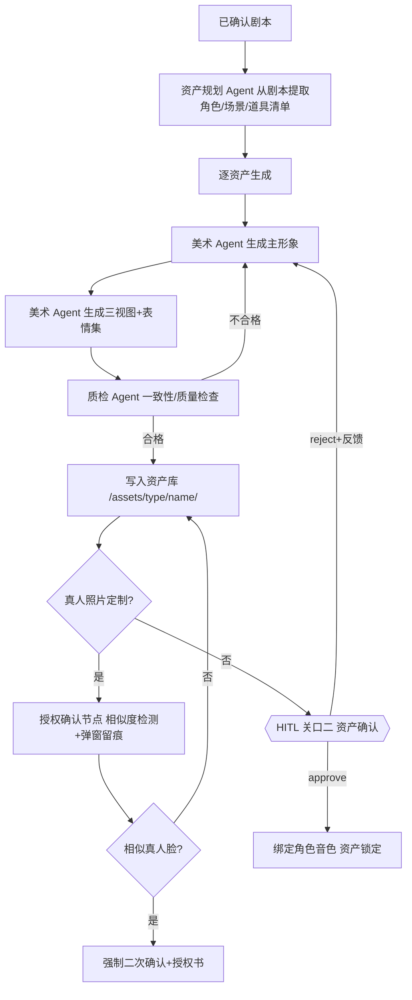

### F3.4 流程步骤

| 步骤 | Agent/节点 | 说明 |
|---|---|---|
| S1 | 资产规划（美术 Agent 的规划子任务） | 从 `Script` 提取：角色清单（含年龄/外形描写/戏份权重）、场景清单（内外/时代/时段）、关键道具；输出生成优先级（戏份重的角色先生成） |
| S2 | 美术 Agent | 按用户选定画风（真人感/二次元/国风/3D）生成主形象；自检循环：主形象 → 三视图 → 表情集，每步由质检 Agent 比对"是否为同一人物" |
| S3 | 质检 Agent | 角色一致性：人脸 embedding 比对 + CLIP 相似度 ≥ 阈值；质量：肢体/手部/五官硬伤检测；不合格附具体原因返回美术 Agent 重生成（≤ 3 轮） |
| S4 | 合规节点 | 真人照片：人脸识别比对公共人物库 + 用户授权弹窗留痕（时间戳/IP/协议版本） |
| S5 | HITL 中断 | 角色卡片墙展示（主形象 + 三视图 + 表情），用户逐个 approve / reject(反馈) / 重抽 |
| S6 | 确定性绑定 | 角色 → 音色绑定写入 `assets`，全剧 TTS 统一引用 |

### F3.5 关键设计

| 编号 | 设计 |
|---|---|
| AD-1 | **一致性不靠 prompt 靠锚点**：所有该角色的后续生成强制注入三视图作为条件图；`asset_id` 进入每个分镜的生成参数 |
| AD-2 | 资产库与项目解耦：资产写入 `/assets/`，项目通过引用使用 → 支持跨项目复用（F3.6/P1） |
| AD-3 | 子代理并行：同批多个角色/场景可并行派生子代理生成，共享 `/assets/` 工作区 |
| AD-4 | 缺失降级：表情集部分缺失允许通过，缺失情绪在分镜层降级处理（旁白代替） |

### F3.6 边界与异常六查

| 类别 | 场景 | 期望行为 |
|---|---|---|
| 空态 | 剧本无可提取角色（纯旁白剧本） | 提示"未识别到角色"，允许跳过直接进入分镜，资产步骤标记为"无需资产" |
| 极值 | 单项目角色数 > 30 | 提示超限并给出分批建议，避免并行度过高拖垮队列 |
| 并发 | 同批 10 个角色同时生成 | 受套餐并发限制排队；子代理并行度受配置上限约束 |
| 失败 | 三视图与主形象相似度过低 | 美术 Agent 改用"图生图 + 姿态参考"而非文生图重抽 |
| 失败 | 表情集生成部分失败 | 允许带缺失通过，缺失情绪在分镜层降级（旁白代替） |
| 失败 | 用户上传非人脸/模糊照片 | 前置校验打回 `50004`，不进入生成、不扣费 |
| 权限 | `view` 成员尝试重抽资产 | 服务端拒绝 `20003` |
| 幂等 | 同一角色重复触发生成 | 幂等键去重，返回进行中的任务而非新建 |
| 合规 | 上传照片命中公共人物库 | 直接拒绝生成并说明原因，不进入"二次确认"通道 |

### F3.7 埋点

`asset_plan_completed`（角色/场景/道具数量）、`asset_generation_started`、`asset_generation_completed`（含一致性得分）、`asset_rejected`（含反馈关键词）、`asset_regenerated`、`voice_bound`、`real_person_auth_started`、`real_person_auth_confirmed`、`asset_locked`。

**V4.0 新增埋点**：`asset_variant_created`（变体使用率）、`asset_batch_regenerated`（批量采纳、M10）、`asset_qc_rounds`（轮次与原因 → M4/M6）、`asset_regenerate_cost_warning_shown`（→ M11）、`asset_voice_replaced`（下架处理率）、`asset_search_used`（资产墙可用性）、`real_person_auth_revoked`（合规审计 CCCR）。

### F3.8 资产状态机细化（V4.0 新增）

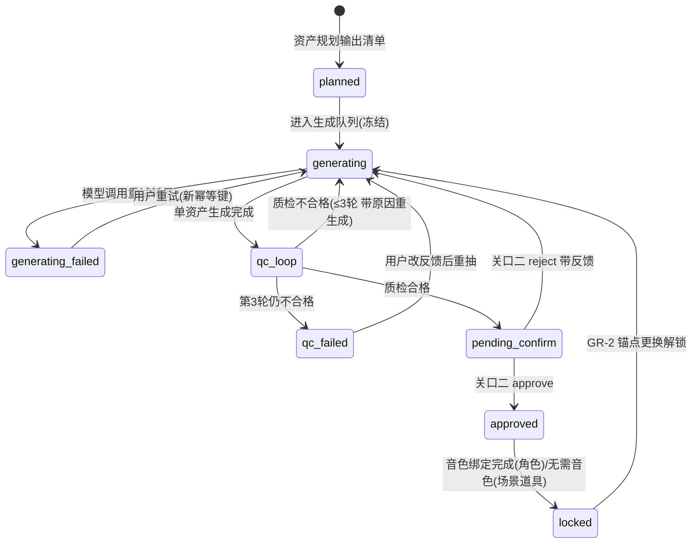

| 状态 | 进入条件 | 可执行动作 | 出口条件 |
|---|---|---|---|
| generating | 队列调度 + 冻结成功 | 用户可预览已完成产物 | 完成进入 qc_loop |
| qc_loop | 生成完成 | 无用户动作（≤ 3 轮自动） | 合格 → pending_confirm；3 轮失败 → qc_failed |
| qc_failed | 修正循环耗尽 | 改反馈重抽 / 接受降级（表情缺失类 AD-4） | 重抽 → generating；接受 → pending_confirm |
| pending_confirm | 质检合格 | approve / reject(反馈) / 重抽 | 见上 |
| locked | 绑定/确认完成 | 查看、历史版本恢复（触发 GR-2） | 锚点更换 → generating |

> ProjectStatus 映射【假设待验证】：`planned → ASSET_PLANNED`；`generating/generating_failed/qc_loop/qc_failed → ASSET_GENERATING`；`pending_confirm → AWAITING_GATE_2`；`approved/locked → ASSET_LOCKED`。场景/道具仅做质量分质检（CLIP 阈值 0.75【假设待验证】），无 face_score 项。

### F3.9 美术 Agent 内部工作流（V4.0 新增）

| 项 | 规格 |
|---|---|
| 输入契约 | `assets_plan`（角色/场景/道具清单）、`art_style`（画风枚举）、`assets[id].anchor_version`（重抽时必读三视图锚点）、`human_feedback.revision_notes`（重抽时）、`assets[id].variant_req`（场景变体） |
| 输入缺失降级 | `art_style` 缺失 → 默认"真人感"并提示；锚点缺失（首次）→ 文生图；锚点存在 → 强制图生图 + 姿态参考（AD-1，禁止退回文生图）；`appearance` 描写 < 10 字 → 先补全描写再出图（补全结果回写设定卡供确认） |
| 输出契约（Asset JSON 关键字段） | `asset_id / asset_type(character|scene|prop) / name / current_version_id / versions[{version_id, gen_params{model, seed, style, revision_notes}, files{main, views[], expressions[], variants[]}, qc{face_score, clip_score, hard_flaws[], round}}]` |
| 自检修正策略阶梯 | 第 1 轮不合格 → 同模型换种子；第 2 轮 → 调整生成参数（降低复杂度/提高参考图权重）；第 3 轮 → 切换备用模型或"图生图 + 姿态参考"；3 轮后仍失败 → `qc_failed` 交用户 |
| 人工反馈注入 | `revision_notes`（5–100 字）拼入提示词「修改要求」区块 + 图生图负向约束；命中年龄类词（太老/太年轻）同步微调 `age_desc`【假设待验证：年龄词解析表】 |

### F3.10 异常决策树（V4.0 新增，六查升级为 EX 场景）

> F3 专用超时：单图生成 30s【假设待验证】，重试 15s / 60s 退避 ≤ 2 次。

| EX 编号 | 场景 | 检测点 | 处置动作 | 用户可见反馈 | 计费影响 | 审计 |
|---|---|---|---|---|---|---|
| EX-F3-01 | 纯旁白剧本无角色 | 规划 Agent 输出为空 | 跳过资产环节，标记"无需资产" | 提示 + 直接进入分镜入口 | 无 | 否 |
| EX-F3-02 | 角色 > 30 | 规划输出计数 | 分批建议（权重 Top30 先行） | 分批卡片 | 仅实际生成计费 | 否 |
| EX-F3-03 | 同批 10 角色并发生成 | 队列并发闸门（free 2 / pro 5 / studio 10） | 排队 | 队列位置可见 | 冻结后排队，未执行可取消解冻 | 否 |
| EX-F3-04 | 三视图与主形象相似度过低 | 质检 `face_score` | 改"图生图 + 姿态参考"重抽 | qc_failed 时可见轮次 | 修正轮计入该资产结算 | 是（超 3 轮） |
| EX-F3-05 | 表情集部分失败 | 质检子项 | 带缺失通过（AD-4），缺失情绪登记 | 资产卡"缺失 n 种情绪"角标 | 按实际成功数结算 | 否 |
| EX-F3-06 | 上传非人脸/模糊照片 | 人脸质量前置校验 | 打回 `50004` | 明确原因 | 不扣费 | 否 |
| EX-F3-07 | 照片命中公共人物库 | 人物库比对 | 直接拒绝（不走二次确认） | 拒绝说明 | 不扣费 | 是 |
| EX-F3-08 | 重抽模型服务超时 | 生成子任务超时监控 | 重试 2 次 → `generating_failed` | 资产卡红色 + 重试按钮 | 未完成部分解冻 | 是 |
| EX-F3-09 | `view` 成员重抽 | ACL 中间件 | 拒绝 `20003` | 权限提示 | 无 | 是 |
| EX-F3-10 | 同角色重复触发生成 | 幂等键（asset_id + 参数 hash） | 返回进行中任务 | 无感知 | 不重复冻结 | 否 |
| EX-F3-11 | 批量重抽中单角色被合规拦截 | 逐角色审核 | 该角色终止，其余继续 | 逐角色状态行 | 仅成功部分结算 | 是 |
| EX-F3-12 | 历史版本恢复时锚点被引用 | GR-2 引用计数 | "影响 N 个镜头"确认后解锁受影响镜头 | 确认弹窗 | 已生成镜头不退费，重新生成另计 | 是 |

### F3.11 界面交互要点（V4.0 新增）

1. **资产卡片墙**：顶部状态筛选条（全部/生成中/待确认/质检未过/已锁定）+ 搜索框（> 10 资产时出现）；卡片左上状态徽标，质检未过显示原因摘要，hover 显示得分明细。
2. **重抽确认弹窗**：反馈输入框（5–100 字）+ 两行成本数字加粗（本次预估 / 已累计消耗）；批量重抽追加"该反馈将应用于全部选中角色"警示。
3. **音色绑定工作台**：左角色列（候选音色预筛 3 个）右试听器；行内 ▶ 试听、✓ 绑定；"全部应用推荐"需每行 ≥ 1 次试听后才可确认。
4. **授权记录页**：表格列（角色/时间/IP/协议版本/状态）；撤回为红色文字按钮，需输入角色名确认。
5. **空态文案**：资产空态——"剧本确认后，角色、场景、道具会自动出现在这里"；搜索空态——"没有找到匹配资产，试试清除筛选"。

---

## F4 智能分镜

### F4.1 目标

把"文字剧本"翻译成"可执行的镜头清单"，并让用户在花大钱之前发现叙事问题。

### F4.2 用户故事与验收标准

| ID | 用户故事 | 优先级 |
|---|---|---|
| US-F4-01 | 作为用户，我希望系统自动把剧本拆成镜头，以便我不懂分镜也能开工 | M |
| US-F4-02 | 作为用户，我希望每个镜头有景别、运镜、画面描述与情绪，以便生成结果可控 | M |
| US-F4-03 | 作为用户，我希望在生成视频前先看一遍"草稿样片"，以便低成本发现叙事错误 | M |
| US-F4-04 | 作为用户，我希望在画布上拖动、增删、排序镜头，以便按我的想法调整 | M |
| US-F4-05 | 作为用户，我希望直接编辑镜头 prompt，以便精确控制画面 | M |
| US-F4-06 | 作为用户，我希望知道改动会波及哪些镜头，以便避免意外破坏一致性 | M |
| US-F4-07 | 作为用户，我希望拆解前选择叙事节奏模式（快节奏爽剧/均衡/慢节奏情感剧），以便分镜节奏匹配题材 | P1 |
| US-F4-08 | 作为用户，我希望复制镜头并把多个镜头批量修改参数，以便整段戏统一调整 | M |
| US-F4-09 | 作为用户，我希望画布操作有历史时间轴并可回退到任意一步，以便误操作可恢复 | M |
| US-F4-10 | 作为用户，我希望套用分镜模板（对话戏/动作戏/转场），以便不懂分镜也能有专业机位 | P2 |

**验收标准**

| ID | 验收标准 |
|---|---|
| AC-F4-01-1 | Given 资产已锁定，When 导演 Agent 执行，Then 先输出全剧分镜策略（叙事节奏曲线、高潮特写密度、对话机位规则）写入 `/project/director_notes.md`，再按集派生子代理并行拆解 |
| AC-F4-02-1 | Given 某集拆解完成，When 查看镜头，Then 每个镜头含 `shot_size`（景别）、`camera_move`（运镜）、`final_prompt`、`emotion_tag`、`duration_ms`、`order_index`、`asset_anchor_ids` |
| AC-F4-02-2 | Given 某镜头对白长度 12 秒而镜头时长 4 秒，When 质检执行，Then 判定不合格并打回（对白镜头 ≤ 6 秒） |
| AC-F4-03-1 | Given 分镜初稿完成，When 生成草稿样片，Then 每个镜头出 1 张关键帧 + TTS 配音 + 字幕，拼成时长 < 3 分钟的节奏样片 |
| AC-F4-04-1 | Given 用户在画布上把镜头 5 拖到镜头 3 之前，When 释放，Then 顺序更新、后续镜头 `order_index` 自动重算，且提示集时长与钩子位置的变化 |
| AC-F4-05-1 | Given 用户修改镜头 12 的 prompt，When 保存并生成，Then 仅镜头 12 使用新 prompt，其它镜头不受影响 |
| AC-F4-06-1 | Given 用户更换角色 A 的锚点图，When 保存前，Then 提示"将影响 N 个镜头"（N 为该角色出现的镜头数），需二次确认 |
| AC-F4-06-2 | Given 分镜已锁定后用户修改了剧本第 2 集，When 保存剧本，Then 第 2 集对应场次的镜头解锁，其它集与已生成视频尽量保留 |
| AC-F4-07-1 | Given 拆解发起页，When 用户选择节奏模式，Then 三选一（快节奏/均衡/慢节奏）写入 `director_notes.md` 的 `pacing_mode` 字段，拆解参数按模式取值：快节奏（镜头均值 2000–3000ms、特写占比 ≥ 40%）、慢节奏（均值 3000–4000ms、空镜占比上调）【假设待验证：具体参数值】 |
| AC-F4-07-2 | Given 项目题材为"赘婿/重生"类爽剧，When 打开拆解发起页，Then 默认预选"快节奏"（题材推荐映射表【假设待验证】），用户可改 |
| AC-F4-07-3 | Given 某集已手动调整过，When 重新按新模式拆解该集，Then 保留手动版本为 F8 手动快照并提示，不静默覆盖 |
| AC-F4-08-1 | Given 用户在镜头 ⋯ 菜单选择"复制"，When 选择粘贴位置（选中镜头后/集尾），Then 复制体继承 `final_prompt/camera_move/duration_ms/emotion_tag/asset_anchor_ids`，`order_index` 自动重算，`shot_id` 全新 |
| AC-F4-08-2 | Given 用户多选 ≥ 2 个镜头并批量修改运镜/时长/情绪，When 确认保存，Then 展示"N 个镜头将修改"与逐项变更摘要，保存后受影响镜头自动重跑分镜质检相关项 |
| AC-F4-08-3 | Given 批量修改导致某镜头对白超时长，When 保存，Then 该镜头质检标红单独提示（对白 ≤ 6s 规则），其余镜头修改不受回滚 |
| AC-F4-09-1 | Given 用户在画布执行增/删/移/批量改，When 打开"操作历史"抽屉，Then 时间轴按序列出结构化操作（类型/目标镜头/时间），保留最近 100 步【假设待验证：存储开销】，仅当次会话有效 |
| AC-F4-09-2 | Given 用户点击历史中任意一步"回退到此步"，When 二次确认，Then 画布恢复到该步状态（被删镜头以原参数恢复），后续历史步截断并提示 |
| AC-F4-10-1 | Given 用户发起拆解，When 勾选"套用分镜模板"，Then 模板以机位规则条目（≤ 10 条，每条 ≤ 50 字）注入导演 Agent 策略上下文；模板与硬性质检规则冲突时硬校验优先并在完成后列出冲突条目 |
| AC-F4-10-2 | Given 用户保存自定义分镜模板，When 命名保存，Then 模板跨项目可用、上限 20 个【假设待验证】，与 2.3 分期"提示词模板库"同族合并实现 |
| AC-F4-01-2 | Given 导演 Agent 制定策略，When 写入 `director_notes.md`，Then 结构化字段含 `pacing_mode / rhythm_curve[](集号→节奏值) / closeup_density / dialogue_camera_rule`，策略对用户只读可见（可解释性） |
| AC-F4-01-3 | Given 按集并行拆解，When 任一集完成，Then 该集在集切换器即时点亮"可编辑"，其余集生成中显示进度（n/m 镜头）；单集失败不阻塞已完成集编辑 |
| AC-F4-02-3 | Given 某集拆解完成，When 校验镜头字段，Then 枚举约束生效：`shot_size ∈ {extreme_wide, wide, medium, close, extreme_close, insert}`、`camera_move ∈ {static, pan, tilt, push, pull, handheld, dolly}`、`emotion_tag ∈ {calm, happy, angry, sad, shocked, fearful, smug, crying}`【假设待验证：枚举全集以 00 契约为准】 |
| AC-F4-02-4 | Given 镜头字段校验，When 数值越界，Then `final_prompt` ≤ 500 字、`duration_ms` ∈ [1000, 15000]、`order_index` 为集内连续正整数；越界字段打回子代理修正 ≤ 2 轮 |
| AC-F4-03-2 | Given 草稿样片生成，When 用户播放，Then 支持按集章节跳转、A-B 区间循环、单镜头循环与 0.5×/1×/2× 变速；样片超 3 分钟按集拆为多文件聚合播控 |
| AC-F4-03-3 | Given 用户对单镜头静帧不满意，When 点击"重出静帧"（可附反馈 ≤ 50 字），Then 仅重生成该关键帧（单帧计价），样片对应段替换，每镜头重出 ≤ 3 次后提示"建议改 prompt"【假设待验证：单帧生成耗时 ≤ 15s 与次数阈值】 |
| AC-F4-04-2 | Given 用户拖动镜头释放，When 落点判定，Then 拖拽命中吸附阈值 8px【假设待验证】，释放后 `order_index` 重算 ≤ 200ms，toast 显示集时长变化（AC-F4-04-1 同源） |
| AC-F4-04-3 | Given 用户删除镜头，When 确认弹窗展示，Then 实时显示"本集剩余 X 分 X 秒（Y 镜头），距目标时长差 Z 秒"（Z 为负差时黄色警示）；提示不阻断删除 |
| AC-F4-05-2 | Given 用户编辑 `final_prompt`，When 输入，Then 字数 ≤ 500 实时计数，达 480 字变黄警示；prompt 中引用的锚点占位符（`@角色名`）以高亮 chip 呈现，删除 chip 即移除锚点引用并触发影响提示 |
| AC-F4-05-3 | Given 分镜已锁定，When 用户点击 prompt 编辑器，Then 编辑器只读 + 弹引导："需解锁第 X 集 → 修改 → 重新走关口三；该集已生成 N 个镜头将标记需重生成，预估 X 积分"；确认后执行解锁 |
| AC-F4-06-3 | Given 分镜锁定后用户修改剧本第 2 集，When 保存剧本，Then 仅第 2 集受影响场次的镜头解锁；已生成视频版本保留（标记"上游已变更"），未生成任务取消并解冻 |

### F4.3 详细流程

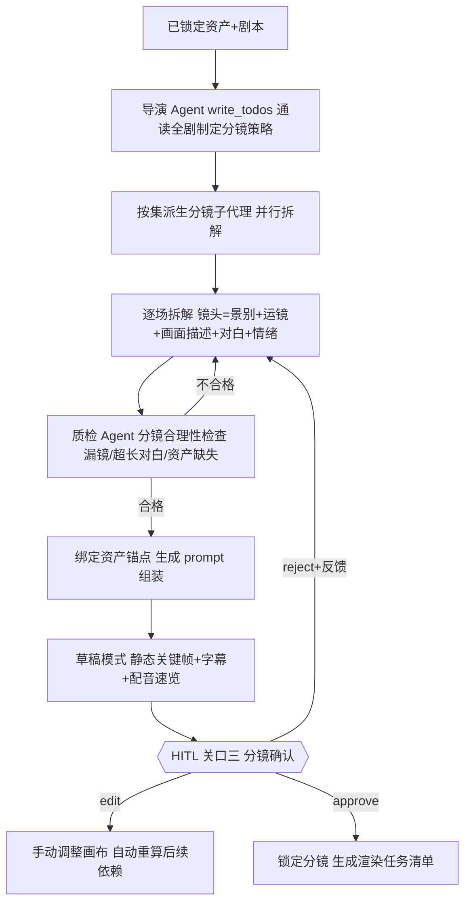

### F4.4 流程步骤

| 步骤 | Agent/节点 | 说明 |
|---|---|---|
| S1 | 导演 Agent | 制定全剧分镜策略：叙事节奏曲线、高潮段落特写密度、对话场景机位规则（谁说话给谁镜头）；策略写入 `/project/director_notes.md` 供子代理遵循 |
| S2 | 导演 Agent → 子代理 | 按集并行派生子代理，每个子代理把场次拆成镜头（默认 2–4s/镜头，对白镜头 ≤ 6s） |
| S3 | 质检 Agent | 检查：相邻镜头景别跳跃过大、对白超出镜头时长、使用了未生成资产的元素、情绪标签缺失；输出问题清单打回 |
| S4 | 确定性组装节点 | 每镜头组装最终生成参数：`asset_id 锚点图 + 场景图 + 画面描述 + 运镜词 + 情绪 + 首帧图`，写入 `shots`，prompt 对用户可见可改 |
| S5 | 草稿模式 | 低成本预览：每个镜头出 1 张关键帧 + TTS 配音 + 字幕，拼成节奏样片（< 3 分钟），让用户在花钱生成视频前先确认叙事 |
| S6 | HITL + 编辑 | 用户在画布上拖动/增删/改镜头；编辑后自动重算依赖（增删镜头影响集时长与钩子位置） |
| S7 | 锁定 | 生成渲染任务清单：每镜头一项，含预估成本，进入计费预检 |

### F4.5 关键设计

| 编号 | 设计 |
|---|---|
| SD-1 | **草稿模式是成本控制核心**：把"叙事错误"的发现成本从视频生成（贵）降到静帧预览（便宜） |
| SD-2 | 分镜子代理并行度受集数限制，全部写回同一 `shots` 集合，由校验节点合并去重（场次边界重叠检测） |
| SD-3 | 用户改 prompt 只影响该镜头；改资产锚点则级联提示"影响 N 个镜头" |
| SD-4 | 相邻镜头景别分布作为质检项，防止"景别跳跃过大"影响观感 |

### F4.6 边界与异常六查

| 类别 | 场景 | 期望行为 |
|---|---|---|
| 空态 | 剧本场次为空 | 拒绝进入分镜，提示先补全剧本 |
| 极值 | 单集镜头数 > 200 | 提示拆分集数；画布启用虚拟化渲染，避免卡死 |
| 极值 | 单镜头时长极值（0.5s / 20s） | 校验为非法，`duration_ms` 限制在 1000–15000ms |
| 并发 | 多集同时拆解 | 并行度受限，写回同一集合时由校验节点合并去重，检测场次边界重叠 |
| 失败 | 某集拆解结果与其他集风格漂移 | 质检 Agent 交叉比对，导演 Agent 统一修订 |
| 失败 | 草稿预览用户 70% 镜头 reject | 触发导演 Agent 重新制定分镜策略（而非逐镜头重抽） |
| 权限 | `export` 权限成员尝试改分镜 | 拒绝 `20003` |
| 幂等 | 重复触发同集拆解 | 幂等键命中返回已有结果 |
| 依赖 | 分镜锁定后用户想改剧本 | 编排器回溯：剧本改动 → 受影响场次分镜解锁，资产与已生成镜头尽量保留 |

### F4.7 埋点

`storyboard_generation_started`、`storyboard_generation_completed`（含集数/镜头数/平均镜头时长）、`draft_mode_generated`（含成本）、`storyboard_shot_added`、`storyboard_shot_deleted`、`storyboard_shot_reordered`、`shot_prompt_edited`、`asset_anchor_replaced`（含影响镜头数）、`storyboard_rejected`（含 reject 比例）、`storyboard_locked`。

**V4.0 新增埋点**：`pacing_mode_selected`（采纳率 → M3）、`shot_batch_edited`（批量采纳率）、`canvas_history_rollback_used`（画布误操作率）、`draft_frame_redrawn`（草稿精细打磨率 UV-1）、`storyboard_partial_decompose_used`（试错成本节约 → M5 侧写）、`gate3_checklist_forced`（清单忽略率 → M3）、`storyboard_template_applied`（P2 价值验证）。

### F4.8 分镜状态机细化（V4.0 新增，集级）

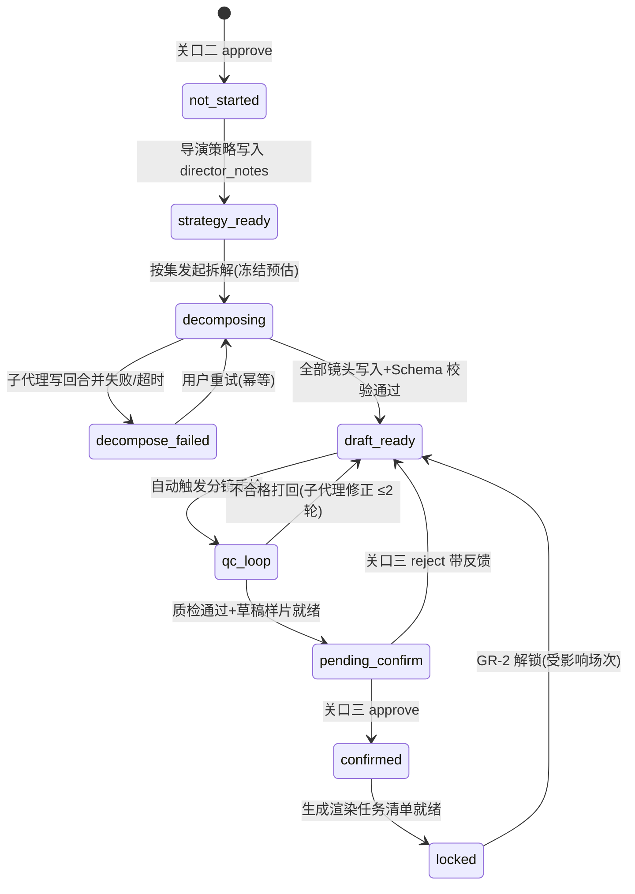

| 状态 | 进入条件 | 可执行动作 | 出口条件 |
|---|---|---|---|
| decomposing | 拆解发起 + 冻结 | 查看已完成集、编辑已完成集 | 全部集写回合并 → draft_ready |
| decompose_failed | 合并冲突/超时 | 重试（幂等键 = project_id + ep_no + 拆解参数 hash） | 成功 → decomposing |
| qc_loop | 集内全部镜头校验通过 | 无用户动作 | 通过 → pending_confirm；未消除警告随样片进关口三清单（EX-F4-12） |
| pending_confirm | 样片就绪 | approve / reject(反馈) / 画布编辑 | 见上 |
| locked | approve 后 | 只读 + 解锁引导（AC-F4-05-3） | 解锁 → draft_ready |

> ProjectStatus 映射【假设待验证】：`not_started/strategy_ready → STORYBOARD_READY`；`decomposing/decompose_failed → STORYBOARD_GENERATING`；`draft_ready/qc_loop → STORYBOARD_DRAFT`；`pending_confirm → AWAITING_GATE_3`；`confirmed/locked → STORYBOARD_LOCKED`。

### F4.9 导演 Agent 内部工作流（V4.0 新增）

| 项 | 规格 |
|---|---|
| 输入契约 | `script`（locked 版本，逐集场次）、`assets`（可用角色/场景/道具及锚点版本）、`director_notes`（既有策略，重拆时必读）、`pacing_mode`（US-F4-07）、`storyboard_template`（可选）、`human_feedback`（关口三 reject） |
| 输入缺失降级 | 场景资产缺失 → 该镜头 `final_prompt` 以文生图描述兜底 + 质检标"场景未锚定"；`emotion_tag` 生成失败 → 置 `calm` 默认值并登记质检警告；`pacing_mode` 缺失 → 均衡模式 |
| 输出契约（Shot JSON 关键字段） | `shot_id / ep_no / scene_no / order_index / shot_size / camera_move / final_prompt / emotion_tag / duration_ms / asset_anchor_ids[] / dialogue_ref / gen_status(pending) / qc_flags[]` |
| 自检循环 | 子代理拆解 → 确定性校验（字段越界/场次边界重叠，SD-2）→ 打回自修 ≤ 2 轮；质检 Agent 四项（景别跳跃/对白超时/未锚定资产/情绪缺失）→ 打回导演统一修订 ≤ 2 轮，仍不合格随样片进关口三清单 |
| 人工反馈注入 | reject 反馈结构化：`{scope: {ep_no, shot_id[]}, action: "reshoot"|"re_pace"|"re_anchor", text}`；节奏/时长类反馈（`re_pace`）路由到导演策略层重拆而非逐镜重抽——reject 镜头比例 ≥ 70%（按镜头数计）自动走策略层（F4.6 固化） |

### F4.10 异常决策树（V4.0 新增，六查升级为 EX 场景）

> F4 专用超时：单集拆解 300s【假设待验证】，重试 60s / 180s 退避 ≤ 2 次。

| EX 编号 | 场景 | 检测点 | 处置动作 | 用户可见反馈 | 计费影响 | 审计 |
|---|---|---|---|---|---|---|
| EX-F4-01 | 剧本场次为空 | 拆解前置校验 | 拒绝进入分镜 | "请先补全剧本" | 无 | 否 |
| EX-F4-02 | 单集镜头数 > 200 | 拆解结果计数 | 提示拆分集数；画布虚拟化渲染 | 超限提示 | 无 | 否 |
| EX-F4-03 | 镜头时长越界 | 字段校验节点 | 打回子代理修正 ≤ 2 轮 | 无感（自动） | 无 | 否 |
| EX-F4-04 | 多集并行写回冲突 | 合并去重节点（SD-2） | 按场次边界裁剪去重，冲突场次重拆 | 进度页显示该集"整理中" | 无 | 否 |
| EX-F4-05 | 集间风格漂移 | 质检交叉比对 | 导演 Agent 统一修订该集 ≤ 2 轮 | 该集标记"策略修订中" | 无额外计费 | 是（超 2 轮） |
| EX-F4-06 | 草稿样片 reject ≥ 70% | 关口三反馈统计 | 自动触发导演策略层重拆（非逐镜重抽） | "将按你的反馈重新制定分镜策略" | 重拆按新预估冻结 | 是 |
| EX-F4-07 | 拆解子任务超时 | 子任务超时监控 | 重试 2 次 → `decompose_failed` | 该集红色 + 重试 | 未完成部分解冻 | 是 |
| EX-F4-08 | `export` 权限成员改分镜 | ACL 中间件 | 拒绝 `20003`，画布只读 | 权限提示 | 无 | 是 |
| EX-F4-09 | 重复触发同集拆解 | 幂等键命中 | 返回已有结果 | 无感知 | 不重复冻结 | 否 |
| EX-F4-10 | 锁定后改剧本（依赖回溯） | GR-2 监听剧本版本事件 | 受影响场次镜头解锁；已生成保留标记 | 影响范围弹窗（二次确认） | 未生成任务解冻；已生成不退费 | 是 |
| EX-F4-11 | 锚点更换级联 | 影响计数 | "影响 N 个镜头"确认后解锁受影响镜头 | 确认弹窗（AC-F4-06-1） | 同上 | 是 |
| EX-F4-12 | 带质检警告 approve | 关口三提交拦截 | 弹检查清单，逐条"已处理/忽略并留痕"后放行 | 清单逐条勾选 | 无 | 是（忽略留痕） |

### F4.11 界面交互要点（V4.0 新增）

1. **画布**：镜头卡缩略图 + 底部时长条（对白镜头显示对白占比红条）；多选态顶栏出现"批量修改 / 复制 / 删除"；删除确认弹窗内嵌集时长实时统计；右侧常驻可折叠统计面板（镜头数/总时长/距目标差值 + 筛选器）。
2. **操作历史抽屉**：左侧滑出，条目含操作图标 + 目标 + 时间；"回退到此步"红色描边 + 二次确认；顶部提示"仅记录本次会话，跨会话请用项目快照"。
3. **草稿播放器**：底部镜头缩略图时间轴（点击跳播）；章节条按集分段；单镜循环按钮悬浮右下。
4. **锁定引导弹窗**：三步图示（解锁 → 修改 → 重新确认）+ 成本预估行；主按钮"解锁第 X 集"红色。
5. **空态文案**：分镜空态——"资产确认后，点击'开始拆解'，AI 按你的节奏偏好出分镜"。

---

## F5 视频生成

### F5.1 目标

在成本可控的前提下，把 100+ 个镜头稳定地变成可用视频，失败可退、重试不重复扣费。

### F5.2 用户故事与验收标准

| ID | 用户故事 | 优先级 |
|---|---|---|
| US-F5-01 | 作为用户，我希望系统自动编排批量生成并优先出"每集前 3 镜"给我快速看效果 | M |
| US-F5-02 | 作为用户，我希望单个镜头失败能自动重试或换模型，以便不阻塞整体 | M |
| US-F5-03 | 作为用户，我希望每个镜头保留多个版本可选，以便挑最好的 | M |
| US-F5-04 | 作为用户，我希望生成中途能取消未执行的任务并退回积分 | M |
| US-F5-05 | 作为用户，我希望知道哪些镜头反复失败需要人工介入 | M |
| US-F5-06 | 作为用户，我希望锁定某个模型不被自动切换，以便结果可预期 | M |
| US-F5-07 | 作为用户，我希望在生成总览仪表盘看到六态计数、总进度与预计剩余时间，以便心中有数 | M |
| US-F5-08 | 作为用户，我希望筛选失败镜头并批量重试（可延迟），以便避开供应商限流一次恢复 | M |
| US-F5-09 | 作为用户，我希望对质检误杀的镜头人工标记合格强制通过，以便流程不被误判卡死 | M |
| US-F5-10 | 作为用户，我希望按集一键锁定全部镜头版本，以便快速进入后期 | M |

**验收标准**

| ID | 验收标准 |
|---|---|
| AC-F5-01-1 | Given 分镜已锁定且余额充足，When 发起批量生成，Then 任务按批次入队，优先级为"每集前 3 镜"优先，用户可实时看到排队与进度 |
| AC-F5-02-1 | Given 某任务失败类型为 `timeout` 或 `rate_limited`，When 自动重试执行，Then 最多重试 2 次并优先切换备用模型，重试不重复冻结 |
| AC-F5-02-2 | Given 某任务失败类型为 `moderation_rejected`，When 处理，Then 标记违规、返还积分、不自动重试（避免反复触发审核） |
| AC-F5-03-1 | Given 某镜头已生成 3 个版本，When 用户锁定第 2 版，Then 该版本成为当前使用版本，其余版本进入冷存储但可恢复 |
| AC-F5-04-1 | Given 队列中还有 40 个未执行任务，When 用户点击取消，Then 未执行任务取消并解冻积分，已执行任务等待结算 |
| AC-F5-05-1 | Given 某镜头经 3 轮修正仍不合格，When 循环终止，Then 该镜头列入"待人工"清单并通知用户，其余镜头正常推进 |
| AC-F5-06-1 | Given 用户锁定模型 M，When 路由决策执行，Then 不自动切换到其它模型；若 M 不可用则暂停并通知，而非静默换模型 |
| AC-F5-07-1 | Given 批量生成执行中，When 打开生成页，Then 仪表盘显示六态计数（排队/生成中/质检中/成功/失败/待人工）、总进度百分比、预计剩余时间（近 10 分钟完成速率滚动估算【假设待验证：ETA 算法】）、实时消耗积分；数据经 SSE 推送，点击计数即筛选任务列表 |
| AC-F5-07-2 | Given 队列拥塞导致速率波动 > 50%，When 计算 ETA，Then ETA 旁标注"波动较大"，不给出精确到秒的承诺 |
| AC-F5-08-1 | Given 失败列表含 ≥ 2 个同类型失败镜头，When 用户多选并点击"重试所选"，Then 统一以新幂等键建任务、按预估重新冻结；余额不足的镜头跳过并提示 |
| AC-F5-08-2 | Given 用户勾选"延迟 30 分钟重试"【假设待验证：默认延迟】，When 到时触发，Then 自动批量重试，倒计时可取消；`moderation_rejected` 类型不提供重试入口（GR-7） |
| AC-F5-09-1 | Given 镜头处于待人工/质检不合格，When 用户点击"人工标记合格"，Then 必须勾选确认声明并填写放行理由（≥ 5 字【假设待验证】），通过后镜头进入正常结算，原始质检得分保留，操作写入 `audit_logs`（who/when/理由） |
| AC-F5-09-2 | Given 镜头已强制通过，When 用户再次发起重生成，Then 走正常质检流程，不再提供强制通过入口（同一镜头仅一次） |
| AC-F5-09-3 | Given 强制通过镜头，When 统计 M4 一致性达标率，Then 该镜头单独标记 `manual_pass` 并从 M4 分母排除（避免指标失真）【假设待验证：口径需评审确认】 |
| AC-F5-10-1 | Given 某集全部镜头生成成功，When 用户点击"锁定本集全部镜头"，Then 默认锁定每镜头质检得分最高版本【假设待验证：最优版规则】，核对列表列出逐镜头版本号（仅 1 版可选的镜头置顶），可单项改选后确认 |
| AC-F5-10-2 | Given 集内含待人工或失败镜头，When 尝试一键锁定，Then 拒绝并提示先处理例外项（列出例外镜头） |
| AC-F5-01-2 | Given 发起批量生成，When 确认单展示，Then 字段含：总镜头数 / 分批数（批 50）/ 预估总积分 / 预计总耗时【假设待验证：估算模型】/ 模型路由摘要（主力+备用）/ 本次生成上限（可调，S1）；底部显示可用余额与冻结后余额 |
| AC-F5-01-3 | Given 排队中任务，When 用户点击"插队"，Then 该任务优先级升至当前批次队首；每批次免费插队 3 次【假设待验证：额度与是否计费】；已"生成中"的任务不可插队 |
| AC-F5-02-3 | Given 任务失败类型 ∈ {timeout, rate_limited}，When 自动重试，Then 退避间隔 30s → 120s（队列级指数退避【假设待验证：基线值】），第 2 次重试优先切换备用模型；重试沿用原冻结不追加 |
| AC-F5-02-4 | Given 任意失败任务，When 展示失败详情，Then 显示用户语言文案（运营可配置映射表：`timeout → "模型响应超时，已自动换备用模型重试"` 等）+ 折叠的原始错误码；未映射码兜底"生成出现异常，已返还积分，可联系客服并提供错误编号" |
| AC-F5-03-2 | Given 镜头有 ≥ 2 个版本，When 打开版本对比，Then 多版本缩略图并排 + 播放进度联动；弱网降级为仅首帧对比；锁定其余版本入冷存储可恢复 |
| AC-F5-03-3 | Given 用户给版本打标签/备注，When 保存，Then 预设标签枚举 {色彩好, 动作对, 表情自然, 其他}、备注 ≤ 100 字，随版本持久化（P1 团队可见并写审计） |
| AC-F5-04-2 | Given 用户取消批次，When 确认弹窗展示，Then 显示"未执行 X 个（返还约 Y 积分）/ 生成中 Z 个（等待结算）"；确认后未执行立即取消解冻，幂等键作废 |
| AC-F5-04-3 | Given 失败/待人工镜头，When 用户点击"放弃"，Then 二次确认（显示返还积分）后终止处理、全额解冻返还，画布该镜头显示"已放弃"角标，可随时以新幂等键重新发起 |
| AC-F5-05-2 | Given 存在待人工镜头，When 打开"待人工"清单页，Then 列表含失败轮次、质检报告摘要、已消耗积分，默认按"轮次多 → 消耗高"排序【假设待验证：排序策略】；逐个处理：标记合格 / 带反馈重生成 / 放弃退款 |
| AC-F5-05-3 | Given 待人工清单为空，When 用户打开，Then 显示"全部处理完毕 ✓"正反馈态（防漏处理的确认动线） |
| AC-F5-06-2 | Given 用户未锁模型，When 发起生成，Then 可选路由策略三档：速度优先 / 均衡（默认）/ 质量优先，作为路由权重输入【假设待验证：三档权重取值需路由实测调优】；已锁模型（AC-F5-06-1）优先级高于策略档 |

### F5.3 详细流程

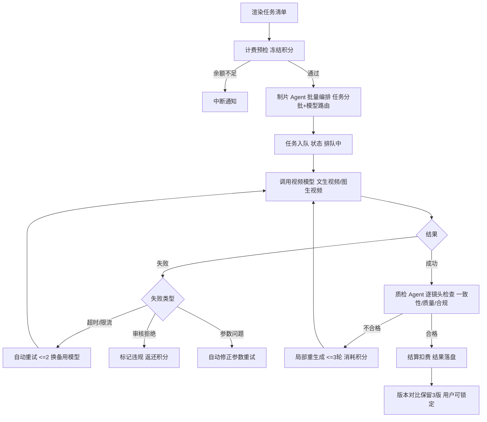

### F5.4 流程步骤

| 步骤 | Agent/节点 | 说明 |
|---|---|---|
| S1 | 计费节点 | 按任务清单预估总成本冻结；支持用户设"本次生成上限" |
| S2 | 制片 Agent | `write_todos` 制定批次计划（并发度、优先级）；模型路由表确定性查询：质量分/价格/排队时长 |
| S3 | 确定性执行器（Celery） | 任务队列，状态机：`排队中 → 生成中 → 质检中 → 待确认/失败/已锁定`；断线重连状态不丢 |
| S4 | 质检子代理（并行） | 每个成片镜头派生质检子代理：角色人脸 embedding vs 三视图锚点、场景 vs 场景图、画面硬伤、内容合规；输出结构化报告 |
| S5 | 修正循环 | 不合格镜头带质检报告重生成（换种子/调运动幅度/降低复杂度），≤ 3 轮后仍不合格则列入"待人工"清单 |
| S6 | 结算 | 按实际成功镜头数结算，失败全额返还；流水含实际调用模型与单价 |
| S7 | 版本管理 | 每镜头保留最近 3 版，用户锁定后其余版本进入冷存储 |

### F5.5 关键设计

| 编号 | 设计 |
|---|---|
| RC-1 | **制片 Agent 的"预算感知"**：系统提示词注入剩余预算与单价表，编排时自动建议"先低价模型出草稿 → 选定后高清重渲"的省钱路径 |
| RC-2 | 模型路由是**确定性代码**而非 LLM 决策，避免幻觉选错模型；LLM 只做策略建议 |
| RC-3 | 生成中途崩溃：Checkpoint 恢复后仅重跑未完成镜头（幂等键去重） |
| RC-4 | 失败分类驱动策略：`timeout`/`rate_limited` 可重试、`moderation_rejected` 不重试、`param_invalid` 修参重试、`model_unavailable` 换模型 |

### F5.6 边界与异常六查

| 类别 | 场景 | 期望行为 |
|---|---|---|
| 空态 | 无待生成任务 | 任务中心显示空态，引导"去锁定分镜" |
| 极值 | 一次性提交 500 个镜头 | 分批入队（默认批 50），前端展示总预估成本与预计耗时 |
| 并发 | 多用户/多项目同时生成 | 按套餐并发与队列配额隔离；单用户并发生成上限 free 2 / pro 5 / studio 10（Q8） |
| 失败 | 全部模型不可用 | 整体挂起，推送通知，冻结积分不解冻直至恢复或用户取消 |
| 失败 | 质检与生成"拉锯"（反复不合格） | 第 3 轮后强制升级：换模型/换参数策略并通知用户 |
| 失败 | 用户中途取消队列 | 未执行任务取消并解冻，执行中任务等待结算 |
| 权限 | 非项目成员调用任务接口 | 拒绝 `20003`；任务详情不泄露 prompt 与资产 |
| 幂等 | 同一 `Idempotency-Key` 重复提交 | 返回首次创建的任务，不重复冻结 |
| 幂等 | Worker 崩溃后任务重派 | 幂等键命中则直接读回历史产物，不重复调用模型 |

### F5.7 埋点

`render_batch_created`（含镜头数、预估成本）、`render_task_succeeded`（含模型、实际成本、耗时）、`render_task_failed`（含失败类型、重试次数）、`render_retry_triggered`、`render_batch_cancelled`、`shot_version_locked`、`qc_manual_required_raised`、`model_locked_by_user`。

**V4.0 新增埋点**：`render_batch_confirmed`（预估/实际差值 → M5）、`render_queue_jump_used`（插队负载）、`render_eta_shown / render_eta_deviation`（ETA 校准）、`render_manual_pass_forced`（质检误杀率 R-3 侧写 + 审计）、`render_batch_retry_delayed`（自助恢复率 M6）、`render_batch_lock_all_used`（→ M2）、`render_budget_warning_80`（→ M11 + 护栏有效性）。

### F5.8 渲染任务状态机细化（V4.0 新增）

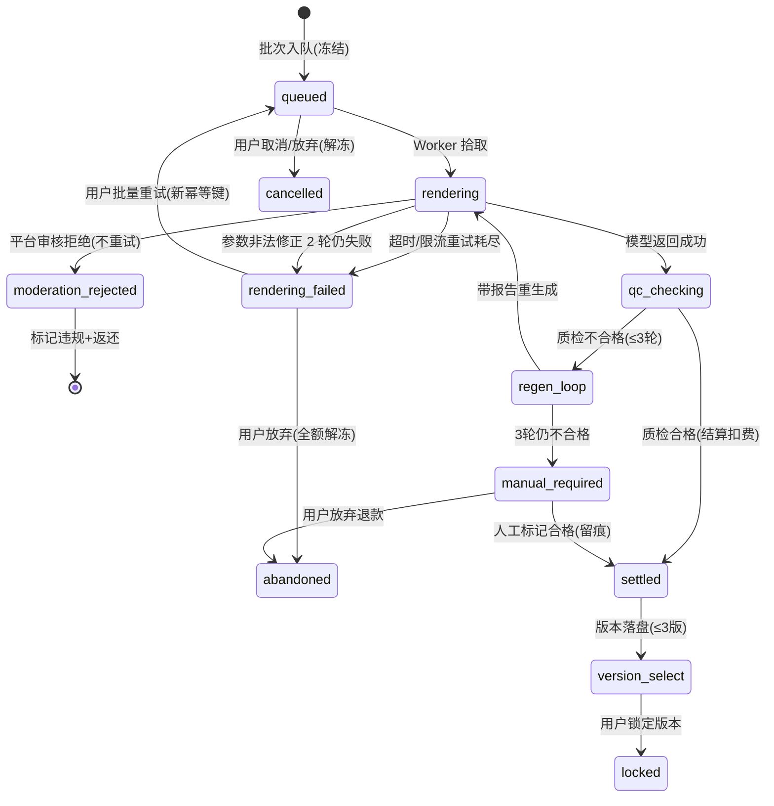

| 状态 | 进入条件 | 可执行动作 | 出口条件 |
|---|---|---|---|
| queued | 冻结成功入队 | 插队（≤ 3 次/批）/ 取消 | 拾取 → rendering；取消 → cancelled |
| rendering | Worker 执行 | 查看（不可干预模型调用） | 成功 → qc_checking；失败按类型分流 |
| qc_checking | 模型产物落盘 | 无用户动作 | 合格 → settled；不合格 → regen_loop |
| regen_loop | 质检不合格 | 无用户动作（≤ 3 轮自动） | 通过 → settled；耗尽 → manual_required |
| manual_required | 修正循环耗尽 | 标记合格 / 带反馈重生成 / 放弃 | 见上 |
| settled | 结算完成 | 版本对比/标签/追加生成 | 锁定 → locked |
| abandoned | 用户放弃 | 查看角标 | 重新发起 → 新 queued |

> ProjectStatus 映射【假设待验证】：存在 `queued/rendering/qc_checking/regen_loop → RENDERING`；全部 settled 且未锁 → `RENDER_DONE`；存在 `manual_required → RENDER_MANUAL_REQUIRED`；全部 locked → `RENDER_LOCKED`。**护栏触发优先级固化**：GR-3 冻结上限（硬）> NFR-K3 消耗 1.5 倍上限（硬）> 批次 100% 暂停（软）> 80% 提醒。

### F5.9 制片 Agent 内部工作流（V4.0 新增）

| 项 | 规格 |
|---|---|
| 输入契约 | `render_tasks`（锁定分镜生成的任务清单，含每镜头预估成本）、`credit_budget / credit_spent`（预算护栏注入）、`model_routing_table`（质量分/价格/排队时长，确定性查询）、`user_pref.model_strategy`（三档）、`user_pref.locked_model`（锁模型优先级最高）、`human_feedback`（重生成反馈） |
| 输入缺失降级 | 路由表某模型缺质量分 → 该模型本轮不参与路由并在确认单标注；`model_strategy` 缺失 → 均衡档；预算字段缺失 → 拒绝执行（计费护栏硬前置，不可降级） |
| 输出契约（RenderTask JSON 关键字段） | `task_id / shot_id / idempotency_key / model / priority(插队>前3镜>批次序) / batch_no / est_cost / status / retry_count / fail_type / actual_cost / qc_report_id / version_id` |
| 自检修正策略阶梯 | 第 1 轮换种子；第 2 轮调运动幅度/降低画面复杂度；第 3 轮换备用模型（与 F5.6"第 3 轮强制升级"一致）；每轮修正计入该镜头结算，轮次与原因落 `qc_reports` |
| 人工反馈注入 | 待人工镜头"带反馈重生成"时，反馈（≤ 100 字）拼入重生成提示词「修正要求」区块 + 结构化 `regen_hint{seed_reset: bool, motion_scale: 0.5–1.5, simplify: bool}`【假设待验证：映射规则】 |

### F5.10 异常决策树（V4.0 新增，六查升级为 EX 场景）

> F5 专用超时【假设待验证：依供应商 SLA 校准】：图生视频单镜头 300s；质检子代理单镜头 60s；修正轮间冷却 30s；队列级重试退避 30s → 120s。

| EX 编号 | 场景 | 检测点 | 处置动作 | 用户可见反馈 | 计费影响 | 审计 |
|---|---|---|---|---|---|---|
| EX-F5-01 | 无待生成任务 | 任务清单为空 | 任务中心空态 | "去锁定分镜"引导 | 无 | 否 |
| EX-F5-02 | 一次提交 500 镜头 | 提交参数校验 | 分批入队（批 50） | 总预估成本 + 预计耗时 | 按批冻结 | 否 |
| EX-F5-03 | 并发超套餐 | 队列配额闸门（free 2 / pro 5 / studio 10） | 排队 | 队列位置 | 已冻结排队，可取消解冻 | 否 |
| EX-F5-04 | 全部模型不可用 | 路由表全量探活失败 | 整体挂起 + 推送通知 | "模型服务恢复后自动继续" | 冻结保留直至恢复或用户取消 | 是 |
| EX-F5-05 | 质检与生成拉锯 | 修正轮次计数 | 第 3 轮强制升级（换模型/策略）并通知 | 通知 + 待人工兜底 | 修正轮计入结算（上限 1.5 倍预估，NFR-K3） | 是 |
| EX-F5-06 | 中途取消 | 用户操作 | 未执行取消解冻；执行中等待结算 | 取消确认弹窗（AC-F5-04-2） | 差异化结算 | 是 |
| EX-F5-07 | 非成员调任务接口 | ACL 中间件 | 拒绝 `20003`，详情不泄露 prompt/资产 | 权限提示 | 无 | 是 |
| EX-F5-08 | 幂等键重复提交 | 幂等中间件 | 返回首次任务 | 无感知 | 不重复冻结 | 否 |
| EX-F5-09 | Worker 崩溃重派 | Checkpoint 恢复（RC-3） | 仅重跑未完成镜头，幂等命中读回历史产物 | 进度无感续跑 | 不重复调用模型 | 是（崩溃事件） |
| EX-F5-10 | 实际消耗达预估 80% / 100% | 结算节点累计比对 | 80% 站内提醒；100% 且有未执行 → 队列暂停等待决策 | 预警 toast / 暂停决策弹窗 | 继续需追加冻结确认 | 是 |
| EX-F5-11 | 锁定模型不可用 | 探活 + 锁定标志 | 暂停该用户任务并通知（不静默换模型） | "模型 M 暂不可用，等待恢复或解锁模型" | 冻结保留 | 是 |
| EX-F5-12 | 审核拒绝 | 审核回调 | 标记违规、全额返还、不自动重试（AC-F5-02-2） | 失败原因（用户语言）+ 修改建议 | 全额解冻返还 | 是 |

### F5.11 界面交互要点（V4.0 新增）

1. **生成仪表盘**：六态计数横排（点击即筛选）+ 环形总进度 + ETA 与实时消耗；拥塞时 ETA 附"波动较大"灰字；断线重连后全量刷新一次。
2. **批次确认单**：模态卡片，字段分区（范围/成本/路由/上限）；余额差 < 10% 时黄色预警条 + "按集缩减范围"快捷入口；主按钮"确认生成"为唯一入队入口。
3. **失败详情**：用户语言主文案 + 建议动作按钮（直达重试/放弃/改 prompt）；原始错误码折叠在"详情"里。
4. **待人工清单**：默认排序轮次多→消耗高；每行三操作（标记合格·红框确认声明 / 重新生成 / 放弃退款）；空态"全部处理完毕 ✓"。
5. **强制通过弹窗**：红色警示样式 + 勾选声明（"我已确认画面质量与角色一致性"）+ 理由输入（≥ 5 字）+ 明示"强制通过后不可再以质检不合格为由退款"。

---

## F6 后期合成

### F6.1 目标

把镜头组装成"能直接发出去的成片"，音画同步、字幕准确、配乐不抢戏。

### F6.2 用户故事与验收标准

| ID | 用户故事 | 优先级 |
|---|---|---|
| US-F6-01 | 作为用户，我希望台词自动生成配音，并先试听 30 秒样音 | M |
| US-F6-02 | 作为用户，我希望字幕与配音精确对齐并套用样式模板 | M |
| US-F6-03 | 作为用户，我希望按情绪自动推荐 BGM 并自动卡点混音 | M |
| US-F6-04 | 作为用户，我希望在简易时间线上微调片段与字幕 | M |
| US-F6-05 | 作为用户，我希望一次性生成多语言版本（P1） | P1 |
| US-F6-06 | 作为用户，我希望成片预览带水印、母版无水印（视权益） | M |
| US-F6-07 | 作为用户，我希望按角色单独试听并调整语速/语调后再全剧应用，以免一处不满意全剧重做 | M |
| US-F6-08 | 作为用户，我希望逐条修改字幕并批量调整字幕样式，以便修正错字与统一视觉 | M |
| US-F6-09 | 作为用户，我希望从候选列表手动指定/替换 BGM，以便配乐符合我的感觉 | M |
| US-F6-10 | 作为用户，我希望手动微调混音音量并自动统一全剧响度，以便跨集连刷体验一致 | P1 |

**验收标准**

| ID | 验收标准 |
|---|---|
| AC-F6-01-1 | Given 镜头已锁定且角色已绑定音色，When 生成配音，Then 先输出 30s 样音供试听，用户确认后再全剧应用 |
| AC-F6-02-1 | Given 配音完成，When 生成字幕，Then 字幕时间轴来自 TTS 音频并强制对齐，竖屏安全区检测通过，无字幕截断 |
| AC-F6-03-1 | Given 镜头含 `emotion_tag`，When 配乐执行，Then 按情绪标签从曲库推荐正版 BGM，混音时对白 -6dB 优先、BGM 侧链闪避 |
| AC-F6-04-1 | Given 时间线已生成，When 用户在轨道上拖动片段或字幕，Then 实时预览生效，保存后生成新的时间线版本 |
| AC-F6-05-1 | Given 用户选择 3 种目标语言，When 多语言生成，Then 只替换语音轨与字幕轨，画面与时间线结构不变，专有名词进入待校对清单 |
| AC-F6-06-1 | Given 用户的套餐不含 4K 权益，When 尝试导出 4K，Then 返回 `70003 权益不足` 并引导升级；预览始终带水印 |
| AC-F6-07-1 | Given 30s 样音确认后、全剧 TTS 应用前，When 用户进入角色配音卡，Then 可对该角色试听并调整：语速 0.80–1.50（步进 0.05）、语调偏移 ±3 档【假设待验证：档位粒度依 TTS 供应商参数】、情绪标签按场覆盖；参数按角色保存 |
| AC-F6-07-2 | Given 用户调整某角色参数并点击"重新试听该角色"，When 重合成完成（≤ 10s/句【假设待验证】），Then 试听更新且"全剧应用"按钮显示受影响台词数（仅该角色台词重合成，其余角色复用） |
| AC-F6-07-3 | Given 调慢语速导致台词超出镜头时长，When 参数保存，Then 质检（对白 ≤ 6s 同源）标红并给出两条出路提示："调回语速"或"解锁分镜改时长"，后期环节不自动改镜头 |
| AC-F6-08-1 | Given 字幕面板，When 用户点击某条字幕，Then 时间线跳转到对应位置并高亮；支持改文本（不改音频）、合并/拆分相邻条、出入点 ± 0.5s 微调【假设待验证：可调范围】 |
| AC-F6-08-2 | Given 出入点调整导致音画同步误差 > 100ms，When 保存，Then 警告并拒绝保存（与 AC-F6-02-1 质检口径一致） |
| AC-F6-08-3 | Given 用户批量修改字幕样式（字体/字号/颜色/描边/背景/九宫格位置），When 选择范围（全片/按集/按说话角色）并应用，Then 应用前实时预览样例句，应用后全片重跑安全区与截断质检，超安全区条目单独列出 |
| AC-F6-09-1 | Given 某情绪段落的推荐 BGM，When 用户展开"更多同情绪候选"（≤ 10 首）并逐曲试听，Then 试听免费，选中替换后自动重新卡点与侧链闪避，混音预览即时更新 |
| AC-F6-09-2 | Given 替换曲版权状态为临期，When 替换确认，Then 提示"该曲 X 天后到期，届时自动替换为同情绪替代曲"（与 F6.6 版权到期规则衔接） |
| AC-F6-10-1 | Given 时间线轨道头，When 用户调节对白/BGM/音效轨音量滑杆（相对自动混音值 ± 6dB【假设待验证】）或单轨静音，Then 当前段落实时重混预览；超 0dBFS 标红；"重置"一键恢复自动混音值 |
| AC-F6-10-2 | Given 母版生成前，When 响度标准化开启（默认开），Then 全剧统一至 -14 LUFS、真峰值 ≤ -1 dBTP【假设待验证：平台通行标准值】，混音面板可查看各集测量值；用户手动混音调整在标准化之后应用（手动优先） |
| AC-F6-01-2 | Given 30s 样音试听，When 播放失败或音色服务超时（10s），Then 重试 2 次（1s / 4s）后提示"试听生成失败，可稍后重试或更换音色"，不阻塞进入下一步但"全剧应用"需样音确认过 |
| AC-F6-01-3 | Given 30s 样音确认，When 用户确认，Then 确认记录（音色版本 + 参数快照）写入配音任务，后续全剧 TTS 与该快照一致（可追溯） |
| AC-F6-02-2 | Given 字幕生成，When 输出，Then 单句字幕 ≤ 20 字（超出自动断句【假设待验证：断句规则与字数上限】）、每条含 `start_ms / end_ms / text / speaker / style_ref`；样式模板字段含 `font / size / color / stroke / bg / position(九宫格)` |
| AC-F6-02-3 | Given 竖屏安全区检测，When 某条字幕出界，Then 该条自动下移至安全区内；仍无法满足（与画面元素冲突）时列出人工处理清单，不静默截断 |
| AC-F6-03-2 | Given 配乐执行，When 曲库推荐，Then 每段落推荐 3 首并展示授权范围标识（仅平台内 / 可随成片分发【假设待验证：授权档位依 D3 签约对齐】）；选择"仅平台内"曲目时 F7 分发前拦截提示 |
| AC-F6-03-3 | Given BGM 版权到期，When 检测命中，Then 自动替换同情绪替代曲并通知用户，替换前后版本均保留 |
| AC-F6-04-2 | Given 用户在时间线编辑并保存，When 保存成功，Then 生成新时间线版本（DR-3），版本下拉可回退；"恢复 Agent 初始版"入口在 ⋯ 菜单，恢复前当前手动版自动存为 F8 手动快照 |
| AC-F6-04-3 | Given 时间线编辑器，When 用户操作，Then 提供素材吸附（阈值 6px【假设待验证】）与常用快捷键（空格播放 / S 切分 / Del 删除），快捷键说明面板可呼出 |
| AC-F6-05-2 | Given 多语言生成（P1），When 翻译完成，Then 专有名词表进入校对界面（原文/译文/采纳状态三列），未校对完成不允许导出该语言版本 |
| AC-F6-06-2 | Given 成片预览，When 用户观看，Then 预览带平台水印且右上角显示"预览版"角标；母版仅 approve 后生成，母版任务幂等（重复触发返回同一母版） |
| AC-F6-06-3 | Given H4 reject 后重做完成，When 新成片产出，Then 保留历史成片版本（≤ 5 版【假设待验证：存储成本】）+ 自动变更摘要（重配音角色/换曲/字幕修改条数），支持双窗口对比 |

### F6.3 详细流程

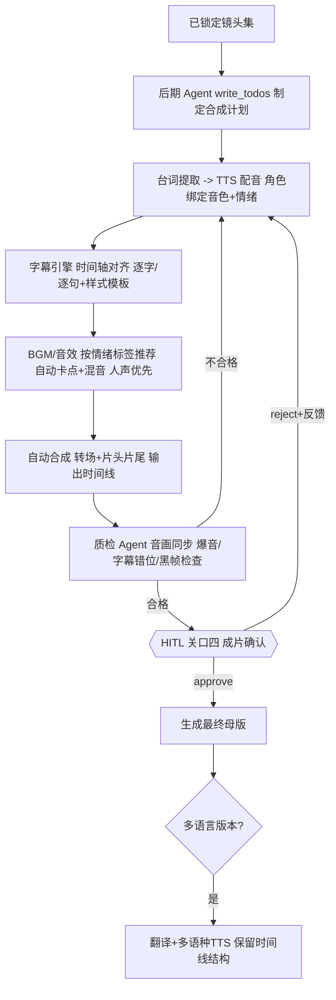

### F6.4 流程步骤

| 步骤 | Agent/节点 | 说明 |
|---|---|---|
| S1 | 后期 Agent | 从 `shots` 提取台词/旁白/情绪，制定合成计划（配音 → 字幕 → 配乐 → 合成 → 质检） |
| S2 | TTS 节点 | 按角色音色 + 情绪标签（平静/愤怒/悲伤等）合成；先出 30s 样音供试听，确认后全剧应用 |
| S3 | 字幕引擎 | 与音轨强制对齐（时间轴来自 TTS 音频），样式套用模板，竖屏安全区检测 |
| S4 | 配乐节点 | 情绪标签 → 正版曲库推荐；自动混音：对白 -6dB 优先，BGM 侧链闪避 |
| S5 | 合成节点 | 拼接镜头 + 转场 + 片头片尾，生成 `timeline` 供简易编辑器二次调整 |
| S6 | 质检 Agent | 音画同步误差 < 100ms、无爆音/静音段、无黑帧、字幕无截断；问题定位到时间码打回 |
| S7 | HITL | 成片试看（带水印预览），approve 后生成母版 |
| S8 | 多语言（P1） | 结构不变只换语音轨与字幕轨，专有名词表人工校对 |

### F6.5 边界与异常六查

| 类别 | 场景 | 期望行为 |
|---|---|---|
| 空态 | 无台词（纯画面短片） | 跳过配音，字幕为空时提示"本片无字幕"，流程可继续 |
| 极值 | 单集配音时长 > 3 分钟 | 提示超出单集时长上限，建议拆分 |
| 并发 | 多集同时合成 | 合成任务按队列串行化到受限并发，避免资源争抢 |
| 失败 | 音画不同步 > 100ms | 定位到时间码并打回重做，不放过 |
| 失败 | 某角色 TTS 音色下架 | 推荐最近似音色并提示用户确认替换 |
| 失败 | BGM 版权到期 | 曲库版本管理，自动替换同情绪替代曲 |
| 权限 | `view` 成员尝试调整时间线 | 拒绝 `20003` |
| 幂等 | 重复触发生成母版 | 幂等键命中返回同一母版，不重复消耗合成资源 |

### F6.6 埋点

`tts_preview_generated`、`tts_applied`、`subtitle_generated`（含样式模板）、`bgm_recommended`（含采纳率）、`timeline_created`、`timeline_edited`、`final_cut_rejected`、`final_cut_approved`、`final_cut_render_started`。

**V4.0 新增埋点**：`tts_param_adjusted`（角色、语速/语调值 → 关口四通过率侧写）、`subtitle_line_edited`（修改类型 → TTS 对齐质量）、`bgm_manual_replaced`（原曲/新曲 → 推荐采纳率补充）、`mix_manual_adjusted`（轨道、调整值 → 自动混音满意度）、`loudness_normalized`（目标/实测 LUFS → 母版质量）、`final_cut_version_compared`（对比版本对 → HR-3）、`timeline_reset_to_agent`（时间线编辑可用性）。

### F6.7 后期管线状态机细化（V4.0 新增，按集）

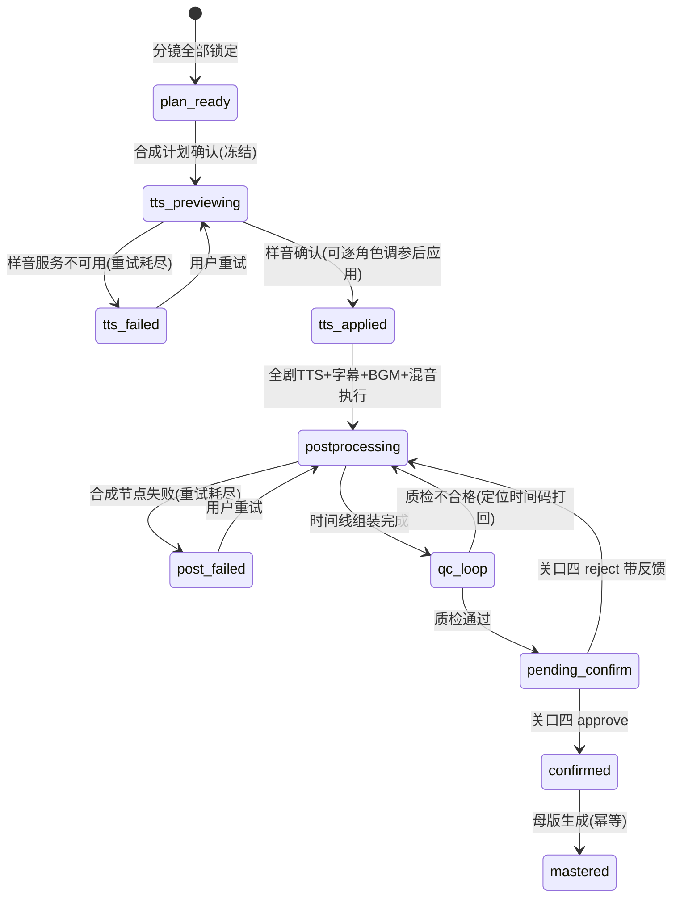

| 状态 | 进入条件 | 可执行动作 | 出口条件 |
|---|---|---|---|
| tts_previewing | 计划确认 + 冻结 | 试听、逐角色调参（US-F6-07）、更换音色 | 确认样音 → tts_applied |
| tts_applied | 样音确认 | 无用户动作（全剧 TTS 执行） | 完成 → postprocessing |
| postprocessing | TTS/字幕/配乐执行 | 查看分段进度 | 组装完成 → qc_loop |
| qc_loop | 时间线就绪 | 无用户动作 | 通过 → pending_confirm；不合格定位时间码打回 |
| pending_confirm | 质检通过（带水印预览就绪） | approve / reject(反馈) / 时间线微调 | 见上 |
| mastered | 母版落盘 | 进入 F7 导出 | — |

> ProjectStatus 映射【假设待验证】：`plan_ready/tts_previewing/tts_applied/postprocessing/post_failed/qc_loop → POSTPRODUCING`；`pending_confirm → AWAITING_GATE_4`；`confirmed/mastered → FINAL_CUT_READY`。

### F6.8 后期 Agent 内部工作流（V4.0 新增）

| 项 | 规格 |
|---|---|
| 输入契约 | `shots`（locked，含 `dialogue_ref / emotion_tag / duration_ms`）、`assets[id].voice_id`（角色音色绑定）、`voice_params{rate, pitch_shift, emotion_override}`（逐角色调参）、`subtitle_style`（模板或自定义）、`bgm_pool`（曲库含授权范围）、`mix_profile`（混音规则）、`human_feedback`（关口四 reject） |
| 输入缺失降级 | 角色 `voice_id` 未绑定 → 该角色台词 TTS 阻塞并提示去绑定（**不可静默用默认音色**）；无台词集 → 跳过配音字幕（F6.5 空态同源）；BGM 池空 → 该段落无配乐继续并提示 |
| 输出契约（Timeline JSON 关键字段） | `timeline_id / version / tracks{voice[], bgm[], sfx[], subtitle[]} / clips[{shot_id, start_ms, end_ms, transition}] / mix{dialogue_db, bgm_db, ducking_ratio} / loudness{lufs, true_peak} / qc_flags[]` |
| 自检循环 | 质检四项（音画同步 < 100ms / 爆音静音段 / 黑帧 / 字幕截断）→ 定位时间码打回对应子任务（仅重做问题段落，不整体重合成）≤ 2 轮 → 仍不合格随预览进关口四由用户决策 |
| 人工反馈注入 | reject 反馈结构化：`{scope: {tc_start, tc_end} | {track}, action: "re_tts"|"re_bgm"|"re_mix"|"re_subtitle", text}`；注入位置：后期 Agent 修订计划的「打回项」清单，未涉及轨道标记"引用原版本" |

### F6.9 异常决策树（V4.0 新增，六查升级为 EX 场景）

> F6 专用超时【假设待验证】：TTS 单句 5s，重试 2s / 8s；合成转码 10min/集，重试 2min / 8min 退避。

| EX 编号 | 场景 | 检测点 | 处置动作 | 用户可见反馈 | 计费影响 | 审计 |
|---|---|---|---|---|---|---|
| EX-F6-01 | 无台词（纯画面） | 台词提取为空 | 跳过配音，字幕空态提示 | "本片无字幕，流程继续" | 无配音计费 | 否 |
| EX-F6-02 | 单集配音时长 > 3 分钟 | TTS 汇总校验 | 提示拆分（Q6 单集上限同源） | 超限提示 | 不执行 | 否 |
| EX-F6-03 | 多集同时合成 | 队列串行化闸门 | 受限并发排队 | 队列位置 | 已冻结可取消 | 否 |
| EX-F6-04 | 音画同步 > 100ms | 质检 Agent | 定位时间码打回对应子任务重做 | 问题清单（时间码跳转） | 仅问题段落重计费 | 是（超 2 轮） |
| EX-F6-05 | 音色下架 | 音色状态检查 | 推荐最近似音色，用户试听确认后替换 | 替换引导 | 替换重合成按新预估 | 是 |
| EX-F6-06 | BGM 版权到期 | 曲库版本巡检 | 自动替换同情绪替代曲 | 替换通知（前后版本保留） | 替代曲计费 | 是 |
| EX-F6-07 | `view` 成员调时间线 | ACL 中间件 | 拒绝 `20003`，编辑器只读 | 权限提示 | 无 | 是 |
| EX-F6-08 | 重复触发生成母版 | 母版幂等键（成片版本 + 参数 hash） | 返回同一母版 | 无感知 | 不重复消耗 | 否 |
| EX-F6-09 | TTS 单句超时 | TTS 任务超时监控 | 重试 2 次 → 标记失败句清单 | 失败句列表 + 重试按钮 | 失败句不计费 | 是 |
| EX-F6-10 | 合成节点失败（转码超时） | 合成任务超时监控 | 重试 2 次 → `post_failed` | 红色 + 重试 | 未完成部分解冻 | 是 |
| EX-F6-11 | 语速调整致台词超镜头时长 | 参数保存校验 | 保存成功但质检标红，给出双出路（调回语速/解锁分镜） | 标红 + 出路提示 | 按实际重合成计费 | 否 |

### F6.10 界面交互要点（V4.0 新增）

1. **配音工作台**：角色卡左列（音色/参数/试听 ▶），调参滑杆即时生效于试听；"全剧应用"按钮显示受影响台词数；未绑定音色的角色卡置顶红色提示。
2. **字幕面板**：左列字幕条目（时间码 + 文本），点击跳转时间线高亮；批量样式编辑器带范围选择器（全片/集/角色）与样例句实时预览。
3. **混音区**：轨道头含音量滑杆 + 静音 + 重置；超 0dBFS 片段轨道上红色波形标识；响度标准化开关与各集实测值列表在混音面板底部。
4. **成片对比**：版本下拉 + 双窗口同步播放 + 自动变更摘要卡（重配音 n 句 / 换曲 m 段 / 字幕改 k 条）。
5. **空态文案**：时间线空态——"成片质检通过后，时间线会出现在这里，可微调后确认"。

---

## F7 导出与分发

### F7.1 目标

让成片按目标平台的规格正确落地，并减少"导出再手动上传"的重复劳动。

### F7.2 用户故事与验收标准

| ID | 用户故事 | 优先级 |
|---|---|---|
| US-F7-01 | 作为用户，我希望按目标平台选择分辨率与比例导出，以便一次通过 | M |
| US-F7-02 | 作为用户，我希望分集批量导出为 ZIP 且文件名自动编号 | M |
| US-F7-03 | 作为用户，我希望系统自动生成标题、简介、话题与封面候选 | M |
| US-F7-04 | 作为用户，我希望授权后一键分发起草到目标平台（P1） | P1 |
| US-F7-05 | 作为用户，我希望看到所有分发记录与链接回写 | P1 |
| US-F7-06 | 作为用户，我希望查看导出历史并复用历史参数重新导出，以便不必重复配置 | M |
| US-F7-07 | 作为用户，我希望导出前按目标平台规格自检，以便不被平台拒稿反复折腾 | P1 |
| US-F7-08 | 作为用户，我希望导出与分发自动携带 AI 生成内容标识，以便符合监管要求（合规强制） | M |
| US-F7-09 | 作为用户，我希望分发记录有状态追踪、失败原因与重试，以便分发失败可自助恢复（P1） | P1 |

**验收标准**

| ID | 验收标准 |
|---|---|
| AC-F7-01-1 | Given 母版已生成，When 用户选择 1080p、9:16 导出，Then 输出文件符合参数，非会员输出带平台水印且锁定 720p |
| AC-F7-02-1 | Given 项目含 10 集，When 执行分集批量导出，Then 产出 ZIP，文件名为项目名-集号-标题规则编号，无重名 |
| AC-F7-03-1 | Given 成片可导出，When 元数据生成，Then 输出标题、简介、话题标签、封面 3 选 1，用户可编辑后保存 |
| AC-F7-04-1 | Given 用户已完成平台 OAuth 授权，When 点击一键分发，Then 通过平台 API 提交或生成剪映草稿；授权失效时提示并支持一键重新授权 |
| AC-F7-05-1 | Given 分发成功，When 查看项目，Then 分发记录含平台、时间、链接，并回写至项目详情 |
| AC-F7-06-1 | Given 用户存在历史导出记录，When 打开"导出历史"页签，Then 列表含时间/集数/参数摘要/文件状态（链接有效期内可重下）/消耗；历史保留 90 天【假设待验证：保留期与存储成本】 |
| AC-F7-06-2 | Given 某历史记录，When 点击"复用参数重新导出"，Then 全部参数预填；同参数命中转码缓存（缓存键 = 成片版本 ID + 参数 hash）时仅重打包不重转码；成片版本已更新时提示"将导出当前最新成片" |
| AC-F7-07-1 | Given 用户选定目标平台，When 点击导出，Then 先执行规格自检：时长上限 / 文件大小 / 分辨率与码率区间 / 封面尺寸；阻断项 ✗ 时导出按钮禁用并列出修改建议（如"第 3 集 3 分 12 秒超平台 3 分钟上限"） |
| AC-F7-07-2 | Given 平台规则库不可用，When 自检执行，Then 降级为通用基线校验（时长 ≤ 3 分钟 / 文件 ≤ 500MB【假设待验证：基线值】）并提示"规则库未更新，结果仅供参考" |
| AC-F7-08-1 | Given 母版导出，When 渲染执行，Then 片尾固定位置嵌入"本内容由 AI 辅助生成"显式标识（样式与位置依监管规范配置【假设待验证：需法务出具口径，依据《人工智能生成合成内容标识办法》】），导出确认页明示且无关闭入口 |
| AC-F7-08-2 | Given 一键分发（P1），When 提交平台，Then 元数据隐式标识字段（AI 生成声明）随 API 上送；平台有专属标识格式要求时按平台规则适配（规则表可配置，与规格自检同源） |
| AC-F7-09-1 | Given 分发已提交，When 查询分发记录，Then 状态机为 `草稿 → 提交中 → 确认中 → 成功 / 失败`；失败含用户语言原因（映射表复用 F5 体系）与操作按钮（重试 / 编辑后重试 / 重新授权） |
| AC-F7-09-2 | Given 平台接口超时未返回明确结果，When 轮询 30 分钟【假设待验证：轮询窗口】仍无结论，Then 状态置"失败（结果未知）"并提示"请到平台后台核实，避免重复发布"；重复成功回调幂等丢弃 |
| AC-F7-01-2 | Given 导出参数页，When 用户配置，Then 参数字段与枚举：`resolution ∈ {720p, 1080p, 4K}`、`aspect ∈ {9:16, 16:9, 1:1, 4:3}`、`watermark ∈ {on, off(权益)}`、`format ∈ {mp4}`【假设待验证：是否支持 mov/prores】；权益不足项（4K/去水印）标灰 + 升级引导，不静默降级 |
| AC-F7-01-3 | Given 用户保存当前配置为预设，When 命名保存，Then 预设上限 10 个【假设待验证】；套用预设时权益项按当下会员状态实时校验 |
| AC-F7-02-2 | Given 批量导出 30 集，When 任务执行，Then 拆分为多个导出任务异步转码 + 最终 ZIP 打包；逐集进度可见（转码 %/完成/失败+重试），已完成集支持"边导边下" |
| AC-F7-02-3 | Given 用户自定义命名模板，When 应用，Then 变量集 `{剧名}/{集号}/{集标题}/{日期}/{分辨率}`，非法字符过滤、重名追加序号（覆盖 AC-F7-02-1 无重名要求）；模板不影响分发标题 |
| AC-F7-03-2 | Given 元数据生成，When 输出，Then 标题 ≤ 30 字、简介 ≤ 100 字、话题标签 3–5 个【假设待验证：各平台字数上限需按平台规则表校准】；超限实时提示并计数 |
| AC-F7-03-3 | Given 用户对封面不满意，When 进入封面编辑器，Then 可从成片任意时间点截帧（时间轴拖动 + 逐帧微调）+ 叠加标题文字；封面带水印口径与成片一致；自定义封面纳入内容审核（`moderation_records.target_type = cover`） |
| AC-F7-04-2 | Given 用户已授权多平台，When 一键分发多选平台，Then 各平台按其规格自检独立执行，阻断项仅阻断该平台，其余照常提交；批量分发幂等（重复点击不重复上传） |
| AC-F7-04-3 | Given OAuth token 临期（剩余 < 24h【假设待验证：阈值】），When 用户进入分发页，Then 预警"授权即将过期，建议重新授权"；过期后分发入口置灰 + 一键重新授权（AC-F7-04-1 同源） |
| AC-F7-05-2 | Given 分发成功，When 回写项目详情，Then 记录字段含 `platform / distributed_at / url / metadata_snapshot / status`，metadata_snapshot 保留发布时元数据（追溯用） |

### F7.3 详细流程

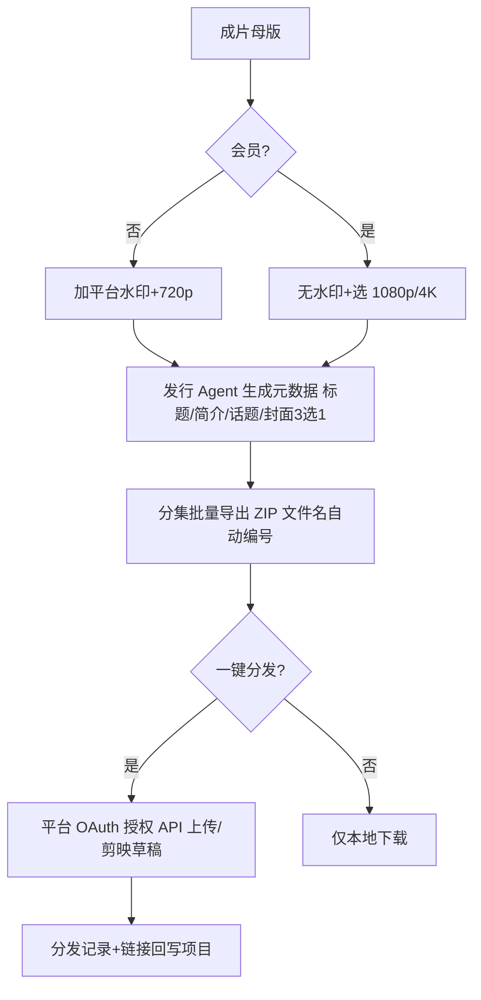

### F7.4 边界与异常六查

| 类别 | 场景 | 期望行为 |
|---|---|---|
| 空态 | 项目无成片母版 | 导出入口禁用，提示"先通过成片确认" |
| 极值 | 导出 30 集 × 4K | 拆分为多个导出任务并异步打包，避免单任务超时；提示预计耗时 |
| 并发 | 同时发起多个导出 | 导出任务排队，受限并发；已存在的相同参数导出结果可复用 |
| 失败 | 导出中断 | 支持断点续传的下载链接；失败重试复用已完成的转码产物 |
| 失败 | 平台授权 token 失效 | 标记失效、通知用户、提供一键重新授权，不静默失败 |
| 权限 | `view` 成员尝试导出母版 | 拒绝 `20003`；`view` 成员只能下载带水印预览 |
| 幂等 | 重复点击导出 | `Idempotency-Key` 去重，返回同一导出任务 |
| 合规 | 导出时检测到未通过成片审核 | 拒绝导出 `40001`，先完成成片确认 |

### F7.5 埋点

`export_started`（含分辨率/水印/格式）、`export_succeeded`（含耗时/文件大小）、`export_downloaded`、`metadata_generated`、`metadata_edited`、`platform_auth_started`、`platform_auth_succeeded`、`distribution_succeeded`、`platform_token_expired`。

**V4.0 新增埋点**：`export_preset_applied`（批量用户效率）、`export_spec_check_blocked`（平台、阻断项类型 → 规则库维护）、`export_cache_hit`（成本节约量化）、`export_history_reused`（参数复用率）、`distribution_retry_used`（分发自助恢复率）、`ai_label_rendered`（合规覆盖审计 CCCR，目标 100%）、`distribution_result_unknown`（平台 API 稳定性调研输入）。

### F7.6 导出与分发状态机细化（V4.0 新增）

**导出任务状态机：**

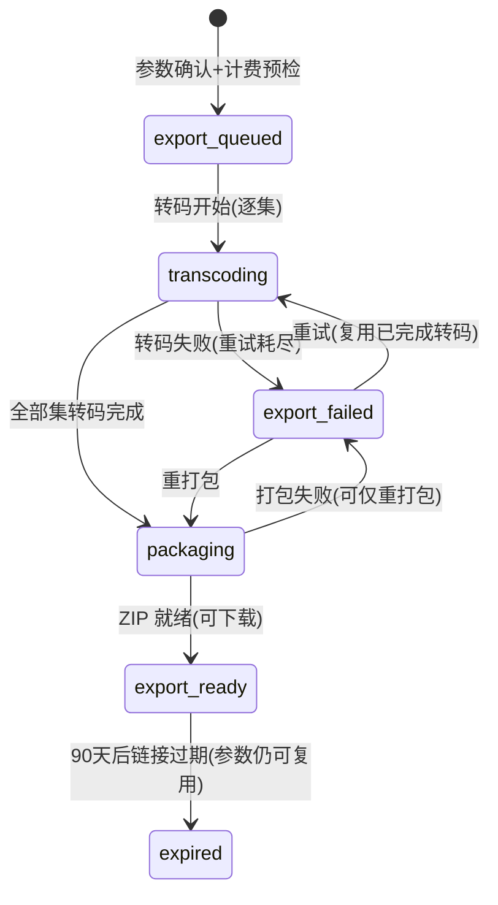

**分发记录状态机（P1）：**

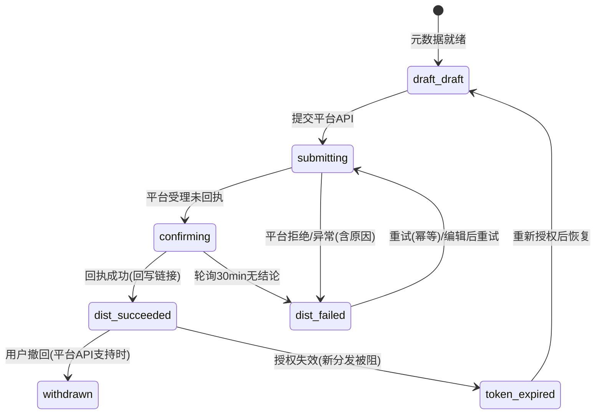

> ProjectStatus 映射【假设待验证】：`export_queued/transcoding/packaging/export_failed → EXPORTING`；`export_ready/expired → DELIVERED`；分发态不改变 ProjectStatus（独立记录域）。

### F7.7 发行 Agent 内部工作流（V4.0 新增）

| 项 | 规格 |
|---|---|
| 输入契约 | `final_cut`（母版引用与元信息：时长/分辨率/大小）、`platform_rules`（目标平台规格表）、`user_subscription`（权益位：分辨率上限/去水印）、`project_meta`（剧名/题材/集数）、`ai_label_config`（标识配置）、`human_feedback`（用户对元数据的编辑偏好） |
| 输入缺失降级 | `platform_rules` 不可用 → 通用基线校验（AC-F7-07-2）；`user_subscription` 缺失 → 按非会员最严口径处理（宁降勿错）；剧名缺失 → 以项目创建时间占位命名并提示 |
| 输出契约（ExportPlan / Metadata JSON 关键字段） | `export{resolution, aspect, watermark, per_ep_files[], ai_label{visible: true, position}}`；`metadata{title ≤30, synopsis ≤100, topics[3–5], covers[3], per_platform_overrides[]}` |
| 自检循环 | 元数据生成后跑规则校验（字数上限/话题数/封面尺寸）→ 不合格自修 ≤ 2 轮 → 仍不合格交用户编辑；规格自检阻断项不自动修复（涉及内容取舍，必须用户决策） |
| 人工反馈注入 | 用户编辑后的元数据保存为 `metadata_edited` 版本；下次生成时用户历史编辑偏好（标题风格/常用话题）作为 few-shot 示例注入【假设待验证：偏好学习范围，仅本项目内】 |

### F7.8 异常决策树（V4.0 新增，六查升级为 EX 场景）

| EX 编号 | 场景 | 检测点 | 处置动作 | 用户可见反馈 | 计费影响 | 审计 |
|---|---|---|---|---|---|---|
| EX-F7-01 | 无成片母版 | 导出前置校验 | 入口禁用 | "先通过成片确认" | 无 | 否 |
| EX-F7-02 | 30 集 × 4K 超大导出 | 任务拆分器 | 拆分异步转码 + 打包 | 预计耗时提示 | 计费点 K 按规则 | 否 |
| EX-F7-03 | 并发多导出 | 导出队列闸门 | 排队；相同参数命中缓存复用 | 队列位置 | 复用免转码费 | 否 |
| EX-F7-04 | 导出中断 | 转码任务失败 | 重试复用已完成转码产物；下载链接支持断点续传 | 进度 + 重试按钮 | 已完成部分不重复计费 | 是 |
| EX-F7-05 | 平台授权 token 失效 | 分发前置校验 | 标记失效 + 通知 + 一键重新授权 | 明确指引（不静默失败） | 无 | 是 |
| EX-F7-06 | `view` 成员导出母版 | ACL 中间件 | 拒绝 `20003`；仅可下载带水印预览 | 权限提示 | 无 | 是 |
| EX-F7-07 | 重复点击导出 | 幂等键（成片版本 + 参数 hash） | 返回同一导出任务 | 无感知 | 不重复扣费 | 否 |
| EX-F7-08 | 成片审核未通过即导出 | 合规检查 | 拒绝导出 `40001` | "先完成成片确认" | 无 | 是 |
| EX-F7-09 | 分发结果未知（超时） | 轮询 30min 无回执 | 状态置"失败（结果未知）" | 提示到平台后台核实，防重复发布 | 无 | 是 |
| EX-F7-10 | 权益中途降档（订阅到期） | 导出执行时权益复核 | 任务暂缓并通知确认（按降档 or 取消退费） | 确认弹窗 | 按确认结果处理 | 是 |

### F7.9 界面交互要点（V4.0 新增）

1. **导出确认页**：参数区（分辨率/比例/水印/格式）+ 权益区三行式（本次是否计费/预估积分/当前权益匹配结果，不匹配红色标注 + 升级直达）+ 合规标识区（AI 标识预览缩略图，无关闭入口）。
2. **规格自检面板**：逐项 ✓/⚠/✗ 三态列表；阻断项 ✗ 时导出主按钮禁用；每项附修改建议文案。
3. **导出历史**：页签式（参数区 / 历史）；每行"重下 / 复用参数"双按钮；过期记录按钮置灰并提示。
4. **分发记录列表**：状态徽标（提交中⟳ / 确认中⏳ / 成功✓ / 失败✗ / 已撤回）；失败行内展示用户语言原因 + 三操作；授权临期页顶黄色横幅。
5. **空态文案**：导出空态——"通过成片确认后即可导出"；分发空态——"授权平台后，可一键分发并在这里追踪结果"。

---

## F8 项目管理与协作

### F8.1 目标

让长流程可中断可恢复、让改动可控、让团队协作有边界。

### F8.2 用户故事与验收标准

| ID | 用户故事 | 优先级 |
|---|---|---|
| US-F8-01 | 作为用户，我希望项目自动保存快照，以便随时回退 | M |
| US-F8-02 | 作为用户，我希望在任意关口关闭浏览器后回来状态还在 | M |
| US-F8-03 | 作为用户，我希望看到项目当前在哪一步、还剩多少预算 | M |
| US-F8-04 | 作为团队管理员，我希望邀请成员并分配查看/编辑/导出权限（P1） | P1 |
| US-F8-05 | 作为团队管理员，我希望所有关键操作有留痕，以便追责（P1） | P1 |
| US-F8-06 | 作为用户，我希望项目转让或成员移除时权限正确级联（P1） | P1 |

**验收标准**

| ID | 验收标准 |
|---|---|
| AC-F8-01-1 | Given 项目进行中，When 每次关键操作完成，Then 自动生成快照，快照总数上限 30，超出后按时间淘汰最旧的非手动快照 |
| AC-F8-01-2 | Given 存在历史快照，When 用户执行回滚，Then 以该快照的 LangGraph checkpoint 恢复 `ProjectState`，回滚本身也生成一个新快照（可再次回滚） |
| AC-F8-02-1 | Given 项目停在关口三审批，When 关闭服务并重启，Then 状态完整恢复，审批待办仍可继续 |
| AC-F8-03-1 | Given 项目进行中，When 打开项目总览，Then 展示流程进度、四关口状态、预算与已消耗、剩余可用积分 |
| AC-F8-04-1 | Given 管理员邀请成员并授予 `edit`，When 该成员访问项目，Then 可编辑但不可导出；尝试导出返回 `20003` |
| AC-F8-05-1 | Given 成员执行了编辑与生成操作，When 查询操作日志，Then 可看到 who/when/what 与关键字段 diff |
| AC-F8-06-1 | Given 成员被移除，When 移除生效，Then 其项目权限即时失效，其创建但未完成的生成任务按策略中止或转移 |

### F8.3 详细流程

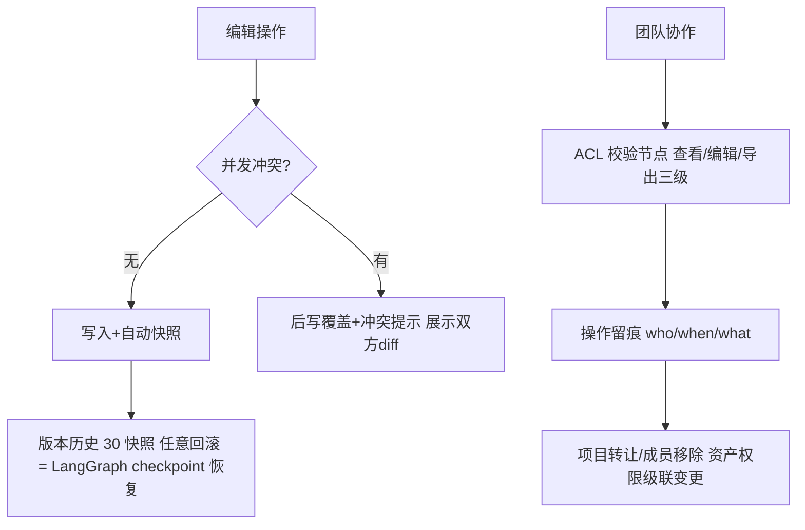

### F8.4 边界与异常六查

| 类别 | 场景 | 期望行为 |
|---|---|---|
| 空态 | 新项目无快照 | 仅展示当前状态，快照区显示"暂无历史版本" |
| 极值 | 快照达 30 上限 | 按策略淘汰最旧非手动快照；手动命名快照优先保留 |
| 并发 | 两人同时编辑同一镜头 | 后写覆盖 + 冲突提示，展示双方 diff，允许用户选择保留哪一版 |
| 失败 | 回滚时目标 checkpoint 已归档 | 从冷存储恢复（延迟可接受并提示），恢复失败则明确报错不静默 |
| 失败 | 快照写入失败 | 不阻塞主流程，记录告警并稍后重试，避免影响用户操作 |
| 权限 | 越权访问他人项目 | 编排器层拦截 `20003`，写 `audit_logs`；Agent 工具调用同样拦截 |
| 幂等 | 重复点击回滚 | 回滚动作幂等：目标快照相同则返回"已在目标版本" |
| 一致性 | 回滚后下游产物不一致 | 回滚同时解锁受影响的下游产物（分镜/任务），并提示用户需重新生成的范围 |

### F8.5 埋点

`project_created`、`project_snapshot_created`、`project_rollback_executed`、`project_state_changed`（含 from/to 状态）、`project_budget_consumed`、`member_invited`、`member_permission_changed`、`member_removed`、`operation_log_viewed`、`concurrent_conflict_detected`。

---

# 第 6 章 多智能体架构需求（承接 V2，作为实现约束）

> 本章内容来自 V2 第 0 章，全部保留。它是**实现层面的硬约束**，不是建议。

## 6.1 设计原则

1. **编排与执行分离**：LangGraph 负责确定性流程（状态流转、计费、权限、中断），LLM Agent 只在"需要智能"的节点运行，不让 LLM 决定扣费、权限等确定性逻辑。
2. **专职 Agent + 共享工作区**：每个环节由专职 DeepAgent 负责，通过虚拟文件系统（`/project/`）交换产物，避免长上下文互相污染。
3. **自检闭环**：所有生成类节点统一采用「生成 → 质检 → 不合格则修正（最多 N 轮）」循环，质检 Agent 是独立节点，不与生成节点同模型。
4. **人在关键环节**：剧本、角色形象、分镜、成片四个质量关口设置 HITL 中断，用户 approve / reject(带反馈) / edit。

## 6.2 Agent 角色总表

| Agent | 运行时 | 职责 | 主要工具 |
|---|---|---|---|
| 编排器 Orchestrator | LangGraph 图（非 LLM） | 路由、状态机、中断、计费守卫 | — |
| 编剧 Agent Screenwriter | DeepAgent | 一句话生成剧本、局部改写、分集拆分 | plan(规划)、剧本模板库、write_todos |
| 解析 Agent Parser | DeepAgent | 上传小说/剧本结构化解析、字段置信度标注 | 文档解析工具、剧本 Schema 校验 |
| 美术 Agent ArtDirector | DeepAgent | 角色形象/三视图/场景/道具生成与一致性维护 | 文生图、图生图、参考图注入 |
| 导演 Agent Director | DeepAgent（含子代理） | 剧本 → 分镜规划、机位逻辑、情绪节奏 | write_todos、分镜子代理（并行拆场） |
| 制片 Agent Producer | DeepAgent + 确定性队列 | 生成任务编排、模型路由、成本控制、失败重试 | 模型路由表、任务队列、比价器 |
| 质检 Agent QC | DeepAgent（视觉/文本双模态） | 角色一致性比对、画面质量、镜头合规 | CLIP 相似度、人脸比对、审核 API |
| 审核 Agent Compliance | DeepAgent | 剧本/画面/成片三重内容安全审核 | 内容安全 API、敏感词库 |
| 后期 Agent Post | DeepAgent | TTS 配音、字幕、配乐、混音、成片合成 | TTS、字幕引擎、音频混流 |
| 发行 Agent Distributor | DeepAgent | 导出参数、元数据生成、一键分发 | 导出服务、平台 OpenAPI |

> 计费不由 LLM Agent 处理：由 LangGraph 中的**确定性计费节点（积分预检/扣费/返还）**实现，Agent 只能申请任务预算。
>
> **V4.0 补充**：各 Agent 的输入契约（含字段缺失降级规则）、输出 JSON 关键字段、自检修正策略阶梯与 `human_feedback` 结构化注入格式，已细化为第 5 章 F2.8–F7.8，作为 07 技术方案的直接输入。

## 6.3 全局状态设计（LangGraph State）

```python
class ProjectState(TypedDict):
    # 身份与权限
    project_id: str
    user_id: str
    team_acl: dict            # 成员角色/权限
    credit_budget: int        # 本项目积分预算
    credit_spent: int

    # 创作产物（即虚拟文件系统的索引）
    script: Script | None             # 结构化剧本（集-场-对白）
    script_draft_versions: list       # 剧本版本历史
    assets: dict[AssetType, list[Asset]]   # 角色/场景/道具/音色
    shots: list[Shot]                 # 分镜列表
    shotboard: dict                   # 画布布局元数据

    # 执行态
    render_tasks: list[RenderTask]    # 生成任务队列
    render_results: dict[str, RenderOutput]
    timeline: Timeline | None         # 后期时间线
    final_cut: MediaRef | None        # 成片

    # 质量与合规
    qc_reports: dict[str, QCReport]
    compliance_flags: list[Flag]

    # 人机协同
    pending_approvals: list[ApprovalRequest]   # 待人工确认项
    human_feedback: str | None                 # 用户 reject 时的反馈
```

- 所有节点幂等：节点输出按 `project_id + 节点名 + 输入 hash` 落盘，重跑不重复扣费。
- Checkpoint：LangGraph Postgres Checkpointer，每一步自动快照 → 支持断点续跑、崩溃恢复、版本回滚（对应 F8.2）。

## 6.4 主流程图（LangGraph 主图）

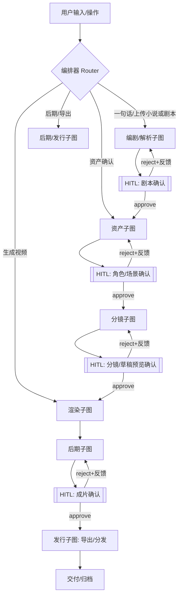

## 6.5 DeepAgents 能力映射

| DeepAgents 特性 | 在本产品中的用途 |
|---|---|
| `write_todos` 规划工具 | 编剧/导演/制片 Agent 对复杂任务先出计划，计划对用户可见（生成进度可解释） |
| 虚拟文件系统 | `/project/script.md`、`/assets/characters/苏婉/`（三视图 + 表情集）、`/shots/ep01/shot0037.json`，Agent 间唯一交换介质 |
| 子代理（subagents） | 导演 Agent 按"集"派生分镜子代理并行拆解；制片 Agent 派生逐镜头质检子代理 |
| 自检循环（iterate） | 美术/制片 Agent 内置 `生成 → 质检 → 修正` 工具链，不退出循环直到通过或达上限 |
| 长时任务上下文压缩 | 10 万字剧本解析时，Parser 只把结构化结果写入文件系统，后续 Agent 按需读取，不整本携带 |

## 6.6 成本控制护栏（Guardrails）

1. 每个渲染任务执行前必经**计费节点**：`credit_spent + 预估成本 ≤ budget` 才放行，否则中断提示充值。
2. 制片 Agent 的路由策略确定性执行：优先级 = 质量分 / 价格，用户可锁模型。
3. 单任务自动重试 ≤ 2 次，仍失败转人工或退积分（F5.5）。
4. 所有 Agent 的 prompt 注入项目预算与已消耗，超预算任务直接拒绝执行。

---

# 第 7 章 非功能需求

## 7.1 性能

| ID | 要求 | 目标值 | 说明 |
|---|---|---|---|
| NFR-P1 | 非生成类接口响应 | P95 ≤ 500ms，P99 ≤ 1.5s | 列表与详情类接口 |
| NFR-P2 | 生成任务队列等待 | P95 ≤ 90s | 从入队到开始执行 |
| NFR-P3 | SSE 事件推送延迟 | ≤ 2s | 任务状态变更到前端可见 |
| NFR-P4 | 分镜画布渲染 | 500 镜头下滚动与拖拽帧率 ≥ 30fps | 需虚拟化与分层渲染 |
| NFR-P5 | 剧本编辑器打开 | 10 万字剧本 ≤ 3s 完成首屏渲染 | 需分块渲染 |
| NFR-P6 | 文件上传 | 预签名直传，500MB 文件上传成功率 ≥ 99% | 分片 + 断点续传 |

## 7.2 可用性与可靠性

| ID | 要求 | 目标值 |
|---|---|---|
| NFR-A1 | 核心 API 可用性 | ≥ 99.5%（月度）【假设待确认】 |
| NFR-A2 | 断点恢复成功率 | 100%（任意 HITL 关口重启后状态完整） |
| NFR-A3 | 幂等正确性 | 重复请求不产生重复扣费与重复生成，专项测试全绿 |
| NFR-A4 | 数据持久性 | 用户创作产物零丢失；数据库 RPO ≤ 5 分钟、RTO ≤ 30 分钟【假设待确认】 |
| NFR-A5 | 长任务容错 | Worker 崩溃后任务自动恢复，用户无感知 |

## 7.3 安全

| ID | 要求 |
|---|---|
| NFR-S1 | 全站 HTTPS；敏感接口二次校验；登录态使用短期 access token + 可吊销 refresh token |
| NFR-S2 | 权限校验在服务端执行，含 Agent 工具调用；越权写审计日志 |
| NFR-S3 | 平台授权 token、支付密钥使用 AEAD 加密存储，密钥与数据分离管理 |
| NFR-S4 | 文件上传类型与内容双重校验（MIME + 魔数），防上传木马 |
| NFR-S5 | 防注入（参数化查询）、防越权（IDOR）、防重放（幂等键 + 时间戳）、防刷（限流） |
| NFR-S6 | 用户隐私数据最小化收集；照片等生物特征数据加密存储并明确使用范围 |

## 7.4 内容合规

| ID | 要求 |
|---|---|
| NFR-C1 | 三重内容安全审核：剧本（前置）、生成画面（生成后即时）、成片（合成后） |
| NFR-C2 | 判定为 `block` 的内容终止流程，明确告知原因，不提供绕过重试 |
| NFR-C3 | 真人形象使用必须完成授权留痕（时间戳 / IP / 协议版本），命中公共人物库直接拒绝 |
| NFR-C4 | 全部数据境内存储，模型调用走境内节点（Q7 待最终确认） |
| NFR-C5 | 保留审核记录以满足监管追溯（`moderation_records` 保留期 ≥ 6 个月） |
| NFR-C6 | **AI 生成内容标识（V4.0 新增，合规强制）**：依据《人工智能生成合成内容标识办法》，导出母版必须嵌入显式标识（片尾固定位置"本内容由 AI 辅助生成"，用户不可关闭），分发元数据携带隐式标识字段（与 Q14 隐形水印协同）；标识样式与位置由法务按最新规范出具口径【需法务确认】 |

## 7.5 成本与资源

| ID | 要求 |
|---|---|
| NFR-K1 | 成本预估偏差 ≤ 15%（M5） |
| NFR-K2 | 草稿模式成本 ≤ 正式生成的 15%【假设待确认，需实测】 |
| NFR-K3 | 自动重试与质检循环不得无界消耗：单任务总消耗上限 = 预估 × 1.5 |
| NFR-K4 | 冷数据（过期版本、归档项目）自动转冷存储，热存储占用可控 |

## 7.6 可维护性与可观测

| ID | 要求 |
|---|---|
| NFR-M1 | `trace_id` 从前端贯穿到模型调用，任一环节可定位 |
| NFR-M2 | 所有生成行为可在 `ai_call_logs` 复原（模型、参数、成本、耗时） |
| NFR-M3 | 核心业务指标有看板：任务成功率、成本偏差、一致性达标率、审核拦截率 |
| NFR-M4 | 日志结构化（JSON），字段规范统一；错误必须带错误码与 `request_id` |

## 7.7 兼容性与国际化

| ID | 要求 |
|---|---|
| NFR-I1 | 支持 Chrome/Edge ≥ 120；1280×800 起可用 |
| NFR-I2 | 界面文案集中管理，为 P1 多语言预留 i18n 结构 |
| NFR-I3 | 成片多语言（P1）保持时间线结构不变，仅替换语音轨与字幕轨 |

---

# 第 8 章 数据需求概要

完整设计见 `02_数据库设计文档_ER图与数据字典.md`，本章仅列需求侧约束：

| ID | 要求 |
|---|---|
| DR-1 | 所有生成产物必须落库可追溯：产物文件、生成参数、模型、成本、操作者 |
| DR-2 | 积分账本只追加不可修改，任何余额变动必须有对应流水 |
| DR-3 | 剧本、资产、分镜、时间线均需版本化，支持对比与回滚 |
| DR-4 | 审批记录需保存反馈原文与操作者，用于后续 Agent 输入与责任追溯 |
| DR-5 | 审计日志保留期 ≥ 12 个月；审核记录 ≥ 6 个月；冷数据归档策略见 02 文档 |
| DR-6 | 资产与项目解耦，支持跨项目引用（P1），引用关系需可级联失效 |
| DR-7 | 所有表具备 `created_at`/`updated_at`，支持软删除，满足审计要求 |
| DR-8 | 数据结构需支撑"集-场-镜头"三级下钻查询的性能要求（见 02 文档索引设计） |
| DR-9 | **V4.0 新增实体/字段**（明细见 02 文档增量章节）：`scripts.version_label / confidence_overall`、`script_runs`（run_status/completed_episodes，支撑生成终止按集结算）、`assets.labels / voice_status`、`asset_versions.variant_tag / revision_notes / cumulative_cost`、`face_authorizations.status`、`shots.locked / upstream_changed / redraft_count`、`director_notes.pacing_mode`、`storyboard_ops.op_history`、`voice_bindings.params / history`、`bgm_tracks.license_scope / expires_at`、`mix_profile.loudness_target`、`export_jobs.cache_key / name_template / expires_at / ai_label_applied`、`distributions.status / fail_reason_user / metadata_snapshot`；新表：`script_template_refs`、`storyboard_templates`、`export_presets`、`asset_search_logs`、`script_export_logs` |
| DR-10 | 强制通过镜头以 `render_tasks.manual_pass` 标记并从 M4 分母排除，原始质检得分保留（审计可溯） |
| DR-11 | 失败原因用户语言映射表为运营可配置数据（后台维护），技术码与用户文案分离存储 |
| DR-12 | 转码缓存键 = 成片版本 ID + 导出参数 hash；成片任何重新合成使缓存失效（F7 复用导出依据） |

---

# 第 9 章 埋点与数据分析需求

## 9.1 埋点规范

| 项 | 规范 |
|---|---|
| 命名 | 全小写 `snake_case`，动词过去式/名词短语，如 `script_approved` |
| 必带属性 | `user_id`、`project_id`（如适用）、`trace_id`、`timestamp`、`client_version` |
| 采集层 | 前端行为 + 服务端事件双写，以服务端为准（防丢失） |
| 隐私 | 不上报用户输入原文、照片等敏感内容，仅上报长度/类型/枚举 |

## 9.2 关键漏斗


对应指标：M1 激活率（A→B）、M2 TTFC（B→L 时长）、M3 各关口通过率（C→D、E→F、G→H、J→K）、CCCR（B→L 转化）。

## 9.3 指标到埋点的映射

| 指标 | 依赖埋点 |
|---|---|
| M1 激活率 | `user_register_success`、`project_created` |
| M2 TTFC | `project_created`、`export_downloaded`（时间差） |
| M3 一次通过率 | `script_approved`/`script_rejected`、`asset_approved`/`asset_rejected`、`storyboard_locked`/`storyboard_rejected`、`final_cut_approved`/`final_cut_rejected` |
| M4 一致性达标率 | `asset_generation_completed`、`render_task_succeeded`（含 qc 得分） |
| M5 成本偏差 | `render_batch_created`（预估）、`render_task_succeeded`（实际） |
| M6 自动成功率 | `render_task_succeeded`、`render_task_failed`、`render_retry_triggered` |
| M7 支付成功率 | `order_created`、`payment_succeeded` |
| M10 重抽率 | `asset_regenerated`、`storyboard_rejected` |
| M1/M3 补充（V4.0） | `script_template_applied`、`gate3_checklist_forced` |
| M5 补充（V4.0） | `script_generation_cancelled`、`render_batch_confirmed`（预估/实际差值） |
| M6 补充（V4.0） | `script_generation_failed`、`render_batch_retry_delayed` |
| M11 补充（V4.0） | `asset_regenerate_cost_warning_shown`、`render_budget_warning_80` |
| 合规审计（V4.0） | `ai_label_rendered`（目标覆盖率 100%）、`real_person_auth_revoked` |

---

# 第 10 章 验收要点与端到端测试场景

> 承接 V2 附录 C 的 5 项，扩展为 12 个可执行场景。每个场景必须可在预发环境复现。

| ID | 场景 | 步骤概要 | 通过标准 |
|---|---|---|---|
| E2E-01 | 断点续跑 | 在 4 个 HITL 关口分别关闭服务并重启 | 状态完整恢复，可继续审批，无数据丢失 |
| E2E-02 | 幂等重跑 | 同一生成请求重复提交 5 次 | 仅 1 次冻结、1 次生成、1 次扣费 |
| E2E-03 | 越权访问 | 成员 A 以多种方式尝试访问成员 B 的项目（含直接改 ID、Agent 工具链） | 编排器层拦截，返回 `20003`，`audit_logs` 有记录 |
| E2E-04 | 一致性抽检 | 同一角色跨 50 个镜头生成 | 人脸相似度达标率 ≥ 95% |
| E2E-05 | 成本偏差 | 一部 10 分钟短剧全流程 | 实际积分消耗与预估偏差 ≤ 15% |
| E2E-06 | 支付幂等 | 支付回调重复推送 10 次 | 积分仅入账 1 次，重复请求返回成功 |
| E2E-07 | 全额返还 | 制造模型不可用导致的任务失败 | 冻结积分全额解冻，流水正确 |
| E2E-08 | 并发透支防护 | 同一用户并发发起 10 个大额生成 | 冻结上限不超过余额，超限返回 `30001` |
| E2E-09 | 上游联动解锁 | 分镜锁定后修改剧本第 2 集 | 仅第 2 集镜头解锁，第 1/3 集与已生成视频保留 |
| E2E-10 | 审核阻断 | 提交含硬性违规内容的剧本 | 流程终止，`block` 等级明确告知，无绕过入口 |
| E2E-11 | 快照回滚 | 回滚到 3 个快照之前的版本 | `ProjectState` 完整恢复，下游产物一致解锁，回滚本身生成新快照 |
| E2E-12 | 长任务恢复 | 视频生成过程中 kill Worker | 任务自动恢复，仅重跑未完成镜头，无重复扣费 |

---

# 第 11 章 风险与依赖

| ID | 风险 | 类别 | 概率 | 影响 | 缓解措施 | 触发信号 |
|---|---|---|---|---|---|---|
| R-1 | 三方模型价格波动导致成本失控 | 商业 | 高 | 高 | 模型抽象层 + 路由可替换 + 单价配置化 + 预算熔断 | 单集成本环比上涨 > 20% |
| R-2 | 角色一致性不达标（< 90%） | 技术 | 中 | 高 | 锚点机制 + 质检闭环 + 阈值调优 + 人工兜底 | M4 指标连续 2 周未达标 |
| R-3 | 内容审核误杀率高导致用户流失 | 合规/体验 | 中 | 高 | 双通道审核 + 人工申诉 + 分级处置（`block` 才终止） | M13 > 3% |
| R-4 | 生成任务排队过久 | 技术 | 中 | 中 | 队列分级 + 优先级 + 并发按套餐分层 + 扩容预案 | NFR-P2 超标 |
| R-5 | 支付对账不平 | 财务 | 低 | 高 | 幂等回调 + T+1 对账 + 补单机制 + 告警 | 对账差异 > 0 |
| R-6 | 存储与带宽成本超预期 | 商业 | 中 | 中 | 生命周期规则 + 冷热分离 + CDN 缓存 + 版本数上限 3 | 存储月增 > 预算 20% |
| R-7 | 长剧本超上下文导致解析质量下降 | 技术 | 中 | 中 | 分段解析 + 只写结构化结果 + 按需读取 | 解析置信度均值 < 0.75 |
| R-8 | 长任务超时/卡死 | 技术 | 中 | 中 | 超时熔断 + 幂等重派 + 心跳检测 | 任务执行超 P95 3 倍 |
| R-9 | BGM/素材版权风险 | 法务 | 低 | 高 | 只用正版曲库 + 版权到期自动替换 + 授权留痕 | 收到侵权通知 |
| R-10 | 真人形象授权争议 | 法务 | 低 | 高 | 强制授权留痕 + 公共人物库拦截 + 使用范围明示 | 用户投诉 |
| R-11 | 团队协作并发冲突 | 产品 | 中 | 低 | 后写覆盖 + diff 提示 + 快照兜底 | 冲突率 > 5% |
| R-12 | 冷启动内容质量不足导致口碑差 | 产品 | 中 | 高 | 内置优质模板 + 分镜策略库 + 新手引导 + 人工精选案例 | M3 通过率 < 40% |

**关键依赖**见 2.4 节（D1–D7）。

---

# 第 12 章 待业务方拍板的问题

## 12.1 阻塞级（不拍板将阻塞开发）

| ID | 问题 | 影响范围 | 建议默认值（未拍板前按此设计） |
|---|---|---|---|
| Q1 | 积分与人民币兑换基准、首充赠送额度 | F1 计费、02、06 | 1 积分 = ¥0.01；注册赠 500 积分；首充加赠 10% |
| Q2 | 三方模型供应商名单与配额、是否需备选供应商 | F3/F5/F6、03、07 | 视频 2 家 + 图像 2 家 + TTS 2 家，配置化接入 |
| Q3 | 未成年人相关题材是否硬拦截 | F2/F5、合规 | 硬拦截，不提供绕过重试 |
| Q4 | BGM 曲库来源与版权归属 | F6、02 | 自建 200 首 + 三方授权，含版权到期字段 |
| Q5 | 支付渠道与主体资质、是否支持企业付款与发票 | F1、02、06 | 微信支付 + 支付宝；发票 P1 |
| Q6 | 单项目最大集数、单集时长区间 | F2/F4、02 | ≤ 30 集；单集 1–3 分钟 |
| Q7 | 数据存储地域与是否涉及数据出境 | 03、07、合规 | 全境内存储，模型调用境内节点 |
| Q8 | 单用户并发生成上限与队列配额 | F5、02 | free 2 / pro 5 / studio 10 |

## 12.2 非阻塞级（可在 P1 前确认）

| ID | 问题 | 影响范围 | 建议默认值 |
|---|---|---|---|
| Q9 | 套餐定价与权益梯度（4K、去水印、并发数） | F1、商业 | free 免费额度 / pro 月付 / studio 团队版，具体价格待定价评审 |
| Q10 | 是否提供免费试用期与邀请返积分 | 增长 | MVP 不提供邀请返利 |
| Q11 | 是否开放平台 API 供第三方调用 | 生态 | 不开放，P2 再评估 |
| Q12 | 用户产物的所有权与平台使用权条款 | 法务 | 产物归用户，平台仅获授权用于服务交付，条款需法务出具 |
| Q13 | 审核申诉通道与人工复核 SLA | 合规/客服 | 提供申诉入口，SLA 24h |
| Q14 | 是否需要在成片加入隐形水印（溯源） | 合规/技术 | P1 增加隐形水印，MVP 用可见水印 |
| Q15 | AI 生成内容显式标识的样式、位置与文案口径 | F7 导出、合规 | 依《人工智能生成合成内容标识办法》由法务出具；未出具前按片尾居中黑底白字实现【假设待验证】 |
| Q16 | 镜头级解锁 vs 整集解锁（GR-2 粒度） | F4/F5、02、06 | 默认整集解锁（实现简单），`shots.locked` 字段预留单镜头粒度 |
| Q17 | 人工强制通过是否计入 M4 一致性达标率分母 | F5、指标口径 | `manual_pass` 单独标记并从 M4 分母排除【假设待验证】 |
| Q18 | 插队功能是否计费及免费额度 | F5、F1 | 每批次免费 3 次，超出暂不计费仅限流【假设待验证】 |
| Q19 | 批次 80%/100% 预算预警阈值 | F5 | 80% 提醒 / 100% 暂停，触发顺序 GR-3 > NFR-K3 > 软暂停 > 提醒 |
| Q20 | 分发平台规则表与 OpenAPI 能力矩阵（时长/大小/撤回支持） | F7、运营 | 运营后台配置模块承接，P1 分发上线前完成主流平台调研 |

---

# 附录 A：LangGraph 节点清单（开发落地用）

| 节点类型 | 节点 | 实现 |
|---|---|---|
| 确定性节点 | 路由、计费预检/结算、Schema 校验、ACL、导出参数 | 纯代码 |
| LLM 节点 | 编剧、解析、美术、导演(+子代理)、制片、质检、审核、后期、发行 | DeepAgents `create_deep_agent` |
| HITL 中断 | 剧本/资产/分镜/成片 四处 | `interrupt()` + 前端审批台 |
| 子图 | 编剧子图、资产子图、分镜子图、渲染子图、后期子图、发行子图 | `StateGraph` 嵌套 |
| 循环边 | 质检 → 重生成（F3/F4/F5/F6） | 边条件：`qc.passed == false && retries < 3` |

# 附录 B：各 Agent 系统提示词框架（摘要）

每个 Agent 的系统提示词统一包含五段：

1. **角色与目标**（如导演：「你是竖屏短剧导演，精通 1–3 分钟叙事的钩子设计」）
2. **项目上下文**（从 `ProjectState` 注入：题材、画风、已锁定资产清单 ID）
3. **工作区约定**（可读/写路径、产物命名规范）
4. **预算与边界**（本项目剩余积分、不可执行的操作清单）
5. **输出契约**（结构化 JSON Schema，非法输出由校验节点打回）

完整提示词实例与 JSON Schema 见 `07_技术方案文档.md` 第 5 章。

# 附录 C：关键指标达标清单（发布门禁）

| 指标 | 门禁值 | 不达标处理 |
|---|---|---|
| M4 一致性达标率 | ≥ 95% | 阻塞 MVP 发布，调优阈值与锚点策略 |
| M5 成本偏差 | ≤ 15% | 阻塞 MVP 发布，修正预估公式 |
| M12 断点恢复成功率 | 100% | 阻塞 MVP 发布 |
| E2E-02 幂等重跑 | 全绿 | 阻塞 MVP 发布 |
| E2E-03 越权测试 | 全绿 | 阻塞 MVP 发布 |
| M6 自动成功率 | ≥ 92% | 可带风险发布，限定灰度 |
| M8 接口 P95 | ≤ 500ms | 可带风险发布，列入性能优化项 |

# 附录 D：需求追溯矩阵

| 需求 | 业务目标 | 关键验收 | 对应测试 | 关联文档 |
|---|---|---|---|---|
| F1 账号计费 | 问题 5、UV-4 | AC-F1-04-1、AC-F1-05-1 | E2E-06、E2E-07、E2E-08 | 02 域 B、06 计费模块 |
| F2 剧本 | 问题 1、UV-6 | AC-F2-01-1、AC-F2-04-1、AC-F2-06-1 | E2E-10 | 02 域 D、06 剧本模块 |
| F3 资产 | 问题 2、UV-2 | AC-F3-02-2、AC-F3-05-1、AC-F3-07-1 | E2E-04 | 02 域 E、06 资产模块 |
| F4 分镜 | 问题 1/3、UV-1 | AC-F4-03-1、AC-F4-06-2 | E2E-09 | 02 域 F、06 分镜模块 |
| F5 视频生成 | 问题 5、UV-4 | AC-F5-02-1、AC-F5-04-1、AC-F5-06-1 | E2E-07、E2E-12 | 02 域 G、06 生成模块 |
| F6 后期 | UV-5 | AC-F6-02-1、AC-F6-03-1 | — | 02 域 I、06 后期模块 |
| F7 导出分发 | UV-5 | AC-F7-01-1、AC-F7-02-1 | — | 02 域 J、06 导出模块 |
| F8 项目管理 | 问题 4、UV-3 | AC-F8-01-2、AC-F8-02-1 | E2E-01、E2E-03、E2E-11 | 02 域 C、06 项目模块 |
| NFR 非功能 | 全部 | 第 7 章各条 | E2E-01 ~ E2E-12 | 03 架构、07 技术方案 |

---

## 修订记录

| 版本 | 日期 | 编制 | 修订内容 |
|---|---|---|---|
| V1.0 | — | 产品 | 初版 PRD |
| V2.0 | — | 产品 | 升级为多智能体架构版：新增第 0 章多智能体总体架构、F1–F8 详细流程设计、HITL 断点 |
| V3.0 | 2026-10-08 | 产品经理 | 详细开发版：补齐产品概述与成功指标、范围与非目标、分期路线；F1–F8 改写为用户故事 + Given/When/Then 验收标准；新增边界异常六查、非功能需求量化目标、埋点体系、12 个端到端测试场景、风险登记册、14 项待拍板问题、需求追溯矩阵；技术基线固化为 Vue 3 + FastAPI + LangGraph + DeepAgents + PostgreSQL + Redis + Celery（取消 Kafka） |
| V4.0 | 2026-10-15 | 产品经理 | 开发落地版：并入文档 12 深度细化与文档 11 P0 细节功能——新增 26 条 US（F2-08~12/F3-08~12/F4-07~10/F5-07~10/F6-07~10/F7-06~09）、132 条 AC（既有全部保留）、F2 状态机重绘 + F3–F7 五个显式状态机（F2.5/F3.8/F4.8/F5.8/F6.7/F7.6）、六套 Agent 内部工作流契约（F2.8–F7.8）、69 个 EX 异常决策树场景（F2.9–F7.8）、35 个数据字段 + 5 张新表（第 8 章 DR-9~12）、42 个埋点、第 7.4 章 NFR-C6（AI 生成内容标识）、6 项 P0 细节功能并入 MVP 范围（2.1）、待拍板问题扩充至 20 项（Q15–Q20） |
