# 01 · AI 短剧创作工具 产品需求说明书 V6.0（配音先行与双模编排版）

| 项目 | 内容 |
|---|---|
| 产品名称 | 浮光造梦 · AI 短剧创作工具（GleamDream Studio） |
| 文档版本 | V6.0（配音先行与双模编排版） |
| 上一版本 | V5.0（业务流程细化版，2026-10-22） |
| 文档状态 | 待业务方评审（**三项阻塞级决策已于 2026-10-22 拍板：D-01 按镜头解锁 / D-02 配音关口强制 / D-03 节点视图 MVP 仅线性+分组**，见 12.4.1） |
| 编制 | 产品经理 |
| 评审方 | 业务负责人、技术负责人、法务/合规 |
| 契约依赖 | `00_文档总览与术语表.md`（术语、枚举、命名规范以该文件为准；V6.0 新增枚举与已拍板决策见 12.4，若与 00 冲突以 00 为准并回写 00） |
| 配套文档 | 02 数据库设计 / 03 系统架构设计 / 04 产品原型线框图 / 05 高保真页面描述清单 / 06 API 接口文档 / 07 技术方案 / 11 细节功能清单（SF）/ 12 深度细化原始稿（已并入本版） |
| 最近更新 | 2026-10-22 |

## V6.0 相对 V5.0 的修订说明

> **本次修订的主题**：把"视频生成链路"从「剧本 → 分镜 → 视频 → 后期（其中才配音）」改为「**剧本 → 配音 → 分镜（台词绑定）→ 视频 → 合成整集**」，并新增「**工作流链路**」——同一份分镜数据支持**节点式（工作流）**与**轨道式（常规剪辑）**两种编排视图，两种视图编译为同一份渲染计划、产出同一条成片。
>
> **修订方式的边界（延续 R23）**：V5.0 已有的 US / AC / EX / 状态机 / 编号**一律不删除、不改写**；链路调整通过"**新增条款 + 显式替代关系表**"表达，凡与旧条款冲突处，均以「V6.0 覆盖说明」逐条标注生效关系，避免研发面对两套口径。

| 编号 | 修订项 | 说明 |
|---|---|---|
| R24 | 生产链路重排（配音先行） | 新增 F9 配音轨模块，把 TTS 与逐句对齐从 F6 前移到「剧本之后、分镜之前」；F2 增产「台词清单 `script_lines`」，F4 增产「镜头—台词绑定」，F5 输入增「配音片段」；F6 职责收缩为「音字轨加工 + 成片质检」，整集合成移入 F10。旧链路以"兼容模式"保留（见 4.6.6） |
| R25 | 新增 F10 合成编排（工作流链路） | 新增「编排图 `composition_graph`」作为整集合成的唯一数据模型，提供**节点视图（Node View）**与**轨道视图（Track View）**两种编辑方式；两视图共用同一 `shots` 数据源与同一渲染计划编译器，以 `plan_hash` 保证结果一致（AC-F10-07-2 / EQ-3） |
| R26 | 新增第五关口：配音确认 | 新增 H-V（配音确认），位于关口一之后、与关口二（资产）**并行**；四关口扩为五关口，ProjectStatus 新增 `AWAITING_GATE_V`【假设待验证：枚举名以 00 契约为准】 |
| R27 | 计费点扩充 | 六消耗点扩为七消耗点，新增 **V（配音）**；合成渲染成本计入既有 **J（后期）**，不新增消耗点 |
| R28 | 新增 L1 横切能力层 | 新增第 5A 章：M0 连续性管理引擎（Story Bible + 六维连续性校验）、M1 三级质检中台（L1 单镜头 / L2 镜头间 / L3 跨集）、M2 结构化反馈中心；F2/F3/F4/F5 的增量条款以 M0 为事实源。该层承接"降返工 + 防穿帮"两大痛点的根因方案 |
| R29 | 时长权威源变更 | 新增 GR-11：镜头时长以**已生成配音的实测音频时长**为权威，取代"按字数估算"；原 AC-F4-02-2 / AC-F6-07-3 的冲突口径按 4.6.5 的替代表处理 |
| R30 | 编排语义分层 | 新增 GR-13：`shots.order_index`（叙事序）与 `composition_graph` 拓扑（合成序）**分离存储、显式同步**，杜绝两套顺序互相覆盖 |
| R31 | 解锁粒度已拍板 | **已拍板（2026-10-22，D-01）**：Q16 默认值由"整集解锁"改为"**按镜头解锁**"，由 M0 作为唯一变更广播源（GR-15）；采纳 V5.0 TBD-F4-01 建议 |
| R32 | 三项阻塞级决策闭环 | **已拍板（2026-10-22）**：D-01 按镜头解锁、D-02 配音关口强制（跳过只能走兼容模式）、D-03 节点视图 MVP 仅线性+分组。结论与落地影响见 12.4.1，正文相关条款已同步改写 |

## V5.0 相对 V4.0 的修订说明

| 编号 | 修订项 | 说明 |
|---|---|---|
| R19 | 零背景阅读支持 | 新增「文档阅读指南」（读者路径、术语速查、角色速查、图表约定、两条主线）与第 4.4 节「全链路时序总览」，使未接触项目背景的读者可先建立全局认知 |
| R20 | 逐功能业务流程细化 | F1–F8 每个功能末尾新增「端到端业务流程详解」（F1.8 / F2.11 / F3.12 / F4.12 / F5.12 / F6.11 / F7.10 / F8.6），统一包含九段：触发场景与前置条件、参与角色、业务流程图、时序图、用户操作步骤、系统处理逻辑、数据流转、异常分支、待确认点 |
| R21 | 图表与文字强对应 | 流程图统一采用 `P` 步骤编号，与「系统处理逻辑」表首列、时序图消息前缀逐一对应；`✋` 标注 HITL 关口，`⏱` 标注计费点，`⛔` 标注终态阻断 |
| R22 | 待确认点补充 | 流程细化中新发现的问题以 `TBD-Fx-nn` 编号就地标注，阻塞级问题汇总至 12.3（TBD-F1-01、TBD-F5-01、TBD-F7-01），原有 Q1–Q20 编号与取值不变 |
| R23 | 既有内容零改动 | V4.0 的需求 ID（US/AC/EX）、状态机、术语、章节编号与验收口径全部保留，V5.0 仅在对应功能末尾追加内容，不改写既有结论 |

## V4.0 相对 V3.0 的修订说明

| 编号 | 修订项 | 说明 |
|---|---|---|
| R11 | 用户故事补全 | F2–F7 新增 26 条 US（F2-08~12、F3-08~12、F4-07~10、F5-07~10、F6-07~10、F7-06~09），覆盖续写扩写、模板库、场景变体、批量重抽、节奏模式、仪表盘、逐角色调参、规格自检等关键场景 |
| R12 | 验收标准下探 | 新增 132 条 AC（全部 Given/When/Then），既有 AC 全部保留；下探至字段级（`final_prompt ≤ 500 字`、`duration_ms ∈ [1000,15000]`、字幕单句 ≤ 20 字、置信度 0.75）、数值级（退避 30s→120s、响度 -14 LUFS）与交互级（二次确认、SSE 事件） |
| R13 | 状态机细化 | F2 状态机重绘（新增 `generating/generating_failed`）；F3–F7 新增显式状态机（集级分镜、渲染任务、后期管线、导出任务、分发记录），每态含进入条件/可执行动作/出口条件，并映射 ProjectStatus 分段 |
| R14 | Agent 工作流契约 | 新增 F2.8–F7.8：六个 Agent 的输入契约（含缺失降级）、输出 JSON 关键字段、自检修正策略阶梯、human_feedback 结构化注入格式 |
| R15 | 异常决策树 | 边界六查升级为 69 个 `EX-` 编号场景（检测点→处置→用户反馈→计费影响→审计），补齐各环节超时基线与指数退避策略 |
| R16 | 数据与埋点 | 新增 35 个数据字段 + 5 张表（第 8 章 DR-9~12；字段明细见各模块与 02 文档增量）、42 个埋点（各模块 F_x.7） |
| R17 | 合规补强 | 新增 SF-F7-11/AC-F7-08-x：AI 生成内容显式标识（片尾固定嵌入，不可关闭）+ 隐式元数据标识，对接《人工智能生成合成内容标识办法》；第 7.4 节增补 NFR-C6 |
| R18 | 细节功能并入 | 文档 11 的 6 项 P0 细节功能（SF-F2-13 编辑器撤销、SF-F3-12 重抽成本透明、SF-F5-11 人工标记合格、SF-F5-13 失败原因翻译、SF-F6-03 单角色调参、SF-F7-11 AI 标识）并入 MVP 范围（2.1）；其余 SF 项见文档 11 按优先级排期 |

## V3.0 相对 V2.0 的修订说明

| 编号 | 修订项 | 说明 |
|---|---|---|
| R1 | 补齐需求前置 | 新增第 1 章产品概述（用户画像、核心问题、价值主张、成功指标），V2 直接进入架构，缺失"为谁做、做成了算不算成功" |
| R2 | 明确范围边界 | 新增第 2 章范围与非目标、分期路线（MVP/P1/P2），防止范围蔓延 |
| R3 | 需求结构化 | F1–F8 全部改写为"用户故事 + Given/When/Then 验收标准"，每条可测可验，V2 以流程描述为主、缺验收口径 |
| R4 | 补齐边界异常 | 每个功能新增"边界与异常六查"（空态/极值/并发/失败/权限/幂等），V2 仅覆盖部分异常分支 |
| R5 | 补全非功能需求 | 新增第 7 章性能、可用性、安全、合规、成本、可维护性量化目标 |
| R6 | 新增埋点与分析 | 新增第 9 章埋点清单，支撑成功指标的观测 |
| R7 | 扩写验收测试 | 第 10 章在 V2 附录 C 的 5 项基础上扩展为 12 个端到端测试场景 |
| R8 | 汇总待确认问题 | 第 12 章汇总 8 个阻塞级 + 6 个非阻塞级待拍板问题，明确未拍板前的默认取值 |
| R9 | 技术基线固化 | 承接 `00` 契约：Vue 3 + FastAPI + LangGraph + DeepAgents + PostgreSQL + Redis + Celery（**取消 Kafka**，见 ADR-01） |
| R10 | 需求追溯 | 新增附录 D 需求追溯矩阵，把需求 ID、业务目标、验收标准、测试场景、所属文档串起来 |

> **V2 内容保留策略**：V2 的「多智能体总体架构」「Agent 角色总表」「全局状态设计」「主流程图」「成本护栏」全部保留并迁入本文件第 6 章，作为非功能约束与实现约束；V2 各 Feature 的流程图与异常分支表全部保留并合并进第 5 章对应章节。

---

# 文档阅读指南（V5.0 新增，V6.0 增补 0.6）

> 本章不属于产品需求，供第一次接触本项目的人建立共同语言。已熟悉项目的读者可直接跳到第 4 章与第 5 章。

## 0.1 按角色选择阅读路径

| 读者 | 建议路径 | 读完能回答的问题 |
|---|---|---|
| 业务方 / 投资方 | 1.1–1.6 → 2.1–2.3 → 4.1 → 5 章各功能的 `Fx.1 目标` 与 `Fx.2 用户故事` | 产品为谁做、怎么做成、哪些不做 |
| 产品 / 设计 | 第 4 章 → 第 5 章目标功能的全节（含该功能末尾的「端到端业务流程详解」）→ 第 12 章 | 某个功能何时触发、谁操作、异常怎么处理 |
| 研发 | 文档阅读指南 → 4.3 全局规则 → 目标功能全节 → 第 6 章 → 附录 A | 状态怎么流转、幂等键是什么、失败怎么退 |
| 测试 | 目标功能的 AC 表 → `Fx.9 异常决策树` → 该功能末尾的「端到端业务流程详解」→ 第 10 章 | 每个分支的期望行为与可判定口径 |
| 法务 / 合规 | 1.2、2.4、7.4、F3.5–F3.13（真人授权与锚点）、F7（AI 标识）、第 12 章（含 12.4 决策记录） | 哪些动作需要留痕、哪些内容必须拦截 |

> **V6.0 增补路径（若你只关心本次变更）**：先读 **0.6（三个概念）→ 4.1.1（新链路图）→ 4.6（链路与两种合成方式）→ F9 / F10 的目标与用户故事 → 12.4（已拍板结论 + 剩余待定）→ 第 13 章（排期）**，约 40 分钟可掌握全貌；其余章节为增量细节。

## 0.2 术语速查

| 术语 | 一句话解释 | 首次定义 |
|---|---|---|
| 项目（Project） | 一部短剧的最小管理单位，承载剧本、资产、分镜、成片与预算 | 第 1 章 |
| 集 / 场 / 镜头 | 三级下钻结构：一集含若干场，一场拆成若干镜头 | F2.8、F4.9 |
| 关口（HITL） | 需要人确认的四个质量检查点（剧本 / 资产 / 分镜 / 成片） | 4.2 |
| 审批台 | 承载各关口待办的界面，用户在此 approve / reject / edit（V6.0 为五个关口） | 4.2 |
| Agent | 具备规划与工具调用能力的智能体，只做"需要智能"的事 | 6.2 |
| 确定性节点 | 纯代码实现、不调用 LLM 的节点（计费、校验、ACL、路由） | 6.1 |
| 冻结 | 在执行前把预估积分从可用余额划入冻结额，防止透支 | F1.4 S4 |
| 结算 | 任务成功后按实际消耗扣减冻结积分 | F1.5 |
| 返还 | 任务失败或取消后把冻结积分退回可用余额（GR-4） | F1.5 |
| 幂等键 | 用于判定"同一请求"的唯一标识，命中即返回首次结果（GR-6） | 4.3 |
| 资产锚点 | 角色三视图等固定参考图，后续镜头生成强制引用以保一致性 | F3 AD-1 |
| 草稿模式 | 用"关键帧 + 配音 + 字幕"拼出的低成本样片，先验证叙事再花钱 | F4.5 SD-1 |
| 渲染任务清单 | 分镜锁定后为每个镜头生成的一条待生成任务 | F4.4 S7 |
| 母版 | 审核通过后生成的无水印高清成片，是导出的唯一来源 | F6.7 |
| 快照 | 项目状态在某一时刻的完整副本，可回滚 | F8.1 |
| 任务中心 | 展示视频生成六态计数与进度的页面 | F5.11 |
| SSE | 服务端向浏览器单向推送事件的通道，用于进度与状态刷新 | NFR-P3 |
| 置信度 | 上传解析时每个字段"识别正确"的可信程度，低于 0.75 需人工校正 | F2.3 |
| `face_score` | 人脸 embedding 余弦相似度，衡量角色一致性（默认阈值 0.80） | F3.2 |
| `manual_pass` | 人工强制标记质检合格的标记，单独统计、不参与 M4 分母 | F5.9 |
| 消耗点 D/V/E/G/I/J/K | 剧本 / **配音** / 资产 / 草稿模式 / 视频 / 后期（含合成渲染）/ 导出 **七个**计费发生点（V6.0 由六个扩为七个） | 4.1 |
| 台词条 `script_line` | 剧本中一句可被独立配音的最小单元：`{speaker, text, emotion, est_ms}`，是配音与镜头绑定的共同原子 | F2.12 |
| 配音轨 `voice_track` | 一集之内由全部台词条的音频片段拼成的音轨，含逐句 `start_ms / end_ms / actual_ms` 与词级时间戳 | F9 |
| 台词绑定 `line_binding` | 镜头与台词条的多对多绑定关系（一个镜头可含 0–n 句台词），是"为分镜选择对应台词"的落地数据结构 | F4.13 |
| 时长权威 | V6.0 原则：镜头时长由所绑台词的**实测音频时长**推导，而非由字数估算（GR-11） | 4.3 |
| 编排图 `composition_graph` | 一集"怎么拼成片"的唯一数据模型：节点（片段/分组/字幕/音轨）+ 边（转场与顺序） | F10.2 |
| 轨道视图 Track View | 常规剪辑器视图（多条时间轨、可拖拽/切分/吸附），是编排图的一种**线性特化投影** | F10.4 |
| 节点视图 Node View | 工作流链路视图（节点 + 连线，可分组、可并列、可分支），是编排图的**全拓扑编辑视图** | F10.5 |
| 渲染计划 `render_plan` | 编排图经确定性编译器产出的可执行渲染指令集（滤镜图 + 时间轴 + 混音参数） | F10.7 |
| `plan_hash` | `render_plan` 的规范化哈希；同构图必同 hash，同 hash 直接复用渲染产物（幂等与"结果一致"的判定依据） | F10.7 |
| 时长漂移 `duration_drift` | 重配音后台词音频时长变化，超出吸收阈值、导致镜头需重生成的状态标记 | F9.6 |
| Story Bible | 全项目唯一事实源：角色/场景/道具在每个场次的状态快照，驱动连续性校验与变更广播 | 5A.2 |

## 0.3 角色速查（谁在流程里做事）

| 角色 | 类型 | 在流程中的职责 | 明确不负责 |
|---|---|---|---|
| 用户 | 人 | 触发流程、做五关口决策、付费、导出分发 | 不能改余额、不能绕过审核 |
| 平台运营 | 人（内部） | 维护模型单价、审核策略、曲库、音色库、失败文案映射表 | 不参与单个项目创作 |
| 编排器 Orchestrator | 确定性 | 路由、状态机、HITL 中断、计费守卫、权限拦截 | 不做内容生成 |
| 计费服务 | 确定性 | 预估、冻结、结算、返还、写流水 | 不调用 LLM（F1.4 S4） |
| 任务执行器 / 队列 | 确定性 | 生成任务排队、调度、重试、崩溃恢复 | 不做质量判断 |
| 编剧 / 解析 Agent | LLM | 一句话生成剧本、上传解析、局部改写 | 不扣费、不决定审核结论 |
| 美术 Agent | LLM | 角色 / 场景 / 道具生成与一致性维护 | 不做真人授权判定 |
| 导演 Agent（含子代理） | LLM | 剧本转分镜、机位与节奏策略 | 不直接调用视频模型 |
| 配音 Agent Voice（V6.0 新增） | LLM + TTS | 台词断句与情绪标注、逐句 TTS、词级对齐、配音轨组装与时长回报 | 不改台词文本、不自行改镜头时长（只回报实测时长，由 GR-11 推导） |
| 制片 Agent | LLM + 队列 | 批量编排、模型路由、预算感知 | 不执行确定性路由代码（RC-2） |
| 质检 Agent | LLM（双模态） | 一致性、画面质量、合规检查 | 不修改产物，只输出报告 |
| 审核 Agent | LLM + 审核 API | 剧本 / 画面 / 成片三重内容安全审核 | 不提供绕过通道（GR-7） |
| 后期 Agent | LLM | 字幕、配乐、混音、成片质检（V6.0：配音前移至配音 Agent，整集合成由编排编译器执行） | 不改镜头时长（V6.0 由 GR-11 替代 AC-F6-07-3 的口径） |
| 编排编译器 Compiler（V6.0 新增） | 确定性 | 把 `composition_graph` 编译为 `render_plan`、计算 `plan_hash`、驱动渲染 | 不做创作判断、不调用 LLM（GR-12） |
| 发行 Agent | LLM | 导出参数、元数据、一键分发 | 不改规格自检结论 |
| 三方服务 | 外部 | 模型、TTS、曲库、支付、平台 OpenAPI | — |

## 0.4 图表阅读约定

1. 每个功能的「端到端业务流程详解」固定包含九段：触发场景与前置条件、参与角色、业务流程图、时序图、用户操作步骤、系统处理逻辑、数据流转、异常分支、待确认点。
2. 业务流程图节点统一编号 `P1…Pn`（Process）；「系统处理逻辑」表首列与之一一对应；时序图消息以同一编号开头，三处编号含义完全相同。
3. 图中标记：`⏱` 计费点（冻结或扣费）、`✋` HITL 关口、`⛔` 不可恢复的阻断终态、`◇` 外部服务依赖。
4. 时序图中 `alt / else` 表示互斥分支，`opt` 表示可选分支，`loop` 表示重复或按集循环；并行在图中以文字注明，避免图面过宽。
5. 异常分支表最后一列给出对应条款（`AC-` / `EX-` / `Q`），便于回查原验收口径；V5.0 新发现的待确认点使用 `TBD-Fx-nn`，汇总见 12.3。
6. 本文件中"审核"一律指内容安全审核（NFR-C1），"审批"一律指五个关口的业务确认（V6.0 由四关口扩为五关口），二者不可混用。
7. V6.0 新增的 `F9 / F10` 编号**不与流程顺序严格对应**（沿用既有编号以保证引用稳定）；真实执行顺序以 4.6「生产链路总览」为准。

## 0.5 主干线与新增导读

- **创作主线（V6.0 重排）**：一句话 / 上传 → 剧本（含台词清单）→ **配音** → 分镜（绑定台词、按音频定镜头时长）→ 视频生成 → **合成编排（轨道 / 节点）** → 音字轨与质检 → 导出 → 分发。每一步的产物是下一步的输入，上游锁定后下游才能开始（GR-2）。
- **资金主线**：预估 → 冻结 → 执行 → 成功则结算、失败则返还。**七个**消耗点（D 剧本 / V 配音 / E 资产 / G 草稿 / I 视频 / J 后期含合成 / K 导出）入口必过冻结节点，形成"扣费与任务一一对应"的闭环。
- **权限主线**：团队角色 × 项目三级权限（view / edit / export）取交集，服务端校验（PR-1、PR-2）。前端隐藏按钮只是体验优化。
- **编排主线（V6.0 新增）**：一集"怎么拼成片"只有一份数据（`composition_graph`），两种视图（轨道 / 节点）只是同一份数据的两种编辑界面；所有合成请求都必须经过同一个编译器产出 `render_plan`，再由 `plan_hash` 决定是否复用既有产物。

## 0.6 V6.0 三个必须先理解的概念

> 这三个概念决定了 V6.0 的绝大部分增量条款，读第 5 章前建议先读完本节（约 3 分钟）。

**概念一：配音先行 —— 声音是时长的权威，不是分镜的附属品**

V5.0 的链路是"先拆镜头（按字数估时长）→ 生成视频 → 最后才配音"，代价是：配音在最后一步才产出真实时长，语速一调就顶爆镜头时长（AC-F6-07-3 的经典冲突），只能回退解锁分镜、重生成视频。V6.0 把配音提到分镜之前，让**实测音频时长**成为镜头时长的计算依据（GR-11），于是"台词说不完"这类返工从"事后发现"变成"结构上不可能发生"。

**概念二：叙事序 ≠ 合成序**

分镜的 `order_index` 是**叙事顺序**（第 3 镜在第 4 镜之前，这是剧本逻辑）；合成编排的拓扑是**播放顺序**（用户可自由重排、分组、并列）。两者分离存储（GR-13）：拖轨道不会偷偷改剧本顺序，改叙事顺序也不会打乱用户精心排好的合成结构；需要互相影响时，必须走显式动作 + 二次确认。

**概念三：两种编排视图 = 同一份图的两种画法**

- **轨道视图**：像常规剪辑软件，一条主轨串起镜头，能拖、能切、能吸附，适合"把镜头按顺序拼起来并精修节奏"。
- **节点视图**：像工作流画布，镜片是节点、顺序是连线，能分组折叠、并列合成、分支多版本，适合"设计一条可复用的生产/叙事结构"。
- **一致性的工程保证**：两者读写同一份 `composition_graph`；把它交给同一个**确定性编译器**，得到同一份 `render_plan`；`render_plan` 的规范化哈希（`plan_hash`）相同即视为"同一条成片"，渲染任务按 `plan_hash` 幂等复用。因此"两种方式结果一致"不是承诺，而是可被 E2E-15 判定的事实（同构 100% 同 hash、逐帧 SSIM = 1.0）。

---

# 第 1 章 产品概述

## 1.1 一句话定位

**面向短剧内容生产者的一站式 AI 创作工具：从一句话创意出发，自动完成剧本、角色、分镜、视频、配音、配乐、字幕、成片与分发，把"一部短剧"的生产从"多人协作数周"压缩到"单人操作数小时"。**

## 1.2 背景与问题

短剧内容生产的现状痛点（以下为行业共识性描述，**具体量化数据待补充调研，标注为【假设待验证】**）：

| 编号 | 痛点 | 谁受影响 | 现状替代方案 | 为什么不够好 |
|---|---|---|---|---|
| PB-1 | 剧本到分镜的"翻译"高度依赖人工经验 | 编剧、导演、制片 | 人工写分镜表、导演口头交代 | 产能瓶颈，1 集 2 分钟短剧分镜耗时 2–4 小时 【假设待验证】 |
| PB-2 | AI 生成内容角色不一致 | 所有 AI 工具使用者 | 反复重抽、垫图、LoRA 训练 | 一致性靠概率，跨镜头漂移明显，返工成本高 |
| PB-3 | AI 工具链割裂 | 个人创作者 | 剧本用 A 工具、图像用 B、视频用 C、配音用 D、剪辑用 E | 文件在工具间手工搬运，元数据与资产无法复用 |
| PB-4 | 生成成本不可控 | 付费创作者 | 逐次试错，先花钱再发现问题 | 叙事错误在"视频生成"这一最贵环节才暴露 |
| PB-5 | 长流程中断即前功尽弃 | 所有使用者 | 重新开始 | 缺少断点续跑与状态持久化 |
| PB-6 | 合规风险不自知 | 面向平台分发者 | 上传后被平台拦截或封号 | 缺少前置审核与授权留痕 |

## 1.3 目标用户与画像

按"是否需要协作、产量高低"划分三类主用户，**每一类都需在 MVP 上线后通过访谈验证，当前为待验证假设**。

| 画像 | 代号 | 特征 | 核心诉求 | 付费意愿 | 关键成功体验 |
|---|---|---|---|---|---|
| 个人创作者 | P-独立 | 1 人，兼职或自由职业，月产 2–10 集，无固定团队 | 少花钱、少返工、全流程不切换工具 | 中（订阅 + 按量积分） | 一句话 → 当天能拿到成片 |
| 小型工作室 | P-工作室 | 3–10 人，有编剧/剪辑分工，月产 30–100 集 | 角色一致性、团队协作、成本可预测、可交付 | 高（团队版订阅） | 项目状态透明、成员权限清晰、成本可核算 |
| MCN / 内容运营 | P-运营 | 批量矩阵号运营，月产 100+ 集 | 批量生产、模板化、一键分发、数据回链 | 高 | 批量导出与分发效率 |

**非目标用户（本期明确不服务）**：影视级长剧制作团队、需要精细 AI 换脸/数字人直播的场景、需要离线私有化部署的机构客户。

## 1.4 要解决的核心问题（本轮产品要回答的问题）

1. 能否让**没有导演经验的个人**也能得到"叙事成立"的分镜？
2. 能否让**角色在跨 50 个镜头**后仍被识别为同一人？
3. 能否让用户在**花大钱之前**先发现"叙事错了"？
4. 能否让**长流程中断/崩溃**后不重来、不重复扣费？
5. 能否让**成本在生成前可预知**、生成后偏差可控？
6. **（V6.0）** 能否让"台词说不完 / 配音顶爆镜头"这类**时长冲突在生成前就不发生**？（→ 配音先行 + 音频驱动时长，F9 + F4.13 + GR-11）
7. **（V6.0）** 能否让"创作者想要的非线性结构（多版本、分组复用、分屏并列）"与"剪辑师习惯的线性轨道"**共用一条成片，而不是两套产物**？（→ F10 编排图 + 双视图 + 单一编译器）

> 对应解法：问题 1 → F4 智能分镜 + 草稿模式；问题 2 → F3 资产锚点 + 质检闭环；问题 3 → F4.6 草稿模式（静帧预览）；问题 4 → F8 快照与断点续跑 + 幂等；问题 5 → F1 冻结-结算 + F5 预算感知编排；问题 6 → F9 配音轨 + F4.13 台词绑定 + GR-11 时长权威；问题 7 → F10 合成编排（4.6 双视图 + F10.7 单一编译器 + `plan_hash`）。

## 1.5 价值主张与差异化（待竞品验证）

产品对外可宣称的差异化主张，**上线前需完成竞品拆解验证**（对应 `lynxce-competitor-analysis` 工作项，本文档不编造竞品数据）：

| 编号 | 主张 | 支撑能力 |
|---|---|---|
| UV-1 | "先预览再付费"：叙事确认发生在最便宜环节 | F4.6 草稿模式 |
| UV-2 | "锚点一致性"：不靠 prompt 撞运气 | F3 三视图锚点 + 人脸向量比对 |
| UV-3 | "断点不重来"：任意关口可中断可恢复 | F8 快照 + Checkpoint |
| UV-4 | "成本可预知"：生成前报价、失败全额返还 | F1 冻结-结算 |
| UV-5 | "一条流水线"：剧本到分发不换工具 | F1–F8 全链路 |
| UV-6 | "合规前置"：审核在生成前，不是上传后 | F2.5 前置审核 + F3 真人授权留痕 |
| UV-7 | （V6.0）"配音先行"：先让声音把时长定下来，再让画面去适配，而不是反过来 | F9 配音轨 + F4.13 台词绑定 + GR-11 |
| UV-8 | （V6.0）"一种结构，两种画法"：工作流式与轨道式编排共用一条成片 | F10 编排图 + 双视图 + `plan_hash` 幂等 |

## 1.6 成功衡量指标

**北极星指标**

> **创意到成片完成率（Creative-to-Cut Completion Rate，CCCR）** = 在 7 天内从创建项目走到"已下载成片"的项目数 ÷ 创建项目数
> 目标：MVP 上线后 30 天内 ≥ 35%（**取值为假设，需上线后按实测校准**）

**一级指标（决定产品是否成立）**

| 编号 | 指标 | 定义 | 目标值 | 观测方式 |
|---|---|---|---|---|
| M1 | 激活率 | 注册后 24h 内创建首个项目的用户占比 | ≥ 60% | 埋点漏斗 |
| M2 | 首次成片时长（TTFC） | 从创建项目到首次导出成片的时长中位数（10 集基准） | ≤ 3 小时 | 埋点计时 |
| M3 | HITL 一次通过率 | 各关口首次 approve 占比（V6.0 五关口：剧本/配音/资产/分镜/成片） | 55% / **60%【V6.0 假设】** / 60% / 50% / 70% | 审批表统计 |
| M4 | 角色一致性达标率 | 同一角色跨 50 镜头的质检通过率 | ≥ 95% | `qc_reports` 统计 |
| M5 | 成本预估偏差 | │实际 − 预估│ ÷ 预估 | ≤ 15% | `render_tasks` 对比 |
| M6 | 生成任务自动成功率 | 无需人工介入即成功（含自动重试成功） | ≥ 92% | `render_tasks` 统计 |
| M7 | 支付成功率 | 支付回调成功入账 ÷ 发起支付 | ≥ 99% | `payments` 统计 |

**二级指标（决定体验是否好用）**

| 编号 | 指标 | 目标值 |
|---|---|---|
| M8 | 非生成类接口 P95 响应时间 | ≤ 500 ms |
| M9 | 生成任务队列等待 P95 | ≤ 90 s |
| M10 | 重抽率（reject 后重新生成的比例） | ≤ 30% |
| M11 | 单集平均积分消耗 | 按模型单价基线核算，波动 ≤ 20% |
| M12 | 项目断点恢复成功率 | 100%（幂等与回滚专项测试必须全绿） |
| M13 | 内容审核拦截导致的用户流失率 | ≤ 3% |

**V6.0 新增指标（决定"配音先行 + 双模编排"是否成立）**

| 编号 | 指标 | 定义 | 目标值 | 观测方式 |
|---|---|---|---|---|
| M14 | 双视图一致性 | 同构拓扑下，轨道视图与节点视图产出的 `plan_hash` 相同占比；抽样渲染逐帧 SSIM | 100% / SSIM = 1.00 | E2E-15 + `render_plans` |
| M15 | 配音一次通过率 | 配音关口（H-V）首次 approve 占比 | ≥ 75%（**假设，需实测校准**） | 审批表统计 |
| M16 | 时长漂移率 | 重配音后触发 `duration_drift` 的镜头数 ÷ 已绑定台词镜头数 | ≤ 8%（**假设**） | `shots.duration_drift` 统计 |
| M17 | 编排无损切换率 | 节点 → 轨道切换时无需"线性化丢弃结构"的占比 | ≥ 70%（**假设**） | `composition_switch_logs` |
| M18 | 合成返工率 | 合成后进入 H4 前被质检打回的集数占比 | ≤ 10%（**假设**） | `qc_reports` + `final_cut_rejected` |

---

# 第 2 章 范围与非目标

## 2.1 本期范围（In Scope）

| 域 | 编号 | 能力 | 分期 |
|---|---|---|---|
| 账号计费 | F1 | 手机号/微信登录、积分账户、套餐订阅、充值、冻结-结算-返还、预算与权限 | MVP 基础 + P1 团队 |
| 剧本 | F2 | 一句话生成、小说/剧本上传解析、分集、局部改写、前置审核、结构化编辑、**台词清单结构化（V6.0）** | MVP |
| **配音** | **F9** | **台词断句与情绪标注、逐角色音色 TTS、词级对齐、配音轨、时长回报、配音关口（V6.0）** | **MVP** |
| 资产 | F3 | 角色/场景/道具规划、主形象、三视图、表情集、一致性质检、音色绑定、真人授权 | MVP |
| 分镜 | F4 | 全剧策略、按集拆解、镜头参数、草稿模式预览、画布编辑、锁定、**台词绑定与音频驱动时长（V6.0）** | MVP |
| 视频生成 | F5 | 批量编排、模型路由、队列、质检闭环、版本管理、失败重试与返还、**音画对齐输入（V6.0）** | MVP |
| **合成编排** | **F10** | **编排图、轨道视图、节点视图、转场与分组、渲染计划编译、`plan_hash` 幂等、整集合成（V6.0）** | **MVP：轨道视图 + 线性图；P1：节点视图进阶（分组复用 / 并列 / 分支）** |
| 后期 | F6 | TTS 配音（V6.0 前移至 F9）、字幕、BGM、混音、合成（合成移入 F10）、成片质检 | MVP 基础 + P1 多语言 |
| 导出分发 | F7 | 母版导出、分辨率与水印策略、元数据、一键分发 | MVP 导出 + P1 分发 |
| 项目管理 | F8 | 状态流转、快照与回滚、团队成员与 ACL、审计留痕 | MVP 快照 + P1 协作 |

> **V4.0 范围补充**：以下 6 项 P0 细节功能（源自文档 11）并入 MVP 必做范围——SF-F2-13 剧本编辑器撤销/重做、SF-F3-12 重抽成本透明（本次预估 + 累计消耗）、SF-F5-11 质检人工标记合格强制通过（留痕）、SF-F5-13 失败原因用户语言翻译、SF-F6-03 单角色 TTS 试听调参、SF-F7-11 AI 生成内容标识（合规强制）。其余 SF 细节功能按文档 11 的 P1/P2 分期排期。
>
> **V6.0 范围补充（三项拍板 D-01/D-02/D-03 已生效）**：F9 配音轨、F4.13 台词绑定、F10 轨道视图 + 线性编排图、GR-11~GR-16 六条新规则、第 5A 章 M0（Story Bible 与六维连续性校验，MVP 限 L1/L2 级）为 **MVP 必做**。**D-03 已拍板**：MVP 节点视图**只做"线性节点 + 分组 + 排序"**，与轨道视图能力等价（两条路径都能独立走通闭环）；**分组宏节点复用、并列分屏、分支多版本全部为 P1**，MVP 不实现、不验收（AC-F10-05-7 等标注 P1 的条款不纳入 MVP 门禁）。
>
> **D-01 / D-02 对 MVP 的直接约束**：① 按镜头解锁要求 `shot_line_bindings` 与 M0 影响集合计算**同期交付**（不得延后，否则退化为整集解锁）；② 配音关口强制要求 F9 与 F4 的入口校验、状态机、兼容模式切换必须一次做齐，不允许"先放行后补校验"。

## 2.2 明确非目标（Out of Scope，本期不做）

| 编号 | 非目标 | 原因 | 何时重新评估 |
|---|---|---|---|
| NG-1 | 桌面客户端与移动 App | Web 优先已验证；桌面端剪辑是独立战场 | P2 之后按需求验证 |
| NG-2 | 微信小程序端 | 画布类重交互在移动端体验差 | P2 之后 |
| NG-3 | 数字人直播 / 实时换脸 | 合规风险高，与短剧生产链路不同 | 不评估 |
| NG-4 | 自研基础模型训练（如 LoRA 训练平台） | 成本极高，先用三方模型 + 锚点方案 | P2 之后按一致性实测结果决定 |
| NG-5 | 多人实时协同编辑（CRDT） | 复杂度高，P1 用"后写覆盖 + 冲突提示"替代 | P2（画布协同） |
| NG-6 | 版权音乐发行 / 收益分成 | 商业模式未验证 | 不评估 |
| NG-7 | 私有化部署 | 与 SaaS 商业模式冲突 | 视 B 端需求个案评估 |
| NG-8 | 发票与财务对账系统 | MVP 用人工处理，财务系统对接后置 | P1 |
| NG-9 | 平台内容数据分析（播放/完播回流） | 依赖平台 OpenAPI 权限，先做分发记录回链 | P2 |
| NG-10 | （V6.0）互动剧播放端（观众端分支选择、互动播放器） | 节点视图可产出分支结构，但**消费分支的播放器**属于发行侧的另一个战场 | P2 之后按平台支持度评估 |
| NG-11 | （V6.0）完整替代专业 NLE（多机位、调色、关键帧动画、复杂特效） | 轨道视图的目标是"合成编排"而非"专业剪辑"，避免与剪映/Pr 正面竞争 | 不评估；P2 已列剪映草稿导出 |

## 2.3 分期路线图

| 分期 | 目标 | 范围 | 出口标准 |
|---|---|---|---|
| **MVP** | 跑通单人端到端闭环（**V6.0：以配音先行为默认链路，配音关口强制——D-02**） | F1 基础、F2（含台词清单）、**F9 配音轨**、F3、F4（含台词绑定 + 草稿模式）、F5、**F10 轨道视图 + 线性编排图 + 节点视图（仅线性+分组，D-03）**、F6 音字轨与质检、F7 导出、F8 快照、**5A 的 M0（L1/L2 级，按镜头解锁 D-01）** | 单用户可在 Web 端从一句话创意走到下载成片；五关口贯通；M2/M4/M5/M12/**M14/M15** 达标；E2E-15 双视图一致性全绿 |
| **P1** | 支撑团队交付与商业化起步 | 团队与 ACL、一键分发与平台授权、多语言、通知中心、审计日志、提示词模板库、发票、**F10 节点视图进阶（分组宏节点复用 / 并列合成 / 分支多版本，D-03）**、**5A 的 M1-L3 跨集质检与 M2 反例库**、经典模式（`classic`）下线 | 5 人团队可协作完成项目交付，M1/M3/M7/**M16/M17** 达标 |
| **P2** | 商业化闭环与规模化 | 4K/去水印权益、剪映草稿导出、跨项目资产复用、画布多人协同、管理后台深化、路由自动调优、**编排模板市场（把一集结构做成可复用模板）**、**互动剧分支导出（不做播放端，见 NG-10）** | 订阅转化可核算，单位算力成本可优化 |

## 2.4 前置依赖与假设

| 编号 | 依赖项 | 类型 | 影响 | 状态 |
|---|---|---|---|---|
| D1 | 三方视频/图像/TTS/BGM 模型供应商签约与配额 | 外部 | 阻塞 F3–F6 | 待确认（Q2） |
| D2 | 支付渠道开通与主体资质 | 外部 | 阻塞 F1 收费 | 待确认（Q5） |
| D3 | BGM 曲库版权授权 | 外部 | 阻塞 F6 | 待确认（Q4） |
| D4 | 内容安全审核服务接入 | 外部 | 阻塞 F2/F3/F5 | 待确认 |
| D5 | 对象存储与 CDN 开通、境内地域 | 外部 | 阻塞全部媒体能力 | 待确认（Q7） |
| D6 | 积分与人民币兑换基准 | 内部 | 阻塞计费 | 建议 1 积分 = ¥0.01（Q1） |
| D7 | 单项目集数/时长上限 | 内部 | 影响成本与性能设计 | 建议 ≤ 30 集，单集 1–3 分钟（Q6） |

## 2.5 平台与兼容性范围

| 项 | 范围 |
|---|---|
| 浏览器 | Chrome ≥ 120、Edge ≥ 120（MVP）；Safari ≥ 17 列为 P1 |
| 最小分辨率 | 1280 × 800；低分辨率下降级为单列布局 |
| 网络 | 需常联网；弱网下生成任务不中断（服务端持久化，前端可断开后回来查看） |
| 国际化 | MVP 仅简体中文界面；成片多语言为 P1 能力 |

---

# 第 3 章 角色与权限

## 3.1 用户角色

| 角色 | 场景 | 说明 |
|---|---|---|
| 未登录访客 | 营销页、模板预览 | 仅可浏览，不可创建 |
| 注册用户 | MVP 唯一使用主体 | 默认拥有个人工作空间 |
| 团队成员 | P1 | 角色 `owner` / `admin` / `member` / `guest`，详见 00 契约第七章 |
| 平台运营 | 内部 | 管理后台：模型单价、审核策略、曲库、音色库、敏感词、异常工单 |

## 3.2 权限模型

权限分两层，**先团队角色、再项目级三级权限（`view` / `edit` / `export`）**，取交集从严。完整矩阵见 `00_文档总览与术语表.md` 第七章。

**关键原则**

| 编号 | 原则 |
|---|---|
| PR-1 | 权限校验必须在**服务端**执行；前端隐藏按钮仅为体验优化，不作为安全手段 |
| PR-2 | 会员权益（4K、去水印、并发数）以**状态字段**参与服务端判定，而非前端隐藏 |
| PR-3 | Agent 的工具调用同样经过 ACL 校验，越权调用直接拒绝并写 `audit_logs` |
| PR-4 | 权限变更（成员移除、项目转让）需级联处理：项目成员关系、资产复用关系同步更新 |

---

# 第 4 章 核心用户旅程与全局业务规则

## 4.1 端到端用户旅程

### 4.1.1 V6.0 主链路（新版，配音先行 + 双模合成）

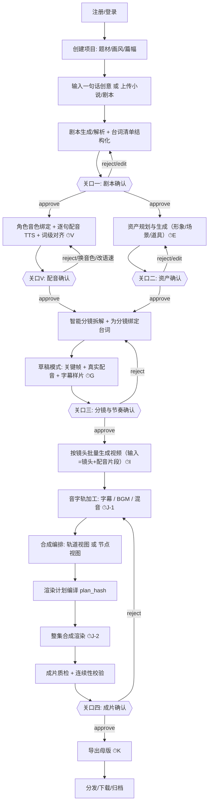

**V6.0 的三处结构性变化**

| 变化 | V5.0 做法 | V6.0 做法 | 直接收益 |
|---|---|---|---|
| 配音位置 | 在 F6 后期，视频生成之后 | **前移到 F9，分镜之前**（与资产生成并行） | 分镜在"已知真实音频时长"的前提下拆解，台词顶爆镜头的问题在结构上消失 |
| 分镜输入 | 剧本文字 + 角色资产 | 剧本文字 + **已生成的台词音频片段** | 镜头时长、断句、情绪与配音一致；草稿样片直接带真配音 |
| 整集合成 | F6 后期一次性拼装 | **F10 独立编排层（轨道/节点双视图）** | 用户可自由设定合成顺序与结构，且两种方式产出一条成片 |

**计费发生点（V6.0，共 7 个）**：`D` 剧本生成、`V` 配音、`E` 资产生成、`G` 草稿模式、`I` 视频生成、`J` 后期（J-1 音字轨 + J-2 整集合成渲染）、`K` 高清导出。每个消耗点入口必过冻结节点；合成渲染不单独设计费点，计入 `J`。

### 4.1.2 V5.0 原链路（保留，作为兼容模式与对照基准）

> 以下为 V5.0 原图，**不改动**。当项目被标记为「兼容模式」（旧项目未生成配音轨，或用户在创建时显式选择"经典流程"）时按此图执行，详见 4.6.6。

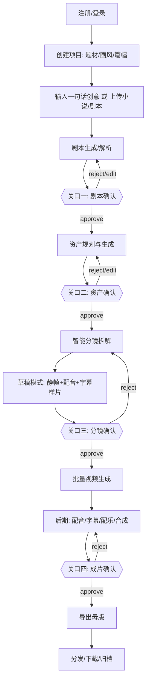

**计费发生点**（与上图对应）：`D` 剧本生成、`E` 资产生成、`G` 草稿模式、`I` 视频生成、`J` 后期合成、`K` 高清导出 —— 共 6 个消耗点，每个消耗点入口必过冻结节点。

## 4.2 五个 HITL 关口（人工介入点，V6.0 由四关口扩为五）

| 关口 | 编号 | 确认对象 | 用户可选动作 | 拒绝后的回流目标 | 默认超时 |
|---|---|---|---|---|---|
| 关口一 | H1 | 结构化剧本（分集大纲 + 场次 + 对白） | approve / reject(带反馈) / edit(手工编辑) | 编剧 Agent 局部改写 | 24h 提示，7 天过期 |
| **关口V（V6.0 新增，强制关口 D-02）** | **H-V** | **配音轨（逐角色 30s 样音 + 全剧逐句配音 + 时长报告）** | **approve / reject(带反馈) / 换音色 / 调语速 / 逐句重配** | **配音 Agent 重配受影响句** | **24h 提示，7 天过期** |
| 关口二 | H2 | 角色卡片墙（主形象 + 三视图 + 表情集）与场景资产 | approve / reject(带反馈) / 重抽 / 逐资产操作 | 美术 Agent 重生成 | 同上 |
| 关口三 | H3 | 分镜画布 + 草稿样片 | approve / reject(带反馈) / 画布编辑 | 导演 Agent 重新拆解 | 同上 |
| 关口四 | H4 | 成片预览（带水印） | approve / reject(带反馈) | 后期 Agent 重做 | 同上 |

**统一次关口规则**

| 编号 | 规则 |
|---|---|
| HR-1 | 一次 reject 必须携带反馈文本（≥ 10 字，前端校验），空反馈不允许提交 |
| HR-2 | reject 反馈写入 `human_feedback`，作为下一轮 Agent 的输入，不做丢弃 |
| HR-3 | 同一关口连续 reject 达 3 次，系统提示"建议修改生成参数/更换模型"，并展示历史反馈汇总 |
| HR-4 | 关口等待期间项目状态为 `*_review`，此状态下禁止进入下一阶段接口（返回 `40001`） |
| HR-5 | 审批动作幂等：同一审批单重复 approve 只生效一次（`approval_requests` 状态机守卫） |
| HR-6 | （V6.0）**双分支并行**：关口V（配音）与关口二（资产）**互不阻塞**，任一先通过即可推进各自下游；进入分镜需**两者同时通过**（分镜既要台词音频，也要角色锚点） |
| HR-7 | （V6.0）**配音关口的最小确认单元是"集"**：可逐集确认与逐集推进（第 1 集配音确认即可先拆第 1 集分镜），避免 30 集全配完才允许开工 |
| HR-8 | （V6.0）配音关口 reject 必须带"作用域"：`{集号, 台词条 ID 列表｜角色 ID}`，用于精确重配，禁止"整集全重配"作为默认动作（成本与时长漂移控制） |
| HR-9 | （V6.0，**D-02 已拍板**）**配音关口不可在 V6.0 链路内跳过**：未 `voice_locked` 的集，分镜入口返回 `40001` 并引导去配音。唯一的"跳过"方式是项目级切换为**兼容模式**（4.6.6），需二次确认 + 写明原因，且切换后该项目**不能**使用台词驱动时长与配音漂移相关能力 |

## 4.3 全局业务规则

| 编号 | 规则 | 说明 |
|---|---|---|
| GR-1 | 项目状态机唯一性 | 项目任一时刻只能处于 `ProjectStatus` 的一个状态，状态流转必须走白名单（见 00 契约 6.1） |
| GR-2 | 上游锁定即下游解锁 | 剧本改动 → 受影响场次分镜解锁；资产锚点更换 → 受影响镜头解锁并提示"影响 N 个镜头" |
| GR-3 | 冻结上限 = 可用余额 | 并发场景下不允许冻结超过余额，防止透支 |
| GR-4 | 失败全额返还 | 因平台原因（模型失败、审核拒绝）导致的失败，冻结积分全额解冻返还 |
| GR-5 | 重试次数上限 | 单任务自动重试 ≤ 2 次；质检修正循环 ≤ 3 轮；超限转"待人工"清单 |
| GR-6 | 幂等优先于重试 | 任何重试前先查幂等键，命中则直接返回历史结果 |
| GR-7 | 审核不可绕过 | 内容安全判定为 `block` 时终止流程并明确告知，不提供"重试绕过"入口 |
| GR-8 | 一切产物可追溯 | 每次生成记录：模型、参数、单价、耗时、操作者、trace_id |
| GR-9 | 审核前置优先 | 剧本与画面审核尽量前置到生成前，降低返工成本 |
| GR-10 | 时间与金额口径统一 | 时间存 UTC、展示按用户时区；积分与金额均为整数最小单位，禁止浮点 |

**V6.0 新增全局规则（配音先行 + 双模编排 + 连续性）**

| 编号 | 规则 | 说明 |
|---|---|---|
| GR-11 | **音频时长权威** | 已绑定台词的镜头，`duration_ms` 由所绑台词的**实测音频时长**推导，公式：`duration_ms = clamp(head_pad + Σ line_actual_ms + tail_pad, 1000, 15000)`，默认 `head_pad = 200ms`、`tail_pad = 300ms`【假设待验证】。未绑定台词的镜头（空镜/动作镜头）仍按导演策略与用户手改值，受 AC-F4-02-4 区间约束。**任何"按字数估算时长"的逻辑在 V6.0 链路中不再作为权威源** |
| GR-12 | **单一编排模型 + 单一编译器** | 一集只有一份 `composition_graph`；轨道视图与节点视图只是它的两个编辑界面；所有合成请求必须经 `render_plan_compiler` 产出 `render_plan` 后才允许渲染。**禁止任何绕过编译器的"直拼"通道**（这是两种编排方式结果一致的唯一工程保证） |
| GR-13 | **叙事序与合成序分离** | `shots.order_index` 表达叙事顺序（剧本逻辑，影响关口三验收）；`composition_graph` 拓扑表达合成/播放顺序（创作自由）。二者不共享同一字段：拖轨道只改图、不改序；"把当前合成顺序写回叙事顺序"是**显式动作**，须二次确认并对下游解锁 |
| GR-14 | **渲染计划幂等** | `plan_hash = sha256(canonical_json(render_plan))`；同 hash 的合成请求直接复用既有产物并返回 `reused: true`，不重复占用渲染资源、不重复计费（J-2）；`plan_hash` 变化必须能追溯到图差异（`graph_diff`） |
| GR-15 | **唯一变更广播源 + 按镜头解锁（D-01 已拍板）** | 所有上游变更（剧本台词、配音、锚点、服装描述）统一由 M0 计算受影响集合，并按**镜头粒度**解锁（`shots.locked` 按镜头置 false），取代 V5.0 的"引用计数"与 Q16 原默认"整集解锁"。解锁清单须逐条列出"变的是谁、影响了哪些镜头、为什么"。**引用保护**：已进入 `composition_graph` 的镜头被解锁时，对应 `clip` 节点标 `stale` 而非移除，新版产出后原位替换 |
| GR-16 | **连续性事实单一来源** | 角色在某场穿什么、场景空间如何、道具在谁手上，只能由 Story Bible（5A.2）登记；任何环节不得各自维护一份"局部认知"。质检判定不一致时，以 Story Bible 快照为准，冲突即报错而不是"就近取信" |

## 4.4 全链路时序总览（V5.0 新增）

> 本图只画"一次完整创作"的主干：不展开重试、质检循环与并行子代理；每个功能的细节时序见第 5 章各功能末尾的「时序图」。图中 `⏱` 为计费点、`✋` 为 HITL 关口。

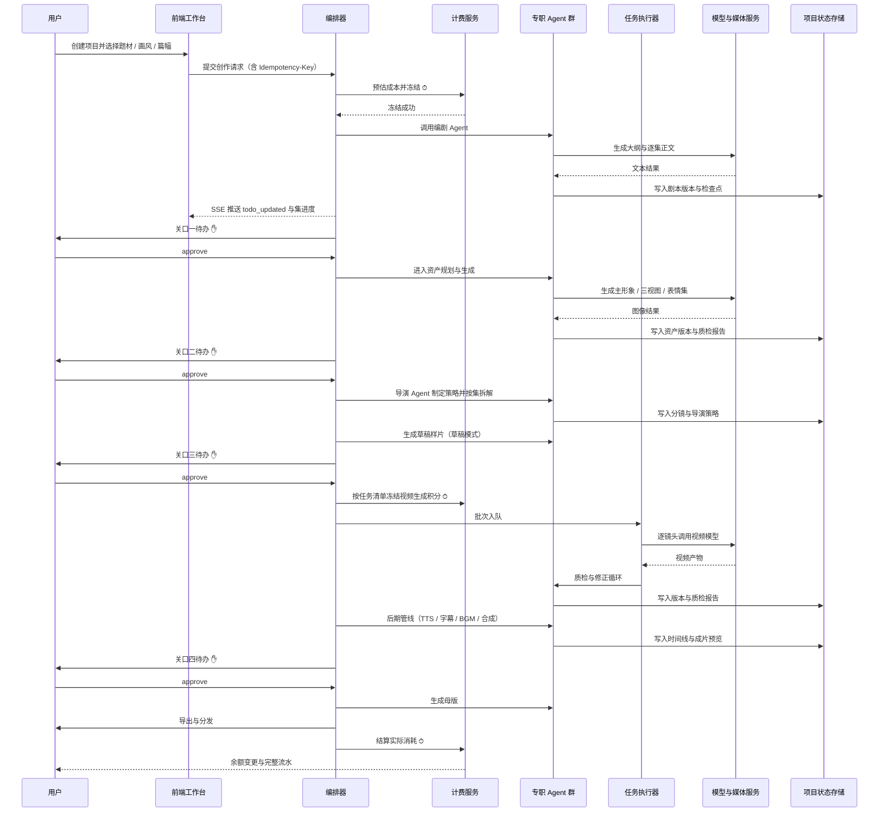

| 阶段 | 主责角色 | 主要产出 | 进入下一阶段的条件 | 计费点 |
|---|---|---|---|---|
| 准入与计费 | 认证 / 计费服务 | 用户、积分账户、冻结记录 | 预检通过且冻结成功 | — |
| 剧本 | 编剧 / 解析 Agent | 剧本版本、分集、置信度 | 关口一 approve 且状态 locked | D |
| 资产 | 美术 Agent + 质检 | 角色 / 场景 / 道具资产版本 | 关口二 approve 且音色绑定完成 | E |
| 分镜 | 导演 Agent + 子代理 | 分镜列表、导演策略、草稿样片 | 关口三 approve | G（草稿模式） |
| 视频 | 制片 Agent + 执行器 | 镜头视频版本（≤3 版） | 全部镜头 settled 且锁定 | I |
| 后期 | 后期 Agent | 时间线、成片预览 | 关口四 approve | J |
| 导出分发 | 发行 Agent | 母版、ZIP、分发记录 | 下载完成或分发成功 | K |

> 说明：任何阶段失败都会回到该阶段的入口而不是从头开始（NFR-A2）；任何阶段的上游内容变更会按 GR-2 解锁受影响的下游产物，并在解锁前提示影响范围。

---

## 4.5 V6.0 双链并行总时序（新增）

> V5.0 的 4.4 是"单链串行"时序，V6.0 的关键变化是**在关口一之后分成两条并行支链、在分镜处汇合**：声音链（台词 → 音色 → TTS 对齐）与视觉链（角色/场景/道具资产）互不依赖，分镜同时消费两条链的产物。这是 V6.0 缩短 TTFC 的主要来源。

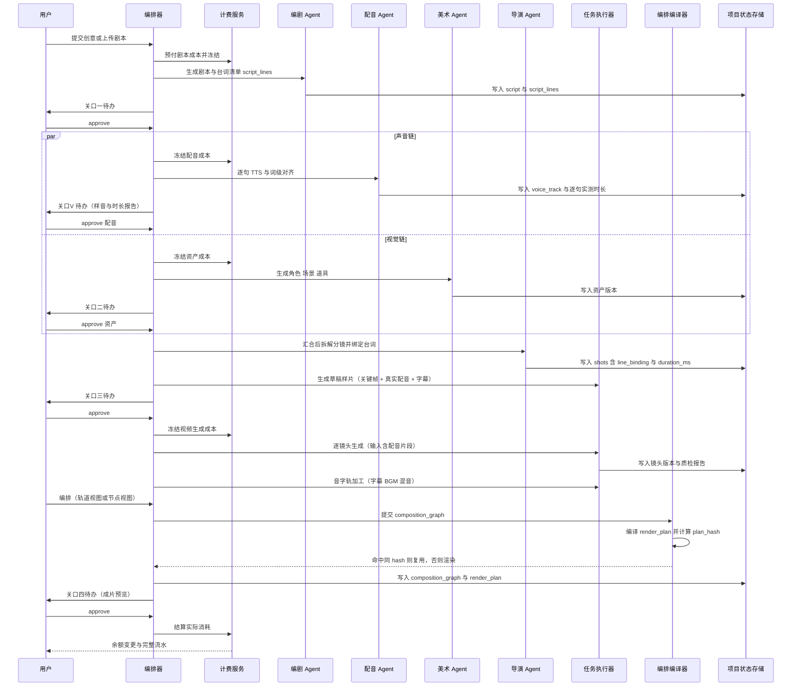

| 阶段（V6.0） | 主责角色 | 主要产出 | 进入下一阶段的条件 | 计费点 |
|---|---|---|---|---|
| 准入与计费 | 认证 / 计费服务 | 用户、积分账户、冻结记录 | 预检通过且冻结成功 | — |
| 剧本 | 编剧 / 解析 Agent | 剧本版本、**台词清单** | 关口一 approve 且状态 locked | D |
| 配音（并行支链 1） | 配音 Agent | 配音轨、逐句实测时长、词级时间戳 | **关口V approve**（可按集） | V |
| 资产（并行支链 2） | 美术 Agent + 质检 | 角色 / 场景 / 道具资产版本、音色绑定 | 关口二 approve | E |
| 分镜（汇合点） | 导演 Agent + 子代理 | 分镜列表、**镜头—台词绑定**、导演策略 | 关口三 approve | G（草稿模式） |
| 视频 | 制片 Agent + 执行器 | 镜头视频版本（≤3 版） | 全部镜头 settled 且锁定 | I |
| 音字轨 | 后期 Agent | 字幕轨、BGM 轨、混音参数 | 音字轨就绪 | J-1 |
| 合成编排 | 用户 + 编排编译器 | `composition_graph`、`render_plan`、整集成片 | 合成完成且质检通过 | J-2 |
| 导出分发 | 发行 Agent | 母版、ZIP、分发记录 | 下载完成或分发成功 | K |

---

## 4.6 生产链路总览、两种合成方式的适用场景与切换关系

> 本节是 V6.0 的核心说明章：先看清链路，再决定什么时候用轨道、什么时候用节点，最后看清两者如何共存。

### 4.6.1 链路总图（五段 + 两个汇合点）

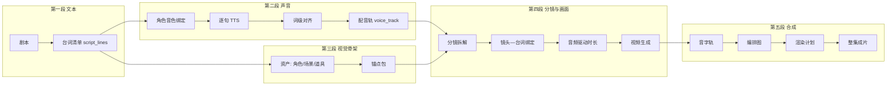

**两个汇合点**

| 汇合点 | 谁汇合 | 为什么必须在这里汇合 | 缺少一方时的降级 |
|---|---|---|---|
| 汇合点一：分镜入口 | 配音轨 + 资产锚点 | 分镜既要"这句话多长、什么情绪"，也要"这个人长什么样、这场戏什么空间" | 缺配音 → 退回 V5.0 估算模式（时长按字数估，标 `est_duration`）；缺资产 → 拒绝进入分镜（无锚点无法生成），提示先完成关口二 |
| 汇合点二：合成入口 | 音字轨 + 镜头视频 | 合成需要"画面片段"与"声音/字幕轨"同时对位 | 缺音字轨 → 允许"无声合成"草稿（仅内部预览，禁止导出，防止无音成片流出） |

### 4.6.2 相对 V5.0 链路的差异与条款替代关系（V6.0 覆盖说明）

> 研发只需看这一张表就能知道"哪些旧口径在 V6.0 链路里不再生效"。

| 旧条款（V5.0） | 原口径 | V6.0 生效状态 | 替代条款 | 说明 |
|---|---|---|---|---|
| AC-F4-02-2 | 对白长度 12s 而镜头 4s → 判不合格 | **替代** | AC-F4-13-2 | 分镜阶段已按音频定长，"超时长"改为"绑定缺失/超上限（>15s 需拆句）"判定 |
| AC-F6-07-3 | 后期调语速致台词超镜头时长 → 标红并给出"解锁分镜"出路 | **替代** | AC-F9-06-3 + GR-11 | 语速调整前移到配音环节，改语速即触发"时长重算 → 漂移判定"，下游据此解锁或吸收 |
| AC-F6-01-1 | 镜头已锁定且角色已绑定音色才生成配音 | **不再适用（V6.0 链路）** | AC-F9-01-1 | 配音在分镜之前，前置条件改为"剧本锁定 + 音色绑定"，与镜头无关 |
| AC-F6-01-2 / AC-F6-01-3 | 30s 样音试听与确认留痕 | **保留并前移** | F9.4 S2 / AC-F9-01-2 | 样音机制沿用，位置从 F6 移到 F9，逐角色 + 逐集 |
| AC-F4-03-1 | 草稿样片 = 关键帧 + TTS 配音 + 字幕 | **保留**（来源变化） | AC-F4-03-1 不变 | 配音不再临时生成，直接引用 `voice_track`，成本更低、质量更稳 |
| AC-F6-04-1 | 时间线拖动片段/字幕生成新时间线版本 | **保留约束，载体变化** | AC-F10-04-x | "时间线版本"统一升级为 `composition_graph` 版本（DR-3 同源） |
| F6.7 状态机 `plan_ready → tts_previewing` | 后期从 tts 开始 | **替代** | F9.6 + F10.9 | 配音状态机移到 F9；F6 状态机起点改为"音字轨就绪" |
| Q16 默认"整集解锁" | 整集解锁 | **已拍板变更（D-01）** | GR-15 | 改为按镜头解锁 + 编排引用保护（`stale` 标记） |
| 4.2 四关口 | 剧本/资产/分镜/成片 | **扩展为五关口** | 4.2 + HR-6/7/8 | 新增关口V（配音），与关口二并行 |

### 4.6.3 两种合成方式的适用场景对照

> 结论先说：**轨道式是"把这一集剪出来"，节点式是"把这一集的造法定下来"**。前者面向时间，后者面向结构。

| 维度 | 轨道视图（常规视频剪辑方式） | 节点视图（工作流链路方式） |
|---|---|---|
| 心智模型 | 时间轴：画面从左到右推进，轨道从下到上叠加 | 流程图：节点是镜头/段落，连线是"接下来播什么" |
| 典型用户 | 有剪辑经验者、习惯剪映/Pr 的创作者、外包剪辑 | 制片/导演型创作者、批量生产者、模板设计者 |
| 核心动作 | 拖拽排序、切分、吸附、逐帧微调、音量与字幕对位 | 连线定义顺序、分组折叠、并列合成、分支多版本、结构复用 |
| 最擅长的场景 | ① 单集收尾精修（节奏、转场、卡点）；② 字幕/音轨对位；③ 平台时长硬要求（如卡 90s）下的精确删减；④ 逐帧修掉某一处瑕疵；⑤ 不熟悉结构设计的用户"直接串起来" | ① 非线性结构（多结局、A/B 版本、不同开场）；② 系列剧结构复用（把第 1 集结构套到 30 集）；③ 并列/分屏/画中画；④ 分段交付（先出一支 30s 预告，独立成图）；⑤ 团队分工（不同人维护不同分支） |
| 表达上限 | **只能表达线性单链**：无法表达分支与并列（强行表达会退化为"拼接多个假片段"） | 可表达任意有向无环结构（MVP 限定 DAG，不允许环） |
| 学习成本 | 低（剪辑软件通用心智） | 中（需理解节点与连线，但比 NLE 的关键帧/调色低） |
| 出错方式 | 误删/误移片段（靠撤销与吸附防护） | 结构错误：悬空节点、成环、缺入口/出口（靠结构守卫拦截） |
| MVP 状态 | **必做**（默认视图） | **必做：仅"线性 + 分组"（D-03 已拍板）**；并列/分支/复用为 **P1** |
| 对应 AC | AC-F10-04-x | AC-F10-05-x |

**一句话选择建议（写进帮助文案）**

- 只想尽快把这一集拼出来、并对节奏做微调 → **用轨道**。
- 想让"这一集的结构"本身可以被反复使用、或要出多个版本/多个并列画面 → **用节点**。
- 拿不定 → 先用轨道（默认），需要非线性时再"升级为节点视图"，结构不会丢（4.6.4）。

### 4.6.4 两种视图的切换关系与守卫规则

> 关系定义：**同一份编排图的两种投影**。轨道视图 = 线性特化投影；节点视图 = 全拓扑视图。切换是"换画法"，不是"换产物"。

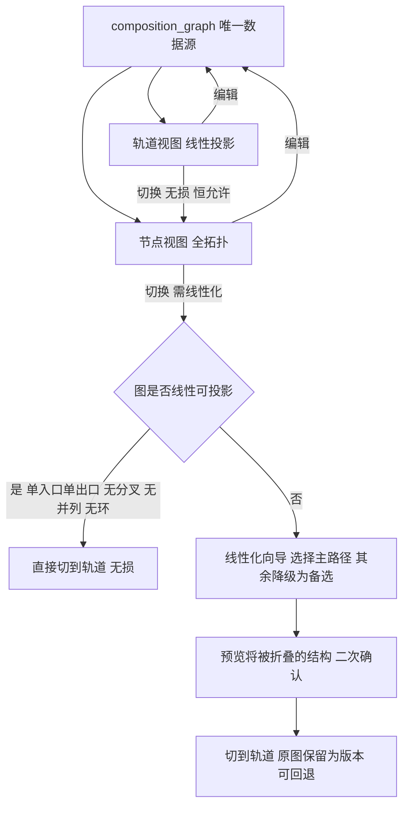

| 场景 | 是否允许 | 数据后果 | 用户可见提示 |
|---|---|---|---|
| 轨道 → 节点 | **恒允许，无损** | 线性链自动标注为一条主路径 | "已切换到节点视图，当前为单链结构" |
| 节点 → 轨道（线性图） | **允许，无损** | 无 | "结构已是线性，可无缝切换" |
| 节点 → 轨道（含分组，无分支） | **允许，无损**（分组降级为"章节标记"） | 分组保留为章节/段落元数据，可回切恢复 | "N 个分组将显示为章节标记" |
| 节点 → 轨道（含分支/并列）**（P1 能力）** | **P1：需线性化，有损但可回退**。MVP 不含分支/并列节点，故 MVP 内不存在此路径 | 选定主路径进入轨道；未选路径标记 `inactive_branch` 保留在图版本中 | 二次确认弹窗，逐条列出"将被折叠的结构"与"保留的备选版本" |
| 同时打开两个视图（双人协作，P1） | **不允许同时编辑** | 后写覆盖 + 冲突提示（沿用 F2.7-3 机制） | "该集编排正在被 X 编辑" |
| 合成渲染进行中切换视图 | **允许查看，禁止提交** | 提交被拒（版本号不匹配） | "渲染中，编排已锁定至本次完成" |

**结构守卫（两视图共用，提交前校验）**

| 守卫 | 规则 | 违反时 |
|---|---|---|
| 单入口单出口 | 必须有唯一起点与唯一终点 | 拒绝提交，高亮悬空节点 |
| 无环 | 图必须为 DAG | 拒绝提交，高亮成环边 |
| 无悬空 | 每个节点必须可达且可到终点 | 拒绝提交 |
| 片段有效性 | 引用的 `shot_id` 必须存在且版本已锁定 | 拒绝提交，列出无效引用 |
| 音画对位 | 视频片段总时长与所绑音频片段总时长差 ≤ 100ms，或已显式声明变速/静音 | 警告并可强制提交（记 `qc_flags`），沿用 AC-F6-08-2 的 100ms 红线 |
| 时长合规 | 单集成片时长在 Q6 区间（1–3 分钟），超限仅警告 | 警告不阻断（与 AC-F2-05-3 一致） |

### 4.6.5 时长权威与"配音改了会怎样"（V6.0 的关键连锁）

配音前置带来的最大新问题是：**改了配音，镜头时长就可能变，进而要重生成视频**。V6.0 用"吸收阈值 + 漂移判定"把这个连锁限死在最小范围。

| 变化幅度（重配音后 Δ = 新实测时长 − 旧实测时长） | 系统判定 | 处理动作 | 用户成本 |
|---|---|---|---|
| `abs(Δ) ≤ 150ms` 且 `abs(Δ) / duration ≤ 5%` | **可吸收** | 不重生成视频；合成层用音轨微偏移 + ≤ ±5% 变速吸收；`plan_hash` 变化但镜头产物复用 | 仅合成重渲（J-2），无视频成本 |
| 超出吸收阈值，但镜头尚未生成视频 | **待重算** | 重算 `duration_ms`，更新分镜（标 `duration_drift`），无需重生成 | 0（尚未花钱） |
| 超出吸收阈值，且镜头已生成视频 | **需重生成** | 按 GR-15 精确解锁**该镜头**（不整集），提示"X 个镜头因台词时长变化需重生成，预估 Y 积分" | 仅受影响镜头 × I 计费 |
| 台词文本被删/合并 | **结构变更** | 解绑该句 → 镜头可能变为"无台词镜头"（按导演时长）或需合并镜头；提示预览 | 视情况 |
| 换角色音色（整角色） | **批量重算** | 该角色全部台词重配 → 按集汇总"受影响镜头清单"后再确认执行 | 配音 V + 受影响镜头 I |

> 设计原则：**"改一句话"的代价必须是"几个镜头"，而不是"一整集"**（GR-15 + 上表）。这也是 5A 章 Story Bible 作为唯一广播源的价值所在。

### 4.6.6 兼容模式（旧项目与"经典流程"，D-02 已拍板口径）

> **拍板结论**：配音关口**强制**。所谓"跳过配音直接分镜"在 V6.0 中不是一个按钮，而是**一次项目级的模式切换**——切到兼容模式后，该项目走 V5.0 经典链路，能力与指标口径也随之下调。这样可以避免"同一个项目一半按实测时长、一半按估算时长"的混合状态。

| 项 | 规则 |
|---|---|
| 模式字段 | `projects.pipeline_mode ∈ {voice_first（默认）, classic}`，创建时确定、可切换（受 ACL 与确认约束） |
| 触发条件 | ① 项目创建于 V5.0 及之前（默认 `classic`，可升级）；② 用户创建时显式选择"经典流程（先分镜后配音）"；③ 用户在 V6.0 项目中主动申请切换为 `classic`（需二次确认 + 填写原因，写入 `audit_logs`） |
| 行为 | 分镜时长按字数估算（`duration_source=est`，界面标注"估算值"）；配音回落到 F6 原流程；H-V 关口不出现；合成仍走 F10（MVP 为轨道视图或线性节点），音轨由 F6 产出 |
| 限制 | ① 不使用台词驱动时长（AC-F4-13-2/3 不适用）；② 不参与 M15/M16 统计；③ 切换为 `classic` 后，本集已产生的 `voice_track` **不删除但不再作为权威源**（保留可回切）；④ `classic` 项目不得使用 F10 的 P1 进阶结构（分支/并列），避免两套语义叠加 |
| 升级路径 | `classic → voice_first`：为既有分镜反查台词（按 `shot_line_bindings` 或文本匹配）→ 生成配音轨 → 逐镜头比对实测时长 → 输出漂移报告 → 用户确认后批量更新 `duration_ms`（**不自动改**） |
| 冻结窗口 | `classic` 仅作为迁移态保留至 P1；P1 结束后新建项目一律 `voice_first`，`classic` 只读维护 |
| 目的 | 不让存量项目断裂，同时保证"新链路是默认且唯一的主流路径" |

### 4.7 编排双视图等价性契约（工程可验收）

> "两种方式结果一致"必须有可判定的口径，否则只是一句口号。

| 编号 | 契约 | 判定方式 |
|---|---|---|
| EQ-1 | **同源**：两视图读写的 `composition_graph` 结构完全相同（同一 schema、同一表） | Schema 评审 + 单测：两视图序列化结果字段一致 |
| EQ-2 | **同编译**：两视图提交都调用同一个 `render_plan_compiler`，无旁路 | 代码级检查：编译入口唯一；API 层禁止直接调用 FFmpeg |
| EQ-3 | **同构同 hash**：拓扑等价（节点集合、边集合、参数一致）时 `plan_hash` 必须相同 | 单测：随机生成 100 组等价图，hash 全等 |
| EQ-4 | **同 hash 同产物**：`plan_hash` 相同则渲染产物复用，且抽样逐帧比对 SSIM = 1.0 | E2E-15：同一集分别用两种视图导出，帧级比对 |
| EQ-5 | **差异可解释**：hash 不同时必须返回 `graph_diff`（哪个节点/边/参数不同） | API 契约：`diff` 字段非空 |
| EQ-6 | **视图无损**：轨道 → 节点恒无损；节点 → 轨道在满足线性条件时无损 | E2E-15 的第二组：切换前后 hash 不变 |

---

# 第 5 章 功能需求

> **需求 ID 规范**：`US-<Feature>-<序号>` 用户故事，`AC-<Feature>-<序号>-<子号>` 验收标准，`EX-<Feature>-<序号>` 边界异常。所有验收标准采用 Given/When/Then 三段式，必须可通过测试判定。
>
> **V6.0 编号说明**：`F9`（配音轨）与 `F10`（合成编排）为新增模块，编号不与流程顺序严格对应（流程顺序见 4.6.1）；`F2.12 / F4.13 / F5.13 / F6.12` 为既有模块的 V6.0 增量节，既有 `Fx.1–Fx.11` 节号与内容不动。

---

## F1 账号、计费与权限

### F1.1 目标

让用户可信地进入系统，让每一次算力消耗都有账可查、有据可依、失败可退。

### F1.2 用户故事与验收标准

| ID | 用户故事 | 优先级 |
|---|---|---|
| US-F1-01 | 作为新用户，我希望用手机号 + 验证码快速注册，以便立刻开始创作 | M |
| US-F1-02 | 作为新用户，我希望微信扫码一键登录，以便免去注册流程 | M |
| US-F1-03 | 作为新用户，我希望注册即获赠积分，以便零成本体验全流程 | M |
| US-F1-04 | 作为用户，我希望在生成前看到本次消耗的预估积分，以便决定是否执行 | M |
| US-F1-05 | 作为用户，我希望生成失败时积分自动返还，以便不为无效结果付费 | M |
| US-F1-06 | 作为用户，我希望查看完整的积分流水，以便核对每一笔消耗 | M |
| US-F1-07 | 作为用户，我希望订阅套餐获得更多额度与权益，以便长期使用 | M |
| US-F1-08 | 作为团队管理员，我希望从团队池划拨预算给项目，以便控制成本（P1） | P1 |
| US-F1-09 | 作为用户，我希望为单个项目设置积分上限，以便防止误操作烧钱 | M |

**验收标准**

| ID | 验收标准（Given / When / Then） |
|---|---|
| AC-F1-01-1 | Given 未注册手机号，When 输入验证码并提交注册，Then 事务内创建用户与积分账户，账户余额 = 500 积分，且产生一条 `transaction_type = grant` 的流水 |
| AC-F1-01-2 | Given 同一手机号 60 秒内第 2 次请求验证码，When 提交，Then 返回 `10004 请求过于频繁`，且不发送短信 |
| AC-F1-01-3 | Given 同一设备 24 小时内注册请求超过阈值（默认 3 次），When 再次提交，Then 触发风控拒绝，返回明确提示且写入 `audit_logs` |
| AC-F1-02-1 | Given 微信授权成功且 unionid 未绑定，When 回调完成，Then 创建用户 + `user_identities` 记录 + 积分账户，一次性完成 |
| AC-F1-02-2 | Given unionid 已绑定既有用户，When 再次微信登录，Then 直接登录既有账号，不创建新用户 |
| AC-F1-04-1 | Given 项目余额 1000 积分，When 用户发起一次预估 1200 积分的生成请求，Then 返回 `30001 积分不足`，不扣费、不创建任务，并返回充值引导字段 |
| AC-F1-04-2 | Given 预估成本已展示，When 用户确认生成，Then 冻结积分 = 预估值，`credit_freezes` 新增记录，`credit_accounts.frozen_credits` 增加 |
| AC-F1-05-1 | Given 某任务已冻结 100 积分且执行失败（失败类型 = 模型不可用），When 结算流程执行，Then 冻结全额释放，账户可用余额恢复，产生 `unfreeze` 流水 |
| AC-F1-05-2 | Given 某任务部分镜头成功、部分失败，When 结算执行，Then 仅按成功镜头实际消耗结算，失败部分解冻返还 |
| AC-F1-06-1 | Given 用户有 137 条流水，When 按 `transaction_type = settle` 筛选并翻页，Then 返回正确分页结果且总数为筛选后数量 |
| AC-F1-07-1 | Given 用户购买 pro 套餐，When 支付回调成功，Then 订阅生效、权益位（并发数、4K、去水印）更新，且同一 `out_trade_no` 的重复回调被丢弃且仍返回成功 |
| AC-F1-09-1 | Given 项目预算 2000 积分已消耗 1900，When 发起预估 300 积分的任务，Then 拒绝执行并返回 `30002 预算超限`，同时不影响账户在其它项目的可用余额 |

### F1.3 详细流程

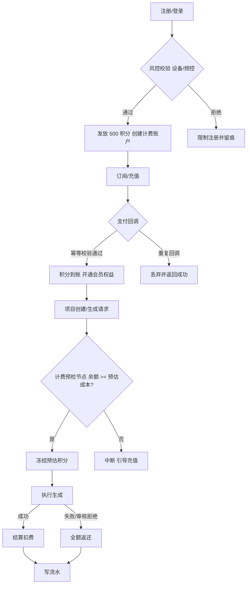

### F1.4 流程步骤

| 步骤 | 处理方 | 说明 |
|---|---|---|
| S1 | 确定性服务 | 登录风控：同设备/手机号频控；微信登录换取 unionid |
| S2 | 计费服务 | 事务内创建账户 + 发积分，杜绝并发重复发放 |
| S3 | 支付网关 + 回调 | 回调以 `out_trade_no` 幂等；到账延迟目标 < 1 分钟 |
| S4 | LangGraph 计费节点 | 每个消耗型子图入口预检 → 冻结；子图完成（或失败）后结算/返还。**LLM Agent 不接触扣费逻辑，只上报 `estimated_cost`** |
| S5 | 审计 | 流水含 `project_id`、任务类型、模型、时长、单价、消耗、冻结/结算/返还状态 |

### F1.5 状态机（订单与积分）

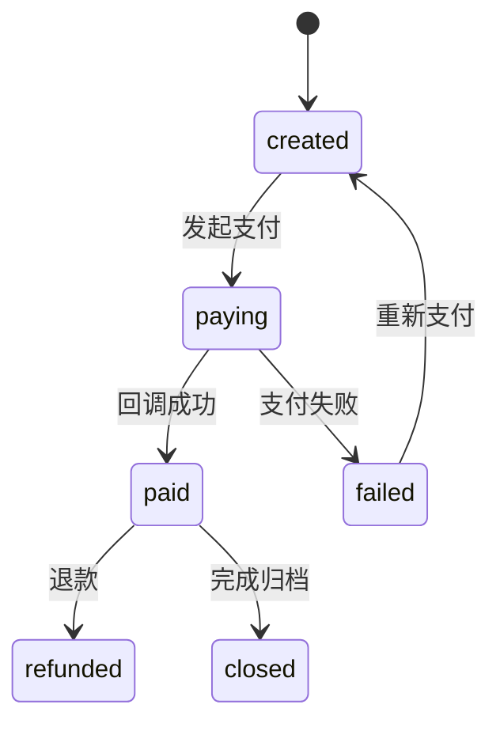

积分账户视角：`可用余额 = 总额度 - 冻结额 - 已消耗`；冻结记录的独立生命周期：`frozen → settled` 或 `frozen → unfrozen`（30 分钟未结算自动解冻并告警）。

### F1.6 边界与异常六查

| 类别 | 场景 | 期望行为 |
|---|---|---|
| 空态 | 用户无任何流水 | 展示空态文案 + "去充值"主按钮，不展示空白表格 |
| 极值 | 单笔充值金额超大 / 积分余额极大 | 金额上限与下限由 `plans` 与配置校验，超限返回 `10001`；余额使用 `BIGINT` 不受溢出影响 |
| 并发 | 同一用户同时发起 5 个生成任务 | 冻结上限 = 可用余额；超出部分返回 `30001`；并发数受套餐限制（free 2 / pro 5 / studio 10） |
| 失败 | 支付回调丢失 | T+1 主动对账任务拉取网关账单补单，补单幂等；用户端显示"到账处理中" |
| 失败 | 生成中服务重启 | 冻结记录已持久化，重启后按 `ProjectState` 恢复结算；不允许出现"扣了钱没结果" |
| 权限 | 成员 A 访问成员 B 的项目 | 编排器层拦截，返回 `20003 无权限`，Agent 工具链不得触碰该资源，写 `audit_logs` |
| 幂等 | 支付回调重复推送 | 以 `out_trade_no` 唯一索引判重，重复请求直接返回成功，不重复入账 |
| 幂等 | 同一生成请求重复提交 | `Idempotency-Key` 命中则返回首次结果，不重复冻结与生成 |

### F1.7 埋点

`user_register_success`、`user_login_success`、`sms_code_sent`、`paywall_shown`（含 trigger 来源：余额不足/权益不足）、`order_created`、`payment_succeeded`、`credit_freeze_created`、`credit_settle_finished`、`credit_refund_finished`、`budget_exceeded_blocked`。

### F1.8 端到端业务流程详解（V5.0 新增）

> 本节把 F1.3 的单张流程图拆成"人 — 系统 — 外部服务"三个视角，供第一次接触本项目的人独立读懂计费链路。P 编号与 F1.4 的 S1–S5 是同一流程的不同粒度，映射见 F1.8.3。

#### F1.8.1 触发场景与前置条件

| 编号 | 触发场景 | 谁触发 | 前置条件 | 完成判定 | 计费点 |
|---|---|---|---|---|---|
| T1-1 | 手机号验证码注册 | 未登录访客 | 手机号未注册；同号 60s 内无第 2 次请求 | 用户、积分账户、500 积分与 grant 流水同事务创建 | 无 |
| T1-2 | 微信扫码登录 | 未登录访客 | 微信授权成功 | unionid 已绑定则直接登录；未绑定则建号并建账户 | 无 |
| T1-3 | 订阅套餐 / 充值 | 注册用户 | 已登录；商品在售 | 支付回调成功，积分到账且权益位更新 | 无（充值不计消耗） |
| T1-4 | 发起任一消耗型动作 | 注册用户 | 已登录；项目存在；无同幂等键进行中任务 | 预检通过并冻结成功 | D/E/G/I/J/K 之一 |
| T1-5 | 任务结束（成功 / 失败 / 部分失败） | 系统 | 存在未结算的冻结记录 | 结算或返还完成，余额与流水一致 | 同上 |
| T1-6 | 余额不足、项目预算超限或并发超限 | 系统 | 已计算本次预估值 | 拦截且不创建任务，给出可执行引导 | 无 |

#### F1.8.2 参与角色

| 角色 | 类型 | 在本流程中的职责 | 明确不负责 |
|---|---|---|---|
| 用户 | 人 | 注册、充值、确认消耗、查看流水 | 不能改余额或流水 |
| 前端工作台 | 界面 | 展示预估价与冻结后余额、二次确认、充值引导 | 不作为安全手段（PR-1） |
| 编排器 | 确定性 | 在消耗型子图入口调用计费节点，携带幂等键 | 不决定单价 |
| 计费服务 | 确定性 | 预估、冻结、结算、返还、写流水、对账 | 不调用 LLM |
| LLM Agent | 智能 | 只上报 `estimated_cost`（F1.4 S4） | 不接触扣费逻辑 |
| 短信 / 微信授权 / 支付网关 | 外部 | 验证码、unionid、支付回调 | — |
| 平台运营 | 人（内部） | 维护套餐、单价、赠送与首充规则 | — |

#### F1.8.3 业务流程图（P 编号 ↔ F1.4 步骤映射）

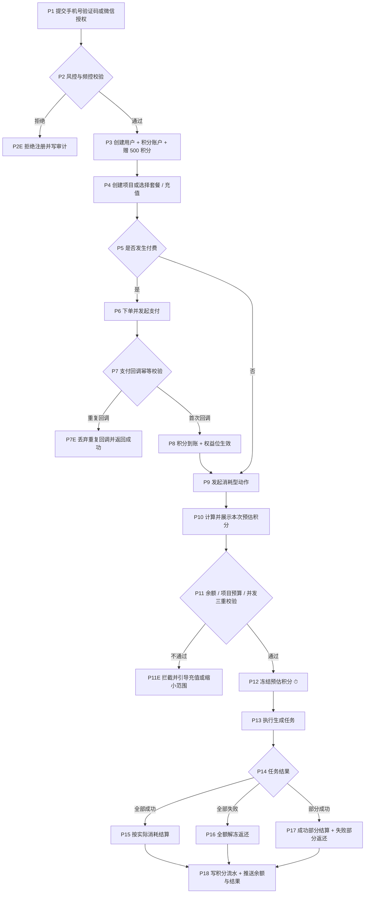

| 图中节点 | 对应 F1.4 步骤 | 说明 |
|---|---|---|
| P1–P2 | S1 | 登录风控：同手机号频控、同设备注册阈值、微信 unionid 换取 |
| P3 | S2 | 账户与赠送在同一事务内完成，杜绝并发重复发放 |
| P6–P8 | S3 | 支付回调以 `out_trade_no` 幂等，到账目标 < 1 分钟 |
| P10–P12、P15–P17 | S4 | 计费节点位于每个消耗型子图入口，Agent 只上报预估值 |
| P18 | S5 | 流水含项目、任务类型、模型、时长、单价、冻结/结算/返还状态 |

#### F1.8.4 时序图一：注册与首充（对应 T1-1 ~ T1-3）

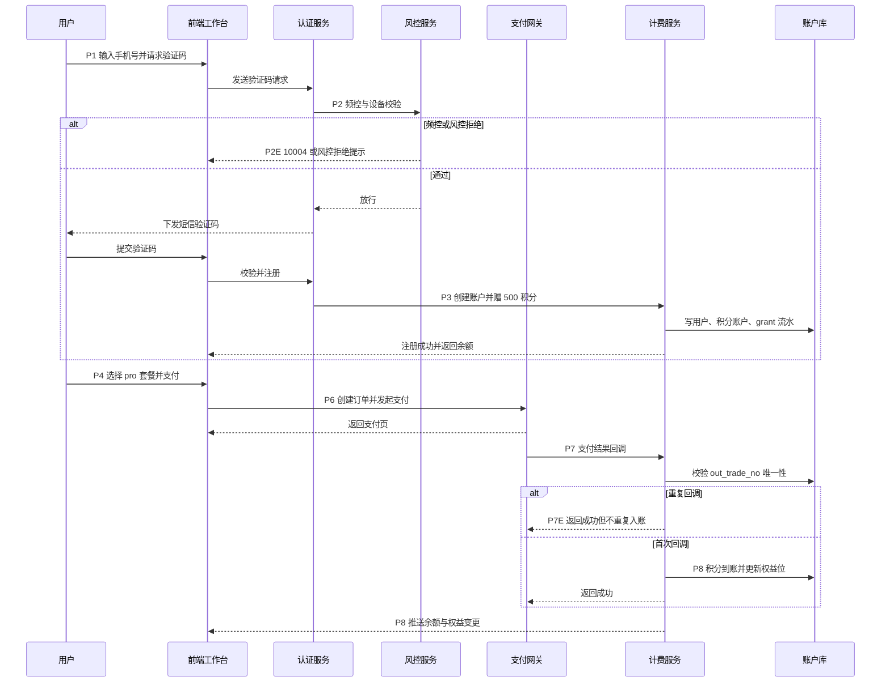

> 微信扫码为 P1 的替代路径：授权成功后以 unionid 查询绑定关系，已绑定直接登录（AC-F1-02-2），未绑定走 P3 建号（AC-F1-02-1）。

#### F1.8.5 时序图二：冻结 — 执行 — 结算（对应 T1-4 / T1-5）

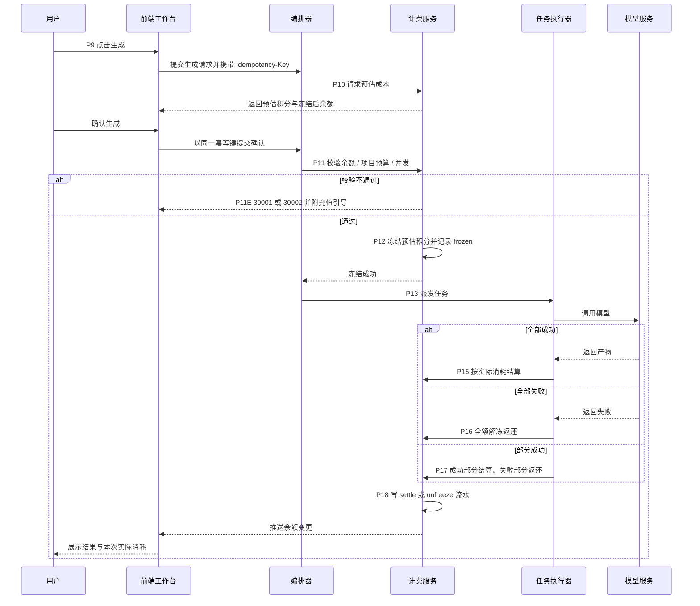

#### F1.8.6 用户操作步骤

| 步骤 | 用户看到什么 | 用户做什么 | 系统即时反馈 |
|---|---|---|---|
| 1 | 登录页（手机号 / 微信两个入口） | 输入手机号→获取验证码→提交；或扫码授权 | 验证码 60s 倒计时；成功即进入工作台并显示 500 积分 |
| 2 | 套餐与充值页 | 选择套餐或面额→发起支付 | 显示"支付处理中"；回调成功后余额与权益位刷新 |
| 3 | 生成确认卡 | 查看预估积分、冻结后余额→确认 | 冻结成功即刷新余额；失败给出 30001/30002 与引导 |
| 4 | 余额不足提示 | 点击"去充值"或缩小生成范围 | 返回原页面且已填参数不丢失 |
| 5 | 积分流水页 | 按类型筛选、翻页 | 返回筛选后的分页结果与总数 |
| 6 | 项目总览 | 查看预算、已消耗、剩余可用 | 与流水口径一致，可下钻到任务明细 |

#### F1.8.7 系统处理逻辑

| 步骤 | 处理方 | 判定与计算规则 | 成功输出 | 失败输出 |
|---|---|---|---|---|
| P2 | 风控服务 | 同手机号 60s 内仅 1 次；同设备 24h 注册 ≤ 3 次 | 放行 | `10004` 或风控拒绝 + `audit_logs` |
| P3 | 计费服务 | 用户、账户、流水同一事务；余额初值 500 | 账户就绪 | 事务回滚，不产生半成品账户 |
| P7 | 计费服务 | `out_trade_no` 唯一索引判重 | 首次入账 | 重复回调返回成功且不入账 |
| P10 | 计费服务 | 预估值 = 任务类型 × 模型单价 × 数量；偏差目标 ≤ 15%（NFR-K1） | 预估价与冻结后余额 | 无法预估时拒绝发起，不采用猜测值 |
| P11 | 计费服务 | 冻结上限 = 可用余额（GR-3）；项目预算余量；套餐并发（free 2 / pro 5 / studio 10） | 通过 | `30001` / `30002` + 引导字段 |
| P12 | 计费服务 | 冻结额 = 预估值；写冻结记录与超时时间 | frozen | 并发冲突重试 1 次后拒绝 |
| P15–P17 | 计费服务 | 成功按实际消耗计；平台原因失败全额返（GR-4）；部分成功按镜头成功数计 | 结算完成 | 结算异常转对账队列并阻断"成功"响应 |
| P18 | 计费服务 + 审计 | 流水不可修改、只追加（DR-2） | 可查询流水 | 写入失败则任务不标记完成 |

#### F1.8.8 数据流转

| 数据对象 | 产生 / 变更时机 | 关键字段 | 写入方 | 读取方 | 生命周期 |
|---|---|---|---|---|---|
| 用户与身份 | P3；微信首次登录 | 手机号、unionid、状态 | 认证服务 | 编排器、计费服务 | 长期（软删除） |
| 积分账户 | P3 创建；P8 / P12 / P15–P17 变动 | 总额度、冻结额、已消耗 | 计费服务 | 前端、编排器 | 项目与账户存续期 |
| 冻结记录 | P12 创建；结算或返还后关闭 | 关联任务、预估额、状态、超时时间 | 计费服务 | 结算流程、定时补偿任务 | 结算后归档 |
| 积分流水 | P3 / P8 / P15–P17 | 类型（grant / freeze / settle / unfreeze）、金额、关联任务 | 计费服务 | 用户、对账、报表 | ≥ 12 个月（DR-5） |
| 订单与订阅 | P6–P8 | `out_trade_no`、商品、金额、权益位 | 支付网关 + 计费服务 | 编排器、权益判定 | 长期 |
| 项目预算 | 创建项目或设置上限时 | 上限、已消耗、剩余 | 用户 / 团队管理员 | 计费服务 | 项目生命周期 |
| 审计日志 | 风控拒绝、越权、退款 | who / when / what / 结果 | 审计服务 | 平台运营、法务 | ≥ 12 个月（DR-5） |

#### F1.8.9 异常分支

| 分支 | 触发条件 | 系统行为 | 用户可见 | 恢复方式 | 对应条款 |
|---|---|---|---|---|---|
| 验证码频控 | 60s 内第 2 次请求 | 不发送短信 | `10004 请求过于频繁` | 等待倒计时结束 | AC-F1-01-2 |
| 设备风控 | 同设备 24h 注册 > 3 次 | 拒绝并写审计 | 明确提示不可注册 | 联系人工客服 | AC-F1-01-3 |
| 支付回调丢失 | 网关未回调 | T+1 对账任务补单（幂等） | "到账处理中" | 自动补单 | F1.6 |
| 生成中服务重启 | 执行中进程中断 | 依据已持久化冻结与项目状态恢复结算 | 进度不丢、余额正确 | 自动恢复 | F1.6、NFR-A2 |
| 并发透支 | 同用户并发多个大额任务 | 冻结上限拦截，不创建超出部分任务 | `30001` + 充值引导 | 充值或等待结算 | AC-F1-04-1、E2E-08 |
| 项目预算超限 | 项目已消耗接近上限 | 拒绝执行且不影响其它项目余额 | `30002` | 调高预算或换项目 | AC-F1-09-1 |
| 冻结 30 分钟未结算 | 定时任务扫描超时冻结 | 自动解冻并告警 | 余额恢复，任务标记异常 | 自动（长任务存在冲突，见 TBD-F1-01） | F1.5 |
| 同一请求重复提交 | 前端双击或网络重试 | 幂等键命中返回首次结果 | 无感知 | 自动 | F1.6、E2E-02 |

#### F1.8.10 待确认点

| 编号 | 待确认问题 | 影响 | 当前默认取值 |
|---|---|---|---|
| TBD-F1-01 | 长任务（单镜头视频可达 300s，整批可能超过 30 分钟）与"冻结 30 分钟自动解冻"直接冲突：是否需要按任务心跳续冻 | 冻结被提前解冻会导致任务执行中无资金保障、结算失败 | [Assumption] 按任务心跳续冻；连续 3 次心跳失败才解冻并标记任务异常（需与 12.3 一并确认） |
| TBD-F1-02 | 注册赠 500 积分与首充加赠 10% 是否叠加；赠予积分能否提现或随退款退回 | 直接影响获客成本与财务口径 | [Assumption] 可叠加；赠予积分不可提现、不可随退款退回 |
| TBD-F1-03 | 并发限制的单位是"同时执行任务数"还是"同时批次"，排队中任务是否计入 | 决定 `30001` 的触发频率与用户体感 | [Assumption] 仅统计执行中任务，排队不计 |
| TBD-F1-04 | 团队预算（P1）划拨到项目后未用完的部分何时回收、能否回收 | 团队成本核算与项目续用 | [Assumption] 项目归档时回收 |
| TBD-F1-05 | 用户购买套餐后申请退款时，已消耗积分如何扣回、赠予积分如何处理 | 财务与客服口径 | [Assumption] 未消耗部分退，已消耗部分不退 |

---

## F2 剧本模块

### F2.1 目标

让用户在 10 分钟内得到"叙事成立、结构合规、可分集拍摄"的剧本，且允许以最低成本修正。

### F2.2 用户故事与验收标准

| ID | 用户故事 | 优先级 |
|---|---|---|
| US-F2-01 | 作为创作者，我希望输入一句话就生成完整剧本，以便零门槛启动 | M |
| US-F2-02 | 作为已有小说或剧本的用户，我希望直接上传文档并能被结构化解析，以便复用已有内容 | M |
| US-F2-03 | 作为用户，我希望上传的小说或剧本解析后标出"不确定的字段"，以便我重点核对 | M |
| US-F2-04 | 作为用户，我希望能逐集确认剧本，并只重写不满意的部分，以便省时省钱 | M |
| US-F2-05 | 作为用户，我希望剧本自带分集与结尾钩子建议，以便适配短剧节奏 | M |
| US-F2-06 | 作为用户，我希望在生成前就知道剧本是否有合规风险，以便避免白做 | M |
| US-F2-07 | 作为用户，我希望手工编辑剧本，以便融入我的创作意图 | M |
| US-F2-08 | 作为已有剧本的用户，我希望在已确认剧本基础上续写新集或扩写某场戏，以便系列化创作而不必从零新建项目 | M |
| US-F2-09 | 作为新用户，我希望从"题材 × 画风"组合模板库一键带入生成参数，以便不必从空白参数开始 | P1 |
| US-F2-10 | 作为用户，我希望把剧本导出为 md/docx/txt 文档，以便线下分享与备份 | M |
| US-F2-11 | 作为用户，我希望对比剧本任意两个版本并恢复历史版本，以便改乱后能回来 | M |
| US-F2-12 | 作为用户，我希望在逐集生成中途终止并保留已完成集，以便方向错了能及时止损 | M |

**验收标准**

| ID | 验收标准 |
|---|---|
| AC-F2-01-1 | Given 用户输入一句话创意并选择题材/字数/风格/结局走向，When 提交生成，Then 先产出 `write_todos` 计划并可见（大纲 → 人物 → 分集 → 对白），随后逐集写入 `/project/script/ep{n}.md` 并同步结构化 `script` 对象 |
| AC-F2-01-2 | Given 生成进行中，When 用户刷新页面，Then 进度不丢失，可继续查看（状态服务端持久化） |
| AC-F2-02-1 | Given 用户上传 10 万字小说或剧本（txt/docx/pdf），When 解析完成，Then 输出结构化"集-场-角色-对白/旁白/动作"，且每个字段带置信度 |
| AC-F2-02-2 | Given 上传的小说或剧本为扫描件图片 PDF，When 解析执行，Then 走 OCR 分支，整体置信度降档并在 UI 显式提示 |
| AC-F2-03-1 | Given 某字段置信度低于阈值（默认 0.75），When 解析完成，Then 该字段标记为"待人工校正"并高亮，剧本状态为 `needs_manual_fix` |
| AC-F2-04-1 | Given 用户 reject 第 3 集并给出反馈，When 系统执行局部改写，Then 仅重生成受影响的场次，其余集引用原版本不被改动（可通过版本 diff 验证） |
| AC-F2-05-1 | Given 剧本已确认，When 执行分集拆分，Then 每集标注预估时长（1–3 分钟）与"结尾钩子"建议，写入 `episodes` |
| AC-F2-06-1 | Given 剧本含敏感内容（涉政/色情/未成年人/侵权），When 前置审核执行，Then 返回"位置 + 风险等级 + 修改建议"；等级为 `block` 时终止流程且不提供绕过入口 |
| AC-F2-07-1 | Given 用户手工编辑某场对白并保存，When 保存成功，Then 产生新剧本版本，旧版本保留可对比 |
| AC-F2-08-1 | Given 项目剧本已确认（`confirmed`/`locked`）且总集数 < 30，When 用户选择"续写 N 集"并输入续写要点，Then 编剧 Agent 仅基于既有大纲与最后一集生成第 n+1 集起的新集，原集内容零改动（版本 diff 为空可判定） |
| AC-F2-08-2 | Given 用户选中第 3 集某场次并输入扩写指令（≤ 200 字），When 扩写完成，Then 仅该场次产生新版本，且该集预估时长变化触发"分集时长重算"提示（不自动改分集边界） |
| AC-F2-08-3 | Given 续写后总集数将 > 30，When 提交续写请求，Then 拒绝并返回 `10001`，提示当前集数与上限 |
| AC-F2-09-1 | Given 用户进入项目创建参数页，When 展开"组合模板库"，Then 展示 ≥ 8 个预设包（题材 + 画风 + 默认单集字数 + 节奏倾向 + 结局走向），每个含 1 句适用说明【假设待验证：初始模板数量与题材覆盖】 |
| AC-F2-09-2 | Given 用户点选某模板包，When 参数回填，Then 被填充字段高亮且可覆盖；任一字段被手改后显示"已偏离预设"标记 |
| AC-F2-09-3 | Given 某模板包已被下线，When 用户打开引用它的历史项目，Then 项目参数保留原值，不因模板下线而变化 |
| AC-F2-10-1 | Given 剧本存在任一版本，When 用户选择导出格式（md / docx / txt），Then 按"集-场-对白/旁白/动作"结构生成文件并触发下载，文件名 = `{项目名}-剧本-{版本号}`，导出免费 |
| AC-F2-10-2 | Given 剧本状态为 `needs_manual_fix`，When 执行导出，Then 文件首行插入"⚠ 本版本含待人工校正字段（N 处）"提示 |
| AC-F2-10-3 | Given 项目无任何剧本内容，When 用户打开导出入口，Then 入口禁用并显示空态文案"生成或上传剧本后可导出" |
| AC-F2-11-1 | Given 剧本存在 ≥ 2 个版本，When 用户任选 2 版对比，Then 展示按场次维度的 diff（新增/删除/修改三色标注）+ 两版集数与字数统计差异 |
| AC-F2-11-2 | Given 用户在历史版本上点击"设为当前"，When 二次确认通过，Then 以该版本内容生成新版本（版本号 +1），版本链不破坏，原历史版本仍可访问 |
| AC-F2-11-3 | Given 剧本版本数已达上限 30，When 保存新版本，Then 按时间淘汰最旧的未被确认为"当前"的版本并提示【假设待验证：淘汰规则与 F8 快照策略对齐】 |
| AC-F2-12-1 | Given 逐集生成进行至第 k 集，When 用户点击"终止生成"并二次确认，Then 第 k+1 集起不再生成，已完成 k 集保留为 `draft`，未执行部分预估积分解冻返还 |
| AC-F2-12-2 | Given 终止请求与"第 k 集写入完成"事件竞态，When 二者几乎同时到达，Then 以先持久化者为准，按实际完成集数结算且不重复扣费（幂等键 = `project_id + script_run_id`） |
| AC-F2-12-3 | Given 用户终止后重新发起生成，When 提交新请求，Then 必须使用新 `Idempotency-Key`，并提供"保留已完成集，只生成缺集"选项（默认勾选） |
| AC-F2-01-3 | Given 一句话创意输入框，When 用户输入，Then 字段 `creative_text` 长度限制 5–500 字，实时计数；为空或超限时生成按钮禁用并提示（空态/极值） |
| AC-F2-01-4 | Given 逐集生成进行中，When 第 n 集写入完成，Then 集列表该集即时点亮"可阅读"，用户可点开阅读并添加备注（备注写入 `human_feedback`，非必填、不阻塞生成）（交互级） |
| AC-F2-01-5 | Given 编剧 Agent `write_todos` 执行，When 每个节点完成，Then 前端以 SSE 收到 `todo_updated` 事件（字段：`todo_id / node_name / status / elapsed_ms`），计划页无请求轮询 |
| AC-F2-02-3 | Given 用户选择上传，When 文件进入解析前，Then 执行 ≤ 30s 预检：格式白名单（txt/docx/pdf）、大小 ≤ 50MB、字数 ≤ 20 万字；超限直接打回 `10001` 不进入解析不计费（数值级） |
| AC-F2-02-4 | Given 上传为扫描件 PDF 且走 OCR 分支，When 解析完成，Then 整体置信度按字段置信度均值 × 0.9 折算【假设待验证：折算系数】，UI 顶部展示"扫描件解析，建议逐场核对"横幅 |
| AC-F2-03-2 | Given 某字段置信度 < 0.75 被标记待校正，When 用户修改该字段并保存，Then 该字段置信度置为 1.0（人工确认），全部待校正字段清零后剧本状态从 `needs_manual_fix` 回到 `draft` |
| AC-F2-03-3 | Given 待校正字段 > 50 处【假设待验证：阈值】，When 解析完成，Then 追加提示"低置信度字段过多，建议检查原文质量或重新上传更清晰的文件" |
| AC-F2-04-2 | Given 用户对第 2 集发起局部改写，When 提交指令，Then 改写范围默认锁定为单集（跨集改写需逐集发起）；反馈文本长度限制 5–200 字 |
| AC-F2-04-3 | Given 局部改写提交前，When 展示确认卡片，Then 显示受影响场次列表与预估 token 成本（计入剧本生成预估），确认后执行 |
| AC-F2-05-2 | Given 分集拆分执行，When 写入 `episodes`，Then 每集字段包含 `ep_no / title / hook_suggestion（≤ 50 字）/ est_duration_sec（60–180）`，钩子建议可被用户编辑后保存 |
| AC-F2-05-3 | Given 某集预估时长 > 180s，When 拆分完成，Then 该集标记黄色警示"建议拆分"，不阻断（分集边界可由用户手动调整后重新估算） |
| AC-F2-06-2 | Given 前置审核输出，When 结果返回，Then 风险等级枚举为 `block / review / info`【假设待验证：是否需要 info 级】：`block` 终止流程无绕过入口；`review` 逐条处理后可重新提交；`info` 仅提示不阻塞 |
| AC-F2-06-3 | Given 审核服务超时，When 重试 2 次（1s / 4s 退避）仍失败，Then 流程暂停（**不默认放行**），用户看到"审核服务暂不可用，已为你保存进度，稍后可一键重试"，恢复后从暂停点续跑 |
| AC-F2-07-2 | Given 用户在编辑器内编辑，When 按下 Ctrl+Z / Ctrl+Shift+Z，Then 撤销/重做生效，会话内步骤栈 ≥ 100 步【假设待验证：内存占用】；页面崩溃后恢复到最后一次自动保存草稿（间隔 10s） |
| AC-F2-07-3 | Given 两个成员（P1 团队）同时编辑同一场次，When 后保存者提交，Then 返回冲突提示并展示双方内容对比，后写者须选择"覆盖 / 基于最新重改"，不静默覆盖 |
| AC-F2-07-4 | Given 用户编辑 `speaker` 字段，When 保存，Then 触发剧本 Schema 校验：对白归属角色必须存在于人物表，否则保存失败并定位到该行 |

### F2.3 详细流程

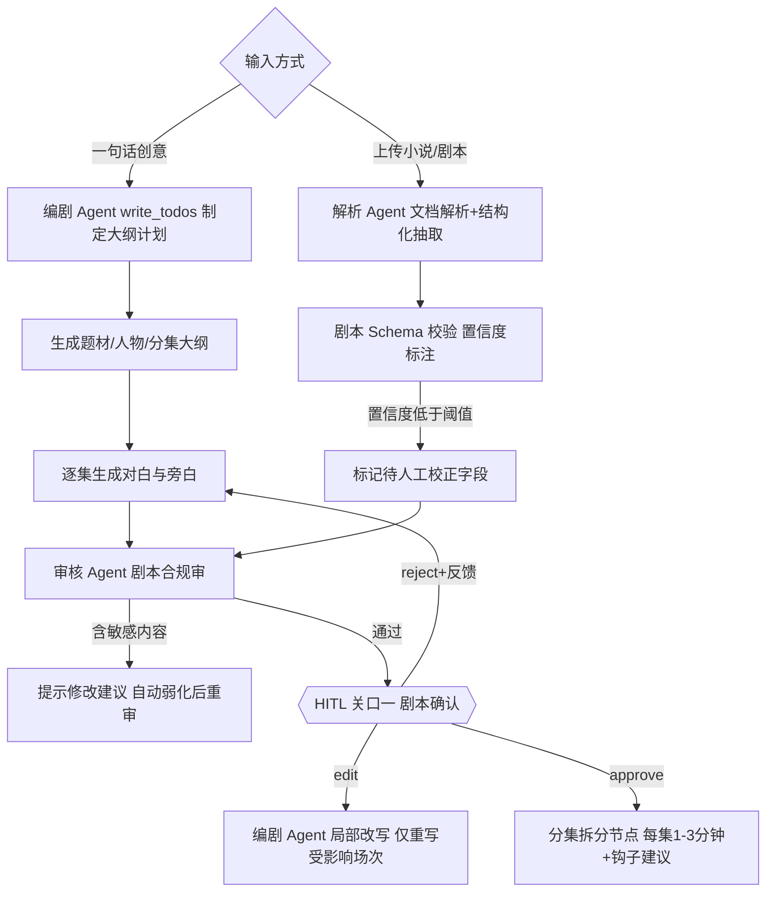

### F2.4 流程步骤

| 步骤 | Agent/节点 | 说明 |
|---|---|---|
| S1 | 编剧 Agent | 接收题材、字数、风格、结局走向。先 `write_todos`（大纲 → 人物 → 分集 → 对白），计划对用户实时可见 |
| S2 | 编剧 Agent | 逐集生成，每集写入 `/project/script/ep{n}.md`，同时维护结构化 `Script` 对象 |
| S3 | 解析 Agent | 上传 10 万字小说/剧本：分段解析 → 合并去重角色 → 场序还原；输出字段级置信度（角色归属/对白边界最易错） |
| S4 | 确定性校验节点 | 按剧本 Schema（集-场-角色-对白/旁白/动作）校验，非法结构直接打回 Agent 自修，不进入人工环节 |
| S5 | 审核 Agent | 前置审核（比生成后审省 90% 成本）：涉政/色情/未成年人/侵权要素扫描，输出"位置 + 风险等级 + 修改建议" |
| S6 | HITL 中断 | 用户可 approve / reject(反馈) / edit。LangGraph `interrupt()` 挂起，反馈写入 `human_feedback` 后从 reject 边重入 |
| S7 | 编剧 Agent | 局部改写：仅重生成受影响场次，其余内容引用原版本（省 token、保一致性） |
| S8 | 分集拆分节点 | 按目标单集时长估算场次，为每集生成"结尾钩子"建议，写入 `episodes` |

### F2.5 状态机

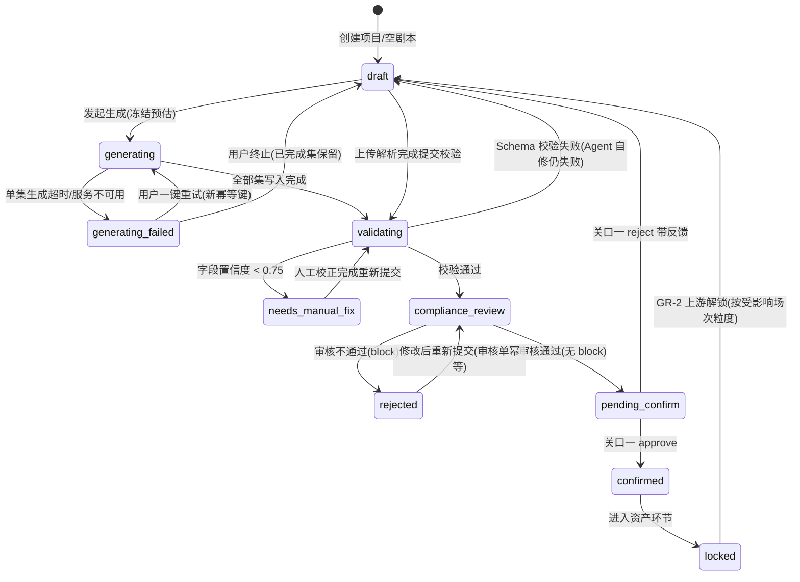

> **V4.0 细化说明**：新增 `generating`（逐集生成中，支撑 AC-F2-01-2 刷新恢复与 AC-F2-12-1 终止保留）与 `generating_failed`（单集重试耗尽）两个显式状态；`locked → draft` 解锁粒度明确为"按受影响场次"。与 ProjectStatus 映射：`draft/generating/generating_failed → SCRIPT_DRAFTING`；`validating/needs_manual_fix/rejected → SCRIPT_VALIDATING`；`compliance_review → SCRIPT_REVIEWING`；`pending_confirm → AWAITING_GATE_1`；`confirmed/locked → SCRIPT_LOCKED`【假设待验证：枚举名以 00 契约为准】。

### F2.6 边界与异常六查

| 类别 | 场景 | 期望行为 |
|---|---|---|
| 空态 | 用户未输入创意也未上传小说/剧本 | 生成按钮禁用，提示两种输入方式；不允许空提交 |
| 极值 | 生成分集超长/超字数（如要求 20 集 × 5 万字） | 校验节点打回，编剧 Agent 按场次裁剪；单项目 > 30 集返回 `10001`（Q6） |
| 极值 | 上传文件超限（> 50MB 或 > 20 万字） | 前置校验打回 `10001`，提示拆分上传 |
| 并发 | 用户连续点击"生成剧本" | `Idempotency-Key` 去重，仅一个任务生效 |
| 失败 | 解析文档为乱码/加密 PDF | 返回明确失败原因，不进入人工环节，不扣费 |
| 失败 | 审核服务超时不可用 | 重试 ≤ 2 次；仍失败则暂停流程并提示"审核服务不可用，稍后重试"（**不默认放行**） |
| 权限 | `view` 权限成员尝试编辑剧本 | 服务端拒绝返回 `20003`，前端编辑器置为只读 |
| 幂等 | 同一剧本重复提交审核 | 审核单幂等，不重复消耗审核额度 |
| 幂等 | 局部改写重复触发 | 幂等键命中返回历史结果，不重复消耗 token |
| 空态 | 剧本已确认后用户再次进入 | 展示已确认版本 + 只读标记 + "申请修改"入口（触发解锁流程） |

### F2.7 埋点

`script_input_method_selected`（一句话/上传小说或剧本）、`script_generation_started`、`script_generation_completed`（含耗时、字数、集数）、`script_parse_completed`（含整体置信度）、`script_low_confidence_field_fixed`、`script_rejected`（含反馈文本长度、次数）、`script_approved`、`script_manual_edit_saved`、`compliance_flagged`（含类型与等级）。

**V4.0 新增埋点**：`script_template_applied`（template_id、偏离字段数 → M1/M3）、`script_generation_cancelled`（已完成集数、返还积分 → M5）、`script_generation_failed`（失败集号、失败类型 → M6）、`script_early_read_used`（→ M2 拆解）、`script_version_compare_used`（→ M3）、`script_export_triggered`（格式、版本号 → CCCR）、`script_continuation_started`（续写集数 → 系列化留存）。

### F2.8 编剧 Agent 内部工作流（V4.0 新增）

| 项 | 规格 |
|---|---|
| 输入契约（读取 ProjectState） | `script_brief`（`creative_text` 或上传文档引用 `uploaded_doc_ref`，二选一必填）、`params{genre, art_style, episode_target, word_target, ending}`、`style_template_id`（可选）、`human_feedback`（reject/edit 重入时必读） |
| 输入缺失降级 | `episode_target` 缺失 → 按单集 1–3 分钟与总字数自动估算集数并在计划页说明【假设待验证】；`art_style` 缺失 → 默认"真人感"；`creative_text` 与上传并存 → 不执行，返回让用户选择输入方式 |
| 输出契约（Script JSON 关键字段） | `project_id / version_id / episodes[{ep_no, title, hook_suggestion, est_duration_sec, scenes[{scene_no, location, int_ext, tod(时段), characters[], dialogues[{speaker, text, emotion_hint}], narrations[], actions[]}]}] / confidence{field_scores} / todos_status` |
| 自检循环 | ① Schema 校验失败 → Agent 自修（重新结构化）≤ 2 轮 → 仍失败置 `draft` 并记录失败原因；② 审核 `review` 级 → 自动弱化改写后重审 ≤ 1 轮，仍命中则交人工逐条处理（不自动放行）；③ 字段置信度必检项：对白归属/场序 |
| 人工反馈注入 | reject 反馈写入 `human_feedback`，结构化建议：`{scope: {ep_no, scene_no[]}, action: "rewrite" 或 "tone_fix" 或 "plot_fix", text, source: "gate_1"}`；注入位置：编剧 Agent 修订轮系统提示的「修订指令」区块，未命中 scope 的场次标记"引用原版本不得改动" |

### F2.9 异常决策树（V4.0 新增，六查升级为 EX 场景）

> 通用基线：同步工具调用超时 10s + 指数退避 1s/4s 重试 ≤ 2 次；F2 专用：编剧单集生成 90s/集【假设待验证】，重试 30s → 120s。所有重试幂等、不重复计费（GR-6）。

| EX 编号 | 场景 | 检测点 | 处置动作 | 用户可见反馈 | 计费影响 | 审计 |
|---|---|---|---|---|---|---|
| EX-F2-01 | 空提交（无创意无上传） | 前端参数校验 | 禁用按钮，不发请求 | 两种输入方式引导 | 无 | 否 |
| EX-F2-02 | 分集超限（> 30 集） | 提交参数校验节点 | 拒绝 | `10001` + 当前集数/上限 | 无冻结 | 是 |
| EX-F2-03 | 上传超限（> 50MB / > 20 万字） | 上传预检 | 打回并提示拆分 | `10001` | 无 | 否 |
| EX-F2-04 | 乱码 / 加密 PDF | 解析 Agent 首段探测 | 终止解析 | 明确失败原因 | 已冻结预估全额解冻 | 是 |
| EX-F2-05 | 单集生成超时 | 编剧子任务超时监控 | 重试 2 次 → `generating_failed` | 进度页标红该集 + 一键重试 | 未完成集按实际结算/解冻 | 是 |
| EX-F2-06 | 审核服务不可用 | 审核 API 超时 × 2 | 流程暂停（不放行） | "审核服务暂不可用，可稍后重试" | 冻结保留，恢复后续跑 | 是 |
| EX-F2-07 | 并发双击生成 | `Idempotency-Key` 去重 | 仅一个任务生效 | 首个任务进度页 | 单次冻结 | 否 |
| EX-F2-08 | 重复提交审核 | 审核单幂等键（版本号 + 内容 hash） | 返回已有审核单 | 无感知 | 不重复扣审核额度 | 否 |
| EX-F2-09 | `view` 成员编辑 | 服务端 ACL 中间件 | 拒绝 `20003`，编辑器只读 | 权限提示 | 无 | 是（越权尝试） |
| EX-F2-10 | 确认后再次进入 | 状态查询 | 只读视图 + "申请修改"入口 | 已确认版本标记 | 无 | 否 |
| EX-F2-11 | 局部改写重复触发 | 改写幂等键（场次 + 指令 hash） | 命中返回历史结果 | 无感知 | 不重复消耗 token | 否 |
| EX-F2-12 | 生成中用户关闭页面 | 服务端任务继续执行 | 回来后状态完整恢复（AC-F2-01-2） | 进度不丢失 | 不变 | 否 |

### F2.10 界面交互要点（V4.0 新增）

1. **生成进度页**：`write_todos` 计划置顶（四节点状态条），集列表左"完成 ✓ / 生成中 ⟳ / 排队 ·"三态图标；已完成集卡片右上 💬 备注入口；终止按钮固定右下角，二次确认显示"将保留 X 集，返还约 Y 积分"。
2. **解析预检卡片**：文件名 / 字数 / 章节估计 / 预计耗时 / 预估积分五行 + "开始解析"主按钮；预检失败整卡红色、无主按钮。
3. **审核结果清单**：顶部"n/m 已处理"进度条；每条含定位链接（点击跳转编辑器并黄色高亮问题文本）与"已处理"勾选；`block` 项红色且无勾选框。
4. **版本对比页**：左版本选择器、中 diff 正文（三色）、右统计卡（字数/集数）；"设为当前"右下角红色描边 + 二次确认。
5. **空态文案**：剧本空态——"用一句话开始，或上传你已有的小说/剧本"；版本空态——"还没有历史版本，第一次保存后即可对比"。

### F2.11 端到端业务流程详解（V5.0 新增）

> 本节回答三个问题：剧本从哪来（一句话 / 上传）、人怎么介入（关口一与手工编辑）、出错时钱和进度怎么算。P 编号与 F2.4 的 S1–S8 对应关系见 F2.11.3。

#### F2.11.1 触发场景与前置条件

| 编号 | 触发场景 | 谁触发 | 前置条件 | 完成判定 | 计费点 |
|---|---|---|---|---|---|
| T2-1 | 一句话创意生成剧本 | 用户 | 项目已创建；`creative_text` 5–500 字；无同幂等键进行中任务 | 全部分集写入且通过 Schema 校验 | D |
| T2-2 | 上传小说 / 剧本解析 | 用户 | 文件为 txt / docx / pdf，≤ 50MB 且 ≤ 20 万字 | 输出"集-场-角色-对白"结构化剧本与字段置信度 | D |
| T2-3 | 关口一决策 | 用户 | 剧本处于 `pending_confirm` | approve 进入锁定；reject / edit 回到改写 | 无（改写另计） |
| T2-4 | 局部改写 / 续写 / 场次扩写 | 用户 | 剧本 `confirmed` 或 `locked`（续写 / 扩写） | 仅受影响场次或新增集产生新版本 | D |
| T2-5 | 终止逐集生成 | 用户 | 剧本处于 `generating` | 已完成集保留为 `draft`，未执行部分返还 | D（已执行部分） |
| T2-6 | 版本对比 / 恢复 / 导出 | 用户 | 存在 ≥ 1 个剧本版本 | 生成新版本或下载文件 | 无（导出免费） |
| T2-7 | 申请修改已锁定剧本 | 用户 | 剧本 `locked` 且下游已存在 | 受影响场次解锁为 `draft` 并提示影响范围 | 无 |

#### F2.11.2 参与角色

| 角色 | 类型 | 在本流程中的职责 | 明确不负责 |
|---|---|---|---|
| 用户（创作者 / 编剧） | 人 | 选择输入方式、编辑剧本、关口一决策、导出 | 不能跳过审核或直接改版本号 |
| 编剧 Agent | LLM | 规划、逐集生成、局部改写、续写、钩子建议 | 不决定审核结论、不扣费 |
| 解析 Agent | LLM | 文档分段解析、角色合并、场序还原、置信度标注 | 不直接改写原文含义 |
| 确定性校验节点 | 确定性 | 剧本 Schema 校验、字段越界校验、幂等键 | 不生成内容 |
| 审核 Agent | LLM + 审核 API | 前置内容安全审核，输出位置、等级、修改建议 | 不提供绕过通道（GR-7） |
| 编排器 + 审批台 | 确定性 / 界面 | 状态流转、HITL 中断、待办展示、审批幂等 | — |
| 计费服务 | 确定性 | 按集冻结与结算、终止时返还未执行部分 | 不判断内容质量 |
| 平台运营 | 人（内部） | 维护敏感词库与审核策略 | — |

#### F2.11.3 业务流程图（P 编号 ↔ F2.4 步骤映射）

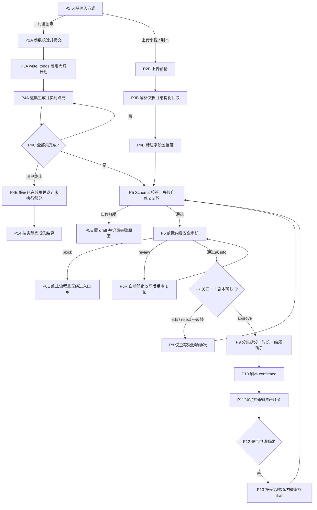

| 图中节点 | 对应 F2.4 步骤 | 说明 |
|---|---|---|
| P3A–P4A | S1、S2 | 计划先于生成，计划节点经 SSE 对用户可见 |
| P3B–P4B | S3 | 分段解析 → 合并去重角色 → 场序还原 → 字段置信度 |
| P5 | S4 | 非法结构直接打回 Agent 自修，不进入人工环节 |
| P6 | S5 | 审核前置，比生成后审核省约 90% 成本 |
| P7 | S6 | LangGraph `interrupt()` 挂起，反馈写入 `human_feedback` |
| P8 | S7 | 未命中反馈作用域的场次引用原版本，不重写 |
| P9 | S8 | 按目标单集时长估算场次，输出钩子建议并写入 `episodes` |

#### F2.11.4 时序图一：一句话生成到关口一（对应 T2-1 / T2-3）

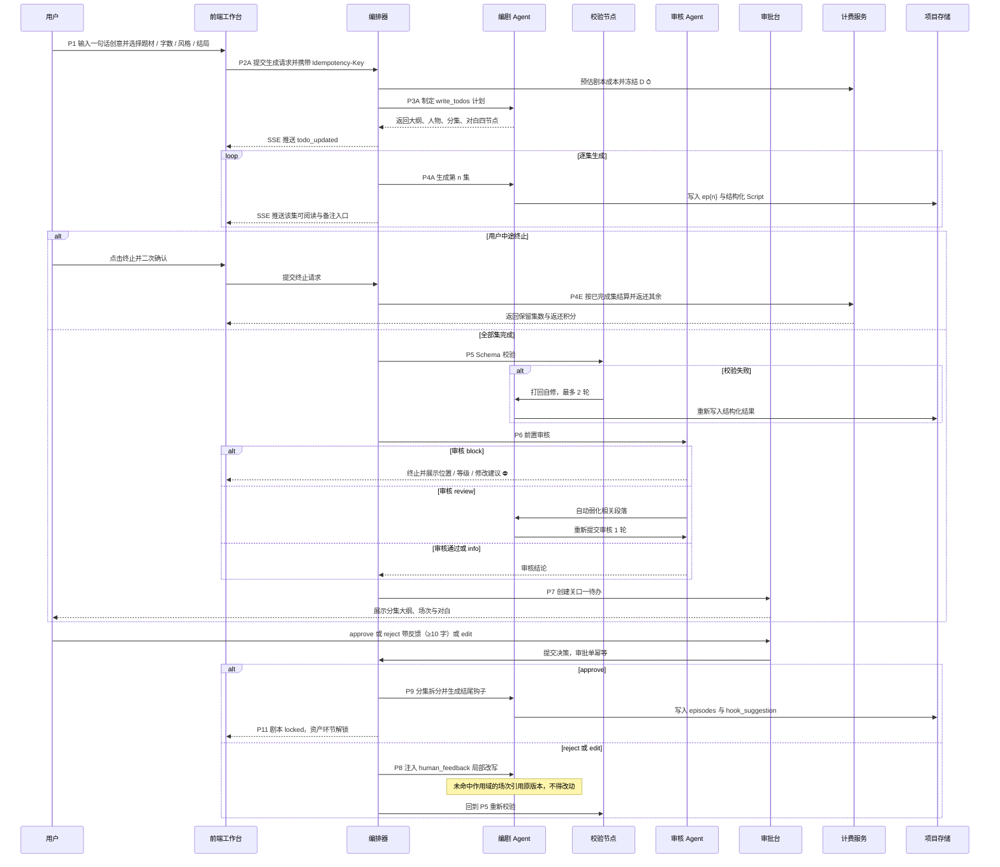

#### F2.11.5 时序图二：上传解析与人工校正（对应 T2-2）

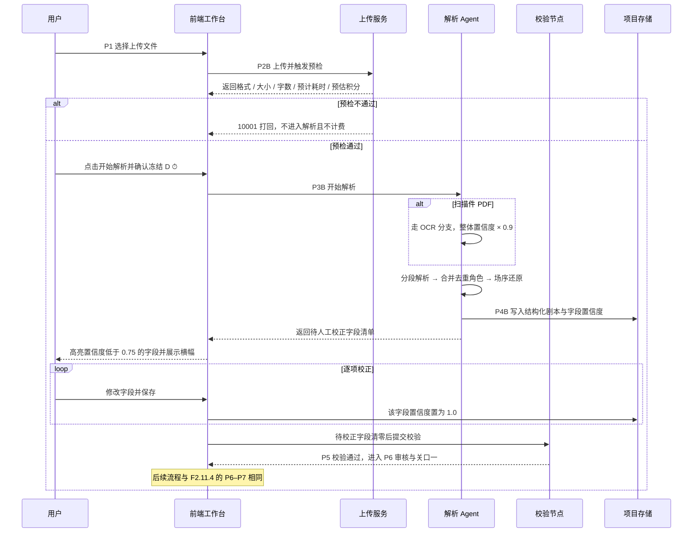

#### F2.11.6 用户操作步骤

| 步骤 | 用户看到什么 | 用户做什么 | 系统即时反馈 |
|---|---|---|---|
| 1 | 输入方式二选一卡片 | 输入一句话创意，或拖入文档 | 字数实时计数；空或超限时生成按钮禁用 |
| 2 | 生成进度页 | 观察四节点计划与集列表三态 | 已完成集即时可读，可加备注（不阻塞生成） |
| 3 | 解析预检卡片 | 查看字数 / 章节估计 / 预计耗时 / 预估积分 | 预检失败整卡变红且无主按钮 |
| 4 | 待校正清单 | 逐项核对高亮字段并修改 | 修改后置信度置 1.0；全部清零回到 `draft` |
| 5 | 审核结果清单 | 逐条查看定位链接与修改建议 | `block` 项无勾选框；`review` 项处理后可重新提交 |
| 6 | 关口一审批台 | approve / reject（≥10 字反馈）/ 手工编辑 | reject 后仅受影响场次重写 |
| 7 | 版本对比页 | 选择两个版本、查看三色 diff | 可"设为当前"，生成新版本号且历史不丢 |
| 8 | 导出入口 | 选择 md / docx / txt | 生成 `{项目名}-剧本-{版本号}` 并下载 |
| 9 | 终止按钮（右下角） | 二次确认 | 显示"将保留 X 集，返还约 Y 积分" |

#### F2.11.7 系统处理逻辑

| 步骤 | 处理方 | 判定与计算规则 | 成功输出 | 失败输出 |
|---|---|---|---|---|
| P2A | 前端 + 校验节点 | `creative_text` 5–500 字；集数 ≤ 30；幂等键去重 | 请求受理 | 按钮禁用或 `10001` |
| P3A | 编剧 Agent | 先规划后生成，计划四节点对用户可见 | `write_todos` 计划 | 计划生成失败则整体失败并解冻 |
| P4A | 编剧 Agent | 单集 90s 超时；重试 30s → 120s ≤ 2 次；逐集写文件与结构化对象 | 集可用 | `generating_failed` + 一键重试 |
| P4E | 计费服务 + 编排器 | 以先持久化者为准；幂等键 = `project_id + script_run_id` | 已完成集保留，其余返还 | 竞态下不重复扣费（AC-F2-12-2） |
| P2B | 上传服务 | 格式白名单、≤ 50MB、≤ 20 万字，预检 ≤ 30s | 进入解析 | `10001`，不解析不计费 |
| P3B–P4B | 解析 Agent | 字段级置信度；扫描件整体 × 0.9（系数待验证）；< 0.75 标"待人工校正" | 结构化剧本 | 乱码 / 加密文件终止并全额解冻 |
| P5 | 校验节点 | 集-场-角色-对白/旁白/动作 Schema；`speaker` 必须在人物表 | 通过 | 自修 2 轮仍失败置 `draft` 并记录原因 |
| P6 | 审核 Agent | 涉政 / 色情 / 未成年人 / 侵权扫描；`block` 终止、`review` 逐条处理、`info` 提示 | 审核结论 | 超时重试 2 次后暂停且不放行 |
| P7 | 审批台 + 编排器 | 反馈 ≥ 10 字；同一审批单幂等；连续 3 次 reject 提示换策略 | 决策生效 | 40001（关口未处理时越级请求） |
| P8 | 编剧 Agent | 改写范围默认单集；反馈 5–200 字；仅重写受影响场次 | 新版本 | 幂等命中返回历史结果 |
| P9 | 编剧 Agent | `est_duration_sec` 60–180；`hook_suggestion` ≤ 50 字；超 180s 黄色警示不阻断 | `episodes` 写入 | 拆分失败保留剧本待重试 |
| P13 | 编排器 | 按受影响场次解锁；提示"影响 N 个镜头" | 解锁完成 | 无权限返回 20003 |

#### F2.11.8 数据流转

| 数据对象 | 产生 / 变更时机 | 关键字段 | 写入方 | 读取方 | 生命周期 |
|---|---|---|---|---|---|
| 结构化剧本 Script | P4A / P4B 生成；P8 改写 | 集、场、角色、对白、旁白、动作 | 编剧 / 解析 Agent | 资产、分镜、导出 | 项目生命周期，版本化（DR-3） |
| 剧本版本 | 每次保存或改写 | 版本号、置信度均值、状态 | 编排器 | 版本对比、回滚 | 上限 30 个 |
| 分集信息 | P9 | `ep_no / title / hook_suggestion / est_duration_sec` | 编剧 Agent | 分镜、导出 | 随剧本版本 |
| 字段置信度 | P4B / 人工校正 | 字段路径、分值、是否人工确认 | 解析 Agent / 用户 | 校验节点、审批台 | 随版本 |
| 人工反馈 `human_feedback` | P7 reject / edit | 作用域、动作、文本、来源关口 | 审批台 | 编剧 Agent 修订轮 | 随版本留存（DR-4） |
| 审批记录 | P7 | 审批单号、结论、操作者、时间 | 审批台 | 编排器、审计 | ≥ 12 个月 |
| 生成运行记录 | P4A / P4E | 运行状态、已完成集数、结算口径 | 编排器 | 计费、报表 | 随项目 |
| 审核记录 | P6 | 位置、风险等级、建议、处理结果 | 审核 Agent | 用户、法务 | ≥ 6 个月（NFR-C5） |
| 导出文件 | T2-6 | 格式、版本号、待校正提示 | 导出服务 | 用户 | 按下载记录留存 |

#### F2.11.9 异常分支

| 分支 | 触发条件 | 系统行为 | 用户可见 | 恢复方式 | 对应条款 |
|---|---|---|---|---|---|
| 空提交 | 无创意且无上传 | 不发送请求 | 两种输入方式引导 | 补充输入 | EX-F2-01 |
| 集数超限 | 总集数 > 30 | 拒绝 | `10001` + 当前集数与上限 | 减少集数 | EX-F2-02 |
| 上传超限 | > 50MB 或 > 20 万字 | 打回 | 提示拆分上传 | 重新上传 | EX-F2-03 |
| 乱码 / 加密 PDF | 首段探测失败 | 终止解析 | 明确失败原因 | 换文件 | EX-F2-04 |
| 单集生成超时 | 重试耗尽 | 置 `generating_failed` | 该集标红 + 一键重试 | 重试（新幂等键） | EX-F2-05 |
| 审核服务不可用 | 审核 API 超时 × 2 | 暂停流程，不放行 | "稍后可一键重试" | 服务恢复后从暂停点续跑 | EX-F2-06、AC-F2-06-3 |
| 审核 `block` | 命中硬性违规 | 终止且无绕过入口 | 风险位置 + 建议 | 修改后新建版本 | GR-7、E2E-10 |
| 并发双击生成 | 幂等键相同 | 仅一个任务生效 | 首个任务进度页 | 自动 | EX-F2-07 |
| 重复提交审核 | 版本号 + 内容 hash 命中 | 返回已有审核单 | 无感知 | 自动 | EX-F2-08 |
| `view` 成员编辑 | ACL 拦截 | 拒绝并置编辑器只读 | 权限提示 | 申请 edit 权限 | EX-F2-09 |
| 确认后再次进入 | 状态为 `locked` | 只读视图 + "申请修改" | 已确认版本标记 | 触发 P13 解锁 | EX-F2-10 |
| 跨成员同时编辑 | 后保存者提交 | 冲突提示 + 双方 diff | 选择覆盖或基于最新重改 | 手工合并 | AC-F2-07-3 |

#### F2.11.10 待确认点

| 编号 | 待确认问题 | 影响 | 当前默认取值 |
|---|---|---|---|
| TBD-F2-01 | 续写新集是否需要重新走完整关口一：已确认的旧集是否重审 | 影响续写效率与确认成本 | [Assumption] 仅新集进入 `pending_confirm`，旧集不重审 |
| TBD-F2-02 | 剧本版本上限 30 与 F8 快照上限 30 是否为同一配额 | 两套版本体系可能互相挤占 | [Assumption] 独立配额，互不淘汰 |
| TBD-F2-03 | 终止生成时已完成集按"集均摊预估"还是"实际 token"结算 | 影响 M5 成本偏差口径 | [Assumption] 按实际 token 结算 |
| TBD-F2-04 | 上传预检本身是否计费 | 用户预期与成本 | [Assumption] 不计费，仅实际解析计费 |
| TBD-F2-05 | 单用户项目的"申请修改"由谁审批 | 单人项目缺少第二审批人 | [Assumption] 本人二次确认 + 审计留痕即可解锁 |
| TBD-F2-06 | 扫描件 OCR 的置信度折算系数 0.9 是否按文件质量动态调整 | 决定待校正字段数量 | [Assumption] 固定 0.9，上线后按实测校准 |
| TBD-F2-07 | 手工编辑与 Agent 改写是否共用版本号序列 | 版本对比与回滚的可解释性 | [Assumption] 共用序列，来源字段区分 manual / agent |

---

### F2.12 V6.0 增量：台词清单（`script_lines`）与配音稿契约

> **为什么在 F2**：V6.0 的配音在分镜之前，配音的最小单元不是"场"也不是"镜头"，而是**一句可独立配音的台词**。这句话必须在剧本层就被切出来、标好归属与情绪，否则下游（配音、绑定、时长、字幕）都要各自重新切一遍，必然对不齐。**台词清单是 V6.0 全链路的公共原子。**

#### F2.12.1 新增用户故事

| ID | 用户故事 | 优先级 |
|---|---|---|
| US-F2-13 | 作为创作者，我希望剧本确认后自动得到一份"逐句台词清单"，以便直接进入配音而不必手工拆分 | M |
| US-F2-14 | 作为创作者，我希望在配音前逐句调整断句、说话人与情绪标注，以便配音出来就是我要的味道 | M |
| US-F2-15 | 作为创作者，我希望在配音前就看到"这句话大约多少秒、整集大约几分钟"，以便判断篇幅是否合适 | M |
| US-F2-16 | 作为创作者，我希望旁白、内心独白、画外音能被区分标注，以便它们用不同的音色与处理 | P1 |

#### F2.12.2 新增验收标准

| ID | 验收标准 |
|---|---|
| AC-F2-13-1 | Given 剧本通过 Schema 校验，When 生成台词清单，Then 输出 `script_lines[]`，每条含 `line_id / ep_no / scene_no / order_in_scene / speaker / speaker_type / text / emotion / est_ms / source(script 或 edit)`；`line_id` 全局唯一且**跨版本稳定**（同一句在改稿后若文本未变则 ID 不变）【假设待验证：稳定 ID 的匹配算法（文本相似度 + 位置）】 |
| AC-F2-13-2 | Given 台词清单已生成，When 用户打开"台词清单"视图，Then 可按集/场/角色三种维度分组查看，逐条显示字数、预估时长与总时长汇总（集级、剧级） |
| AC-F2-13-3 | Given 剧本发生局部改写（AC-F2-04-1），When 改写完成，Then 台词清单增量更新：新增句标 `added`、删除句标 `removed`（软删保留 ID）、修改句沿用原 ID 并标 `modified`；**不得整表重建**（否则配音轨无法复用） |
| AC-F2-14-1 | Given 用户在某句台词上操作，When 修改 `speaker`，Then 校验该角色存在且已绑定音色（未绑定则提示"该角色尚未选音色，配音前需绑定"），保存后该句标记 `dirty_voice` |
| AC-F2-14-2 | Given 用户编辑某句台词文本，When 保存，Then 该句 `source=edit`，`est_ms` 按字数重新估算，且若该句已生成配音则提示"该句配音将失效，需重新配音（约 X 秒）" |
| AC-F2-14-3 | Given 用户对一句过长的台词点击"拆分"，When 选择切分点，Then 生成两条 `script_lines`（原 ID 保留给前半句，新 ID 给后半句），`order_in_scene` 顺延，并提示下游受影响镜头数 |
| AC-F2-15-1 | Given 台词清单生成，When 展示时长预估，Then 按语速默认 4.2 字/秒【假设待验证】估算 `est_ms`，并明确标注"预估"字样；配音完成后该集显示"实测"时长并可对比差异 |
| AC-F2-15-2 | Given 某集预估总时长 > 180s（Q6 上限），When 展示，Then 集级标黄"超出单集时长上限，建议拆分或删减"，不阻断进入配音 |
| AC-F2-16-1 | Given 台词含旁白/内心独白，When 标注，Then `speaker_type ∈ {dialogue, narration, inner_monologue, voice_over}`，配音时按类型套用不同音色与处理链（旁白默认降 2dB、无口型要求）【假设待验证：处理链参数】 |

#### F2.12.3 数据结构（`script_lines` 关键字段）

| 字段 | 类型 | 说明 |
|---|---|---|
| `line_id` | string | 全局唯一、跨版本稳定（配音轨复用的前提） |
| `ep_no` / `scene_no` / `order_in_scene` | int | 三级定位，供分镜按场取句 |
| `speaker` / `speaker_type` | string / enum | 说话人与类型（对白/旁白/独白/画外音） |
| `text` | string | 台词原文（≤ 200 字【假设待验证】） |
| `emotion` | enum | 复用 F4 的 `emotion_tag` 枚举，保证与分镜同构 |
| `est_ms` | int | 字数估算时长（仅用于配音前预估） |
| `actual_ms` | int \| null | 配音后实测时长（写入方为 F9，F2 只读） |
| `voice_status` | enum | `pending / voiced / dirty_voice / failed` |
| `source` | enum | `script`（Agent 生成）/ `edit`（人工编辑） |

> **契约要求**：`script_lines` 是**唯一台词来源**。F4 的镜头台词绑定、F9 的配音、F6 的字幕都只能引用 `line_id`，不允许各自保存一份台词文本副本（否则改一句要改四处）。

#### F2.12.4 与其他模块的接口

| 下游 | 消费方式 | 约束 |
|---|---|---|
| F9 配音 | 按 `ep_no` 取全部 `pending/dirty_voice` 句批量配音 | 只读 `script_lines`，写回 `actual_ms` 与 `voice_status` |
| F4 分镜 | 按场取候选句列表供"为镜头选择台词" | 一个镜头可绑多条；一条可被多个镜头复用（如同一句回闪） |
| F6 字幕 | 按 `line_id` 生成字幕条，文本不再重新断句 | 断句以 `script_lines` 为准，字幕仅做二次折行 |
| M0 Story Bible | 从台词提取"谁在场、说什么、什么情绪"作为场次状态的一部分 | 见 5A.2 |

> **异常兜底**：若剧本为纯动作/纯画面（无台词），`script_lines` 为空数组，F9 直接跳过并提示"本集无台词，可跳过配音"，链路继续（与 F6.5 空态同源）。

---

## F3 资产模块

### F3.1 目标

让角色在跨镜头、跨集、甚至跨项目时被稳定识别为"同一个人"，并让用户对形象有决定权。

### F3.2 用户故事与验收标准

| ID | 用户故事 | 优先级 |
|---|---|---|
| US-F3-01 | 作为用户，我希望系统自动从剧本提取角色/场景/道具清单，以便不用手工整理 | M |
| US-F3-02 | 作为用户，我希望角色生成主形象 + 三视图 + 表情集，以便后续镜头保持一致 | M |
| US-F3-03 | 作为用户，我希望不满意的角色能"带反馈重抽"，以便不反复盲抽 | M |
| US-F3-04 | 作为用户，我希望为角色绑定音色，以便全剧配音统一 | M |
| US-F3-05 | 作为用户，我希望用真人照片定制角色，并完成授权确认，以便合规使用 | M |
| US-F3-06 | 作为用户，我希望角色资产能跨项目复用，以便打造系列剧（P1） | P1 |
| US-F3-07 | 作为用户，我希望知道角色一致性是否达标，以便决定是否继续 | M |
| US-F3-08 | 作为用户，我希望为场景资产生成时段/季节变体（白天/夜晚/雨天），以便不同剧情时段画面连贯 | M |
| US-F3-09 | 作为用户，我希望为关键道具生成特写资产，以便插入镜头有稳定参照 | P1 |
| US-F3-10 | 作为用户，我希望对多个角色应用同一条重抽反馈批量重抽，以便不用逐个操作 | M |
| US-F3-11 | 作为用户，我希望给资产打标签并按名称/标签搜索，以便角色多的项目快速定位 | P1 |
| US-F3-12 | 作为用户，我希望查看和管理我的真人授权记录（含撤回），以便合规可控（P1） | P1 |

**验收标准**

| ID | 验收标准 |
|---|---|
| AC-F3-01-1 | Given 剧本已锁定，When 资产规划执行，Then 输出角色清单（含年龄/外形描写/戏份权重）、场景清单（内外/时代/时段）、关键道具，并按戏份权重给出生成优先级 |
| AC-F3-02-1 | Given 用户选定画风预设，When 生成角色资产，Then 依次产出主形象、正/侧/背三视图、表情集（≥ 5 种情绪），全过程在同一自检循环内 |
| AC-F3-02-2 | Given 生成完成，When 质检执行，Then 三视图与主形象的人脸 embedding 余弦相似度 `face_score` ≥ 阈值（默认 0.80，可用配置覆盖，见 00 契约 §6.8），否则判定不合格 |
| AC-F3-03-1 | Given 用户对角色 A 点击 reject 并输入"太老、换发型"，When 重新生成，Then 新版本创建为独立 `asset_version`，旧版本保留可对比，反馈文本进入生成参数 |
| AC-F3-04-1 | Given 角色 A 与音色 V 绑定，When 全剧 TTS 执行，Then 角色 A 的所有台词统一使用音色 V；音色下架时提示替换 |
| AC-F3-05-1 | Given 用户上传真人照片，When 授权流程执行，Then 先做人脸质量校验，再做公共人物库比对；若命中相似真人脸，则强制二次确认 + 授权书留痕（时间戳/IP/协议版本）写入 `face_authorizations` |
| AC-F3-05-2 | Given 用户未完成授权确认，When 尝试用该角色生成镜头，Then 拒绝并返回 `50003 未完成真人授权` |
| AC-F3-07-1 | Given 某角色跨 50 个镜头生成完毕，When 质检抽检执行，Then 人脸相似度达标率 ≥ 95%，不达标镜头进入"待人工"清单 |
| AC-F3-08-1 | Given 场景清单含某场景（内外/时代/时段），When 用户为该场景勾选变体（时段：晨/昼/黄昏/夜；天气：晴/雨/雪，最多各选 2 项【假设待验证】），Then 每个变体生成独立 `asset_version` 并以场景 × 变体命名 |
| AC-F3-08-2 | Given 分镜引用某场景的"夜"变体，When 该变体未生成，Then 分镜质检报"场景变体缺失"并引导一键生成，不阻塞其它镜头 |
| AC-F3-09-1 | Given 资产清单标记某道具为"关键道具"（出场 ≥ 3 场【假设待验证：判定规则】），When 生成执行，Then 该道具生成正/侧 2 张特写图，纳入质检与锁定流程 |
| AC-F3-09-2 | Given 用户手动追加道具特写请求，When 提交，Then 按单资产计费并进入同一资产库目录 `/assets/props/` |
| AC-F3-10-1 | Given 用户多选 5 个角色并输入同一条重抽反馈，When 确认执行，Then 展示"N 个角色 × 单价 = 预估积分"并逐角色独立执行（独立版本与质检循环），单角色失败不阻塞其余 |
| AC-F3-10-2 | Given 批量重抽执行中，When 某角色命中"命中公共人物库"拦截，Then 仅该角色终止并说明原因，其余继续 |
| AC-F3-11-1 | Given 项目含 > 10 个资产【假设待验证：搜索入口出现阈值】，When 用户在资产墙顶部搜索框输入，Then 按 `name / label` 前缀匹配过滤（标签为多选 AND），500ms 内返回【假设待验证：前端过滤即可满足】 |
| AC-F3-11-2 | Given 用户给资产打标签，When 保存，Then 标签数上限 10 个/资产、单标签 ≤ 12 字 |
| AC-F3-12-1 | Given 用户存在真人授权记录，When 打开"真人授权记录"页，Then 列出角色、授权时间、IP、协议版本、状态（`active/revoked`） |
| AC-F3-12-2 | Given 用户对某角色执行"撤回授权"，When 输入角色名二次确认，Then 该角色状态置 `revoked`、禁止发起新的镜头生成（返回 `50003`，`error_detail = authorization_revoked`），已生成内容保留，撤回写入 `audit_logs` |
| AC-F3-12-3 | Given 被撤回角色存在进行中的生成任务，When 撤回生效，Then 进行中任务照常完成并结算（已冻结），后续新任务被拒 |
| AC-F3-01-2 | Given 资产规划执行，When 输出清单，Then 每个角色含 `name / age_desc / appearance / screen_weight(0–1, 两位小数) / voice_gender_hint`；场景含 `int_ext / era / tod`；戏份权重 = 角色对白场次数 ÷ 总场次数（保留两位小数），按权重降序生成【假设待验证：权重公式】 |
| AC-F3-01-3 | Given 提取角色数 > 30，When 规划完成，Then 提示超限并按戏份权重排序给出"前 30 优先生成"的分批建议，其余置为 `pending` |
| AC-F3-02-3 | Given 主形象生成，When 输出，Then 主形象为 1024×1024 PNG【假设待验证：分辨率与格式，依模型能力】；三视图为同分辨率竖排三联图，均可单独下载 |
| AC-F3-02-4 | Given 三视图逐张质检，When 任一视图 `face_score` < 0.80，Then 仅重生成该视图（不重跑主形象），并附具体视图名与得分返回美术 Agent |
| AC-F3-03-2 | Given 用户对角色发起重抽，When 确认弹窗展示，Then 显示"本次预估 X 积分 + 该角色已累计消耗 Y 积分 / 已重抽 N 次"；Y > 成本基线 2 倍时【假设待验证：阈值】追加"建议换描述策略"提示（不阻断） |
| AC-F3-03-3 | Given 重抽反馈文本，When 注入生成参数，Then 反馈长度限制 5–100 字，以 `revision_notes` 字段拼入美术 Agent 提示词的「修改要求」区块 |
| AC-F3-04-2 | Given 音色绑定工作台，When 用户试听候选音色，Then 每角色提供 3 句试听样音（取该角色台词量最多的 3 句【假设待验证：选句规则】），绑定前必须完成 ≥ 1 次试听（交互防呆） |
| AC-F3-04-3 | Given 音色 V 下架，When 用户进入受影响项目，Then 资产页角色卡显示"音色已下架"徽标 + 推荐最近似音色（性别/年龄匹配）一键替换，替换前必须试听 |
| AC-F3-05-3 | Given 授权确认完成，When 写入 `face_authorizations`，Then 字段含 `user_id / character_id / auth_time / ip / agreement_version / photo_hash / status`，photo_hash 用于后续一致性核验 |
| AC-F3-05-4 | Given 上传照片命中公共人物库，When 拦截，Then 直接拒绝（不走二次确认通道），提示"照片与公众人物高度相似，不可用于定制"，写入 `audit_logs` |
| AC-F3-07-2 | Given 关口二审批页，When 展示角色卡片墙，Then 顶部一致性面板显示：平均 `face_score` 分布柱状图、低于阈值 +5% 的"踩线角色"清单（可一键筛选）、整体通过率；面板不阻塞 approve |

### F3.3 详细流程

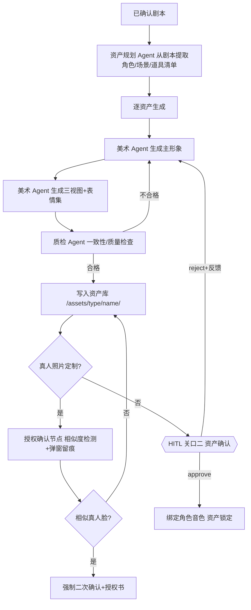

### F3.4 流程步骤

| 步骤 | Agent/节点 | 说明 |
|---|---|---|
| S1 | 资产规划（美术 Agent 的规划子任务） | 从 `Script` 提取：角色清单（含年龄/外形描写/戏份权重）、场景清单（内外/时代/时段）、关键道具；输出生成优先级（戏份重的角色先生成） |
| S2 | 美术 Agent | 按用户选定画风（真人感/二次元/国风/3D）生成主形象；自检循环：主形象 → 三视图 → 表情集，每步由质检 Agent 比对"是否为同一人物" |
| S3 | 质检 Agent | 角色一致性：人脸 embedding 比对 + CLIP 相似度 ≥ 阈值；质量：肢体/手部/五官硬伤检测；不合格附具体原因返回美术 Agent 重生成（≤ 3 轮） |
| S4 | 合规节点 | 真人照片：人脸识别比对公共人物库 + 用户授权弹窗留痕（时间戳/IP/协议版本） |
| S5 | HITL 中断 | 角色卡片墙展示（主形象 + 三视图 + 表情），用户逐个 approve / reject(反馈) / 重抽 |
| S6 | 确定性绑定 | 角色 → 音色绑定写入 `assets`，全剧 TTS 统一引用 |

### F3.5 关键设计

| 编号 | 设计 |
|---|---|
| AD-1 | **一致性不靠 prompt 靠锚点**：所有该角色的后续生成强制注入三视图作为条件图；`asset_id` 进入每个分镜的生成参数 |
| AD-2 | 资产库与项目解耦：资产写入 `/assets/`，项目通过引用使用 → 支持跨项目复用（F3.6/P1） |
| AD-3 | 子代理并行：同批多个角色/场景可并行派生子代理生成，共享 `/assets/` 工作区 |
| AD-4 | 缺失降级：表情集部分缺失允许通过，缺失情绪在分镜层降级处理（旁白代替） |

### F3.6 边界与异常六查

| 类别 | 场景 | 期望行为 |
|---|---|---|
| 空态 | 剧本无可提取角色（纯旁白剧本） | 提示"未识别到角色"，允许跳过直接进入分镜，资产步骤标记为"无需资产" |
| 极值 | 单项目角色数 > 30 | 提示超限并给出分批建议，避免并行度过高拖垮队列 |
| 并发 | 同批 10 个角色同时生成 | 受套餐并发限制排队；子代理并行度受配置上限约束 |
| 失败 | 三视图与主形象相似度过低 | 美术 Agent 改用"图生图 + 姿态参考"而非文生图重抽 |
| 失败 | 表情集生成部分失败 | 允许带缺失通过，缺失情绪在分镜层降级（旁白代替） |
| 失败 | 用户上传非人脸/模糊照片 | 前置校验打回 `50004`，不进入生成、不扣费 |
| 权限 | `view` 成员尝试重抽资产 | 服务端拒绝 `20003` |
| 幂等 | 同一角色重复触发生成 | 幂等键去重，返回进行中的任务而非新建 |
| 合规 | 上传照片命中公共人物库 | 直接拒绝生成并说明原因，不进入"二次确认"通道 |

### F3.7 埋点

`asset_plan_completed`（角色/场景/道具数量）、`asset_generation_started`、`asset_generation_completed`（含一致性得分）、`asset_rejected`（含反馈关键词）、`asset_regenerated`、`voice_bound`、`real_person_auth_started`、`real_person_auth_confirmed`、`asset_locked`。

**V4.0 新增埋点**：`asset_variant_created`（变体使用率）、`asset_batch_regenerated`（批量采纳、M10）、`asset_qc_rounds`（轮次与原因 → M4/M6）、`asset_regenerate_cost_warning_shown`（→ M11）、`asset_voice_replaced`（下架处理率）、`asset_search_used`（资产墙可用性）、`real_person_auth_revoked`（合规审计 CCCR）。

### F3.8 资产状态机细化（V4.0 新增）

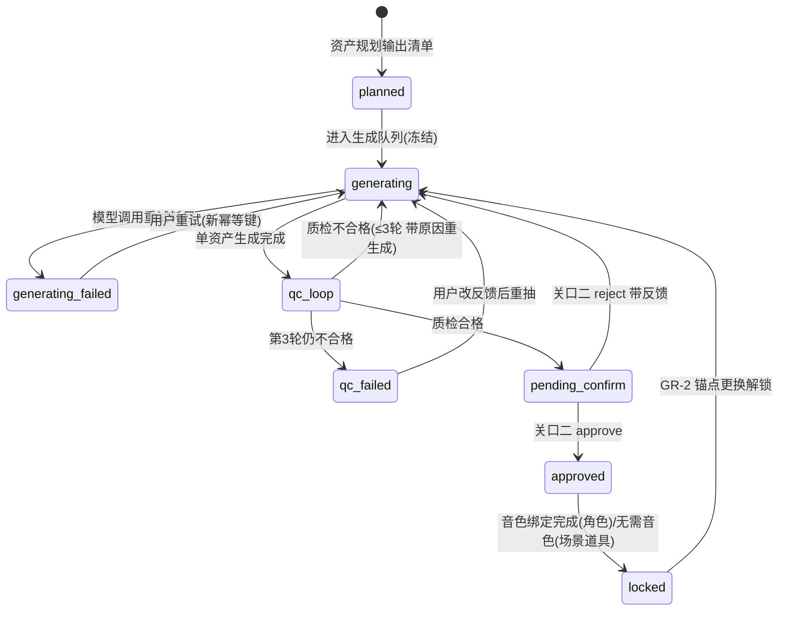

| 状态 | 进入条件 | 可执行动作 | 出口条件 |
|---|---|---|---|
| generating | 队列调度 + 冻结成功 | 用户可预览已完成产物 | 完成进入 qc_loop |
| qc_loop | 生成完成 | 无用户动作（≤ 3 轮自动） | 合格 → pending_confirm；3 轮失败 → qc_failed |
| qc_failed | 修正循环耗尽 | 改反馈重抽 / 接受降级（表情缺失类 AD-4） | 重抽 → generating；接受 → pending_confirm |
| pending_confirm | 质检合格 | approve / reject(反馈) / 重抽 | 见上 |
| locked | 绑定/确认完成 | 查看、历史版本恢复（触发 GR-2） | 锚点更换 → generating |

> ProjectStatus 映射【假设待验证】：`planned → ASSET_PLANNED`；`generating/generating_failed/qc_loop/qc_failed → ASSET_GENERATING`；`pending_confirm → AWAITING_GATE_2`；`approved/locked → ASSET_LOCKED`。场景/道具仅做质量分质检（CLIP 阈值 0.75【假设待验证】），无 face_score 项。

### F3.9 美术 Agent 内部工作流（V4.0 新增）

| 项 | 规格 |
|---|---|
| 输入契约 | `assets_plan`（角色/场景/道具清单）、`art_style`（画风枚举）、`assets[id].anchor_version`（重抽时必读三视图锚点）、`human_feedback.revision_notes`（重抽时）、`assets[id].variant_req`（场景变体） |
| 输入缺失降级 | `art_style` 缺失 → 默认"真人感"并提示；锚点缺失（首次）→ 文生图；锚点存在 → 强制图生图 + 姿态参考（AD-1，禁止退回文生图）；`appearance` 描写 < 10 字 → 先补全描写再出图（补全结果回写设定卡供确认） |
| 输出契约（Asset JSON 关键字段） | `asset_id / asset_type(character|scene|prop) / name / current_version_id / versions[{version_id, gen_params{model, seed, style, revision_notes}, files{main, views[], expressions[], variants[]}, qc{face_score, clip_score, hard_flaws[], round}}]` |
| 自检修正策略阶梯 | 第 1 轮不合格 → 同模型换种子；第 2 轮 → 调整生成参数（降低复杂度/提高参考图权重）；第 3 轮 → 切换备用模型或"图生图 + 姿态参考"；3 轮后仍失败 → `qc_failed` 交用户 |
| 人工反馈注入 | `revision_notes`（5–100 字）拼入提示词「修改要求」区块 + 图生图负向约束；命中年龄类词（太老/太年轻）同步微调 `age_desc`【假设待验证：年龄词解析表】 |

### F3.10 异常决策树（V4.0 新增，六查升级为 EX 场景）

> F3 专用超时：单图生成 30s【假设待验证】，重试 15s / 60s 退避 ≤ 2 次。

| EX 编号 | 场景 | 检测点 | 处置动作 | 用户可见反馈 | 计费影响 | 审计 |
|---|---|---|---|---|---|---|
| EX-F3-01 | 纯旁白剧本无角色 | 规划 Agent 输出为空 | 跳过资产环节，标记"无需资产" | 提示 + 直接进入分镜入口 | 无 | 否 |
| EX-F3-02 | 角色 > 30 | 规划输出计数 | 分批建议（权重 Top30 先行） | 分批卡片 | 仅实际生成计费 | 否 |
| EX-F3-03 | 同批 10 角色并发生成 | 队列并发闸门（free 2 / pro 5 / studio 10） | 排队 | 队列位置可见 | 冻结后排队，未执行可取消解冻 | 否 |
| EX-F3-04 | 三视图与主形象相似度过低 | 质检 `face_score` | 改"图生图 + 姿态参考"重抽 | qc_failed 时可见轮次 | 修正轮计入该资产结算 | 是（超 3 轮） |
| EX-F3-05 | 表情集部分失败 | 质检子项 | 带缺失通过（AD-4），缺失情绪登记 | 资产卡"缺失 n 种情绪"角标 | 按实际成功数结算 | 否 |
| EX-F3-06 | 上传非人脸/模糊照片 | 人脸质量前置校验 | 打回 `50004` | 明确原因 | 不扣费 | 否 |
| EX-F3-07 | 照片命中公共人物库 | 人物库比对 | 直接拒绝（不走二次确认） | 拒绝说明 | 不扣费 | 是 |
| EX-F3-08 | 重抽模型服务超时 | 生成子任务超时监控 | 重试 2 次 → `generating_failed` | 资产卡红色 + 重试按钮 | 未完成部分解冻 | 是 |
| EX-F3-09 | `view` 成员重抽 | ACL 中间件 | 拒绝 `20003` | 权限提示 | 无 | 是 |
| EX-F3-10 | 同角色重复触发生成 | 幂等键（asset_id + 参数 hash） | 返回进行中任务 | 无感知 | 不重复冻结 | 否 |
| EX-F3-11 | 批量重抽中单角色被合规拦截 | 逐角色审核 | 该角色终止，其余继续 | 逐角色状态行 | 仅成功部分结算 | 是 |
| EX-F3-12 | 历史版本恢复时锚点被引用 | GR-2 引用计数 | "影响 N 个镜头"确认后解锁受影响镜头 | 确认弹窗 | 已生成镜头不退费，重新生成另计 | 是 |

### F3.11 界面交互要点（V4.0 新增）

1. **资产卡片墙**：顶部状态筛选条（全部/生成中/待确认/质检未过/已锁定）+ 搜索框（> 10 资产时出现）；卡片左上状态徽标，质检未过显示原因摘要，hover 显示得分明细。
2. **重抽确认弹窗**：反馈输入框（5–100 字）+ 两行成本数字加粗（本次预估 / 已累计消耗）；批量重抽追加"该反馈将应用于全部选中角色"警示。
3. **音色绑定工作台**：左角色列（候选音色预筛 3 个）右试听器；行内 ▶ 试听、✓ 绑定；"全部应用推荐"需每行 ≥ 1 次试听后才可确认。
4. **授权记录页**：表格列（角色/时间/IP/协议版本/状态）；撤回为红色文字按钮，需输入角色名确认。
5. **空态文案**：资产空态——"剧本确认后，角色、场景、道具会自动出现在这里"；搜索空态——"没有找到匹配资产，试试清除筛选"。

### F3.12 端到端业务流程详解（V5.0 新增）

> 资产环节是"AI 生成 + 人工决定权"的第一个交汇点：系统负责产出与质检，用户负责在关口二逐个决定"用不用、换不换"。真人定制还叠加了授权合规链路，单独画在 F3.12.5。

#### F3.12.1 触发场景与前置条件

| 编号 | 触发场景 | 谁触发 | 前置条件 | 完成判定 | 计费点 |
|---|---|---|---|---|---|
| T3-1 | 进入资产环节 | 系统（剧本 locked 后自动） | 剧本 `locked`；人物表非空 | 生成资产规划清单（角色按戏份排序） | 无 |
| T3-2 | 生成角色 / 场景 / 道具 | 系统 | 规划清单已生成；已有冻结 | 每个资产至少 1 个可用版本并入库 | E |
| T3-3 | 单角色重抽 | 用户 | 资产处于 `qc_passed` / `pending_confirm` / `qc_failed`；反馈 5–100 字 | 生成新版本号并重新质检 | E |
| T3-4 | 批量重抽 | 用户 | 选中 ≥ 2 个角色；同一反馈 | 逐角色独立生成、独立质检 | E |
| T3-5 | 真人照片定制 | 用户 | 照片满足质量基线；未命中公共人物库 | 授权记录生效且可生成 | E |
| T3-6 | 撤回真人授权 | 用户 | 存在有效授权记录 | 授权状态 `revoked`，新任务被拦截 | 无 |
| T3-7 | 场景变体生成 | 用户 | 场景资产已 `qc_passed` | 按时段 / 天气各生成 ≤ 2 个变体 | E |
| T3-8 | 音色试听与绑定 | 用户 | 角色清单已生成；音色库可用 | 每个有台词角色绑定 1 个在架音色 | 无 |
| T3-9 | 关口二决策 | 用户 | 全部角色 `qc_passed` 且音色已绑定 | approve 后资产 `locked`，分镜解锁 | 无 |

#### F3.12.2 参与角色

| 角色 | 类型 | 在本流程中的职责 | 明确不负责 |
|---|---|---|---|
| 用户 | 人 | 重抽与反馈、真人定制、选变体、绑定音色、关口二决策 | 不能绕过质检或授权直接进分镜 |
| 资产规划子任务 | 确定性 + LLM | 从剧本提取角色 / 场景 / 道具，合并同名，按戏份权重排序与分批 | 不生成图像 |
| 美术 Agent | LLM | 主形象、三视图、表情集、场景、道具、变体生成 | 不做授权判定 |
| 质检 Agent | LLM（双模态） | 一致性、硬伤、语义匹配打分并给出重抽建议 | 不修改图像 |
| 合规节点 | 确定性 + 外部库 | 照片质量、公共人物库比对、相似真人识别、授权留痕 | 不判断艺术质量 |
| 音色库 | 外部（运营维护） | 提供试听样本、在架状态、适配标签 | — |
| 编排器 + 审批台 | 确定性 / 界面 | 池化并发、状态流转、关口二待办 | — |
| 计费服务 | 确定性 | 按资产数量与变体数冻结 / 结算 | — |

#### F3.12.3 业务流程图（P 编号 ↔ F3.4 步骤映射）

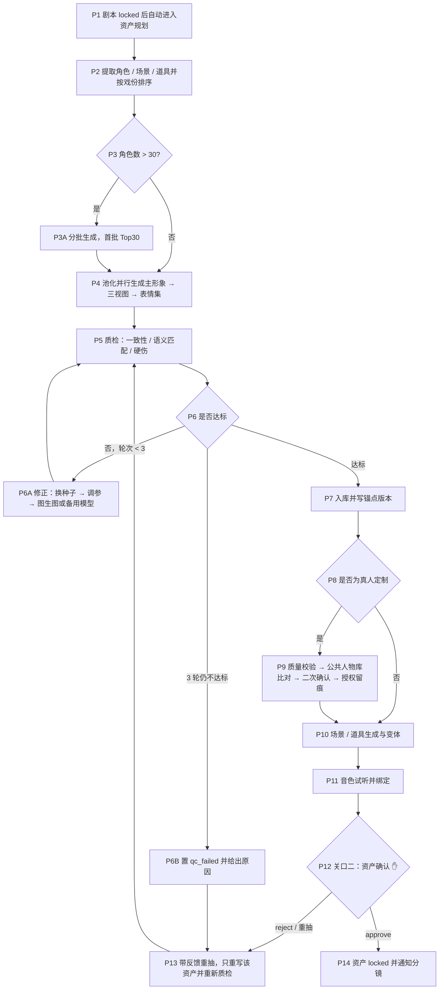

| 图中节点 | 对应 F3.4 步骤 | 说明 |
|---|---|---|
| P2–P3A | S1 | 戏份权重 = 对白场次 / 总场次，保留两位小数降序 |
| P4 | S2 | 同一角色按"主形象 → 三视图 → 表情集"串行，不同角色并行 |
| P5–P6B | S3 | 每个版本独立质检报告，未通过不进入待确认 |
| P7 | S4 | 合格主形象即为锚点，后续重抽必须引用同一锚点版本 |
| P9 | S5 | 真人定制专用合规链路，任一环节失败不生成 |
| P10 | S6 | 场景 / 道具与角色共用质检口径（CLIP 与硬伤检查） |
| P11 | S7 | 有台词角色必须绑定在架音色，否则关口二不可提交 |
| P12–P13 | S8 | 重抽以 `anchor_version` 为参考，偏差超阈值时提示"可能偏脸" |

#### F3.12.4 时序图一：资产生成到关口二（对应 T3-1 ~ T3-4、T3-9）

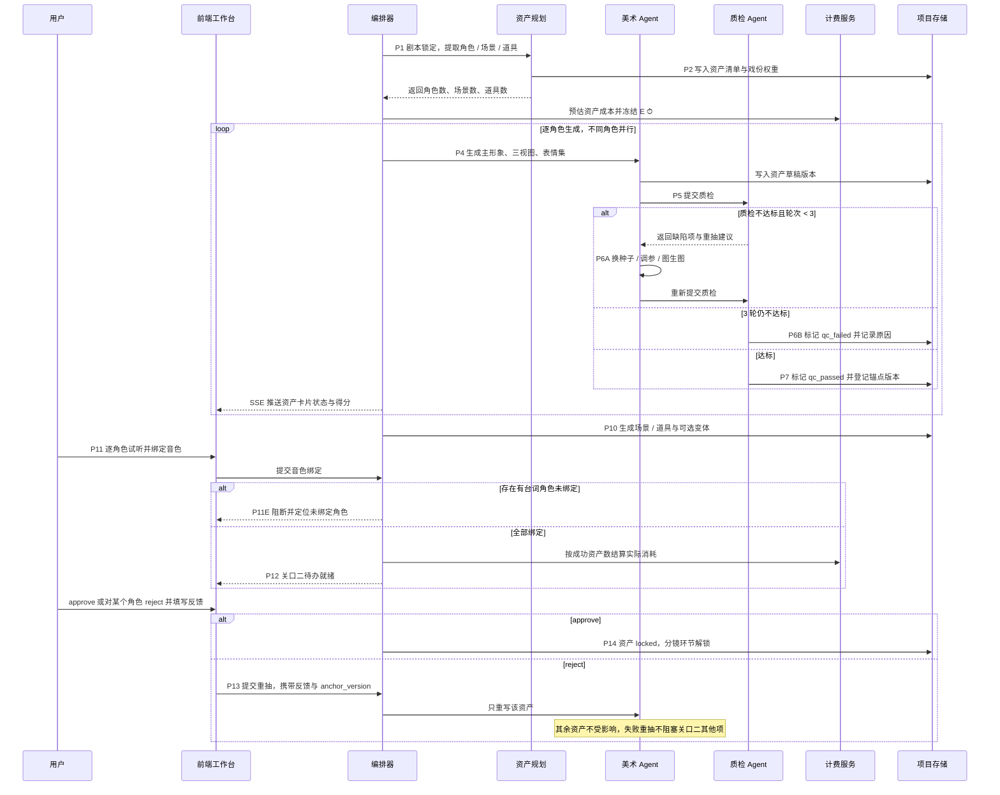

#### F3.12.5 时序图二：真人照片定制与授权（对应 T3-5 / T3-6）

```mermaid
sequenceDiagram
    participant U as 用户
    participant FE as 前端工作台
    participant OR as 编排器
    participant CP as 合规节点
    participant LIB as 公共人物库
    participant AR as 美术 Agent
    participant DB as 授权库

    U->>FE: P9 上传真人照片并选择目标角色
    FE->>CP: 提交照片质量校验
    alt 质量不合格
        CP-->>FE: 50004 提示重拍或更换清晰正脸
    else 质量合格
        CP->>LIB: 比对公共人物库
        alt 命中公共人物
            CP-->>FE: 直接拒绝，提示不可用于真实人物形象 ⛔
        else 未命中
            CP-->>FE: 返回相似度与"疑似真人"提示
            FE-->>U: 二次确认：需勾选授权声明
            U->>FE: 勾选并提交授权声明
            FE->>CP: 提交授权材料
            CP->>DB: 写入授权记录（时间 / IP / 协议版本 / photo_hash）
            CP-->>OR: 授权生效
            OR->>AR: 基于照片生成角色形象
            AR->>DB: 写入资产版本并关联授权记录
        end
    end
    U->>FE: 撤回授权（输入角色名确认）
    FE->>CP: 提交撤回
    CP->>DB: 授权状态置 revoked 并记录时间
    CP-->>OR: 后续新任务校验失败
    OR-->>FE: 50003 该角色授权已撤回，无法继续生成
```

#### F3.12.6 用户操作步骤

| 步骤 | 用户看到什么 | 用户做什么 | 系统即时反馈 |
|---|---|---|---|
| 1 | 资产卡片墙（角色在前，场景道具在后） | 浏览卡片与状态徽标 | 生成中的卡片显示进度，完成后显示得分 |
| 2 | 质检未过卡片 | 展开原因摘要与建议 | 提供"重抽 / 手动上传"两个入口 |
| 3 | 重抽确认弹窗 | 填写 5–100 字反馈，查看本次预估与累计消耗 | 提交后生成新版本并重新质检 |
| 4 | 真人定制入口 | 上传照片、勾选授权声明 | 质量与公共人物校验结果即时返回 |
| 5 | 场景变体选择器 | 勾选时段 / 天气（各 ≤ 2 项） | 按勾选项生成变体并计入成本 |
| 6 | 音色绑定工作台 | 逐行试听、绑定、"全部应用推荐" | 未试听时"全部应用"不可提交 |
| 7 | 关口二审批台 | 逐个 approve / reject 或批量重抽 | 有未通过资产或未绑定音色时 approve 不可用 |
| 8 | 授权记录页 | 查看时间 / IP / 协议版本 / 状态 | 撤回需输入角色名二次确认 |

#### F3.12.7 系统处理逻辑

| 步骤 | 处理方 | 判定与计算规则 | 成功输出 | 失败输出 |
|---|---|---|---|---|
| P2 | 资产规划 | 同名角色合并；戏份权重降序；场景按出场顺序；道具去重 | 资产清单 | 人物表为空时阻断并提示回剧本 |
| P3–P3A | 编排器 | 角色数 > 30 时分批，首批 Top30，其余后续批次 | 分批任务 | 批次失败只影响该批 |
| P4 | 美术 Agent | 主形象 1024×1024 PNG；三视图竖排；表情 ≥ 5 张 | 资产版本 | 生成失败自动重试 2 次 |
| P5 | 质检 Agent | 角色一致性 `face_score` ≥ 0.80；场景道具 CLIP ≥ 0.75；硬伤零容忍 | 质检报告 | 未通过进入 P6A |
| P6A | 美术 Agent | 修正阶梯固定顺序，最多 3 轮 | 新版本 | `qc_failed` + 原因 + 建议 |
| P7 | 编排器 | 合格主形象登记为锚点版本 | 锚点可用 | 锚点写入失败则该资产不可重抽 |
| P9 | 合规节点 | 照片质量基线；公共人物库命中即拒绝；相似真人必须二次确认 | 授权记录生效 | `50004` / 拒绝 / `50003` |
| P10 | 美术 / 导演 Asset Agent | 时段与天气各 ≤ 2 项，生成变体共用同一场景锚点 | 变体版本 | 单项变体失败不影响主场景 |
| P11 | 音色库 + 编排器 | 每角色候选 3 个；试听 ≥ 1 次才可批量应用；下架音色不可绑定 | 绑定完成 | 下架引用阻断并要求替换 |
| P12 | 审批台 | 全部 `qc_passed` 且音色绑定完成才可 approve | `locked` | 40001 / 定位未完成项 |
| P13 | 编排器 + 美术 | 单资产重抽不影响其它资产；批量重抽逐项独立 | 新版本 | 单角色失败不阻塞批次 |

#### F3.12.8 数据流转

| 数据对象 | 产生 / 变更时机 | 关键字段 | 写入方 | 读取方 | 生命周期 |
|---|---|---|---|---|---|
| 角色 / 场景 / 道具资产 | P4 / P10 生成；P13 重抽 | 类型、名称、主形象、三视图、表情、标签 | 美术 Agent | 分镜、视频、后期 | 项目生命周期（DR-3） |
| 资产版本 | 每次生成或重抽 | 版本号、来源（生成 / 重抽 / 上传 / 恢复）、锚点引用 | 编排器 | 质检、分镜、回滚 | 每资产上限 10 个 |
| 资产锚点 | P7 登记 | 锚点版本、特征向量、生效时间 | 编排器 | 视频生成、质检 | 随当前版本 |
| 质检报告 | P5 / P13 | 得分项、缺陷项、结论、轮次 | 质检 Agent | 用户、审批台、报表 | 随版本 |
| 真人授权记录 | P9 / 撤回 | 时间、IP、协议版本、`photo_hash`、状态 | 合规节点 | 生成前校验、法务 | ≥ 项目归档后 3 年（留存时长待法务确认） |
| 音色绑定 | P11 | 角色、音色 ID、试听次数、绑定时间 | 编排器 | 后期 TTS、分镜草稿 | 随项目 |
| 资产文件 | P7 入库 | 路径、格式、尺寸、文件 hash | 存储服务 | 前端、下游生成 | 项目生命周期 |

#### F3.12.9 异常分支

| 分支 | 触发条件 | 系统行为 | 用户可见 | 恢复方式 | 对应条款 |
|---|---|---|---|---|---|
| 剧本未锁定即请求 | 跳过关口一 | 拒绝 | `40003` 前置状态不满足 | 先完成关口一 | F3.2 前置条件 |
| 照片质量不合格 | 模糊 / 侧脸 / 遮挡 | 不进入生成 | `50004` + 重拍建议 | 更换照片 | EX-F3-06 |
| 相同照片被他人绑定 | `photo_hash` 命中他人授权 | 不创建授权 | 提示已存在绑定 | 使用本人照片或申诉 | F3.5 真人定制规则 |
| 授权已撤回 | 生成前校验 `revoked` | 拦截 | `50003` | 重新授权 | F3.5 真人定制规则 |
| 生成超时 / 模型不可用 | 单次失败 | 自动重试 2 次 | 卡片保持生成中 | 自动 | EX-F3-08 |
| 质检 3 轮未过 | 修正阶梯耗尽 | 置 `qc_failed` | 原因摘要 + 建议 | 换反馈重抽或手动上传 | EX-F3-04 |
| 音色未绑定 | 关口二提交 | 阻断 | 定位未绑定角色 | 补绑定 | F3.7 音色绑定规则 |
| 音色已下架 | 绑定或播放时校验失败 | 阻断该音色 | 要求替换 | 更换在架音色 | F3.7 音色绑定规则 |
| 批量重抽部分失败 | 某角色被合规拦截或生成失败 | 其余继续 | 失败项单独标红 | 单项重试 | EX-F3-11 |
| 锚点被历史版本引用 | 恢复旧版本 | 引用计数后解锁受影响镜头 | "影响 N 个镜头"确认 | 确认后解锁 | EX-F3-12、GR-2 |

#### F3.12.10 待确认点

| 编号 | 待确认问题 | 影响 | 当前默认取值 |
|---|---|---|---|
| TBD-F3-01 | 公共人物库的数据来源、比对阈值与更新频率未定义 | 合规风险与误判率 | [Assumption] 接入第三方人脸库 + 人工复核白名单，阈值与供应商一致 |
| TBD-F3-02 | 撤回授权后，已生成并已用于镜头的形象是否必须下架 | 法务口径直接影响已付费用户 | [Assumption] 保留已有产物不再生成新内容，需法务确认（与 Q12 产物所有权条款一并明确） |
| TBD-F3-03 | 表情集缺失时降级为"仅三视图"是否计入角色一致性达标率分母 | 影响 M4 的计算口径 | [Assumption] 不计入，降级单独标记 |
| TBD-F3-04 | 场景变体"时段与天气各最多 2 项"是每项 2 个（最多 4 个）还是合计 2 个 | 直接影响计费与生成时长 | [Assumption] 各 2 项，合计最多 4 个变体 |
| TBD-F3-05 | 批量重抽是否合并为一笔冻结，还是每个角色单独冻结 | 影响失败返还与流水可读性 | [Assumption] 单笔冻结、按成功个数结算 |
| TBD-F3-06 | 场景与道具是否也必须锁定才能进入分镜 | 流程完整性 | [Assumption] 需要，与角色一致 |
| TBD-F3-07 | "手动上传形象"是否走质检与锚点登记 | 影响一致性与合规 | [Assumption] 必须过质检并登记锚点，不享受免检 |
| TBD-F3-08（V6.0） | 多维锚点包带来的造型/时段变体是否单独计费 | 影响计费口径与用户预期 | [Assumption] 首次生成按资产单价，变体按"图生图"折价计（折扣待定价）；懒生成，未被引用不生成 |

### F3.13 V6.0 增量：多维锚点包（从"保住脸"到"保住一切"）

> **问题**：现有锚点只锚人脸（AD-1），因此质检只能回答"是不是同一张脸"，回答不了"是不是同一件衣服""是不是同一个房间""杯子还在不在手里"。V6.0 把锚点从"一张三视图"升级为"一包参考约束"。

| 资产类型 | 锚点包内容 | 服务的一致性维度 |
|---|---|---|
| 角色 | 人脸 embedding（沿用）+ 三视图 + **分场服装/造型 reference**（每个 outfit 变体一组）+ 体型结构化描述（身高/体态/年龄感） | ① 脸、② 服装造型 |
| 场景 | 全景锚点 + **关键点位标注**（门窗/主家具的相对位置描述）+ **时段光线基准图**（日/夜/黄昏各一张） | ③ 空间、⑤ 时间光线 |
| 道具 | 特写 reference + **状态变体图**（完好/破损/沾血等） | ④ 道具连续性 |

| ID | 验收标准 |
|---|---|
| AC-F3-13-1 | Given 角色在某场有专用造型，When 生成该场镜头，Then prompt 组装节点注入该场的 `outfit_ref` 而非默认造型；未登记该场变体时回落到 `base_look` 并在质检报告标注"造型未声明" |
| AC-F3-13-2 | Given 质检执行，When 输出报告，Then 除 `face_score` 外必须包含 `outfit_score / scene_layout_score / prop_score`（各带阈值与证据截图），任一低于阈值即判不合格并指明维度 |
| AC-F3-13-3 | Given 场景锚点登记，When 用户未做关键点位标注，Then 允许保存但标 `layout_unverified`，该场景的 L2 空间校验降级为"仅 CLIP 粗匹配"并在报告注明精度下降 |
| AC-F3-13-4 | Given 道具存在状态变化（如第 4 场破损），When 生成第 4 场镜头，Then 注入破损态 reference；若剧本未声明状态变化但画面出现变化，L2 判定道具不一致（④ 类穿帮） |

> **成本提示**：多维锚点使资产生成量上升（每角色多套造型、每场景多时段）。缓解：① 造型/时段变体按"实际被引用"懒生成（剧本声明了才生成）；② 变体复用同 base 锚点做图生图，单价低于全新生成。相关计费口径见 TBD-F3-08（新增待确认点）。

---


## F4 智能分镜

### F4.1 目标

把"文字剧本"翻译成"可执行的镜头清单"，并让用户在花大钱之前发现叙事问题。

### F4.2 用户故事与验收标准

| ID | 用户故事 | 优先级 |
|---|---|---|
| US-F4-01 | 作为用户，我希望系统自动把剧本拆成镜头，以便我不懂分镜也能开工 | M |
| US-F4-02 | 作为用户，我希望每个镜头有景别、运镜、画面描述与情绪，以便生成结果可控 | M |
| US-F4-03 | 作为用户，我希望在生成视频前先看一遍"草稿样片"，以便低成本发现叙事错误 | M |
| US-F4-04 | 作为用户，我希望在画布上拖动、增删、排序镜头，以便按我的想法调整 | M |
| US-F4-05 | 作为用户，我希望直接编辑镜头 prompt，以便精确控制画面 | M |
| US-F4-06 | 作为用户，我希望知道改动会波及哪些镜头，以便避免意外破坏一致性 | M |
| US-F4-07 | 作为用户，我希望拆解前选择叙事节奏模式（快节奏爽剧/均衡/慢节奏情感剧），以便分镜节奏匹配题材 | P1 |
| US-F4-08 | 作为用户，我希望复制镜头并把多个镜头批量修改参数，以便整段戏统一调整 | M |
| US-F4-09 | 作为用户，我希望画布操作有历史时间轴并可回退到任意一步，以便误操作可恢复 | M |
| US-F4-10 | 作为用户，我希望套用分镜模板（对话戏/动作戏/转场），以便不懂分镜也能有专业机位 | P2 |

**验收标准**

| ID | 验收标准 |
|---|---|
| AC-F4-01-1 | Given 资产已锁定，When 导演 Agent 执行，Then 先输出全剧分镜策略（叙事节奏曲线、高潮特写密度、对话机位规则）写入 `/project/director_notes.md`，再按集派生子代理并行拆解 |
| AC-F4-02-1 | Given 某集拆解完成，When 查看镜头，Then 每个镜头含 `shot_size`（景别）、`camera_move`（运镜）、`final_prompt`、`emotion_tag`、`duration_ms`、`order_index`、`asset_anchor_ids` |
| AC-F4-02-2 | Given 某镜头对白长度 12 秒而镜头时长 4 秒，When 质检执行，Then 判定不合格并打回（对白镜头 ≤ 6 秒） |
| AC-F4-03-1 | Given 分镜初稿完成，When 生成草稿样片，Then 每个镜头出 1 张关键帧 + TTS 配音 + 字幕，拼成时长 < 3 分钟的节奏样片 |
| AC-F4-04-1 | Given 用户在画布上把镜头 5 拖到镜头 3 之前，When 释放，Then 顺序更新、后续镜头 `order_index` 自动重算，且提示集时长与钩子位置的变化 |
| AC-F4-05-1 | Given 用户修改镜头 12 的 prompt，When 保存并生成，Then 仅镜头 12 使用新 prompt，其它镜头不受影响 |
| AC-F4-06-1 | Given 用户更换角色 A 的锚点图，When 保存前，Then 提示"将影响 N 个镜头"（N 为该角色出现的镜头数），需二次确认 |
| AC-F4-06-2 | Given 分镜已锁定后用户修改了剧本第 2 集，When 保存剧本，Then 第 2 集对应场次的镜头解锁，其它集与已生成视频尽量保留 |
| AC-F4-07-1 | Given 拆解发起页，When 用户选择节奏模式，Then 三选一（快节奏/均衡/慢节奏）写入 `director_notes.md` 的 `pacing_mode` 字段，拆解参数按模式取值：快节奏（镜头均值 2000–3000ms、特写占比 ≥ 40%）、慢节奏（均值 3000–4000ms、空镜占比上调）【假设待验证：具体参数值】 |
| AC-F4-07-2 | Given 项目题材为"赘婿/重生"类爽剧，When 打开拆解发起页，Then 默认预选"快节奏"（题材推荐映射表【假设待验证】），用户可改 |
| AC-F4-07-3 | Given 某集已手动调整过，When 重新按新模式拆解该集，Then 保留手动版本为 F8 手动快照并提示，不静默覆盖 |
| AC-F4-08-1 | Given 用户在镜头 ⋯ 菜单选择"复制"，When 选择粘贴位置（选中镜头后/集尾），Then 复制体继承 `final_prompt/camera_move/duration_ms/emotion_tag/asset_anchor_ids`，`order_index` 自动重算，`shot_id` 全新 |
| AC-F4-08-2 | Given 用户多选 ≥ 2 个镜头并批量修改运镜/时长/情绪，When 确认保存，Then 展示"N 个镜头将修改"与逐项变更摘要，保存后受影响镜头自动重跑分镜质检相关项 |
| AC-F4-08-3 | Given 批量修改导致某镜头对白超时长，When 保存，Then 该镜头质检标红单独提示（对白 ≤ 6s 规则），其余镜头修改不受回滚 |
| AC-F4-09-1 | Given 用户在画布执行增/删/移/批量改，When 打开"操作历史"抽屉，Then 时间轴按序列出结构化操作（类型/目标镜头/时间），保留最近 100 步【假设待验证：存储开销】，仅当次会话有效 |
| AC-F4-09-2 | Given 用户点击历史中任意一步"回退到此步"，When 二次确认，Then 画布恢复到该步状态（被删镜头以原参数恢复），后续历史步截断并提示 |
| AC-F4-10-1 | Given 用户发起拆解，When 勾选"套用分镜模板"，Then 模板以机位规则条目（≤ 10 条，每条 ≤ 50 字）注入导演 Agent 策略上下文；模板与硬性质检规则冲突时硬校验优先并在完成后列出冲突条目 |
| AC-F4-10-2 | Given 用户保存自定义分镜模板，When 命名保存，Then 模板跨项目可用、上限 20 个【假设待验证】，与 2.3 分期"提示词模板库"同族合并实现 |
| AC-F4-01-2 | Given 导演 Agent 制定策略，When 写入 `director_notes.md`，Then 结构化字段含 `pacing_mode / rhythm_curve[](集号→节奏值) / closeup_density / dialogue_camera_rule`，策略对用户只读可见（可解释性） |
| AC-F4-01-3 | Given 按集并行拆解，When 任一集完成，Then 该集在集切换器即时点亮"可编辑"，其余集生成中显示进度（n/m 镜头）；单集失败不阻塞已完成集编辑 |
| AC-F4-02-3 | Given 某集拆解完成，When 校验镜头字段，Then 枚举约束生效：`shot_size ∈ {extreme_wide, wide, medium, close, extreme_close, insert}`、`camera_move ∈ {static, pan, tilt, push, pull, handheld, dolly}`、`emotion_tag ∈ {calm, happy, angry, sad, shocked, fearful, smug, crying}`【假设待验证：枚举全集以 00 契约为准】 |
| AC-F4-02-4 | Given 镜头字段校验，When 数值越界，Then `final_prompt` ≤ 500 字、`duration_ms` ∈ [1000, 15000]、`order_index` 为集内连续正整数；越界字段打回子代理修正 ≤ 2 轮 |
| AC-F4-03-2 | Given 草稿样片生成，When 用户播放，Then 支持按集章节跳转、A-B 区间循环、单镜头循环与 0.5×/1×/2× 变速；样片超 3 分钟按集拆为多文件聚合播控 |
| AC-F4-03-3 | Given 用户对单镜头静帧不满意，When 点击"重出静帧"（可附反馈 ≤ 50 字），Then 仅重生成该关键帧（单帧计价），样片对应段替换，每镜头重出 ≤ 3 次后提示"建议改 prompt"【假设待验证：单帧生成耗时 ≤ 15s 与次数阈值】 |
| AC-F4-04-2 | Given 用户拖动镜头释放，When 落点判定，Then 拖拽命中吸附阈值 8px【假设待验证】，释放后 `order_index` 重算 ≤ 200ms，toast 显示集时长变化（AC-F4-04-1 同源） |
| AC-F4-04-3 | Given 用户删除镜头，When 确认弹窗展示，Then 实时显示"本集剩余 X 分 X 秒（Y 镜头），距目标时长差 Z 秒"（Z 为负差时黄色警示）；提示不阻断删除 |
| AC-F4-05-2 | Given 用户编辑 `final_prompt`，When 输入，Then 字数 ≤ 500 实时计数，达 480 字变黄警示；prompt 中引用的锚点占位符（`@角色名`）以高亮 chip 呈现，删除 chip 即移除锚点引用并触发影响提示 |
| AC-F4-05-3 | Given 分镜已锁定，When 用户点击 prompt 编辑器，Then 编辑器只读 + 弹引导："需解锁第 X 集 → 修改 → 重新走关口三；该集已生成 N 个镜头将标记需重生成，预估 X 积分"；确认后执行解锁 |
| AC-F4-06-3 | Given 分镜锁定后用户修改剧本第 2 集，When 保存剧本，Then 仅第 2 集受影响场次的镜头解锁；已生成视频版本保留（标记"上游已变更"），未生成任务取消并解冻 |

### F4.3 详细流程

```mermaid
flowchart TD
    A[已锁定资产+剧本] --> B[导演 Agent write_todos 通读全剧制定分镜策略]
    B --> C[按集派生分镜子代理 并行拆解]
    C --> D[逐场拆解 镜头=景别+运镜+画面描述+对白+情绪]
    D --> E[质检 Agent 分镜合理性检查 漏镜/超长对白/资产缺失]
    E -->|不合格| D
    E -->|合格| F[绑定资产锚点 生成 prompt 组装]
    F --> G[草稿模式 静态关键帧+字幕+配音速览]
    G --> H{{HITL 关口三 分镜确认}}
    H -->|reject+反馈| D
    H -->|edit| I[手动调整画布 自动重算后续依赖]
    H -->|approve| J[锁定分镜 生成渲染任务清单]
```

### F4.4 流程步骤

| 步骤 | Agent/节点 | 说明 |
|---|---|---|
| S1 | 导演 Agent | 制定全剧分镜策略：叙事节奏曲线、高潮段落特写密度、对话场景机位规则（谁说话给谁镜头）；策略写入 `/project/director_notes.md` 供子代理遵循 |
| S2 | 导演 Agent → 子代理 | 按集并行派生子代理，每个子代理把场次拆成镜头（默认 2–4s/镜头，对白镜头 ≤ 6s） |
| S3 | 质检 Agent | 检查：相邻镜头景别跳跃过大、对白超出镜头时长、使用了未生成资产的元素、情绪标签缺失；输出问题清单打回 |
| S4 | 确定性组装节点 | 每镜头组装最终生成参数：`asset_id 锚点图 + 场景图 + 画面描述 + 运镜词 + 情绪 + 首帧图`，写入 `shots`，prompt 对用户可见可改 |
| S5 | 草稿模式 | 低成本预览：每个镜头出 1 张关键帧 + TTS 配音 + 字幕，拼成节奏样片（< 3 分钟），让用户在花钱生成视频前先确认叙事 |
| S6 | HITL + 编辑 | 用户在画布上拖动/增删/改镜头；编辑后自动重算依赖（增删镜头影响集时长与钩子位置） |
| S7 | 锁定 | 生成渲染任务清单：每镜头一项，含预估成本，进入计费预检 |

### F4.5 关键设计

| 编号 | 设计 |
|---|---|
| SD-1 | **草稿模式是成本控制核心**：把"叙事错误"的发现成本从视频生成（贵）降到静帧预览（便宜） |
| SD-2 | 分镜子代理并行度受集数限制，全部写回同一 `shots` 集合，由校验节点合并去重（场次边界重叠检测） |
| SD-3 | 用户改 prompt 只影响该镜头；改资产锚点则级联提示"影响 N 个镜头" |
| SD-4 | 相邻镜头景别分布作为质检项，防止"景别跳跃过大"影响观感 |

### F4.6 边界与异常六查

| 类别 | 场景 | 期望行为 |
|---|---|---|
| 空态 | 剧本场次为空 | 拒绝进入分镜，提示先补全剧本 |
| 极值 | 单集镜头数 > 200 | 提示拆分集数；画布启用虚拟化渲染，避免卡死 |
| 极值 | 单镜头时长极值（0.5s / 20s） | 校验为非法，`duration_ms` 限制在 1000–15000ms |
| 并发 | 多集同时拆解 | 并行度受限，写回同一集合时由校验节点合并去重，检测场次边界重叠 |
| 失败 | 某集拆解结果与其他集风格漂移 | 质检 Agent 交叉比对，导演 Agent 统一修订 |
| 失败 | 草稿预览用户 70% 镜头 reject | 触发导演 Agent 重新制定分镜策略（而非逐镜头重抽） |
| 权限 | `export` 权限成员尝试改分镜 | 拒绝 `20003` |
| 幂等 | 重复触发同集拆解 | 幂等键命中返回已有结果 |
| 依赖 | 分镜锁定后用户想改剧本 | 编排器回溯：剧本改动 → 受影响场次分镜解锁，资产与已生成镜头尽量保留 |

### F4.7 埋点

`storyboard_generation_started`、`storyboard_generation_completed`（含集数/镜头数/平均镜头时长）、`draft_mode_generated`（含成本）、`storyboard_shot_added`、`storyboard_shot_deleted`、`storyboard_shot_reordered`、`shot_prompt_edited`、`asset_anchor_replaced`（含影响镜头数）、`storyboard_rejected`（含 reject 比例）、`storyboard_locked`。

**V4.0 新增埋点**：`pacing_mode_selected`（采纳率 → M3）、`shot_batch_edited`（批量采纳率）、`canvas_history_rollback_used`（画布误操作率）、`draft_frame_redrawn`（草稿精细打磨率 UV-1）、`storyboard_partial_decompose_used`（试错成本节约 → M5 侧写）、`gate3_checklist_forced`（清单忽略率 → M3）、`storyboard_template_applied`（P2 价值验证）。

### F4.8 分镜状态机细化（V4.0 新增，集级）

```mermaid
stateDiagram-v2
    [*] --> not_started: 关口二 approve
    not_started --> strategy_ready: 导演策略写入 director_notes
    strategy_ready --> decomposing: 按集发起拆解(冻结预估)
    decomposing --> decompose_failed: 子代理写回合并失败/超时
    decompose_failed --> decomposing: 用户重试(幂等)
    decomposing --> draft_ready: 全部镜头写入+Schema 校验通过
    draft_ready --> qc_loop: 自动触发分镜质检
    qc_loop --> draft_ready: 不合格打回(子代理修正 ≤2 轮)
    qc_loop --> pending_confirm: 质检通过+草稿样片就绪
    pending_confirm --> confirmed: 关口三 approve
    pending_confirm --> draft_ready: 关口三 reject 带反馈
    confirmed --> locked: 生成渲染任务清单就绪
    locked --> draft_ready: GR-2 解锁(受影响场次)
```

| 状态 | 进入条件 | 可执行动作 | 出口条件 |
|---|---|---|---|
| decomposing | 拆解发起 + 冻结 | 查看已完成集、编辑已完成集 | 全部集写回合并 → draft_ready |
| decompose_failed | 合并冲突/超时 | 重试（幂等键 = project_id + ep_no + 拆解参数 hash） | 成功 → decomposing |
| qc_loop | 集内全部镜头校验通过 | 无用户动作 | 通过 → pending_confirm；未消除警告随样片进关口三清单（EX-F4-12） |
| pending_confirm | 样片就绪 | approve / reject(反馈) / 画布编辑 | 见上 |
| locked | approve 后 | 只读 + 解锁引导（AC-F4-05-3） | 解锁 → draft_ready |

> ProjectStatus 映射【假设待验证】：`not_started/strategy_ready → STORYBOARD_READY`；`decomposing/decompose_failed → STORYBOARD_GENERATING`；`draft_ready/qc_loop → STORYBOARD_DRAFT`；`pending_confirm → AWAITING_GATE_3`；`confirmed/locked → STORYBOARD_LOCKED`。

### F4.9 导演 Agent 内部工作流（V4.0 新增）

| 项 | 规格 |
|---|---|
| 输入契约 | `script`（locked 版本，逐集场次）、`assets`（可用角色/场景/道具及锚点版本）、`director_notes`（既有策略，重拆时必读）、`pacing_mode`（US-F4-07）、`storyboard_template`（可选）、`human_feedback`（关口三 reject） |
| 输入缺失降级 | 场景资产缺失 → 该镜头 `final_prompt` 以文生图描述兜底 + 质检标"场景未锚定"；`emotion_tag` 生成失败 → 置 `calm` 默认值并登记质检警告；`pacing_mode` 缺失 → 均衡模式 |
| 输出契约（Shot JSON 关键字段） | `shot_id / ep_no / scene_no / order_index / shot_size / camera_move / final_prompt / emotion_tag / duration_ms / asset_anchor_ids[] / dialogue_ref / gen_status(pending) / qc_flags[]` |
| 自检循环 | 子代理拆解 → 确定性校验（字段越界/场次边界重叠，SD-2）→ 打回自修 ≤ 2 轮；质检 Agent 四项（景别跳跃/对白超时/未锚定资产/情绪缺失）→ 打回导演统一修订 ≤ 2 轮，仍不合格随样片进关口三清单 |
| 人工反馈注入 | reject 反馈结构化：`{scope: {ep_no, shot_id[]}, action: "reshoot"|"re_pace"|"re_anchor", text}`；节奏/时长类反馈（`re_pace`）路由到导演策略层重拆而非逐镜重抽——reject 镜头比例 ≥ 70%（按镜头数计）自动走策略层（F4.6 固化） |

### F4.10 异常决策树（V4.0 新增，六查升级为 EX 场景）

> F4 专用超时：单集拆解 300s【假设待验证】，重试 60s / 180s 退避 ≤ 2 次。

| EX 编号 | 场景 | 检测点 | 处置动作 | 用户可见反馈 | 计费影响 | 审计 |
|---|---|---|---|---|---|---|
| EX-F4-01 | 剧本场次为空 | 拆解前置校验 | 拒绝进入分镜 | "请先补全剧本" | 无 | 否 |
| EX-F4-02 | 单集镜头数 > 200 | 拆解结果计数 | 提示拆分集数；画布虚拟化渲染 | 超限提示 | 无 | 否 |
| EX-F4-03 | 镜头时长越界 | 字段校验节点 | 打回子代理修正 ≤ 2 轮 | 无感（自动） | 无 | 否 |
| EX-F4-04 | 多集并行写回冲突 | 合并去重节点（SD-2） | 按场次边界裁剪去重，冲突场次重拆 | 进度页显示该集"整理中" | 无 | 否 |
| EX-F4-05 | 集间风格漂移 | 质检交叉比对 | 导演 Agent 统一修订该集 ≤ 2 轮 | 该集标记"策略修订中" | 无额外计费 | 是（超 2 轮） |
| EX-F4-06 | 草稿样片 reject ≥ 70% | 关口三反馈统计 | 自动触发导演策略层重拆（非逐镜重抽） | "将按你的反馈重新制定分镜策略" | 重拆按新预估冻结 | 是 |
| EX-F4-07 | 拆解子任务超时 | 子任务超时监控 | 重试 2 次 → `decompose_failed` | 该集红色 + 重试 | 未完成部分解冻 | 是 |
| EX-F4-08 | `export` 权限成员改分镜 | ACL 中间件 | 拒绝 `20003`，画布只读 | 权限提示 | 无 | 是 |
| EX-F4-09 | 重复触发同集拆解 | 幂等键命中 | 返回已有结果 | 无感知 | 不重复冻结 | 否 |
| EX-F4-10 | 锁定后改剧本（依赖回溯） | GR-2 监听剧本版本事件 | 受影响场次镜头解锁；已生成保留标记 | 影响范围弹窗（二次确认） | 未生成任务解冻；已生成不退费 | 是 |
| EX-F4-11 | 锚点更换级联 | 影响计数 | "影响 N 个镜头"确认后解锁受影响镜头 | 确认弹窗（AC-F4-06-1） | 同上 | 是 |
| EX-F4-12 | 带质检警告 approve | 关口三提交拦截 | 弹检查清单，逐条"已处理/忽略并留痕"后放行 | 清单逐条勾选 | 无 | 是（忽略留痕） |

### F4.11 界面交互要点（V4.0 新增）

1. **画布**：镜头卡缩略图 + 底部时长条（对白镜头显示对白占比红条）；多选态顶栏出现"批量修改 / 复制 / 删除"；删除确认弹窗内嵌集时长实时统计；右侧常驻可折叠统计面板（镜头数/总时长/距目标差值 + 筛选器）。
2. **操作历史抽屉**：左侧滑出，条目含操作图标 + 目标 + 时间；"回退到此步"红色描边 + 二次确认；顶部提示"仅记录本次会话，跨会话请用项目快照"。
3. **草稿播放器**：底部镜头缩略图时间轴（点击跳播）；章节条按集分段；单镜循环按钮悬浮右下。
4. **锁定引导弹窗**：三步图示（解锁 → 修改 → 重新确认）+ 成本预估行；主按钮"解锁第 X 集"红色。
5. **空态文案**：分镜空态——"资产确认后，点击'开始拆解'，AI 按你的节奏偏好出分镜"。

### F4.12 端到端业务流程详解（V5.0 新增）

> 分镜是"花钱前的最后一次低成本验证"：用草稿模式（关键帧 + 配音 + 字幕）先看叙事是否成立，确认后才进入按镜头计费的视频生成。本节的 P 编号与 F4.4 的 S1–S9 对应。

#### F4.12.1 触发场景与前置条件

| 编号 | 触发场景 | 谁触发 | 前置条件 | 完成判定 | 计费点 |
|---|---|---|---|---|---|
| T4-1 | 进入分镜环节 | 系统（资产 locked 后自动） | 资产 `locked`；剧本 `locked` | 显示分镜空态与"开始拆解"入口 | 无 |
| T4-2 | 按集拆解 | 用户 | 已选择节奏模式或模板；无同集进行中拆解 | 每集镜头覆盖 100% 场次内容并通过校验 | G（草稿模式） |
| T4-3 | 重新拆解 | 用户 | 该集已存在分镜 | 生成新分镜版本并保留旧版本 | 无（未走草稿模式时） |
| T4-4 | 画布编辑 | 用户 | 分镜处于 `draft` | 操作即时落库（会话内可回退） | 无 |
| T4-5 | 生成并播放草稿样片 | 用户 | 镜头已有关键帧与对白 | 可播放、章节可跳转 | G |
| T4-6 | 关口三决策 | 用户 | 全部分镜 `pending_confirm` | approve 后锁定并可生成任务清单 | 无 |
| T4-7 | 锁定分镜 | 系统（关口三 approve 后） | 全部镜头通过质检 | 生成渲染任务清单并进入视频生成 | 无 |
| T4-8 | 上游变更解锁 | 系统（剧本 / 锚点变更） | 受影响镜头处于 `locked` 或已生成 | 标记"上游已变更"并取消未生成任务 | 无（取消部分返还） |

#### F4.12.2 参与角色

| 角色 | 类型 | 在本流程中的职责 | 明确不负责 |
|---|---|---|---|
| 用户 | 人 | 选节奏、拆解、编辑画布、看草稿、关口三决策 | 不能在锁定后直接改分镜 |
| 导演 Agent | LLM | 集级叙事策略（`director_notes`）、风格与节奏 | 不直接调用视频模型 |
| 分镜子代理 | LLM（按集派生） | 逐场拆镜头：景别、机位、运镜、时长、prompt、首尾帧 | 不跨集统筹 |
| 确定性校验节点 | 确定性 | 枚举合法性、时长范围、场次边界、覆盖度 | 不生成内容 |
| 质检 Agent | LLM | 覆盖度、时长、逻辑、资产一致性四项检查 | 不自动修改分镜 |
| 编排器 + 审批台 | 确定性 / 界面 | 并行派生、合并写回、HITL 中断、任务清单生成 | — |
| 计费服务 | 确定性 | 草稿模式冻结与结算 | — |
| 视频生成执行器 | 确定性 | 接收任务清单（下游，见 F5） | — |

#### F4.12.3 业务流程图（P 编号 ↔ F4.4 步骤映射）

```mermaid
flowchart TD
    P1["P1 资产 locked 后进入分镜空态"] --> P2["P2 导演 Agent 制定集级节奏策略"]
    P2 --> P3["P3 按集派生子代理并行拆解"]
    P3 --> P4{"P4 确定性校验：枚举 / 时长 / 场次边界"}
    P4 -->|不合法且轮次 < 2| P4A["P4A 打回子代理自修"]
    P4A --> P4
    P4 -->|2 轮仍不合法| P4B["P4B 该集标记拆解失败并保留原分镜"]
    P4 -->|通过| P5["P5 合并去重后写回分镜列表"]
    P5 --> P6{"P6 质检：覆盖度 / 时长 / 逻辑 / 一致性"}
    P6 -->|不通过| P6A["P6A 定向重拆或提示调整"]
    P6A --> P3
    P6 -->|通过| P7["P7 组装镜头 prompt 并强制注入资产锚点"]
    P7 --> P8["P8 用户画布编辑与批量调整"]
    P8 --> P9{"P9 是否需要草稿样片"}
    P9 -->|是| P10["P10 生成关键帧 + TTS + 字幕并拼接 ⏱"]
    P9 -->|否| P11
    P10 --> P11{"P11 关口三：分镜确认 ✋"}
    P11 -->|reject / 选择范围| P12["P12 仅重拆被拒集或镜头"]
    P12 --> P3
    P11 -->|approve| P13["P13 分镜 locked 并生成渲染任务清单"]
    P13 --> P14["P14 进入视频生成 F5"]
    P13 --> P15{"P15 上游剧本或锚点变更"}
    P15 -->|是| P16["P16 标记上游已变更，解锁受影响镜头并取消未生成任务"]
    P16 --> P3
```

| 图中节点 | 对应 F4.4 步骤 | 说明 |
|---|---|---|
| P2 | S1 | 策略含叙事节奏、镜头密度、风格偏好，写 `director_notes` 并全链路复用 |
| P3 | S2 | 每集一个子代理，集与集之间并行；单集内按场序串行 |
| P4–P4B | S3 | 校验为纯代码，不消耗模型费用 |
| P5 | S4 | 同场次同机位重复镜头合并，保留引用关系 |
| P6 | S5 | 覆盖度必须 100%，缺场次即不通过 |
| P7 | S6 | 一致性依赖 F3 的锚点；锚点缺失则阻断该镜头 |
| P8 | S7 前半 | 增删移、批量改、提示词编辑、操作历史 |
| P10 | S7 后半 | 草稿模式，60s 内出可播放样片 |
| P11–P12 | S8 | reject 可按集或按镜头选择范围 |
| P13 | S9 | 每个镜头生成一条渲染任务，锁定后仅只读 |
| P15–P16 | GR-2 级联 | 解锁前必须提示影响镜头数与已生成内容处理方式 |

#### F4.12.4 时序图一：拆解、草稿与关口三（对应 T4-2 ~ T4-7）

```mermaid
sequenceDiagram
    participant U as 用户
    participant FE as 前端工作台
    participant OR as 编排器
    participant DR as 导演 Agent
    participant SUB as 分镜子代理
    participant VAL as 校验节点
    participant QC as 质检 Agent
    participant CB as 计费服务
    participant DB as 项目存储

    U->>FE: P1 点击开始拆解并选择节奏模式 / 模板
    FE->>OR: 提交拆解请求并携带幂等键
    OR->>DR: P2 读取剧本、资产与用户偏好，生成集级策略
    DR->>DB: 写入 director_notes
    loop 每集并行派生子代理
        OR->>SUB: P3 拆解第 n 集为镜头清单
        SUB->>VAL: P4 镜头字段校验
        alt 非法且轮次 < 2
            VAL-->>SUB: 返回越界字段
            SUB->>VAL: P4A 自修后重新提交
        else 2 轮仍非法
            VAL->>DB: P4B 该集标记拆解失败并保留原分镜
        end
    end
    SUB->>DB: P5 合并去重后写回分镜列表
    OR->>QC: P6 四项质检
    alt 覆盖度或逻辑不通过
        QC-->>SUB: 返回缺陷场次与镜头
        SUB->>DB: P6A 定向重拆后写回
    else 通过
        QC->>DB: 写入质检报告
    end
    OR->>DB: P7 组装 prompt 并注入资产锚点
    OR-->>FE: SSE 推送分镜就绪与统计
    U->>FE: P8 画布编辑、批量修改、删除或复制镜头
    FE->>DB: 逐操作落库，记录会话操作历史
    U->>FE: P9 请求草稿样片
    FE->>OR: 提交草稿模式请求
    OR->>CB: 冻结草稿模式积分 G ⏱
    OR->>SUB: P10 生成关键帧、TTS 与字幕
    SUB->>DB: 写入关键帧与音频，拼接时间线
    OR->>CB: 按实际消耗结算
    OR-->>FE: 草稿样片可播放
    U->>FE: P11 approve 或 reject 并选择范围
    alt approve
        OR->>DB: P13 分镜 locked
        OR->>DB: 生成每个镜头的渲染任务清单
        OR-->>FE: P14 跳转视频生成，显示预估成本
    else reject
        OR->>SUB: P12 仅重拆被拒的集或镜头
        Note over SUB: 未被拒部分保持原版本，不重复计费
    end
```

#### F4.12.5 时序图二：上游变更的级联解锁（对应 T4-8）

```mermaid
sequenceDiagram
    participant U as 用户
    participant FE as 前端工作台
    participant OR as 编排器
    participant SRC as 上游环节（剧本 / 资产）
    participant DB as 项目存储
    participant CB as 计费服务

    SRC->>OR: 提交变更并锁定新版本
    OR->>DB: 查询引用该场次 / 锚点的镜头
    OR->>DB: 标记受影响镜头为"上游已变更"
    alt 镜头尚未生成
        OR->>CB: 取消未执行任务并返还冻结
        CB-->>OR: 返还完成
    else 镜头已生成
        Note over OR: 保留旧产物，但标记需重新确认
    end
    OR-->>FE: 展示影响范围：N 个镜头、M 个已生成
    U->>FE: 确认解锁并重拆
    FE->>OR: 提交解锁范围
    OR->>DB: 受影响镜头回到 draft，其余保持 locked
    OR->>SRC: 请求重新拆解受影响场次
    SRC->>DB: 写入新分镜版本
    OR->>CB: 新生成按新幂等键重新冻结
    OR-->>FE: 回到 P4 校验
```

#### F4.12.6 用户操作步骤

| 步骤 | 用户看到什么 | 用户做什么 | 系统即时反馈 |
|---|---|---|---|
| 1 | 分镜空态与节奏选择 | 选择节奏模式或模板→开始拆解 | 显示按集进度与当前集镜头数 |
| 2 | 画布（镜头卡 + 时长条） | 浏览、筛选、多选 | 右侧统计面板实时更新总时长与目标差值 |
| 3 | 批量工具栏 | 批量改时长 / 景别 / 复制 / 删除 | 删除弹窗内嵌集时长实时统计 |
| 4 | 提示词抽屉 | 编辑单镜 prompt、选择首尾帧 | 保存后标记"已人工调整" |
| 5 | 草稿播放器 | 播放、章节跳转、单镜循环 | 60s 内出样片；失败可重试 |
| 6 | 操作历史抽屉 | "回退到此步" | 二次确认；提示仅本次会话有效 |
| 7 | 关口三审批台 | approve 或按集 / 按镜 reject | 显示 reject 影响范围与预计成本 |
| 8 | 锁定引导弹窗 | 确认解锁 → 修改 → 重新确认 | 锁定后编辑入口消失，仅显示"申请解锁" |

#### F4.12.7 系统处理逻辑

| 步骤 | 处理方 | 判定与计算规则 | 成功输出 | 失败输出 |
|---|---|---|---|---|
| P2 | 导演 Agent | 读取剧本、资产、用户节奏偏好与历史反馈 | `director_notes` | 策略生成失败则整次拆解失败并解冻 |
| P3 | 编排器 + 子代理 | 集级并行，单集内按场序；单集超时 5 分钟 | 镜头清单 | 超时重试 2 次后标记失败 |
| P4 | 校验节点 | 景别 / 机位 / 运镜枚举合法；时长在下限与上限之间；镜头不得跨场；覆盖度 100% | 合法分镜 | 打回自修 ≤ 2 轮 |
| P5 | 编排器 | 同场次同机位重复镜头合并；顺序按场序 + 镜序 | 分镜列表 | 写回冲突以版本号乐观锁重试 |
| P6 | 质检 Agent | 覆盖度 100%；单集总时长偏差 ≤ 10%；逻辑连贯；资产引用存在 | 质检报告 | 定向重拆并记录问题场次 |
| P7 | 编排器 | 每镜头 prompt 必须引用角色 / 场景 / 道具锚点 | 任务级 prompt | 锚点缺失阻断该镜头 |
| P10 | 导演 / 后期子任务 | 关键帧 + TTS + 字幕拼接；单镜重出静帧 ≤ 3 次 | 草稿样片 | 超出次数阻断并提示改 prompt |
| P11 | 审批台 | reject 必须选择范围（集或镜头）并填写反馈 | 决策生效 | 40001 / 未选范围不可提交 |
| P13 | 编排器 | 每个镜头生成一条任务；任务清单含模型、时长、预估积分 | 任务清单 | 清单生成失败可重试，不重复计费 |
| P16 | 编排器 + 计费 | 未生成任务取消并返还；已生成保留并标记 | 解锁完成 | 计费异常转对账队列 |

#### F4.12.8 数据流转

| 数据对象 | 产生 / 变更时机 | 关键字段 | 写入方 | 读取方 | 生命周期 |
|---|---|---|---|---|---|
| 导演策略 `director_notes` | P2 | 节奏、镜头密度、风格、集级备注 | 导演 Agent | 子代理、视频生成、后期 | 随分镜版本 |
| 分镜 / 镜头 | P3–P5、P8、P12 | 集、场、镜序、景别、机位、运镜、时长、prompt、首尾帧、资产引用 | 子代理 / 用户 | 草稿模式、视频生成、后期 | 项目生命周期（DR-3） |
| 分镜版本 | 每次拆解或锁定 | 版本号、来源（AI / 人工 / 重拆）、状态 | 编排器 | 回滚、对比、视频生成 | 每集上限 10 个 |
| 操作历史 | P8 | 操作类型、目标、前后值、时间 | 前端 + 编排器 | 会话内回退 | 仅当前会话（跨会话用快照） |
| 草稿样片 | P10 | 关键帧、音频、字幕、时间线、时长 | 编排器 | 用户、关口三 | 随分镜版本 |
| 质检报告 | P6 | 覆盖度、时长偏差、逻辑问题、引用缺失 | 质检 Agent | 用户、审批台、报表 | 随版本 |
| 渲染任务清单 | P13 | 镜头、模型、时长、预估积分、优先级 | 编排器 | 视频生成执行器 | 随分镜版本 |

#### F4.12.9 异常分支

| 分支 | 触发条件 | 系统行为 | 用户可见 | 恢复方式 | 对应条款 |
|---|---|---|---|---|---|
| 资产未锁定 | 跳过关口二 | 拒绝 | `40003` | 先完成关口二 | F4.2 前置条件 |
| 拆解超时 | 单集 > 5 分钟 | 重试 2 次后标记失败 | 该集失败 + 保留原分镜 | 一键重试 | EX-F4-07 |
| 字段越界 | 时长 / 枚举 / 跨场 | 打回自修 ≤ 2 轮 | 定位到具体镜头 | 自动；仍失败可手工编辑 | EX-F4-03 |
| 覆盖度不足 | 漏场次或漏对白 | 定向重拆 | 列出缺失场次 | 自动或手动补 | F4.7 质检规则 |
| 多集并行写回冲突 | 多集同时写回 | 按场次边界裁剪去重，冲突场次重拆 | 该集显示"整理中" | 自动 | EX-F4-04 |
| 单集总时长偏差 > 10% | 与目标时长不符 | 提示但不阻断 | 黄色警示与差值 | 手动增删镜头 | F4.7 质检规则 |
| 草稿重出静帧 > 3 次 | 同一镜头反复重出 | 阻断该镜头 | 提示修改 prompt | 修改后重试 | AC-F4-03-3 |
| 锁定后编辑 | 直接调用编辑接口 | 服务端拒绝 | 只读 + "申请解锁" | 解锁流程 | F4.8 状态机 |
| 解锁无权限 | `view` 或 `export` 成员 | 拒绝 | `20003` | 申请 edit 权限 | EX-F4-08 |
| 上游变更 | 剧本 / 锚点新版本 | 标记并解锁受影响镜头 | "影响 N 个镜头" | 确认后重拆 | EX-F4-10、EX-F4-11、GR-2 |
| 并发画布编辑 | 两成员同时保存 | 乐观锁冲突 + diff | 选择覆盖或重改 | 手工合并 | F8.4 协作规则 |
| 重拆已人工调整集 | 用户确认重拆 | 覆盖前提示，保留手动版本为快照 | 二次确认 | 确认后重拆 | AC-F4-07-3 |
| 任务清单生成失败 | 落库异常 | 重试 3 次 | 提示稍后重试 | 重试不重复扣费 | F4.4 S9 |

#### F4.12.10 待确认点

| 编号 | 待确认问题 | 影响 | 当前默认取值 |
|---|---|---|---|
| TBD-F4-01 | 解锁粒度按整集还是按镜头：Q16 默认整集（实现简单），但整集解锁会让未受影响的已生成镜头作废 | 影响已付费产物的浪费与解锁成本 | [Assumption] 与 Q16 保持一致，MVP 按整集解锁并提示影响范围；建议评审改为按镜头解锁（字段已预留） |
| TBD-F4-02 | "reject 聚焦重拆触发率 > 70% 则回策略层"中的 reject 是否包含 edit | 影响重拆成本与效果判定 | [Assumption] 仅统计 reject，edit 视为人工微调 |
| TBD-F4-03 | 草稿模式单镜重出静帧 3 次后的强制路径 | 用户可能被卡住无法出样片 | [Assumption] 强制提示修改 prompt 或跳过该镜头出片 |
| TBD-F4-04 | 画布操作历史"仅会话内"与项目快照的边界如何向用户解释 | 用户误以为可跨会话回退 | [Assumption] 抽屉顶部固定文案提示，跨会话回退走快照 |
| TBD-F4-05 | 用户模板与系统节奏模式同时指定时的优先级 | 拆解结果不符合预期 | [Assumption] 用户模板优先，系统节奏作为兜底 |
| TBD-F4-06 | 单镜头时长上限与长对白冲突时以时长还是对白完整为准 | 影响口型与剪辑连贯性 | [Assumption] 以对白完整为准，超出上限时拆为多镜 |
| TBD-F4-07 | 重新拆解是否生成独立版本并保留旧版本 | 影响版本对比与回滚 | [Assumption] 保留，最多 10 个版本 |

---

### F4.13 V6.0 增量：台词绑定与音频驱动时长

> **一句话需求**：用户在分镜上**为每个镜头选择它要说哪几句台词**（"支持为分镜选择对应台词"），镜头时长随之由这些台词的实测音频时长推导（GR-11）。
>
> **为什么必须先有配音再绑定**：如果先拆镜头再配音，用户只能"猜这句话多长"，然后祈祷配音不要超时长；先有配音再绑定，用户在分镜上看到的是"这句 3.4 秒，那个镜头 4.2 秒够不够"，**时长从"估"变成"量"**。

#### F4.13.1 新增用户故事

| ID | 用户故事 | 优先级 |
|---|---|---|
| US-F4-11 | 作为创作者，我希望在拆解分镜时系统自动把每句台词分配到对应镜头，以便我不必逐句手工绑定 | M |
| US-F4-12 | 作为创作者，我希望手动为某个镜头挑选/替换/移除台词，以便按我的想法安排谁说哪句话 | M |
| US-F4-13 | 作为创作者，我希望镜头时长自动跟着所绑台词的音频长度走，以便画面与声音天然对齐 | M |
| US-F4-14 | 作为创作者，我希望一眼看出"哪句台词还没被任何镜头用上"，以便避免漏词 | M |
| US-F4-15 | 作为创作者，我希望在分镜画布上直接听到这句台词，以便判断这个镜头配这句话合不合适 | M |
| US-F4-16 | 作为创作者，我希望一个镜头可以不带台词（空镜/动作/环境音），也能正常定长 | M |

#### F4.13.2 新增验收标准

**台词绑定（选择台词）**

| ID | 验收标准 |
|---|---|
| AC-F4-11-1 | Given 某集配音轨已就绪（H-V approve），When 导演 Agent 拆解该集，Then 每个镜头输出 `line_bindings[]`（`{line_id, offset_ms}`），拆解时**优先按场次内台词顺序**分配，一个镜头承载 1–3 句【假设待验证：单镜句数上限】 |
| AC-F4-11-2 | Given 用户打开镜头详情，When 点击"选择台词"，Then 弹出该场候选台词列表（已绑定者置灰并标注所属镜头），支持搜索、按角色筛选、多选、拖入；列表显示每句的实测时长与情绪标签 |
| AC-F4-11-3 | Given 用户为镜头勾选 2 句台词，When 确认，Then 该镜头 `line_bindings` 更新，`duration_ms` 按 GR-11 重算并即时显示新旧时长对比；原绑定方（若有）中移除该句并重新计算其自身时长 |
| AC-F4-11-4 | Given 某句台词已绑定到镜头 A，When 用户又把同一句绑定到镜头 B，Then 允许（回闪/重复叙事场景），但提示"该句已在镜头 A 使用，将生成第二条配音引用（不重复计费）"，音频复用同一产物 |
| AC-F4-11-5 | Given 用户移除某镜头的全部台词，When 保存，Then 该镜头转为"无台词镜头"，`duration_ms` 回退为导演策略值（或被用户手改值），并提示"已转为无台词镜头，时长按 X 计算" |
| AC-F4-11-6 | Given 某镜头绑定的台词属于角色 R，When 该镜头 `asset_anchor_ids` 中不含角色 R，Then 分镜质检判定不合格（"台词说话人不在画面中"），列出问题并要求修正（允许"画外音"例外：`speaker_type = voice_over/inner_monologue` 时不校验在场） |

**时长推导**

| ID | 验收标准 |
|---|---|
| AC-F4-12-1 | Given 镜头绑定台词，When 计算时长，Then `duration_ms = clamp(head_pad + Σ line_actual_ms + tail_pad, 1000, 15000)`，默认 `head_pad=200ms / tail_pad=300ms`；计算过程可在镜头详情展开查看（可解释） |
| AC-F4-12-2 | Given 用户手动修改某镜头的 `duration_ms`，When 保存，Then 系统判定：① 新值 ≥ 台词总时长 + 最小留白 → 允许（标记 `duration_manual=true`）；② 新值 < 台词总时长 → 拒绝并提示"该镜头台词共 X 秒，时长不得小于 X 秒（可缩小留白或拆分台词）" |
| AC-F4-12-3 | Given 用户在分镜画布拖动镜头边界（调整时长），When 释放，Then 以 AC-F4-12-2 的判定为准：合法则生效并重算集时长；非法则回弹（snap back）并给出原因 |
| AC-F4-12-4 | Given 某镜头时长被手动改过（`duration_manual=true`），When 该镜头所绑台词被重新配音且时长变化，Then 系统**不自动覆盖**用户手动值，而是比对后在镜头卡上提示"台词时长已变化 X ms，当前手动时长仍可容纳 / 已不足，建议调整" |
| AC-F4-12-5 | Given 分镜已锁定，When 用户查看集级时长，Then 显示"画面总时长 / 台词音频总时长 / 静默段总时长"三项，且三项之和与画面总时长的差额 ≤ 100ms（不含显式留白的说明） |

**超限与拆句**

| ID | 验收标准 |
|---|---|
| AC-F4-13-1 | Given 单句台词实测时长 > 12s，When 分镜拆解，Then 系统建议拆句（给出建议切分点），并在未拆句时把该镜头标为 `long_line` 警告（超过 12s 无换气的台词在成片里会明显不自然）【假设待验证：阈值】 |
| AC-F4-13-2 | Given 台词音频时长 > 15000ms（单镜头上限），When 计算时长，Then 判定无法单镜承载，强制要求"拆句 + 拆镜"或"降语速"，拒绝生成渲染任务（替代 AC-F4-02-2 的旧口径） |
| AC-F4-13-3 | Given 用户选择"降语速以塞进单镜"，When 确认，Then 跳转配音环节对该句重配（新语速），产生 `duration_drift` 记录并按 4.6.5 判定是否解锁下游（**不允许在分镜层做变速伪装**） |

**覆盖率与漏词**

| ID | 验收标准 |
|---|---|
| AC-F4-14-1 | Given 某集分镜拆解完成，When 计算台词覆盖率，Then `覆盖率 = 已被绑定引用的去重 line_id 数 ÷ 该集 line_id 总数`；< 100% 时在关口三检查清单中列出未使用的台词（可跳转定位） |
| AC-F4-14-2 | Given 存在未被使用的台词，When 用户点击"自动补绑"，Then 系统为该场相邻镜头推荐绑定方案（优先插入到同角色出镜镜头），用户逐条确认后生效 |
| AC-F4-14-3 | Given 台词覆盖率 < 100%，When 用户提交关口三，Then **不阻断**但需勾选"确认有台词未被使用（将不出现在成片中）"，勾选记录写入审批留痕（防止误删台词流入成片） |
| AC-F4-14-4 | Given 某集全部台词均已绑定且无 `long_line` 警告，When 用户提交关口三，Then 检查清单该项显示通过，可一键 approve |

**画布与试听**

| ID | 验收标准 |
|---|---|
| AC-F4-15-1 | Given 用户选中某镜头，When 点击试听，Then 播放该镜头所绑台词的拼接音频（含留白），并在时间标尺上显示台词条占位；试听不产生计费 |
| AC-F4-15-2 | Given 分镜画布，When 开启"台词轨道"显示，Then 每个镜头卡下方显示其绑定的台词条（首 12 字 + 时长），未绑定镜头的台词位显示为"静默"标记 |
| AC-F4-16-1 | Given 无台词镜头，When 用户未手动改时长，Then 时长取导演策略默认值（快节奏 2000ms / 均衡 2800ms / 慢节奏 3500ms【假设待验证】），标 `duration_source=strategy` |

#### F4.13.3 台词绑定的三个"必须显式"（防坑清单）

| 坑 | 现象 | V6.0 的防线 |
|---|---|---|
| 漏词 | 改稿新增一句台词，没人绑定，成片里"少了一句" | 覆盖率检查（AC-F4-14-1）+ 关口三勾选留痕 |
| 抢词 | 两个镜头争同一句台词，A 改 B 变，互相踩 | 绑定时显示"已被镜头 X 使用"，且变更返回受影响清单（AC-F4-11-3/4） |
| 顶词 | 台词塞进短镜头，配音被截断 | 时长下限校验（AC-F4-12-2）+ 画布拖拽回弹（AC-F4-12-3） |

#### F4.13.4 异常场景（EX-F4-2x，V6.0 新增；避免与既有 EX-F4-01~12 冲突，从 21 起编号）

| EX 编号 | 场景 | 检测点 | 处置动作 | 用户可见反馈 | 计费影响 | 审计 |
|---|---|---|---|---|---|---|
| EX-F4-21 | 分镜拆解时该集无配音轨 | 拆解前置校验 | **V6.0 链路：阻断并引导去配音（D-02）**；仅 `pipeline_mode=classic` 时允许降级为估算模式（`est_duration`） | 阻断提示 + "去配音"入口（classic 项目显示"未经配音校准"横幅） | 无 | 是（模式切换） |
| EX-F4-22 | 绑定的 `line_id` 已被删除（改稿软删） | 绑定校验 | 解绑该句并列入"待处理绑定"清单 | 红色提示定位到镜头 | 无 | 是 |
| EX-F4-23 | 台词时长变化导致 200+ 镜头需重生成 | 漂移批量判定 | 中止自动解锁，改为"生成影响报告让用户确认分批执行"（D-01 配套） | 影响报告 + 分批执行入口 | 按确认批次冻结 | 是 |
| EX-F4-24 | 用户在同一镜头绑定 > 3 句 | 绑定上限校验 | 允许但警告"单镜台词过多，观感与口型压力大" | 黄色警告 | 无 | 否 |
| EX-F4-25 | 台词覆盖率为 0（整集无台词） | 覆盖率计算 | 跳过台词绑定视图，直接进入无台词分镜模式 | 提示"本集无台词" | 无 | 否 |

#### F4.13.5 连续性预检（关口三新增检查项，V6.0 与 5A 联动）

> **这是全链路 ROI 最高的一道防线**：关键帧的生成成本约为视频的 1/15（对应 NFR-K2 ≤ 15%），但拦截的是视频级返工。草稿样片阶段就能看出的服装/场景/道具/光线不一致，绝不该留到成片。

| 步骤 | 做什么 | 输出 |
|---|---|---|
| CP-1 | 待关口三 approve 前，对关键帧序列按场景顺序执行 M1 的 **L2 镜头间校验**（服装/场景关键点/道具/色温光线四维） | 逐镜头对得分 |
| CP-2 | 与 Story Bible 快照比对（该镜头"应有状态"vs"画出来是什么"） | 维度级偏差清单 |
| CP-3 | 生成《连续性预检报告》并入关口三确认页 | 报告 + 可跳转的问题镜头列表 |
| CP-4 | 分级处置：`block`（锚点引用错角色/错场次）必须先处理；`warn`（服装近似但有差异）可带警告放行 | 报告状态 |

| ID | 验收标准 |
|---|---|
| AC-F4-17-1 | Given 某集草稿样片生成完成，When 打开关口三确认页，Then 展示《连续性预检报告》：四维得分、问题镜头数、每条的维度与证据（关键帧局部截图），且报告未生成完成时 approve 按钮置为"预检中"不可点 |
| AC-F4-17-2 | Given 预检存在 `block` 级问题，When 用户尝试 approve，Then 拒绝并提示先处理（列出问题与"一键重出该关键帧"入口）；`warn` 级仅提示，可勾选"知悉并放行"后 approve（留痕） |
| AC-F4-17-3 | Given 用户在关口三修改了某镜头的台词绑定，When 保存，Then 该镜头的时长与关键帧均标记失效，需重出关键帧后重新预检（避免"报告与当前不一致"） |

> **与 V5.0 的关系**：V5.0 的关口三检查项（景别跳跃/对白超时长/资产缺失/情绪标签）**全部保留**，本节的四维连续性校验是**新增并列项**，不替代原有校核。

---

## F5 视频生成

### F5.1 目标

在成本可控的前提下，把 100+ 个镜头稳定地变成可用视频，失败可退、重试不重复扣费。

### F5.2 用户故事与验收标准

| ID | 用户故事 | 优先级 |
|---|---|---|
| US-F5-01 | 作为用户，我希望系统自动编排批量生成并优先出"每集前 3 镜"给我快速看效果 | M |
| US-F5-02 | 作为用户，我希望单个镜头失败能自动重试或换模型，以便不阻塞整体 | M |
| US-F5-03 | 作为用户，我希望每个镜头保留多个版本可选，以便挑最好的 | M |
| US-F5-04 | 作为用户，我希望生成中途能取消未执行的任务并退回积分 | M |
| US-F5-05 | 作为用户，我希望知道哪些镜头反复失败需要人工介入 | M |
| US-F5-06 | 作为用户，我希望锁定某个模型不被自动切换，以便结果可预期 | M |
| US-F5-07 | 作为用户，我希望在生成总览仪表盘看到六态计数、总进度与预计剩余时间，以便心中有数 | M |
| US-F5-08 | 作为用户，我希望筛选失败镜头并批量重试（可延迟），以便避开供应商限流一次恢复 | M |
| US-F5-09 | 作为用户，我希望对质检误杀的镜头人工标记合格强制通过，以便流程不被误判卡死 | M |
| US-F5-10 | 作为用户，我希望按集一键锁定全部镜头版本，以便快速进入后期 | M |

**验收标准**

| ID | 验收标准 |
|---|---|
| AC-F5-01-1 | Given 分镜已锁定且余额充足，When 发起批量生成，Then 任务按批次入队，优先级为"每集前 3 镜"优先，用户可实时看到排队与进度 |
| AC-F5-02-1 | Given 某任务失败类型为 `timeout` 或 `rate_limited`，When 自动重试执行，Then 最多重试 2 次并优先切换备用模型，重试不重复冻结 |
| AC-F5-02-2 | Given 某任务失败类型为 `moderation_rejected`，When 处理，Then 标记违规、返还积分、不自动重试（避免反复触发审核） |
| AC-F5-03-1 | Given 某镜头已生成 3 个版本，When 用户锁定第 2 版，Then 该版本成为当前使用版本，其余版本进入冷存储但可恢复 |
| AC-F5-04-1 | Given 队列中还有 40 个未执行任务，When 用户点击取消，Then 未执行任务取消并解冻积分，已执行任务等待结算 |
| AC-F5-05-1 | Given 某镜头经 3 轮修正仍不合格，When 循环终止，Then 该镜头列入"待人工"清单并通知用户，其余镜头正常推进 |
| AC-F5-06-1 | Given 用户锁定模型 M，When 路由决策执行，Then 不自动切换到其它模型；若 M 不可用则暂停并通知，而非静默换模型 |
| AC-F5-07-1 | Given 批量生成执行中，When 打开生成页，Then 仪表盘显示六态计数（排队/生成中/质检中/成功/失败/待人工）、总进度百分比、预计剩余时间（近 10 分钟完成速率滚动估算【假设待验证：ETA 算法】）、实时消耗积分；数据经 SSE 推送，点击计数即筛选任务列表 |
| AC-F5-07-2 | Given 队列拥塞导致速率波动 > 50%，When 计算 ETA，Then ETA 旁标注"波动较大"，不给出精确到秒的承诺 |
| AC-F5-08-1 | Given 失败列表含 ≥ 2 个同类型失败镜头，When 用户多选并点击"重试所选"，Then 统一以新幂等键建任务、按预估重新冻结；余额不足的镜头跳过并提示 |
| AC-F5-08-2 | Given 用户勾选"延迟 30 分钟重试"【假设待验证：默认延迟】，When 到时触发，Then 自动批量重试，倒计时可取消；`moderation_rejected` 类型不提供重试入口（GR-7） |
| AC-F5-09-1 | Given 镜头处于待人工/质检不合格，When 用户点击"人工标记合格"，Then 必须勾选确认声明并填写放行理由（≥ 5 字【假设待验证】），通过后镜头进入正常结算，原始质检得分保留，操作写入 `audit_logs`（who/when/理由） |
| AC-F5-09-2 | Given 镜头已强制通过，When 用户再次发起重生成，Then 走正常质检流程，不再提供强制通过入口（同一镜头仅一次） |
| AC-F5-09-3 | Given 强制通过镜头，When 统计 M4 一致性达标率，Then 该镜头单独标记 `manual_pass` 并从 M4 分母排除（避免指标失真）【假设待验证：口径需评审确认】 |
| AC-F5-10-1 | Given 某集全部镜头生成成功，When 用户点击"锁定本集全部镜头"，Then 默认锁定每镜头质检得分最高版本【假设待验证：最优版规则】，核对列表列出逐镜头版本号（仅 1 版可选的镜头置顶），可单项改选后确认 |
| AC-F5-10-2 | Given 集内含待人工或失败镜头，When 尝试一键锁定，Then 拒绝并提示先处理例外项（列出例外镜头） |
| AC-F5-01-2 | Given 发起批量生成，When 确认单展示，Then 字段含：总镜头数 / 分批数（批 50）/ 预估总积分 / 预计总耗时【假设待验证：估算模型】/ 模型路由摘要（主力+备用）/ 本次生成上限（可调，S1）；底部显示可用余额与冻结后余额 |
| AC-F5-01-3 | Given 排队中任务，When 用户点击"插队"，Then 该任务优先级升至当前批次队首；每批次免费插队 3 次【假设待验证：额度与是否计费】；已"生成中"的任务不可插队 |
| AC-F5-02-3 | Given 任务失败类型 ∈ {timeout, rate_limited}，When 自动重试，Then 退避间隔 30s → 120s（队列级指数退避【假设待验证：基线值】），第 2 次重试优先切换备用模型；重试沿用原冻结不追加 |
| AC-F5-02-4 | Given 任意失败任务，When 展示失败详情，Then 显示用户语言文案（运营可配置映射表：`timeout → "模型响应超时，已自动换备用模型重试"` 等）+ 折叠的原始错误码；未映射码兜底"生成出现异常，已返还积分，可联系客服并提供错误编号" |
| AC-F5-03-2 | Given 镜头有 ≥ 2 个版本，When 打开版本对比，Then 多版本缩略图并排 + 播放进度联动；弱网降级为仅首帧对比；锁定其余版本入冷存储可恢复 |
| AC-F5-03-3 | Given 用户给版本打标签/备注，When 保存，Then 预设标签枚举 {色彩好, 动作对, 表情自然, 其他}、备注 ≤ 100 字，随版本持久化（P1 团队可见并写审计） |
| AC-F5-04-2 | Given 用户取消批次，When 确认弹窗展示，Then 显示"未执行 X 个（返还约 Y 积分）/ 生成中 Z 个（等待结算）"；确认后未执行立即取消解冻，幂等键作废 |
| AC-F5-04-3 | Given 失败/待人工镜头，When 用户点击"放弃"，Then 二次确认（显示返还积分）后终止处理、全额解冻返还，画布该镜头显示"已放弃"角标，可随时以新幂等键重新发起 |
| AC-F5-05-2 | Given 存在待人工镜头，When 打开"待人工"清单页，Then 列表含失败轮次、质检报告摘要、已消耗积分，默认按"轮次多 → 消耗高"排序【假设待验证：排序策略】；逐个处理：标记合格 / 带反馈重生成 / 放弃退款 |
| AC-F5-05-3 | Given 待人工清单为空，When 用户打开，Then 显示"全部处理完毕 ✓"正反馈态（防漏处理的确认动线） |
| AC-F5-06-2 | Given 用户未锁模型，When 发起生成，Then 可选路由策略三档：速度优先 / 均衡（默认）/ 质量优先，作为路由权重输入【假设待验证：三档权重取值需路由实测调优】；已锁模型（AC-F5-06-1）优先级高于策略档 |

### F5.3 详细流程

```mermaid
flowchart TD
    A[渲染任务清单] --> B[计费预检 冻结积分]
    B -->|余额不足| B1[中断通知]
    B -->|通过| C[制片 Agent 批量编排 任务分批+模型路由]
    C --> D[任务入队 状态 排队中]
    D --> E[调用视频模型 文生视频/图生视频]
    E --> F{结果}
    F -->|成功| G[质检 Agent 逐镜头检查 一致性/质量/合规]
    F -->|失败| H{失败类型}
    H -->|超时/限流| I[自动重试 <=2 换备用模型]
    H -->|审核拒绝| J[标记违规 返还积分]
    H -->|参数问题| K[自动修正参数重试]
    G -->|不合格| L[局部重生成 <=3轮 消耗积分]
    G -->|合格| M[结算扣费 结果落盘]
    I --> E
    L --> E
    M --> N[版本对比保留3版 用户可锁定]
```

### F5.4 流程步骤

| 步骤 | Agent/节点 | 说明 |
|---|---|---|
| S1 | 计费节点 | 按任务清单预估总成本冻结；支持用户设"本次生成上限" |
| S2 | 制片 Agent | `write_todos` 制定批次计划（并发度、优先级）；模型路由表确定性查询：质量分/价格/排队时长 |
| S3 | 确定性执行器（Celery） | 任务队列，状态机：`排队中 → 生成中 → 质检中 → 待确认/失败/已锁定`；断线重连状态不丢 |
| S4 | 质检子代理（并行） | 每个成片镜头派生质检子代理：角色人脸 embedding vs 三视图锚点、场景 vs 场景图、画面硬伤、内容合规；输出结构化报告 |
| S5 | 修正循环 | 不合格镜头带质检报告重生成（换种子/调运动幅度/降低复杂度），≤ 3 轮后仍不合格则列入"待人工"清单 |
| S6 | 结算 | 按实际成功镜头数结算，失败全额返还；流水含实际调用模型与单价 |
| S7 | 版本管理 | 每镜头保留最近 3 版，用户锁定后其余版本进入冷存储 |

### F5.5 关键设计

| 编号 | 设计 |
|---|---|
| RC-1 | **制片 Agent 的"预算感知"**：系统提示词注入剩余预算与单价表，编排时自动建议"先低价模型出草稿 → 选定后高清重渲"的省钱路径 |
| RC-2 | 模型路由是**确定性代码**而非 LLM 决策，避免幻觉选错模型；LLM 只做策略建议 |
| RC-3 | 生成中途崩溃：Checkpoint 恢复后仅重跑未完成镜头（幂等键去重） |
| RC-4 | 失败分类驱动策略：`timeout`/`rate_limited` 可重试、`moderation_rejected` 不重试、`param_invalid` 修参重试、`model_unavailable` 换模型 |

### F5.6 边界与异常六查

| 类别 | 场景 | 期望行为 |
|---|---|---|
| 空态 | 无待生成任务 | 任务中心显示空态，引导"去锁定分镜" |
| 极值 | 一次性提交 500 个镜头 | 分批入队（默认批 50），前端展示总预估成本与预计耗时 |
| 并发 | 多用户/多项目同时生成 | 按套餐并发与队列配额隔离；单用户并发生成上限 free 2 / pro 5 / studio 10（Q8） |
| 失败 | 全部模型不可用 | 整体挂起，推送通知，冻结积分不解冻直至恢复或用户取消 |
| 失败 | 质检与生成"拉锯"（反复不合格） | 第 3 轮后强制升级：换模型/换参数策略并通知用户 |
| 失败 | 用户中途取消队列 | 未执行任务取消并解冻，执行中任务等待结算 |
| 权限 | 非项目成员调用任务接口 | 拒绝 `20003`；任务详情不泄露 prompt 与资产 |
| 幂等 | 同一 `Idempotency-Key` 重复提交 | 返回首次创建的任务，不重复冻结 |
| 幂等 | Worker 崩溃后任务重派 | 幂等键命中则直接读回历史产物，不重复调用模型 |

### F5.7 埋点

`render_batch_created`（含镜头数、预估成本）、`render_task_succeeded`（含模型、实际成本、耗时）、`render_task_failed`（含失败类型、重试次数）、`render_retry_triggered`、`render_batch_cancelled`、`shot_version_locked`、`qc_manual_required_raised`、`model_locked_by_user`。

**V4.0 新增埋点**：`render_batch_confirmed`（预估/实际差值 → M5）、`render_queue_jump_used`（插队负载）、`render_eta_shown / render_eta_deviation`（ETA 校准）、`render_manual_pass_forced`（质检误杀率 R-3 侧写 + 审计）、`render_batch_retry_delayed`（自助恢复率 M6）、`render_batch_lock_all_used`（→ M2）、`render_budget_warning_80`（→ M11 + 护栏有效性）。

### F5.8 渲染任务状态机细化（V4.0 新增）

```mermaid
stateDiagram-v2
    [*] --> queued: 批次入队(冻结)
    queued --> rendering: Worker 拾取
    queued --> cancelled: 用户取消/放弃(解冻)
    rendering --> rendering_failed: 超时/限流重试耗尽
    rendering --> moderation_rejected: 平台审核拒绝(不重试)
    rendering --> rendering_failed: 参数非法修正 2 轮仍失败
    rendering --> qc_checking: 模型返回成功
    rendering_failed --> queued: 用户批量重试(新幂等键)
    rendering_failed --> abandoned: 用户放弃(全额解冻)
    moderation_rejected --> [*]: 标记违规+返还
    qc_checking --> regen_loop: 质检不合格(≤3轮)
    regen_loop --> rendering: 带报告重生成
    regen_loop --> manual_required: 3轮仍不合格
    qc_checking --> settled: 质检合格(结算扣费)
    manual_required --> settled: 人工标记合格(留痕)
    manual_required --> abandoned: 用户放弃退款
    settled --> version_select: 版本落盘(≤3版)
    version_select --> locked: 用户锁定版本
```

| 状态 | 进入条件 | 可执行动作 | 出口条件 |
|---|---|---|---|
| queued | 冻结成功入队 | 插队（≤ 3 次/批）/ 取消 | 拾取 → rendering；取消 → cancelled |
| rendering | Worker 执行 | 查看（不可干预模型调用） | 成功 → qc_checking；失败按类型分流 |
| qc_checking | 模型产物落盘 | 无用户动作 | 合格 → settled；不合格 → regen_loop |
| regen_loop | 质检不合格 | 无用户动作（≤ 3 轮自动） | 通过 → settled；耗尽 → manual_required |
| manual_required | 修正循环耗尽 | 标记合格 / 带反馈重生成 / 放弃 | 见上 |
| settled | 结算完成 | 版本对比/标签/追加生成 | 锁定 → locked |
| abandoned | 用户放弃 | 查看角标 | 重新发起 → 新 queued |

> ProjectStatus 映射【假设待验证】：存在 `queued/rendering/qc_checking/regen_loop → RENDERING`；全部 settled 且未锁 → `RENDER_DONE`；存在 `manual_required → RENDER_MANUAL_REQUIRED`；全部 locked → `RENDER_LOCKED`。**护栏触发优先级固化**：GR-3 冻结上限（硬）> NFR-K3 消耗 1.5 倍上限（硬）> 批次 100% 暂停（软）> 80% 提醒。

### F5.9 制片 Agent 内部工作流（V4.0 新增）

| 项 | 规格 |
|---|---|
| 输入契约 | `render_tasks`（锁定分镜生成的任务清单，含每镜头预估成本）、`credit_budget / credit_spent`（预算护栏注入）、`model_routing_table`（质量分/价格/排队时长，确定性查询）、`user_pref.model_strategy`（三档）、`user_pref.locked_model`（锁模型优先级最高）、`human_feedback`（重生成反馈） |
| 输入缺失降级 | 路由表某模型缺质量分 → 该模型本轮不参与路由并在确认单标注；`model_strategy` 缺失 → 均衡档；预算字段缺失 → 拒绝执行（计费护栏硬前置，不可降级） |
| 输出契约（RenderTask JSON 关键字段） | `task_id / shot_id / idempotency_key / model / priority(插队>前3镜>批次序) / batch_no / est_cost / status / retry_count / fail_type / actual_cost / qc_report_id / version_id` |
| 自检修正策略阶梯 | 第 1 轮换种子；第 2 轮调运动幅度/降低画面复杂度；第 3 轮换备用模型（与 F5.6"第 3 轮强制升级"一致）；每轮修正计入该镜头结算，轮次与原因落 `qc_reports` |
| 人工反馈注入 | 待人工镜头"带反馈重生成"时，反馈（≤ 100 字）拼入重生成提示词「修正要求」区块 + 结构化 `regen_hint{seed_reset: bool, motion_scale: 0.5–1.5, simplify: bool}`【假设待验证：映射规则】 |

### F5.10 异常决策树（V4.0 新增，六查升级为 EX 场景）

> F5 专用超时【假设待验证：依供应商 SLA 校准】：图生视频单镜头 300s；质检子代理单镜头 60s；修正轮间冷却 30s；队列级重试退避 30s → 120s。

| EX 编号 | 场景 | 检测点 | 处置动作 | 用户可见反馈 | 计费影响 | 审计 |
|---|---|---|---|---|---|---|
| EX-F5-01 | 无待生成任务 | 任务清单为空 | 任务中心空态 | "去锁定分镜"引导 | 无 | 否 |
| EX-F5-02 | 一次提交 500 镜头 | 提交参数校验 | 分批入队（批 50） | 总预估成本 + 预计耗时 | 按批冻结 | 否 |
| EX-F5-03 | 并发超套餐 | 队列配额闸门（free 2 / pro 5 / studio 10） | 排队 | 队列位置 | 已冻结排队，可取消解冻 | 否 |
| EX-F5-04 | 全部模型不可用 | 路由表全量探活失败 | 整体挂起 + 推送通知 | "模型服务恢复后自动继续" | 冻结保留直至恢复或用户取消 | 是 |
| EX-F5-05 | 质检与生成拉锯 | 修正轮次计数 | 第 3 轮强制升级（换模型/策略）并通知 | 通知 + 待人工兜底 | 修正轮计入结算（上限 1.5 倍预估，NFR-K3） | 是 |
| EX-F5-06 | 中途取消 | 用户操作 | 未执行取消解冻；执行中等待结算 | 取消确认弹窗（AC-F5-04-2） | 差异化结算 | 是 |
| EX-F5-07 | 非成员调任务接口 | ACL 中间件 | 拒绝 `20003`，详情不泄露 prompt/资产 | 权限提示 | 无 | 是 |
| EX-F5-08 | 幂等键重复提交 | 幂等中间件 | 返回首次任务 | 无感知 | 不重复冻结 | 否 |
| EX-F5-09 | Worker 崩溃重派 | Checkpoint 恢复（RC-3） | 仅重跑未完成镜头，幂等命中读回历史产物 | 进度无感续跑 | 不重复调用模型 | 是（崩溃事件） |
| EX-F5-10 | 实际消耗达预估 80% / 100% | 结算节点累计比对 | 80% 站内提醒；100% 且有未执行 → 队列暂停等待决策 | 预警 toast / 暂停决策弹窗 | 继续需追加冻结确认 | 是 |
| EX-F5-11 | 锁定模型不可用 | 探活 + 锁定标志 | 暂停该用户任务并通知（不静默换模型） | "模型 M 暂不可用，等待恢复或解锁模型" | 冻结保留 | 是 |
| EX-F5-12 | 审核拒绝 | 审核回调 | 标记违规、全额返还、不自动重试（AC-F5-02-2） | 失败原因（用户语言）+ 修改建议 | 全额解冻返还 | 是 |

### F5.11 界面交互要点（V4.0 新增）

1. **生成仪表盘**：六态计数横排（点击即筛选）+ 环形总进度 + ETA 与实时消耗；拥塞时 ETA 附"波动较大"灰字；断线重连后全量刷新一次。
2. **批次确认单**：模态卡片，字段分区（范围/成本/路由/上限）；余额差 < 10% 时黄色预警条 + "按集缩减范围"快捷入口；主按钮"确认生成"为唯一入队入口。
3. **失败详情**：用户语言主文案 + 建议动作按钮（直达重试/放弃/改 prompt）；原始错误码折叠在"详情"里。
4. **待人工清单**：默认排序轮次多→消耗高；每行三操作（标记合格·红框确认声明 / 重新生成 / 放弃退款）；空态"全部处理完毕 ✓"。
5. **强制通过弹窗**：红色警示样式 + 勾选声明（"我已确认画面质量与角色一致性"）+ 理由输入（≥ 5 字）+ 明示"强制通过后不可再以质检不合格为由退款"。

### F5.12 端到端业务流程详解（V5.0 新增）

> 视频生成是全链路最贵的环节，因此设计成"先确认成本与上限，再批量入队；失败可退、重试不重复扣费"。本节回答：一次批量生成从确认到锁定经历了什么，失败后钱和任务分别去哪。P 编号与 F5.4 的 S1–S9 对应。

#### F5.12.1 触发场景与前置条件

| 编号 | 触发场景 | 谁触发 | 前置条件 | 完成判定 | 计费点 |
|---|---|---|---|---|---|
| T5-1 | 发起批量生成 | 用户 | 分镜 `locked`；任务清单已生成；无同批次进行中任务 | 批次内全部任务进入终态（settled / failed / skipped） | I |
| T5-2 | 队列中取消单镜或放弃整批 | 用户 | 任务处于 `queued` 或 `retry_waiting` | 未执行任务取消并返还冻结 | I（未执行部分返还） |
| T5-3 | 批量重试失败镜头 | 用户 | 存在 `failed` 且可重试类型的任务 | 生成新任务并以新幂等键执行 | I |
| T5-4 | 插队加速 | 用户 | 套餐插队额度未用尽 | 该批任务排到队首 | I（Q18 待确认） |
| T5-5 | 单镜修正重抽 | 系统（质检未过） | 修正轮次 < 3 且消耗 < 预估 × 1.5 | 新版本重新质检 | I（计入同一冻结） |
| T5-6 | 进入待人工 | 系统 | 修正轮次或成本上限耗尽 | 用户在三个动作中选择一个 | 无（等待期间不额外计费） |
| T5-7 | 人工标记合格 | 用户 | 任务处于 `待人工` | 记录 `manual_pass` 并参与结算 | 无 |
| T5-8 | 一键锁定本集 | 用户 | 该集全部镜头 ≥ 1 个合格版本 | 每镜锁定最优版本，本集进入后期 | 无 |
| T5-9 | 预算预警 | 系统（项目消耗达 80% / 100%） | 项目设置了预算上限 | 80% 提示、100% 中止入队 | 无 |

#### F5.12.2 参与角色

| 角色 | 类型 | 在本流程中的职责 | 明确不负责 |
|---|---|---|---|
| 用户 | 人 | 确认生成范围与成本、取消、重试、处理待人工、锁定 | 不能绕过计费或质检直接标记成功 |
| 制片 Agent | LLM + 队列 | 批次编排、模型路由、预算感知、失败类型归类 | 不执行确定性路由代码（RC-2） |
| 任务执行器 / 队列 | 确定性 | 排队、取任务、并发控制、重试、崩溃恢复 | 不判断画面质量 |
| 模型供应商 | 外部 | 视频生成、超时与限流反馈 | — |
| 质检子代理 | LLM（双模态） | 一致性、画面质量、合规检查 | 不修改产物 |
| 计费服务 | 确定性 | 冻结、按镜头结算、失败返还 | — |
| 编排器 + 前端 | 确定性 / 界面 | 批次状态机、SSE 推送、待人工清单 | — |
| 平台运营 | 人（内部） | 维护失败文案映射表、模型路由表、单价 | — |

#### F5.12.3 业务流程图（P 编号 ↔ F5.4 步骤映射）

```mermaid
flowchart TD
    P1["P1 生成确认单：范围 / 成本 / 路由 / 上限"] --> P2{"P2 余额 / 预算 / 并发校验"}
    P2 -->|不通过| P2E["P2E 拦截并给出缩减范围或充值引导"]
    P2 -->|通过| P3["P3 按优先级分批：插队 > 每集前 3 镜 > 批次序"]
    P3 --> P4["P4 入队并冻结 ⏱"]
    P4 --> P5["P5 Worker 取任务并调用视频模型"]
    P5 --> P6{"P6 结果类型"}
    P6 -->|成功| P7["P7 质检：一致性 / 画面 / 合规"]
    P6 -->|超时或限流| P6A["P6A 自动重试 2 次并切换备用模型"]
    P6 -->|参数非法| P6B["P6B 修正参数后重试"]
    P6 -->|审核拒绝| P6C["P6C 不重试，全额返还并说明原因"]
    P6 -->|模型不可用| P6D["P6D 切换备用模型，全部不可用则挂起"]
    P6A --> P5
    P6B --> P5
    P7 --> P8{"P8 质检是否通过"}
    P8 -->|通过| P11["P11 按镜头结算并落盘版本"]
    P8 -->|未通过且轮次 < 3| P9["P9 修正循环，累计消耗不超过预估 1.5 倍"]
    P9 --> P5
    P8 -->|3 轮或成本耗尽| P10["P10 进入待人工清单"]
    P10 --> P10A["P10A 标记合格 / 重新生成 / 放弃退款"]
    P10A -->|标记合格| P11
    P10A -->|放弃| P12["P12 取消该任务并返还"]
    P11 --> P13["P13 版本落盘，每镜最多保留 3 个版本"]
    P13 --> P14{"P14 本集是否全部镜头有合格版本"}
    P14 -->|是| P15["P15 一键锁定本集最优版本"]
    P14 -->|否| P5
    P15 --> P16["P16 全集 settled 后解锁后期合成"]
    P12 --> P14
```

| 图中节点 | 对应 F5.4 步骤 | 说明 |
|---|---|---|
| P1–P2 | S1、S2 | 确认单是唯一入队入口，前端绕过无效（RC-1） |
| P3–P4 | S3 | 批次大小与并发按套餐配置；插队消耗额度 |
| P5 | S4 | 每次调用记录模型、参数、单价、耗时、trace_id（GR-8） |
| P6–P6D | S5 | 五类失败各自固定处理路径，运营可改文案不可改逻辑 |
| P7–P9 | S6 | 质检与修正共享同一冻结，超上限即转待人工 |
| P10–P10A | S7 | 强制通过需声明 + 理由，标记 `manual_pass` |
| P11 | S8 | 按成功镜头结算，失败镜头返还 |
| P13–P16 | S9 | 每镜 ≤ 3 版，锁定后进入后期并触发 F6 |

#### F5.12.4 时序图一：批量生成主链路（对应 T5-1 ~ T5-5、T5-8）

```mermaid
sequenceDiagram
    participant U as 用户
    participant FE as 前端工作台
    participant OR as 编排器
    participant PR as 制片 Agent
    participant CB as 计费服务
    participant EX as 任务执行器
    participant MD as 视频模型
    participant QC as 质检 Agent
    participant DB as 项目存储

    U->>FE: P1 打开批次确认单
    FE->>OR: 请求批次预估与路由方案
    OR->>CB: 计算预估值与冻结后余额
    CB-->>FE: 返回范围、成本、路由、上限
    U->>FE: 确认生成
    FE->>OR: 提交批次并携带 Idempotency-Key
    OR->>CB: P2 三重校验并冻结 I ⏱
    alt 校验不通过
        CB-->>FE: P2E 30001 / 30002 / 并发上限
    else 通过
        OR->>PR: P3 编排批次与优先级
        PR->>EX: P4 入队并设置并发
        loop 并行执行，受套餐并发限制
            EX->>MD: P5 调用视频模型
            alt 超时或限流
                EX->>MD: P6A 自动重试 2 次并切换备用模型
            else 审核拒绝
                EX->>CB: P6C 不重试，按镜头返还
            else 参数非法
                EX->>MD: P6B 修正参数后重试
            else 成功
                MD-->>EX: 返回视频产物
                EX->>QC: P7 质检
                alt 质检未通过且轮次 < 3
                    EX->>MD: P9 修正后重新生成，累计不超过预估 1.5 倍
                else 3 轮或成本耗尽
                    EX->>DB: P10 置待人工并记录轮次与消耗
                else 通过
                    EX->>CB: P11 按镜头结算
                    EX->>DB: P13 落盘版本，每镜最多 3 版
                end
            end
            OR-->>FE: SSE 推送六态计数与进度
        end
        PR->>DB: P14 检查本集是否全部镜头合格
        U->>FE: P15 一键锁定本集
        FE->>OR: 提交锁定
        OR->>DB: 记录锁定版本与 manual_pass 明细
        OR-->>FE: P16 解锁后期合成
    end
```

#### F5.12.5 时序图二：失败分流与人工介入（对应 T5-2 / T5-3 / T5-6 / T5-7）

```mermaid
sequenceDiagram
    participant U as 用户
    participant FE as 前端工作台
    participant OR as 编排器
    participant EX as 任务执行器
    participant MD as 视频模型
    participant QC as 质检 Agent
    participant CB as 计费服务
    participant DB as 项目存储

    U->>FE: 打开失败详情
    FE-->>U: 展示用户语言文案、建议动作与折叠的原始错误码
    alt 可重试类失败
        U->>FE: 点击重试
        FE->>OR: 提交重试并生成新幂等键
        OR->>CB: 为新任务重新冻结
        OR->>EX: 重新入队
        EX->>MD: 按原延迟策略执行
    else 审核拒绝类失败
        FE-->>U: 显示不可重试与全额返还结果
        OR->>CB: P6C 全额返还
    else 等待用户放弃
        U->>FE: 点击放弃
        FE->>OR: 提交放弃
        alt 任务未执行
            OR->>CB: P12 取消并返还
        else 任务执行中
            OR->>EX: 请求中止
            EX->>MD: 中止调用
            OR->>CB: 按已产生消耗结算或返还
        end
    end
    EX->>DB: P10 标记待人工
    OR-->>FE: 待人工清单刷新，按轮次多、消耗高排序
    U->>FE: 选择标记合格（勾选声明 + 理由 ≥ 5 字）
    FE->>OR: 提交强制通过
    OR->>DB: 记录 manual_pass、操作者、理由
    OR->>CB: P11 按成功镜头结算
    OR-->>U: 明示不可再以质检不合格退款
```

#### F5.12.6 用户操作步骤

| 步骤 | 用户看到什么 | 用户做什么 | 系统即时反馈 |
|---|---|---|---|
| 1 | 批次确认单（范围 / 成本 / 路由 / 上限） | 查看预估，必要时按集缩减范围 | 余额差 < 10% 时黄色预警 |
| 2 | 生成仪表盘（六态计数 + 环形进度 + ETA） | 观察进度或筛选某态 | 断线重连后全量刷新一次 |
| 3 | 任务列表 | 按集 / 状态筛选，查看单镜 | 单镜卡片显示版本数与质检结论 |
| 4 | 失败详情 | 查看用户语言原因→重试 / 放弃 / 改 prompt | 原始错误码折叠展示 |
| 5 | 待人工清单 | 三选一：标记合格 / 重新生成 / 放弃退款 | 默认按轮次多、消耗高排序 |
| 6 | 强制通过弹窗 | 勾选声明、填写 ≥ 5 字理由 | 红色警示 + 退款权利提示 |
| 7 | 本集汇总 | 点击"一键锁定本集" | 显示每镜采用版本与总时长 |
| 8 | 全集完成状态 | 进入后期合成 | 未合格镜头需先处理，否则入口不可用 |

#### F5.12.7 系统处理逻辑

| 步骤 | 处理方 | 判定与计算规则 | 成功输出 | 失败输出 |
|---|---|---|---|---|
| P1 | 制片 Agent + 计费 | 范围 = 选中镜头；成本 = 镜头数 × 时长 × 单价；路由按模型可用性与预算选型 | 确认单 | 无可用模型则不给确认单 |
| P2 | 计费服务 | 余额、项目预算、套餐并发三重校验；同幂等键只允许一次冻结 | 冻结成功 | `30001` / `30002` / 并发上限 |
| P3 | 制片 Agent | 优先级：插队 > 每集前 3 镜 > 批次顺序；每批 50 镜（EX-F5-02） | 队列顺序 | 插队额度用尽则提示 |
| P5 | 执行器 | 调用超时按模型配置；每次记录 trace_id 与单价 | 产物 | 进入 P6 分流 |
| P6A | 执行器 | 超时 / 限流自动重试 2 次，第二次起切备用模型 | 继续执行 | 仍失败则 `failed` |
| P6B | 执行器 | 参数非法时按规则修正（时长、分辨率、首尾帧） | 重新提交 | 修正 2 次仍非法则 `failed` |
| P6C | 执行器 + 计费 | 审核拒绝不重试，按镜头全额返还 | 返还完成 | 返还失败转对账 |
| P6D | 执行器 | 模型不可用切备用；全部不可用则整批挂起 | 挂起并保留冻结 | 挂起超时按 TBD-F5-05 处理 |
| P7 | 质检 Agent | 角色一致性、画面质量、内容合规三项；硬性违规直接拒绝 | 质检结论 | 未通过进入修正 |
| P9 | 执行器 | 修正最多 3 轮，累计消耗 ≤ 预估 × 1.5 | 新版本 | 超限转待人工 |
| P10A | 审批台 | 标记合格需声明 + 理由 ≥ 5 字；记录 `manual_pass` | 任务终态 | 未勾选声明不可提交 |
| P11 | 计费服务 | 成功镜头结算，失败 / 放弃镜头返还；`manual_pass` 计为成功 | 结算完成 | 异常转对账 |
| P13 | 编排器 | 每镜最多 3 个版本，超出淘汰最旧非锁定版本 | 版本落盘 | 落盘失败重试 |
| P14–P16 | 编排器 | 本集全部镜头有合格版本才允许一键锁定；锁定后进入后期 | 后期解锁 | 有未合格镜头则阻断并定位 |

#### F5.12.8 数据流转

| 数据对象 | 产生 / 变更时机 | 关键字段 | 写入方 | 读取方 | 生命周期 |
|---|---|---|---|---|---|
| 渲染任务 | P4 入队、P6 分流、P10 待人工 | 镜头、批次、状态（六态）、轮次、模型、幂等键 | 执行器 | 前端、计费、报表 | 随项目（DR-3） |
| 视频版本 | P11 / P13 | 版本号、产物路径、时长、质检结论、是否 `manual_pass` | 执行器 + 质检 | 后期、锁定、导出 | 每镜 ≤ 3 个 |
| 质检报告 | P7 / P9 | 一致性分、画面问题、合规结论、缺陷项 | 质检 Agent | 用户、审批台、M4 | 随版本 |
| 冻结记录 | P2 / P12 / P11 | 批次、预估额、已结算额、已返还额 | 计费服务 | 结算、对账 | 结算后归档 |
| 预算消耗 | P11 每次结算 | 项目、已消耗、剩余、预警状态 | 计费服务 | 用户、制片 Agent | 项目生命周期 |
| 失败文案映射 | 运营维护 | 错误类型、用户文案、建议动作 | 运营 | 前端 | 版本化配置 |
| 批次统计 | 实时 | 六态计数、ETA、实时消耗 | 编排器 | 仪表盘、SSE | 批次结束后归档 |

#### F5.12.9 异常分支

| 分支 | 触发条件 | 系统行为 | 用户可见 | 恢复方式 | 对应条款 |
|---|---|---|---|---|---|
| 无待生成任务 / 分镜未锁定 | 提前请求生成 | 拒绝 | `40003` 或任务中心空态 | 先完成关口三 | EX-F5-01、F5.2 |
| 并发超限 | 超出套餐并发 | 排队不拒绝（可配置） | 排队数 + ETA | 等待或插队 | EX-F5-03 |
| 余额不足 | 冻结失败 | 不入队 | `30001` + 缩减范围入口 | 充值 / 缩减 | E2E-08 |
| 预算 80% | 项目消耗达 80% | 继续执行 + 提示 | 黄色预警条 | 调高预算 | EX-F5-10 |
| 预算 100% | 项目消耗达 100% | 中止新入队，已入队执行完 | 阻断提示 | 调高预算 | EX-F5-10 |
| 超时 / 限流 | 单次调用失败 | 自动重试 2 次并换模型 | 状态显示重试等待 | 自动 | F5.5 失败类型分流 |
| 审核拒绝 | 画面违规 | 不重试，全额返还 | 原因 + 修改建议 | 改 prompt 后新任务 | EX-F5-12、AC-F5-02-2 |
| 参数非法 | 时长 / 分辨率不合法 | 修正参数后重试 | 重试中 | 自动 | F5.5 失败类型分流 |
| 模型全不可用 | 主备均失败 | 整批挂起并保留冻结 | "服务暂不可用" | 等恢复或放弃整批 | EX-F5-04 |
| 锁定模型不可用 | 用户指定的模型不可用 | 暂停该用户任务并通知，不静默换模型 | 等待恢复或解锁模型 | 切换模型 | EX-F5-11 |
| 修正成本超 1.5 倍 | 累计消耗达上限 | 转待人工 | 消耗明细 | 人工三选一 | EX-F5-05、NFR-K3 |
| 3 轮未过 | 轮次耗尽 | 强制升级模型或策略后转待人工 | 缺陷摘要 | 人工三选一 | EX-F5-05 |
| 放弃执行中任务 | 用户点击放弃 | 中止调用并按实际结算或返还 | 结算明细 | 自动 | EX-F5-06、AC-F5-04-2 |
| 服务重启 | 执行中断 | 依据持久化状态恢复；未执行任务重新入队 | 进度不丢 | 自动 | EX-F5-09、E2E-12、NFR-A2 |
| 重复入队 | 同幂等键 | 返回已有批次 | 无感知 | 自动 | EX-F5-08、GR-6 |

#### F5.12.10 待确认点

| 编号 | 待确认问题 | 影响 | 当前默认取值 |
|---|---|---|---|
| TBD-F5-01 | "修正轮次消耗上限 1.5 倍预估"与"失败全额返还"同时生效时的口径：修正消耗是否退还 | 直接影响用户付费公平性与毛利 | [Assumption] 已发生消耗不退，超过上限即停；平台原因导致的失败仍按 GR-4 返还（阻塞级，见 12.3） |
| TBD-F5-02 | "每集前 3 镜优先"是否每集都插队，还是仅首集 | 影响队列公平与首集出片速度 | [Assumption] 每集前 3 镜均优先 |
| TBD-F5-03 | 一键锁定"最优版本"的排序算法（总分 / 一致性 / 主观分） | 决定最终采用哪个版本 | [Assumption] 先比质检总分，再比一致性分，最后取最新 |
| TBD-F5-04 | 插队额度与是否单独计费 | 影响套餐权益与成本（Q18） | [Assumption] 按 Q18 执行：每批次免费 3 次，超出仅限流、不计费 |
| TBD-F5-05 | 全模型不可用时冻结保留多久、何时自动取消 | 可能导致长期占款 | [Assumption] 保留 2 小时，超时自动取消并返还 |
| TBD-F5-06 | 六态之外的"已取消 / 已跳过"是否计入进度分母 | 影响进度与 ETA 准确性 | [Assumption] 已取消计入终态，已跳过不计入分母 |
| TBD-F5-07 | 字节级产物保留期与版本淘汰策略是否一致 | 存储成本与回滚能力 | [Assumption] 每镜 3 版，淘汰最旧非锁定版本 |

---

### F5.13 V6.0 增量：以"镜头 + 配音片段"为输入的生成

> V5.0 的视频生成输入是"prompt + 锚点图 + 时长"。V6.0 多了一个强输入：**该镜头所绑台词的音频片段**。它带来三个能力（时长自洽、口型可选对齐、音画同源），也带来一个约束（**镜头时长不可在生成层擅改**）。

#### F5.13.1 新增用户故事

| ID | 用户故事 | 优先级 |
|---|---|---|
| US-F5-11 | 作为创作者，我希望生成时画面时长严格等于我分镜里定的（台词决定的）时长，以便合成时不用二次裁剪 | M |
| US-F5-12 | 作为创作者，我希望角色说话时口型与配音大致对得上，以便近景不露破绽 | P1 |
| US-F5-13 | 作为创作者，我希望当台词被重配、时长变了，系统只重生成真正受影响的镜头 | M |

#### F5.13.2 新增验收标准

| ID | 验收标准 |
|---|---|
| AC-F5-11-1 | Given 某镜头 `duration_ms = 4200` 且绑定了 2 句台词，When 提交生成任务，Then 任务载荷含 `duration_ms`、`line_bindings[]` 与音频引用（`voice_clip_ids`），且模型侧输出时长与该值偏差 ≤ 1 帧（≤ 40ms）【假设待验证：模型能力边界，若不支持则由合成层补齐/裁剪】 |
| AC-F5-11-2 | Given 模型返回时长与请求不符（如多出 500ms），When 质检执行，Then 判定 `duration_mismatch`：优先在合成层裁尾（若尾部为静态/可裁段），否则要求重生成；不得把不符片段直接送入合成 |
| AC-F5-12-1 | Given 近景对白镜头且项目开启"口型对齐"，When 生成完成，Then 走口型驱动流程（音频驱动口型或对口型后处理），输出 `lip_sync_score`；低于阈值 0.70【假设待验证】时标 `lip_sync_weak` 并列入质检报告（P1 能力，MVP 仅打标不阻断） |
| AC-F5-12-2 | Given 项目未开启口型对齐，When 生成对白近景，Then 按普通生成执行并在质检报告标注"未做口型校验"，关口三/四提示可开启 |
| AC-F5-13-1 | Given 某句台词被重配且时长变化超吸收阈值（4.6.5），When 系统处理，Then 仅解锁引用该句的镜头（去重后的镜头集合），其余镜头与其视频版本保留，并输出"受影响镜头清单 + 预估积分" |
| AC-F5-13-2 | Given 用户确认重生成受影响镜头，When 执行，Then 使用新幂等键（含 `line_audio_hash`），同 `line_audio_hash` 的历史任务可复用不重复扣费 |
| AC-F5-13-3 | Given 镜头因台词变化被解锁，When 该镜头已有 3 个历史版本，Then 新版本顶替最旧版本的位置（沿用 AC-F5-03-1 的三版策略），并在版本列表标注触发原因"台词时长变化" |

#### F5.13.3 与旧条款的关系

| 旧条款 | V6.0 关系 |
|---|---|
| AC-F5-01-1 批量生成优先级"每集前 3 镜" | **不变**。V6.0 追加一条：若某镜头为"预告素材候选"（用户在编排层标记），其优先级高于前 3 镜 |
| AC-F5-03-1 三版策略 | **不变**，版本元数据新增 `trigger_reason`（初版/质检重生成/台词漂移/人工重抽） |
| AC-F5-09-1 人工标记合格 | **不变**，且强制通过不豁免 `duration_mismatch`（时长错位不可人工放行，必须重生成，避免合成崩） |
| F5.4 S4 质检子代理 | **升级**为 M1 质检中台的 L1 层调用，并新增 L2 镜头间连续性校验（见 5A.3） |

---

## F6 后期合成

### F6.1 目标

把镜头组装成"能直接发出去的成片"，音画同步、字幕准确、配乐不抢戏。

### F6.2 用户故事与验收标准

| ID | 用户故事 | 优先级 |
|---|---|---|
| US-F6-01 | 作为用户，我希望台词自动生成配音，并先试听 30 秒样音 | M |
| US-F6-02 | 作为用户，我希望字幕与配音精确对齐并套用样式模板 | M |
| US-F6-03 | 作为用户，我希望按情绪自动推荐 BGM 并自动卡点混音 | M |
| US-F6-04 | 作为用户，我希望在简易时间线上微调片段与字幕 | M |
| US-F6-05 | 作为用户，我希望一次性生成多语言版本（P1） | P1 |
| US-F6-06 | 作为用户，我希望成片预览带水印、母版无水印（视权益） | M |
| US-F6-07 | 作为用户，我希望按角色单独试听并调整语速/语调后再全剧应用，以免一处不满意全剧重做 | M |
| US-F6-08 | 作为用户，我希望逐条修改字幕并批量调整字幕样式，以便修正错字与统一视觉 | M |
| US-F6-09 | 作为用户，我希望从候选列表手动指定/替换 BGM，以便配乐符合我的感觉 | M |
| US-F6-10 | 作为用户，我希望手动微调混音音量并自动统一全剧响度，以便跨集连刷体验一致 | P1 |

**验收标准**

| ID | 验收标准 |
|---|---|
| AC-F6-01-1 | Given 镜头已锁定且角色已绑定音色，When 生成配音，Then 先输出 30s 样音供试听，用户确认后再全剧应用 |
| AC-F6-02-1 | Given 配音完成，When 生成字幕，Then 字幕时间轴来自 TTS 音频并强制对齐，竖屏安全区检测通过，无字幕截断 |
| AC-F6-03-1 | Given 镜头含 `emotion_tag`，When 配乐执行，Then 按情绪标签从曲库推荐正版 BGM，混音时对白 -6dB 优先、BGM 侧链闪避 |
| AC-F6-04-1 | Given 时间线已生成，When 用户在轨道上拖动片段或字幕，Then 实时预览生效，保存后生成新的时间线版本 |
| AC-F6-05-1 | Given 用户选择 3 种目标语言，When 多语言生成，Then 只替换语音轨与字幕轨，画面与时间线结构不变，专有名词进入待校对清单 |
| AC-F6-06-1 | Given 用户的套餐不含 4K 权益，When 尝试导出 4K，Then 返回 `70003 权益不足` 并引导升级；预览始终带水印 |
| AC-F6-07-1 | Given 30s 样音确认后、全剧 TTS 应用前，When 用户进入角色配音卡，Then 可对该角色试听并调整：语速 0.80–1.50（步进 0.05）、语调偏移 ±3 档【假设待验证：档位粒度依 TTS 供应商参数】、情绪标签按场覆盖；参数按角色保存 |
| AC-F6-07-2 | Given 用户调整某角色参数并点击"重新试听该角色"，When 重合成完成（≤ 10s/句【假设待验证】），Then 试听更新且"全剧应用"按钮显示受影响台词数（仅该角色台词重合成，其余角色复用） |
| AC-F6-07-3 | Given 调慢语速导致台词超出镜头时长，When 参数保存，Then 质检（对白 ≤ 6s 同源）标红并给出两条出路提示："调回语速"或"解锁分镜改时长"，后期环节不自动改镜头 |
| AC-F6-08-1 | Given 字幕面板，When 用户点击某条字幕，Then 时间线跳转到对应位置并高亮；支持改文本（不改音频）、合并/拆分相邻条、出入点 ± 0.5s 微调【假设待验证：可调范围】 |
| AC-F6-08-2 | Given 出入点调整导致音画同步误差 > 100ms，When 保存，Then 警告并拒绝保存（与 AC-F6-02-1 质检口径一致） |
| AC-F6-08-3 | Given 用户批量修改字幕样式（字体/字号/颜色/描边/背景/九宫格位置），When 选择范围（全片/按集/按说话角色）并应用，Then 应用前实时预览样例句，应用后全片重跑安全区与截断质检，超安全区条目单独列出 |
| AC-F6-09-1 | Given 某情绪段落的推荐 BGM，When 用户展开"更多同情绪候选"（≤ 10 首）并逐曲试听，Then 试听免费，选中替换后自动重新卡点与侧链闪避，混音预览即时更新 |
| AC-F6-09-2 | Given 替换曲版权状态为临期，When 替换确认，Then 提示"该曲 X 天后到期，届时自动替换为同情绪替代曲"（与 F6.6 版权到期规则衔接） |
| AC-F6-10-1 | Given 时间线轨道头，When 用户调节对白/BGM/音效轨音量滑杆（相对自动混音值 ± 6dB【假设待验证】）或单轨静音，Then 当前段落实时重混预览；超 0dBFS 标红；"重置"一键恢复自动混音值 |
| AC-F6-10-2 | Given 母版生成前，When 响度标准化开启（默认开），Then 全剧统一至 -14 LUFS、真峰值 ≤ -1 dBTP【假设待验证：平台通行标准值】，混音面板可查看各集测量值；用户手动混音调整在标准化之后应用（手动优先） |
| AC-F6-01-2 | Given 30s 样音试听，When 播放失败或音色服务超时（10s），Then 重试 2 次（1s / 4s）后提示"试听生成失败，可稍后重试或更换音色"，不阻塞进入下一步但"全剧应用"需样音确认过 |
| AC-F6-01-3 | Given 30s 样音确认，When 用户确认，Then 确认记录（音色版本 + 参数快照）写入配音任务，后续全剧 TTS 与该快照一致（可追溯） |
| AC-F6-02-2 | Given 字幕生成，When 输出，Then 单句字幕 ≤ 20 字（超出自动断句【假设待验证：断句规则与字数上限】）、每条含 `start_ms / end_ms / text / speaker / style_ref`；样式模板字段含 `font / size / color / stroke / bg / position(九宫格)` |
| AC-F6-02-3 | Given 竖屏安全区检测，When 某条字幕出界，Then 该条自动下移至安全区内；仍无法满足（与画面元素冲突）时列出人工处理清单，不静默截断 |
| AC-F6-03-2 | Given 配乐执行，When 曲库推荐，Then 每段落推荐 3 首并展示授权范围标识（仅平台内 / 可随成片分发【假设待验证：授权档位依 D3 签约对齐】）；选择"仅平台内"曲目时 F7 分发前拦截提示 |
| AC-F6-03-3 | Given BGM 版权到期，When 检测命中，Then 自动替换同情绪替代曲并通知用户，替换前后版本均保留 |
| AC-F6-04-2 | Given 用户在时间线编辑并保存，When 保存成功，Then 生成新时间线版本（DR-3），版本下拉可回退；"恢复 Agent 初始版"入口在 ⋯ 菜单，恢复前当前手动版自动存为 F8 手动快照 |
| AC-F6-04-3 | Given 时间线编辑器，When 用户操作，Then 提供素材吸附（阈值 6px【假设待验证】）与常用快捷键（空格播放 / S 切分 / Del 删除），快捷键说明面板可呼出 |
| AC-F6-05-2 | Given 多语言生成（P1），When 翻译完成，Then 专有名词表进入校对界面（原文/译文/采纳状态三列），未校对完成不允许导出该语言版本 |
| AC-F6-06-2 | Given 成片预览，When 用户观看，Then 预览带平台水印且右上角显示"预览版"角标；母版仅 approve 后生成，母版任务幂等（重复触发返回同一母版） |
| AC-F6-06-3 | Given H4 reject 后重做完成，When 新成片产出，Then 保留历史成片版本（≤ 5 版【假设待验证：存储成本】）+ 自动变更摘要（重配音角色/换曲/字幕修改条数），支持双窗口对比 |

### F6.3 详细流程

```mermaid
flowchart TD
    A[已锁定镜头集] --> B[后期 Agent write_todos 制定合成计划]
    B --> C[台词提取 -> TTS 配音 角色绑定音色+情绪]
    C --> D[字幕引擎 时间轴对齐 逐字/逐句+样式模板]
    D --> E[BGM/音效 按情绪标签推荐 自动卡点+混音 人声优先]
    E --> F[自动合成 转场+片头片尾 输出时间线]
    F --> G[质检 Agent 音画同步 爆音/字幕错位/黑帧检查]
    G -->|不合格| C
    G -->|合格| H{{HITL 关口四 成片确认}}
    H -->|reject+反馈| C
    H -->|approve| I[生成最终母版]
    I --> J{多语言版本?}
    J -->|是| K[翻译+多语种TTS 保留时间线结构]
```

### F6.4 流程步骤

| 步骤 | Agent/节点 | 说明 |
|---|---|---|
| S1 | 后期 Agent | 从 `shots` 提取台词/旁白/情绪，制定合成计划（配音 → 字幕 → 配乐 → 合成 → 质检） |
| S2 | TTS 节点 | 按角色音色 + 情绪标签（平静/愤怒/悲伤等）合成；先出 30s 样音供试听，确认后全剧应用 |
| S3 | 字幕引擎 | 与音轨强制对齐（时间轴来自 TTS 音频），样式套用模板，竖屏安全区检测 |
| S4 | 配乐节点 | 情绪标签 → 正版曲库推荐；自动混音：对白 -6dB 优先，BGM 侧链闪避 |
| S5 | 合成节点 | 拼接镜头 + 转场 + 片头片尾，生成 `timeline` 供简易编辑器二次调整 |
| S6 | 质检 Agent | 音画同步误差 < 100ms、无爆音/静音段、无黑帧、字幕无截断；问题定位到时间码打回 |
| S7 | HITL | 成片试看（带水印预览），approve 后生成母版 |
| S8 | 多语言（P1） | 结构不变只换语音轨与字幕轨，专有名词表人工校对 |

### F6.5 边界与异常六查

| 类别 | 场景 | 期望行为 |
|---|---|---|
| 空态 | 无台词（纯画面短片） | 跳过配音，字幕为空时提示"本片无字幕"，流程可继续 |
| 极值 | 单集配音时长 > 3 分钟 | 提示超出单集时长上限，建议拆分 |
| 并发 | 多集同时合成 | 合成任务按队列串行化到受限并发，避免资源争抢 |
| 失败 | 音画不同步 > 100ms | 定位到时间码并打回重做，不放过 |
| 失败 | 某角色 TTS 音色下架 | 推荐最近似音色并提示用户确认替换 |
| 失败 | BGM 版权到期 | 曲库版本管理，自动替换同情绪替代曲 |
| 权限 | `view` 成员尝试调整时间线 | 拒绝 `20003` |
| 幂等 | 重复触发生成母版 | 幂等键命中返回同一母版，不重复消耗合成资源 |

### F6.6 埋点

`tts_preview_generated`、`tts_applied`、`subtitle_generated`（含样式模板）、`bgm_recommended`（含采纳率）、`timeline_created`、`timeline_edited`、`final_cut_rejected`、`final_cut_approved`、`final_cut_render_started`。

**V4.0 新增埋点**：`tts_param_adjusted`（角色、语速/语调值 → 关口四通过率侧写）、`subtitle_line_edited`（修改类型 → TTS 对齐质量）、`bgm_manual_replaced`（原曲/新曲 → 推荐采纳率补充）、`mix_manual_adjusted`（轨道、调整值 → 自动混音满意度）、`loudness_normalized`（目标/实测 LUFS → 母版质量）、`final_cut_version_compared`（对比版本对 → HR-3）、`timeline_reset_to_agent`（时间线编辑可用性）。

### F6.7 后期管线状态机细化（V4.0 新增，按集）

```mermaid
stateDiagram-v2
    [*] --> plan_ready: 分镜全部锁定
    plan_ready --> tts_previewing: 合成计划确认(冻结)
    tts_previewing --> tts_failed: 样音服务不可用(重试耗尽)
    tts_failed --> tts_previewing: 用户重试
    tts_previewing --> tts_applied: 样音确认(可逐角色调参后应用)
    tts_applied --> postprocessing: 全剧TTS+字幕+BGM+混音执行
    postprocessing --> post_failed: 合成节点失败(重试耗尽)
    post_failed --> postprocessing: 用户重试
    postprocessing --> qc_loop: 时间线组装完成
    qc_loop --> postprocessing: 质检不合格(定位时间码打回)
    qc_loop --> pending_confirm: 质检通过
    pending_confirm --> confirmed: 关口四 approve
    pending_confirm --> postprocessing: 关口四 reject 带反馈
    confirmed --> mastered: 母版生成(幂等)
```

| 状态 | 进入条件 | 可执行动作 | 出口条件 |
|---|---|---|---|
| tts_previewing | 计划确认 + 冻结 | 试听、逐角色调参（US-F6-07）、更换音色 | 确认样音 → tts_applied |
| tts_applied | 样音确认 | 无用户动作（全剧 TTS 执行） | 完成 → postprocessing |
| postprocessing | TTS/字幕/配乐执行 | 查看分段进度 | 组装完成 → qc_loop |
| qc_loop | 时间线就绪 | 无用户动作 | 通过 → pending_confirm；不合格定位时间码打回 |
| pending_confirm | 质检通过（带水印预览就绪） | approve / reject(反馈) / 时间线微调 | 见上 |
| mastered | 母版落盘 | 进入 F7 导出 | — |

> ProjectStatus 映射【假设待验证】：`plan_ready/tts_previewing/tts_applied/postprocessing/post_failed/qc_loop → POSTPRODUCING`；`pending_confirm → AWAITING_GATE_4`；`confirmed/mastered → FINAL_CUT_READY`。

### F6.8 后期 Agent 内部工作流（V4.0 新增）

| 项 | 规格 |
|---|---|
| 输入契约 | `shots`（locked，含 `dialogue_ref / emotion_tag / duration_ms`）、`assets[id].voice_id`（角色音色绑定）、`voice_params{rate, pitch_shift, emotion_override}`（逐角色调参）、`subtitle_style`（模板或自定义）、`bgm_pool`（曲库含授权范围）、`mix_profile`（混音规则）、`human_feedback`（关口四 reject） |
| 输入缺失降级 | 角色 `voice_id` 未绑定 → 该角色台词 TTS 阻塞并提示去绑定（**不可静默用默认音色**）；无台词集 → 跳过配音字幕（F6.5 空态同源）；BGM 池空 → 该段落无配乐继续并提示 |
| 输出契约（Timeline JSON 关键字段） | `timeline_id / version / tracks{voice[], bgm[], sfx[], subtitle[]} / clips[{shot_id, start_ms, end_ms, transition}] / mix{dialogue_db, bgm_db, ducking_ratio} / loudness{lufs, true_peak} / qc_flags[]` |
| 自检循环 | 质检四项（音画同步 < 100ms / 爆音静音段 / 黑帧 / 字幕截断）→ 定位时间码打回对应子任务（仅重做问题段落，不整体重合成）≤ 2 轮 → 仍不合格随预览进关口四由用户决策 |
| 人工反馈注入 | reject 反馈结构化：`{scope: {tc_start, tc_end} | {track}, action: "re_tts"|"re_bgm"|"re_mix"|"re_subtitle", text}`；注入位置：后期 Agent 修订计划的「打回项」清单，未涉及轨道标记"引用原版本" |

### F6.9 异常决策树（V4.0 新增，六查升级为 EX 场景）

> F6 专用超时【假设待验证】：TTS 单句 5s，重试 2s / 8s；合成转码 10min/集，重试 2min / 8min 退避。

| EX 编号 | 场景 | 检测点 | 处置动作 | 用户可见反馈 | 计费影响 | 审计 |
|---|---|---|---|---|---|---|
| EX-F6-01 | 无台词（纯画面） | 台词提取为空 | 跳过配音，字幕空态提示 | "本片无字幕，流程继续" | 无配音计费 | 否 |
| EX-F6-02 | 单集配音时长 > 3 分钟 | TTS 汇总校验 | 提示拆分（Q6 单集上限同源） | 超限提示 | 不执行 | 否 |
| EX-F6-03 | 多集同时合成 | 队列串行化闸门 | 受限并发排队 | 队列位置 | 已冻结可取消 | 否 |
| EX-F6-04 | 音画同步 > 100ms | 质检 Agent | 定位时间码打回对应子任务重做 | 问题清单（时间码跳转） | 仅问题段落重计费 | 是（超 2 轮） |
| EX-F6-05 | 音色下架 | 音色状态检查 | 推荐最近似音色，用户试听确认后替换 | 替换引导 | 替换重合成按新预估 | 是 |
| EX-F6-06 | BGM 版权到期 | 曲库版本巡检 | 自动替换同情绪替代曲 | 替换通知（前后版本保留） | 替代曲计费 | 是 |
| EX-F6-07 | `view` 成员调时间线 | ACL 中间件 | 拒绝 `20003`，编辑器只读 | 权限提示 | 无 | 是 |
| EX-F6-08 | 重复触发生成母版 | 母版幂等键（成片版本 + 参数 hash） | 返回同一母版 | 无感知 | 不重复消耗 | 否 |
| EX-F6-09 | TTS 单句超时 | TTS 任务超时监控 | 重试 2 次 → 标记失败句清单 | 失败句列表 + 重试按钮 | 失败句不计费 | 是 |
| EX-F6-10 | 合成节点失败（转码超时） | 合成任务超时监控 | 重试 2 次 → `post_failed` | 红色 + 重试 | 未完成部分解冻 | 是 |
| EX-F6-11 | 语速调整致台词超镜头时长 | 参数保存校验 | 保存成功但质检标红，给出双出路（调回语速/解锁分镜） | 标红 + 出路提示 | 按实际重合成计费 | 否 |

### F6.10 界面交互要点（V4.0 新增）

1. **配音工作台**：角色卡左列（音色/参数/试听 ▶），调参滑杆即时生效于试听；"全剧应用"按钮显示受影响台词数；未绑定音色的角色卡置顶红色提示。
2. **字幕面板**：左列字幕条目（时间码 + 文本），点击跳转时间线高亮；批量样式编辑器带范围选择器（全片/集/角色）与样例句实时预览。
3. **混音区**：轨道头含音量滑杆 + 静音 + 重置；超 0dBFS 片段轨道上红色波形标识；响度标准化开关与各集实测值列表在混音面板底部。
4. **成片对比**：版本下拉 + 双窗口同步播放 + 自动变更摘要卡（重配音 n 句 / 换曲 m 段 / 字幕改 k 条）。
5. **空态文案**：时间线空态——"成片质检通过后，时间线会出现在这里，可微调后确认"。

### F6.11 端到端业务流程详解（V5.0 新增）

> 后期把"一个个镜头"变成"一集能直接发的成片"：先出声（配音样音确认）、再对字（字幕）、配乐、混音、合成，最后人工在关口四确认。本节 P 编号与 F6.4 的 S1–S8 对应，母版的生成与版本策略见 F6.7。

#### F6.11.1 触发场景与前置条件

| 编号 | 触发场景 | 谁触发 | 前置条件 | 完成判定 | 计费点 |
|---|---|---|---|---|---|
| T6-1 | 进入后期环节 | 系统（全部镜头锁定后自动） | 全部镜头已锁定且每镜有采用版本 | 生成后期计划（集数、台词数、预计耗时） | 无 |
| T6-2 | 确认合成计划 | 用户 | 计划已生成；余额足够 | 冻结成功并开始管线 | J |
| T6-3 | 30s 样音试听与调参 | 用户 | TTS 已生成样音 | 至少试听 1 次后才可全剧应用 | J（含在冻结内） |
| T6-4 | 全剧配音 / 字幕 / 配乐 / 混音 / 合成 | 系统 | 样音已确认；音色均绑定 | 时间线生成且质检通过 | J |
| T6-5 | 时间线微调 | 用户 | 时间线处于 `timeline_editing` | 片段、字幕、音量修改落库 | 无 |
| T6-6 | 关口四决策 | 用户 | 成片质检通过，时间线待确认 | approve 后进入母版；reject 回时间线 | 无 |
| T6-7 | 生成母版 | 系统（关口四 approve 后） | 时间线版本已确认 | 母版可下载并可导出 | 无 |
| T6-8 | BGM 版权到期自动替换 | 系统（定时检查） | 存在使用中且临近到期的曲目 | 替换为同风格可用曲并通知 | J（是否计费待确认） |

#### F6.11.2 参与角色

| 角色 | 类型 | 在本流程中的职责 | 明确不负责 |
|---|---|---|---|
| 用户 | 人 | 确认计划、试听与调参、微调时间线、关口四决策 | 不能改镜头时长（AC-F6-07-3） |
| 后期 Agent | LLM | 台词提取、情绪标注、BGM 选曲、混音参数建议 | 不改镜头画面内容 |
| TTS 服务 | 外部 | 按音色与情绪合成配音 | — |
| 字幕引擎 | 确定性 + LLM | 对齐时间码、断句、标点、样式与安全区 | 不改台词文本含义 |
| 曲库 | 外部（运营维护） | 提供候选曲目、版权有效期、风格标签 | — |
| 合成 / 转码服务 | 确定性 | 合成时间线、混音、响度标准化、母版输出 | 不做内容判断 |
| 质检 Agent | LLM（双模态） | 音画同步、字幕、配乐、整体四项检查 | 不自动修改时间线 |
| 计费服务 + 审批台 | 确定性 / 界面 | 冻结与结算、关口四待办 | — |

#### F6.11.3 业务流程图（P 编号 ↔ F6.4 步骤映射）

```mermaid
flowchart TD
    P1["P1 全部镜头锁定后生成后期计划"] --> P2{"P2 用户确认计划并冻结"}
    P2 -->|取消| P2E["P2E 返回镜头阶段，不扣费"]
    P2 -->|确认| P3["P3 提取台词与旁白并标注情绪 ⏱"]
    P3 --> P4["P4 生成 30s 样音供试听"]
    P4 --> P5{"P5 样音是否确认"}
    P5 -->|调参或重试| P4
    P5 -->|确认| P6["P6 全剧配音生成"]
    P6 --> P7{"P7 配音是否全部成功"}
    P7 -->|部分失败| P7A["P7A 仅重试失败台词"]
    P7A --> P6
    P7 -->|全部成功| P8["P8 字幕对齐、断句与样式"]
    P8 --> P9["P9 BGM 匹配、卡点与侧链"]
    P9 --> P10["P10 混音与响度标准化"]
    P10 --> P11["P11 合成时间线并生成成片预览"]
    P11 --> P12{"P12 成片质检"}
    P12 -->|不通过| P12A["P12A 定位问题时间码并打回对应环节"]
    P12A --> P8
    P12 -->|通过| P13{"P13 关口四：成片确认 ✋"}
    P13 -->|reject 指定时间码| P14["P14 回到时间线微调"]
    P14 --> P10
    P13 -->|approve| P15["P15 生成母版，按时间线版本幂等"]
    P15 --> P16["P16 母版就绪，导出入口可用"]
    P9 --> P17{"P17 BGM 临近版权到期"}
    P17 -->|是| P17A["P17A 自动替换并通知用户"]
    P17A --> P10
```

| 图中节点 | 对应 F6.4 步骤 | 说明 |
|---|---|---|
| P3 | S1 | 台词、旁白、情绪三类信息决定 TTS 与字幕 |
| P4–P5 | S2 | 样音是强制人工确认点，未试听不可全剧应用 |
| P6–P7A | S2 | 单句失败只重试该句，不重跑全剧 |
| P8 | S3 | 字幕以配音时间码为准，不按镜头估时 |
| P9 | S4 | 候选 ≤ 3 首，可手动更换；卡点与侧链自动处理 |
| P10 | S5 | 响度标准化与手动混音冲突时以手动为准 |
| P11 | S6 | 时间线含画面轨、配音轨、字幕轨、音乐轨 |
| P12 | S7 | 质检不通过必须给出可定位的时间码 |
| P13–P14 | S8 | reject 支持按时间码或按集打回 |
| P15–P16 | F6.7 | 母版幂等，重复生成同一版本返回同一文件 |

#### F6.11.4 时序图一：后期管线与关口四（对应 T6-1 ~ T6-7）

```mermaid
sequenceDiagram
    participant U as 用户
    participant FE as 前端工作台
    participant OR as 编排器
    participant PA as 后期 Agent
    participant TTS as TTS 服务
    participant SUB as 字幕引擎
    participant MUS as 曲库
    participant MX as 合成服务
    participant QC as 质检 Agent
    participant CB as 计费服务
    participant DB as 项目存储

    OR->>PA: P1 全部镜头锁定，生成后期计划
    PA-->>FE: 展示集数、台词数、预计耗时与预估积分
    U->>FE: P2 确认计划
    FE->>OR: 提交后期请求并携带幂等键
    OR->>CB: 冻结后期积分 J ⏱
    OR->>PA: P3 提取台词、旁白与情绪
    PA->>TTS: P4 生成 30s 样音
    TTS-->>FE: 返回样音
    U->>FE: 试听并调参或确认
    alt 需要调参
        FE->>TTS: 调整音色参数并重新生成样音
        TTS-->>FE: 返回新样音
    else 确认
        FE->>OR: 提交样音确认
    end
    OR->>TTS: P6 全剧配音
    alt 部分台词失败
        TTS-->>OR: 返回失败句列表
        OR->>TTS: P7A 仅重试失败台词
    end
    TTS->>DB: 写入配音轨
    OR->>SUB: P8 字幕对齐、断句与样式
    SUB->>DB: 写入字幕轨
    OR->>MUS: P9 匹配 BGM 候选并处理卡点
    MUS->>DB: 写入音乐轨与版权信息
    OR->>MX: P10 混音与响度标准化
    MX->>DB: P11 合成时间线并输出成片预览
    OR->>QC: P12 四项质检
    alt 质检不通过
        QC-->>OR: 返回问题时间码与类型
        OR->>SUB: P12A 打回对应环节修正
    else 通过
        QC->>DB: 写入质检报告
        OR-->>FE: P13 关口四待办就绪
    end
    U->>FE: approve 或 reject 并指定时间码
    alt approve
        OR->>MX: P15 生成母版
        MX->>DB: 登记母版与时间线版本
        OR->>CB: 按实际消耗结算
        OR-->>FE: P16 母版就绪，导出入口开放
    else reject
        OR->>DB: P14 时间线回到 editing 状态
        OR-->>FE: 定位到问题时间码
    end
```

#### F6.11.5 用户操作步骤

| 步骤 | 用户看到什么 | 用户做什么 | 系统即时反馈 |
|---|---|---|---|
| 1 | 后期计划卡（集数 / 台词数 / 耗时 / 预估积分） | 确认或取消 | 取消回到镜头阶段且不扣费 |
| 2 | 配音工作台（角色卡 + 样音） | 试听、调音色参数、点"全剧应用" | 显示受影响台词数；未试听不可提交 |
| 3 | 字幕面板 | 查看时间码与文本，批量改样式 | 点击条目跳转时间线并高亮 |
| 4 | 混音区 | 调音量、静音、重置、开关响度标准化 | 超 0dBFS 片段红色波形提示 |
| 5 | 成片播放器 | 播放、按集跳转、查看版本对比 | 变更摘要卡显示重配音 / 换曲 / 改字幕数量 |
| 6 | 时间线编辑器 | 拖动片段、改字幕、调音量 | 修改后标记"已人工调整" |
| 7 | 关口四审批台 | approve 或按时间码 reject | reject 必须指定时间码或集 |
| 8 | 母版区 | 下载、查看版本 | 同一时间线版本重复生成返回同一文件 |

#### F6.11.6 系统处理逻辑

| 步骤 | 处理方 | 判定与计算规则 | 成功输出 | 失败输出 |
|---|---|---|---|---|
| P1 | 后期 Agent | 汇总所有锁定镜头、台词、角色音色；单集建议 ≤ 3 分钟 | 后期计划 | 存在未锁定镜头则阻断 |
| P2 | 计费服务 | 按台词数、时长、BGM 数预估；冻结后不可二次冻结同一幂等键 | 冻结成功 | 余额不足 `30001`，不启动管线 |
| P3 | 后期 Agent | 区分对白 / 旁白 / 情绪；情绪标签映射音色参数 | 台词清单 | 台词为空时进入无台词分支（TBD-F6-01） |
| P4–P5 | TTS + 前端 | 30s 样音；试听 ≥ 1 次才允许全剧应用；单角色独立确认 | 样音确认 | 未确认不可进入 P6 |
| P6–P7A | TTS 服务 | 单句失败重试 2 次；仍失败只标记该句 | 配音轨 | 失败句清单 + 一键重试 |
| P8 | 字幕引擎 | 以配音时间码为准；标点错误率 ≤ 2%；单行长度与安全区按规则 | 字幕轨 | 对齐失败打回重试 |
| P9 | 后期 Agent + 曲库 | 候选 ≤ 3 首；按风格、节奏、版权有效期过滤；侧链自动 | 音乐轨 | 无候选则提示手动上传或换风格 |
| P10 | 合成服务 | 响度标准化目标与真峰值上限；手动混音优先 | 混音轨 | 超峰值提示但不阻断 |
| P11 | 合成服务 | 画面、配音、字幕、音乐四轨合成；时间线版本号自增 | 成片预览 | 合成超时重试 1 次 |
| P12 | 质检 Agent | 音画同步按 `shot_id` 精确配对；字幕、配乐、整体四项 | 质检报告 | 问题时间码 + 类型 |
| P13 | 审批台 | reject 必须指定时间码或集；审批单幂等 | 决策生效 | 40001 / 未指定不可提交 |
| P15 | 合成服务 | 母版以"时间线版本 + 参数"幂等；每项目 ≤ 5 版 | 母版文件 | 失败重试，不重复计费 |

#### F6.11.7 数据流转

| 数据对象 | 产生 / 变更时机 | 关键字段 | 写入方 | 读取方 | 生命周期 |
|---|---|---|---|---|---|
| 后期计划 | P1 | 集数、台词数、预计耗时、预估积分 | 后期 Agent | 用户、计费 | 随项目 |
| 配音轨 | P6 / P7A | 台词、角色、音色、情绪、时间码、失败句 | TTS 服务 | 字幕、混音、质检 | 随版本 |
| 字幕轨 | P8 | 文本、起止时间、样式、安全区、行数 | 字幕引擎 | 合成、质检、导出 | 随版本 |
| 音乐轨 | P9 | 曲目、版权有效期、卡点、侧链参数 | 后期 Agent + 曲库 | 混音、质检 | 随版本 |
| 时间线 | P10–P11 / P14 | 四轨片段、时长、版本号、人工调整标记 | 用户 + 合成服务 | 质检、母版、导出 | 版本化（≤ 5 母版） |
| 成片预览 | P11 | 文件路径、时长、分辨率、版本号 | 合成服务 | 用户、关口四 | 随版本 |
| 质检报告 | P12 | 音画偏差、字幕问题、配乐问题、结论 | 质检 Agent | 用户、审批台、M4 | 随版本 |
| 母版 | P15 | 版本号、文件路径、时间线版本、生成时间 | 合成服务 | 导出、分发 | 项目生命周期（DR-3） |

#### F6.11.8 异常分支

| 分支 | 触发条件 | 系统行为 | 用户可见 | 恢复方式 | 对应条款 |
|---|---|---|---|---|---|
| 镜头未全部锁定 | 提前请求后期 | 拒绝 | `40003` | 先完成锁定 | F6.4 前置条件 |
| 样音未确认 | 直接请求全剧应用 | 阻断 | "请先试听并确认样音" | 试听确认 | AC-F6-01-3 |
| TTS 单句失败 | 合成失败 / 超时 | 仅重试该句 2 次 | 失败句列表 | 一键重试或换音色 | EX-F6-09 |
| 音色未绑定 | 角色缺音色 | 阻断并定位 | 红色角色卡置顶 | 回 F3 绑定 | F6.4 前置条件、F3.7 |
| 音色已下架 | 引用音色不在架 | 推荐最近似音色，试听确认后替换 | 替换引导 | 更换在架音色 | EX-F6-05 |
| 字幕对齐失败 | 时间码缺失 | 打回重试 | 失败集与原因 | 重试或手动校正 | F6.5 字幕规则 |
| 无 BGM 候选 | 风格过窄 / 版权不足 | 提示手动上传或换风格 | 候选为空 | 更换风格 | F6.6 BGM 规则 |
| BGM 版权到期 | 定时检查命中 | 自动替换同情绪可用曲并通知 | 通知 + 替换明细 | 自动 | AC-F6-03-3、EX-F6-06 |
| 单集时长过长 | 配音或成片超 3 分钟 | 提示建议拆分，不阻断 | 黄色提示 | 手工拆集 | EX-F6-02 |
| 合成超时 | 大文件合成失败 | 重试 2 次后置 `post_failed` | 红色 + 重试 | 重试 | EX-F6-10 |
| 质检不通过 | 音画 / 字幕 / 配乐问题 | 打回对应环节 | 问题时间码 | 修正后重跑 | EX-F6-04 |
| 母版生成失败 | 存储或转码异常 | 重试，不重复计费 | 生成失败提示 | 重试 | F6.7 母版规则 |
| 并发时间线编辑 | 两成员同时保存 | 乐观锁冲突 + diff | 选择覆盖或重改 | 手工合并 | F8.4 协作规则 |

#### F6.11.9 待确认点

| 编号 | 待确认问题 | 影响 | 当前默认取值 |
|---|---|---|---|
| TBD-F6-01 | 30s 样音是"整剧抽样 30s"还是"每个角色各 30s"；无台词集如何呈现 | 影响确认效率与验收口径 | [Assumption] 每个有台词角色各 30s；无台词集跳过样音直接出字幕空态 |
| TBD-F6-02 | 单集超过建议时长时仅提示还是阻断 | 影响成片完整性与平台适配 | [Assumption] 仅提示，不阻断 |
| TBD-F6-03 | "手动混音优先"与响度标准化真峰值上限冲突时以谁为准 | 可能导致导出被平台压限 | [Assumption] 真峰值上限优先，超限时提示而非静默修改 |
| TBD-F6-04 | 母版 ≤ 5 版与 F8 快照的版本口径是否统一 | 用户理解与存储成本 | [Assumption] 独立计数 |
| TBD-F6-05 | BGM 到期自动替换是否计费、是否需要用户确认 | AC-F6-03-3 与 EX-F6-06 的口径不完全一致 | [Assumption] 自动替换不计费，但需通知用户（阻塞级待法务与财务确认） |
| TBD-F6-06 | 逐角色调参与样音确认的先后顺序在界面上如何表达 | 用户可能重复确认 | [Assumption] 先逐角色样音，再一次性"全剧应用" |

---

### F6.12 V6.0 增量：职责收缩为"音字轨加工"，合成移入 F10

> **为什么动 F6**：V6.0 把配音前移到 F9、把整集合成移入 F10 之后，F6 中间那段"配音 → 字幕 → 配乐 → 混音 → 合成"的链条被拆成三段。必须把 F6 的新边界写死，否则研发会同时实现两套合成逻辑。

#### F6.12.1 新边界（务必与 F9 / F10 严格分工）

| 能力 | V5.0 归属 | V6.0 归属 | 说明 |
|---|---|---|---|
| 逐句 TTS、音色、情绪、语速 | F6 | **F9 配音轨** | F6 不再调用 TTS，只消费 `voice_track` |
| 词级对齐 / 时间戳 | F6（TTS 自带时间戳） | **F9（强制 WhisperX 对齐）** | 对齐质量从"供应商赠品"变为"平台能力"，支撑 100ms 红线 |
| 字幕文本与断句 | F6 重新断句 | **F6 消费 `script_lines`** | 断句以台词清单为准，字幕只做折行与样式 |
| 字幕轨、BGM 轨、混音参数 | F6 | **F6（不变）** | 产出 `subtitle_track / bgm_track / mix_profile` 作为 F10 的输入 |
| 拼接、转场、片头片尾、整集渲染 | F6 | **F10 合成编排** | F6 不再直接调用合成器 |
| 成片质检、关口四 | F6 | **F6 + M1 质检中台** | H4 位置不变，仍在合成之后 |

#### F6.12.2 新增验收标准

| ID | 验收标准 |
|---|---|
| AC-F6-12-1 | Given 配音轨已就绪，When F6 生成字幕，Then 字幕条与 `script_lines` **一一对应**（不合并、不拆分），每条含 `line_id / start_ms / end_ms / text / speaker / style_ref`，且 `start_ms/end_ms` 来自 F9 对齐后的时间戳（误差 ≤ 40ms【假设待验证】） |
| AC-F6-12-2 | Given F6 完成音字轨加工，When 交付 F10，Then 产出物为 `audio_assets{subtitle_track, bgm_track, mix_profile, loudness}`，**不含任何视频拼接结果**；F10 仅消费该结构，不得反向要求 F6 出片 |
| AC-F6-12-3 | Given 用户在 F6 修改字幕文本，When 保存，Then 允许（字幕可独立于配音微调错字），但标记 `text_diverged`；若同一 `line_id` 字幕文本与台词文本差异 > 20%，提示"字幕与台词已不一致，是否同步回剧本？" |
| AC-F6-12-4 | Given F10 合成完成，When F6 执行成片质检，Then 检查项在原有四项（音画同步/爆音静音/黑帧/字幕截断）之外新增：转场黑闪、片头片尾完整性、响度 -14 LUFS、AI 标识嵌入（NFR-C6）、连续性（M1 的 L2） |
| AC-F6-12-5 | Given 成片质检不合格且问题定位到编排层（如转场时长导致的音频截断），When 打回，Then 打回目标为 **F10 编排（带时间码）**，而非重生配音；避免"编排问题让配音背锅" |

#### F6.12.3 兼容说明

- 兼容模式下（4.6.6），F6 仍可按 V5.0 原流程执行"配音 → 字幕 → 配乐 → 合成"，但合成结果不写入 `composition_graph`，仅生成一份"扁平时间线"，F10 打开时自动转换为线性图（只读结构，可编辑参数）。
- **不做双重实现**：长期目标是所有项目都走 F9/F10；兼容模式只保留一个发布周期（P1 前完成迁移）。

---

## F7 导出与分发

### F7.1 目标

让成片按目标平台的规格正确落地，并减少"导出再手动上传"的重复劳动。

### F7.2 用户故事与验收标准

| ID | 用户故事 | 优先级 |
|---|---|---|
| US-F7-01 | 作为用户，我希望按目标平台选择分辨率与比例导出，以便一次通过 | M |
| US-F7-02 | 作为用户，我希望分集批量导出为 ZIP 且文件名自动编号 | M |
| US-F7-03 | 作为用户，我希望系统自动生成标题、简介、话题与封面候选 | M |
| US-F7-04 | 作为用户，我希望授权后一键分发起草到目标平台（P1） | P1 |
| US-F7-05 | 作为用户，我希望看到所有分发记录与链接回写 | P1 |
| US-F7-06 | 作为用户，我希望查看导出历史并复用历史参数重新导出，以便不必重复配置 | M |
| US-F7-07 | 作为用户，我希望导出前按目标平台规格自检，以便不被平台拒稿反复折腾 | P1 |
| US-F7-08 | 作为用户，我希望导出与分发自动携带 AI 生成内容标识，以便符合监管要求（合规强制） | M |
| US-F7-09 | 作为用户，我希望分发记录有状态追踪、失败原因与重试，以便分发失败可自助恢复（P1） | P1 |

**验收标准**

| ID | 验收标准 |
|---|---|
| AC-F7-01-1 | Given 母版已生成，When 用户选择 1080p、9:16 导出，Then 输出文件符合参数，非会员输出带平台水印且锁定 720p |
| AC-F7-02-1 | Given 项目含 10 集，When 执行分集批量导出，Then 产出 ZIP，文件名为项目名-集号-标题规则编号，无重名 |
| AC-F7-03-1 | Given 成片可导出，When 元数据生成，Then 输出标题、简介、话题标签、封面 3 选 1，用户可编辑后保存 |
| AC-F7-04-1 | Given 用户已完成平台 OAuth 授权，When 点击一键分发，Then 通过平台 API 提交或生成剪映草稿；授权失效时提示并支持一键重新授权 |
| AC-F7-05-1 | Given 分发成功，When 查看项目，Then 分发记录含平台、时间、链接，并回写至项目详情 |
| AC-F7-06-1 | Given 用户存在历史导出记录，When 打开"导出历史"页签，Then 列表含时间/集数/参数摘要/文件状态（链接有效期内可重下）/消耗；历史保留 90 天【假设待验证：保留期与存储成本】 |
| AC-F7-06-2 | Given 某历史记录，When 点击"复用参数重新导出"，Then 全部参数预填；同参数命中转码缓存（缓存键 = 成片版本 ID + 参数 hash）时仅重打包不重转码；成片版本已更新时提示"将导出当前最新成片" |
| AC-F7-07-1 | Given 用户选定目标平台，When 点击导出，Then 先执行规格自检：时长上限 / 文件大小 / 分辨率与码率区间 / 封面尺寸；阻断项 ✗ 时导出按钮禁用并列出修改建议（如"第 3 集 3 分 12 秒超平台 3 分钟上限"） |
| AC-F7-07-2 | Given 平台规则库不可用，When 自检执行，Then 降级为通用基线校验（时长 ≤ 3 分钟 / 文件 ≤ 500MB【假设待验证：基线值】）并提示"规则库未更新，结果仅供参考" |
| AC-F7-08-1 | Given 母版导出，When 渲染执行，Then 片尾固定位置嵌入"本内容由 AI 辅助生成"显式标识（样式与位置依监管规范配置【假设待验证：需法务出具口径，依据《人工智能生成合成内容标识办法》】），导出确认页明示且无关闭入口 |
| AC-F7-08-2 | Given 一键分发（P1），When 提交平台，Then 元数据隐式标识字段（AI 生成声明）随 API 上送；平台有专属标识格式要求时按平台规则适配（规则表可配置，与规格自检同源） |
| AC-F7-09-1 | Given 分发已提交，When 查询分发记录，Then 状态机为 `草稿 → 提交中 → 确认中 → 成功 / 失败`；失败含用户语言原因（映射表复用 F5 体系）与操作按钮（重试 / 编辑后重试 / 重新授权） |
| AC-F7-09-2 | Given 平台接口超时未返回明确结果，When 轮询 30 分钟【假设待验证：轮询窗口】仍无结论，Then 状态置"失败（结果未知）"并提示"请到平台后台核实，避免重复发布"；重复成功回调幂等丢弃 |
| AC-F7-01-2 | Given 导出参数页，When 用户配置，Then 参数字段与枚举：`resolution ∈ {720p, 1080p, 4K}`、`aspect ∈ {9:16, 16:9, 1:1, 4:3}`、`watermark ∈ {on, off(权益)}`、`format ∈ {mp4}`【假设待验证：是否支持 mov/prores】；权益不足项（4K/去水印）标灰 + 升级引导，不静默降级 |
| AC-F7-01-3 | Given 用户保存当前配置为预设，When 命名保存，Then 预设上限 10 个【假设待验证】；套用预设时权益项按当下会员状态实时校验 |
| AC-F7-02-2 | Given 批量导出 30 集，When 任务执行，Then 拆分为多个导出任务异步转码 + 最终 ZIP 打包；逐集进度可见（转码 %/完成/失败+重试），已完成集支持"边导边下" |
| AC-F7-02-3 | Given 用户自定义命名模板，When 应用，Then 变量集 `{剧名}/{集号}/{集标题}/{日期}/{分辨率}`，非法字符过滤、重名追加序号（覆盖 AC-F7-02-1 无重名要求）；模板不影响分发标题 |
| AC-F7-03-2 | Given 元数据生成，When 输出，Then 标题 ≤ 30 字、简介 ≤ 100 字、话题标签 3–5 个【假设待验证：各平台字数上限需按平台规则表校准】；超限实时提示并计数 |
| AC-F7-03-3 | Given 用户对封面不满意，When 进入封面编辑器，Then 可从成片任意时间点截帧（时间轴拖动 + 逐帧微调）+ 叠加标题文字；封面带水印口径与成片一致；自定义封面纳入内容审核（`moderation_records.target_type = cover`） |
| AC-F7-04-2 | Given 用户已授权多平台，When 一键分发多选平台，Then 各平台按其规格自检独立执行，阻断项仅阻断该平台，其余照常提交；批量分发幂等（重复点击不重复上传） |
| AC-F7-04-3 | Given OAuth token 临期（剩余 < 24h【假设待验证：阈值】），When 用户进入分发页，Then 预警"授权即将过期，建议重新授权"；过期后分发入口置灰 + 一键重新授权（AC-F7-04-1 同源） |
| AC-F7-05-2 | Given 分发成功，When 回写项目详情，Then 记录字段含 `platform / distributed_at / url / metadata_snapshot / status`，metadata_snapshot 保留发布时元数据（追溯用） |

### F7.3 详细流程

```mermaid
flowchart TD
    A[成片母版] --> B{会员?}
    B -->|否| C[加平台水印+720p]
    B -->|是| D[无水印+选 1080p/4K]
    C --> E[发行 Agent 生成元数据 标题/简介/话题/封面3选1]
    D --> E
    E --> F[分集批量导出 ZIP 文件名自动编号]
    F --> G{一键分发?}
    G -->|是| H[平台 OAuth 授权 API 上传/剪映草稿]
    G -->|否| I[仅本地下载]
    H --> J[分发记录+链接回写项目]
```

### F7.4 边界与异常六查

| 类别 | 场景 | 期望行为 |
|---|---|---|
| 空态 | 项目无成片母版 | 导出入口禁用，提示"先通过成片确认" |
| 极值 | 导出 30 集 × 4K | 拆分为多个导出任务并异步打包，避免单任务超时；提示预计耗时 |
| 并发 | 同时发起多个导出 | 导出任务排队，受限并发；已存在的相同参数导出结果可复用 |
| 失败 | 导出中断 | 支持断点续传的下载链接；失败重试复用已完成的转码产物 |
| 失败 | 平台授权 token 失效 | 标记失效、通知用户、提供一键重新授权，不静默失败 |
| 权限 | `view` 成员尝试导出母版 | 拒绝 `20003`；`view` 成员只能下载带水印预览 |
| 幂等 | 重复点击导出 | `Idempotency-Key` 去重，返回同一导出任务 |
| 合规 | 导出时检测到未通过成片审核 | 拒绝导出 `40001`，先完成成片确认 |

### F7.5 埋点

`export_started`（含分辨率/水印/格式）、`export_succeeded`（含耗时/文件大小）、`export_downloaded`、`metadata_generated`、`metadata_edited`、`platform_auth_started`、`platform_auth_succeeded`、`distribution_succeeded`、`platform_token_expired`。

**V4.0 新增埋点**：`export_preset_applied`（批量用户效率）、`export_spec_check_blocked`（平台、阻断项类型 → 规则库维护）、`export_cache_hit`（成本节约量化）、`export_history_reused`（参数复用率）、`distribution_retry_used`（分发自助恢复率）、`ai_label_rendered`（合规覆盖审计 CCCR，目标 100%）、`distribution_result_unknown`（平台 API 稳定性调研输入）。

### F7.6 导出与分发状态机细化（V4.0 新增）

**导出任务状态机：**

```mermaid
stateDiagram-v2
    [*] --> export_queued: 参数确认+计费预检
    export_queued --> transcoding: 转码开始(逐集)
    transcoding --> export_failed: 转码失败(重试耗尽)
    transcoding --> packaging: 全部集转码完成
    packaging --> export_ready: ZIP 就绪(可下载)
    packaging --> export_failed: 打包失败(可仅重打包)
    export_failed --> transcoding: 重试(复用已完成转码)
    export_failed --> packaging: 重打包
    export_ready --> expired: 90天后链接过期(参数仍可复用)
```

**分发记录状态机（P1）：**

```mermaid
stateDiagram-v2
    [*] --> draft_draft: 元数据就绪
    draft_draft --> submitting: 提交平台API
    submitting --> confirming: 平台受理未回执
    submitting --> dist_failed: 平台拒绝/异常(含原因)
    confirming --> dist_succeeded: 回执成功(回写链接)
    confirming --> dist_failed: 轮询30min无结论
    dist_failed --> submitting: 重试(幂等)/编辑后重试
    dist_succeeded --> withdrawn: 用户撤回(平台API支持时)
    dist_succeeded --> token_expired: 授权失效(新分发被阻)
    token_expired --> draft_draft: 重新授权后恢复
```

> ProjectStatus 映射【假设待验证】：`export_queued/transcoding/packaging/export_failed → EXPORTING`；`export_ready/expired → DELIVERED`；分发态不改变 ProjectStatus（独立记录域）。

### F7.7 发行 Agent 内部工作流（V4.0 新增）

| 项 | 规格 |
|---|---|
| 输入契约 | `final_cut`（母版引用与元信息：时长/分辨率/大小）、`platform_rules`（目标平台规格表）、`user_subscription`（权益位：分辨率上限/去水印）、`project_meta`（剧名/题材/集数）、`ai_label_config`（标识配置）、`human_feedback`（用户对元数据的编辑偏好） |
| 输入缺失降级 | `platform_rules` 不可用 → 通用基线校验（AC-F7-07-2）；`user_subscription` 缺失 → 按非会员最严口径处理（宁降勿错）；剧名缺失 → 以项目创建时间占位命名并提示 |
| 输出契约（ExportPlan / Metadata JSON 关键字段） | `export{resolution, aspect, watermark, per_ep_files[], ai_label{visible: true, position}}`；`metadata{title ≤30, synopsis ≤100, topics[3–5], covers[3], per_platform_overrides[]}` |
| 自检循环 | 元数据生成后跑规则校验（字数上限/话题数/封面尺寸）→ 不合格自修 ≤ 2 轮 → 仍不合格交用户编辑；规格自检阻断项不自动修复（涉及内容取舍，必须用户决策） |
| 人工反馈注入 | 用户编辑后的元数据保存为 `metadata_edited` 版本；下次生成时用户历史编辑偏好（标题风格/常用话题）作为 few-shot 示例注入【假设待验证：偏好学习范围，仅本项目内】 |

### F7.8 异常决策树（V4.0 新增，六查升级为 EX 场景）

| EX 编号 | 场景 | 检测点 | 处置动作 | 用户可见反馈 | 计费影响 | 审计 |
|---|---|---|---|---|---|---|
| EX-F7-01 | 无成片母版 | 导出前置校验 | 入口禁用 | "先通过成片确认" | 无 | 否 |
| EX-F7-02 | 30 集 × 4K 超大导出 | 任务拆分器 | 拆分异步转码 + 打包 | 预计耗时提示 | 计费点 K 按规则 | 否 |
| EX-F7-03 | 并发多导出 | 导出队列闸门 | 排队；相同参数命中缓存复用 | 队列位置 | 复用免转码费 | 否 |
| EX-F7-04 | 导出中断 | 转码任务失败 | 重试复用已完成转码产物；下载链接支持断点续传 | 进度 + 重试按钮 | 已完成部分不重复计费 | 是 |
| EX-F7-05 | 平台授权 token 失效 | 分发前置校验 | 标记失效 + 通知 + 一键重新授权 | 明确指引（不静默失败） | 无 | 是 |
| EX-F7-06 | `view` 成员导出母版 | ACL 中间件 | 拒绝 `20003`；仅可下载带水印预览 | 权限提示 | 无 | 是 |
| EX-F7-07 | 重复点击导出 | 幂等键（成片版本 + 参数 hash） | 返回同一导出任务 | 无感知 | 不重复扣费 | 否 |
| EX-F7-08 | 成片审核未通过即导出 | 合规检查 | 拒绝导出 `40001` | "先完成成片确认" | 无 | 是 |
| EX-F7-09 | 分发结果未知（超时） | 轮询 30min 无回执 | 状态置"失败（结果未知）" | 提示到平台后台核实，防重复发布 | 无 | 是 |
| EX-F7-10 | 权益中途降档（订阅到期） | 导出执行时权益复核 | 任务暂缓并通知确认（按降档 or 取消退费） | 确认弹窗 | 按确认结果处理 | 是 |

### F7.9 界面交互要点（V4.0 新增）

1. **导出确认页**：参数区（分辨率/比例/水印/格式）+ 权益区三行式（本次是否计费/预估积分/当前权益匹配结果，不匹配红色标注 + 升级直达）+ 合规标识区（AI 标识预览缩略图，无关闭入口）。
2. **规格自检面板**：逐项 ✓/⚠/✗ 三态列表；阻断项 ✗ 时导出主按钮禁用；每项附修改建议文案。
3. **导出历史**：页签式（参数区 / 历史）；每行"重下 / 复用参数"双按钮；过期记录按钮置灰并提示。
4. **分发记录列表**：状态徽标（提交中⟳ / 确认中⏳ / 成功✓ / 失败✗ / 已撤回）；失败行内展示用户语言原因 + 三操作；授权临期页顶黄色横幅。
5. **空态文案**：导出空态——"通过成片确认后即可导出"；分发空态——"授权平台后，可一键分发并在这里追踪结果"。

### F7.10 端到端业务流程详解（V5.0 新增）

> 导出是"把母版变成目标平台能收的文件"，分发是"把文件送到平台"。两条链路相互独立：只导出不分发完全可以；分发必须先有可用的导出产物。本节 P 编号与 F7.4 的 S1–S8 对应。

#### F7.10.1 触发场景与前置条件

| 编号 | 触发场景 | 谁触发 | 前置条件 | 完成判定 | 计费点 |
|---|---|---|---|---|---|
| T7-1 | 进入导出 | 用户（关口四 approve 后） | 母版就绪且时间线已确认 | 导出确认页可用 | 无 |
| T7-2 | 选择导出参数 | 用户 | 已登录；项目有 export 权限 | 参数合法且通过规格自检 | 无 |
| T7-3 | 规格自检 | 系统 | 已选择目标平台或使用通用基线 | 阻断项为 0 才允许导出 | 无 |
| T7-4 | 执行导出 | 用户 | 自检通过；余额足够 | 全部集转码完成并可下载 | K |
| T7-5 | 下载 / 重下 | 用户 | 导出产物未过期（90 天内） | 文件可下载 | 无（重下不计费） |
| T7-6 | 复用历史参数 | 用户 | 存在历史导出记录 | 参数被带入确认页 | 无 |
| T7-7 | 生成元数据 | 系统（导出完成后） | 存在集标题与简介 | 标题、简介、话题、封面、AI 标识就绪 | 无 |
| T7-8 | 一键分发（P1） | 用户 | 已授权目标平台；导出产物可用 | 平台返回成功或明确失败 | 无 |
| T7-9 | 分发失败重试 / 重新授权 | 用户 | 存在失败记录或 token 失效 | 重新提交且不重复发布 | 无 |

#### F7.10.2 参与角色

| 角色 | 类型 | 在本流程中的职责 | 明确不负责 |
|---|---|---|---|
| 用户 | 人 | 选参数、确认计费、下载、授权平台、处理分发失败 | 不能关闭 AI 标识 |
| 发行 Agent | LLM | 导出参数建议、元数据生成、失败归类与建议 | 不改规格自检结论 |
| 转码 / 打包服务 | 确定性 | 逐集转码、缓存复用、ZIP 打包、命名模板 | 不做内容判断 |
| 权益与规则模块 | 确定性 | 会员权益判定、平台规格规则库校验 | 不调用模型 |
| 平台 OpenAPI + OAuth | 外部 | 授权、创建发布、查询结果 | — |
| 计费服务 | 确定性 | 导出计费冻结与结算 | — |
| 平台运营 | 人（内部） | 维护平台规则库、规格模板、AI 标识样式 | — |
| 编排器 + 前端 | 确定性 / 界面 | 导出任务状态、下载链接、分发记录 | — |

#### F7.10.3 业务流程图（P 编号 ↔ F7.4 步骤映射）

```mermaid
flowchart TD
    P1["P1 母版就绪后进入导出确认页"] --> P2["P2 选择分辨率 / 比例 / 水印 / 格式"]
    P2 --> P3["P3 权益校验：会员 / 去水印 / 4K"]
    P3 --> P4{"P4 规格自检是否通过"}
    P4 -->|存在阻断项| P4E["P4E 禁用导出并给出逐项修改建议"]
    P4 -->|通过或有警告| P5["P5 确认计费并冻结 ⏱"]
    P5 --> P6["P6 逐集转码，命中缓存则复用"]
    P6 --> P7{"P7 转码结果"}
    P7 -->|失败| P7A["P7A 重试失败集，已成功集不重跑"]
    P7A --> P6
    P7 -->|全部成功| P8["P8 按命名模板打包 ZIP"]
    P8 --> P9["P9 生成元数据与 AI 标识"]
    P9 --> P10{"P10 是否一键分发"}
    P10 -->|否| P12["P12 提供下载链接（90 天有效）"]
    P10 -->|是| P11["P11 OAuth 授权并创建发布"]
    P11 --> P13{"P13 平台结果"}
    P13 -->|成功| P14["P14 回写发布链接与状态"]
    P13 -->|失败| P15["P15 记录失败原因并提供重试 / 重新授权"]
    P13 -->|结果未知| P16["P16 先查询再决定，禁止重复创建"]
    P16 --> P13
    P15 --> P11
    P14 --> P12
```

| 图中节点 | 对应 F7.4 步骤 | 说明 |
|---|---|---|
| P2 | S1 | 参数含分辨率、比例、水印、格式，可保存为预设 |
| P3 | S2 | 权益不匹配时红色标注并提供升级入口 |
| P4 | S3 | 有平台模板按模板，无模板按通用基线 |
| P5 | S4 | 唯一计费入口，计费口径见 TBD-F7-01 |
| P6 | S5 | 缓存键 = 时间线版本 + 导出参数，命中不重复转码 |
| P8 | S5 | 命名模板含项目名、集号、分辨率、日期 |
| P9 | S6 | AI 标识强制写入，无关闭入口 |
| P11–P16 | S7 | 分发是 P1 能力，MVP 可仅展示占位 |
| P12 | S8 | 下载链接 90 天有效，过期需重新导出 |

#### F7.10.4 时序图一：导出主链路（对应 T7-1 ~ T7-5）

```mermaid
sequenceDiagram
    participant U as 用户
    participant FE as 前端工作台
    participant OR as 编排器
    participant RB as 权益与规则
    participant TR as 转码打包
    participant CB as 计费服务
    participant DB as 项目存储

    U->>FE: P1 打开导出确认页
    FE->>OR: 请求母版信息与可选参数
    OR-->>FE: 返回母版版本、时长、可选规格
    U->>FE: P2 选择分辨率 / 比例 / 水印 / 格式
    FE->>RB: P3 权益校验与规格自检
    alt 权益不足或存在阻断项
        RB-->>FE: P4E 逐项 ✗ 原因 + 升级或修改建议
    else 通过
        RB-->>FE: 自检结果（含 ⚠ 警告项）
        U->>FE: P5 确认导出
        FE->>OR: 提交导出并携带幂等键
        OR->>CB: 冻结导出积分 K ⏱
        OR->>TR: P6 逐集转码
        alt 某集转码失败
            TR-->>OR: 返回失败集
            OR->>TR: P7A 仅重试失败集
        else 全部成功
            TR->>DB: 写入导出产物
        end
        TR->>DB: P8 打包 ZIP 并登记下载记录
        OR->>CB: 按实际导出量结算
        OR-->>FE: P12 返回下载链接与有效期
        U->>FE: 点击下载
        FE->>TR: 获取下载地址
        TR-->>U: 文件下载
    end
```

#### F7.10.5 时序图二：一键分发与失败处理（对应 T7-8 / T7-9）

```mermaid
sequenceDiagram
    participant U as 用户
    participant FE as 前端工作台
    participant OR as 编排器
    participant DA as 发行 Agent
    participant OA as OAuth 授权
    participant PL as 平台 OpenAPI
    participant DB as 项目存储

    U->>FE: P9 检查元数据与 AI 标识
    FE-->>U: 展示标题、简介、话题、封面、标识预览
    U->>FE: P10 点击一键分发
    FE->>OR: 提交分发请求
    OR->>OA: P11 校验授权状态
    alt token 失效
        OA-->>FE: 需要重新授权
        U->>FE: 完成平台授权
        FE->>OR: 重新提交分发
    else 授权有效
        OR->>DA: 生成平台侧发布内容
        DA->>PL: 创建发布并提交
        PL-->>OR: 返回确认中
        OR->>DB: 记录分发单与状态
        loop 轮询结果
            OR->>PL: 查询发布结果
            alt 成功
                PL-->>OR: 返回发布链接
                OR->>DB: P14 回写成功与链接
            else 失败
                PL-->>OR: 返回失败原因
                OR->>DB: P15 记录失败并提供重试
            else 结果未知
                OR->>PL: P16 先查询确认是否已创建
                Note over OR: 已创建则转为确认中，禁止重复提交
            end
        end
    end
    OR-->>FE: 分发记录列表刷新状态徽标
    U->>FE: 对失败记录选择重试或重新授权
```

#### F7.10.6 用户操作步骤

| 步骤 | 用户看到什么 | 用户做什么 | 系统即时反馈 |
|---|---|---|---|
| 1 | 导出确认页（参数 / 权益 / 合规标识三区） | 选择参数，查看权益是否匹配 | 不匹配项红色标注 + 升级直达 |
| 2 | 规格自检面板 | 查看 ✓ / ⚠ / ✗ 三项 | 出现 ✗ 时导出按钮禁用 |
| 3 | 计费确认 | 确认本次预估积分 | 冻结后余额刷新 |
| 4 | 导出进度 | 查看逐集转码进度 | 已成功集可先下载（边导边下） |
| 5 | 导出历史 | 重下或复用参数 | 过期记录按钮置灰并提示 |
| 6 | 元数据编辑 | 修改标题、简介、话题，选择封面 | AI 标识预览固定展示且不可关闭 |
| 7 | 分发记录列表 | 查看状态徽标，处理失败行 | 授权临期页顶黄色横幅 |
| 8 | 失败详情 | 选择重试 / 重新授权 / 查看平台原因 | 结果未知时只允许查询，不重复提交 |

#### F7.10.7 系统处理逻辑

| 步骤 | 处理方 | 判定与计算规则 | 成功输出 | 失败输出 |
|---|---|---|---|---|
| P1 | 编排器 | 仅存在已确认母版的项目可进入导出 | 导出页数据 | 未过关口四返回 `40003` |
| P2 | 前端 | 分辨率、比例、格式在可选范围内；预设 ≤ 10 个 | 参数对象 | 非法组合禁选 |
| P3 | 权益与规则 | 会员等级、去水印、4K 权益逐项判定 | 权益匹配结果 | `40002` + 升级引导 |
| P4 | 规则模块 | 平台模板逐项校验；✗ 阻断、⚠ 警告放行 | 自检报告 | 阻断项禁用导出 |
| P5 | 计费服务 | 唯一计费入口；同幂等键不重复冻结 | 冻结成功 | 余额不足 `30001` |
| P6 | 转码服务 | 缓存键 = 时间线版本 + 参数；命中直接复用 | 转码产物 | 失败只重试该集 |
| P8 | 打包服务 | 命名模板；ZIP 内含逐集文件与元数据 | 打包文件 | 空间不足则提示清理 |
| P9 | 发行 Agent | 标题、简介、话题按平台限制生成；封面 3 选 1；AI 标识强制 | 元数据 | 超限字段高亮 |
| P11 | 发行 Agent + OAuth | 授权有效性校验；发布前查询是否已存在 | 分发单 | token 失效要求重新授权 |
| P13 | 平台 OpenAPI | 异步结果轮询；限流时退避重试 | 成功 / 失败 / 未知 | 失败原因归一为用户语言 |
| P16 | 编排器 | 结果未知时先查询，不重复创建 | 状态回写 | 查询也失败则保持未知并告警 |

#### F7.10.8 数据流转

| 数据对象 | 产生 / 变更时机 | 关键字段 | 写入方 | 读取方 | 生命周期 |
|---|---|---|---|---|---|
| 导出任务 | P5 创建；P6 更新 | 参数、状态、进度、幂等键、预估与实扣 | 编排器 | 前端、计费 | 随项目 |
| 规格自检报告 | P4 | 平台、逐项结论、修改建议 | 规则模块 | 用户、导出流程 | 随导出任务 |
| 导出产物 | P6 / P8 | 集号、分辨率、比例、文件路径、hash | 转码打包 | 用户、分发 | 90 天（可重导） |
| 元数据 | P9 | 标题、简介、话题、封面、AI 标识版本 | 发行 Agent / 用户 | 分发、导出页 | 随项目 |
| 分发记录 | P11–P16 | 平台、分发单号、状态、外部链接、失败原因 | 编排器 | 用户、报表 | ≥ 12 个月 |
| 平台授权 | 用户授权 / 重新授权 | 平台、token、有效期、授权人 | OAuth | 分发流程 | 授权有效期 |
| 平台规则 | 运营维护 | 规格项、阈值、是否阻断 | 运营 | 规则模块 | 版本化配置 |

#### F7.10.9 异常分支

| 分支 | 触发条件 | 系统行为 | 用户可见 | 恢复方式 | 对应条款 |
|---|---|---|---|---|---|
| 未过关口四 / 无母版 | 母版未确认 | 拒绝 | `40003` 或 "先通过成片确认" | 先完成关口四 | EX-F7-01、EX-F7-08 |
| 规格自检阻断 | 平台硬性规则不符 | 禁用导出 | 逐项 ✗ 与建议 | 改参数或规格 | F7.4 S3 |
| 权益不足 | 非会员选 4K / 去水印 | 拦截并提供升级 | `40002` | 升级或降低规格 | F7.4 S1 |
| 转码失败 / 导出中断 | 单集异常或服务重启 | 复用已完成产物，仅重试失败集 | 失败集标红 | 重试或断点续传 | EX-F7-04 |
| 存储空间不足 | 打包空间不够 | 中止并保留已转码集 | 清理提示 | 清理或减少范围 | F7.5 打包规则 |
| 下载链接过期 | 超过 90 天 | 禁止下载 | "已过期，请重新导出" | 重新导出（免费） | AC-F7-06-1 |
| token 失效 | 授权过期或撤销 | 要求重新授权 | 授权横幅 | 重新授权 | EX-F7-05、AC-F7-04-3 |
| 平台限流 | 调用频率超限 | 指数退避重试 | 状态保持确认中 | 自动 | F7.4 S7 |
| 分发结果未知 | 平台超时无响应 | 先查询，禁止重复创建 | "确认中" | 自动查询 | EX-F7-09 |
| 重复分发 | 同素材同平台已发布 | 提示已存在并给出链接 | 已有发布提示 | 查看已有发布 | AC-F7-04-2 |
| 权益中途降档 | 订阅到期 | 任务暂缓并等待用户确认 | 确认弹窗 | 按确认结果继续或退费 | EX-F7-10 |
| AI 标识缺失 | 元数据生成异常 | 阻断导出 | 标识区红色提示 | 重新生成 | NFR-C6 |

#### F7.10.10 待确认点

| 编号 | 待确认问题 | 影响 | 当前默认取值 |
|---|---|---|---|
| TBD-F7-01 | 导出计费口径未定义：按集、按分钟、按分辨率，还是会员免费 | 直接影响收入模型与用户预期（阻塞级） | [Assumption] 按导出分钟数 × 分辨率系数计费，会员每月含一定免费额度 |
| TBD-F7-02 | 下载链接 90 天过期后，用户是否仍有权取回已付费成片 | 涉及用户资产所有权与客诉 | [Assumption] 可免费重新导出，不重复计费 |
| TBD-F7-03 | AI 标识的具体样式、位置与不可关闭的交互形式 | 合规要求（Q15） | [Assumption] 依 Q15 先按片尾居中黑底白字实现，界面无关闭入口，法务口径出具后替换 |
| TBD-F7-04 | "分发结果未知"时用户侧如何表达，是否允许手动放弃 | 可能造成重复发布或状态长期悬挂 | [Assumption] 仅显示"确认中"并自动查询，超 30 分钟转人工 |
| TBD-F7-05 | 平台规格规则库的维护责任人与更新频率 | 平台改规则后导出失败率 | [Assumption] 运营每月核对，平台变更 7 天内更新 |
| TBD-F7-06 | 导出预设上限 10 个与规格模板库 20 个是否合并计数 | 影响用户可保存数量 | [Assumption] 分开计数 |
| TBD-F7-07 | 分发失败重试是否计入平台限流额度 | 影响重试成功率 | [Assumption] 计入，重试采用退避策略 |

---

## F8 项目管理与协作

### F8.1 目标

让长流程可中断可恢复、让改动可控、让团队协作有边界。

### F8.2 用户故事与验收标准

| ID | 用户故事 | 优先级 |
|---|---|---|
| US-F8-01 | 作为用户，我希望项目自动保存快照，以便随时回退 | M |
| US-F8-02 | 作为用户，我希望在任意关口关闭浏览器后回来状态还在 | M |
| US-F8-03 | 作为用户，我希望看到项目当前在哪一步、还剩多少预算 | M |
| US-F8-04 | 作为团队管理员，我希望邀请成员并分配查看/编辑/导出权限（P1） | P1 |
| US-F8-05 | 作为团队管理员，我希望所有关键操作有留痕，以便追责（P1） | P1 |
| US-F8-06 | 作为用户，我希望项目转让或成员移除时权限正确级联（P1） | P1 |

**验收标准**

| ID | 验收标准 |
|---|---|
| AC-F8-01-1 | Given 项目进行中，When 每次关键操作完成，Then 自动生成快照，快照总数上限 30，超出后按时间淘汰最旧的非手动快照 |
| AC-F8-01-2 | Given 存在历史快照，When 用户执行回滚，Then 以该快照的 LangGraph checkpoint 恢复 `ProjectState`，回滚本身也生成一个新快照（可再次回滚） |
| AC-F8-02-1 | Given 项目停在关口三审批，When 关闭服务并重启，Then 状态完整恢复，审批待办仍可继续 |
| AC-F8-03-1 | Given 项目进行中，When 打开项目总览，Then 展示流程进度、各关口状态（V6.0 为五个）、预算与已消耗、剩余可用积分 |
| AC-F8-04-1 | Given 管理员邀请成员并授予 `edit`，When 该成员访问项目，Then 可编辑但不可导出；尝试导出返回 `20003` |
| AC-F8-05-1 | Given 成员执行了编辑与生成操作，When 查询操作日志，Then 可看到 who/when/what 与关键字段 diff |
| AC-F8-06-1 | Given 成员被移除，When 移除生效，Then 其项目权限即时失效，其创建但未完成的生成任务按策略中止或转移 |

### F8.3 详细流程

```mermaid
flowchart TD
    A[编辑操作] --> B{并发冲突?}
    B -->|无| C[写入+自动快照]
    B -->|有| D[后写覆盖+冲突提示 展示双方diff]
    C --> E[版本历史 30 快照 任意回滚 = LangGraph checkpoint 恢复]
    F[团队协作] --> G[ACL 校验节点 查看/编辑/导出三级]
    G --> H[操作留痕 who/when/what]
    H --> I[项目转让/成员移除 资产权限级联变更]
```

### F8.4 边界与异常六查

| 类别 | 场景 | 期望行为 |
|---|---|---|
| 空态 | 新项目无快照 | 仅展示当前状态，快照区显示"暂无历史版本" |
| 极值 | 快照达 30 上限 | 按策略淘汰最旧非手动快照；手动命名快照优先保留 |
| 并发 | 两人同时编辑同一镜头 | 后写覆盖 + 冲突提示，展示双方 diff，允许用户选择保留哪一版 |
| 失败 | 回滚时目标 checkpoint 已归档 | 从冷存储恢复（延迟可接受并提示），恢复失败则明确报错不静默 |
| 失败 | 快照写入失败 | 不阻塞主流程，记录告警并稍后重试，避免影响用户操作 |
| 权限 | 越权访问他人项目 | 编排器层拦截 `20003`，写 `audit_logs`；Agent 工具调用同样拦截 |
| 幂等 | 重复点击回滚 | 回滚动作幂等：目标快照相同则返回"已在目标版本" |
| 一致性 | 回滚后下游产物不一致 | 回滚同时解锁受影响的下游产物（分镜/任务），并提示用户需重新生成的范围 |

### F8.5 埋点

`project_created`、`project_snapshot_created`、`project_rollback_executed`、`project_state_changed`（含 from/to 状态）、`project_budget_consumed`、`member_invited`、`member_permission_changed`、`member_removed`、`operation_log_viewed`、`concurrent_conflict_detected`。

### F8.6 端到端业务流程详解（V5.0 新增）

> 项目模块承担两件事：一是让长流程"断电也不丢"，二是让多人协作"越权也做不了"。前者靠快照与检查点，后者靠服务端 ACL 与乐观锁。本节 P 编号与 F8.2 的状态机、F8.3 的快照回滚、F8.4 的协作权限三部分对应。

#### F8.6.1 触发场景与前置条件

| 编号 | 触发场景 | 谁触发 | 前置条件 | 完成判定 | 计费点 |
|---|---|---|---|---|---|
| T8-1 | 创建项目 | 用户 | 名称 1–30 字且项目数未超套餐上限 | 项目进入 `draft` 且默认参数就绪 | 无 |
| T8-2 | 推进或回退项目状态 | 系统（各环节完成） | 迁移在状态白名单内 | 状态落库并写 `project_state_changed` | 无 |
| T8-3 | 关键操作完成自动快照 | 系统 | 关口完成、版本确认、镜头锁定等触发点 | 快照可列出且可在 10s 内回滚 | 无 |
| T8-4 | 手动创建快照 | 用户 | 项目存在且状态非归档 | 快照带名称并进入版本历史 | 无 |
| T8-5 | 回滚到历史快照 | 用户 | 目标快照可用；用户有 edit 权限 | 状态恢复且下游一致性已处理 | 无（是否退费见 TBD-F8-02） |
| T8-6 | 服务重启后续跑 | 系统 | 存在进行中任务与最近检查点 | 从最近检查点继续，不重复扣费 | 无（沿用原冻结） |
| T8-7 | 邀请成员 / 改权限 / 移除 / 转让（P1） | 团队管理员 | 管理员角色；成员数未超上限 | 成员生效且操作写审计 | 无 |
| T8-8 | 越权访问或并发编辑 | 用户 | — | 越权拒绝并审计；冲突给出 diff | 无 |

#### F8.6.2 参与角色

| 角色 | 类型 | 在本流程中的职责 | 明确不负责 |
|---|---|---|---|
| 用户 / 项目所有者 | 人 | 创建项目、命名快照、回滚、管理成员 | 不能绕过状态机或 ACL |
| 团队管理员 | 人（P1） | 邀请、改权限、移除、转让 | 不能查看无权限项目的产物 |
| 编排器 | 确定性 | 状态机、快照触发、检查点恢复、下游解锁 | 不做内容判断 |
| 快照 / 检查点服务 | 确定性 | 快照写入、版本清单、冷热分层、回滚 | 不修改业务规则 |
| ACL 中间件 | 确定性 | 团队角色 × 项目权限取交集校验 | 不依赖前端隐藏 |
| 审计服务 | 确定性 | 记录越权、回滚、成员变更 | — |
| 各业务 Agent | LLM | 通过工具调用时同样受 ACL 约束 | 不能自行提权 |

#### F8.6.3 业务流程图（P 编号 ↔ F8.2 / F8.3 / F8.4 映射）

```mermaid
flowchart TD
    P1["P1 创建项目：名称 / 题材 / 画风 / 集数 / 预算"] --> P2{"P2 参数与套餐上限校验"}
    P2 -->|不通过| P2E["P2E 拒绝并给出修改建议"]
    P2 -->|通过| P3["P3 项目进入 draft 并初始化默认参数"]
    P3 --> P4["P4 创作流程推进，状态迁移走白名单"]
    P4 --> P5{"P5 是否到达快照触发点"}
    P5 -->|否| P4
    P5 -->|是| P6["P6 自动快照并写版本历史"]
    P6 --> P7{"P7 快照数是否超过 30"}
    P7 -->|是| P7A["P7A 淘汰最旧的非手动快照"]
    P7 -->|否| P8
    P7A --> P8["P8 用户可查看版本历史并命名手动快照"]
    P8 --> P9{"P9 是否发起回滚"}
    P9 -->|是| P10["P10 校验权限与目标快照可用性"]
    P10 --> P11["P11 恢复项目状态与检查点"]
    P11 --> P12["P12 解锁受影响下游产物并提示影响范围"]
    P12 --> P13["P13 写回滚记录与新快照"]
    P9 -->|否| P14{"P14 服务是否重启"}
    P14 -->|是| P15["P15 读取最近检查点续跑，沿用原冻结"]
    P14 -->|否| P16["P16 继续创作"]
    P4 --> P17{"P17 是否有成员操作"}
    P17 -->|是| P18["P18 ACL 校验团队角色 × 项目权限"]
    P18 -->|拒绝| P18E["P18E 返回 20003 并写审计"]
    P18 -->|通过| P19{"P19 是否存在并发写冲突"}
    P19 -->|是| P19A["P19A 返回冲突 diff，要求选择覆盖或重改"]
    P19 -->|否| P20["P20 写入并广播变更"]
```

| 图中节点 | 对应章节 | 说明 |
|---|---|---|
| P1–P3 | F8.2 项目状态机 | 创建即为 `draft`，参数校验失败不落库 |
| P6–P7A | F8.3 快照 | 触发点固定，最多 30 个，手动快照优先保留 |
| P10–P13 | F8.3 回滚 | 回滚幂等；必须同时处理下游一致性 |
| P15 | F8.3 检查点 | 恢复以"最近检查点 + 已持久化冻结"为准，不重复扣费 |
| P18–P20 | F8.4 协作权限 | 服务端校验在前，冲突检测在后 |

#### F8.6.4 时序图一：快照、回滚与断点恢复（对应 T8-3 ~ T8-6）

```mermaid
sequenceDiagram
    participant U as 用户
    participant FE as 前端工作台
    participant OR as 编排器
    participant SS as 快照服务
    participant BK as 业务存储
    participant CB as 计费服务
    participant DB as 审计存储

    OR->>BK: P4 推进项目状态
    OR->>SS: P5 到达触发点，创建自动快照
    SS->>SS: P6 写入快照并登记版本清单
    alt 快照数超过 30
        SS->>SS: P7A 淘汰最旧的非手动快照
    end
    SS-->>OR: 快照完成（失败仅告警，不阻塞主流程）
    U->>FE: P8 查看版本历史并命名手动快照
    FE->>SS: 创建手动快照
    SS-->>FE: 返回快照与创建方式
    U->>FE: P9 选择目标快照并回滚
    FE->>OR: 提交回滚请求（幂等键）
    OR->>SS: P10 校验快照可用性与权限
    alt 目标快照已归档
        SS->>SS: 从冷存储恢复并提示延迟
    end
    SS->>BK: P11 恢复项目状态与检查点
    OR->>BK: P12 解锁受影响的下游产物
    OR-->>FE: 提示影响范围与需重新生成的内容
    OR->>DB: P13 写回滚记录并生成新快照
    OR-->>FE: 回滚完成
    Note over OR,CB: 服务重启后按最近检查点续跑，冻结沿用原记录，不重复扣费
    OR->>SS: P15 读取最近检查点
    SS-->>OR: 返回检查点与任务状态
    OR->>BK: 恢复未完成任务并重新入队
```

#### F8.6.5 时序图二：团队协作、越权与并发冲突（P1，对应 T8-7 / T8-8）

```mermaid
sequenceDiagram
    participant A as 团队管理员
    participant U as 成员
    participant FE as 前端工作台
    participant ACL as ACL 中间件
    participant OR as 编排器
    participant DB as 项目存储
    participant AU as 审计服务

    A->>FE: P18 邀请成员并设置团队角色
    FE->>ACL: 校验管理员权限与成员上限
    alt 无权限或超员
        ACL-->>FE: 20003 或 成员上限提示
    else 通过
        ACL->>DB: 写入成员与项目权限
        ACL->>AU: 记录 member_invited
    end
    U->>FE: 打开项目并尝试编辑
    FE->>ACL: P18 请求项目资源
    ACL->>ACL: 团队角色 × 项目权限取交集
    alt 无 edit 权限
        ACL->>AU: 记录越权访问
        ACL-->>FE: 20003 并置编辑器只读
    else 有 edit 权限
        ACL-->>FE: 返回资源
        U->>FE: 保存修改
        FE->>OR: 提交变更（携带版本号）
        OR->>DB: P19 乐观锁校验版本号
        alt 版本号落后
            DB-->>OR: 冲突
            OR-->>FE: 返回双方 diff
            U->>FE: 选择覆盖或基于最新重改
            FE->>OR: 重新提交
        else 版本一致
            OR->>DB: P20 写入并递增版本
            OR->>AU: 记录操作日志
            OR-->>FE: 保存成功并广播变更
        end
    end
    A->>FE: 移除成员或转让管理员
    FE->>ACL: 校验后执行
    ACL->>DB: 更新成员状态与权限
    ACL->>AU: 记录 member_removed / 转让
    Note over ACL: 被移除成员的进行中任务归属见 TBD-F8-04
```

#### F8.6.6 用户操作步骤

| 步骤 | 用户看到什么 | 用户做什么 | 系统即时反馈 |
|---|---|---|---|
| 1 | 新建项目表单 | 填写名称、题材、画风、集数、预算 | 重名与超限即时提示 |
| 2 | 项目总览 | 查看当前阶段与下一步 | 阶段推进后状态徽标更新 |
| 3 | 版本历史页 | 浏览自动 / 手动快照，查看时间与阶段 | 手动快照可命名、可备注 |
| 4 | 回滚确认弹窗 | 查看将受影响的环节与产物数量 | 二次确认后执行，10s 内完成 |
| 5 | 回滚结果页 | 查看已解锁内容与需重新生成范围 | 提供逐项跳转 |
| 6 | 团队成员页（P1） | 邀请成员、设置角色与项目权限 | 无权限成员看不到项目入口 |
| 7 | 编辑冲突弹窗 | 查看双方 diff | 选择覆盖或基于最新重改 |
| 8 | 操作日志页 | 按成员 / 动作 / 时间筛选 | 仅管理员可见全量 |

#### F8.6.7 系统处理逻辑

| 步骤 | 处理方 | 判定与计算规则 | 成功输出 | 失败输出 |
|---|---|---|---|---|
| P2 | 编排器 | 名称 1–30 字；项目数不超套餐；集数 ≤ 30（Q6）；预算可为空 | 项目创建 | `10001` / `40002` |
| P4 | 编排器 | 状态迁移必须命中白名单；非法迁移直接拒绝 | 状态落库 | `40003` |
| P6 | 快照服务 | 触发点固定；快照含项目状态、各环节版本引用、任务状态 | 快照可回滚 | 失败仅告警并重试，不阻塞 |
| P7A | 快照服务 | 上限 30，优先淘汰最旧的自动快照 | 版本清单 | — |
| P10 | ACL + 快照 | 目标快照存在且未损坏；用户有 edit 权限 | 允许回滚 | `20003` / 快照不可用 |
| P11 | 快照服务 | 恢复状态与检查点；回滚幂等（同目标返回"已在目标版本"） | 恢复完成 | 归档快照从冷存储恢复 |
| P12 | 编排器 | 解锁下游产物；已生成内容保留但标记 | 解锁完成 | 计费异常转对账 |
| P15 | 编排器 | 以最近检查点续跑；沿用原冻结，不重复扣费 | 续跑 | 检查点损坏则从头重跑并提示 |
| P18 | ACL | 团队角色 × 项目权限（view / edit / export）取交集；Agent 工具调用同样校验 | 放行 | `20003` + 审计 |
| P19 | 编排器 | 乐观锁版本号比对 | 写入成功 | 冲突 diff |
| P20 | 编排器 | 写入后递增版本并广播 | 变更生效 | 广播失败不影响落库 |

#### F8.6.8 数据流转

| 数据对象 | 产生 / 变更时机 | 关键字段 | 写入方 | 读取方 | 生命周期 |
|---|---|---|---|---|---|
| 项目 | P1 创建；P4 状态变更 | 名称、题材、画风、集数、预算、当前状态 | 编排器 | 全流程 | 项目生命周期 |
| 项目快照 | P6 / P8 | 创建方式、阶段、版本引用、大小、创建人 | 快照服务 | 版本历史、回滚 | 最多 30 个（DR-3） |
| 检查点 | 每个环节完成 / 任务执行 | 环节、已完成单元、任务状态 | 编排器 | 断点恢复 | 随项目 |
| 成员与权限 | P18 / 移除 / 转让 | 成员、团队角色、项目权限、状态 | ACL | 全流程校验 | 项目生命周期 |
| 操作日志 | 每次写操作 | 操作者、动作、目标、时间、结果 | 编排器 | 管理员、审计 | ≥ 12 个月（DR-5） |
| 冲突记录 | P19 | 双方版本号、diff、最终选择 | 编排器 | 用户、审计 | ≥ 6 个月 |

#### F8.6.9 异常分支

| 分支 | 触发条件 | 系统行为 | 用户可见 | 恢复方式 | 对应条款 |
|---|---|---|---|---|---|
| 项目名重复 | 同名项目已存在 | 拒绝创建 | 行内错误 | 改名 | F8.2 创建规则 |
| 项目数超限 | 超出套餐上限 | 拒绝 | `40002` + 升级引导 | 升级或归档旧项目 | F8.1 范围与上限 |
| 状态非法迁移 | 跳阶段调用 | 拒绝 | `40003` | 按阶段顺序操作 | F8.2 状态机 |
| 快照写入失败 | 存储异常 | 不阻塞主流程，告警重试 | 无感 | 自动 | AC-F8-01-1 |
| 快照超限 | 超过 30 个 | 淘汰最旧的非手动快照 | 历史列表更新 | 自动 | AC-F8-01-1 |
| 回滚目标已归档 | 冷存储 | 先恢复再回滚，提示延迟 | 进度提示 | 自动 | F8.3 快照分层 |
| 回滚后下游不一致 | 下游版本引用失效 | 解锁受影响产物并提示 | "影响 N 个镜头" | 确认后重新生成 | AC-F8-01-2、GR-2 |
| 重复点击回滚 | 同目标快照 | 返回"已在目标版本" | 无感 | 自动 | AC-F8-01-2 |
| 检查点损坏 | 数据异常 | 从头重跑并提示 | 明确提示 | 自动重跑 | AC-F8-02-1 |
| 越权访问 | 无权限成员 | 拒绝并写审计 | `20003` | 申请权限 | AC-F8-04-1、E2E-03、NFR-S4 |
| 邀请超员 | 超过团队席位 | 拒绝 | 席位上限提示 | 升级或移除 | F8.4 成员上限 |
| 并发编辑 | 版本号落后 | 返回 diff | 冲突弹窗 | 覆盖或重改 | F8.4 协作规则 |
| 移除成员有进行中任务 | 移除时存在任务 | 需选择中止或转移 | 二次确认 | 按选择处理 | AC-F8-06-1、TBD-F8-04 |

#### F8.6.10 待确认点

| 编号 | 待确认问题 | 影响 | 当前默认取值 |
|---|---|---|---|
| TBD-F8-01 | 自动快照的触发粒度：每次关键操作都拍，还是按 10s 合并窗口 | 存储成本与回滚精度 | [Assumption] 按固定触发点（关口完成、版本确认、镜头锁定）拍，不做逐操作快照 |
| TBD-F8-02 | 回滚是否涉及计费：已生成产物回滚后是否退费、重新生成是否重扣 | 用户成本与财务口径 | [Assumption] 回滚不退费；重新生成按新任务正常计费 |
| TBD-F8-03 | 手动快照是否不受 30 个上限淘汰 | 用户主动保存的可靠性 | [Assumption] 手动快照优先保留，但总数仍受 30 限制并提示 |
| TBD-F8-04 | 移除成员时其进行中任务的归属：中止并返还，还是转给管理员 | 影响任务完成与费用 | [Assumption] 转给项目所有者，不中止 |
| TBD-F8-05 | 剧本"设为当前"与项目回滚是两套版本体系，回滚后剧本版本如何对齐 | 可能导致剧本与下游不一致 | [Assumption] 项目回滚以快照中的剧本版本引用为准，不再单独触发"设为当前" |
| TBD-F8-06 | 团队角色（owner / admin / member）与项目三级权限（view / edit / export）的映射表未定义 | 协作权限判定无依据（P1 阻塞） | [Assumption] owner/admin 拥有全部权限，member 默认 edit，export 需单独授予 |
| TBD-F8-07 | 项目创建时预算是否为必填 | 影响 F1 预算护栏是否生效 | [Assumption] 选填，未填则不启用项目预算护栏 |

---

## F9 配音轨（V6.0 新增，链路第 2 段）

### F9.1 目标

在分镜之前，把"逐句台词"变成"一条可信、可对齐、可复用的配音轨"，并输出**每句的实测时长**作为下游分镜定长的唯一依据。

### F9.2 用户故事与验收标准

| ID | 用户故事 | 优先级 |
|---|---|---|
| US-F9-01 | 作为创作者，我希望剧本确认后能一键为整集配音，并按角色自动分配音色 | M |
| US-F9-02 | 作为创作者，我希望先听 30 秒样音再决定是否全剧配音，以便不浪费积分 | M |
| US-F9-03 | 作为创作者，我希望听到逐句配音并单独重配某一句，而不必整集重来 | M |
| US-F9-04 | 作为创作者，我希望配音确认后系统告诉我"这集多久、哪句最长"，以便判断篇幅 | M |
| US-F9-05 | 作为创作者，我希望用自己上传的真人配音替换 AI 配音（同一句），以便混用 | P1 |
| US-F9-06 | 作为创作者，我希望台词改了以后只有改动的那几句需要重配，以便省钱 | M |

**验收标准**

| ID | 验收标准 |
|---|---|
| AC-F9-01-1 | Given 剧本已锁定（关口一 approve）且各角色已绑定音色，When 发起配音，Then 按 `ep_no` 批量提交 `script_lines` 中 `voice_status ∈ {pending, dirty_voice}` 的句子；前置条件不再要求"镜头已锁定"（替代 AC-F6-01-1） |
| AC-F9-01-2 | Given 发起配音，When 确认单展示，Then 含：集数、待配句数、按角色分布、预估积分、预估总时长；未绑定音色的角色单独列出并阻断（不许静默用默认音色） |
| AC-F9-02-1 | Given 某角色首次配音，When 生成样音，Then 输出该角色 2–3 句代表台词的 30s 样音，可试听、可换音色、可调语速/语调后重新试听；确认后写入配音任务快照（音色版本 + 参数），后续该角色全部句沿用 |
| AC-F9-02-2 | Given 样音试听服务超时（10s），When 重试 2 次仍失败，Then 提示"样音生成失败，可稍后重试或更换音色"，允许直接"跳过样音按默认参数全配"（需二次确认，记留痕） |
| AC-F9-03-1 | Given 某句配音已完成，When 用户点击"重配此句"，Then 仅重配该句（可改语速/情绪/音色），替换原音频并更新 `actual_ms`；变更写入 `duration_drift` 判定 |
| AC-F9-03-2 | Given 用户选中连续多句（≤ 20 句）批量重配，When 确认，Then 按新参数重配并给出"受影响镜头数"（引用这些句的镜头去重计数） |
| AC-F9-03-3 | Given 某句配音状态为 `failed`，When 查看，Then 显示失败原因（用户语言）+ 该句文本 + 重试入口；失败句不计费（沿用 GR-4） |
| AC-F9-04-1 | Given 某集配音全部完成，When 生成时长报告，Then 输出：集总时长、逐角色时长、最长 5 句（含时长）、静默占比、与剧本预估时长的偏差；报告随关口V 一并展示 |
| AC-F9-04-2 | Given 集总时长 > 180s（Q6 上限），When 生成报告，Then 标黄并给出"删减建议"（按场次时长排序，指出可压缩场次），不阻断 |
| AC-F9-05-1 | Given 用户上传某句的真人配音文件（wav/mp3，≤ 30s），When 关联到 `line_id`，Then 走强制对齐（与 TTS 同一对齐管道）产出时间戳，`source=human`；真人配音句不参与 M15 的 AI 配音统计 |
| AC-F9-05-2 | Given 真人配音与台词文本字数偏差 > 30%，When 对齐，Then 提示"上传音频与台词文本可能不匹配，请确认"，允许强制关联（记留痕） |
| AC-F9-06-1 | Given 剧本某句被修改（`dirty_voice`），When 用户发起"增量配音"，Then 仅重配 `dirty_voice` 句，其余句音频原样复用（按 `text_hash` 判定可复用，**不得整集重配**） |
| AC-F9-06-2 | Given 某句重配后时长变化，When 系统处理，Then 按 4.6.5 的阈值判定"可吸收 / 待重算 / 需重生成"，输出 `duration_drift` 记录并把受影响镜头列入待办；不自动执行视频重生成 |
| AC-F9-06-3 | Given 用户在配音环节把某角色语速从 1.0 调到 1.3，When 应用，Then 该角色全部句重配 → 逐句比对时长 → 汇总"受影响镜头清单 + 预估积分" → 用户确认后才解锁镜头（替代 AC-F6-07-3） |
| AC-F9-06-4 | Given 音频对齐（WhisperX）结果与 TTS 自带时间戳偏差 > 100ms，When 对齐完成，Then 以 WhisperX 结果为准并记录偏差告警（供应商时间戳质量监控） |

### F9.3 详细流程

```mermaid
flowchart TD
    A[剧本锁定 台词清单就绪] --> B{角色音色是否全部绑定}
    B -->|否| B1[角色音色绑定 未绑定角色置顶提示]
    B1 --> B
    B -->|是| C[逐角色生成 30s 样音 ⏱V预检]
    C --> D[用户试听 调语速/语调/换音色]
    D -->|不满意| C
    D -->|确认| E[批量逐句 TTS 含情绪与语速]
    E --> F[WhisperX 词级强制对齐]
    F --> G{对齐与合成都成功?}
    G -->|单句失败| H[记录失败句 不计费 允许重试]
    H --> E
    G -->|成功| I[组装配音轨 voice_track 写入实测时长]
    I --> J[生成时长报告 集总时长/最长句/静默占比]
    J --> K{{HITL 关口V 配音确认}}
    K -->|reject 指定句或角色| E
    K -->|approve| L[配音轨锁定 解锁分镜入口]
    L --> M[后续若台词变更 增量配音 + 漂移判定]
    M --> E
```

### F9.4 流程步骤

| 步骤 | Agent/节点 | 说明 |
|---|---|---|
| S1 | 确定性前置校验 | 校验剧本锁定、`script_lines` 非空、各说话角色已绑定音色；缺音色则阻断并跳转绑定 |
| S2 | 配音 Agent | 逐角色生成 30s 样音（取该角色最长的 2–3 句），试听与调参；确认后锁定参数快照 |
| S3 | TTS 节点（逐句） | 按 `{voice_id, rate, pitch, emotion}` 合成单句；按 `text_hash + params_hash` 做产物缓存，命中即复用（跨项目亦可复用同参数同文本） |
| S4 | 对齐节点（WhisperX） | 对每句音频做词级强制对齐，产出 `words[{w, start_ms, end_ms}]`；与 TTS 时间戳比对，偏差写告警 |
| S5 | 组装节点（确定性） | 按 `order_in_scene` 拼接为集级 `voice_track`，句间插入默认气口（`gap_ms=120`【假设待验证】），计算 `actual_ms` 并回写 `script_lines` |
| S6 | 报告与关口 | 生成时长报告；HITL 关口V 展示"样音 + 逐句试听 + 时长报告 + 异常句清单" |
| S7 | 增量重配 | 台词变更后只重配 `dirty_voice` 句；产出 `duration_drift` 并触发 4.6.5 的分级处理 |

### F9.5 关键设计

| 编号 | 设计 |
|---|---|
| VD-1 | **时长即契约**：配音轨的产出物不只是音频，而是"句子 → 实测毫秒"的映射表；它是 GR-11 的唯一输入，也是分镜时长可解释的根 |
| VD-2 | **对齐是平台能力，不是供应商赠品**：统一走 WhisperX 强制对齐，把 AC-F6-08-2 的 100ms 红线从"事后拦截"变成"结构达标" |
| VD-3 | **增量优先**：所有重配都以"句"为单位，`text_hash + params_hash` 命中即复用，把"改一句台词"的成本压到"一句 TTS" |
| VD-4 | **样音前置把控**：30s 样音是唯一的"音色决策点"，避免全剧配完才发现音色不对（对应 M15 配音一次通过率） |
| VD-5 | **不碰画面**：配音环节严禁调整镜头时长，只回报实测值；任何"为了塞进镜头而变速"的动作都属于分镜层显式决策（AC-F4-13-3） |

### F9.6 状态机（句子级 + 集级）

```mermaid
stateDiagram-v2
    [*] --> pending: 台词清单生成
    pending --> previewing: 发起样音
    previewing --> pending: 试听不满意
    previewing --> voicing: 样音确认(参数快照锁定)
    voicing --> aligning: 单句TTS成功
    voicing --> failed: 单句TTS失败(重试耗尽)
    failed --> voicing: 用户重试
    aligning --> voiced: 对齐成功(写入actual_ms)
    aligning --> aligning_failed: 对齐失败/偏差超阈值
    aligning_failed --> voicing: 重新合成
    voiced --> dirty_voice: 台词文本或参数变更
    dirty_voice --> voicing: 增量重配
    voiced --> [*]: 集级锁定
```

| 集级状态 | 进入条件 | 可执行动作 | 出口条件 |
|---|---|---|---|
| `not_started` | 剧本锁定 | 绑定音色、发起样音 | 样音确认 → `previewing_done` |
| `previewing_done` | 全部角色样音确认 | 发起全量/增量配音 | 全部句 `voiced` → `voice_ready` |
| `voice_ready` | 集内无 `pending/failed` | 试听、单句重配、看时长报告、提交关口V | 关口V approve → `voice_locked` |
| `voice_locked` | 关口V approve | 台词变更（触发增量）、查漂移报告 | 进入分镜 |
| `voice_drift` | 重配导致时长变化超阈值 | 查看受影响镜头、确认分批重生成 | 处理完 → `voice_locked` |

> ProjectStatus 映射【假设待验证】：`not_started/previewing_done/voicing → VOICE_PRODUCING`；`voice_ready → AWAITING_GATE_V`；`voice_locked → VOICE_LOCKED`；`voice_drift → VOICE_LOCKED`（附带 flag）。

### F9.7 边界与异常六查

| 类别 | 场景 | 期望行为 |
|---|---|---|
| 空态 | 本集无台词 | 跳过配音，集状态直接 `voice_locked`，标"无台词"，分镜走无台词模式 |
| 极值 | 单句 > 200 字 / > 15s | 提示拆句（引导回 F2.12 拆分），不直接配 |
| 极值 | 单集 > 500 句 | 分批（每批 100 句）提交，展示批次进度 |
| 并发 | 用户连续点击"开始配音" | 幂等键（`ep_no + line_ids_hash + params_hash`）去重 |
| 失败 | 某角色音色下架 | 暂停该角色、推荐最近似音色、其余角色继续；已配句不失效 |
| 失败 | 对齐服务不可用 | 降级用 TTS 时间戳并标 `align_degraded`，同时提示"字幕精度可能下降" |
| 权限 | `view` 成员发起配音 | 拒绝 `20003` |
| 幂等 | 同一句重复发起配音（同参数） | 产物缓存命中，返回既有音频，不重复计费 |
| 依赖 | 角色未绑定音色 | 阻断该角色，其余可先行（不整集阻塞） |
| 依赖 | 剧本锁定后被解锁 | 集状态回 `dirty_voice`，重配仅限受影响句 |

### F9.8 异常决策树（EX-F9-xx）

| EX 编号 | 场景 | 检测点 | 处置动作 | 用户可见反馈 | 计费影响 | 审计 |
|---|---|---|---|---|---|---|
| EX-F9-01 | 无台词 | `script_lines` 为空 | 跳过配音 | "本集无台词" | 无 | 否 |
| EX-F9-02 | 未绑定音色 | 前置校验 | 阻断该角色，其余继续 | 角色卡红色置顶 | 无 | 否 |
| EX-F9-03 | 单句 TTS 超时 | 单句 5s 超时 | 重试 2 次（2s/8s）→ 标失败句 | 失败句清单 | 失败句不计费 | 是 |
| EX-F9-04 | 对齐失败 | WhisperX 无结果 | 降级 TTS 时间戳 + `align_degraded` | 精度提示 | 已发生不退 | 是 |
| EX-F9-05 | 音色下架 | 音色状态巡检 | 暂停该角色、推荐替代 | 替换引导 | 替换按新预估 | 是 |
| EX-F9-06 | 台词时长变化致大面积解锁 | 漂移批量判定 | 生成影响报告，分批确认 | 报告 + 分批入口 | 按批冻结 | 是 |
| EX-F9-07 | 真人配音与文本不匹配 | 字数/对齐置信度 | 提示确认，允许强制关联 | 警告 | 无 | 是 |
| EX-F9-08 | 集总时长超上限 | 时长汇总 | 标黄 + 删减建议（不阻断） | 黄色横幅 | 无 | 否 |
| EX-F9-09 | 重复发起配音 | 幂等键 | 返回既有产物 | 无感 | 不重复 | 否 |

### F9.9 埋点

`voice_bind_started`、`voice_sample_generated`（角色、耗时）、`voice_sample_confirmed`（是否改参）、`voice_batch_submitted`（句数、集数、预估积分）、`voice_line_failed`（原因分类）、`voice_align_degraded`、`voice_track_assembled`（集时长、静默占比 → M2/M15）、`voice_gate_approved` / `voice_gate_rejected`（reject 作用域 → M15）、`voice_line_rerecorded`（句数、原因）、`voice_drift_detected`（Δ 分布 → M16）、`voice_drift_confirmed`（重生成镜头数、积分 → M16/M5）、`voice_human_upload_used`（P1 → 混用率）。

### F9.10 界面交互要点

1. **配音工作台**：左列角色卡（音色、语速/语调滑杆、试听 ▶、绑定状态），右列逐句列表（`line_id`、角色、文本、实测时长、状态徽标、单句 ▶ 与"重配"）。
2. **时长看板**：顶部固定条显示"集总时长 / 台词音频总时长 / 静默 / 预估偏差"，超 Q6 上限变黄。
3. **漂移提醒**：重配后若触发漂移，工作台顶部出现"本次重配影响 N 个镜头"卡片，一键查看清单（跳分镜）。
4. **关口V 审批页**：样音回放 + 逐角色时长柱状图 + 异常句列表（失败/过长/未对齐）+ approve/reject（reject 必须选作用域，HR-8）。
5. **空态**：无台词集显示"本集为纯画面，无需配音，可直接进入分镜"。

### F9.11 端到端业务流程详解（九段式摘要）

| 段 | 内容 |
|---|---|
| 触发场景与前置条件 | 关口一 approve 后自动提示"下一步：配音"；前置 = 剧本锁定 + `script_lines` 非空 + 角色音色绑定 |
| 参与角色 | 用户、编排器、配音 Agent、TTS 服务、对齐服务（WhisperX）、计费服务 |
| 业务流程图 | 见 F9.3（P 编号 S1–S7 一一对应） |
| 时序图 | 见 4.5 的"声音链"分支（par 块内） |
| 用户操作步骤 | ①绑定音色 ②听样音 ③确认样音 ④批量配音 ⑤逐句抽听 ⑥看时长报告 ⑦approve（或指定句重配） |
| 系统处理逻辑 | S1–S7；核心是"逐句合成 → 强制对齐 → 组装 → 回报实测时长" |
| 数据流转 | `script_lines` → `voice_clips[]` → `voice_tracks[]` → 回写 `script_lines.actual_ms` → 供 F4 定长、F6 出字幕 |
| 异常分支 | 见 F9.8（9 个 EX） |
| 待确认点 | TBD-F9-01 气口默认值；TBD-F9-02 样音句数；TBD-F9-03 缓存复用是否跨项目（涉及版权与音色授权）；TBD-F9-04 真人配音混用的计费口径 |

---

## F10 合成编排 · 工作流链路（V6.0 新增，链路第 5 段）

### F10.1 目标

让用户用**两种自己熟悉的方式**把分镜合成整集——轨道式（像剪辑软件）或节点式（像搭工作流）——且**两种方式产出的成片完全一致**；同时保证"合成顺序可自由设定"而不破坏叙事数据。

### F10.2 数据模型：编排图（`composition_graph`）

> 一集 = 一张图。轨道视图与节点视图都是这张图的编辑器，不是两套数据。

```mermaid
flowchart LR
    S([start]) --> N1[clip shot_0012]
    N1 -->|transition: cut| N2[clip shot_0013]
    N2 -->|transition: dissolve 300ms| G1[group 第2场 雨夜对峙]
    G1 --> N3[clip shot_0014]
    N3 -->|transition: fade| N4[clip shot_0020]
    N4 --> E([end])
```

| 实体 | 字段（关键） | 说明 |
|---|---|---|
| `composition_graph` | `graph_id / project_id / ep_no / version / status / view_pref / created_by` | 一集可有多版本（DR-3），但只有一版为 `active` |
| `cg_nodes` | `node_id / graph_id / node_type / ref_id / params / ui_pos / label` | `node_type ∈ {clip, group, title, audio_overlay, compose(P1), branch(P1)}` |
| `cg_edges` | `edge_id / graph_id / from_node / to_node / transition / duration_ms / order_hint` | `transition ∈ {cut, dissolve, fade, wipe, slide}`；`order_hint` 供轨道视图排序 |
| `cg_layout` | `graph_id / view_type(track|node) / payload(JSON)` | 仅存布局（轨道高度、缩放、节点坐标），**不含任何成片语义** |
| `render_plans` | `plan_id / graph_id / graph_hash / plan_hash / plan_json / created_at / reused_count` | 编译器产物，按 `plan_hash` 唯一索引 |
| `composition_switch_logs` | `graph_id / from_view / to_view / lossless / discarded_nodes / at / by` | 视图切换审计（M17 数据源） |

**节点语义细则**

| node_type | 语义 | MVP | 轨道视图中的表现 |
|---|---|---|---|
| `clip` | 一个镜头的某个锁定版本 | ✅ | 主轨上的一个片段块 |
| `group` | 段落容器（场/章节），可折叠 | ✅（不嵌套 > 2 层） | 片段上方的"章节条" |
| `title` | 片头/片尾/字幕卡/章节字卡 | ✅ | 叠加轨上的文本块 |
| `audio_overlay` | 音效/额外音轨片段 | ✅ | 音频轨上的块 |
| `compose` | 并列合成（分屏/画中画） | P1 | 不表达（提示"该结构需节点视图"） |
| `branch` | 分支/多版本（多结局、A/B 开场） | P1 | 只展示当前主路径 |

### F10.3 用户故事

| ID | 用户故事 | 优先级 |
|---|---|---|
| US-F10-01 | 作为创作者，我希望在时间线上把镜头按我想的顺序拖好并合成整集，以便像剪辑一样收尾 | M |
| US-F10-02 | 作为创作者，我希望在工作流画布上用节点和连线自由设定合成顺序，以便设计更复杂的结构 | M |
| US-F10-03 | 作为创作者，我希望在工作流里把一段镜头折叠成一个"段落节点"，以便整体复用与移动 | P1 |
| US-F10-04 | 作为创作者，我希望两种方式随便切换，且不会把我的结构改乱 | M |
| US-F10-05 | 作为创作者，我希望知道"我这版和上一版到底哪里不同"，以便确认改动 | M |
| US-F10-06 | 作为创作者，我希望同一集用两种方式各合成一次，得到的成片完全一样 | M |
| US-F10-07 | 作为创作者，我希望把当前合成顺序写回分镜叙事顺序（或反之），且系统明确告诉我代价 | M |
| US-F10-08 | 作为创作者，我希望给某几段单独做一支预告（独立编排），而不影响正片 | P1 |
| US-F10-09 | 作为创作者，我希望编排图能存为模板套用到其它集，以便系列化生产 | P2 |

### F10.4 轨道视图规格与验收标准

**能力清单（MVP）**：主视频轨（片段排序/切分/删除/吸附）、叠加轨（字幕卡/片头片尾）、音频轨（旁白/音效位）、时间标尺与播放头、集时长实时统计、逐帧步进（±1 帧）、转场设置（剪辑点右键）、与分镜画布双向跳转（点片段跳该镜头）。

| ID | 验收标准 |
|---|---|
| AC-F10-04-1 | Given 用户进入轨道视图，When 首次打开，Then 若该集无编排图，则按 `shots.order_index` 自动生成**线性编排图**（含默认 `cut` 转场），并提示"已按叙事顺序生成初版编排" |
| AC-F10-04-2 | Given 用户拖动片段改变顺序，When 释放，Then 仅更新 `cg_edges` 的 `order_hint` 与拓扑，**不修改 `shots.order_index`**（GR-13）；集时长实时重算 ≤ 200ms |
| AC-F10-04-3 | Given 用户在某剪辑点设置转场（dissolve 300ms），When 保存，Then 该边 `transition/duration_ms` 更新；若转场时长 > 相邻片段较短者时长的 50%，警告"转场可能吞掉画面" |
| AC-F10-04-4 | Given 用户切分一个片段（S 键），When 确认，Then 生成两个 `clip` 节点引用**同一 `shot_id` 的不同区间**（`in_ms/out_ms`），不新增镜头；提示"已切分为两段引用，分镜镜头数未变" |
| AC-F10-04-5 | Given 用户删除片段，When 确认，Then 该 `clip` 节点从图中移除（镜头数据保留在分镜中，可重新加回）；提示"已从编排移除，可随时加回" |
| AC-F10-04-6 | Given 用户从分镜库把某镜头加入轨道，When 拖入，Then 生成新 `clip` 节点，默认插入位置为落点附近，转场默认 `cut` |
| AC-F10-04-7 | Given 用户对同一片段重复加入（同一 shot 同一区间），When 加入，Then 提示"该片段已在时间 00:12 处引用，是否仍要重复使用？"（重复使用常见于回闪，允许） |
| AC-F10-04-8 | Given 轨道视图编辑，When 保存，Then 生成新的图版本（`version+1`），旧版本可回退；保存失败时不改 `active` 版本 |
| AC-F10-04-9 | Given 集时长超出 Q6 上限，When 编辑，Then 顶部时长条标黄并给出"超出 X 秒"，不阻断（导出前提示） |

### F10.5 节点视图规格与验收标准

**能力清单（MVP）**：画布（缩放/平移/框选）、节点 = 片段/分组/字卡、连线定义顺序、自动布局（按拓扑分层）、结构守卫校验、节点内联预览（首帧 + 时长 + 台词首句）、单步渲染（选中子路径试渲 5s）。**P1**：分组宏节点（折叠复用）、并列 compose、branch 分支、模板套用。

| ID | 验收标准 |
|---|---|
| AC-F10-05-1 | Given 用户进入节点视图，When 打开已有线性图，Then 以水平链布局展示（节点含首帧缩略图、镜头号、时长、台词首句），画布缩放 ≥ 500 节点时 P95 帧率 ≥ 30fps（对应 NFR-P4 同源要求）【假设待验证：MVP 单集镜头数上限 200】 |
| AC-F10-05-2 | Given 用户在节点视图连线 A→B，When 释放，Then 建立边并重算拓扑序；若成环（B 已能到达 A），则**拒绝连线**并高亮成环路径 |
| AC-F10-05-3 | Given 用户框选多个节点，When 点击"成组"，Then 生成一个 `group` 节点（子节点保留在图内，`parent_id` 指向 group），画布折叠为单节点显示；展开可还原 |
| AC-F10-05-4 | Given 用户选中某节点，When 按 Delete，Then 删除节点与相连边；若该节点是唯一入口/出口，拒绝并提示 |
| AC-F10-05-5 | Given 用户提交节点图，When 结构守卫执行，Then 按 4.6.4 的 6 条规则校验；任一条不通过则列出问题 + 定位（高亮节点/边），拒绝提交 |
| AC-F10-05-6 | Given 用户点击"试渲此路径"（选中一段子路径），When 执行，Then 仅渲染该段（≤ 10s），产物为临时预览，不计入成片版本、不写 `render_plans`（或写 `is_preview=true`） |
| AC-F10-05-7 | **（P1，D-03）** Given 节点视图存在分支，When 用户选择"主路径"，Then 该分支边标 `is_main=true`，其余边 `inactive`；合成只走主路径，分支保留在图内。**MVP 不含分支节点，本条不纳入 MVP 验收** |
| AC-F10-05-8 | Given 用户把某集的图保存为模板（P2），When 套用到另一集，Then 按"节点数量与顺序"映射镜头（不足则提示补齐、超出则截断并列出被舍弃镜头），映射结果需人工确认后才生效 |

### F10.6 双视图切换（详见 4.6.4）

| ID | 验收标准 |
|---|---|
| AC-F10-06-1 | Given 用户在轨道视图点击"切换到节点视图"，When 切换，Then 无任何提示与丢失（恒无损），且节点布局自动生成；`composition_switch_logs` 记 `lossless=true` |
| AC-F10-06-2 | Given 用户在节点视图点击"切换到轨道视图"且图含分支/并列，When 切换，Then 弹出"线性化向导"：列出将被折叠的结构、要求选择主路径、提供"保留原图版本"勾选（默认勾选）；确认后切换并写日志 `lossless=false` |
| AC-F10-06-3 | Given 线性化后用户想找回分支，When 打开版本历史，Then 可回退到线性化前的图版本（分支完整恢复） |
| AC-F10-06-4 | Given 合成渲染进行中，When 用户尝试提交编排修改，Then 拒绝并提示"渲染中，编排锁定至本次完成"（版本号冲突守卫） |
| AC-F10-06-5 | Given 两个成员同时编辑同一集编排（P1），When 后保存者提交，Then 冲突提示 + 差异对比，不静默覆盖（沿用 F2.7-3 机制） |
| AC-F10-06-6 | Given 用户上次使用节点视图，When 再次打开该集，Then 默认进入上次使用的视图（`view_pref`），可手动切换；**视图偏好不影响任何数据** |

### F10.7 渲染计划编译器与 `plan_hash`（一致性的工程核心）

| 步骤 | 输入 | 处理 | 输出 |
|---|---|---|---|
| C1 图规范化 | `composition_graph` | 拓扑排序、节点参数归一化（枚举/单位/默认值）、去除布局类字段 | 规范化图 `canonical_graph` |
| C2 资源解析 | `canonical_graph` | 解析每个 `clip` 到具体视频文件与版本、`title` 到字卡资源、`audio_overlay` 到音频文件 | 资源引用表 |
| C3 计划生成 | `canonical_graph` + 资源表 + `mix_profile` + `subtitle_track` | 生成滤镜图（trim/concat/overlay/xfade）、时间轴、混音链、编码参数 | `render_plan` |
| C4 哈希 | `render_plan` | `sha256(canonical_json(plan))`，剔除时间戳等易变字段 | `plan_hash` |
| C5 幂等判定 | `plan_hash` | 命中则复用既有产物（`reused=true`），未命中入队渲染 | 渲染任务 / 复用结果 |

| ID | 验收标准 |
|---|---|
| AC-F10-07-1 | Given 任一合成请求，When 提交，Then 必须经 C1–C5；API 层不提供"直接传 FFmpeg 参数"的入口（EQ-2） |
| AC-F10-07-2 | Given 两个拓扑等价、参数相同的图（一个来自轨道视图、一个来自节点视图），When 分别编译，Then `plan_hash` **完全相同**（EQ-3），第二份请求返回 `reused=true` |
| AC-F10-07-3 | Given `plan_hash` 命中，When 复用，Then 复用产物必须核验文件存在且校验和一致；若产物已过期清理则重新渲染（复用失败不报错） |
| AC-F10-07-4 | Given 两次编译 `plan_hash` 不同，When 返回差异，Then `graph_diff` 列出变化的节点/边/参数（EQ-5），前端可"跳转到差异处" |
| AC-F10-07-5 | Given `plan_hash` 计算，When 图中仅布局（`cg_layout`）变化，Then `plan_hash` **不得变化**（布局不参与成片语义） |
| AC-F10-07-6 | Given 渲染完成，When 写入，Then `render_plans` 记录 `graph_hash + plan_hash + 产物引用 + 耗时 + 成本`，供 M14 与审计追溯 |

### F10.8 详细流程

```mermaid
flowchart TD
    A[镜头全部锁定 + 音字轨就绪] --> B{是否已有编排图}
    B -->|否| B1[按叙事顺序生成线性图]
    B -->|是| B2[载入 active 版本]
    B1 --> C[用户选择视图 轨道或节点]
    B2 --> C
    C --> D[编辑 排序/分组/转场/字卡]
    D --> E[结构守卫校验 单入单出/无环/无悬空/引用有效]
    E -->|不通过| D
    E -->|通过| F[提交 生成图新版本]
    F --> G[编译器 C1 规范化]
    G --> H[C2 资源解析]
    H --> I[C3 生成 render_plan]
    I --> J[C4 计算 plan_hash]
    J --> K{命中同 hash?}
    K -->|是| L[复用既有产物 reused=true]
    K -->|否| M[入队渲染 整集合成 ⏱J-2]
    M --> N[成片质检 音画同步/黑帧/响度/标识/连续性]
    L --> N
    N -->|不合格| D
    N -->|合格| O{{HITL 关口四 成片确认}}
    O -->|approve| P[母版 → F7 导出]
    O -->|reject| D
```

### F10.9 状态机（集级）

```mermaid
stateDiagram-v2
    [*] --> not_ready: 镜头未全部锁定
    not_ready --> draft: 镜头+音字轨就绪(自动生线性图)
    draft --> editing: 用户编辑(轨道/节点)
    editing --> validating: 提交
    validating --> editing: 结构守卫不通过
    validating --> compiling: 通过(生成图版本)
    compiling --> reused: plan_hash命中复用
    compiling --> rendering: 未命中入队
    rendering --> render_failed: 渲染失败(重试耗尽)
    render_failed --> rendering: 用户重试
    rendering --> qc: 渲染完成
    reused --> qc
    qc --> editing: 质检不合格(定位时间码)
    qc --> pending_confirm: 质检通过
    pending_confirm --> editing: 关口四reject
    pending_confirm --> master_ready: 关口四approve
    master_ready --> [*]
```

> ProjectStatus 映射【假设待验证】：`not_ready → VIDEO_LOCKED`；`draft/editing/validating/compiling → COMPOSING`；`rendering/render_failed/qc → COMPOSING`；`pending_confirm → AWAITING_GATE_4`；`master_ready → FINAL_CUT_READY`。

### F10.10 关键设计

| 编号 | 设计 | 理由 |
|---|---|---|
| CD-1 | **一集一图，两视图两界面** | 两套数据必然漂移；一套数据两种画法是唯一能承诺"结果一致"的结构 |
| CD-2 | **编译器唯一入口** | 只要允许旁路，就一定会有人为了"快一点"直拼，一致性就破产 |
| CD-3 | **布局不进语义** | 节点坐标、轨道高度、缩放全在 `cg_layout`，不参与 `plan_hash`，否则"挪一下画布"就会重渲 |
| CD-4 | **默认线性，按需升级** | MVP 让 90% 用户只在轨道里工作；节点视图是进阶能力，不增加首用负担 |
| CD-5 | **合成顺序与叙事顺序分离** | 用户敢自由重排的前提是"不会把剧本顺序搞乱"（GR-13） |
| CD-6 | **结构守卫前置** | 图错误在提交前拦截，比渲染失败后再排查便宜一个数量级 |

### F10.11 边界与异常六查

| 类别 | 场景 | 期望行为 |
|---|---|---|
| 空态 | 该集无锁定镜头 | 禁止进入编排，提示"请先完成视频生成并锁定镜头" |
| 空态 | 图存在但为空（用户删光） | 守卫拒绝提交，提示"至少保留一个片段" |
| 极值 | 单集节点 > 300 | 画布虚拟化 + 提示"建议合并片段"；渲染计划长度告警 |
| 极值 | 集时长 > 3 分钟 | 标黄告警（Q6），不阻断编辑，导出前强制提示 |
| 并发 | 渲染中提交修改 | 拒绝（版本冲突），提示渲染完成后再改 |
| 失败 | 渲染失败（转码/OOM） | 重试 2 次 → `render_failed`，保留图版本，支持"降分辨率快速出片"应急路径 |
| 失败 | 资源丢失（某镜头视频被清理） | 守卫拦截并列出缺失引用，提示重新生成或替换片段 |
| 权限 | `view` 成员编辑编排 | 拒绝 `20003`，只读预览 |
| 幂等 | 重复点击"合成" | `plan_hash` 命中即复用，不重复渲染计费 |
| 依赖 | 音字轨未就绪 | 允许"无声试合成"（内部预览，禁止导出） |

### F10.12 异常决策树（EX-F10-xx）

| EX 编号 | 场景 | 检测点 | 处置动作 | 用户可见反馈 | 计费影响 | 审计 |
|---|---|---|---|---|---|---|
| EX-F10-01 | 无锁定镜头 | 前置校验 | 阻断 | 引导去生成 | 无 | 否 |
| EX-F10-02 | 图成环 | 结构守卫 | 拒绝提交，高亮环 | 红色提示 | 无 | 否 |
| EX-F10-03 | 引用镜头版本失效 | 资源解析 | 守卫拦截 | 缺失清单 | 无 | 是 |
| EX-F10-04 | 音画时长差 > 100ms | 编译前校验 | 警告或强制变速（记 `qc_flags`） | 警告 | 无 | 否 |
| EX-F10-05 | 渲染超时/OOM | 渲染监控 | 重试 2 次 → 降级路径 | 红色 + 重试 | 未完成部分解冻 | 是 |
| EX-F10-06 | 渲染中提交修改 | 版本守卫 | 拒绝 | "渲染中锁定" | 无 | 否 |
| EX-F10-07 | 分支图切轨道 | 切换守卫 | 线性化向导 | 结构折叠预览 | 无 | 是（`switch_logs`） |
| EX-F10-08 | `plan_hash` 命中但产物已清理 | 复用校验 | 重新渲染 | 无感 | 按实际渲染 | 否 |
| EX-F10-09 | 编排顺序与叙事顺序不一致 | 提交校验 | 不阻断，标"非线性编排"徽标，关口四提示 | 徽标 + 提示 | 无 | 否 |
| EX-F10-10 | 同片段重复引用 | 提交校验 | 允许（回闪），列在成片摘要 | 摘要提示 | 无 | 否 |
| EX-F10-11 | 已入图的镜头被上游变更解锁（D-01 引用保护） | 图引用校验（GR-15） | `clip` 节点标 `stale` 但**不移除**；新版本产出后原位替换；替换前允许用旧版本合成，但成片标 `upstream_changed` | 片段块出现"待更新"角标 + 一键替换入口；关口四提示"N 处引用了旧版本" | 无（重生成按 I 计费） | 是 |

### F10.13 埋点

`composition_graph_created`（自动/手动）、`composition_view_opened`（track/node → M17）、`composition_view_switched`（方向、lossless → M17）、`composition_node_added/deleted/grouped`、`composition_track_reordered`、`composition_transition_set`、`composition_guard_blocked`（规则 → 结构质量）、`composition_compiled`（节点数、边数、`plan_hash`）、`composition_render_reused`（→ 成本节约指标）、`composition_render_started/completed`（耗时、成本 → M18）、`composition_order_synced`（写回叙事序次数与影响镜头数）、`composition_template_applied`（P2）。

### F10.14 界面交互要点

1. **视图切换器**：右上角分段控件「轨道 / 节点」，切换即换画法；非线性图切轨道时出现线性化向导。
2. **轨道视图**：主轨 + 叠加轨 + 音频轨；片段块内显示首帧、镜头号、时长、台词首句；剪辑点右键设转场；顶部时长条显示"当前 / 目标"。
3. **节点视图**：左工具栏（片段/分组/字卡/自动布局），画布自动分层布局；节点内联预览；连线后即时校验；右下角"结构检查"面板列出 6 条守卫状态。
4. **一致性地基的可视化**：合成面板底部常驻一行 `plan_hash` 指纹（如 `plan_hash: 8f3a…`）与"本次复用"提示，让"两种方式一致"这件事对用户可见、可验证。
5. **差异对比**：版本下拉 + "与上一版对比"，差异以节点/边/参数三色标注。
6. **空态文案**："镜头都锁好了。你可以像剪辑一样把片段排在轨道上，也可以像搭流程一样用节点连起来——两种方式得到的是同一条片子。"

### F10.15 端到端业务流程详解（九段式摘要）

| 段 | 内容 |
|---|---|
| 触发场景与前置条件 | 该集镜头全部锁定 + 音字轨就绪；用户点"合成整集"进入 |
| 参与角色 | 用户、编排器、编排编译器、渲染执行器（Celery）、质检中台（M1）、计费服务 |
| 业务流程图 | 见 F10.8（P 编号 S/C 对应） |
| 时序图 | 见 4.5 末段（提交图 → 编译 → hash 判定 → 渲染/复用 → 质检 → 关口四） |
| 用户操作步骤 | ①选视图 ②排序/分组/设转场 ③结构检查 ④提交 ⑤等待编译与渲染 ⑥看成片质检摘要 ⑦去关口四 |
| 系统处理逻辑 | 守卫校验 → 图版本化 → C1–C5 编译与哈希 → 复用或渲染 → 质检 |
| 数据流转 | `shots`（只读）→ `composition_graph` → `render_plan` → 成片产物 → `final_cut` → F7 母版 |
| 异常分支 | 见 F10.12（10 个 EX） |
| 待确认点 | TBD-F10-01 节点坐标是否跨用户共享；TBD-F10-02 预览试渲是否计费；TBD-F10-03 线性化后分支的保留策略（默认保留图版本）；TBD-F10-04 编排模板的映射规则（P2） |

---

# 第 5A 章 横切能力层：连续性管理（V6.0 新增）

> 本章不属于任何一个流程环节，但横切全部环节。它回答的是 V5.0 没有回答的问题：**"这个镜头应该长什么样"由谁说了算？** V5.0 的质检只能判断"这张脸像不像同一个人"，却无法判断"她这场该不该穿红裙""杯子该不该在她手里""这场是不是黄昏"。

## 5A.1 问题定位：六类穿帮与现有覆盖

| 穿帮类型 | 举例 | V5.0 覆盖 | V6.0 承担模块 |
|---|---|---|---|
| ① 角色脸不一致 | 同角色跨镜头像两个人 | ✅ `face_score ≥ 0.80` | M1-L1（保留） |
| ② 服装/造型漂移 | 上一镜红裙，下一镜黑裙 | ❌ 未覆盖 | M0 状态快照 + M1-L2 |
| ③ 场景空间不一致 | 门在左变右、家具挪位 | ❌ 仅 CLIP 0.75 粗匹配 | M0 场景关键点 + M1-L2 |
| ④ 道具连续性 | 手里杯子消失、伤口时有时无 | ❌ 未覆盖 | M0 道具状态机 + M1-L2 |
| ⑤ 时间/光线连续性 | 剧情 10 分钟后仍是黄昏 | ❌ 未覆盖 | M0 时段标签 + 纯 CV 色温/直方图判定 |
| ⑥ 剧情逻辑穿帮 | 已死角色又出场、字幕与台词矛盾 | ⚠️ 弱（无量化口径） | F2.12 台词清单 + M0 规则校验器 |

**根因**：V5.0 是"单产物质检"，缺的是"连续性管理"——即一个**权威事实源**（谁该穿什么）+ 一个**跨产物比对网**（相邻镜头是否一致）+ 一个**精确变更广播**（改一处影响哪些镜头）。这三件事分别由 M0、M1、M0+GR-15 承担。

## 5A.2 M0 连续性管理引擎（Story Bible）

### 5A.2.1 数据形态

| 实体 | 关键字段 | 写入方 |
|---|---|---|
| `story_bible_characters` | `char_id / name / base_look / outfits[{outfit_id, desc, scenes[]}] / body_desc / voice_id` | F3（资产）+ F2（剧本状态事件） |
| `story_bible_scenes` | `scene_id / ep_no / location / layout_ref / key_points[{name, pos_desc}] / time_of_day / lighting_base` | F2 + F3 |
| `story_bible_props` | `prop_id / name / state_machine[{state, at_scene}] / holder_by_scene / ref_images[]` | F2 + F3 |
| `continuity_snapshots` | `snapshot_id / shot_id / scene_ref / expected_state(JSON) / source_version` | F4（分镜生成时组装） |
| `continuity_checks` | `check_id / shot_id / dimension / score / threshold / verdict / evidence_ref` | M1-L2/L3 |

### 5A.2.2 三件事

| 能力 | 说明 | 关联条款 |
|---|---|---|
| **快照组装** | 任一镜头生成前，自动组装"该镜头应有的世界状态"：谁在场、穿什么、什么光线、什么道具在什么状态、台词第几句 | AC-F5-13-1 的输入契约扩展 |
| **六维校验** | 人物/服装/场景/道具/时间光线/剧情逻辑，逐维给分与阈值判定，输出可解释证据（"第 37 镜服装与第 36 镜不一致，置信度 0.83"） | M1-L2 |
| **变更广播** | 任何上游变更由 M0 计算受影响集合，输出"精确到字段的影响清单"，驱动 GR-15 的按镜头解锁 | GR-15 / E2E-09 升级 |

### 5A.2.3 与 V6.0 链路的耦合点（重点）

| 变更源 | M0 计算 | 下游动作 |
|---|---|---|
| 剧本改一句台词 | 该句 `line_id` → 引用它的镜头集合 + 同场相邻镜头的时空上下文变化 | 解锁这些镜头；触发增量配音（F9.4 S7）；按 4.6.5 判定时长漂移 |
| 配音重配导致时长变化 | 受影响镜头的 `duration_ms` 重算结果 | 漂移分级处理；合成层吸收或解锁重生成 |
| 换角色服装描述 | 该角色在该场的 `outfit` 变体 → 所有引用该场该角色的镜头 | 解锁 + 提示"重注入服装 reference 即可，无需全镜重抽" |
| 编排顺序改变（F10） | **不触发 M0 连续性校验**（合成序不影响世界事实） | 仅重算 `plan_hash`，不重生成任何镜头（这是 CD-5 的直接收益） |

> **设计红线**：编排（F10）绝不能反向触发镜头重生成。合成顺序是"怎么看"，不是"世界是什么"。若编排改动导致连续性问题（如把雨戏插到晴天戏中间），由 M1-L2 在成片质检给出"叙事连续性提示"，但不阻断（创作自由）。

## 5A.3 M1 三级质检中台

| 层级 | 检查对象 | 检查项 | 判定方式 | 分期 |
|---|---|---|---|---|
| **L1 单镜头** | 单个镜头产物 | 画面硬伤、合规、人脸一致性（`face_score`） | 现有能力 + 自部署模型 | MVP |
| **L2 镜头间** | 相邻镜头两两 | 服装 embedding 差、场景关键点匹配、道具检测一致、色温/光照连续性 | 规则 → 小模型 → LLM 三级裁决 | MVP |
| **L3 跨集** | 同一故事线跨集 | 角色/场景状态长周期漂移抽检 | 抽样 + 状态比对 | P1 |

**技术裁决顺序（成本与准确性平衡）**

| 维度 | 一级（零成本规则） | 二级（自部署小模型） | 三级（LLM 复核） |
|---|---|---|---|
| 时间/光线 | 直方图 + 色温统计 | — | 仅边界 case |
| 人脸 | — | InsightFace(ArcFace) | 低置信度 |
| 服装 | — | CLIP + 服装区域 crop（或轻量分类头） | 低置信度 |
| 场景 | 关键点数量校验 | DINOv2 + SuperPoint 匹配 | 低置信度 |
| 道具 | — | Grounding-DINO + CLIP 比对 | 低置信度 |
| 剧情逻辑 | **纯确定性规则**（死亡/离场/道具状态机） | — | 软规则（情绪连贯） |

> **为什么不用 LLM 直接打分**：质检需要可审计阈值与可回放证据（"0.83 不一致"），LLM 打分无法稳定复现；且调用量 = 镜头数 × 3–5 次 × 修正轮次，商业 API 成本不可控。

## 5A.4 M2 结构化反馈中心

| 项 | V5.0 | V6.0 |
|---|---|---|
| 反馈形态 | 自由文本 5–200 字 | `{维度: 脸/服装/场景/道具/节奏/叙事/台词/配音, 作用域: 镜头/句, 期望方向, 保留项}` + 可选文本 |
| Agent 消费 | "再抽一次" | 按维度路由修正策略：脸→重注入人脸锚点+同种子；服装→换 outfit reference；节奏→`re_pace`；台词/配音→定向重配 |
| 沉淀 | 无 | 项目级反例库，注入后续生成提示词；同时作为 L2 检测阈值的校准样本 |

## 5A.5 八项设计与 V6.0 条款的落点

| 设计 | 落点章节 | 关键条款 |
|---|---|---|
| 1 Story Bible | 5A.2 | GR-16、AC-F5-13-1 扩展 |
| 2 多维锚点包 | F3.13（新增） | `face/outfit/scene_layout/prop` 四项分数（AC-F3-13-2） |
| 3 三级质检中台 | 5A.3、F5.4 升级 | L1/L2/L3 |
| 4 分镜连续性预检 | F4.13.5（新增） | 关口三新增《连续性预检报告》（AC-F4-17-x） |
| 5 结构化反馈 | 5A.4、HR-1 升级 | `human_feedback` 结构化 schema |
| 6 剧本状态事件 + 逻辑校验 | F2.12 台词清单 + F2.9 | 死亡/离场/道具状态机规则 |
| 7 词级对齐 | F9.4 S4 | AC-F9-06-4、100ms 红线主动达标 |
| 8 变更广播 + 按镜头解锁 | GR-15 | 取代 Q16 默认值 |

## 5A.6 非目标与成本边界

| 项 | 结论 |
|---|---|
| 不做图数据库 | Story Bible 的"角色-场次-状态"用 PG 递归查询 + JSONB 足够；MVP 不引入 Neo4j 的运维面 |
| 不做独立向量库 | 向量与业务数据强关联（"某角色在某场的向量"），用 pgvector 单库；≤ 30 集 × 200 镜头（百万级向量）足够；P2 到千万级再评估 |
| 不做 LoRA 训练平台 | 沿用 NG-4；多维锚点 + 修正阶梯在 M4 ≥ 95% 前的收益更高 |
| 检测成本上限 | L2 校验计入 J/I 的成本预算，单镜头检测成本 ≤ 该镜头生成成本的 3%【假设待验证】 |

## 5A.7 验收与门禁

| 编号 | 门禁 | 值 |
|---|---|---|
| QG-1 | L2 对构造穿帮样片的拦截率 | ≥ 90%（服装/道具/场景三类各 10 组样片） |
| QG-2 | 连续性事故流入成片数 | = 0（关口四前必须清零） |
| QG-3 | 关口三连续性预检覆盖率 | 100%（有台词的集） |
| QG-4 | 变更广播准确率 | 解锁集合与人工核对集合一致率 ≥ 95% |
| QG-5 | M4 一致性 | ≥ 95%（保留） |

---

# 第 6 章 多智能体架构需求（承接 V2，作为实现约束）

> 本章内容来自 V2 第 0 章，全部保留。它是**实现层面的硬约束**，不是建议。

## 6.1 设计原则

1. **编排与执行分离**：LangGraph 负责确定性流程（状态流转、计费、权限、中断），LLM Agent 只在"需要智能"的节点运行，不让 LLM 决定扣费、权限等确定性逻辑。
2. **专职 Agent + 共享工作区**：每个环节由专职 DeepAgent 负责，通过虚拟文件系统（`/project/`）交换产物，避免长上下文互相污染。
3. **自检闭环**：所有生成类节点统一采用「生成 → 质检 → 不合格则修正（最多 N 轮）」循环，质检 Agent 是独立节点，不与生成节点同模型。
4. **人在关键环节**：剧本、配音、角色形象、分镜、成片五个质量关口设置 HITL 中断，用户 approve / reject(带反馈) / edit（V6.0 由四关口扩为五关口）。

## 6.2 Agent 角色总表

| Agent | 运行时 | 职责 | 主要工具 |
|---|---|---|---|
| 编排器 Orchestrator | LangGraph 图（非 LLM） | 路由、状态机、中断、计费守卫 | — |
| 编剧 Agent Screenwriter | DeepAgent | 一句话生成剧本、局部改写、分集拆分 | plan(规划)、剧本模板库、write_todos |
| 解析 Agent Parser | DeepAgent | 上传小说/剧本结构化解析、字段置信度标注 | 文档解析工具、剧本 Schema 校验 |
| 美术 Agent ArtDirector | DeepAgent | 角色形象/三视图/场景/道具生成与一致性维护 | 文生图、图生图、参考图注入 |
| 导演 Agent Director | DeepAgent（含子代理） | 剧本 → 分镜规划、机位逻辑、情绪节奏、**台词绑定**（V6.0） | write_todos、分镜子代理（并行拆场）、台词选择器 |
| **配音 Agent Voice（V6.0）** | DeepAgent + TTS 工具 | 台词断句与情绪细化、逐句 TTS、词级强制对齐、配音轨组装、实测时长回报 | TTS 工具、WhisperX 对齐、音频缓存 |
| 制片 Agent Producer | DeepAgent + 确定性队列 | 生成任务编排、模型路由、成本控制、失败重试 | 模型路由表、任务队列、比价器 |
| 质检 Agent QC | DeepAgent（视觉/文本双模态） | 角色一致性比对、画面质量、镜头合规 | CLIP 相似度、人脸比对、审核 API |
| 审核 Agent Compliance | DeepAgent | 剧本/画面/成片三重内容安全审核 | 内容安全 API、敏感词库 |
| 后期 Agent Post | DeepAgent | 字幕、配乐、混音、成片质检（V6.0：配音已移至 Voice Agent，合成由编排编译器执行） | 字幕引擎、音频混流 |
| 发行 Agent Distributor | DeepAgent | 导出参数、元数据生成、一键分发 | 导出服务、平台 OpenAPI |
| **编排编译器 Composition Compiler（V6.0，非 LLM）** | 确定性代码 | `composition_graph` → `render_plan` → `plan_hash` → 渲染调度 | FFmpeg 滤镜图生成、规范化哈希 |

> 计费不由 LLM Agent 处理：由 LangGraph 中的**确定性计费节点（积分预检/扣费/返还）**实现，Agent 只能申请任务预算。
>
> **V4.0 补充**：各 Agent 的输入契约（含字段缺失降级规则）、输出 JSON 关键字段、自检修正策略阶梯与 `human_feedback` 结构化注入格式，已细化为第 5 章 F2.8–F7.8，作为 07 技术方案的直接输入。

## 6.3 全局状态设计（LangGraph State）

```python
class ProjectState(TypedDict):
    # 身份与权限
    project_id: str
    user_id: str
    team_acl: dict            # 成员角色/权限
    credit_budget: int        # 本项目积分预算
    credit_spent: int

    # 创作产物（即虚拟文件系统的索引）
    script: Script | None             # 结构化剧本（集-场-对白）
    script_draft_versions: list       # 剧本版本历史
    script_lines: list[ScriptLine]    # V6.0：台词清单（配音与绑定的公共原子）
    voice_tracks: dict[int, VoiceTrack]  # V6.0：集号 → 配音轨（含逐句实测时长）
    voice_params: dict[str, VoiceParam]  # V6.0：角色 → 音色与语速/语调快照
    assets: dict[AssetType, list[Asset]]   # 角色/场景/道具/音色
    shots: list[Shot]                 # 分镜列表（含 line_bindings / duration_source）
    shotboard: dict                   # 画布布局元数据
    story_bible: StoryBible | None    # V6.0：连续性事实源（见 5A.2）
    continuity_snapshots: dict[str, ContinuitySnapshot]  # V6.0：镜头 → 应有世界状态

    # 执行态
    render_tasks: list[RenderTask]    # 生成任务队列
    render_results: dict[str, RenderOutput]
    audio_assets: AudioAssets | None  # V6.0：字幕轨 / BGM 轨 / 混音参数（F6 产出）
    composition_graphs: dict[int, CompositionGraph]  # V6.0：集号 → 编排图
    render_plans: dict[str, RenderPlan]              # V6.0：plan_hash → 渲染计划
    timeline: Timeline | None         # 后期时间线（V6.0：兼容模式保留，新链路以编排图为准）
    final_cut: MediaRef | None        # 成片

    # 质量与合规
    qc_reports: dict[str, QCReport]
    compliance_flags: list[Flag]

    # 人机协同
    pending_approvals: list[ApprovalRequest]   # 待人工确认项
    human_feedback: str | StructuredFeedback | None  # V6.0：支持结构化反馈（5A.4）
```

- 所有节点幂等：节点输出按 `project_id + 节点名 + 输入 hash` 落盘，重跑不重复扣费。
- Checkpoint：LangGraph Postgres Checkpointer，每一步自动快照 → 支持断点续跑、崩溃恢复、版本回滚（对应 F8.2）。

## 6.4 主流程图（LangGraph 主图）

```mermaid
flowchart TD
    U[用户输入/操作] --> R{编排器 Router}
    R -->|一句话/上传小说或剧本| SG[编剧/解析子图]
    R -->|配音| VG[配音子图]
    R -->|资产确认| AG[资产子图]
    R -->|生成视频| RG[渲染子图]
    R -->|编排与合成| CG[合成编排子图]
    R -->|后期/导出| PG[后期/发行子图]

    SG --> H1[[HITL: 剧本确认]]
    H1 -->|approve| VG
    H1 -->|approve| AG
    H1 -->|reject+反馈| SG

    VG --> HV[[HITL: 配音确认]]
    HV -->|approve| DG[分镜子图]
    HV -->|reject/换音色/调语速| VG

    AG --> H2[[HITL: 角色/场景确认]]
    H2 -->|approve| DG
    H2 -->|reject+反馈| AG

    DG --> H3[[HITL: 分镜/草稿预览确认]]
    H3 -->|approve| RG
    H3 -->|reject+反馈| DG

    RG --> PO[后期子图: 音字轨加工]
    PO --> CG
    CG --> H4[[HITL: 成片确认]]
    H4 -->|approve| DS[发行子图: 导出/分发]
    H4 -->|reject+反馈| CG
    DS --> E[交付/归档]
```

> **V6.0 图注**：`VG`（配音）与 `AG`（资产）是关口一之后的**并行支链**，在 `DG`（分镜）汇合；`CG`（合成编排）是新增子图，内部有两个视图但只有一条编译路径（GR-12）。四个旧关口位置不变，新增 `HV` 位于两支链汇合之前。

## 6.5 DeepAgents 能力映射

| DeepAgents 特性 | 在本产品中的用途 |
|---|---|
| `write_todos` 规划工具 | 编剧/导演/制片 Agent 对复杂任务先出计划，计划对用户可见（生成进度可解释） |
| 虚拟文件系统 | `/project/script.md`、`/assets/characters/苏婉/`（三视图 + 表情集）、`/shots/ep01/shot0037.json`，Agent 间唯一交换介质 |
| 子代理（subagents） | 导演 Agent 按"集"派生分镜子代理并行拆解；制片 Agent 派生逐镜头质检子代理 |
| 自检循环（iterate） | 美术/制片 Agent 内置 `生成 → 质检 → 修正` 工具链，不退出循环直到通过或达上限 |
| 长时任务上下文压缩 | 10 万字剧本解析时，Parser 只把结构化结果写入文件系统，后续 Agent 按需读取，不整本携带 |

## 6.6 成本控制护栏（Guardrails）

1. 每个渲染任务执行前必经**计费节点**：`credit_spent + 预估成本 ≤ budget` 才放行，否则中断提示充值。
2. 制片 Agent 的路由策略确定性执行：优先级 = 质量分 / 价格，用户可锁模型。
3. 单任务自动重试 ≤ 2 次，仍失败转人工或退积分（F5.5）。
4. 所有 Agent 的 prompt 注入项目预算与已消耗，超预算任务直接拒绝执行。

---

# 第 7 章 非功能需求

## 7.1 性能

| ID | 要求 | 目标值 | 说明 |
|---|---|---|---|
| NFR-P1 | 非生成类接口响应 | P95 ≤ 500ms，P99 ≤ 1.5s | 列表与详情类接口 |
| NFR-P2 | 生成任务队列等待 | P95 ≤ 90s | 从入队到开始执行 |
| NFR-P3 | SSE 事件推送延迟 | ≤ 2s | 任务状态变更到前端可见 |
| NFR-P4 | 分镜画布渲染 | 500 镜头下滚动与拖拽帧率 ≥ 30fps | 需虚拟化与分层渲染 |
| NFR-P5 | 剧本编辑器打开 | 10 万字剧本 ≤ 3s 完成首屏渲染 | 需分块渲染 |
| NFR-P6 | 文件上传 | 预签名直传，500MB 文件上传成功率 ≥ 99% | 分片 + 断点续传 |
| NFR-P7 | （V6.0）编排图编译时延 | 单集 ≤ 200 镜头，`render_plan` 编译 P95 ≤ 800ms | 纯 CPU 计算，无 IO；超出则拆图或异步编译 |
| NFR-P8 | （V6.0）轨道/节点视图交互 | 轨道拖拽排序反馈 ≤ 100ms；节点画布 200 节点拖拽帧率 ≥ 30fps | 节点坐标变化不触发后端保存（防抖 + 批量提交） |
| NFR-P9 | （V6.0）配音批量吞吐 | 单集 100 句 TTS + 对齐 P95 ≤ 6 分钟（并发 8）【假设待验证】 | 逐句并行 + 缓存复用 |
| NFR-P10 | （V6.0）视图切换 | 轨道 ↔ 节点切换 P95 ≤ 1s（200 节点） | 布局惰性生成，语义层不重算 |

## 7.2 可用性与可靠性

| ID | 要求 | 目标值 |
|---|---|---|
| NFR-A1 | 核心 API 可用性 | ≥ 99.5%（月度）【假设待确认】 |
| NFR-A2 | 断点恢复成功率 | 100%（任意 HITL 关口重启后状态完整） |
| NFR-A3 | 幂等正确性 | 重复请求不产生重复扣费与重复生成，专项测试全绿 |
| NFR-A4 | 数据持久性 | 用户创作产物零丢失；数据库 RPO ≤ 5 分钟、RTO ≤ 30 分钟【假设待确认】 |
| NFR-A5 | 长任务容错 | Worker 崩溃后任务自动恢复，用户无感知 |

## 7.3 安全

| ID | 要求 |
|---|---|
| NFR-S1 | 全站 HTTPS；敏感接口二次校验；登录态使用短期 access token + 可吊销 refresh token |
| NFR-S2 | 权限校验在服务端执行，含 Agent 工具调用；越权写审计日志 |
| NFR-S3 | 平台授权 token、支付密钥使用 AEAD 加密存储，密钥与数据分离管理 |
| NFR-S4 | 文件上传类型与内容双重校验（MIME + 魔数），防上传木马 |
| NFR-S5 | 防注入（参数化查询）、防越权（IDOR）、防重放（幂等键 + 时间戳）、防刷（限流） |
| NFR-S6 | 用户隐私数据最小化收集；照片等生物特征数据加密存储并明确使用范围 |

## 7.4 内容合规

| ID | 要求 |
|---|---|
| NFR-C1 | 三重内容安全审核：剧本（前置）、生成画面（生成后即时）、成片（合成后） |
| NFR-C2 | 判定为 `block` 的内容终止流程，明确告知原因，不提供绕过重试 |
| NFR-C3 | 真人形象使用必须完成授权留痕（时间戳 / IP / 协议版本），命中公共人物库直接拒绝 |
| NFR-C4 | 全部数据境内存储，模型调用走境内节点（Q7 待最终确认） |
| NFR-C5 | 保留审核记录以满足监管追溯（`moderation_records` 保留期 ≥ 6 个月） |
| NFR-C6 | **AI 生成内容标识（V4.0 新增，合规强制）**：依据《人工智能生成合成内容标识办法》，导出母版必须嵌入显式标识（片尾固定位置"本内容由 AI 辅助生成"，用户不可关闭），分发元数据携带隐式标识字段（与 Q14 隐形水印协同）；标识样式与位置由法务按最新规范出具口径【需法务确认】 |

## 7.5 成本与资源

| ID | 要求 |
|---|---|
| NFR-K1 | 成本预估偏差 ≤ 15%（M5） |
| NFR-K2 | 草稿模式成本 ≤ 正式生成的 15%【假设待确认，需实测】 |
| NFR-K3 | 自动重试与质检循环不得无界消耗：单任务总消耗上限 = 预估 × 1.5 |
| NFR-K4 | 冷数据（过期版本、归档项目）自动转冷存储，热存储占用可控 |

## 7.6 可维护性与可观测

| ID | 要求 |
|---|---|
| NFR-M1 | `trace_id` 从前端贯穿到模型调用，任一环节可定位 |
| NFR-M2 | 所有生成行为可在 `ai_call_logs` 复原（模型、参数、成本、耗时） |
| NFR-M3 | 核心业务指标有看板：任务成功率、成本偏差、一致性达标率、审核拦截率 |
| NFR-M4 | 日志结构化（JSON），字段规范统一；错误必须带错误码与 `request_id` |

## 7.7 兼容性与国际化

| ID | 要求 |
|---|---|
| NFR-I1 | 支持 Chrome/Edge ≥ 120；1280×800 起可用 |
| NFR-I2 | 界面文案集中管理，为 P1 多语言预留 i18n 结构 |
| NFR-I3 | 成片多语言（P1）保持时间线结构不变，仅替换语音轨与字幕轨 |

---

# 第 8 章 数据需求概要

完整设计见 `02_数据库设计文档_ER图与数据字典.md`，本章仅列需求侧约束：

| ID | 要求 |
|---|---|
| DR-1 | 所有生成产物必须落库可追溯：产物文件、生成参数、模型、成本、操作者 |
| DR-2 | 积分账本只追加不可修改，任何余额变动必须有对应流水 |
| DR-3 | 剧本、资产、分镜、时间线均需版本化，支持对比与回滚 |
| DR-4 | 审批记录需保存反馈原文与操作者，用于后续 Agent 输入与责任追溯 |
| DR-5 | 审计日志保留期 ≥ 12 个月；审核记录 ≥ 6 个月；冷数据归档策略见 02 文档 |
| DR-6 | 资产与项目解耦，支持跨项目引用（P1），引用关系需可级联失效 |
| DR-7 | 所有表具备 `created_at`/`updated_at`，支持软删除，满足审计要求 |
| DR-8 | 数据结构需支撑"集-场-镜头"三级下钻查询的性能要求（见 02 文档索引设计） |
| DR-9 | **V4.0 新增实体/字段**（明细见 02 文档增量章节）：`scripts.version_label / confidence_overall`、`script_runs`（run_status/completed_episodes，支撑生成终止按集结算）、`assets.labels / voice_status`、`asset_versions.variant_tag / revision_notes / cumulative_cost`、`face_authorizations.status`、`shots.locked / upstream_changed / redraft_count`、`director_notes.pacing_mode`、`storyboard_ops.op_history`、`voice_bindings.params / history`、`bgm_tracks.license_scope / expires_at`、`mix_profile.loudness_target`、`export_jobs.cache_key / name_template / expires_at / ai_label_applied`、`distributions.status / fail_reason_user / metadata_snapshot`；新表：`script_template_refs`、`storyboard_templates`、`export_presets`、`asset_search_logs`、`script_export_logs` |
| DR-10 | 强制通过镜头以 `render_tasks.manual_pass` 标记并从 M4 分母排除，原始质检得分保留（审计可溯） |
| DR-11 | 失败原因用户语言映射表为运营可配置数据（后台维护），技术码与用户文案分离存储 |
| DR-12 | 转码缓存键 = 成片版本 ID + 导出参数 hash；成片任何重新合成使缓存失效（F7 复用导出依据） |
| DR-13 | **（V6.0）台词清单表 `script_lines`**：`line_id`（全局唯一、跨版本稳定）、三级定位、`speaker/speaker_type`、`text`、`emotion`、`est_ms`、`actual_ms`、`voice_status`、`source`；`line_id` 是全链路台词引用的唯一标识，禁止其他表保存台词文本副本 |
| DR-14 | **（V6.0）配音数据**：`voice_tracks`（集级：`track_id/ep_no/version/total_ms/silence_ratio`）、`voice_clips`（句级：`clip_id/line_id/voice_id/params_hash/audio_ref/actual_ms/words_json/align_status/source`）、`voice_params`（角色参数快照）；`clip` 按 `text_hash + params_hash` 建唯一索引以支撑复用 |
| DR-15 | **（V6.0）镜头—台词绑定**：`shot_line_bindings`（`shot_id/line_id/offset_ms/order_in_shot`），唯一约束 `(shot_id, line_id)` 允许跨镜头复用同一句但同镜不重复；`shots` 增 `duration_source ∈ {audio, manual, strategy, est}`、`duration_drift`、`line_coverage` 字段 |
| DR-16 | **（V6.0）编排图**：`composition_graphs`（集级、多版本、`active` 唯一）、`cg_nodes`、`cg_edges`、`cg_layout`（仅布局）。**约束：`cg_layout` 不得参与 `plan_hash` 计算**；`cg_nodes` 对 `shots.shot_id` 为软引用，镜头删除时置 `invalid` 而非级联删除 |
| DR-17 | **（V6.0）渲染计划**：`render_plans`（`plan_hash` 唯一索引、`graph_hash`、`plan_json`、产物引用、`reused_count`）；`plan_hash` 相同视为同一条成片，导出缓存与计费复用同一键 |
| DR-18 | **（V6.0）连续性数据**：`story_bible_characters / _scenes / _props`、`continuity_snapshots`（镜头 → 应有世界状态）、`continuity_checks`（维度/分数/阈值/证据引用）；向量列启用 pgvector，与业务表同库 |
| DR-19 | **（V6.0）结构化反馈**：`human_feedback` 由文本扩为 JSONB（`{dimension, scope, expectation, keep[], text}`），并派生 `negative_examples` 反例库表（项目级、可跨项目迁移 P1） |
| DR-20 | **（V6.0）版本与审计**：编排图版本、配音轨版本、`plan_hash` 三者必须能被一次 join 还原"这条成片由哪版图 + 哪版配音 + 哪版镜头版本构成"，满足 DR-1 的可追溯要求 |

---

# 第 9 章 埋点与数据分析需求

## 9.1 埋点规范

| 项 | 规范 |
|---|---|
| 命名 | 全小写 `snake_case`，动词过去式/名词短语，如 `script_approved` |
| 必带属性 | `user_id`、`project_id`（如适用）、`trace_id`、`timestamp`、`client_version` |
| 采集层 | 前端行为 + 服务端事件双写，以服务端为准（防丢失） |
| 隐私 | 不上报用户输入原文、照片等敏感内容，仅上报长度/类型/枚举 |

## 9.2 关键漏斗

```mermaid
flowchart LR
    A[注册] --> B[创建项目]
    B --> C[生成剧本]
    C --> D[剧本确认]
    D --> V[配音生成]
    V --> W[配音确认]
    D --> E[资产生成]
    E --> F[资产确认]
    W --> G[生成分镜]
    F --> G
    G --> H[分镜确认]
    H --> I[视频生成]
    I --> J[合成编排]
    J --> K[成片确认]
    K --> L[导出成片]
```

对应指标：M1 激活率（A→B）、M2 TTFC（B→L 时长）、M3 各关口通过率（C→D、**V→W**、E→F、G→H、J→K）、CCCR（B→L 转化）、**M15 配音一次通过率（V→W）**。

> **V6.0 漏斗变化**：新增配音节点（V→W），资产与配音**并行**（两条链路都汇入 G）。因此在漏斗分析中，`E→F` 与 `V→W` 的先后顺序不代表用户实际路径，二者是同层的并列分支。

## 9.3 指标到埋点的映射

| 指标 | 依赖埋点 |
|---|---|
| M1 激活率 | `user_register_success`、`project_created` |
| M2 TTFC | `project_created`、`export_downloaded`（时间差） |
| M3 一次通过率 | `script_approved`/`script_rejected`、`asset_approved`/`asset_rejected`、`storyboard_locked`/`storyboard_rejected`、`final_cut_approved`/`final_cut_rejected` |
| M4 一致性达标率 | `asset_generation_completed`、`render_task_succeeded`（含 qc 得分） |
| M5 成本偏差 | `render_batch_created`（预估）、`render_task_succeeded`（实际） |
| M6 自动成功率 | `render_task_succeeded`、`render_task_failed`、`render_retry_triggered` |
| M7 支付成功率 | `order_created`、`payment_succeeded` |
| M10 重抽率 | `asset_regenerated`、`storyboard_rejected` |
| M1/M3 补充（V4.0） | `script_template_applied`、`gate3_checklist_forced` |
| M5 补充（V4.0） | `script_generation_cancelled`、`render_batch_confirmed`（预估/实际差值） |
| M6 补充（V4.0） | `script_generation_failed`、`render_batch_retry_delayed` |
| M11 补充（V4.0） | `asset_regenerate_cost_warning_shown`、`render_budget_warning_80` |
| 合规审计（V4.0） | `ai_label_rendered`（目标覆盖率 100%）、`real_person_auth_revoked` |
| M15 配音一次通过率（V6.0） | `voice_gate_approved` / `voice_gate_rejected`、`voice_line_rerecorded` |
| M16 时长漂移率（V6.0） | `voice_drift_detected`、`voice_drift_confirmed`、`shots.duration_drift` |
| M17 编排无损切换率（V6.0） | `composition_view_switched`（`lossless` 字段） |
| M14 双视图一致性（V6.0） | `composition_compiled`（`plan_hash`、视图来源）、`composition_render_reused` |
| M18 合成返工率（V6.0） | `composition_render_completed`、`final_cut_rejected`（定位到编排层的问题占比） |
| M2 拆解（V6.0） | `voice_track_assembled`（配音耗时）、`composition_render_started`（合成耗时）→ 两条链各占 TTFC 多少 |

---

# 第 10 章 验收要点与端到端测试场景

> 承接 V2 附录 C 的 5 项，扩展为 12 个可执行场景。每个场景必须可在预发环境复现。

| ID | 场景 | 步骤概要 | 通过标准 |
|---|---|---|---|
| E2E-01 | 断点续跑 | 在 4 个 HITL 关口分别关闭服务并重启 | 状态完整恢复，可继续审批，无数据丢失 |
| E2E-02 | 幂等重跑 | 同一生成请求重复提交 5 次 | 仅 1 次冻结、1 次生成、1 次扣费 |
| E2E-03 | 越权访问 | 成员 A 以多种方式尝试访问成员 B 的项目（含直接改 ID、Agent 工具链） | 编排器层拦截，返回 `20003`，`audit_logs` 有记录 |
| E2E-04 | 一致性抽检 | 同一角色跨 50 个镜头生成 | 人脸相似度达标率 ≥ 95% |
| E2E-05 | 成本偏差 | 一部 10 分钟短剧全流程 | 实际积分消耗与预估偏差 ≤ 15% |
| E2E-06 | 支付幂等 | 支付回调重复推送 10 次 | 积分仅入账 1 次，重复请求返回成功 |
| E2E-07 | 全额返还 | 制造模型不可用导致的任务失败 | 冻结积分全额解冻，流水正确 |
| E2E-08 | 并发透支防护 | 同一用户并发发起 10 个大额生成 | 冻结上限不超过余额，超限返回 `30001` |
| E2E-09 | 上游联动解锁 | 分镜锁定后修改剧本第 2 集 | 仅第 2 集镜头解锁，第 1/3 集与已生成视频保留 |
| E2E-10 | 审核阻断 | 提交含硬性违规内容的剧本 | 流程终止，`block` 等级明确告知，无绕过入口 |
| E2E-11 | 快照回滚 | 回滚到 3 个快照之前的版本 | `ProjectState` 完整恢复，下游产物一致解锁，回滚本身生成新快照 |
| E2E-12 | 长任务恢复 | 视频生成过程中 kill Worker | 任务自动恢复，仅重跑未完成镜头，无重复扣费 |

**V6.0 新增端到端场景**

| ID | 场景 | 步骤概要 | 通过标准 |
|---|---|---|---|
| E2E-13 | 配音先行全链路 | 建项目 → 剧本 → 配音 → 分镜（自动绑词）→ 视频 → 轨道合成 → 导出 | 全链路无阻断；分镜时长与配音实测时长的偏差 ≤ 100ms（人工手改镜头除外）；成片音画同步 ≤ 100ms |
| E2E-14 | 台词漂移影响半径 | 改第 3 集第 2 场一句台词（增加 2 秒）→ 增量配音 → 观察解锁 | 仅该句被重配（其余句音频文件哈希不变）；仅引用该句的镜头被解锁；输出影响清单；未受影响镜头视频版本保留率 100% |
| E2E-15 | **双视图一致性（发布门禁）** | 同一集分别用轨道视图与节点视图（同构拓扑）各合成一次 | ① `plan_hash` 完全相同；② 第二次渲染 `reused=true` 且不产生新渲染成本；③ 导出成片逐帧 SSIM = 1.00；④ 轨道→节点→轨道往返切换后 hash 不变 |
| E2E-16 | 叙事序与合成序隔离 | 在轨道上把第 5 镜拖到第 2 镜之前并合成；再打开分镜画布 | 分镜 `order_index` **未变**；合成成片顺序为新顺序；界面出现"非线性编排"徽标；"写回叙事顺序"需二次确认且列出影响镜头 |
| E2E-17 | 六维连续性拦截 | 构造 6 组穿帮样片（脸/服装/场景/道具/光线/逻辑）各 10 例 | L2 拦截率 ≥ 90%；服装/道具/场景三类流入成片的数量 = 0；每例给出维度、分数与证据引用 |
| E2E-18 | 编排结构守卫 | 人为制造成环、悬空节点、引用已删镜头、音画时长差 200ms 四类错误 | 前三类拒绝提交并定位；第四类给出警告且可强制提交但记 `qc_flags` |
| E2E-19 | 合成幂等与并发守卫 | 重复点击"合成"10 次；渲染中提交编排修改 | 仅 1 次渲染、1 次计费；渲染中提交被拒且提示明确；渲染完成后可正常提交 |
| E2E-20 | 兼容模式回归 | 打开一个 V5.0 存量项目并走完后期 | 可正常出片；配音在 F6 完成；编排图自动由扁平时间线转换；无报错、无重复计费 |

---

# 第 11 章 风险与依赖

| ID | 风险 | 类别 | 概率 | 影响 | 缓解措施 | 触发信号 |
|---|---|---|---|---|---|---|
| R-1 | 三方模型价格波动导致成本失控 | 商业 | 高 | 高 | 模型抽象层 + 路由可替换 + 单价配置化 + 预算熔断 | 单集成本环比上涨 > 20% |
| R-2 | 角色一致性不达标（< 90%） | 技术 | 中 | 高 | 锚点机制 + 质检闭环 + 阈值调优 + 人工兜底 | M4 指标连续 2 周未达标 |
| R-3 | 内容审核误杀率高导致用户流失 | 合规/体验 | 中 | 高 | 双通道审核 + 人工申诉 + 分级处置（`block` 才终止） | M13 > 3% |
| R-4 | 生成任务排队过久 | 技术 | 中 | 中 | 队列分级 + 优先级 + 并发按套餐分层 + 扩容预案 | NFR-P2 超标 |
| R-5 | 支付对账不平 | 财务 | 低 | 高 | 幂等回调 + T+1 对账 + 补单机制 + 告警 | 对账差异 > 0 |
| R-6 | 存储与带宽成本超预期 | 商业 | 中 | 中 | 生命周期规则 + 冷热分离 + CDN 缓存 + 版本数上限 3 | 存储月增 > 预算 20% |
| R-7 | 长剧本超上下文导致解析质量下降 | 技术 | 中 | 中 | 分段解析 + 只写结构化结果 + 按需读取 | 解析置信度均值 < 0.75 |
| R-8 | 长任务超时/卡死 | 技术 | 中 | 中 | 超时熔断 + 幂等重派 + 心跳检测 | 任务执行超 P95 3 倍 |
| R-9 | BGM/素材版权风险 | 法务 | 低 | 高 | 只用正版曲库 + 版权到期自动替换 + 授权留痕 | 收到侵权通知 |
| R-10 | 真人形象授权争议 | 法务 | 低 | 高 | 强制授权留痕 + 公共人物库拦截 + 使用范围明示 | 用户投诉 |
| R-11 | 团队协作并发冲突 | 产品 | 中 | 低 | 后写覆盖 + diff 提示 + 快照兜底 | 冲突率 > 5% |
| R-12 | 冷启动内容质量不足导致口碑差 | 产品 | 中 | 高 | 内置优质模板 + 分镜策略库 + 新手引导 + 人工精选案例 | M3 通过率 < 40% |

**V6.0 新增风险（配音先行 + 双模编排）**

| ID | 风险 | 类别 | 概率 | 影响 | 缓解措施 | 触发信号 |
|---|---|---|---|---|---|---|
| R-13 | 配音前置导致"改剧本就白配"，早期投入浪费 | 产品/成本 | 高 | 中 | 增量配音（按句）+ 音频缓存（`text_hash+params_hash`）+ 样音前置 + 按集推进而非全剧先配 | 单项目重配句占比 > 30% |
| R-14 | TTS 时长不稳定（同文本同参数多次时长漂移） | 技术 | 中 | 高 | 参数快照 + 固定种子 + 产物缓存（不重配）+ 以"实测值"为唯一权威 | 同参数重复合成时长差 > 100ms 的比例 > 5% |
| R-15 | 双视图语义漂移（两个前端各写一套图） | 技术 | 中 | 高 | 单一编排 API + Schema 校验 + EQ-1~EQ-6 单测门禁 + 禁止旁路编译器 | E2E-15 任意一项不通过；两视图写入的图字段差异 > 0 |
| R-16 | 编排图复杂度失控（节点爆炸、用户搭出不可维护的图） | 产品 | 中 | 中 | 节点上限 300 + 分组折叠 + 结构守卫 + 一键"线性化"退路 | 单集节点数 > 150 的项目占比 > 10% |
| R-17 | 配音关口成为新瓶颈（用户不会选音色，反复试听） | 体验 | 高 | 中 | 音色推荐（按角色气质标签）+ 预设音色包 + 3 句样音快速对比 + 默认推荐可一键通过 | M15 < 60%；样音试听次数/角色 > 5 |
| R-18 | 近景对白口型不同步破功（MVP 无语口型驱动） | 技术/体验 | 高 | 中 | P1 上口型对齐；MVP 在分镜质检提示"近景对白建议改中景或加插入镜"；合成层避免过度放大面部 | 关口四 reject 中"口型"类反馈占比 > 10% |
| R-19 | 兼容模式与 V6.0 双实现长期并存 | 工程 | 中 | 中 | 明确迁移窗口（P1 前完成），兼容模式只读侧维护，不新增功能 | 兼容模式项目占比 > 15% 持续 2 个月 |

**关键依赖**见 2.4 节（D1–D7）。

---

# 第 12 章 待业务方拍板的问题

## 12.1 阻塞级（不拍板将阻塞开发）

| ID | 问题 | 影响范围 | 建议默认值（未拍板前按此设计） |
|---|---|---|---|
| Q1 | 积分与人民币兑换基准、首充赠送额度 | F1 计费、02、06 | 1 积分 = ¥0.01；注册赠 500 积分；首充加赠 10% |
| Q2 | 三方模型供应商名单与配额、是否需备选供应商 | F3/F5/F6、03、07 | 视频 2 家 + 图像 2 家 + TTS 2 家，配置化接入 |
| Q3 | 未成年人相关题材是否硬拦截 | F2/F5、合规 | 硬拦截，不提供绕过重试 |
| Q4 | BGM 曲库来源与版权归属 | F6、02 | 自建 200 首 + 三方授权，含版权到期字段 |
| Q5 | 支付渠道与主体资质、是否支持企业付款与发票 | F1、02、06 | 微信支付 + 支付宝；发票 P1 |
| Q6 | 单项目最大集数、单集时长区间 | F2/F4、02 | ≤ 30 集；单集 1–3 分钟 |
| Q7 | 数据存储地域与是否涉及数据出境 | 03、07、合规 | 全境内存储，模型调用境内节点 |
| Q8 | 单用户并发生成上限与队列配额 | F5、02 | free 2 / pro 5 / studio 10 |

## 12.2 非阻塞级（可在 P1 前确认）

| ID | 问题 | 影响范围 | 建议默认值 |
|---|---|---|---|
| Q9 | 套餐定价与权益梯度（4K、去水印、并发数） | F1、商业 | free 免费额度 / pro 月付 / studio 团队版，具体价格待定价评审 |
| Q10 | 是否提供免费试用期与邀请返积分 | 增长 | MVP 不提供邀请返利 |
| Q11 | 是否开放平台 API 供第三方调用 | 生态 | 不开放，P2 再评估 |
| Q12 | 用户产物的所有权与平台使用权条款 | 法务 | 产物归用户，平台仅获授权用于服务交付，条款需法务出具 |
| Q13 | 审核申诉通道与人工复核 SLA | 合规/客服 | 提供申诉入口，SLA 24h |
| Q14 | 是否需要在成片加入隐形水印（溯源） | 合规/技术 | P1 增加隐形水印，MVP 用可见水印 |
| Q15 | AI 生成内容显式标识的样式、位置与文案口径 | F7 导出、合规 | 依《人工智能生成合成内容标识办法》由法务出具；未出具前按片尾居中黑底白字实现【假设待验证】 |
| Q16 | 镜头级解锁 vs 整集解锁（GR-2 粒度） | F4/F5、02、06 | **已拍板：按镜头解锁（2026-10-22，见 12.4.1 D-01）**；`shots.locked` 按镜头置位，M0 为唯一广播源 |
| Q17 | 人工强制通过是否计入 M4 一致性达标率分母 | F5、指标口径 | `manual_pass` 单独标记并从 M4 分母排除【假设待验证】 |
| Q18 | 插队功能是否计费及免费额度 | F5、F1 | 每批次免费 3 次，超出暂不计费仅限流【假设待验证】 |
| Q19 | 批次 80%/100% 预算预警阈值 | F5 | 80% 提醒 / 100% 暂停，触发顺序 GR-3 > NFR-K3 > 软暂停 > 提醒 |
| Q20 | 分发平台规则表与 OpenAPI 能力矩阵（时长/大小/撤回支持） | F7、运营 | 运营后台配置模块承接，P1 分发上线前完成主流平台调研 |

## 12.3 V5.0 流程细化新增待确认点（2026-10-22）

> V5.0 在逐功能细化业务流程时共发现 53 项原文未覆盖或存在歧义的规则，已以 `TBD-Fx-nn` 编号就地标注在各功能末尾的「待确认点」表中，不再重复罗列。下表只摘出会改变资金流向、合规结论或核心流程的 7 项，建议与 12.1 同级优先拍板；其余 46 项可随对应功能评审逐项确认。

| 编号 | 问题摘要 | 所属功能 | 与既有条款的关系 | 未拍板前的默认值 |
|---|---|---|---|---|
| TBD-F1-01 | 冻结 30 分钟自动解冻与长视频任务冲突 | F1 | 补充 F1.5 与 Q8 | 按任务心跳续冻，连续 3 次心跳失败才解冻 |
| TBD-F5-01 | 修正轮次消耗上限与失败全额返还的口径冲突 | F5 | 补充 GR-4、EX-F5-07 | 已发生消耗不退，平台原因失败仍全额返还 |
| TBD-F7-01 | 导出计费口径完全缺失（按集 / 分钟 / 分辨率 / 会员免费） | F7 | 影响 F1.4 消耗点 K 与 Q9 | 按导出分钟数 × 分辨率系数计费 |
| TBD-F6-05 | BGM 版权到期自动替换是否计费，AC 与 EX 口径不一致 | F6 | 需修正 AC-F6-03-3 或 EX-F6-06 | 自动替换不计费，但必须通知用户 |
| TBD-F3-02 | 撤回真人授权后，已生成并已用于镜头的形象是否必须下架 | F3 | 补充 Q12 产物所有权条款 | 保留已有产物，不再生成新内容 |
| TBD-F4-01 | 解锁粒度与 Q16 默认值（整集）冲突 | F4 | 需更新 Q16 | **已决（2026-10-22，D-01）：按镜头解锁**，Q16 已同步更新 |
| TBD-F8-06 | 团队角色与项目三级权限的映射表缺失（P1 阻塞） | F8 | 补充 F8.4 | owner / admin 全权，member 默认 edit，export 单独授予 |

> 处理规则：本节问题一旦拍板，须同步更新对应功能的「待确认点」表、正文默认值与相关 AC/EX，并在修订记录中登记；不允许只改正文不改验收口径。

## 12.4 V6.0 决策记录（2026-10-22 已拍板 3 项）

> V6.0 引入链路重排与编排层，以下 3 项为**阻塞级且已拍板**，直接决定 F9/F10 的接口形态与 MVP 边界。拍板结论即刻生效，正文相关条款已同步更新（见"落地影响"列），不再是"建议默认值"。

### 12.4.1 已拍板结论

| 编号 | 议题 | 拍板结论 | 落地影响（已同步更新的条款） |
|---|---|---|---|
| **D-01**（原 V6-01） | 解锁粒度：按镜头 vs 整集 | **按镜头解锁**。上游任一变更只解锁受影响镜头，未受影响镜头的视频版本、配音片段、编排引用全部保留 | GR-15（改写为已拍板口径）；Q16 默认值（12.1）；F4.13.4 EX-F4-23（批量解锁需分批确认）；E2E-14；M16 统计口径；TBD-F4-01（12.3 标记已决） |
| **D-02**（原 V6-02） | 配音关口（H-V）是否强制 | **强制**。V6.0 链路上，未通过关口V不得进入分镜；如需"先分镜后配音"，只能显式选择/切换为**兼容模式项目**（走 V5.0 经典链路），不得在 V6.0 链路内跳过 | 4.2 关口表（标注强制）；HR-6/HR-9（新增跳过规则）；4.6.6 兼容模式（触发条件与边界改写）；F9.6 状态机；F4.13.4 EX-F4-21（默认阻断而非降级）；2.3 路线图 |
| **D-03**（原 V6-04） | 节点视图在 MVP 的范围 | **MVP 只做"线性 + 分组"**；并列合成（compose）、分支多版本（branch）、分组宏节点跨集复用**全部放 P1**。MVP 内节点视图与轨道视图能力等价，不存在"有损线性化"路径 | 2.1 范围表；2.3 路线图；F10.2 节点类型表（compose/branch 标 P1）；F10.5 能力清单与 AC-F10-05-7；4.6.4 切换表（有损线性化标注为 P1 能力）；E2E-16/E2E-18 用例范围；13.3 WBS（T-20 范围冻结） |

**三条结论之间的相互约束（请一并遵守，否则会互相打脸）**

1. **D-01 × D-02**：按镜头解锁的前提是"影响集合可精确计算"，而配音轨是影响集合的主要输入之一。因此 M0 的"台词 → 镜头"反查能力（`shot_line_bindings`）必须与 F9 同期交付，不能延后——否则 D-01 退化为"看起来按镜头、实际只能整集"。
2. **D-02 × D-03**：配音强制 + 节点视图仅线性，意味着 MVP 用户的完整路径是"配音→分镜→视频→轨道或线性节点→合成"，两条视图路径都必须能独立走通闭环（这也是 E2E-15 的第一组用例）。
3. **D-01 的反向约束**：按镜头解锁会让"解锁次数"上升，必须在编排层做**引用保护**——已进入 `composition_graph` 的镜头被解锁时，编排图对应 `clip` 节点标 `stale` 而非自动移除，等新版本产出后再替换（避免用户重排的结构被悄悄打断）。

### 12.4.2 仍待拍板（7 项，不阻塞 MVP 动工，但需在对应里程碑前定）

> 未拍板前按"建议默认值"设计；一旦拍板，须同步更新正文默认值与相关 AC/EX，并在修订记录登记。

| 编号 | 问题 | 影响范围 | 建议默认值 | 需在何时前定 |
|---|---|---|---|---|
| V6-03 | 时长吸收阈值（150ms / 5%）是否合理 | GR-11、F9.6、F5.13 | 采用 150ms 且 5% 双条件；上线后按 M16 实测校准 | M1（2026-11-20） |
| V6-05 | 口型对齐是否进 MVP | F5.13、2.1 | **不进 MVP**，仅在近景对白镜头做风险提示；P1 上口型驱动 | M2（2026-11-27） |
| V6-06 | 新建项目默认链路：配音先行 vs 经典 | 4.6.6、F2 | **默认配音先行**（与 D-02 一致）；经典流程仅作为"显式选择"保留一个发布周期 | M1（2026-11-20） |
| V6-07 | 编排序与叙事序是否需要双向同步入口 | GR-13、F10 | 仅提供"合成顺序写回叙事顺序"单向入口（反向用重新生成线性图实现） | M3（2026-12-04） |
| V6-08 | 配音音频缓存是否跨项目复用（含真人音色授权边界） | F9.4 S3、合规 | **仅同项目内复用**；跨项目需法务确认音色与文本授权 | M1（2026-11-20） |
| V6-09 | 合成渲染（J-2）的计费口径 | 4.1、F1、F10 | 按"集数 × 分辨率系数"计入 J，不单独收；重渲同 `plan_hash` 不计费 | M3（2026-12-04） |
| V6-10 | M0（Story Bible）在 MVP 的深度 | 5A、排期 | MVP 只做"事实登记 + L2 服装/道具/光线三维校验"，剧情逻辑规则与 L3 放 P1 | M5（2026-12-11） |

> **决策变更规则**：任一已拍板项如需推翻，必须同时提交①影响条款清单、②受影响的 AC/E2E、③返工评估（人日）。只改结论不改条款的"口头拍板"不予承认。

---

# 第 13 章 V6.0 落地计划与排期建议（项目管理视角）

> 本章不是产品需求，是把上面 12 章落成可执行排期的建议。**人力与预算为待确认项**，涉及具体人名的位置统一标注「待确认」，请在实际排期会上填入。

## 13.1 里程碑

| 里程碑 | 目标 | 出口标准 | 建议日期 |
|---|---|---|---|
| M0 契约冻结 | 三项已拍板结论（D-01/D-02/D-03）落成字段与接口；F9/F10 数据结构与 API 契约评审通过；剩余 7 项给出结论或明确"按建议默认值执行" | 02/06 增量评审通过；D-01 的 `stale` 引用保护、D-02 的兼容模式切换、D-03 的 MVP 范围均在契约中可见；V6-03/05~10 状态明确 | 2026-10-30 |
| M1 声音链可跑通 | 剧本 → 台词清单 → 配音轨 → 关口V | 单集 100 句可配音 + 对齐；时长报告可用；E2E-13 前半段通过 | 2026-11-20 |
| M2 分镜绑定可用 | 台词绑定 + 音频驱动时长 + 漂移处理 | AC-F4-11-x ~ AC-F4-14-x 全绿；E2E-14 通过 | 2026-11-27 |
| M3 编排 MVP 可用 | 编排图 + 轨道视图 + 编译器 + `plan_hash` | AC-F10-04-x / 07-x 全绿；E2E-15 与 E2E-19 通过 | 2026-12-04 |
| M4 双视图上线 | 节点视图（线性 + 分组）+ 切换守卫 | AC-F10-05-x / 06-x 全绿；E2E-16、E2E-18 通过 | 2026-12-09 |
| M5 连续性与门禁 | M0 事实源 + L2 三维校验 + 反馈结构化 | QG-1~QG-4 达标；E2E-17 通过 | 2026-12-11 |
| M6 灰度发布 | 全链路联调 + 兼容模式回归 + 灰度 | E2E-13~E2E-20 全绿；附录 C 门禁全过 | 2026-12-18 |

## 13.2 排期（甘特）

```mermaid
gantt
    title V6.0 交付排期（2026-10-26 ~ 2026-12-18）
    dateFormat YYYY-MM-DD
    axisFormat %m-%d

    section 决策与契约
    已拍板3项落契约 剩余7项定结论      :crit, d0, 2026-10-26, 5d
    数据结构与API契约评审          :d1, after d0, 3d

    section 声音链
    台词清单 F2.12                :a1, after d1, 8d
    配音轨 F9                    :a2, after a1, 10d
    配音关口与时长报告            :a3, after a2, 3d

    section 视觉与分镜
    台词绑定与音频驱动时长 F4.13   :b1, after a1, 10d
    视频生成输入扩展 F5.13        :b2, after b1, 6d

    section 编排层
    编排图与编译器 F10.2/10.7     :crit, c1, after a1, 12d
    轨道视图 F10.4               :c2, after c1, 6d
    节点视图与切换 F10.5/10.6     :c3, after c2, 8d

    section 连续性
    Story Bible M0               :e1, after a1, 12d
    L2 三维校验与结构化反馈        :e2, after e1, 6d

    section 联调发布
    全链路联调与E2E               :crit, f1, after c3, 8d
    兼容模式回归与灰度            :f2, after f1, 4d
```

## 13.3 WBS 任务拆解（1–2 天粒度，责任到角色）

> 负责人列写"角色"而非姓名，便于按现有团队映射；**工期为净工作日，不含缓冲**。

| 编号 | 任务 | 产出（可验收） | 负责人 | 工期 | 依赖 |
|---|---|---|---|---|---|
| T-01 | 落地已拍板结论 + 厘清剩余 7 项 | 契约冻结清单（D-01/D-02/D-03 对应字段/接口/状态机）；V6-03/05~10 结论表 | 产品/技术负责人 | 2d（**已完成 1d**） | — |
| T-02 | 台词清单 Schema 与迁移脚本 | `script_lines` 表 + 迁移 + 回填脚本 | 后端 | 2d | T-01 |
| T-03 | 台词清单生成节点 + 增量更新 | 生成/增量 diff 单测（改稿不重建） | 后端 + 算法 | 3d | T-02 |
| T-04 | 台词清单前端视图 | 三维度分组、逐句编辑、时长汇总 | 前端 | 3d | T-03 |
| T-05 | 配音数据模型与缓存 | `voice_clips` 表 + `text_hash+params_hash` 唯一索引 | 后端 | 2d | T-02 |
| T-06 | TTS 逐句合成 + 样音 | 单句合成、参数快照、样音 30s | 算法 | 4d | T-05 |
| T-07 | WhisperX 对齐管道 | 词级时间戳、偏差告警、降级路径 | 算法 | 4d | T-06 |
| T-08 | 配音轨组装与时长回写 | `voice_track` + `actual_ms` 回写 | 后端 | 2d | T-07 |
| T-09 | 配音工作台 + 关口V | 逐句试听、重配、时长看板、审批页 | 前端 | 5d | T-08 |
| T-10 | 增量重配与漂移判定 | `duration_drift` 记录与分级 | 后端 | 3d | T-08 |
| T-11 | 镜头—台词绑定 API | 绑定/解绑/复用、覆盖率计算 | 后端 | 3d | T-02 |
| T-12 | 分镜画布台词轨道 + 选择器 | 台词条、候选列表、试听 | 前端 | 5d | T-11 |
| T-13 | 音频驱动时长与校验 | GR-11 计算、下限校验、回弹 | 后端 + 前端 | 3d | T-12 |
| T-14 | 绑定质检与覆盖率门禁 | 漏词/抢词/顶词三类检查 | 后端 | 2d | T-13 |
| T-15 | 视频生成输入扩展 | `voice_clip_ids` 载荷、`duration_mismatch` 判定 | 后端 | 4d | T-13 |
| T-16 | 编排图数据模型（含 D-01 引用保护） | `composition_graphs/nodes/edges/layout` + `clip` 节点 `stale` 状态与替换流程 | 后端 | 4d | T-01 |
| T-17 | **编排编译器 + `plan_hash`** | 规范化、滤镜图生成、哈希、幂等复用 | 后端（核心） | 6d | T-16 |
| T-18 | 轨道视图（Konva） | 片段拖拽/切分/吸附/转场/时长条 | 前端（核心） | 6d | T-16 |
| T-19 | 结构守卫 | 6 条守卫 + 定位 | 后端 | 2d | T-16 |
| T-20 | 节点视图（**仅线性 + 分组，D-03 冻结范围**） | 画布、连线、自动布局、结构检查面板；**不做**分支/并列/宏节点复用 | 前端（核心） | 6d | T-19 |
| T-21 | 双视图切换与线性化向导 | 无损/有损判定、折叠预览、回退 | 前端 + 后端 | 3d | T-18,T-20 |
| T-22 | 合成渲染与质检联动 | 渲染任务、质检打回编排层 | 后端 | 3d | T-17 |
| T-23 | Story Bible 模型与登记 | 角色/场景/道具状态表 + pgvector | 后端 + 算法 | 4d | T-01 |
| T-24 | 快照组装与 L2 三维校验 | 服装/道具/光线判定 + 证据 | 算法 | 5d | T-23 |
| T-25 | 结构化反馈 | `human_feedback` JSONB + 维度路由 | 后端 + 前端 | 3d | T-23 |
| T-26 | 全链路联调与 E2E-13~20 | 自动化脚本 + 报告 | 测试 | 5d | 全部 |
| T-27 | 兼容模式回归 | E2E-20 报告 | 测试 | 2d | T-26 |

## 13.4 关键路径与缓冲

- **关键路径**：T-01 → T-02 → T-05 → T-06 → T-07 → T-08 → T-13 → T-17 → T-18 → T-21 → T-26。
- **最大不确定性**：T-17（编译器与 `plan_hash`）与 T-07（WhisperX 对齐质量）。这两项建议**先用 2 天做技术验证（spike）**，验证不通过立即调整方案，不等到中期。
- **缓冲策略**：总工期 8 周，在 M3 与 M6 各留 3 个工作日缓冲；不把缓冲放在末尾（末尾缓冲等于没有）。

## 13.5 质量门禁（发布前必须全过）

| 门禁 | 判定 | 不通过处理 |
|---|---|---|
| E2E-15 双视图一致性 | `plan_hash` 全等 + SSIM 1.00 | **阻塞发布**（这是 V6.0 的核心承诺） |
| E2E-14 漂移影响半径 | 未受影响镜头保留率 100% | 阻塞发布 |
| QG-1 L2 拦截率 | ≥ 90% | 阻塞发布 |
| M15 配音一次通过率 | ≥ 60%（首版宽松，P1 提到 75%） | 可带风险发布，列入体验优化 |
| E2E-20 兼容模式 | 全绿 | 阻塞发布（存量用户不能断） |
| M8 接口 P95 | ≤ 500ms | 可带风险发布 |

## 13.6 协作节奏

| 机制 | 频率 | 产出 |
|---|---|---|
| 契约对齐会 | M0 前 2 次，之后每周 1 次 | 02/06 文档增量评审结论 |
| 站会 | 每日 15 分钟 | 阻塞项上墙（谁卡住、卡在哪） |
| 里程碑评审 | 每个 M 节点 | 门禁结果 + 是否放行下一阶段 |
| 风险复审 | 每两周 | 更新 R-13~R-19 的概率与触发信号 |

## 13.7 建议立即做的 3 件事

1. **V6-01 / V6-02 / V6-04 已于 2026-10-22 拍板（D-01/D-02/D-03）**，下一步是**冻结契约**：把 D-01 的"按镜头解锁 + 编排引用保护（`stale`）"、D-02 的"强制关口 + 兼容模式切换"、D-03 的"MVP 节点视图仅线性+分组"写进 02/06 的字段与接口，并让后端在 T-02/T-16 阶段就按此建表——**契约冻结晚一天，返工就多一天**。剩下 7 项（V6-03/05~10）按 12.4.2 的"需在何时前定"逐个跟。
2. **做两个 spike**：① 编排编译器与 `plan_hash` 的等价性验证（1 集样片、两视图各渲一次、逐帧比对）；② WhisperX 在自家 TTS 音频上的对齐精度（抽 50 句测误差分布）。这两件事决定 V6.0 是"能承诺"还是"大概能"。
3. **把 E2E-15 写进发布门禁**，并指定唯一负责人——一致性是 V6.0 的立身之本，不能由多方"共同负责"。

---

# 附录 A：LangGraph 节点清单（开发落地用）

| 节点类型 | 节点 | 实现 |
|---|---|---|
| 确定性节点 | 路由、计费预检/结算、Schema 校验、ACL、导出参数、**台词清单校验（V6.0）**、**时长推导 GR-11（V6.0）**、**结构守卫（V6.0）**、**编排编译器 `render_plan_compiler`（V6.0）** | 纯代码 |
| LLM 节点 | 编剧、解析、美术、导演(+子代理)、**配音（V6.0）**、制片、质检、审核、后期、发行 | DeepAgents `create_deep_agent` |
| HITL 中断 | 剧本/资产/分镜/成片 四处 + **配音（V6.0 第五处）** | `interrupt()` + 前端审批台 |
| 子图 | 编剧子图、**配音子图（V6.0）**、资产子图、分镜子图、渲染子图、后期子图、**合成编排子图（V6.0）**、发行子图、**连续性校验子图（V6.0，M0/M1）**、**反馈处理子图（V6.0，M2）** | `StateGraph` 嵌套 |
| 循环边 | 质检 → 重生成（F3/F4/F5/F6） | 边条件：`qc.passed == false && retries < 3` |
| 条件边（V6.0） | 漂移判定（吸收/重算/重生成）、编译命中（复用/渲染） | 边条件：`delta_ms > threshold`、`plan_hash exists` |

# 附录 B：各 Agent 系统提示词框架（摘要）

每个 Agent 的系统提示词统一包含五段：

1. **角色与目标**（如导演：「你是竖屏短剧导演，精通 1–3 分钟叙事的钩子设计」）
2. **项目上下文**（从 `ProjectState` 注入：题材、画风、已锁定资产清单 ID）
3. **工作区约定**（可读/写路径、产物命名规范）
4. **预算与边界**（本项目剩余积分、不可执行的操作清单）
5. **输出契约**（结构化 JSON Schema，非法输出由校验节点打回）

完整提示词实例与 JSON Schema 见 `07_技术方案文档.md` 第 5 章。

# 附录 C：关键指标达标清单（发布门禁）

| 指标 | 门禁值 | 不达标处理 |
|---|---|---|
| M4 一致性达标率 | ≥ 95% | 阻塞 MVP 发布，调优阈值与锚点策略 |
| M5 成本偏差 | ≤ 15% | 阻塞 MVP 发布，修正预估公式 |
| M12 断点恢复成功率 | 100% | 阻塞 MVP 发布 |
| E2E-02 幂等重跑 | 全绿 | 阻塞 MVP 发布 |
| E2E-03 越权测试 | 全绿 | 阻塞 MVP 发布 |
| M6 自动成功率 | ≥ 92% | 可带风险发布，限定灰度 |
| M8 接口 P95 | ≤ 500ms | 可带风险发布，列入性能优化项 |
| **（V6.0）E2E-15 双视图一致性** | **`plan_hash` 全等 + SSIM 1.00** | **阻塞 MVP 发布** |
| **（V6.0）E2E-14 漂移影响半径** | **未受影响镜头保留率 100%** | **阻塞 MVP 发布** |
| **（V6.0）QG-1 L2 穿帮拦截率** | **≥ 90%** | **阻塞 MVP 发布** |
| **（V6.0）E2E-20 兼容模式回归** | **全绿** | **阻塞 MVP 发布**（存量项目不能断） |
| **（V6.0）M15 配音一次通过率** | **≥ 60%（P1 目标 75%）** | 可带风险发布，列入体验优化 |

# 附录 D：需求追溯矩阵

| 需求 | 业务目标 | 关键验收 | 对应测试 | 关联文档 |
|---|---|---|---|---|
| F1 账号计费 | 问题 5、UV-4 | AC-F1-04-1、AC-F1-05-1 | E2E-06、E2E-07、E2E-08 | 02 域 B、06 计费模块 |
| F2 剧本 | 问题 1、UV-6 | AC-F2-01-1、AC-F2-04-1、AC-F2-06-1 | E2E-10 | 02 域 D、06 剧本模块 |
| F3 资产 | 问题 2、UV-2 | AC-F3-02-2、AC-F3-05-1、AC-F3-07-1 | E2E-04 | 02 域 E、06 资产模块 |
| F4 分镜 | 问题 1/3、UV-1 | AC-F4-03-1、AC-F4-06-2 | E2E-09 | 02 域 F、06 分镜模块 |
| F5 视频生成 | 问题 5、UV-4 | AC-F5-02-1、AC-F5-04-1、AC-F5-06-1 | E2E-07、E2E-12 | 02 域 G、06 生成模块 |
| F6 后期 | UV-5 | AC-F6-02-1、AC-F6-03-1 | — | 02 域 I、06 后期模块 |
| F7 导出分发 | UV-5 | AC-F7-01-1、AC-F7-02-1 | — | 02 域 J、06 导出模块 |
| F8 项目管理 | 问题 4、UV-3 | AC-F8-01-2、AC-F8-02-1 | E2E-01、E2E-03、E2E-11 | 02 域 C、06 项目模块 |
| **F9 配音轨（V6.0）** | **问题 6、UV-7** | **AC-F9-01-1、AC-F9-04-1、AC-F9-06-2** | **E2E-13、E2E-14** | **02 域 D2（新增）、06 配音模块** |
| **F10 合成编排（V6.0）** | **问题 7、UV-8** | **AC-F10-04-2、AC-F10-05-5、AC-F10-07-2** | **E2E-15、E2E-16、E2E-18、E2E-19** | **02 域 K（新增）、06 编排模块** |
| **5A 连续性层（V6.0）** | **问题 2、防穿帮** | **QG-1~QG-5** | **E2E-17** | **02 域 L（新增）、07 第 6 章** |
| NFR 非功能 | 全部 | 第 7 章各条 | E2E-01 ~ E2E-20 | 03 架构、07 技术方案 |

---

## 修订记录

| 版本 | 日期 | 编制 | 修订内容 |
|---|---|---|---|
| V1.0 | — | 产品 | 初版 PRD |
| V2.0 | — | 产品 | 升级为多智能体架构版：新增第 0 章多智能体总体架构、F1–F8 详细流程设计、HITL 断点 |
| V3.0 | 2026-10-08 | 产品经理 | 详细开发版：补齐产品概述与成功指标、范围与非目标、分期路线；F1–F8 改写为用户故事 + Given/When/Then 验收标准；新增边界异常六查、非功能需求量化目标、埋点体系、12 个端到端测试场景、风险登记册、14 项待拍板问题、需求追溯矩阵；技术基线固化为 Vue 3 + FastAPI + LangGraph + DeepAgents + PostgreSQL + Redis + Celery（取消 Kafka） |
| V4.0 | 2026-10-15 | 产品经理 | 开发落地版：并入文档 12 深度细化与文档 11 P0 细节功能——新增 26 条 US（F2-08~12/F3-08~12/F4-07~10/F5-07~10/F6-07~10/F7-06~09）、132 条 AC（既有全部保留）、F2 状态机重绘 + F3–F7 五个显式状态机（F2.5/F3.8/F4.8/F5.8/F6.7/F7.6）、六套 Agent 内部工作流契约（F2.8–F7.8）、69 个 EX 异常决策树场景（F2.9–F7.8）、35 个数据字段 + 5 张新表（第 8 章 DR-9~12）、42 个埋点、第 7.4 章 NFR-C6（AI 生成内容标识）、6 项 P0 细节功能并入 MVP 范围（2.1）、待拍板问题扩充至 20 项（Q15–Q20） |
| V5.0 | 2026-10-22 | 产品经理 | 业务流程细化版：新增文档阅读指南（读者路径 / 术语 / 角色 / 图表约定 / 两条主线）、4.4 全链路时序总览；F1–F8 每个功能新增「端到端业务流程详解」（F1.8 / F2.11 / F3.12 / F4.12 / F5.12 / F6.11 / F7.10 / F8.6），合计 8 张业务流程图 + 15 张功能级时序图，另加 4.4 全链路时序总览 1 张；统一 P 编号与文字逐段对应；新增 53 项 TBD-Fx-nn 待确认点，其中 7 项阻塞级汇总至 12.3；V4.0 的 US / AC / EX / 状态机 / 术语与章节编号全部保留 |
| V6.0 | 2026-10-22 | 产品经理 | 配音先行与双模编排版：①**链路重排**——新增 F9 配音轨（TTS + WhisperX 强制对齐 + 实测时长回报），配音前移至分镜之前，与资产生成并行、在分镜汇合；F2 增产台词清单 `script_lines`（F2.12），F4 增产台词绑定与音频驱动时长（F4.13），F5 增产"镜头 + 配音片段"输入（F5.13），F6 收缩为音字轨加工（F6.12）；②**新增 F10 合成编排**——编排图 `composition_graph` 为唯一数据模型，提供轨道视图与节点视图，经单一编译器产出 `render_plan` 并以 `plan_hash` 保证两视图结果一致（EQ-1~EQ-6、E2E-15 门禁）；③**新增第五关口**（H-V 配音）与计费点 V，四关口扩为五关口、六消耗点扩为七消耗点；④**新增第 5A 章横切层**：M0 Story Bible 与六维连续性校验、M1 三级质检中台、M2 结构化反馈中心；⑤新增 GR-11~GR-16 六条全局规则（音频时长权威、单一编排模型、叙事序与合成序分离、`plan_hash` 幂等、按镜头解锁、连续性事实单一来源）；⑥新增指标 M14~M18、E2E-13~E2E-20、风险 R-13~R-19、第 13 章落地计划；⑦明确 4.6.2 条款替代关系与 4.6.6 兼容模式，V5.0 全部 US/AC/EX 与章节编号保留未改 |
| V6.0（决策补记） | 2026-10-22 | 产品经理 | 三项阻塞级决策拍板并落地：**D-01 按镜头解锁**（GR-15 增"编排引用保护 `stale`"、Q16 改写、TBD-F4-01 标记已决、EX-F4-23 分批确认、EX-F10-11 引用保护）；**D-02 配音关口强制**（4.2 关口表标注强制、新增 HR-9 跳过规则、4.6.6 兼容模式改为项目级 `pipeline_mode` 切换、EX-F4-21 改为默认阻断、新增 `projects.pipeline_mode` 字段口径）；**D-03 节点视图 MVP 仅线性+分组**（2.1 范围与 2.3 路线图标注、F10.5 AC-F10-05-7 标 P1、4.6.4 有损切换标 P1、T-20 范围冻结）；新增 12.4 决策记录（已拍板 3 项 + 待定 7 项及截止里程碑）、修订说明 R31 改写与 R32 新增 |
