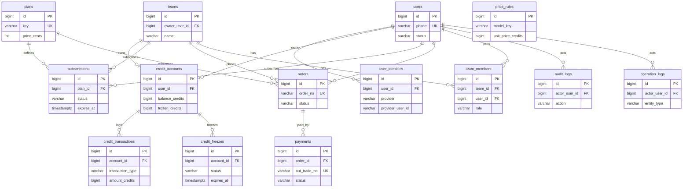
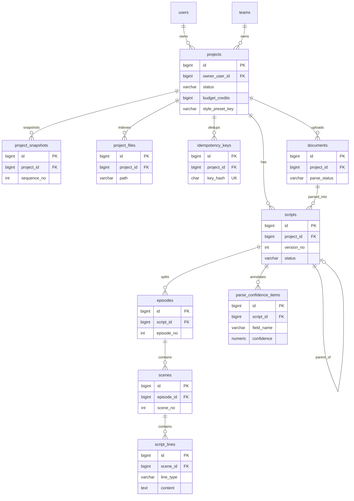
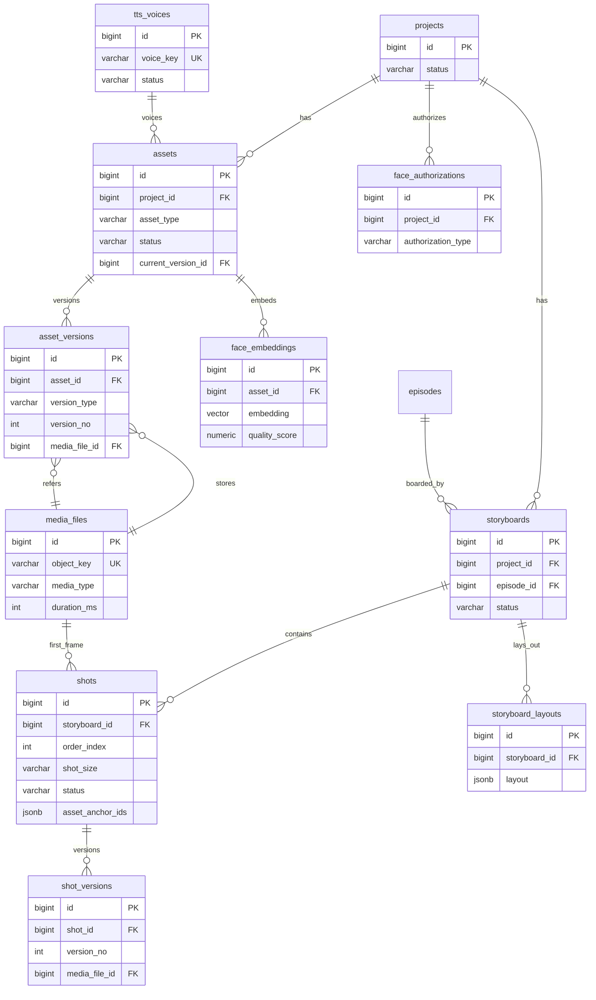
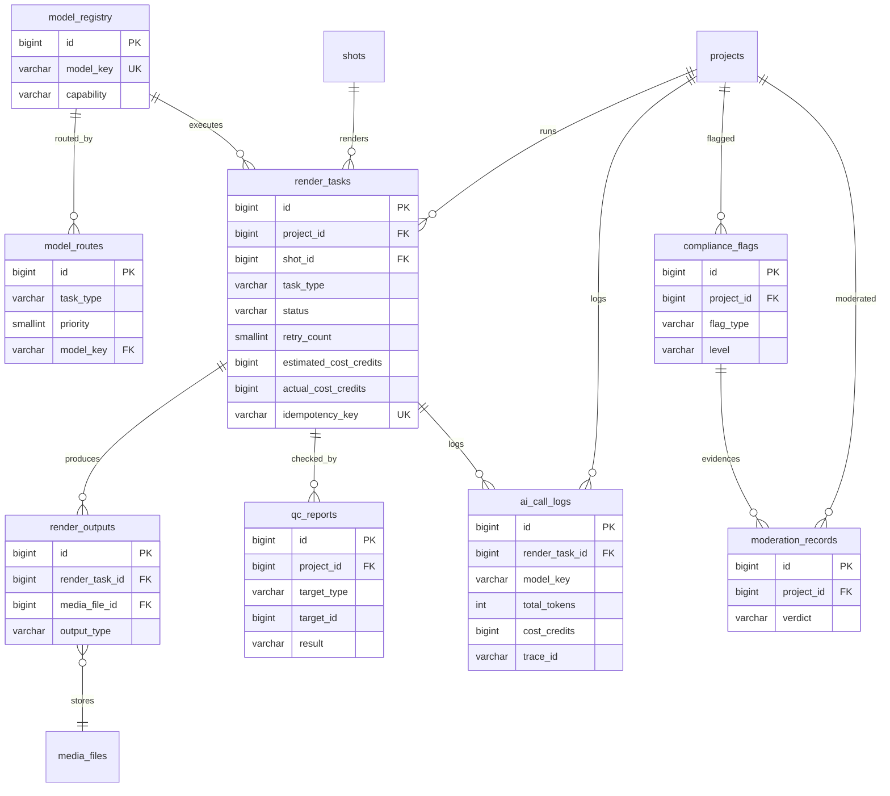
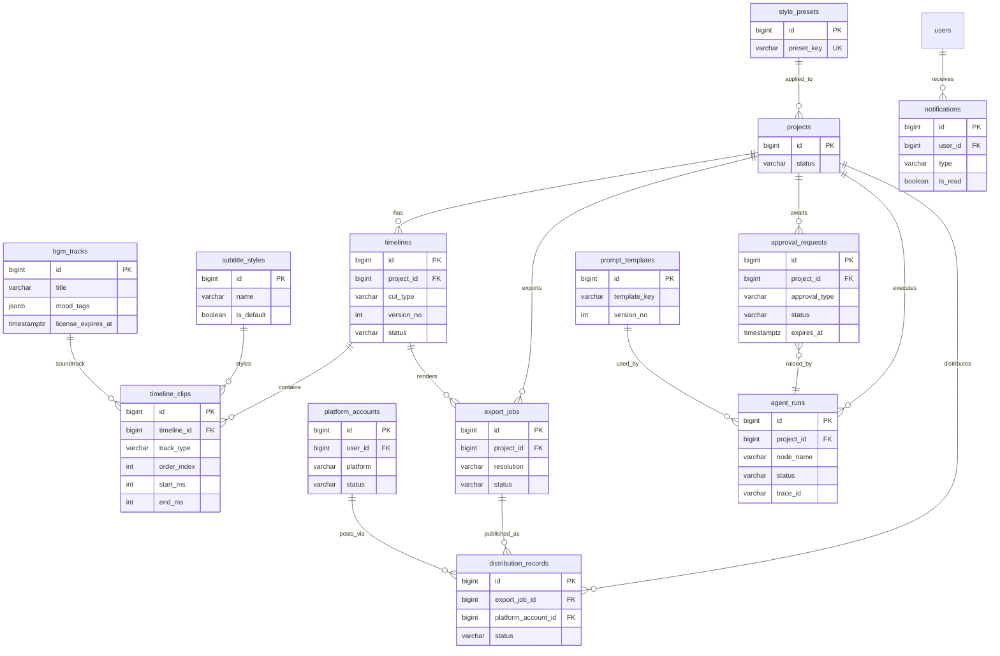
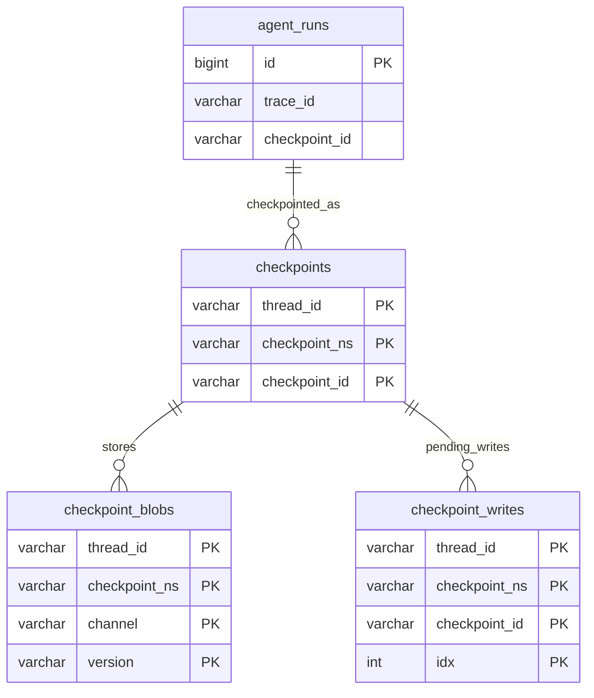

# 02 · 数据库设计文档（ER 图与数据字典）

| 项目 | 内容 |
|---|---|
| 产品名称 | 浮光造梦 · AI 短剧创作工具（GleamDream Studio） |
| 文档版本 | V4.0（契约基线版） |
| 最近更新 | 2026-10-15 |
| 维护人 | 数据架构师 |
| 数据库 | PostgreSQL 16+（含 `pgvector`）、Redis 7+（缓存/锁/限流） |
| 读者 | 后端工程师、DBA、测试工程师、Agent 工程 |
| 上游契约 | `00_文档总览与术语表.md` |

---

## 一、文档说明

### 1.1 目的

本文档定义 GleamDream Studio 全部持久化数据结构：表、字段、类型、约束、索引、分区、迁移与容量规划，作为后端建模（SQLAlchemy 2.0）、Alembic 迁移、测试数据构造与 DBA 运维的唯一依据。

### 1.2 读者

- **后端工程师**：按第 5 章逐表字典建立 ORM 模型与仓储层；按第 7 章写查询。
- **DBA**：按第 9 章做分区与归档；按第 7、8 章建索引与约束。
- **测试工程师**：按第 5、8 章构造边界数据与状态流转用例。
- **Agent 工程**：按第 3、4 章理解 `agent_runs`、`idempotency_keys`、`approval_requests`、`project_files` 与 LangGraph checkpoint 的边界。

### 1.3 适用范围

覆盖 `00_文档总览与术语表.md` 第五章列出的 **52 张业务表 + 4 张基础设施表（`audit_logs`、`operation_logs`、`project_files`、`idempotency_keys`）**，共 56 张自建表；另含 **3 张 LangGraph 官方 checkpointer 表**（`checkpoints`、`checkpoint_blobs`、`checkpoint_writes`），后者由库自行管理，本文档只说明边界、不设计字段。

### 1.4 与 00 契约的关系

- 表名、字段名、状态枚举、命名规范、分期标注（**M** = MVP 必须 / **P1** = 迭代一 / **P2** = 迭代二）**全部对齐 00 契约**。
- 本文档在契约未明确的物理细节（索引、分区分表、字段长度、JSONB 边界）上做**合理扩展**，扩展点在第 13 章集中登记。
- **冲突处理**：本文档与 00 契约冲突时，**以 00 为准**，并回改本文档。

### 1.5 分期标注含义

| 标注 | 含义 | 落地要求 |
|---|---|---|
| M | MVP 必须 | MVP 版本必须建表、建索引、建约束 |
| P1 | 迭代一 | MVP 版可先建表（预留）或留待 P1 迁移；本文档给出完整设计 |
| P2 | 迭代二 | 本文档仅给出方向性说明或预算/权益字段预留，物理表在 P2 建 |

### 1.6 约定记号

- 类型列中 `TIMESTAMPTZ` 一律为 `timestamp with time zone`，DB 存 UTC。
- 字段表省略「通用审计列」`created_at` / `updated_at`（除特殊说明外每表均有，定义见 2.2），仅在表下「通用字段」行注明。
- `_credits` 结尾字段为积分；`_amount_cents` 结尾字段为人民币分。均为整数最小单位。
- 索引名遵循 `idx_<表>_<字段列表>`；唯一约束名遵循 `uq_<表>_<字段列表>`；外键名遵循 `fk_<表>_<引用表>`；CHECK 名遵循 `ck_<表>_<字段>`。

---

## 二、设计原则

### 2.1 主键策略（BIGINT IDENTITY）

| 决策 | 内容 | 理由 |
|---|---|---|
| 主键类型 | `BIGINT GENERATED ALWAYS AS IDENTITY` | 对齐 ADR-02 |
| 字段名 | 统一 `id` | 对齐 00 契约 §4.1 |
| 不外泄业务语义 | 主键仅作内部标识，不编码业务含义 | 便于分库/归档重置 |
| 越权防护 | 由 JWT + ACL 兜底，不依赖主键不可猜 | 对齐 ADR-02 |

选择理由：相比 UUID，BIGINT 索引体积小（8 字节 vs 16 字节）、顺序写入无页分裂、B-tree 深度更低、调试直观、API 路径更短。分布式唯一性在本系统不需要——单库单写足够，后续如扩展多实例可引入 `snowflake` 方案并保留主键类型不变。

### 2.2 审计字段（强制）

每张自建表必含下列审计列：

| 字段名 | 类型 | NULL | 默认 | 说明 |
|---|---|---|---|---|
| `created_at` | TIMESTAMPTZ | NO | `now()` | 创建时间，UTC |
| `updated_at` | TIMESTAMPTZ | NO | `now()` | 末次更新时间，由 ORM/触发器维护 |

- `updated_at` 维护方式：应用层 `onupdate=func.now()` 为主，DDL 附录对关键表附 `set_updated_at` 触发器兜底（防绕过 ORM 的直接 UPDATE）。
- 只追加型表（`credit_transactions`、`ai_call_logs`、`audit_logs`、`operation_logs`、`moderation_records`）仍保留 `updated_at` 列以满足契约「每表必有」；业务上不允许 UPDATE，`updated_at` 恒等于 `created_at`（审计断言校验）。

### 2.3 软删除

| 项 | 约定 |
|---|---|
| 字段 | `deleted_at TIMESTAMPTZ NULL`（对齐 00 契约 §4.1） |
| 语义 | `NULL` 表示存活；非空表示已软删除，值记录删除时刻 |
| 查询 | 仓储层默认追加 `deleted_at IS NULL`；`UNIQUE` 约束采用**部分唯一索引**（`WHERE deleted_at IS NULL`）以允许删除后同键复用 |
| 不适用表 | 纯日志/账本/关联表（`credit_transactions`、`ai_call_logs`、`operation_logs`、`team_members`、`project_members` 等）不设软删除，行数可控或需物理清理 |

### 2.4 枚举落库

- 一律 `VARCHAR(32)` 存 `snake_case` 值，**不使用 PostgreSQL 原生 `ENUM` 类型**（对齐 00 契约 §4.1 与「枚举落库原则」）。
- 应用层用 Pydantic `Literal`/`StrEnum` 校验；DB 层用 `CHECK` 约束兜底，取值清单见第 8 章。
- 新增取值：`CHECK` 变更用 `ALTER TABLE ... DROP CONSTRAINT / ADD CONSTRAINT`（`NOT VALID` + `VALIDATE` 两步，避免长事务锁表）。

### 2.5 JSONB 使用边界

| 允许使用 JSONB 的场景 | 示例字段 | 理由 |
|---|---|---|
| 结构多变、不需要按单字段检索的**配置** | `projects.config`、`style_presets.params`、`system_configs.config_value` | 形态随业务演进，避免频繁 DDL |
| 数组型引用集合 | `shots.asset_anchor_ids`、`shots.prop_asset_ids`、`plans.benefits` | 元素为 ID 列表，整取整存 |
| 快照/快照型留痕 | `project_snapshots.state`、`moderation_records.request_snapshot` | 需原样留存，不参与复杂查询 |
| 质检/缺陷明细 | `qc_reports.quality_defects`、`compliance_flags.position` | 结构由 Agent 输出契约决定 |

| 禁止使用 JSONB 的场景 | 理由 |
|---|---|
| 会被 WHERE/JOIN/ORDER BY 高频使用的**外键与状态字段** | 必须独立成列并建索引，JSONB 会导致索引缺失与语义模糊 |
| 金额、积分、时间戳 | 必须为整数/`TIMESTAMPTZ` 强类型，杜绝精度与比较错误 |
| 会单独更新的字段 | JSONB 整列重写代价高，且无法做部分更新优化 |
| 用户身份、授权、审计的关键字段 | 必须结构化以便合规查询与约束 |

### 2.6 金额与积分为整数最小单位

- 积分：整数（`BIGINT`），字段后缀 `_credits`，1 积分 = ¥0.01（对齐 00 契约 Q1）。**禁止浮点**。
- 人民币：整数分（`INT`），字段后缀 `_amount_cents`。货币代码单独列 `currency CHAR(3)`，默认 `CNY`。
- 账户余额运算在 DB 事务内以 `UPDATE ... SET balance_credits = balance_credits - :x WHERE ... AND balance_credits >= :x` 保证非负与原子性。

### 2.7 时区统一 UTC / TIMESTAMPTZ

- 所有时间列使用 `TIMESTAMPTZ`，库内 UTC；连接参数 `timezone=UTC`。
- 展示层按用户时区转换，DB 不做本地化。
- 时间边界（如冻结 30 分钟、审批 7 天过期）以 `expires_at` 列显式存储，由定时任务扫描，不依赖时区函数推算。

### 2.8 外键与级联策略

| 策略 | 适用对象 | 理由 |
|---|---|---|
| `ON DELETE RESTRICT`（默认） | 被引用的主数据：`plans`、`model_registry`、`tts_voices`、`style_presets`、`bgm_tracks`、`users` | 防止误删主数据导致引用悬空；主数据用软删除/停用 |
| `ON DELETE CASCADE` | 强从属层级：`episodes → scripts`、`scenes → episodes`、`script_lines → scenes`、`shots → storyboards`、`timeline_clips → timelines`、`render_outputs → render_tasks`、`team_members → teams`、`project_members → projects` | 父行物理删除时子行无独立价值，物理级联清理 |
| `ON DELETE SET NULL` | 可选弱引用：`shots.scene_asset_id`、`projects.cover_media_id`、`subscriptions.order_id` | 引用对象消失不应连累主体 |
| `ON UPDATE` | 一律 `NO ACTION` | 主键/外键不更新 |
| 应用层原则 | 所有「删除」默认走**软删除**（置 `deleted_at`），`ON DELETE` 级别仅在运维物理清理/DBA 归档时触发 | 软删除优先，物理级联为兜底 |

### 2.9 时长字段命名约定

| 类别 | 后缀 | 单位 | 类型 | 示例 |
|---|---|---|---|---|
| 技术/媒体时长 | `_ms` | 毫秒 | INT / BIGINT | `shots.duration_ms`、`timelines.duration_ms`、`media_files.duration_ms`、`bgm_tracks.duration_ms`、`storyboards.estimated_duration_ms` |
| 业务时长 | `_seconds` | 秒 | INT | `episodes.target_duration_seconds` |

- **统一规则**：凡表示媒体播放/渲染/时间线等**技术时长**，一律用 `_ms`（整数毫秒，精度对齐音画同步 < 100ms 的质检要求）；凡表示剧本/业务口径的**计划时长**，用 `_seconds`（整数秒，全拼，不使用 `_sec` 缩写）。
- 计费数量不是数据库列：`price_rules.unit` 为 `per_second` 时，接口层「计费数量」以秒计，属按计费单位口径的派生量，不与本表命名约定冲突（见 2.6 与 B-8 `price_rules`）。

---

## 三、领域划分总览

### 3.1 十一个域

| 域 | 代号 | 名称 | 表数 | 说明 |
|---|---|---|---|---|
| A | IAM | 身份与权限 | 7 | 用户、三方身份、团队与授权、审计/操作日志 |
| B | Billing | 计费与商业化 | 8 | 套餐、订阅、积分账户/流水/冻结、订单、支付、单价 |
| C | Project | 项目与版本 | 4 | 项目主表、快照、虚拟文件系统索引、幂等键 |
| D | Script | 剧本 | 6 | 文档、剧本版本、集、场、台词行、解析置信度 |
| E | Asset | 资产 | 6 | 资产、资产版本、媒体文件、人脸向量、真人授权、音色 |
| F | Storyboard | 分镜 | 4 | 分镜板、镜头、镜头版本、画布布局 |
| G | Render | 生成执行 | 5 | 模型注册、路由、渲染任务、渲染产物、模型调用日志 |
| H | QC | 质量与合规 | 3 | 质检报告、合规标记、三方审核记录 |
| I | Post | 后期 | 4 | 时间线、时间线片段、字幕样式、BGM 曲库 |
| J | Distribution | 导出与分发 | 3 | 导出任务、平台账号、分发记录 |
| K | Collaboration | 协同与运行时 | 6 | 审批单、通知、Agent 运行、画风预设、提示词模板、系统配置 |

### 3.2 表总览矩阵

> 行数量级基于 3.3 节容量假设的**单项目**口径；1 项目 = 10 集 × 20 镜 = 200 镜。

| # | 表名 | 中文名 | 域 | 分期 | 单项目行数量级 | 主要关系 |
|---|---|---|---|---|---|---|
| 1 | `users` | 用户主表 | A | M | 1 | 1:N 全部归属表 |
| 2 | `user_identities` | 三方登录身份 | A | M | 1~2 | N:1 → `users` |
| 3 | `teams` | 团队 | A | P1 | 0~1 | 1:N `team_members`/`projects` |
| 4 | `team_members` | 团队成员 | A | P1 | 0~5 | N:1 `teams`/`users` |
| 5 | `project_members` | 项目级授权 | A | P1 | 0~5 | N:1 `projects`/`users` |
| 6 | `audit_logs` | 审计日志 | A | P1 | 50~200 | 弱引用 `users`/`projects` |
| 7 | `operation_logs` | 操作日志 | A | P1 | 200~2000 | 弱引用 `users`/`projects` |
| 8 | `plans` | 套餐定义 | B | M | 全局约 6 行 | 1:N `subscriptions` |
| 9 | `subscriptions` | 订阅实例 | B | M | 1 | N:1 `users`/`teams`/`plans` |
| 10 | `credit_accounts` | 积分账户 | B | M | 1 | 1:1 `users`/`teams` |
| 11 | `credit_transactions` | 积分流水 | B | M | 400~600 | N:1 `credit_accounts` |
| 12 | `credit_freezes` | 冻结记录 | B | M | 200~300 | N:1 `credit_accounts` |
| 13 | `orders` | 订单 | B | M | 0~5 | 1:N `payments` |
| 14 | `payments` | 支付流水 | B | M | 0~5 | N:1 `orders` |
| 15 | `price_rules` | 计费单价规则 | B | M | 全局数十行 | N:1 `model_registry`（逻辑） |
| 16 | `projects` | 项目主表 | C | M | 1 | 1:N 全部业务表 |
| 17 | `project_snapshots` | 版本快照 | C | M | ≤30 | N:1 `projects` |
| 18 | `project_files` | 虚拟文件索引 | C | M | 100~400 | N:1 `projects` |
| 19 | `idempotency_keys` | 幂等键登记 | C | M | 500~1500 | 弱引用 `projects` |
| 20 | `documents` | 上传剧本文档 | D | M | 0~2 | N:1 `projects` |
| 21 | `scripts` | 剧本版本 | D | M | 1~3 | N:1 `projects` |
| 22 | `episodes` | 分集 | D | M | 10 | N:1 `scripts` |
| 23 | `scenes` | 场次 | D | M | 40~60 | N:1 `episodes` |
| 24 | `script_lines` | 台词/旁白/动作行 | D | M | 600~1200 | N:1 `scenes` |
| 25 | `parse_confidence_items` | 解析置信度标注 | D | M | 100~400 | N:1 `scripts` |
| 26 | `assets` | 资产主表 | E | M | 20~30 | N:1 `projects` |
| 27 | `asset_versions` | 资产版本 | E | M | 120~200 | N:1 `assets` |
| 28 | `media_files` | 统一媒体文件 | E | M | 800~1500 | 被多表引用 |
| 29 | `face_embeddings` | 人脸向量 | E | M | 60~120 | N:1 `assets` |
| 30 | `face_authorizations` | 真人授权留痕 | E | M | 0~5 | N:1 `users`/`projects` |
| 31 | `tts_voices` | 音色库 | E | M | 全局数百行 | 1:N `assets.voice_id` |
| 32 | `storyboards` | 分镜板 | F | M | 10 | N:1 `projects`/`episodes` |
| 33 | `shots` | 镜头 | F | M | 200 | N:1 `storyboards` |
| 34 | `shot_versions` | 镜头生成版本 | F | M | 300~600 | N:1 `shots` |
| 35 | `storyboard_layouts` | 画布布局 | F | P1 | 10~20 | N:1 `storyboards` |
| 36 | `model_registry` | 模型注册表 | G | M | 全局数十行 | 1:N `render_tasks` |
| 37 | `model_routes` | 路由策略 | G | M | 全局数十行 | N:1 `model_registry` |
| 38 | `render_tasks` | 渲染任务 | G | M | 600~1000 | N:1 `projects`/`shots` |
| 39 | `render_outputs` | 渲染产物 | G | M | 500~800 | N:1 `render_tasks` |
| 40 | `ai_call_logs` | 模型调用日志 | G | M | 1200~2500 | N:1 `render_tasks` |
| 41 | `qc_reports` | 质检报告 | H | M | 300~500 | 多态指向 shot/asset/output |
| 42 | `compliance_flags` | 合规标记 | H | M | 10~60 | N:1 `projects` |
| 43 | `moderation_records` | 三方审核记录 | H | M | 20~100 | N:1 `projects` |
| 44 | `timelines` | 时间线 | I | M | 10~20 | N:1 `projects` |
| 45 | `timeline_clips` | 时间线片段 | I | M | 400~1200 | N:1 `timelines` |
| 46 | `subtitle_styles` | 字幕样式模板 | I | M | 全局+项目各若干 | 被 `timeline_clips` 引用 |
| 47 | `bgm_tracks` | BGM 曲库 | I | M | 全局约 200+ 行 | 被 `timeline_clips` 引用 |
| 48 | `export_jobs` | 导出任务 | J | M | 10~30 | N:1 `projects`/`timelines` |
| 49 | `platform_accounts` | 三方平台授权 | J | P1 | 0~3 | N:1 `users` |
| 50 | `distribution_records` | 分发记录 | J | P1 | 0~30 | N:1 `export_jobs` |
| 51 | `approval_requests` | HITL 审批单 | K | M | 4~40 | N:1 `projects` |
| 52 | `notifications` | 站内通知 | K | P1 | 20~100 | N:1 `users` |
| 53 | `agent_runs` | Agent 运行记录 | K | M | 100~400 | N:1 `projects` |
| 54 | `style_presets` | 画风预设库 | K | M | 全局约 4~8 行 | 被 `projects.style_preset_key` 引用 |
| 55 | `prompt_templates` | 提示词模板 | K | P1 | 全局数十行 | — |
| 56 | `system_configs` | 系统配置中心 | K | P1 | 全局数十行 | — |

> 说明：`plans`、`price_rules`、`model_registry`、`model_routes`、`tts_voices`、`bgm_tracks`、`style_presets`、`prompt_templates`、`system_configs`、`subtitle_styles` 为**全局/跨项目主数据**，行数不随用户项目线性增长。

---

## 四、全局 ER 总图

> 说明：Mermaid `erDiagram` 中实体名一律使用表名 `snake_case`；为可渲染性，图中只列出主键与关键字段，完整字段见第 5 章。分域拆成 5 张图。

### 4.1 IAM + 计费（域 A/B）



### 4.2 项目 + 剧本（域 C/D）



### 4.3 资产 + 分镜（域 E/F）



### 4.4 生成 + 质检（域 G/H）



### 4.5 后期 + 发行 + 协同（域 I/J/K）



### 4.6 LangGraph 框架表边界



> `checkpoints` / `checkpoint_blobs` / `checkpoint_writes` 由 `langgraph-checkpoint-postgres` 自动建表与维护，**不纳入 Alembic 版本管理**，仅在初始化脚本中执行 `PostgresSaver.setup()`。业务表通过 `agent_runs.checkpoint_id` / `project_snapshots.checkpoint_id` 与 `checkpoints.checkpoint_id` 逻辑关联（同库不同 schema 时用 `thread_id = project_id` 关联，见 13 章扩展点 E-3）。

---

## 五、逐表数据字典

> 通用说明：每表均含 `id BIGINT GENERATED ALWAYS AS IDENTITY PRIMARY KEY` 与审计列 `created_at` / `updated_at`（TIMESTAMPTZ NOT NULL DEFAULT `now()`）。表内字段表不再重复列出审计列（另有说明者除外）。

### 5.1 域 A · 身份与权限（IAM）

#### A-1 `users`（用户主表）

用户账号主表，承载登录标识、昵称、状态与风控标记。

| 字段名 | 类型 | NULL | 默认 | 说明 | 取值约束 |
|---|---|---|---|---|---|
| id | BIGINT | NO | IDENTITY | 主键 | — |
| phone | VARCHAR(20) | YES | NULL | 手机号（登录标识之一） | 唯一（软删部分唯一）；`^1[3-9]\d{9}$` |
| email | VARCHAR(255) | YES | NULL | 邮箱（可选登录） | 软删部分唯一 |
| nickname | VARCHAR(64) | NO | `''` | 昵称 | 长度 ≤ 64 |
| avatar_url | VARCHAR(512) | YES | NULL | 头像 URL | — |
| password_hash | VARCHAR(255) | YES | NULL | 密码哈希（Argon2id） | 三方登录可空 |
| status | VARCHAR(32) | NO | `'active'` | 账号状态 | `active`/`suspended`/`banned` |
| risk_level | SMALLINT | NO | 0 | 风控等级 | 0~3 |
| register_source | VARCHAR(32) | NO | `'web'` | 注册来源 | `web`/`wechat`/`apple`/`admin` |
| last_login_at | TIMESTAMPTZ | YES | NULL | 末次登录 | — |
| deleted_at | TIMESTAMPTZ | YES | NULL | 软删除 | — |
| created_at / updated_at | TIMESTAMPTZ | NO | `now()` | 审计 | — |

- 主键：`id`；唯一：`uq_users_phone`（`phone WHERE deleted_at IS NULL`）、`uq_users_email`；外键：无。
- 索引：
  - `idx_users_status`（`status`）—— 后台按状态筛选、封禁批处理。
  - `idx_users_created_at`（`created_at`）—— 注册趋势统计。
  - `idx_users_last_login_at`（`last_login_at`）—— 流失用户召回。

#### A-2 `user_identities`（三方登录身份）

一个用户可绑定多个三方身份（微信/Apple 等），供登录换取。

| 字段名 | 类型 | NULL | 默认 | 说明 | 取值约束 |
|---|---|---|---|---|---|
| id | BIGINT | NO | IDENTITY | 主键 | — |
| user_id | BIGINT | NO | — | 归属用户 | FK → `users.id` ON DELETE CASCADE |
| provider | VARCHAR(32) | NO | — | 身份提供方 | `wechat`/`apple`/`qq`/`phone` |
| provider_user_id | VARCHAR(128) | NO | — | 提供方用户标识（openid/sub） | — |
| union_id | VARCHAR(128) | YES | NULL | 微信 unionid 等 | — |
| raw_profile | JSONB | YES | NULL | 原始资料快照 | — |
| created_at / updated_at | TIMESTAMPTZ | NO | `now()` | 审计 | — |

- 主键：`id`；唯一：`uq_user_identities_provider_provider_user_id`（`provider, provider_user_id`）；外键：`user_id`。
- 索引：
  - `idx_user_identities_user_id`（`user_id`）—— 查用户的全部登录方式。
  - `idx_user_identities_union_id`（`union_id`）—— 微信多应用 unionid 归并。

#### A-3 `teams`（团队/工作空间）

P1 团队容器，团队版项目的计费与成员归属主体。

| 字段名 | 类型 | NULL | 默认 | 说明 | 取值约束 |
|---|---|---|---|---|---|
| id | BIGINT | NO | IDENTITY | 主键 | — |
| name | VARCHAR(128) | NO | — | 团队名称 | 长度 ≤ 128 |
| owner_user_id | BIGINT | NO | — | 拥有者 | FK → `users.id` ON DELETE RESTRICT |
| plan_id | BIGINT | YES | NULL | 团队套餐 | FK → `plans.id` ON DELETE SET NULL |
| seat_limit | SMALLINT | NO | 5 | 席位数上限 | ≥ 1 |
| status | VARCHAR(32) | NO | `'active'` | 状态 | `active`/`suspended`/`archived` |
| deleted_at | TIMESTAMPTZ | YES | NULL | 软删除 | — |
| created_at / updated_at | TIMESTAMPTZ | NO | `now()` | 审计 | — |

- 主键：`id`；唯一：无（团队名不强制唯一）；外键：`owner_user_id`、`plan_id`。
- 索引：`idx_teams_owner_user_id`（`owner_user_id`）—— 我拥有的团队列表。

#### A-4 `team_members`（团队成员与角色）

团队与用户的多对多关联，携带角色。

| 字段名 | 类型 | NULL | 默认 | 说明 | 取值约束 |
|---|---|---|---|---|---|
| id | BIGINT | NO | IDENTITY | 主键 | — |
| team_id | BIGINT | NO | — | 团队 | FK → `teams.id` ON DELETE CASCADE |
| user_id | BIGINT | NO | — | 成员 | FK → `users.id` ON DELETE CASCADE |
| role | VARCHAR(32) | NO | `'member'` | 角色 | `owner`/`admin`/`member`/`guest` |
| invited_by | BIGINT | YES | NULL | 邀请人 | FK → `users.id` ON DELETE SET NULL |
| joined_at | TIMESTAMPTZ | NO | `now()` | 加入时间 | — |
| created_at / updated_at | TIMESTAMPTZ | NO | `now()` | 审计 | — |

- 主键：`id`；唯一：`uq_team_members_team_id_user_id`（`team_id, user_id`）；外键：见上。
- 索引：`idx_team_members_user_id`（`user_id`）—— 查用户所属团队。

#### A-5 `project_members`（项目级授权）

项目三级权限（view/edit/export）的显式授权表，团队之外的单点授权。

| 字段名 | 类型 | NULL | 默认 | 说明 | 取值约束 |
|---|---|---|---|---|---|
| id | BIGINT | NO | IDENTITY | 主键 | — |
| project_id | BIGINT | NO | — | 项目 | FK → `projects.id` ON DELETE CASCADE |
| user_id | BIGINT | NO | — | 被授权用户 | FK → `users.id` ON DELETE CASCADE |
| permission | VARCHAR(16) | NO | `'view'` | 权限级别 | `view`/`edit`/`export` |
| granted_by | BIGINT | YES | NULL | 授权人 | FK → `users.id` ON DELETE SET NULL |
| created_at / updated_at | TIMESTAMPTZ | NO | `now()` | 审计 | — |

- 主键：`id`；唯一：`uq_project_members_project_id_user_id`（`project_id, user_id`）；外键：见上。
- 索引：`idx_project_members_user_id`（`user_id`）—— 查用户被授权的项目。

#### A-6 `audit_logs`（审计日志）【基础设施表】

越权、敏感操作的不可篡改留痕，按月分区、只追加。

| 字段名 | 类型 | NULL | 默认 | 说明 | 取值约束 |
|---|---|---|---|---|---|
| id | BIGINT | NO | IDENTITY | 主键（分区内） | — |
| actor_type | VARCHAR(16) | NO | — | 主体类型 | `user`/`agent`/`system` |
| actor_user_id | BIGINT | YES | NULL | 操作者 | 弱引用 `users.id`，不建物理 FK（日志独立性） |
| actor_agent_run_id | BIGINT | YES | NULL | Agent 运行 | 弱引用 `agent_runs.id` |
| project_id | BIGINT | YES | NULL | 关联项目 | 弱引用 |
| action | VARCHAR(64) | NO | — | 动作 | 如 `acl.denied`、`project.transfer` |
| target_type | VARCHAR(32) | YES | NULL | 目标类型 | `project`/`asset`/`shot`/`user`… |
| target_id | BIGINT | YES | NULL | 目标 ID | — |
| ip | INET | YES | NULL | 来源 IP | — |
| user_agent | VARCHAR(512) | YES | NULL | UA | — |
| detail | JSONB | YES | NULL | 详情 | — |
| trace_id | VARCHAR(64) | YES | NULL | 链路 ID | ULID |
| created_at / updated_at | TIMESTAMPTZ | NO | `now()` | 审计 | 业务只写不更 |

- 主键：`id`（分区表需含分区键，见 9 章）；唯一：无；外键：无物理 FK（避免日志被主表级联删除）。
- 索引：`idx_audit_logs_project_id_created_at`、`idx_audit_logs_actor_user_id_created_at`、`idx_audit_logs_action_created_at`。

#### A-7 `operation_logs`（操作日志）【基础设施表】

常规 who/when/what/diff 留痕，按月分区、只追加。

| 字段名 | 类型 | NULL | 默认 | 说明 | 取值约束 |
|---|---|---|---|---|---|
| id | BIGINT | NO | IDENTITY | 主键（分区内） | — |
| actor_user_id | BIGINT | YES | NULL | 操作者 | 弱引用 |
| project_id | BIGINT | YES | NULL | 项目 | 弱引用 |
| entity_type | VARCHAR(32) | NO | — | 实体类型 | `project`/`shot`/`asset`… |
| entity_id | BIGINT | YES | NULL | 实体 ID | — |
| action | VARCHAR(32) | NO | — | 动作 | `create`/`update`/`delete` |
| diff | JSONB | YES | NULL | 变更前后差异 | `{before, after}` |
| request_id | VARCHAR(64) | YES | NULL | 请求 ID | ULID |
| created_at / updated_at | TIMESTAMPTZ | NO | `now()` | 审计 | 只写不更 |

- 主键：`id`；唯一：无；外键：无。
- 索引：`idx_operation_logs_project_id_created_at`、`idx_operation_logs_entity_type_entity_id`。

### 5.2 域 B · 计费与商业化（Billing）

#### B-1 `plans`（套餐定义）

free/pro/studio 三档套餐的定价与权益定义（全局主数据）。

| 字段名 | 类型 | NULL | 默认 | 说明 | 取值约束 |
|---|---|---|---|---|---|
| id | BIGINT | NO | IDENTITY | 主键 | — |
| key | VARCHAR(32) | NO | — | 套餐键 | `free`/`pro`/`studio`，唯一 |
| name | VARCHAR(64) | NO | — | 显示名 | — |
| billing_period | VARCHAR(16) | NO | — | 周期 | `month`/`year` |
| price_cents | INT | NO | 0 | 价格（分） | ≥ 0 |
| currency | CHAR(3) | NO | `'CNY'` | 币种 | — |
| credits_per_period | BIGINT | NO | 0 | 周期赠送积分 | ≥ 0 |
| concurrency_limit | SMALLINT | NO | 2 | 并发生成上限 | 对齐 Q8：free 2/pro 5/studio 10 |
| benefits | JSONB | YES | NULL | 权益位 | 如 `{"max_resolution":"1080p","no_watermark":false}` |
| is_active | BOOLEAN | NO | TRUE | 是否在售 | — |
| sort_order | SMALLINT | NO | 0 | 展示排序 | — |
| created_at / updated_at | TIMESTAMPTZ | NO | `now()` | 审计 | — |

- 主键：`id`；唯一：`uq_plans_key`；外键：无。
- 索引：`idx_plans_is_active_sort_order`（`is_active, sort_order`）—— 套餐选择页。

#### B-2 `subscriptions`（订阅实例）

用户/团队的套餐订阅实例与生效期。

| 字段名 | 类型 | NULL | 默认 | 说明 | 取值约束 |
|---|---|---|---|---|---|
| id | BIGINT | NO | IDENTITY | 主键 | — |
| owner_type | VARCHAR(8) | NO | — | 主体类型 | `user`/`team` |
| user_id | BIGINT | YES | NULL | 用户 | FK → `users.id` ON DELETE CASCADE |
| team_id | BIGINT | YES | NULL | 团队 | FK → `teams.id` ON DELETE CASCADE |
| plan_id | BIGINT | NO | — | 套餐 | FK → `plans.id` ON DELETE RESTRICT |
| status | VARCHAR(32) | NO | `'active'` | 状态 | `active`/`expired`/`cancelled`/`past_due` |
| started_at | TIMESTAMPTZ | NO | `now()` | 生效时间 | — |
| expires_at | TIMESTAMPTZ | YES | NULL | 到期时间 | NULL 表示永久（free） |
| auto_renew | BOOLEAN | NO | FALSE | 自动续费 | — |
| order_id | BIGINT | YES | NULL | 来源订单 | FK → `orders.id` ON DELETE SET NULL |
| created_at / updated_at | TIMESTAMPTZ | NO | `now()` | 审计 | — |

- 主键：`id`；唯一：无；外键：`user_id`、`team_id`、`plan_id`、`order_id`。
- 约束：CHECK `ck_subscriptions_owner`：`(owner_type='user' AND user_id IS NOT NULL AND team_id IS NULL) OR (owner_type='team' AND team_id IS NOT NULL AND user_id IS NULL)`。
- 索引：`idx_subscriptions_user_id_status`、`idx_subscriptions_team_id_status`、`idx_subscriptions_expires_at`（到期扫描）。

#### B-3 `credit_accounts`（积分账户）

积分余额容器，用户或团队各一个。

| 字段名 | 类型 | NULL | 默认 | 说明 | 取值约束 |
|---|---|---|---|---|---|
| id | BIGINT | NO | IDENTITY | 主键 | — |
| owner_type | VARCHAR(8) | NO | — | 主体类型 | `user`/`team` |
| user_id | BIGINT | YES | NULL | 用户 | FK → `users.id` ON DELETE CASCADE |
| team_id | BIGINT | YES | NULL | 团队 | FK → `teams.id` ON DELETE CASCADE |
| balance_credits | BIGINT | NO | 0 | 可用余额 | ≥ 0 |
| frozen_credits | BIGINT | NO | 0 | 冻结额 | ≥ 0 |
| total_granted_credits | BIGINT | NO | 0 | 累计获得 | ≥ 0 |
| total_consumed_credits | BIGINT | NO | 0 | 累计消耗 | ≥ 0 |
| lock_version | INT | NO | 0 | 乐观锁版本 | — |
| created_at / updated_at | TIMESTAMPTZ | NO | `now()` | 审计 | — |

- 主键：`id`；唯一：`uq_credit_accounts_user_id`（`user_id WHERE user_id IS NOT NULL`）、`uq_credit_accounts_team_id`（`team_id WHERE team_id IS NOT NULL`）；外键：`user_id`、`team_id`。
- 约束：`ck_credit_accounts_balance`（`balance_credits >= 0 AND frozen_credits >= 0`）、`ck_credit_accounts_owner` 同 B-2。
- 索引：`idx_credit_accounts_user_id`、`idx_credit_accounts_team_id`。

#### B-4 `credit_transactions`（积分流水）

积分变动不可变账本，按月分区、只追加。

| 字段名 | 类型 | NULL | 默认 | 说明 | 取值约束 |
|---|---|---|---|---|---|
| id | BIGINT | NO | IDENTITY | 主键（分区内） | — |
| account_id | BIGINT | NO | — | 账户 | FK → `credit_accounts.id` ON DELETE RESTRICT |
| transaction_type | VARCHAR(32) | NO | — | 类型 | `grant`/`recharge`/`freeze`/`unfreeze`/`settle`/`refund`/`expire`/`adjust` |
| amount_credits | BIGINT | NO | — | 变动额（有符号） | 正入负出，≠ 0 |
| balance_after_credits | BIGINT | NO | — | 变动后可用余额 | ≥ 0 |
| frozen_after_credits | BIGINT | YES | NULL | 变动后冻结额 | ≥ 0 |
| related_freeze_id | BIGINT | YES | NULL | 关联冻结 | 弱引用 `credit_freezes.id` |
| related_task_id | BIGINT | YES | NULL | 关联任务 | 弱引用 `render_tasks.id` |
| project_id | BIGINT | YES | NULL | 关联项目 | 弱引用 |
| description | VARCHAR(255) | YES | NULL | 备注 | — |
| idempotency_key | VARCHAR(128) | YES | NULL | 幂等键 | 部分唯一 |
| created_at / updated_at | TIMESTAMPTZ | NO | `now()` | 审计 | 只写不更 |

- 主键：`id`；唯一：`uq_credit_transactions_idempotency_key`（`idempotency_key WHERE idempotency_key IS NOT NULL`）；外键：`account_id`。
- 索引：`idx_credit_transactions_account_id_created_at`、`idx_credit_transactions_project_id_created_at`、`idx_credit_transactions_related_task_id`。
- 分区：`PARTITION BY RANGE (created_at)` 按月（见第 9 章）。

#### B-5 `credit_freezes`（冻结记录）

任务执行前的预留冻结，含 30 分钟自动解冻。

| 字段名 | 类型 | NULL | 默认 | 说明 | 取值约束 |
|---|---|---|---|---|---|
| id | BIGINT | NO | IDENTITY | 主键 | — |
| account_id | BIGINT | NO | — | 账户 | FK → `credit_accounts.id` ON DELETE RESTRICT |
| project_id | BIGINT | YES | NULL | 项目 | 弱引用 |
| render_task_id | BIGINT | YES | NULL | 渲染任务 | 弱引用 `render_tasks.id` |
| frozen_credits | BIGINT | NO | — | 冻结额 | ≥ 0 |
| settled_credits | BIGINT | YES | NULL | 实际结算额 | ≥ 0 |
| status | VARCHAR(32) | NO | `'frozen'` | 状态 | `frozen`/`settled`/`released`/`expired` |
| expires_at | TIMESTAMPTZ | NO | — | 自动解冻时刻（+30min） | — |
| settled_at | TIMESTAMPTZ | YES | NULL | 结算时刻 | — |
| released_at | TIMESTAMPTZ | YES | NULL | 解冻时刻 | — |
| created_at / updated_at | TIMESTAMPTZ | NO | `now()` | 审计 | — |

- 主键：`id`；唯一：无；外键：`account_id`。
- 索引：`idx_credit_freezes_status_expires_at`（`status, expires_at`）—— 定时解冻扫描；`idx_credit_freezes_render_task_id`。

#### B-6 `orders`（订单）

订阅购买与积分充值订单。

| 字段名 | 类型 | NULL | 默认 | 说明 | 取值约束 |
|---|---|---|---|---|---|
| id | BIGINT | NO | IDENTITY | 主键 | — |
| order_no | VARCHAR(64) | NO | — | 订单号（业务唯一） | 唯一 |
| owner_type | VARCHAR(8) | NO | — | 主体类型 | `user`/`team` |
| user_id | BIGINT | YES | NULL | 用户 | FK → `users.id` ON DELETE CASCADE |
| team_id | BIGINT | YES | NULL | 团队 | FK → `teams.id` ON DELETE CASCADE |
| plan_id | BIGINT | YES | NULL | 套餐 | FK → `plans.id` ON DELETE SET NULL |
| order_type | VARCHAR(32) | NO | — | 订单类型 | `subscription`/`credit_pack` |
| credits | BIGINT | NO | 0 | 购买积分 | ≥ 0 |
| amount_cents | INT | NO | 0 | 金额（分） | ≥ 0 |
| currency | CHAR(3) | NO | `'CNY'` | 币种 | — |
| status | VARCHAR(32) | NO | `'created'` | 状态 | `created`/`paying`/`paid`/`failed`/`refunded`/`closed` |
| paid_at | TIMESTAMPTZ | YES | NULL | 支付时间 | — |
| expired_at | TIMESTAMPTZ | YES | NULL | 关单时间 | — |
| created_at / updated_at | TIMESTAMPTZ | NO | `now()` | 审计 | — |

- 主键：`id`；唯一：`uq_orders_order_no`；外键：见上。
- 索引：`idx_orders_user_id_status`、`idx_orders_created_at`。

#### B-7 `payments`（支付流水）

支付回调流水，`out_trade_no` 幂等。

| 字段名 | 类型 | NULL | 默认 | 说明 | 取值约束 |
|---|---|---|---|---|---|
| id | BIGINT | NO | IDENTITY | 主键 | — |
| order_id | BIGINT | NO | — | 订单 | FK → `orders.id` ON DELETE RESTRICT |
| out_trade_no | VARCHAR(64) | NO | — | 商户订单号（幂等键） | 唯一 |
| channel | VARCHAR(16) | NO | — | 渠道 | `wechat`/`alipay` |
| channel_trade_no | VARCHAR(64) | YES | NULL | 渠道流水号 | — |
| amount_cents | INT | NO | — | 支付金额（分） | ≥ 0 |
| status | VARCHAR(32) | NO | `'init'` | 状态 | `init`/`success`/`failed`/`refunded` |
| paid_at | TIMESTAMPTZ | YES | NULL | 支付时间 | — |
| raw_callback | JSONB | YES | NULL | 回调原文 | — |
| created_at / updated_at | TIMESTAMPTZ | NO | `now()` | 审计 | — |

- 主键：`id`；唯一：`uq_payments_out_trade_no`；外键：`order_id`。
- 索引：`idx_payments_order_id`、`idx_payments_status_created_at`。

#### B-8 `price_rules`（模型计费单价规则表）

模型计费单价规则，按任务类型与生效期版本化。

| 字段名 | 类型 | NULL | 默认 | 说明 | 取值约束 |
|---|---|---|---|---|---|
| id | BIGINT | NO | IDENTITY | 主键 | — |
| model_key | VARCHAR(64) | NO | — | 模型键 | 逻辑关联 `model_registry.model_key` |
| task_type | VARCHAR(32) | NO | — | 任务类型 | 同 `render_tasks.task_type` 枚举 |
| unit | VARCHAR(32) | NO | — | 计费单位 | `per_image`/`per_second`/`per_1k_token`/`per_call` |
| unit_price_credits | BIGINT | NO | — | 单位单价（积分） | ≥ 0 |
| currency_basis | CHAR(3) | NO | `'CNY'` | 计费基准币种 | — |
| effective_from | TIMESTAMPTZ | NO | `now()` | 生效起 | — |
| effective_to | TIMESTAMPTZ | YES | NULL | 生效止 | NULL 表示当前有效 |
| is_active | BOOLEAN | NO | TRUE | 是否启用 | — |
| created_at / updated_at | TIMESTAMPTZ | NO | `now()` | 审计 | — |

- 主键：`id`；唯一：`uq_price_rules_model_key_task_type_effective_from`；外键：无（逻辑关联）。
- 索引：`idx_price_rules_model_key_task_type`（`model_key, task_type`）—— 计费查价；`idx_price_rules_is_active`。

### 5.3 域 C · 项目与版本（Project）

#### C-1 `projects`（项目主表）

一次短剧创作的全生命周期容器。

| 字段名 | 类型 | NULL | 默认 | 说明 | 取值约束 |
|---|---|---|---|---|---|
| id | BIGINT | NO | IDENTITY | 主键 | — |
| owner_user_id | BIGINT | NO | — | 创建者 | FK → `users.id` ON DELETE RESTRICT |
| team_id | BIGINT | YES | NULL | 归属团队 | FK → `teams.id` ON DELETE SET NULL |
| title | VARCHAR(255) | NO | — | 项目标题 | 长度 ≤ 255 |
| synopsis | TEXT | YES | NULL | 一句话简介/创意 | — |
| genre | VARCHAR(32) | YES | NULL | 题材 | `urban_romance`/`suspense`/`fantasy`/`ancient`/`comedy`… |
| style_preset_key | VARCHAR(32) | NO | `'live_action'` | 画风 | `live_action`/`anime`/`chinese_style`/`three_d` |
| aspect_ratio | VARCHAR(8) | NO | `'9:16'` | 画面比例 | `9:16`/`16:9`/`1:1` |
| language | VARCHAR(16) | NO | `'zh-CN'` | 主语言 | BCP-47 |
| status | VARCHAR(32) | NO | `'draft'` | 项目状态 | 见 6.1 ProjectStatus |
| target_episode_count | SMALLINT | NO | 10 | 目标集数 | 1~30（Q6） |
| budget_credits | BIGINT | NO | 0 | 项目预算上限 | ≥ 0，0 表示不限 |
| spent_credits | BIGINT | NO | 0 | 已消耗 | ≥ 0 |
| cover_media_id | BIGINT | YES | NULL | 封面 | FK → `media_files.id` ON DELETE SET NULL |
| current_script_id | BIGINT | YES | NULL | 当前剧本 | 弱引用 `scripts.id` |
| current_storyboard_id | BIGINT | YES | NULL | 当前分镜板 | 弱引用 `storyboards.id` |
| config | JSONB | YES | NULL | 项目级配置 | — |
| lock_version | INT | NO | 0 | 乐观锁 | — |
| archived_at | TIMESTAMPTZ | YES | NULL | 归档时间 | — |
| deleted_at | TIMESTAMPTZ | YES | NULL | 软删除 | — |
| created_at / updated_at | TIMESTAMPTZ | NO | `now()` | 审计 | — |

- 主键：`id`；唯一：无；外键：`owner_user_id`、`team_id`、`cover_media_id`。
- 索引：
  - `idx_projects_owner_user_id_status`（`owner_user_id, status`）—— 「我的项目」列表按状态筛选。
  - `idx_projects_team_id_status`（`team_id, status`）—— 团队项目列表。
  - `idx_projects_status_updated_at`（`status, updated_at DESC`）—— 首页最近项目。
  - `idx_projects_created_at`（`created_at`）—— 统计。

#### C-2 `project_snapshots`（版本快照）

项目状态快照（上限 30 个），与 LangGraph checkpoint 关联以支持回滚。

| 字段名 | 类型 | NULL | 默认 | 说明 | 取值约束 |
|---|---|---|---|---|---|
| id | BIGINT | NO | IDENTITY | 主键 | — |
| project_id | BIGINT | NO | — | 项目 | FK → `projects.id` ON DELETE CASCADE |
| sequence_no | INT | NO | — | 快照序号 | ≥ 1，项目内唯一 |
| label | VARCHAR(128) | YES | NULL | 快照名称 | — |
| state | JSONB | NO | — | 项目状态快照 | — |
| checkpoint_id | VARCHAR(64) | YES | NULL | 关联 checkpoint | — |
| created_by | BIGINT | YES | NULL | 触发用户 | FK → `users.id` ON DELETE SET NULL |
| size_bytes | BIGINT | NO | 0 | 快照体积 | ≥ 0 |
| created_at | TIMESTAMPTZ | NO | `now()` | 创建时间 | — |
| updated_at | TIMESTAMPTZ | NO | `now()` | 审计 | — |

- 主键：`id`；唯一：`uq_project_snapshots_project_id_sequence_no`；外键：`project_id`、`created_by`。
- 索引：`idx_project_snapshots_project_id_created_at`（`project_id, created_at DESC`）—— 版本历史列表。

#### C-3 `project_files`（虚拟文件系统索引）【基础设施表】

DeepAgents 工作区 `/project/<project_id>/` 的产物索引。

| 字段名 | 类型 | NULL | 默认 | 说明 | 取值约束 |
|---|---|---|---|---|---|
| id | BIGINT | NO | IDENTITY | 主键 | — |
| project_id | BIGINT | NO | — | 项目 | FK → `projects.id` ON DELETE CASCADE |
| path | VARCHAR(512) | NO | — | 工作区路径 | 以 `/project/` 开头 |
| file_type | VARCHAR(32) | NO | — | 文件类型 | `script`/`notes`/`json`/`media_ref`… |
| media_file_id | BIGINT | YES | NULL | 媒体文件 | FK → `media_files.id` ON DELETE SET NULL |
| content_hash | CHAR(64) | YES | NULL | 内容 SHA-256 | — |
| size_bytes | BIGINT | NO | 0 | 体积 | ≥ 0 |
| agent_run_id | BIGINT | YES | NULL | 产出运行 | 弱引用 `agent_runs.id` |
| created_at / updated_at | TIMESTAMPTZ | NO | `now()` | 审计 | — |

- 主键：`id`；唯一：`uq_project_files_project_id_path`（`project_id, path`）；外键：`project_id`、`media_file_id`。
- 索引：`idx_project_files_project_id_file_type`（`project_id, file_type`）—— 按类型列产物；`idx_project_files_content_hash`。

#### C-4 `idempotency_keys`（幂等键登记）【基础设施表】

节点级幂等登记，`sha256(project_id + node + input_hash)`。

| 字段名 | 类型 | NULL | 默认 | 说明 | 取值约束 |
|---|---|---|---|---|---|
| id | BIGINT | NO | IDENTITY | 主键 | — |
| project_id | BIGINT | YES | NULL | 项目 | FK → `projects.id` ON DELETE CASCADE |
| node_name | VARCHAR(64) | NO | — | 节点名 | snake_case |
| scope | VARCHAR(32) | NO | `'agent_node'` | 作用域 | `agent_node`/`api_write`/`payment` |
| key_hash | CHAR(64) | NO | — | 幂等键哈希 | 唯一 |
| request_hash | CHAR(64) | YES | NULL | 入参哈希 | — |
| response_ref | JSONB | YES | NULL | 已产生结果引用 | — |
| status | VARCHAR(16) | NO | `'done'` | 状态 | `processing`/`done`/`failed` |
| first_seen_at | TIMESTAMPTZ | NO | `now()` | 首次登记 | — |
| expires_at | TIMESTAMPTZ | YES | NULL | 过期清理 | — |
| created_at / updated_at | TIMESTAMPTZ | NO | `now()` | 审计 | — |

- 主键：`id`；唯一：`uq_idempotency_keys_key_hash`；外键：`project_id`。
- 索引：`idx_idempotency_keys_project_id_node_name`（`project_id, node_name`）；`idx_idempotency_keys_expires_at`（清理扫描）。

### 5.4 域 D · 剧本（Script）

#### D-1 `documents`（上传的剧本文档）

用户上传的剧本文档与其解析状态。

| 字段名 | 类型 | NULL | 默认 | 说明 | 取值约束 |
|---|---|---|---|---|---|
| id | BIGINT | NO | IDENTITY | 主键 | — |
| project_id | BIGINT | NO | — | 项目 | FK → `projects.id` ON DELETE CASCADE |
| uploader_user_id | BIGINT | YES | NULL | 上传者 | FK → `users.id` ON DELETE SET NULL |
| file_name | VARCHAR(255) | NO | — | 原文件名 | — |
| media_file_id | BIGINT | YES | NULL | 文件存储 | FK → `media_files.id` ON DELETE SET NULL |
| doc_type | VARCHAR(32) | NO | — | 文档类型 | `txt`/`docx`/`pdf_text`/`pdf_scan` |
| page_count | INT | YES | NULL | 页数 | ≥ 0 |
| ocr_used | BOOLEAN | NO | FALSE | 是否走 OCR | — |
| parse_status | VARCHAR(32) | NO | `'pending'` | 解析状态 | `pending`/`parsing`/`parsed`/`failed` |
| parse_error | TEXT | YES | NULL | 解析错误 | — |
| created_at / updated_at | TIMESTAMPTZ | NO | `now()` | 审计 | — |

- 主键：`id`；唯一：无；外键：`project_id`、`uploader_user_id`、`media_file_id`。
- 索引：`idx_documents_project_id`（`project_id`）；`idx_documents_parse_status`。

#### D-2 `scripts`（剧本版本，结构化根）

结构化剧本根，版本化（一条对应一个版本）。

| 字段名 | 类型 | NULL | 默认 | 说明 | 取值约束 |
|---|---|---|---|---|---|
| id | BIGINT | NO | IDENTITY | 主键 | — |
| project_id | BIGINT | NO | — | 项目 | FK → `projects.id` ON DELETE CASCADE |
| version_no | INT | NO | — | 版本号 | ≥ 1，项目内唯一 |
| parent_script_id | BIGINT | YES | NULL | 父版本 | FK → `scripts.id` ON DELETE SET NULL |
| source_type | VARCHAR(32) | NO | — | 来源 | `generated`/`uploaded` |
| document_id | BIGINT | YES | NULL | 来源文档 | FK → `documents.id` ON DELETE SET NULL |
| status | VARCHAR(32) | NO | `'draft'` | 状态 | 见 6.2 ScriptStatus |
| title | VARCHAR(255) | YES | NULL | 剧名 | — |
| logline | TEXT | YES | NULL | 一句话梗概 | — |
| genre | VARCHAR(32) | YES | NULL | 题材 | 同 `projects.genre` |
| total_episodes | SMALLINT | NO | 0 | 集数 | ≥ 0 |
| total_words | INT | NO | 0 | 总字数 | ≥ 0 |
| structure | JSONB | YES | NULL | 结构化剧本 | 集-场-行树 |
| confirmed_at | TIMESTAMPTZ | YES | NULL | 确认时间 | — |
| locked_at | TIMESTAMPTZ | YES | NULL | 锁定时间 | — |
| created_by | BIGINT | YES | NULL | 创建者 | FK → `users.id` ON DELETE SET NULL |
| created_at / updated_at | TIMESTAMPTZ | NO | `now()` | 审计 | — |

- 主键：`id`；唯一：`uq_scripts_project_id_version_no`；外键：`project_id`、`parent_script_id`、`document_id`、`created_by`。
- 索引：`idx_scripts_project_id_status`（`project_id, status`）—— 查当前剧本；`idx_scripts_project_id_version_no`。

#### D-3 `episodes`（分集）

项目内叙事单元，目标 1~3 分钟。

| 字段名 | 类型 | NULL | 默认 | 说明 | 取值约束 |
|---|---|---|---|---|---|
| id | BIGINT | NO | IDENTITY | 主键 | — |
| script_id | BIGINT | NO | — | 剧本版本 | FK → `scripts.id` ON DELETE CASCADE |
| project_id | BIGINT | NO | — | 项目 | FK → `projects.id` ON DELETE CASCADE |
| episode_no | INT | NO | — | 集号 | ≥ 1，剧本内唯一 |
| title | VARCHAR(255) | YES | NULL | 集标题 | — |
| synopsis | TEXT | YES | NULL | 集简介 | — |
| target_duration_seconds | INT | YES | NULL | 目标时长（秒，业务时长） | 60~180（Q6） |
| hook_text | TEXT | YES | NULL | 结尾钩子 | — |
| order_index | INT | NO | — | 展示序 | ≥ 0 |
| status | VARCHAR(32) | NO | `'draft'` | 状态 | `draft`/`confirmed`/`locked` |
| created_at / updated_at | TIMESTAMPTZ | NO | `now()` | 审计 | — |

- 主键：`id`；唯一：`uq_episodes_script_id_episode_no`；外键：`script_id`、`project_id`。
- 索引：`idx_episodes_script_id_order_index`（`script_id, order_index`）。

#### D-4 `scenes`（场次）

集内时间/地点连续单元。

| 字段名 | 类型 | NULL | 默认 | 说明 | 取值约束 |
|---|---|---|---|---|---|
| id | BIGINT | NO | IDENTITY | 主键 | — |
| episode_id | BIGINT | NO | — | 集 | FK → `episodes.id` ON DELETE CASCADE |
| project_id | BIGINT | NO | — | 项目 | FK → `projects.id` ON DELETE CASCADE |
| scene_no | INT | NO | — | 场号 | ≥ 1，集内唯一 |
| title | VARCHAR(255) | YES | NULL | 场标题 | — |
| location | VARCHAR(255) | YES | NULL | 地点 | — |
| time_of_day | VARCHAR(16) | YES | NULL | 时段 | `day`/`night`/`dawn`/`dusk` |
| int_ext | VARCHAR(8) | YES | NULL | 内外景 | `int`/`ext` |
| summary | TEXT | YES | NULL | 场摘要 | — |
| order_index | INT | NO | — | 展示序 | ≥ 0 |
| created_at / updated_at | TIMESTAMPTZ | NO | `now()` | 审计 | — |

- 主键：`id`；唯一：`uq_scenes_episode_id_scene_no`；外键：`episode_id`、`project_id`。
- 索引：`idx_scenes_episode_id_order_index`（`episode_id, order_index`）。

#### D-5 `script_lines`（台词/旁白/动作/舞台提示行）

剧本最小行单元。

| 字段名 | 类型 | NULL | 默认 | 说明 | 取值约束 |
|---|---|---|---|---|---|
| id | BIGINT | NO | IDENTITY | 主键 | — |
| scene_id | BIGINT | NO | — | 场次 | FK → `scenes.id` ON DELETE CASCADE |
| project_id | BIGINT | NO | — | 项目 | FK → `projects.id` ON DELETE CASCADE |
| line_no | INT | NO | — | 行号 | ≥ 1，场内唯一 |
| line_type | VARCHAR(32) | NO | — | 行类型 | `dialogue`/`narration`/`action`/`stage_direction` |
| character_asset_id | BIGINT | YES | NULL | 角色资产 | FK → `assets.id` ON DELETE SET NULL |
| speaker_name | VARCHAR(64) | YES | NULL | 说话人（原文名） | — |
| content | TEXT | NO | — | 行内容 | — |
| emotion_tag | VARCHAR(32) | YES | NULL | 情绪 | 同 `shots.emotion_tag` 枚举 |
| order_index | INT | NO | — | 展示序 | ≥ 0 |
| created_at / updated_at | TIMESTAMPTZ | NO | `now()` | 审计 | — |

- 主键：`id`；唯一：`uq_script_lines_scene_id_line_no`；外键：`scene_id`、`project_id`、`character_asset_id`。
- 索引：`idx_script_lines_scene_id_order_index`（`scene_id, order_index`）；`idx_script_lines_character_asset_id`。

#### D-6 `parse_confidence_items`（解析置信度逐字段标注）

上传剧本解析后逐字段置信度标注，低置信度进入人工校正。

| 字段名 | 类型 | NULL | 默认 | 说明 | 取值约束 |
|---|---|---|---|---|---|
| id | BIGINT | NO | IDENTITY | 主键 | — |
| script_id | BIGINT | NO | — | 剧本版本 | FK → `scripts.id` ON DELETE CASCADE |
| document_id | BIGINT | YES | NULL | 来源文档 | FK → `documents.id` ON DELETE CASCADE |
| target_type | VARCHAR(32) | NO | — | 目标类型 | `episode`/`scene`/`line`/`character` |
| target_ref | VARCHAR(128) | YES | NULL | 目标引用 | 临时引用键 |
| field_name | VARCHAR(64) | NO | — | 字段名 | 如 `speaker`、`boundary` |
| confidence | NUMERIC(4,3) | NO | — | 置信度 | 0.000~1.000 |
| extracted_value | TEXT | YES | NULL | 抽取值 | — |
| corrected_value | TEXT | YES | NULL | 人工校正值 | — |
| needs_manual | BOOLEAN | NO | FALSE | 是否需人工 | — |
| reviewed_by | BIGINT | YES | NULL | 校正人 | FK → `users.id` ON DELETE SET NULL |
| reviewed_at | TIMESTAMPTZ | YES | NULL | 校正时间 | — |
| created_at / updated_at | TIMESTAMPTZ | NO | `now()` | 审计 | — |

- 主键：`id`；唯一：无；外键：`script_id`、`document_id`、`reviewed_by`。
- 索引：`idx_parse_confidence_items_script_id_needs_manual`（`script_id, needs_manual`）—— 待校正清单。

### 5.5 域 E · 资产（Asset）

#### E-1 `assets`（资产主表）

可复用创作元素（角色/场景/道具/音色）。

| 字段名 | 类型 | NULL | 默认 | 说明 | 取值约束 |
|---|---|---|---|---|---|
| id | BIGINT | NO | IDENTITY | 主键 | — |
| project_id | BIGINT | YES | NULL | 归属项目 | FK → `projects.id` ON DELETE SET NULL（NULL 表示跨项目复用） |
| owner_user_id | BIGINT | YES | NULL | 资产所有者 | FK → `users.id` ON DELETE SET NULL |
| asset_type | VARCHAR(32) | NO | — | 资产类型 | `character`/`scene`/`prop`/`voice` |
| name | VARCHAR(128) | NO | — | 名称 | — |
| description | TEXT | YES | NULL | 描述 | — |
| status | VARCHAR(32) | NO | `'planning'` | 状态 | 见 6.3 AssetStatus |
| source | VARCHAR(32) | NO | `'ai_generated'` | 来源 | `ai_generated`/`uploaded` |
| current_version_id | BIGINT | YES | NULL | 当前版本 | 弱引用 `asset_versions.id` |
| voice_id | BIGINT | YES | NULL | 绑定音色 | FK → `tts_voices.id` ON DELETE SET NULL |
| tags | JSONB | YES | NULL | 标签 | 字符串数组 |
| metadata | JSONB | YES | NULL | 扩展元数据 | 年龄/戏份权重/外形等 |
| approved_at | TIMESTAMPTZ | YES | NULL | 通过时间 | — |
| locked_at | TIMESTAMPTZ | YES | NULL | 锁定时间 | — |
| deleted_at | TIMESTAMPTZ | YES | NULL | 软删除 | — |
| created_at / updated_at | TIMESTAMPTZ | NO | `now()` | 审计 | — |

- 主键：`id`；唯一：无；外键：`project_id`、`owner_user_id`、`voice_id`。
- 索引：`idx_assets_project_id_asset_type_status`（`project_id, asset_type, status`）—— 角色卡片墙；`idx_assets_owner_user_id`（跨项目复用检索）；`idx_assets_status`。

#### E-2 `asset_versions`（资产版本）

资产的具体产出：主形象、三视图、表情集、场景/道具参考。

| 字段名 | 类型 | NULL | 默认 | 说明 | 取值约束 |
|---|---|---|---|---|---|
| id | BIGINT | NO | IDENTITY | 主键 | — |
| asset_id | BIGINT | NO | — | 资产 | FK → `assets.id` ON DELETE CASCADE |
| version_type | VARCHAR(32) | NO | — | 版本类型 | `portrait`/`turnaround_front`/`turnaround_side`/`turnaround_back`/`expression_set`/`scene_ref`/`prop_ref` |
| version_no | INT | NO | — | 序号 | ≥ 1 |
| media_file_id | BIGINT | YES | NULL | 媒体文件 | FK → `media_files.id` ON DELETE SET NULL |
| prompt | TEXT | YES | NULL | 生成 prompt | — |
| negative_prompt | TEXT | YES | NULL | 负向 prompt | — |
| seed | BIGINT | YES | NULL | 随机种子 | — |
| model_key | VARCHAR(64) | YES | NULL | 生成模型 | 逻辑关联 `model_registry.model_key` |
| qc_report_id | BIGINT | YES | NULL | 质检报告 | 弱引用 `qc_reports.id` |
| is_current | BOOLEAN | NO | FALSE | 是否当前 | — |
| created_at / updated_at | TIMESTAMPTZ | NO | `now()` | 审计 | — |

- 主键：`id`；唯一：`uq_asset_versions_asset_id_version_type_version_no`；外键：`asset_id`、`media_file_id`。
- 索引：`idx_asset_versions_asset_id_version_type`（`asset_id, version_type`）—— 取锚点图；`idx_asset_versions_is_current`。

#### E-3 `media_files`（统一媒体文件表）

全部分媒体文件的 OSS 引用与元数据。

| 字段名 | 类型 | NULL | 默认 | 说明 | 取值约束 |
|---|---|---|---|---|---|
| id | BIGINT | NO | IDENTITY | 主键 | — |
| owner_user_id | BIGINT | YES | NULL | 所有者 | FK → `users.id` ON DELETE SET NULL |
| project_id | BIGINT | YES | NULL | 项目 | FK → `projects.id` ON DELETE SET NULL |
| storage_provider | VARCHAR(16) | NO | — | 存储商 | `cos`/`oss` |
| bucket | VARCHAR(128) | NO | — | 存储桶 | — |
| object_key | VARCHAR(512) | NO | — | 对象键 | 唯一 |
| url | VARCHAR(1024) | YES | NULL | 访问 URL | 可带签名 |
| media_type | VARCHAR(32) | NO | — | 媒体类型 | `image`/`video`/`audio`/`subtitle`/`zip`/`document` |
| mime_type | VARCHAR(128) | YES | NULL | MIME | — |
| file_size_bytes | BIGINT | NO | 0 | 字节数 | ≥ 0 |
| width | INT | YES | NULL | 宽 | ≥ 0 |
| height | INT | YES | NULL | 高 | ≥ 0 |
| duration_ms | INT | YES | NULL | 时长（毫秒） | ≥ 0（音视频） |
| checksum_sha256 | CHAR(64) | YES | NULL | 内容哈希 | — |
| meta | JSONB | YES | NULL | 扩展元数据 | 如帧率/码率/转码状态 |
| created_at / updated_at | TIMESTAMPTZ | NO | `now()` | 审计 | — |

- 主键：`id`；唯一：`uq_media_files_object_key`；外键：`owner_user_id`、`project_id`。
- 索引：`idx_media_files_project_id_media_type`、`idx_media_files_checksum_sha256`（去重）、`idx_media_files_created_at`。

#### E-4 `face_embeddings`（人脸向量）

角色人脸 embedding，用 `pgvector` 做一致性比对。

| 字段名 | 类型 | NULL | 默认 | 说明 | 取值约束 |
|---|---|---|---|---|---|
| id | BIGINT | NO | IDENTITY | 主键 | — |
| asset_id | BIGINT | YES | NULL | 资产 | FK → `assets.id` ON DELETE CASCADE |
| asset_version_id | BIGINT | YES | NULL | 资产版本 | FK → `asset_versions.id` ON DELETE CASCADE |
| media_file_id | BIGINT | YES | NULL | 来源图 | FK → `media_files.id` ON DELETE SET NULL |
| face_index | SMALLINT | NO | 0 | 人脸序号 | ≥ 0 |
| embedding | vector(512) | NO | — | 人脸向量 | 512 维 |
| model_key | VARCHAR(64) | YES | NULL | 提取模型 | — |
| quality_score | NUMERIC(4,3) | YES | NULL | 质量分 | 0.000~1.000 |
| bbox | JSONB | YES | NULL | 人脸框 | `{x,y,w,h}` |
| created_at | TIMESTAMPTZ | NO | `now()` | 创建时间 | — |
| updated_at | TIMESTAMPTZ | NO | `now()` | 审计 | — |

- 主键：`id`；唯一：无；外键：`asset_id`、`asset_version_id`、`media_file_id`。
- 索引：
  - `idx_face_embeddings_asset_id`（`asset_id`）—— 取某角色全部锚点向量。
  - `idx_face_embeddings_embedding_hnsw`：`USING hnsw (embedding vector_cosine_ops) WITH (m = 16, ef_construction = 64)`。
  - **向量索引选择说明**：本表为**在线持续写入 + 对召回率敏感**（ID 一致性误判代价高），因此选 `hnsw` 而非 `ivfflat`。`ivfflat` 需先有数据再按 `lists` 建索引、且对高维分布不均召回不稳；`hnsw` 支持增量插入、召回更高，代价是内存与构建时间。参数：`m = 16`（每节点连接数，平衡召回与内存）、`ef_construction = 64`（构建期候选池，越大越准越慢）；查询期设 `hnsw.ef_search = 80` 以在召回与延迟间取平衡。当向量行数 < 1 万时可暂不建向量索引（顺序扫描更快），超过后再建。

#### E-5 `face_authorizations`（真人照片授权留痕）

真人照片定制的授权留痕（时间戳/IP/协议版本）。

| 字段名 | 类型 | NULL | 默认 | 说明 | 取值约束 |
|---|---|---|---|---|---|
| id | BIGINT | NO | IDENTITY | 主键 | — |
| project_id | BIGINT | YES | NULL | 项目 | FK → `projects.id` ON DELETE SET NULL |
| user_id | BIGINT | NO | — | 授权提交人 | FK → `users.id` ON DELETE RESTRICT |
| asset_id | BIGINT | YES | NULL | 关联资产 | FK → `assets.id` ON DELETE SET NULL |
| authorization_type | VARCHAR(32) | NO | — | 授权类型 | `self`/`authorized_other` |
| subject_name | VARCHAR(128) | YES | NULL | 被授权人姓名 | — |
| id_card_hash | CHAR(64) | YES | NULL | 证件号哈希 | 不存明文 |
| protocol_version | VARCHAR(32) | NO | — | 协议版本 | — |
| agreement_media_id | BIGINT | YES | NULL | 协议/授权书存证 | FK → `media_files.id` ON DELETE SET NULL |
| similarity_score | NUMERIC(4,3) | YES | NULL | 相似度检测分 | 0.000~1.000 |
| ip | INET | YES | NULL | 提交 IP | — |
| user_agent | VARCHAR(512) | YES | NULL | UA | — |
| authorized_at | TIMESTAMPTZ | NO | `now()` | 授权时间 | — |
| expires_at | TIMESTAMPTZ | YES | NULL | 授权到期 | — |
| created_at / updated_at | TIMESTAMPTZ | NO | `now()` | 审计 | — |

- 主键：`id`；唯一：无；外键：`user_id`、`project_id`、`asset_id`、`agreement_media_id`。
- 索引：`idx_face_authorizations_user_id`、`idx_face_authorizations_project_id`、`idx_face_authorizations_expires_at`。

#### E-6 `tts_voices`（音色库）

可供角色绑定的 TTS 音色，含下架状态与授权到期。

| 字段名 | 类型 | NULL | 默认 | 说明 | 取值约束 |
|---|---|---|---|---|---|
| id | BIGINT | NO | IDENTITY | 主键 | — |
| voice_key | VARCHAR(64) | NO | — | 音色键 | 唯一 |
| name | VARCHAR(128) | NO | — | 音色名 | — |
| gender | VARCHAR(16) | YES | NULL | 性别 | `male`/`female`/`neutral` |
| language | VARCHAR(16) | NO | `'zh-CN'` | 语言 | BCP-47 |
| style_tags | JSONB | YES | NULL | 风格标签 | 字符串数组 |
| provider | VARCHAR(64) | YES | NULL | 提供方 | — |
| sample_media_id | BIGINT | YES | NULL | 试听样音 | FK → `media_files.id` ON DELETE SET NULL |
| status | VARCHAR(32) | NO | `'available'` | 状态 | `available`/`offline`/`deprecated` |
| offline_at | TIMESTAMPTZ | YES | NULL | 下架时间 | — |
| license_expires_at | TIMESTAMPTZ | YES | NULL | 授权到期 | — |
| created_at / updated_at | TIMESTAMPTZ | NO | `now()` | 审计 | — |

- 主键：`id`；唯一：`uq_tts_voices_voice_key`；外键：`sample_media_id`。
- 索引：`idx_tts_voices_status`、`idx_tts_voices_language_status`。

### 5.6 域 F · 分镜（Storyboard）

#### F-1 `storyboards`（分镜板，按集）

某集的镜头有序集合容器。

| 字段名 | 类型 | NULL | 默认 | 说明 | 取值约束 |
|---|---|---|---|---|---|
| id | BIGINT | NO | IDENTITY | 主键 | — |
| project_id | BIGINT | NO | — | 项目 | FK → `projects.id` ON DELETE CASCADE |
| episode_id | BIGINT | NO | — | 集 | FK → `episodes.id` ON DELETE CASCADE |
| version_no | INT | NO | 1 | 版本号 | ≥ 1 |
| status | VARCHAR(32) | NO | `'draft'` | 状态 | `draft`/`qc_review`/`pending_review`/`approved`/`locked` |
| shot_count | INT | NO | 0 | 镜头数 | ≥ 0 |
| estimated_duration_ms | BIGINT | NO | 0 | 预估总时长 | ≥ 0 |
| locked_at | TIMESTAMPTZ | YES | NULL | 锁定时间 | — |
| created_at / updated_at | TIMESTAMPTZ | NO | `now()` | 审计 | — |

- 主键：`id`；唯一：`uq_storyboards_episode_id_version_no`；外键：`project_id`、`episode_id`。
- 索引：`idx_storyboards_project_id_episode_id`（`project_id, episode_id`）。

#### F-2 `shots`（镜头）

分镜最小单位，含景别/运镜/情绪/prompt/锚点。

| 字段名 | 类型 | NULL | 默认 | 说明 | 取值约束 |
|---|---|---|---|---|---|
| id | BIGINT | NO | IDENTITY | 主键 | — |
| storyboard_id | BIGINT | NO | — | 分镜板 | FK → `storyboards.id` ON DELETE CASCADE |
| project_id | BIGINT | NO | — | 项目 | FK → `projects.id` ON DELETE CASCADE |
| episode_id | BIGINT | NO | — | 集 | FK → `episodes.id` ON DELETE CASCADE |
| scene_id | BIGINT | YES | NULL | 场次 | FK → `scenes.id` ON DELETE SET NULL |
| shot_no | INT | NO | — | 镜号 | ≥ 1，分镜板内唯一 |
| order_index | INT | NO | — | 展示序 | ≥ 0 |
| shot_size | VARCHAR(32) | NO | `'medium'` | 景别 | `extreme_wide`/`wide`/`medium`/`close_up`/`extreme_close_up`/`over_shoulder` |
| camera_move | VARCHAR(32) | NO | `'static'` | 运镜 | `static`/`pan`/`tilt`/`dolly_in`/`dolly_out`/`tracking`/`orbit`/`handheld`/`crane` |
| emotion_tag | VARCHAR(32) | YES | NULL | 情绪 | `calm`/`joy`/`anger`/`sadness`/`fear`/`surprise`/`tension`/`romance` |
| duration_ms | INT | NO | 3000 | 时长（毫秒） | 2000~6000（对白镜 ≤ 6000） |
| dialogue | TEXT | YES | NULL | 对白 | — |
| action_desc | TEXT | YES | NULL | 动作/画面描述 | — |
| image_prompt | TEXT | YES | NULL | 关键帧 prompt | — |
| final_prompt | TEXT | YES | NULL | 最终组装 prompt | 对用户可见可改 |
| negative_prompt | TEXT | YES | NULL | 负向 prompt | — |
| asset_anchor_ids | JSONB | YES | NULL | 锚点资产版本 ID 数组 | 整型数组，如 `[12,15]` |
| character_asset_ids | JSONB | YES | NULL | 出场角色资产 ID | 整型数组 |
| scene_asset_id | BIGINT | YES | NULL | 场景资产 | FK → `assets.id` ON DELETE SET NULL |
| prop_asset_ids | JSONB | YES | NULL | 道具资产 ID | 整型数组 |
| first_frame_media_id | BIGINT | YES | NULL | 首帧图 | FK → `media_files.id` ON DELETE SET NULL |
| status | VARCHAR(32) | NO | `'draft'` | 状态 | 见 6.4 ShotStatus |
| is_draft_preview | BOOLEAN | NO | FALSE | 是否草稿预览生成 | — |
| locked_at | TIMESTAMPTZ | YES | NULL | 锁定时间 | — |
| created_at / updated_at | TIMESTAMPTZ | NO | `now()` | 审计 | — |

- 主键：`id`；唯一：`uq_shots_storyboard_id_shot_no`；外键：`storyboard_id`、`project_id`、`episode_id`、`scene_id`、`scene_asset_id`、`first_frame_media_id`。
- 约束：`ck_shots_duration_ms`（`duration_ms BETWEEN 500 AND 15000`）；`ck_shots_shot_size`/`ck_shots_camera_move`/`ck_shots_emotion_tag`/`ck_shots_status`（见第 8 章）。
- 索引：
  - `idx_shots_storyboard_id_order_index`（`storyboard_id, order_index`）—— 分镜画布按序取镜。
  - `idx_shots_status`（`status`）—— 待渲染镜筛选。
  - `idx_shots_project_id_status`（`project_id, status`）—— 项目维度进度统计。
  - `idx_shots_asset_anchor_ids_gin`：`USING gin (asset_anchor_ids)`—— 反查「改资产影响哪些镜头」。
  - `idx_shots_prop_asset_ids_gin`：`USING gin (prop_asset_ids)`。
  - `idx_shots_scene_asset_id`（`scene_asset_id`）。

#### F-3 `shot_versions`（镜头生成版本，保留 3 版）

每个镜头多次生成的版本，锁定后其余进冷存储。

| 字段名 | 类型 | NULL | 默认 | 说明 | 取值约束 |
|---|---|---|---|---|---|
| id | BIGINT | NO | IDENTITY | 主键 | — |
| shot_id | BIGINT | NO | — | 镜头 | FK → `shots.id` ON DELETE CASCADE |
| version_no | INT | NO | — | 版本号 | ≥ 1，镜头内唯一 |
| media_file_id | BIGINT | YES | NULL | 产物文件 | FK → `media_files.id` ON DELETE SET NULL |
| render_task_id | BIGINT | YES | NULL | 来源任务 | FK → `render_tasks.id` ON DELETE SET NULL |
| qc_report_id | BIGINT | YES | NULL | 质检报告 | 弱引用 `qc_reports.id` |
| prompt_snapshot | TEXT | YES | NULL | 生成时 prompt | — |
| seed | BIGINT | YES | NULL | 种子 | — |
| is_current | BOOLEAN | NO | FALSE | 是否当前 | — |
| is_locked | BOOLEAN | NO | FALSE | 是否锁定 | — |
| created_at / updated_at | TIMESTAMPTZ | NO | `now()` | 审计 | — |

- 主键：`id`；唯一：`uq_shot_versions_shot_id_version_no`；外键：`shot_id`、`media_file_id`、`render_task_id`。
- 索引：`idx_shot_versions_shot_id_created_at`（`shot_id, created_at DESC`）—— 版本对比；`idx_shot_versions_render_task_id`。

#### F-4 `storyboard_layouts`（画布布局元数据）P1

分镜画布的拖拽布局与视口状态（按用户维度保存）。

| 字段名 | 类型 | NULL | 默认 | 说明 | 取值约束 |
|---|---|---|---|---|---|
| id | BIGINT | NO | IDENTITY | 主键 | — |
| storyboard_id | BIGINT | NO | — | 分镜板 | FK → `storyboards.id` ON DELETE CASCADE |
| user_id | BIGINT | NO | — | 用户 | FK → `users.id` ON DELETE CASCADE |
| layout | JSONB | NO | — | 布局 | 镜头坐标/分组/连线 |
| viewport | JSONB | YES | NULL | 视口 | `{x,y,zoom}` |
| created_at / updated_at | TIMESTAMPTZ | NO | `now()` | 审计 | — |

- 主键：`id`；唯一：`uq_storyboard_layouts_storyboard_id_user_id`；外键：`storyboard_id`、`user_id`。
- 索引：`idx_storyboard_layouts_storyboard_id`。

### 5.7 域 G · 生成执行（Render）

#### G-1 `model_registry`（模型注册表）

三方模型能力、单价、质量分、并发。

| 字段名 | 类型 | NULL | 默认 | 说明 | 取值约束 |
|---|---|---|---|---|---|
| id | BIGINT | NO | IDENTITY | 主键 | — |
| model_key | VARCHAR(64) | NO | — | 模型键 | 唯一 |
| model_name | VARCHAR(128) | NO | — | 模型名 | — |
| provider | VARCHAR(64) | NO | — | 提供方 | — |
| capability | VARCHAR(32) | NO | — | 能力 | `image`/`video`/`tts`/`llm`/`bgm`/`subtitle` |
| task_types | JSONB | YES | NULL | 支持任务类型 | 字符串数组 |
| quality_score | NUMERIC(4,2) | YES | NULL | 质量分 | 0.00~10.00 |
| unit | VARCHAR(32) | NO | — | 计费单位 | 同 `price_rules.unit` |
| unit_price_credits | BIGINT | NO | 0 | 参考单价 | ≥ 0 |
| avg_latency_ms | INT | YES | NULL | 平均时延 | ≥ 0 |
| max_concurrency | SMALLINT | NO | 4 | 最大并发 | ≥ 1 |
| is_available | BOOLEAN | NO | TRUE | 是否可用 | — |
| region | VARCHAR(32) | YES | NULL | 部署地域 | `cn` 等（Q7） |
| version_tag | VARCHAR(64) | YES | NULL | 模型版本标签 | — |
| created_at / updated_at | TIMESTAMPTZ | NO | `now()` | 审计 | — |

- 主键：`id`；唯一：`uq_model_registry_model_key`；外键：无。
- 索引：`idx_model_registry_capability_is_available`（`capability, is_available`）—— 按能力列可用模型。

#### G-2 `model_routes`（路由策略）

任务类型到候选模型的确定性优先级。

| 字段名 | 类型 | NULL | 默认 | 说明 | 取值约束 |
|---|---|---|---|---|---|
| id | BIGINT | NO | IDENTITY | 主键 | — |
| task_type | VARCHAR(32) | NO | — | 任务类型 | 同 `render_tasks.task_type` |
| priority | SMALLINT | NO | — | 优先级 | 1~20，任务内唯一 |
| model_key | VARCHAR(64) | NO | — | 模型键 | FK → `model_registry.model_key`（逻辑关联） |
| condition | JSONB | YES | NULL | 选用条件 | 如 `{"style":"anime"}` |
| is_fallback | BOOLEAN | NO | FALSE | 是否兜底 | — |
| is_active | BOOLEAN | NO | TRUE | 是否启用 | — |
| created_at / updated_at | TIMESTAMPTZ | NO | `now()` | 审计 | — |

- 主键：`id`；唯一：`uq_model_routes_task_type_priority`；外键：无（`model_key` 逻辑关联 `model_registry.model_key`，见 13 章 E-1）。
- 索引：`idx_model_routes_task_type_is_active_priority`（`task_type, is_active, priority`）—— 路由查表。

#### G-3 `render_tasks`（渲染任务）

生成执行任务，含状态机、重试计数、预估/实际成本与幂等键。

| 字段名 | 类型 | NULL | 默认 | 说明 | 取值约束 |
|---|---|---|---|---|---|
| id | BIGINT | NO | IDENTITY | 主键 | — |
| project_id | BIGINT | NO | — | 项目 | FK → `projects.id` ON DELETE CASCADE |
| storyboard_id | BIGINT | YES | NULL | 分镜板 | FK → `storyboards.id` ON DELETE SET NULL |
| shot_id | BIGINT | YES | NULL | 镜头 | FK → `shots.id` ON DELETE SET NULL |
| task_type | VARCHAR(32) | NO | — | 任务类型 | `text_to_image`/`image_to_image`/`text_to_video`/`image_to_video`/`tts`/`bgm`/`subtitle`/`compose`/`upscale` |
| status | VARCHAR(32) | NO | `'pending'` | 状态 | 见 6.5 RenderTaskStatus |
| priority | SMALLINT | NO | 5 | 优先级 | 1（最高）~9（最低） |
| model_key | VARCHAR(64) | YES | NULL | 选用模型 | 逻辑关联 `model_registry.model_key` |
| retry_count | SMALLINT | NO | 0 | 已重试次数 | ≥ 0 |
| max_retries | SMALLINT | NO | 2 | 最大重试 | 对齐 F5：≤ 2 |
| estimated_cost_credits | BIGINT | NO | 0 | 预估成本 | ≥ 0 |
| actual_cost_credits | BIGINT | YES | NULL | 实际成本 | ≥ 0 |
| frozen_credits | BIGINT | YES | NULL | 已冻结 | ≥ 0 |
| idempotency_key | VARCHAR(128) | YES | NULL | 幂等键 | 部分唯一 |
| input_params | JSONB | YES | NULL | 入参 | prompt/尺寸/时长等 |
| input_hash | CHAR(64) | YES | NULL | 入参哈希 | — |
| failure_type | VARCHAR(32) | YES | NULL | 失败类型 | `timeout`/`rate_limited`/`moderation_rejected`/`param_invalid`/`model_unavailable`/`unknown` |
| failure_reason | TEXT | YES | NULL | 失败详情 | — |
| celery_task_id | VARCHAR(64) | YES | NULL | 队列任务 ID | — |
| agent_run_id | BIGINT | YES | NULL | 触发运行 | 弱引用 `agent_runs.id` |
| queued_at | TIMESTAMPTZ | YES | NULL | 入队时间 | — |
| started_at | TIMESTAMPTZ | YES | NULL | 开始时间 | — |
| finished_at | TIMESTAMPTZ | YES | NULL | 完成时间 | — |
| created_at / updated_at | TIMESTAMPTZ | NO | `now()` | 审计 | — |

- 主键：`id`；唯一：`uq_render_tasks_idempotency_key`（`idempotency_key WHERE idempotency_key IS NOT NULL`）；外键：`project_id`、`storyboard_id`、`shot_id`。
- 约束：`ck_render_tasks_retry_count`（`retry_count >= 0 AND retry_count <= max_retries + 3`）；`ck_render_tasks_task_type`/`ck_render_tasks_status`/`ck_render_tasks_failure_type`（第 8 章）。
- 索引：
  - `idx_render_tasks_status_priority_queued_at`（`status, priority, queued_at`）—— 队列调度取任务。
  - `idx_render_tasks_shot_id`（`shot_id`）。
  - `idx_render_tasks_project_id_status`（`project_id, status`）—— 项目进度。
  - `idx_render_tasks_celery_task_id`（`celery_task_id`）。
  - `idx_render_tasks_created_at`（`created_at`）—— 清理/归档扫描。

#### G-4 `render_outputs`（渲染产物）

渲染任务的产物，关联媒体文件。

| 字段名 | 类型 | NULL | 默认 | 说明 | 取值约束 |
|---|---|---|---|---|---|
| id | BIGINT | NO | IDENTITY | 主键 | — |
| render_task_id | BIGINT | NO | — | 渲染任务 | FK → `render_tasks.id` ON DELETE CASCADE |
| project_id | BIGINT | NO | — | 项目 | FK → `projects.id` ON DELETE CASCADE |
| shot_id | BIGINT | YES | NULL | 镜头 | FK → `shots.id` ON DELETE SET NULL |
| media_file_id | BIGINT | YES | NULL | 产物文件 | FK → `media_files.id` ON DELETE SET NULL |
| output_index | SMALLINT | NO | 0 | 序号 | ≥ 0 |
| output_type | VARCHAR(32) | NO | — | 产物类型 | `video`/`image`/`audio`/`subtitle` |
| qc_report_id | BIGINT | YES | NULL | 质检报告 | 弱引用 `qc_reports.id` |
| is_selected | BOOLEAN | NO | FALSE | 是否被选中 | — |
| created_at / updated_at | TIMESTAMPTZ | NO | `now()` | 审计 | — |

- 主键：`id`；唯一：无；外键：`render_task_id`、`project_id`、`shot_id`、`media_file_id`。
- 索引：`idx_render_outputs_render_task_id`；`idx_render_outputs_shot_id`；`idx_render_outputs_project_id_output_type`。

#### G-5 `ai_call_logs`（模型调用日志）

每次模型调用的 token、时长、成本、链路留痕，按月分区、只追加。

| 字段名 | 类型 | NULL | 默认 | 说明 | 取值约束 |
|---|---|---|---|---|---|
| id | BIGINT | NO | IDENTITY | 主键（分区内） | — |
| project_id | BIGINT | YES | NULL | 项目 | 弱引用 |
| render_task_id | BIGINT | YES | NULL | 渲染任务 | 弱引用 |
| agent_run_id | BIGINT | YES | NULL | Agent 运行 | 弱引用 |
| model_key | VARCHAR(64) | YES | NULL | 模型键 | — |
| provider | VARCHAR(64) | YES | NULL | 提供方 | — |
| call_type | VARCHAR(32) | NO | — | 调用类型 | 同 `render_tasks.task_type` |
| prompt_tokens | INT | YES | NULL | 输入 token | ≥ 0 |
| completion_tokens | INT | YES | NULL | 输出 token | ≥ 0 |
| total_tokens | INT | YES | NULL | 总 token | ≥ 0 |
| latency_ms | INT | YES | NULL | 时延 | ≥ 0 |
| cost_credits | BIGINT | NO | 0 | 成本（积分） | ≥ 0 |
| status | VARCHAR(16) | NO | — | 调用状态 | `success`/`failed` |
| error_code | VARCHAR(64) | YES | NULL | 错误码 | — |
| trace_id | VARCHAR(64) | YES | NULL | 链路 ID | ULID |
| request_snapshot | JSONB | YES | NULL | 请求快照 | — |
| response_snapshot | JSONB | YES | NULL | 响应快照 | 可脱敏 |
| created_at / updated_at | TIMESTAMPTZ | NO | `now()` | 审计 | 只写不更 |

- 主键：`id`；唯一：无；外键：无物理 FK（高写入日志）。
- 索引：`idx_ai_call_logs_project_id_created_at`、`idx_ai_call_logs_trace_id`、`idx_ai_call_logs_model_key_created_at`、`idx_ai_call_logs_render_task_id`。
- 分区：`PARTITION BY RANGE (created_at)` 按月（第 9 章）。

### 5.8 域 H · 质量与合规（QC & Compliance）

#### H-1 `qc_reports`（质检报告）

对生成结果的一致性/质量/合规自动判定，多态指向目标。

| 字段名 | 类型 | NULL | 默认 | 说明 | 取值约束 |
|---|---|---|---|---|---|
| id | BIGINT | NO | IDENTITY | 主键 | — |
| project_id | BIGINT | NO | — | 项目 | FK → `projects.id` ON DELETE CASCADE |
| target_type | VARCHAR(32) | NO | — | 目标类型 | `shot`/`asset`/`script`/`timeline`/`output` |
| target_id | BIGINT | NO | — | 目标 ID | 多态，无物理 FK |
| target_version_id | BIGINT | YES | NULL | 目标版本 | 多态 |
| result | VARCHAR(16) | NO | — | 结论 | `passed`/`failed`/`warning` |
| consistency_score | NUMERIC(4,3) | YES | NULL | 一致性分 | 0.000~1.000 |
| quality_defects | JSONB | YES | NULL | 质量缺陷清单 | — |
| detail | JSONB | YES | NULL | 详细报告 | — |
| round_no | SMALLINT | NO | 1 | 自检轮次 | ≥ 1 |
| model_key | VARCHAR(64) | YES | NULL | 质检模型 | — |
| checked_by_agent_run_id | BIGINT | YES | NULL | 质检运行 | 弱引用 `agent_runs.id` |
| created_at / updated_at | TIMESTAMPTZ | NO | `now()` | 审计 | — |

- 主键：`id`；唯一：无；外键：`project_id`。
- 索引：`idx_qc_reports_target_type_target_id`（`target_type, target_id`）—— 取某镜头/资产的最新质检；`idx_qc_reports_project_id_result`（`project_id, result`）。

#### H-2 `compliance_flags`（合规标记）

内容安全标记：类型/等级/位置/建议。

| 字段名 | 类型 | NULL | 默认 | 说明 | 取值约束 |
|---|---|---|---|---|---|
| id | BIGINT | NO | IDENTITY | 主键 | — |
| project_id | BIGINT | NO | — | 项目 | FK → `projects.id` ON DELETE CASCADE |
| target_type | VARCHAR(32) | NO | — | 目标类型 | `script`/`shot`/`asset`/`timeline` |
| target_id | BIGINT | YES | NULL | 目标 ID | 多态 |
| flag_type | VARCHAR(32) | NO | — | 违规类型 | `politics`/`porn`/`minor`/`violence`/`infringement`/`sensitive_word`/`celebrity_face`/`real_person_likeness` |
| level | VARCHAR(16) | NO | — | 等级 | `low`/`medium`/`high`/`block` |
| position | JSONB | YES | NULL | 位置定位 | 时间码/字符偏移 |
| description | TEXT | YES | NULL | 描述 | — |
| suggestion | TEXT | YES | NULL | 修改建议 | — |
| status | VARCHAR(16) | NO | `'open'` | 处理状态 | `open`/`resolved`/`blocked` |
| source | VARCHAR(16) | NO | `'model'` | 来源 | `rule`/`model`/`manual` |
| created_at / updated_at | TIMESTAMPTZ | NO | `now()` | 审计 | — |

- 主键：`id`；唯一：无；外键：`project_id`。
- 索引：`idx_compliance_flags_project_id_level`（`project_id, level`）；`idx_compliance_flags_target_type_target_id`；`idx_compliance_flags_status`。

#### H-3 `moderation_records`（三方审核记录）

三方内容审核的请求/响应快照，只追加。

| 字段名 | 类型 | NULL | 默认 | 说明 | 取值约束 |
|---|---|---|---|---|---|
| id | BIGINT | NO | IDENTITY | 主键 | — |
| project_id | BIGINT | NO | — | 项目 | FK → `projects.id` ON DELETE CASCADE |
| flag_id | BIGINT | YES | NULL | 关联合规标记 | FK → `compliance_flags.id` ON DELETE SET NULL |
| provider | VARCHAR(64) | YES | NULL | 审核提供方 | — |
| api_name | VARCHAR(64) | YES | NULL | 调用接口 | — |
| verdict | VARCHAR(16) | NO | — | 判定 | `pass`/`review`/`block` |
| request_snapshot | JSONB | YES | NULL | 请求快照 | — |
| response_snapshot | JSONB | YES | NULL | 响应快照 | — |
| cost_credits | BIGINT | NO | 0 | 成本 | ≥ 0 |
| latency_ms | INT | YES | NULL | 时延 | ≥ 0 |
| trace_id | VARCHAR(64) | YES | NULL | 链路 | ULID |
| created_at / updated_at | TIMESTAMPTZ | NO | `now()` | 审计 | 只写不更 |

- 主键：`id`；唯一：无；外键：`project_id`、`flag_id`。
- 索引：`idx_moderation_records_project_id_created_at`；`idx_moderation_records_verdict`。

### 5.9 域 I · 后期（Post）

#### I-1 `timelines`（时间线，母版/预览版）

后期时间线容器，区分母版与预览版。

| 字段名 | 类型 | NULL | 默认 | 说明 | 取值约束 |
|---|---|---|---|---|---|
| id | BIGINT | NO | IDENTITY | 主键 | — |
| project_id | BIGINT | NO | — | 项目 | FK → `projects.id` ON DELETE CASCADE |
| episode_id | BIGINT | YES | NULL | 集 | FK → `episodes.id` ON DELETE SET NULL |
| cut_type | VARCHAR(16) | NO | — | 版本类型 | `master`/`preview` |
| version_no | INT | NO | 1 | 版本号 | ≥ 1 |
| status | VARCHAR(32) | NO | `'draft'` | 状态 | `draft`/`composing`/`qc_review`/`pending_review`/`approved`/`failed` |
| duration_ms | BIGINT | NO | 0 | 总时长 | ≥ 0 |
| fps | SMALLINT | NO | 30 | 帧率 | 24/25/30 |
| resolution | VARCHAR(8) | NO | `'1080p'` | 分辨率 | `720p`/`1080p`/`4k` |
| rendered_media_file_id | BIGINT | YES | NULL | 合成产物 | FK → `media_files.id` ON DELETE SET NULL |
| edit_state | JSONB | YES | NULL | 编辑器状态 | 轨道/片段快照 |
| approved_at | TIMESTAMPTZ | YES | NULL | 通过时间 | — |
| created_at / updated_at | TIMESTAMPTZ | NO | `now()` | 审计 | — |

- 主键：`id`；唯一：`uq_timelines_project_id_episode_id_cut_type_version_no`；外键：`project_id`、`episode_id`、`rendered_media_file_id`。
- 索引：`idx_timelines_project_id_cut_type`（`project_id, cut_type`）—— 取母版/预览。

#### I-2 `timeline_clips`（时间线片段）

时间线的视频/音频/字幕/BGM 轨元素。

| 字段名 | 类型 | NULL | 默认 | 说明 | 取值约束 |
|---|---|---|---|---|---|
| id | BIGINT | NO | IDENTITY | 主键 | — |
| timeline_id | BIGINT | NO | — | 时间线 | FK → `timelines.id` ON DELETE CASCADE |
| track_type | VARCHAR(16) | NO | — | 轨道类型 | `video`/`audio`/`subtitle`/`bgm` |
| source_type | VARCHAR(32) | YES | NULL | 源类型 | `shot_version`/`media_file`/`bgm`/`tts` |
| source_id | BIGINT | YES | NULL | 源 ID | 多态 |
| order_index | INT | NO | 0 | 轨内序号 | ≥ 0 |
| start_ms | INT | NO | — | 时间线起点 | ≥ 0 |
| end_ms | INT | NO | — | 时间线终点 | > start_ms |
| in_point_ms | INT | YES | NULL | 源入点 | ≥ 0 |
| out_point_ms | INT | YES | NULL | 源出点 | ≥ 0 |
| transition | JSONB | YES | NULL | 转场参数 | — |
| volume_db | NUMERIC(5,2) | YES | NULL | 音量（dB） | 对白基准 -6 |
| subtitle_style_id | BIGINT | YES | NULL | 字幕样式 | FK → `subtitle_styles.id` ON DELETE SET NULL |
| content | TEXT | YES | NULL | 字幕文本 | 字幕轨用 |
| created_at / updated_at | TIMESTAMPTZ | NO | `now()` | 审计 | — |

- 主键：`id`；唯一：无；外键：`timeline_id`、`subtitle_style_id`。
- 索引：`idx_timeline_clips_timeline_id_track_type_order_index`（`timeline_id, track_type, order_index`）。

#### I-3 `subtitle_styles`（字幕样式模板）

字幕视觉样式模板。

| 字段名 | 类型 | NULL | 默认 | 说明 | 取值约束 |
|---|---|---|---|---|---|
| id | BIGINT | NO | IDENTITY | 主键 | — |
| project_id | BIGINT | YES | NULL | 归属项目 | FK → `projects.id` ON DELETE CASCADE（NULL 为全局） |
| name | VARCHAR(128) | NO | — | 样式名 | — |
| font_family | VARCHAR(64) | YES | NULL | 字体 | — |
| font_size | INT | YES | NULL | 字号 | ≥ 1 |
| color | VARCHAR(16) | YES | NULL | 颜色 | 十六进制 |
| stroke | JSONB | YES | NULL | 描边参数 | — |
| position | VARCHAR(16) | YES | NULL | 位置 | `top`/`middle`/`bottom` |
| safe_area | JSONB | YES | NULL | 安全区 | 竖屏安全区 |
| is_default | BOOLEAN | NO | FALSE | 是否默认 | — |
| created_at / updated_at | TIMESTAMPTZ | NO | `now()` | 审计 | — |

- 主键：`id`；唯一：无；外键：`project_id`。
- 索引：`idx_subtitle_styles_project_id`；`idx_subtitle_styles_is_default`。

#### I-4 `bgm_tracks`（BGM 曲库与版权信息）

BGM 曲库，含版权到期字段（对齐 Q4）。

| 字段名 | 类型 | NULL | 默认 | 说明 | 取值约束 |
|---|---|---|---|---|---|
| id | BIGINT | NO | IDENTITY | 主键 | — |
| title | VARCHAR(255) | NO | — | 曲名 | — |
| artist | VARCHAR(128) | YES | NULL | 艺术家 | — |
| mood_tags | JSONB | YES | NULL | 情绪标签 | 字符串数组 |
| bpm | SMALLINT | YES | NULL | 节拍 | ≥ 0 |
| duration_ms | INT | NO | 0 | 时长 | ≥ 0 |
| media_file_id | BIGINT | YES | NULL | 音频文件 | FK → `media_files.id` ON DELETE SET NULL |
| license_type | VARCHAR(32) | YES | NULL | 授权类型 | `self`/`third_party` |
| license_expires_at | TIMESTAMPTZ | YES | NULL | 版权到期 | — |
| is_active | BOOLEAN | NO | TRUE | 是否上架 | — |
| created_at / updated_at | TIMESTAMPTZ | NO | `now()` | 审计 | — |

- 主键：`id`；唯一：无；外键：`media_file_id`。
- 索引：`idx_bgm_tracks_mood_tags_gin`：`USING gin (mood_tags)`—— 按情绪推荐；`idx_bgm_tracks_license_expires_at`—— 版权到期替换扫描。

### 5.10 域 J · 导出与分发（Distribution）

#### J-1 `export_jobs`（导出任务）

导出任务，含分辨率/水印/编码参数。

| 字段名 | 类型 | NULL | 默认 | 说明 | 取值约束 |
|---|---|---|---|---|---|
| id | BIGINT | NO | IDENTITY | 主键 | — |
| project_id | BIGINT | NO | — | 项目 | FK → `projects.id` ON DELETE CASCADE |
| timeline_id | BIGINT | YES | NULL | 时间线 | FK → `timelines.id` ON DELETE SET NULL |
| resolution | VARCHAR(8) | NO | `'1080p'` | 分辨率 | `720p`/`1080p`/`4k` |
| has_watermark | BOOLEAN | NO | TRUE | 是否带水印 | — |
| format | VARCHAR(16) | NO | `'mp4'` | 格式 | `mp4`/`mov`/`zip` |
| params | JSONB | YES | NULL | 编码参数 | 码率/编码器/帧率 |
| status | VARCHAR(32) | NO | `'pending'` | 状态 | `pending`/`running`/`succeeded`/`failed` |
| progress | SMALLINT | NO | 0 | 进度 | 0~100 |
| output_media_file_id | BIGINT | YES | NULL | 产物文件 | FK → `media_files.id` ON DELETE SET NULL |
| output_size_bytes | BIGINT | YES | NULL | 产物大小 | ≥ 0 |
| idempotency_key | VARCHAR(128) | YES | NULL | 幂等键 | 部分唯一 |
| error_reason | TEXT | YES | NULL | 失败原因 | — |
| started_at | TIMESTAMPTZ | YES | NULL | 开始时间 | — |
| finished_at | TIMESTAMPTZ | YES | NULL | 完成时间 | — |
| created_at / updated_at | TIMESTAMPTZ | NO | `now()` | 审计 | — |

- 主键：`id`；唯一：`uq_export_jobs_idempotency_key`（部分唯一）；外键：`project_id`、`timeline_id`、`output_media_file_id`。
- 索引：`idx_export_jobs_project_id_status`；`idx_export_jobs_status_created_at`。

#### J-2 `platform_accounts`（三方平台授权）P1

三方平台 OAuth 授权，token 加密存储。

| 字段名 | 类型 | NULL | 默认 | 说明 | 取值约束 |
|---|---|---|---|---|---|
| id | BIGINT | NO | IDENTITY | 主键 | — |
| user_id | BIGINT | NO | — | 用户 | FK → `users.id` ON DELETE CASCADE |
| platform | VARCHAR(32) | NO | — | 平台 | `douyin`/`kuaishou`/`wechat_channels`/`jianying` |
| platform_user_id | VARCHAR(128) | YES | NULL | 平台用户标识 | — |
| access_token_encrypted | TEXT | YES | NULL | 加密 access token | — |
| refresh_token_encrypted | TEXT | YES | NULL | 加密 refresh token | — |
| token_expires_at | TIMESTAMPTZ | YES | NULL | 到期时间 | — |
| scope | VARCHAR(255) | YES | NULL | 授权范围 | — |
| status | VARCHAR(32) | NO | `'active'` | 状态 | `active`/`expired`/`revoked` |
| authorized_at | TIMESTAMPTZ | YES | NULL | 授权时间 | — |
| created_at / updated_at | TIMESTAMPTZ | NO | `now()` | 审计 | — |

- 主键：`id`；唯一：`uq_platform_accounts_user_id_platform_platform_user_id`；外键：`user_id`。
- 索引：`idx_platform_accounts_user_id`；`idx_platform_accounts_status_token_expires_at`。

#### J-3 `distribution_records`（分发记录与回链）P1

分发记录与平台回链。

| 字段名 | 类型 | NULL | 默认 | 说明 | 取值约束 |
|---|---|---|---|---|---|
| id | BIGINT | NO | IDENTITY | 主键 | — |
| project_id | BIGINT | NO | — | 项目 | FK → `projects.id` ON DELETE CASCADE |
| export_job_id | BIGINT | YES | NULL | 导出任务 | FK → `export_jobs.id` ON DELETE SET NULL |
| platform_account_id | BIGINT | YES | NULL | 平台账号 | FK → `platform_accounts.id` ON DELETE SET NULL |
| platform | VARCHAR(32) | NO | — | 平台 | 同 `platform_accounts.platform` |
| external_video_id | VARCHAR(128) | YES | NULL | 平台视频 ID | — |
| publish_url | VARCHAR(1024) | YES | NULL | 发布链接 | — |
| title | VARCHAR(255) | YES | NULL | 发布标题 | — |
| status | VARCHAR(32) | NO | `'pending'` | 状态 | `pending`/`uploading`/`succeeded`/`failed` |
| error_reason | TEXT | YES | NULL | 失败原因 | — |
| distributed_at | TIMESTAMPTZ | YES | NULL | 分发时间 | — |
| created_at / updated_at | TIMESTAMPTZ | NO | `now()` | 审计 | — |

- 主键：`id`；唯一：无；外键：`project_id`、`export_job_id`、`platform_account_id`。
- 索引：`idx_distribution_records_project_id`；`idx_distribution_records_status`。
- 状态取值对齐同域 `export_jobs.status` 的 `succeeded` 命名，并保留 `uploading` 过渡态以便前端展示上传进度。

### 5.11 域 K · 协同与运行时（Collaboration & Runtime）

#### K-1 `approval_requests`（HITL 审批单）

四类关口（剧本/资产/分镜/成片）的人工审批单。

| 字段名 | 类型 | NULL | 默认 | 说明 | 取值约束 |
|---|---|---|---|---|---|
| id | BIGINT | NO | IDENTITY | 主键 | — |
| project_id | BIGINT | NO | — | 项目 | FK → `projects.id` ON DELETE CASCADE |
| approval_type | VARCHAR(32) | NO | — | 关口类型 | `script`/`asset`/`storyboard`/`final_cut` |
| target_type | VARCHAR(32) | YES | NULL | 目标类型 | `script`/`asset`/`shot`/`timeline` |
| target_id | BIGINT | YES | NULL | 目标 ID | 多态 |
| status | VARCHAR(32) | NO | `'pending'` | 状态 | `pending`/`approved`/`rejected`/`edited`/`expired` |
| requested_by_agent_run_id | BIGINT | YES | NULL | 发起运行 | FK → `agent_runs.id` ON DELETE SET NULL |
| requested_at | TIMESTAMPTZ | NO | `now()` | 发起时间 | — |
| decided_by_user_id | BIGINT | YES | NULL | 决策人 | FK → `users.id` ON DELETE SET NULL |
| decided_at | TIMESTAMPTZ | YES | NULL | 决策时间 | — |
| decision | VARCHAR(16) | YES | NULL | 决策 | `approve`/`reject`/`edit` |
| feedback | TEXT | YES | NULL | 反馈 | reject/edit 时写入 |
| edited_payload | JSONB | YES | NULL | 人工编辑内容 | — |
| expires_at | TIMESTAMPTZ | NO | — | 过期时刻（+7 天） | — |
| checkpoint_id | VARCHAR(64) | YES | NULL | 关联 checkpoint | — |
| created_at / updated_at | TIMESTAMPTZ | NO | `now()` | 审计 | — |

- 主键：`id`；唯一：无；外键：`project_id`、`requested_by_agent_run_id`、`decided_by_user_id`。
- 索引：
  - `idx_approval_requests_project_id_status`（`project_id, status`）—— 项目待办。
  - `idx_approval_requests_status_expires_at`（`status, expires_at`）—— 过期扫描。
  - `idx_approval_requests_target_type_target_id`。

#### K-2 `notifications`（站内通知）P1

站内通知。

| 字段名 | 类型 | NULL | 默认 | 说明 | 取值约束 |
|---|---|---|---|---|---|
| id | BIGINT | NO | IDENTITY | 主键 | — |
| user_id | BIGINT | NO | — | 收件人 | FK → `users.id` ON DELETE CASCADE |
| project_id | BIGINT | YES | NULL | 关联项目 | FK → `projects.id` ON DELETE CASCADE |
| type | VARCHAR(32) | NO | — | 类型 | `render_done`/`render_failed`/`approval_pending`/`credit_low`/`system` |
| title | VARCHAR(255) | NO | — | 标题 | — |
| content | TEXT | YES | NULL | 正文 | — |
| payload | JSONB | YES | NULL | 跳转参数 | — |
| is_read | BOOLEAN | NO | FALSE | 是否已读 | — |
| read_at | TIMESTAMPTZ | YES | NULL | 已读时间 | — |
| created_at / updated_at | TIMESTAMPTZ | NO | `now()` | 审计 | — |

- 主键：`id`；唯一：无；外键：`user_id`、`project_id`。
- 索引：`idx_notifications_user_id_is_read_created_at`（`user_id, is_read, created_at DESC`）—— 未读列表；`idx_notifications_project_id`。

#### K-3 `agent_runs`（Agent 运行记录）

每个 LangGraph 节点运行的步数/耗时/token/成本记录。

| 字段名 | 类型 | NULL | 默认 | 说明 | 取值约束 |
|---|---|---|---|---|---|
| id | BIGINT | NO | IDENTITY | 主键 | — |
| project_id | BIGINT | YES | NULL | 项目 | FK → `projects.id` ON DELETE CASCADE |
| node_name | VARCHAR(64) | NO | — | 节点名 | snake_case |
| agent_key | VARCHAR(32) | YES | NULL | Agent 键 | `screenwriter`/`art_director`… |
| parent_run_id | BIGINT | YES | NULL | 父运行 | FK → `agent_runs.id` ON DELETE SET NULL（子代理） |
| status | VARCHAR(16) | NO | `'running'` | 状态 | `running`/`succeeded`/`failed`/`interrupted` |
| steps | SMALLINT | NO | 0 | 步数 | ≥ 0 |
| total_tokens | INT | NO | 0 | 总 token | ≥ 0 |
| cost_credits | BIGINT | NO | 0 | 成本（积分） | ≥ 0 |
| latency_ms | INT | YES | NULL | 耗时 | ≥ 0 |
| checkpoint_id | VARCHAR(64) | YES | NULL | 关联 checkpoint | — |
| trace_id | VARCHAR(64) | YES | NULL | 链路 ID | ULID |
| input_summary | JSONB | YES | NULL | 入参摘要 | — |
| output_summary | JSONB | YES | NULL | 出参摘要 | — |
| error_reason | TEXT | YES | NULL | 失败原因 | — |
| started_at | TIMESTAMPTZ | YES | NULL | 开始时间 | — |
| finished_at | TIMESTAMPTZ | YES | NULL | 结束时间 | — |
| created_at / updated_at | TIMESTAMPTZ | NO | `now()` | 审计 | — |

- 主键：`id`；唯一：无；外键：`project_id`、`parent_run_id`。
- 索引：`idx_agent_runs_project_id_node_name`（`project_id, node_name`）；`idx_agent_runs_trace_id`；`idx_agent_runs_parent_run_id`；`idx_agent_runs_status`。

#### K-4 `style_presets`（画风预设库）

可复用画风参数包（真人感/二次元/国风/3D）。

| 字段名 | 类型 | NULL | 默认 | 说明 | 取值约束 |
|---|---|---|---|---|---|
| id | BIGINT | NO | IDENTITY | 主键 | — |
| preset_key | VARCHAR(32) | NO | — | 预设键 | `live_action`/`anime`/`chinese_style`/`three_d`，唯一 |
| name | VARCHAR(64) | NO | — | 显示名 | — |
| description | TEXT | YES | NULL | 描述 | — |
| cover_media_id | BIGINT | YES | NULL | 封面示例 | FK → `media_files.id` ON DELETE SET NULL |
| prompt_prefix | TEXT | YES | NULL | 正向前缀 | — |
| negative_prompt | TEXT | YES | NULL | 负向前缀 | — |
| params | JSONB | YES | NULL | 参数包 | 模型/采样/风格权重 |
| is_active | BOOLEAN | NO | TRUE | 是否启用 | — |
| sort_order | SMALLINT | NO | 0 | 排序 | — |
| created_at / updated_at | TIMESTAMPTZ | NO | `now()` | 审计 | — |

- 主键：`id`；唯一：`uq_style_presets_preset_key`；外键：`cover_media_id`。
- 索引：`idx_style_presets_is_active_sort_order`。

#### K-5 `prompt_templates`（提示词模板，可版本化）P1

提示词模板，按 `template_key + version_no` 版本化。

| 字段名 | 类型 | NULL | 默认 | 说明 | 取值约束 |
|---|---|---|---|---|---|
| id | BIGINT | NO | IDENTITY | 主键 | — |
| template_key | VARCHAR(64) | NO | — | 模板键 | — |
| agent_key | VARCHAR(32) | YES | NULL | 适用 Agent | `screenwriter`/`art_director`/`director`/`producer`/`qc`/`compliance`/`post`/`distributor` |
| version_no | INT | NO | — | 版本号 | ≥ 1 |
| content | TEXT | NO | — | 模板内容 | 含 `{变量}` 占位符 |
| variables | JSONB | YES | NULL | 变量定义 | 变量名/类型/默认值 |
| is_active | BOOLEAN | NO | TRUE | 是否启用 | — |
| created_by | BIGINT | YES | NULL | 创建人 | FK → `users.id` ON DELETE SET NULL |
| created_at / updated_at | TIMESTAMPTZ | NO | `now()` | 审计 | — |

- 主键：`id`；唯一：`uq_prompt_templates_template_key_version_no`（`template_key, version_no`）；外键：`created_by`。
- 索引：`idx_prompt_templates_template_key_is_active`（`template_key, is_active`）；`idx_prompt_templates_agent_key`。

#### K-6 `system_configs`（系统配置中心）P1

系统级配置中心，键值 + 类型。

| 字段名 | 类型 | NULL | 默认 | 说明 | 取值约束 |
|---|---|---|---|---|---|
| id | BIGINT | NO | IDENTITY | 主键 | — |
| config_key | VARCHAR(128) | NO | — | 配置键 | 唯一，点号分层如 `billing.freeze_ttl_minutes` |
| config_value | JSONB | NO | — | 配置值 | — |
| value_type | VARCHAR(16) | NO | — | 值类型 | `string`/`number`/`boolean`/`json` |
| description | TEXT | YES | NULL | 说明 | — |
| scope | VARCHAR(32) | NO | `'global'` | 作用域 | `global`/`user`/`project` |
| is_public | BOOLEAN | NO | FALSE | 是否前端可见 | — |
| updated_by | BIGINT | YES | NULL | 更新人 | FK → `users.id` ON DELETE SET NULL |
| created_at / updated_at | TIMESTAMPTZ | NO | `now()` | 审计 | — |

- 主键：`id`；唯一：`uq_system_configs_config_key`；外键：`updated_by`。
- 索引：`idx_system_configs_scope`（`scope`）。

---

## 六、关键关系与基数说明

### 6.1 一对一（1:1）关系

| 关系 | 实现方式 | 说明 |
|---|---|---|
| `users` → `credit_accounts` | `credit_accounts.user_id` 部分唯一索引 | 个人积分账户唯一 |
| `teams` → `credit_accounts` | `credit_accounts.team_id` 部分唯一索引 | 团队积分账户唯一 |
| `projects` → 当前剧本 | `projects.current_script_id` 弱引用 | 项目当前生效剧本，非物理 1:1 表结构 |
| `projects` → 当前分镜板 | `projects.current_storyboard_id` 弱引用 | 同上 |

> 实现说明：账户与主体选择「主体表中不放账户外键、由账户表反向持有 `user_id/team_id` 唯一」的方式，避免主体表与账户表互相引用造成的循环外键与迁移顺序问题。

### 6.2 一对多（1:N）关系

| 父 | 子 | 外键 | 基数说明 |
|---|---|---|---|
| `users` | `user_identities` | `user_id` | 1 用户多登录身份 |
| `users` | `projects` | `owner_user_id` | 1 用户多项目 |
| `teams` | `team_members` | `team_id` | 1 团队多成员 |
| `projects` | `project_members` | `project_id` | 1 项目多授权 |
| `projects` | `project_snapshots` | `project_id` | 1 项目 ≤ 30 快照 |
| `projects` | `project_files` | `project_id` | 1 项目多工作区文件 |
| `scripts` | `episodes` | `script_id` | 1 剧本多集 |
| `episodes` | `scenes` | `episode_id` | 1 集多场 |
| `scenes` | `script_lines` | `scene_id` | 1 场多行 |
| `assets` | `asset_versions` | `asset_id` | 1 资产多版本（按 `version_type` 分组） |
| `assets` | `face_embeddings` | `asset_id` | 1 资产多人脸向量 |
| `storyboards` | `shots` | `storyboard_id` | 1 分镜板多镜头 |
| `shots` | `shot_versions` | `shot_id` | 1 镜头多版本（保留 3） |
| `render_tasks` | `render_outputs` | `render_task_id` | 1 任务多产物 |
| `render_tasks` | `ai_call_logs` | `render_task_id` | 1 任务多次模型调用 |
| `timelines` | `timeline_clips` | `timeline_id` | 1 时间线多片段 |
| `agent_runs` | `agent_runs` | `parent_run_id` | 自引用，主运行多子代理运行 |
| `scripts` | `scripts` | `parent_script_id` | 自引用，剧本版本链 |

### 6.3 多对多（N:M）关系与中间表设计

| N:M 关系 | 中间表 | 设计理由 |
|---|---|---|
| 用户 ↔ 团队 | `team_members` | 携带 `role` 角色属性，非纯连接表，故独立成实体 |
| 用户 ↔ 项目 | `project_members` | 携带 `permission`（view/edit/export）属性，需可查询授权 |
| 分镜镜头 ↔ 资产锚点 | `shots.asset_anchor_ids`（JSONB 数组） | 锚点集合为镜头局部属性，查询按「数组包含」用 GIN 索引即可，无需独立关联表；避免为 200 镜/项目引入数倍行数的关联表 |
| 镜头 ↔ 出场角色 | `shots.character_asset_ids`（JSONB 数组） | 同锚点理由 |
| 资产 ↔ BGM/字幕样式 | `timeline_clips`（多态 `source_id`） | 通过切片表天然承载引用，无需专用中间表 |
| 项目 ↔ 平台账号 | `distribution_records` | 携带分发状态/外部 ID 等业务属性 |

> 中间表设计原则：**连接上带业务属性 → 独立实体表**（如 `team_members`）；**连接仅为 ID 集合且规模小、无独立查询需求 → JSONB 数组**（如 `asset_anchor_ids`）；**连接上承载流程状态 → 复用业务表**（如 `distribution_records`）。

---

## 七、索引与查询性能设计

### 7.1 Top 15 高频查询场景与索引方案

| # | 场景 | SQL 片段（示意） | 命中索引 |
|---|---|---|---|
| 1 | 我的项目列表（按状态+时间） | `SELECT * FROM projects WHERE owner_user_id = :uid AND deleted_at IS NULL ORDER BY updated_at DESC LIMIT 20` | `idx_projects_owner_user_id_status` + 排序走 `updated_at` |
| 2 | 项目创建/团队项目 | `... WHERE team_id = :tid AND status = :s` | `idx_projects_team_id_status` |
| 3 | 某集镜头按序加载（画布） | `SELECT * FROM shots WHERE storyboard_id = :sb ORDER BY order_index` | `idx_shots_storyboard_id_order_index` |
| 4 | 待渲染镜头筛选 | `SELECT * FROM shots WHERE project_id = :pid AND status = 'approved'` | `idx_shots_project_id_status` |
| 5 | 改资产锚点影响面 | `SELECT id FROM shots WHERE asset_anchor_ids @> :jsonb_arr` | `idx_shots_asset_anchor_ids_gin` |
| 6 | 队列取任务（优先级 FIFO） | `SELECT * FROM render_tasks WHERE status = 'queued' ORDER BY priority, queued_at LIMIT 50 FOR UPDATE SKIP LOCKED` | `idx_render_tasks_status_priority_queued_at` |
| 7 | 项目渲染进度 | `SELECT status, count(*) FROM render_tasks WHERE project_id = :pid GROUP BY status` | `idx_render_tasks_project_id_status` |
| 8 | 链路追踪（全链路） | `SELECT * FROM ai_call_logs WHERE trace_id = :tid` | `idx_ai_call_logs_trace_id` |
| 9 | 积分流水分页 | `SELECT * FROM credit_transactions WHERE account_id = :aid ORDER BY created_at DESC LIMIT 20` | `idx_credit_transactions_account_id_created_at` |
| 10 | 待解冻扫描 | `SELECT * FROM credit_freezes WHERE status = 'frozen' AND expires_at < now()` | `idx_credit_freezes_status_expires_at` |
| 11 | 项目 HITL 待办 | `SELECT * FROM approval_requests WHERE project_id = :pid AND status = 'pending'` | `idx_approval_requests_project_id_status` |
| 12 | 审批过期扫描 | `SELECT id FROM approval_requests WHERE status = 'pending' AND expires_at < now()` | `idx_approval_requests_status_expires_at` |
| 13 | 人脸一致性比对（最近邻） | `SELECT asset_id, 1 - (embedding <=> :vec) AS sim FROM face_embeddings ORDER BY embedding <=> :vec LIMIT 5` | `idx_face_embeddings_embedding_hnsw` |
| 14 | 低置信度解析待校正 | `SELECT * FROM parse_confidence_items WHERE script_id = :sid AND needs_manual = TRUE` | `idx_parse_confidence_items_script_id_needs_manual` |
| 15 | BGM 情绪推荐 | `SELECT * FROM bgm_tracks WHERE mood_tags @> :jsonb_arr AND is_active = TRUE` | `idx_bgm_tracks_mood_tags_gin` |

### 7.2 慢查询预防

| 措施 | 说明 |
|---|---|
| 列表接口强制分页 | 对齐 00 契约 §8.2，`page_size ≤ 100`，禁用无 LIMIT 的全表扫描 |
| 深分页优化 | 超 1 万条时改用游标分页（`WHERE id < :last_id ORDER BY id DESC`），避免大 OFFSET |
| 覆盖索引 | 高频只读字段（如镜头列表的 `id, status, order_index`）可建包含列索引 `INCLUDE` 减少回表 |
| 热点表统计信息 | 分区表定期 `ANALYZE`；`ai_call_logs`、`credit_transactions` 写入后异步 `ANALYZE` |
| 避免函数包裹列 | 查询条件不写 `WHERE date(created_at) = ...`，改用范围 `created_at >= :d1 AND created_at < :d2` |
| 连接池 | SQLAlchemy `AsyncSession` + pgbouncer（transaction 模式），单实例连接数受控 |
| N+1 消除 | 仓储层用 `selectinload`/`joinedload` 预加载 `shots` → `shot_versions` 等 |
| JSONB 查询 | 仅对需要检索的 JSONB 建 GIN；对大 JSONB 只取整列不做 `->>` 过滤 |

### 7.3 JSONB GIN 索引使用点

| 表.字段 | 索引类型 | 使用场景 |
|---|---|---|
| `shots.asset_anchor_ids` | `gin (asset_anchor_ids)` | 反查资产锚点引用（第 7.1 节 #5） |
| `shots.prop_asset_ids` | `gin (prop_asset_ids)` | 道具引用反查 |
| `bgm_tracks.mood_tags` | `gin (mood_tags)` | 情绪标签推荐（#15） |
| `plans.benefits` | `gin (benefits)` | 权益位查询（可选，视后台需要） |
| `system_configs.config_value` | `gin (config_value jsonb_path_ops)` | 配置键值过滤（P1，视需要） |

> 未列出的 JSONB 字段（如 `input_params`、`edit_state`、`response_snapshot`）**不建 GIN**，仅整取整存，避免写放大。

---

## 八、约束与状态机映射

### 8.1 状态枚举 CHECK 约束清单

> 命名遵循 `ck_<表>_<字段>`；枚举取值严格对齐 00 契约第六章。

| 表.字段 | CHECK 约束取值 |
|---|---|
| `projects.status` | `draft`/`scripting`/`script_review`/`asset_preparing`/`asset_review`/`storyboarding`/`storyboard_review`/`rendering`/`post_producing`/`final_review`/`completed`/`archived`/`paused`/`failed` |
| `scripts.status` | `draft`/`validating`/`compliance_review`/`pending_confirm`/`confirmed`/`locked`/`needs_manual_fix`/`rejected` |
| `assets.asset_type` | `character`/`scene`/`prop`/`voice` |
| `assets.status` | `planning`/`generating`/`qc_review`/`pending_review`/`approved`/`locked`/`qc_failed`/`rejected`/`deprecated` |
| `asset_versions.version_type` | `portrait`/`turnaround_front`/`turnaround_side`/`turnaround_back`/`expression_set`/`scene_ref`/`prop_ref` |
| `storyboards.status` | `draft`/`qc_review`/`pending_review`/`approved`/`locked` |
| `shots.status` | `draft`/`qc_review`/`pending_review`/`approved`/`locked`/`render_queued`/`rendering`/`rendered`/`qc_failed`/`render_failed`/`needs_manual` |
| `shots.shot_size` | `extreme_wide`/`wide`/`medium`/`close_up`/`extreme_close_up`/`over_shoulder` |
| `shots.camera_move` | `static`/`pan`/`tilt`/`dolly_in`/`dolly_out`/`tracking`/`orbit`/`handheld`/`crane` |
| `shots.emotion_tag` | `calm`/`joy`/`anger`/`sadness`/`fear`/`surprise`/`tension`/`romance` |
| `render_tasks.status` | `pending`/`queued`/`running`/`qc_review`/`succeeded`/`failed`/`cancelled`/`retrying`/`manual_required` |
| `render_tasks.task_type` | `text_to_image`/`image_to_image`/`text_to_video`/`image_to_video`/`tts`/`bgm`/`subtitle`/`compose`/`upscale` |
| `render_tasks.failure_type` | `timeout`/`rate_limited`/`moderation_rejected`/`param_invalid`/`model_unavailable`/`unknown` |
| `qc_reports.result` | `passed`/`failed`/`warning` |
| `compliance_flags.flag_type` | `politics`/`porn`/`minor`/`violence`/`infringement`/`sensitive_word`/`celebrity_face`/`real_person_likeness` |
| `compliance_flags.level` | `low`/`medium`/`high`/`block` |
| `approval_requests.approval_type` | `script`/`asset`/`storyboard`/`final_cut` |
| `approval_requests.status` | `pending`/`approved`/`rejected`/`edited`/`expired` |
| `credit_transactions.transaction_type` | `grant`/`recharge`/`freeze`/`unfreeze`/`settle`/`refund`/`expire`/`adjust` |
| `orders.status` | `created`/`paying`/`paid`/`failed`/`refunded`/`closed` |
| `payments.status` | `init`/`success`/`failed`/`refunded` |
| `export_jobs.status` | `pending`/`running`/`succeeded`/`failed` |
| `export_jobs.resolution` | `720p`/`1080p`/`4k` |
| `credit_freezes.status` | `frozen`/`settled`/`released`/`expired` |
| `platform_accounts.status` | `active`/`expired`/`revoked` |
| `distribution_records.status` | `pending`/`uploading`/`succeeded`/`failed` |
| `timelines.cut_type` | `master`/`preview` |
| `projects.aspect_ratio` | `9:16`/`16:9`/`1:1` |
| `projects.style_preset_key` | `live_action`/`anime`/`chinese_style`/`three_d` |
| `face_authorizations.authorization_type` | `self`/`authorized_other` |
| `tts_voices.status` | `available`/`offline`/`deprecated` |
| `users.status` | `active`/`suspended`/`banned` |
| `script_lines.line_type` | `dialogue`/`narration`/`action`/`stage_direction` |
| `model_registry.capability` | `image`/`video`/`tts`/`llm`/`bgm`/`subtitle` |

其他非状态枚举（长度约束类，如 `time_of_day`、`int_ext`、`gender`、`track_type`、`output_type`、`media_type`、`notifications.type`）同样以 `CHECK` 兜底，取值见各表字段说明。

### 8.2 状态流转：DB 兜底与应用层守卫分工

| 层面 | 负责内容 | 手段 |
|---|---|---|
| DB 兜底 | **取值合法性**（状态值必须在枚举内）、**非空/范围**（如 `retry_count ≥ 0`、`amount_credits ≠ 0`）、**唯一性**（幂等键、订单号、`out_trade_no`） | `CHECK`、`NOT NULL`、`UNIQUE` |
| 应用层守卫 | **流转合法性**（A→B 是否允许）、**跨表联动**（资产锁定→镜头解锁）、**并发控制**（乐观锁 `lock_version`） | 服务层状态机、`SELECT ... FOR UPDATE`、条件 UPDATE |
| 不放入 DB 的原因 | 状态图的合法迁移边会随迭代变化（如新增 `paused`），用触发器维护成本高且难测试；`CHECK` 仅约束当前取值集合，无法表达「从哪来、到哪去」 | — |

具体流转约束（对齐 00 契约 6.1–6.6）：

- **ProjectStatus**：允许的下一状态见契约 §6.1 表；`paused` 记录挂起前状态于 `projects.config`（键 `resume_status`）以便恢复；`failed` 同理记录 `resume_status`。这两处为应用层字段约定，DB 不做约束。
- **ScriptStatus / AssetStatus / ShotStatus / RenderTaskStatus / ApprovalStatus**：迁移边由后端状态机服务维护；DB 仅保证状态取值在枚举内。
- **计费一致性**：`credit_freezes.status` 从 `frozen` → `settled`/`released`/`expired` 的迁移必须与 `credit_transactions` 插入在同一事务内，由应用层保证；`ck_credit_accounts_balance` 兜底余额非负。

---

## 九、分区与归档策略

### 9.1 分区表

| 表 | 分区方式 | 分区键 | 分区粒度 | 理由 |
|---|---|---|---|---|
| `ai_call_logs` | RANGE | `created_at` | 月 | 写入量大、按时间查询，老分区可整体脱管或归档 |
| `credit_transactions` | RANGE | `created_at` | 月 | 账本只追加、按月对账，冷数据可下沉 |
| `operation_logs` | RANGE | `created_at` | 月 | 常规留痕，保留期后清理 |
| `audit_logs` | RANGE | `created_at` | 月 | 合规留存，超期后转冷存储 |
| `render_tasks` | HASH（可选） | `project_id` | 16 分区 | 高并发写入，按项目散列降低单分区热点；MVP 可先不分区，量达千万级再启用 |

> 注：PostgreSQL 声明式分区要求分区键包含在唯一约束/主键中。分区表的主键改为 `(id, created_at)` 组合（或使用 `id` 全局序列 + 分区本地唯一）。业务侧仍以 `id` 单列查询，`created_at` 由路由裁剪。此细节在第 12 章 DDL 中体现。

### 9.2 归档冷存储策略

| 数据 | 热存（主库） | 温存 | 冷存 | 触发 |
|---|---|---|---|---|
| `ai_call_logs` | 近 3 个月 | 3~12 个月（同库低频分区） | > 12 个月导出至对象存储 Parquet | 月度任务 |
| `credit_transactions` | 近 12 个月 | 12~36 个月 | > 36 个月导出（合规留痕） | 年度任务；账本永不可删 |
| `operation_logs` | 近 3 个月 | 3~12 个月 | > 12 个月删除（可导出） | 月度任务 |
| `audit_logs` | 全部（合规） | 按需 | > 36 个月导出后保留分区只读 | 年度任务 |
| `render_outputs` 关联的非选中 `media_files` | 选中版本保留 | — | 非选中版本媒体文件转低频存储（OSS 归档型） | 镜头锁定后 |
| `project_snapshots` | 最近 30 个 | — | 超 30 个自动删最旧（契约上限） | 快照创建时 |
| `idempotency_keys` | 有效期 30 天 | — | `expires_at` 到期后删除 | 每日任务 |

- 归档实现：`ALTER TABLE ... DETACH PARTITION` 后 `pg_dump` 到对象存储，再 `DROP`（除账本/审计外）。
- 冷存检索：归档数据以 Parquet 落 OSS，按需通过外部表（`postgres_fdw` 或查询引擎）访问。

---

## 十、迁移策略（Alembic）

### 10.1 目录与命名约定

| 对象 | 约定 | 示例 |
|---|---|---|
| 迁移目录 | `alembic/versions/` | — |
| revision id | 时间戳前缀 + 序号，或哈希 | `20261008_0001` |
| 文件命名 | `NNNN_<动词>_<对象>.py` | `0001_create_iam_tables.py` |
| `message` | 小写下划线，动词开头 | `create_billing_tables` |
| 每次迁移 | 单一主题，可原子回滚 | 一个域或一组相关表 |

### 10.2 revision 规则

- `down_revision` 线性串联；**禁止多头分支**（merge 用 `alembic merge`，但原则上避免）。
- 迁移文件**不修改历史**：已发布的 revision 一律冻结；修改走新 revision。
- 表结构变更必须**同时**更新本文档数据字典与 DDL 附录。
- 大表加列：优先 `ADD COLUMN ... NULL`（PostgreSQL 11+ 无重写），再分批回填，再 `SET NOT NULL`。

### 10.3 不可逆迁移处理

| 情形 | 处理 |
|---|---|
| 删表/删列 | `downgrade` 中重建结构但**不恢复数据**，并在 docstring 显式标注「不可逆：数据不恢复」 |
| 数据转换（如枚举拆分） | 提供正向转换；`downgrade` 尽力逆向，标注数据精度损失 |
| 分区切换 | `downgrade` 不自动回滚分区，需人工确认 |
| 强制执行 | 生产环境禁止直接 `downgrade` 数据类迁移；仅允许结构类 `downgrade` |

### 10.4 生产变更流程

1. **Autogenerate 复核**：`alembic revision --autogenerate -m ...` 后**逐行人工复核**（对齐 00 契约技术基线「手写 + autogenerate 复核」），删除误检的类型/默认值抖动。
2. **评审**：迁移脚本进 PR，DBA 评审锁表风险与回滚路径。
3. **灰度**：
   - 加索引用 `CREATE INDEX CONCURRENTLY`（不锁写）。
   - 加约束用 `ADD CONSTRAINT ... NOT VALID` + 后续 `VALIDATE CONSTRAINT`。
   - 改枚举用「先 `DROP` 旧 CHECK、`ADD` 新 CHECK（NOT VALID）、回填、`VALIDATE`」。
4. **执行窗口**：DDL 在业务低峰执行；大表结构变更走在线变更。
5. **验证**：迁移后跑数据一致性检查（账户余额 = 流水汇总、外键无悬空）。
6. **回滚预案**：每次迁移附回滚说明；结构类可 `alembic downgrade -1`，数据类走补偿脚本。

### 10.5 初始化顺序

依赖顺序（同迁移内）：扩展（`CREATE EXTENSION vector`）→ IAM → Billing → Project → Script → Asset → Storyboard → Render → QC → Post → Distribution → Collaboration → 分区表 → 种子数据。LangGraph 三张表由 `PostgresSaver.setup()` 在应用启动时创建，Alembic 不管辖（但需在文档中声明连接同一数据库，见 13 章 E-3）。

---

## 十一、容量估算

### 11.1 估算假设

| 假设项 | 取值 | 来源 |
|---|---|---|
| 单项目集数 | 10 | 用户设定 |
| 单集镜头数 | 20 | 用户设定 |
| 单项目镜头数 | 200 | 10 × 20 |
| 每镜平均渲染任务数（含重试/多版本） | 3.0 | 假设：1 主任务 + 1 重试/修正 + 1 草稿关键帧 |
| 每任务平均模型调用次数 | 2.0 | 假设：主调用 + 质检调用 |
| 每镜媒体文件数（视频+关键帧+音频+缩略，含版本） | 6 | 假设：3 版本 × 2 类 |
| 项目平均资产数 | 23 | 假设：8 角色 + 10 场景 + 5 道具 |
| 每资产平均版本数 | 6 | 假设：主形象 + 3 视图 + 表情集 + 参考 |
| 快照数上限 | 30 | 契约 |
| 单行平均存储（含对齐与行头） | 见 11.3 | 估算 |

### 11.2 行数估算（核心表）

以「单项目」为基数，乘 `N`（项目数）：

| 表 | 单项目行数 | 1,000 项目 | 10,000 项目 |
|---|---|---|---|
| `projects` | 1 | 1,000 | 10,000 |
| `episodes` | 10 | 10,000 | 100,000 |
| `scenes` | 50 | 50,000 | 500,000 |
| `script_lines` | 900 | 900,000 | 9,000,000 |
| `assets` | 23 | 23,000 | 230,000 |
| `asset_versions` | 138 | 138,000 | 1,380,000 |
| `shots` | 200 | 200,000 | 2,000,000 |
| `shot_versions` | 400 | 400,000 | 4,000,000 |
| `render_tasks` | 600 | 600,000 | 6,000,000 |
| `render_outputs` | 480 | 480,000 | 4,800,000 |
| `ai_call_logs` | 1,400 | 1,400,000 | 14,000,000 |
| `qc_reports` | 260 | 260,000 | 2,600,000 |
| `credit_transactions` | 1,200 | 1,200,000 | 12,000,000 |
| `media_files` | 1,200 | 1,200,000 | 12,000,000 |
| `project_files` | 250 | 250,000 | 2,500,000 |
| `agent_runs` | 240 | 240,000 | 2,400,000 |

计算式示例：
- `script_lines` = 20 镜/集 ≈ 45 行/集 × 10 集 = 450 行/项目。此处取含旁白/动作的 90 行/集 × 10 = 900 行/项目（对白+旁白+动作合计）。
- `ai_call_logs` = 600 任务 × 2 次调用 + TTS/字幕/质检 ≈ 1,400 行/项目。
- `credit_transactions` = 600 任务 × 2（freeze + settle/refund）= 1,200 行/项目。

### 11.3 存储占用估算（关系库）

行宽估算（含 TOAST 外置的大 JSONB 不计入主堆，此处给常规行宽）：

| 表 | 平均行宽 | 1,000 项目数据量 | 10,000 项目数据量 | 索引开销 |
|---|---|---|---|---|
| `shots` | 2.0 KB（含 `final_prompt` 等） | 400 MB | 4.0 GB | +60% ≈ 2.4 GB / 24 GB |
| `render_tasks` | 0.6 KB | 360 MB | 3.6 GB | +50% |
| `ai_call_logs` | 0.5 KB | 700 MB | 7.0 GB | +40% |
| `credit_transactions` | 0.25 KB | 300 MB | 3.0 GB | +40% |
| `media_files`（仅元数据） | 0.4 KB | 480 MB | 4.8 GB | +50% |
| `shot_versions` | 1.0 KB | 400 MB | 4.0 GB | +50% |
| 其余表合计 | — | ~1.2 GB | ~12 GB | — |

计算式示例：`shots` 存储 = 200,000 行 × 2.0 KB = 400,000 KB ≈ 390 MB ≈ 400 MB；10,000 项目 = 2,000,000 × 2.0 KB ≈ 3.8 GB ≈ 4.0 GB。

**结论（关系库主堆 + 索引）**：1,000 项目约 **5–7 GB**；10,000 项目约 **50–70 GB**。单实例 PostgreSQL 完全可承载；建议为 10,000 项目规模预留 200 GB 磁盘（含 WAL、临时空间与增长余量）。

### 11.4 对象存储（OSS）估算

媒体文件本体存 OSS，不占数据库：

| 项 | 单项目估算 | 说明 |
|---|---|---|
| 镜头视频产物 | 200 镜 × 3 版 × 5 MB = 3.0 GB | 假设 1080p 4s 片段约 5 MB |
| 关键帧/首帧图 | 200 × 3 × 0.3 MB = 180 MB | — |
| TTS 音频 | 每镜 4s ≈ 60 KB × 200 × 3 = 36 MB | — |
| 成片母版 | 10 集 × 2 分钟 × 8 MB/分钟 ≈ 160 MB | — |
| 资产图（主形象/三视图/表情） | 23 资产 × 6 版 × 0.3 MB ≈ 41 MB | — |
| **合计** | **约 3.4 GB/项目** | — |

- 1,000 项目 ≈ **3.4 TB**；10,000 项目 ≈ **34 TB**。
- 优化：非选中镜头版本（锁定后）转 OSS 低频/归档存储；预估可降低 **60%–70%** 媒体成本。
- 费用：OSS 具体单价随供应商与地域变化，此处不列金额，**费用单价待补充**（依赖 Q2/Q7 供应商与地域拍板）。

---

## 十二、DDL 示例附录

> 以下 DDL 为 PostgreSQL 16 语法，可直接执行；包含注释与索引。实际生成以 Alembic 为准，本附录用于字段口径核对。

### 12.1 前置扩展

```sql
CREATE EXTENSION IF NOT EXISTS vector;       -- pgvector，用于 face_embeddings
CREATE EXTENSION IF NOT EXISTS pg_trgm;      -- 可选：模糊检索
```

### 12.2 `users`

```sql
CREATE TABLE users (
    id              BIGINT GENERATED ALWAYS AS IDENTITY PRIMARY KEY,
    phone           VARCHAR(20),
    email           VARCHAR(255),
    nickname        VARCHAR(64)  NOT NULL DEFAULT '',
    avatar_url      VARCHAR(512),
    password_hash   VARCHAR(255),
    status          VARCHAR(32)  NOT NULL DEFAULT 'active',
    risk_level      SMALLINT     NOT NULL DEFAULT 0,
    register_source VARCHAR(32)  NOT NULL DEFAULT 'web',
    last_login_at   TIMESTAMPTZ,
    deleted_at      TIMESTAMPTZ,
    created_at      TIMESTAMPTZ  NOT NULL DEFAULT now(),
    updated_at      TIMESTAMPTZ  NOT NULL DEFAULT now(),
    CONSTRAINT ck_users_status CHECK (status IN ('active','suspended','banned')),
    CONSTRAINT ck_users_risk_level CHECK (risk_level BETWEEN 0 AND 3)
);
COMMENT ON TABLE users IS '用户主表';
COMMENT ON COLUMN users.status IS '账号状态: active/suspended/banned';

CREATE UNIQUE INDEX uq_users_phone ON users (phone) WHERE deleted_at IS NULL;
CREATE UNIQUE INDEX uq_users_email ON users (email) WHERE deleted_at IS NULL;
CREATE INDEX idx_users_status ON users (status);
CREATE INDEX idx_users_created_at ON users (created_at);
CREATE INDEX idx_users_last_login_at ON users (last_login_at);
```

### 12.3 `projects`

```sql
CREATE TABLE projects (
    id                    BIGINT GENERATED ALWAYS AS IDENTITY PRIMARY KEY,
    owner_user_id         BIGINT       NOT NULL REFERENCES users(id) ON DELETE RESTRICT,
    team_id               BIGINT,
    title                 VARCHAR(255) NOT NULL,
    synopsis              TEXT,
    genre                 VARCHAR(32),
    style_preset_key      VARCHAR(32)  NOT NULL DEFAULT 'live_action',
    aspect_ratio          VARCHAR(8)   NOT NULL DEFAULT '9:16',
    language              VARCHAR(16)  NOT NULL DEFAULT 'zh-CN',
    status                VARCHAR(32)  NOT NULL DEFAULT 'draft',
    target_episode_count  SMALLINT     NOT NULL DEFAULT 10,
    budget_credits        BIGINT       NOT NULL DEFAULT 0,
    spent_credits         BIGINT       NOT NULL DEFAULT 0,
    cover_media_id        BIGINT,
    current_script_id     BIGINT,
    current_storyboard_id BIGINT,
    config                JSONB,
    lock_version          INT          NOT NULL DEFAULT 0,
    archived_at           TIMESTAMPTZ,
    deleted_at            TIMESTAMPTZ,
    created_at            TIMESTAMPTZ  NOT NULL DEFAULT now(),
    updated_at            TIMESTAMPTZ  NOT NULL DEFAULT now(),
    CONSTRAINT ck_projects_status CHECK (status IN (
        'draft','scripting','script_review','asset_preparing','asset_review',
        'storyboarding','storyboard_review','rendering','post_producing',
        'final_review','completed','archived','paused','failed')),
    CONSTRAINT ck_projects_aspect_ratio CHECK (aspect_ratio IN ('9:16','16:9','1:1')),
    CONSTRAINT ck_projects_style_preset CHECK (style_preset_key IN ('live_action','anime','chinese_style','three_d')),
    CONSTRAINT ck_projects_episode_count CHECK (target_episode_count BETWEEN 1 AND 30),
    CONSTRAINT ck_projects_budget CHECK (budget_credits >= 0 AND spent_credits >= 0)
);
COMMENT ON TABLE projects IS '项目主表';
COMMENT ON COLUMN projects.style_preset_key IS '画风预设: live_action/anime/chinese_style/three_d';
COMMENT ON COLUMN projects.budget_credits IS '项目积分预算上限，0 表示不限';

CREATE INDEX idx_projects_owner_user_id_status ON projects (owner_user_id, status) WHERE deleted_at IS NULL;
CREATE INDEX idx_projects_team_id_status ON projects (team_id, status) WHERE deleted_at IS NULL;
CREATE INDEX idx_projects_status_updated_at ON projects (status, updated_at DESC);
CREATE INDEX idx_projects_created_at ON projects (created_at);
```

### 12.4 `shots`

```sql
CREATE TABLE shots (
    id                   BIGINT GENERATED ALWAYS AS IDENTITY PRIMARY KEY,
    storyboard_id        BIGINT      NOT NULL REFERENCES storyboards(id) ON DELETE CASCADE,
    project_id           BIGINT      NOT NULL REFERENCES projects(id) ON DELETE CASCADE,
    episode_id           BIGINT      NOT NULL REFERENCES episodes(id) ON DELETE CASCADE,
    scene_id             BIGINT      REFERENCES scenes(id) ON DELETE SET NULL,
    shot_no              INT         NOT NULL,
    order_index          INT         NOT NULL DEFAULT 0,
    shot_size            VARCHAR(32) NOT NULL DEFAULT 'medium',
    camera_move          VARCHAR(32) NOT NULL DEFAULT 'static',
    emotion_tag          VARCHAR(32),
    duration_ms          INT         NOT NULL DEFAULT 3000,
    dialogue             TEXT,
    action_desc          TEXT,
    image_prompt         TEXT,
    final_prompt         TEXT,
    negative_prompt      TEXT,
    asset_anchor_ids     JSONB,
    character_asset_ids  JSONB,
    scene_asset_id       BIGINT      REFERENCES assets(id) ON DELETE SET NULL,
    prop_asset_ids       JSONB,
    first_frame_media_id BIGINT      REFERENCES media_files(id) ON DELETE SET NULL,
    status               VARCHAR(32) NOT NULL DEFAULT 'draft',
    is_draft_preview     BOOLEAN     NOT NULL DEFAULT FALSE,
    locked_at            TIMESTAMPTZ,
    created_at           TIMESTAMPTZ NOT NULL DEFAULT now(),
    updated_at           TIMESTAMPTZ NOT NULL DEFAULT now(),
    CONSTRAINT uq_shots_storyboard_id_shot_no UNIQUE (storyboard_id, shot_no),
    CONSTRAINT ck_shots_shot_size CHECK (shot_size IN (
        'extreme_wide','wide','medium','close_up','extreme_close_up','over_shoulder')),
    CONSTRAINT ck_shots_camera_move CHECK (camera_move IN (
        'static','pan','tilt','dolly_in','dolly_out','tracking','orbit','handheld','crane')),
    CONSTRAINT ck_shots_emotion_tag CHECK (emotion_tag IS NULL OR emotion_tag IN (
        'calm','joy','anger','sadness','fear','surprise','tension','romance')),
    CONSTRAINT ck_shots_status CHECK (status IN (
        'draft','qc_review','pending_review','approved','locked',
        'render_queued','rendering','rendered','qc_failed','render_failed','needs_manual')),
    CONSTRAINT ck_shots_duration_ms CHECK (duration_ms BETWEEN 500 AND 15000)
);
COMMENT ON TABLE shots IS '镜头（分镜最小单位）';
COMMENT ON COLUMN shots.asset_anchor_ids IS '生成时强制注入的资产版本 ID 数组（一致性锚点）';
COMMENT ON COLUMN shots.final_prompt IS '最终组装 prompt，对用户可见可改';

CREATE INDEX idx_shots_storyboard_id_order_index ON shots (storyboard_id, order_index);
CREATE INDEX idx_shots_project_id_status ON shots (project_id, status);
CREATE INDEX idx_shots_status ON shots (status);
CREATE INDEX idx_shots_scene_asset_id ON shots (scene_asset_id);
CREATE INDEX idx_shots_asset_anchor_ids_gin ON shots USING gin (asset_anchor_ids);
CREATE INDEX idx_shots_prop_asset_ids_gin ON shots USING gin (prop_asset_ids);
```

### 12.5 `render_tasks`

```sql
CREATE TABLE render_tasks (
    id                     BIGINT GENERATED ALWAYS AS IDENTITY PRIMARY KEY,
    project_id             BIGINT      NOT NULL REFERENCES projects(id) ON DELETE CASCADE,
    storyboard_id          BIGINT      REFERENCES storyboards(id) ON DELETE SET NULL,
    shot_id                BIGINT      REFERENCES shots(id) ON DELETE SET NULL,
    task_type              VARCHAR(32) NOT NULL,
    status                 VARCHAR(32) NOT NULL DEFAULT 'pending',
    priority               SMALLINT    NOT NULL DEFAULT 5,
    model_key              VARCHAR(64),
    retry_count            SMALLINT    NOT NULL DEFAULT 0,
    max_retries            SMALLINT    NOT NULL DEFAULT 2,
    estimated_cost_credits BIGINT      NOT NULL DEFAULT 0,
    actual_cost_credits    BIGINT,
    frozen_credits         BIGINT,
    idempotency_key        VARCHAR(128),
    input_params           JSONB,
    input_hash             CHAR(64),
    failure_type           VARCHAR(32),
    failure_reason         TEXT,
    celery_task_id         VARCHAR(64),
    agent_run_id           BIGINT,
    queued_at              TIMESTAMPTZ,
    started_at             TIMESTAMPTZ,
    finished_at            TIMESTAMPTZ,
    created_at             TIMESTAMPTZ NOT NULL DEFAULT now(),
    updated_at             TIMESTAMPTZ NOT NULL DEFAULT now(),
    CONSTRAINT ck_render_tasks_task_type CHECK (task_type IN (
        'text_to_image','image_to_image','text_to_video','image_to_video',
        'tts','bgm','subtitle','compose','upscale')),
    CONSTRAINT ck_render_tasks_status CHECK (status IN (
        'pending','queued','running','qc_review','succeeded',
        'failed','cancelled','retrying','manual_required')),
    CONSTRAINT ck_render_tasks_failure_type CHECK (failure_type IS NULL OR failure_type IN (
        'timeout','rate_limited','moderation_rejected','param_invalid','model_unavailable','unknown')),
    CONSTRAINT ck_render_tasks_priority CHECK (priority BETWEEN 1 AND 9),
    CONSTRAINT ck_render_tasks_cost CHECK (estimated_cost_credits >= 0 AND (actual_cost_credits IS NULL OR actual_cost_credits >= 0))
);
COMMENT ON TABLE render_tasks IS '渲染任务（生成执行）';
COMMENT ON COLUMN render_tasks.priority IS '优先级 1（最高）~9（最低）';
COMMENT ON COLUMN render_tasks.estimated_cost_credits IS '执行前预估成本，用于冻结额度';
COMMENT ON COLUMN render_tasks.actual_cost_credits IS '实际结算成本';
COMMENT ON COLUMN render_tasks.idempotency_key IS '任务幂等键，避免重复扣费';

CREATE UNIQUE INDEX uq_render_tasks_idempotency_key ON render_tasks (idempotency_key) WHERE idempotency_key IS NOT NULL;
CREATE INDEX idx_render_tasks_status_priority_queued_at ON render_tasks (status, priority, queued_at);
CREATE INDEX idx_render_tasks_project_id_status ON render_tasks (project_id, status);
CREATE INDEX idx_render_tasks_shot_id ON render_tasks (shot_id);
CREATE INDEX idx_render_tasks_celery_task_id ON render_tasks (celery_task_id);
CREATE INDEX idx_render_tasks_created_at ON render_tasks (created_at);
```

### 12.6 初始化种子数据

**plans**（对齐 Q1/Q8）

```sql
INSERT INTO plans (key, name, billing_period, price_cents, credits_per_period, concurrency_limit, benefits, is_active, sort_order) VALUES
('free',   '免费版', 'month', 0,     500,   2,  '{"max_resolution":"1080p","no_watermark":false}', TRUE, 1),
('pro',    '专业版', 'month', 4900,  5000,  5,  '{"max_resolution":"1080p","no_watermark":true}',  TRUE, 2),
('studio', '工作室', 'month', 19900, 30000, 10, '{"max_resolution":"4k","no_watermark":true}',       TRUE, 3);
```

**style_presets**（对齐契约枚举）

```sql
INSERT INTO style_presets (preset_key, name, description, prompt_prefix, is_active, sort_order) VALUES
('live_action',   '真人感', '写实电影质感，真实光影与皮肤质感', 'cinematic, photorealistic, natural lighting, 35mm film', TRUE, 1),
('anime',         '二次元', '日系动画风格，干净线条与明快色彩', 'anime style, cel shading, clean lineart, vibrant colors', TRUE, 2),
('chinese_style', '国风',   '中国古典美学，水墨与工笔质感',     'chinese ink painting style, guofeng, elegant, detailed',  TRUE, 3),
('three_d',       '3D',     '三维渲染风格，体积光与细腻材质',   '3d render, octane, volumetric lighting, detailed materials', TRUE, 4);
```

**model_registry**（示例行，实际以 Q2 供应商名单为准）

```sql
INSERT INTO model_registry (model_key, model_name, provider, capability, task_types, quality_score, unit, unit_price_credits, avg_latency_ms, max_concurrency, is_available, region) VALUES
('img_a_v1',      '文生图-A',   'provider_a', 'image', '["text_to_image","image_to_image"]', 8.50, 'per_image',   10,  3000, 8,  TRUE, 'cn'),
('vid_a_v1',      '文生视频-A', 'provider_a', 'video', '["text_to_video","image_to_video"]', 8.00, 'per_second',  60, 20000, 4,  TRUE, 'cn'),
('vid_b_v1',      '文生视频-B', 'provider_b', 'video', '["text_to_video","image_to_video"]', 7.20, 'per_second',  35, 30000, 4,  TRUE, 'cn'),
('tts_a_v1',      '语音合成-A', 'provider_c', 'tts',   '["tts"]',                             9.00, 'per_1k_token', 5,  2000, 10, TRUE, 'cn'),
('llm_a_v1',      '文本大模型-A','provider_d','llm',   '[]',                                  9.20, 'per_1k_token', 8,  1500, 20, TRUE, 'cn');
```

---

## 十三、修订记录与扩展点登记

### 13.1 与 00 契约的一致性声明

- 表名、字段命名、状态枚举、分期标注、命名规范**全部对齐** `00_文档总览与术语表.md`。
- 表数量对账：域 A~K 累计 56 张 = **52 张业务表 + 4 张基础设施表**（`audit_logs`/`operation_logs`/`project_files`/`idempotency_keys`），另有 **3 张 LangGraph 框架表**由库管理。对外表述与契约 §5 一致。
- 本文档与 00 契约冲突时，**以 00 为准**，并回改本文档。

### 13.2 相对契约的合理扩展点（不改变契约语义）

| 编号 | 扩展点 | 说明 |
|---|---|---|
| E-1 | `model_routes.model_key` 未建物理外键 | 因 `model_registry.model_key` 为业务键（非主键）且路由表为配置表，采用应用层校验，避免物理改造主键；如需强约束可改为引用 `id` |
| E-2 | `shots` 锚点用 JSONB 数组而非关联表 | 契约未规定实现方式；选择 JSONB + GIN 以控制行数与写入放大，语义不变 |
| E-3 | LangGraph checkpoint 表与业务表关联方式 | `project_snapshots.checkpoint_id` / `agent_runs.checkpoint_id` 以字符串关联 checkpoint；建议同库同 schema，`thread_id = project_id`；跨 schema 时不做物理外键 |
| E-4 | 分区表主键改为 `(id, created_at)` | PostgreSQL 声明式分区要求分区键进主键；业务仍以 `id` 查询 |
| E-5 | `credit_accounts` 采用「账户反向持有主体」 | 避免主体表与账户表循环外键；以部分唯一索引保证 1:1 |
| E-6 | 新增字段（契约未列但业务必需） | `render_tasks.retry_count/max_retries/estimated_cost_credits/actual_cost_credits/frozen_credits/idempotency_key/priority`、`shots.asset_anchor_ids/order_index/duration_ms/final_prompt`、`approval_requests.checkpoint_id` 等，均为落地必需，已在本文档定义 |
| E-7 | 全局主数据表行数不随项目增长 | `plans`/`price_rules`/`model_registry` 等为配置类，容量估算已单独说明 |

### 13.3 待补充项（依赖业务拍板）

| 项 | 依赖 | 现状 |
|---|---|---|
| OSS/模型调用费用金额 | Q2 供应商、Q7 地域 | 单价待补充 |
| BGM 曲库实际条目与授权方 | Q4 | 结构已定义，数据待补充 |
| 支付渠道实现细节 | Q5 | `payments.channel` 已预留 `wechat`/`alipay` |
| 单用户并发上限落地值 | Q8 | 已写入 `plans.concurrency_limit` 默认值 |

### 13.4 修订记录

| 版本 | 日期 | 修订人 | 修订内容 |
|---|---|---|---|
| V3.0 | 2026-10-08 | 数据架构师 | 首次建立数据库设计基线：设计原则、11 域 56 表逐表字典、5 张 ER 分域图、索引与查询设计、状态 CHECK 清单、分区归档策略、Alembic 迁移约定、容量估算、核心表 DDL 与种子数据 |
| V4.0 | 2026-10-15 | 数据架构师 | 对齐 PRD V4.0（见 §13.5）：新增 5 张表、35 个字段、3 组状态枚举扩展；Alembic 迁移按 §13.5 顺序执行 |

### 13.5 V4.0 数据模型增量（对齐 PRD V4.0，2026-10-15）

> 来源：PRD V4.0 第 8 章 DR-9~12 与第 5 章各模块 V4.0 新增字段。以下为**增量清单**，不改既有表结构语义；Alembic 迁移顺序：新表 → 新字段 → CHECK 扩展。

**新增表（5 张）**

| 表 | 关键字段 | 用途 | PRD 依据 |
|---|---|---|---|
| `script_runs` | `run_status(generating/succeeded/failed/cancelled)`、`completed_episodes`、`frozen_credits` | 一次剧本生成任务的运行态，支撑生成中终止按集结算 | AC-F2-12-1~3、DR-9 |
| `script_template_refs` | `project_id`、`template_id`、`deviated_fields(jsonb)` | 模板包引用与偏离记录（模板下线不影响历史项目） | AC-F2-09-3 |
| `storyboard_templates` | `owner_user_id`、`name`、`rules(jsonb ≤10 条)` | 用户自定义分镜模板（跨项目，上限 20） | AC-F4-10-1~2 |
| `export_presets` | `owner_user_id`、`name`、`params(jsonb)` | 导出参数预设（上限 10） | AC-F7-01-3 |
| `script_export_logs` | `user_id`、`version_id`、`format` | 剧本导出留痕 | AC-F2-10-1、DR-9 |

**新增字段（按表）**

| 表.字段 | 类型 | 用途 / PRD 依据 |
|---|---|---|
| `scripts.version_label` | varchar(50) | 版本命名备注（AC-F2-11-1） |
| `scripts.confidence_overall` | decimal(3,2) | 解析整体置信度（AC-F2-02-4） |
| `human_feedback.feedback_scope` | jsonb | 结构化反馈作用域（F2.8 Agent 注入） |
| `assets.labels` | jsonb string[] ≤10 | 资产标签搜索（AC-F3-11-1） |
| `assets.voice_status` | enum(bound/delisted/pending) | 音色下架替换流程（AC-F3-04-3） |
| `asset_versions.variant_tag` | varchar(20) | 场景时段/天气变体（AC-F3-08-1） |
| `asset_versions.revision_notes` | varchar(200) | 重抽反馈原文（F3.9 注入） |
| `asset_versions.cumulative_cost` | int | 资产累计消耗（AC-F3-03-2 成本透明） |
| `face_authorizations.status` | enum(active/revoked) | 授权撤回（AC-F3-12-2） |
| `shots.locked` | boolean | 镜头级锁定位（预留，Q16 默认整集解锁） |
| `shots.upstream_changed` | boolean | 上游变更后已生成产物标记（AC-F4-06-3） |
| `shots.redraft_count` | int ≤3 | 静帧重出次数（AC-F4-03-3） |
| `director_notes.pacing_mode` | enum(fast/balanced/slow) | 节奏模式（AC-F4-07-1） |
| `storyboard_ops.op_history` | jsonb 环形 ≤100 | 画布操作历史（AC-F4-09-1） |
| `render_tasks.manual_pass` | boolean + `manual_pass_reason` varchar(100) | 人工强制合格（AC-F5-09-1、DR-10） |
| `render_tasks.user_language_error` | varchar(200) | 失败原因用户语言（AC-F5-02-4、DR-11） |
| `render_tasks.priority_source` | enum(first3/queue_jump/batch_order) | 优先级来源审计（AC-F5-01-3） |
| `render_batches.strategy_tier` | enum(speed/balanced/quality) | 路由策略三档（AC-F5-06-2） |
| `render_batches.warning_80_sent` | boolean | 80% 预警防重发（EX-F5-10） |
| `shot_versions.label / note` | enum + varchar(100) | 版本标签备注（AC-F5-03-3） |
| `voice_bindings.params` | jsonb {rate, pitch_shift, emotion_override[]} | 逐角色调参（AC-F6-07-1） |
| `voice_bindings.history` | jsonb ≤3 版 | 配音版本回退（F6.7 状态机） |
| `subtitle_lines.edited` | boolean | 逐条编辑标记（AC-F6-08-1） |
| `subtitle_templates.is_custom / owner_user_id` | boolean / bigint | 自定义字幕模板（P2 预留） |
| `bgm_tracks.license_scope / expires_at` | enum(platform_only/distribution_ok) / datetime | 授权范围与临期（AC-F6-03-2、AC-F7 分发拦截） |
| `timeline_versions.change_summary` | jsonb | 成片版本对比摘要（AC-F6-06-3） |
| `mix_profile.loudness_target` | decimal(4,1) 默认 -14.0 | 响度标准化【假设待验证】 |
| `export_jobs.cache_key` | varchar(64)（成片版本 + 参数 hash） | 转码缓存复用（AC-F7-06-2、DR-12） |
| `export_jobs.name_template / expires_at / ai_label_applied` | varchar(100) / datetime / boolean | 命名模板、90 天过期、AI 标识落片（AC-F7-02-3、AC-F7-08-1） |
| `distributions.status` | enum(draft/submitting/confirming/succeeded/failed/withdrawn) | 分发状态机（AC-F7-09-1） |
| `distributions.fail_reason_user / metadata_snapshot` | varchar(200) / jsonb | 用户语言失败原因、发布时元数据快照（AC-F7-05-2） |
| `moderation_records.target_type` | 增加 `cover` 枚举值 | 封面纳入审核（AC-F7-03-3） |
| `moderation_records.script_version_id` | bigint | 审核记录关联剧本版本（合规报告导出依据） |

**状态 CHECK 扩展**

| 表 | 变更 |
|---|---|
| `render_tasks.status` | CHECK 增加 `cancelled / abandoned / manual_required / moderation_rejected`（对齐 00 契约 §11.1 与 PRD F5.8） |
| `export_jobs.status` | 新增 CHECK：`export_queued/transcoding/packaging/export_ready/export_failed/expired` |
| `distribution_records.status` | CHECK 增加 `confirming / withdrawn`，保留既有 `uploading` |
| `episodes` | 增加 `hook_suggestion varchar(50)`、`est_duration_sec int [60,180]`（AC-F2-05-2） |

**索引与容量补充**：`asset_versions(asset_id, created_at desc)` 已有索引复用；`script_runs(project_id, created_at desc)` 新增；`export_jobs(cache_key)` 唯一索引（命中复用）；`distributions(project_id, status)` 复合索引。

#### 13.5.1 落地实现说明（2026-10-20 回填，对齐 `15_V4功能落地完成报告`）

本节为**实现后回填**，记录迁移 `d4e8b1f60c27_v4_data_increment` 与本节的差异及原因，避免文档-实现漂移：

| 项 | 本文档原口径 | 实际实现 | 原因 |
|---|---|---|---|
| 新表数量 | 5 张 | **11 张** | 本节"新增字段"清单引用了 `director_notes` / `storyboard_ops` / `voice_bindings` / `subtitle_lines` / `mix_profile` 五张当时并不存在的表，且 `render_batches` 无所依托；为实现"字段有名有实"补齐 6 张宿主表（`render_batches` 承载策略档 / 插队额度 / 80% 预警） |
| `export_jobs(cache_key)` | **唯一**索引 | **非唯一**索引 `idx_export_jobs_cache_key` | 唯一约束会阻断 AC-F7-06-2「复用历史参数重新导出」——复用必然以相同 `cache_key` 新建导出任务；缓存键语义是"转码产物可复用标识"而非任务身份 |
| `human_feedback.feedback_scope` | 落在 `human_feedback` 表 | 落在 `approval_requests.feedback_scope` | 项目未建 `human_feedback` 表，HITL 反馈实际由审批单承载，语义等价 |
| `bgm_tracks.expires_at` | 新增 `expires_at` | 复用既有 `license_expires_at`，仅新增 `license_scope` | 避免同义字段重复 |
| `shot_versions.label` | 枚举 | `varchar(32)` + CHECK 四值约束 | 与既有代码风格一致（用 CHECK 而非 PG ENUM，便于扩展） |
| `subtitle_lines` 文本列 | `text` | 列名 `content` | `text` 与 SQLAlchemy 的 `text()` 构造器同名，会在类体内遮蔽该构造器 |

> 迁移脚本位置：`backend/alembic/versions/d4e8b1f60c27_v4_data_increment.py`；
> 已实测 `upgrade → downgrade → upgrade` 双向可回滚，`alembic check` 无结构漂移。

---

## 十四、V6.4 数据增量（2026-10-22，对齐 PRD V6.4）

> 本节为 M0「契约冻结」的数据层增量，覆盖 F9 配音轨、F4.13 台词绑定、
> F10 合成编排、F11 参数中心、5A Story Bible/连续性与 F3.14 照片合成角色。
> 迁移脚本：`backend/alembic/versions/f1a2b3c4d5e6_v6_increment.py`；
> ORM 定义：`backend/app/models/v6.py`。迁移已实测 `upgrade → downgrade →
> upgrade` 双向通过，`alembic check` 无结构漂移。
>
> 字段类型缩写：`bigint/integer/smallint/boolean/varchar/text/numeric/jsonb/datetime`；
> 后缀 `!` 表示 `NOT NULL`。全部表均含 `id bigint PK`、`created_at`、
> `updated_at`（由 `IdMixin` / `TimestampMixin` 统一提供，下文不再重复）。

### 14.1 既有表增量字段

| 表 | 新增字段 | 说明 |
|---|---|---|
| `script_lines` | `line_key varchar`、`speaker_type varchar`、`est_ms integer`、`actual_ms integer`、`voice_status varchar`、`source varchar`、`is_deleted boolean` | 稳定行键（`ln_{id:010d}`）、预估/实测时长、配音状态机；`line_key` 建唯一索引 `idx_script_lines_line_key` |
| `shots` | `duration_source varchar`、`duration_manual boolean`、`line_coverage_pct numeric(5,2)`、`duration_drift_ms integer`、`long_line boolean` | 时长来源 strategy/manual/audio、手工锁定、台词覆盖率、漂移量、超长句提示 |
| `projects` | `pipeline_mode varchar`、`config_version integer`、`bible_incomplete boolean` | 制作流程（配音先行/传统）、配置版本回放锚点、Story Bible 不完整标记 |

### 14.2 新增表清单（27 张）

| # | 表 | 域 | 用途 |
|---|---|---|---|
| 1 | `voice_params` | F9 | 角色音色参数版本（旧版本 superseded，新版本 active） |
| 2 | `voice_tracks` | F9 | 集级配音轨（状态、时长汇总、关口 V、锁定） |
| 3 | `voice_clips` | F9 | 逐句配音片段（文本/参数哈希、词级时间戳、对齐来源、计费标记） |
| 4 | `voice_drift_records` | F9 | 音频时长漂移分级记录（absorb/recalc/regenerate） |
| 5 | `shot_line_bindings` | F4.13 | 镜头↔台词多对多绑定（偏移、镜头内顺序） |
| 6 | `composition_graphs` | F10 | 编排图版本（状态、视图偏好、图哈希、渲染锁） |
| 7 | `cg_nodes` | F10 | 编排节点（类型、引用对象、参数、坐标、顺序、失效标记） |
| 8 | `cg_edges` | F10 | 编排边（转场类型/时长、主路径标记） |
| 9 | `cg_layouts` | F10 | 视图布局（track/node 两份布局与节点/边分离） |
| 10 | `render_plans` | F10 | 不可变渲染计划（`plan_hash` 幂等、复用次数、成本/时长） |
| 11 | `composition_switch_logs` | F10 | 双视图切换留痕（是否无损、折叠节点） |
| 12 | `param_defs` | F11 | 参数定义（8 组约 40 项、类型/边界/危险/合规锁定标记） |
| 13 | `param_configs` | F11 | 项目/集级参数覆盖（带 config_version） |
| 14 | `config_versions` | F11 | 配置版本快照（不可变，回滚以新版本落库） |
| 15 | `config_audits` | F11 | 参数变更审计（旧值/新值/理由/操作人） |
| 16 | `story_bible_characters` | 5A | 角色档案（基础外形、服装、状态、音色） |
| 17 | `story_bible_scenes` | 5A | 场景档案（空间要点、时间/天气、光线基线、闪回） |
| 18 | `story_bible_props` | 5A | 道具档案（状态机、按场持有人、参考图） |
| 19 | `continuity_facts` | 5A | 场次连续性事实（角色/服装/时间/道具/情绪弧，版本递增） |
| 20 | `continuity_snapshots` | 5A | 镜头期望状态快照（哈希） |
| 21 | `continuity_checks` | 5A | L1/L2 校验结果（维度、评分、阈值、裁决、证据、reviewer） |
| 22 | `logic_waivers` | F2.13 | 逻辑规则豁免（LR-1~LR-6，理由留痕） |
| 23 | `human_feedback` | 5A-M2 | 结构化反馈（维度、期望、保留项、路由策略、轮次） |
| 24 | `negative_examples` | 5A-M2 | 项目内反例库（错-改-对、通过标记） |
| 25 | `photo_uploads` | F3.14 | 照片登记与四道闸结果（质量分、拒绝码、批次阻断） |
| 26 | `identity_profiles` | F3.14 | 身份档（批次可用照片聚类、主图、指纹） |
| 27 | `character_compositions` | F3.14 | M1 合成任务（风格化、人脸相似度、自检、拒绝码、落资产） |

### 14.3 字段级数据字典

#### 14.3.1 F9 配音轨

**voice_params**（角色音色参数）
- 字段：`project_id:bigint!`、`character_asset_id:bigint!`、`voice_id:bigint`、`rate:numeric!`、`pitch:smallint!`、`emotion_default:varchar`、`params_hash:varchar!`、`status:varchar!`、`sample_audio_key:varchar`、`sample_duration_ms:integer`、`confirmed_by:bigint`、`confirmed_at:datetime`
- 约束：`(project_id, character_asset_id, params_hash)` 唯一；`status ∈ {active, superseded}`。

**voice_tracks**（集级配音轨）
- 字段：`project_id:bigint!`、`ep_no:integer!`、`status:varchar!`、`total_ms:bigint!`、`speech_ms:bigint!`、`silence_ms:bigint!`、`gap_ms:integer!`、`line_count:integer!`、`voiced_count:integer!`、`failed_count:integer!`、`gate_status:varchar!`、`report:jsonb`、`align_degraded:boolean!`、`approved_by:bigint`、`approved_at:datetime`、`locked_at:datetime`
- 约束：`(project_id, ep_no)` 唯一；`status ∈ {draft, generating, voice_ready, voice_drift, voice_locked}`。

**voice_clips**（逐句配音片段）
- 字段：`project_id:bigint!`、`track_id:bigint!`、`line_id:bigint!`、`line_key:varchar!`、`text_hash:varchar!`、`params_hash:varchar!`、`voice_id:bigint`、`character_asset_id:bigint`、`source:varchar!`、`status:varchar!`、`audio_key:varchar`、`audio_url:varchar`、`duration_ms:integer!`、`words:jsonb!`、`alignment_source:varchar!`、`align_degraded:boolean!`、`retry_count:smallint!`、`error_message:text`、`billed:boolean!`
- 约束：`(track_id, line_id)` 唯一；`status ∈ {pending, voiced, failed, stale}`；`alignment_source ∈ {whisperx, estimate, manual}`。

**voice_drift_records**（时长漂移）
- 字段：`project_id:bigint!`、`ep_no:integer!`、`line_id:bigint`、`old_ms:integer!`、`new_ms:integer!`、`delta_ms:integer!`、`delta_pct:numeric!`、`level:varchar!`、`affected_shot_ids:jsonb!`、`status:varchar!`、`source:varchar!`、`config_version:integer`
- 约束：`level ∈ {absorb, recalc, regenerate}`；`status ∈ {open, applied, dismissed}`。

#### 14.3.2 F4.13 台词绑定

**shot_line_bindings**（镜头↔台词）
- 字段：`project_id:bigint!`、`shot_id:bigint!`、`line_id:bigint!`、`offset_ms:integer!`、`order_index:integer!`、`created_by:bigint`
- 约束：`(shot_id, line_id)` 唯一；`(shot_id, order_index)` 唯一；`offset_ms ≥ 0`。

#### 14.3.3 F10 合成编排

**composition_graphs**
- 字段：`project_id:bigint!`、`ep_no:integer!`、`version:integer!`、`status:varchar!`、`view_pref:varchar!`、`graph_hash:varchar`、`source:varchar!`、`created_by:bigint`、`locked_by_render:boolean!`、`activated_at:datetime`
- 约束：`(project_id, ep_no, version)` 唯一；`status ∈ {draft, active, archived}`；`view_pref ∈ {track, node}`；`source ∈ {storyboard, manual, migrated}`。

**cg_nodes**
- 字段：`graph_id:bigint!`、`node_key:varchar!`、`node_type:varchar!`、`ref_id:varchar`、`ref_kind:varchar`、`params:jsonb!`、`label:varchar`、`parent_id:bigint`、`ui_pos:jsonb`、`order_hint:integer!`、`is_stale:boolean!`、`status:varchar!`
- 约束：`(graph_id, node_key)` 唯一；`node_type ∈ {clip, title, audio_overlay, compose, branch, group}`；自引用 `parent_id` 使用 `use_alter` 外键。

**cg_edges**
- 字段：`graph_id:bigint!`、`from_node_id:bigint!`、`to_node_id:bigint!`、`transition:varchar!`、`duration_ms:integer!`、`order_hint:integer!`、`is_main:boolean!`
- 约束：`transition ∈ {cut, dissolve, fade, wipe}`；`duration_ms ≥ 0`。

**cg_layouts**
- 字段：`graph_id:bigint!`、`view_type:varchar!`、`payload:jsonb!`
- 约束：`(graph_id, view_type)` 唯一；`view_type ∈ {track, node}`。

**render_plans**
- 字段：`project_id:bigint!`、`graph_id:bigint!`、`graph_hash:varchar!`、`plan_hash:varchar!`、`plan_json:jsonb!`、`output_ref:varchar`、`status:varchar!`、`reused_count:integer!`、`cost_credits:integer!`、`duration_ms:bigint!`、`is_preview:boolean!`
- 约束：`(project_id, plan_hash)` 唯一（幂等复用）；`status ∈ {compiled, rendering, rendered, failed}`。

**composition_switch_logs**
- 字段：`graph_id:bigint!`、`from_view:varchar!`、`to_view:varchar!`、`lossless:boolean!`、`discarded_nodes:jsonb!`、`actor_user_id:bigint`

#### 14.3.4 F11 参数中心

**param_defs**（约 40 项，8 组 A–H）
- 字段：`param_key:varchar!`、`param_group:varchar!`、`label:varchar!`、`value_type:varchar!`、`default_value:jsonb!`、`hard_min:jsonb`、`hard_max:jsonb`、`suggested_min:jsonb`、`suggested_max:jsonb`、`enum_options:jsonb!`、`unit:varchar`、`effect_scope:varchar!`、`is_dangerous:boolean!`、`is_locked:boolean!`、`is_advanced:boolean!`、`is_common:boolean!`、`description:varchar!`、`high_effect:varchar!`、`low_effect:varchar!`、`display_order:integer!`
- 组：A 剧本解析 / B 分镜时长 / C 资产一致性 / D 生成模型 / E 配音 / F 后期 / G 合规 / H 连续性。
- `effect_scope ∈ {immediate, next_generate, next_storyboard, next_check}`；`is_locked=true` 表示合规锁定，写入返回 `20003`。

**param_configs**
- 字段：`project_id:bigint!`、`scope:varchar!`、`scope_id:varchar!`、`param_key:varchar!`、`value:jsonb!`、`updated_by:bigint`、`config_version:integer!`
- 约束：`(project_id, scope, scope_id, param_key)` 唯一；`scope ∈ {project, episode}`。

**config_versions**
- 字段：`project_id:bigint!`、`version_no:integer!`、`snapshot:jsonb!`、`changes:jsonb!`、`source:varchar!`、`rollback_from:integer`、`actor_user_id:bigint`、`config_hash:varchar!`
- 约束：`(project_id, version_no)` 唯一；历史不可变，回滚生成新版本。

**config_audits**
- 字段：`project_id:bigint!`、`config_version:integer!`、`param_key:varchar!`、`old_value:jsonb`、`new_value:jsonb`、`is_dangerous:boolean!`、`reason:text`、`actor_user_id:bigint`、`action:varchar!`
- `action ∈ {save, rollback, restore, adopt}`。

#### 14.3.5 5A Story Bible / 连续性 / 反馈

**story_bible_characters**
- 字段：`project_id:bigint!`、`char_key:varchar!`、`name:varchar!`、`char_asset_id:bigint`、`base_look:text`、`body_desc:text`、`voice_id:bigint`、`outfits:jsonb!`、`current_state:varchar!`、`extra:jsonb`
- 约束：`(project_id, char_key)` 唯一；`current_state ∈ {alive, dead, missing}`。

**story_bible_scenes**
- 字段：`project_id:bigint!`、`ep_no:integer!`、`scene_no:integer!`、`location:varchar`、`layout_ref:varchar`、`key_points:jsonb!`、`time_of_day:varchar`、`elapsed_minutes:integer`、`weather:varchar`、`lighting_base:varchar`、`is_flashback:boolean!`
- 约束：`(project_id, ep_no, scene_no)` 唯一。

**story_bible_props**
- 字段：`project_id:bigint!`、`prop_key:varchar!`、`name:varchar!`、`prop_asset_id:bigint`、`state_machine:jsonb!`、`holder_by_scene:jsonb!`、`ref_images:jsonb!`、`current_state:varchar`
- 约束：`(project_id, prop_key)` 唯一。

**continuity_facts**
- 字段：`project_id:bigint!`、`script_id:bigint`、`scene_id:bigint`、`ep_no:integer!`、`scene_no:integer!`、`facts:jsonb!`、`missing_fields:jsonb!`、`completeness_pct:numeric!`、`version_no:integer!`、`source:varchar!`
- 约束：`(project_id, ep_no, scene_no, version_no)` 唯一；`source ∈ {auto, edit}`；人工编辑默认不被重建覆盖。

**continuity_snapshots**
- 字段：`project_id:bigint!`、`shot_id:bigint!`、`expected_state:jsonb!`、`source_version:varchar!`、`snapshot_hash:varchar!`
- 约束：`(shot_id, snapshot_hash)` 唯一。

**continuity_checks**
- 字段：`project_id:bigint!`、`shot_id:bigint!`、`adjacent_shot_id:bigint`、`level:varchar!`、`dimension:varchar!`、`score:numeric`、`threshold:numeric`、`verdict:varchar!`、`evidence_ref:jsonb`、`reviewer:varchar!`、`config_version:integer`
- 约束：`level ∈ {L1, L2, L3}`；`dimension ∈ {face, outfit, scene, lighting, prop, time, logic}`；`verdict ∈ {pass, fail, unavailable}`；`reviewer ∈ {auto, human_override}`。**缺检必须记 `unavailable`，不得以 `pass` 冒充。**

**logic_waivers**
- 字段：`project_id:bigint!`、`rule_code:varchar!`、`target_ref:varchar!`、`reason:text!`、`actor_user_id:bigint`、`extra:jsonb`
- 约束：`rule_code ∈ {LR-1..LR-6}`；`reason` 长度 ≥ 10。

**human_feedback**
- 字段：`project_id:bigint!`、`target_type:varchar!`、`target_id:bigint!`、`dimensions:jsonb!`、`scope:jsonb!`、`expectation:varchar`、`expectation_text:text`、`keep_items:jsonb!`、`text:text!`、`source_gate:varchar!`、`routed_strategy:varchar!`、`strategy_round:integer!`、`actor_user_id:bigint`、`adopted:boolean!`
- 约束：`target_type ∈ {shot, asset, script}`；同对象+维度轮次递增，累计 ≥3 自动写入反例库。

**negative_examples**
- 字段：`project_id:bigint!`、`dimension:varchar!`、`character_asset_id:bigint`、`scene_ref:varchar`、`issue_desc:text!`、`evidence_ref:jsonb`、`fix_action:varchar`、`passed:boolean!`、`source:varchar!`

#### 14.3.6 F3.14 照片合成角色

**photo_uploads**
- 字段：`project_id:bigint!`、`batch_key:varchar!`、`uploader_user_id:bigint`、`file_name:varchar!`、`object_key:varchar`、`mime:varchar!`、`size_bytes:bigint!`、`width:integer`、`height:integer`、`sha256:varchar`、`status:varchar!`、`quality_score:numeric`、`analysis:jsonb`、`reject_code:varchar`、`reject_message:varchar`、`gate:varchar`、`face_count:smallint!`、`pose_yaw:numeric`、`pose_pitch:numeric`、`blur_score:numeric`、`lighting_score:numeric`、`is_public_figure:boolean!`、`minor_confidence:numeric`、`is_sensitive:boolean!`、`is_duplicate:boolean!`、`is_main:boolean!`、`batch_blocked:boolean!`、`declaration:varchar!`、`authorization_confirmed:boolean!`、`exif_stripped:boolean!`
- 约束：同项目 `sha256` 去重（业务层）；`status ∈ {usable, degraded, rejected, consumed, removed, invalid}`；`gate ∈ {static, content, compliance, dedup}`；`declaration ∈ {self, authorized_other}`。
- 拒绝码：`F314_FORMAT / F314_TOO_LARGE / F314_RESOLUTION / F314_FACE_COUNT / F314_BLUR / F314_POSE / F314_LIGHTING / F314_PUBLIC_FIGURE / F314_MINOR / F314_SENSITIVE / F314_AUTH_MISSING / F314_DUPLICATE / F314_BATCH_BLOCKED`。

**identity_profiles**
- 字段：`project_id:bigint!`、`batch_key:varchar!`、`name:varchar!`、`main_photo_id:bigint`、`photo_ids:jsonb!`、`fingerprint:varchar!`、`cluster_info:jsonb`、`status:varchar!`、`created_by:bigint`
- 约束：`status ∈ {ready, consumed}`；可用照片 <3 张禁止创建。

**character_compositions**
- 字段：`project_id:bigint!`、`profile_id:bigint!`、`batch_key:varchar!`、`style_preset_id:bigint`、`stylization:smallint!`、`mode:varchar!`、`status:varchar!`、`asset_id:bigint`、`preview_media_key:varchar`、`face_score:numeric`、`over_similarity:boolean!`、`self_check:jsonb`、`freeze_credits:integer!`、`cost_credits:integer!`、`error_code:varchar`、`error_message:text`、`rejected_codes:jsonb!`、`config_version:integer`、`composed_at:datetime`
- 约束：`mode='M1'`；`status ∈ {composing, preview_ready, failed, confirmed}`；`face_score < 0.72` 判失败（`F314_FACE_DRIFT`）。

### 14.4 索引与关键约束

| 表 | 索引/约束 |
|---|---|
| `voice_clips` | `idx_voice_clips_track_id_status`、`idx_voice_clips_line_id` |
| `voice_tracks` | `uq_voice_tracks_project_ep` |
| `shot_line_bindings` | `uq_shot_line_bindings_shot_line`、`uq_shot_line_bindings_shot_order` |
| `composition_graphs` | `uq_composition_graphs_project_ep_version`、`idx_composition_graphs_status` |
| `cg_nodes` / `cg_edges` | `idx_cg_nodes_graph_id`、`idx_cg_edges_graph_id`；节点/边均在 `graph_id` 上级联删除 |
| `render_plans` | `uq_render_plans_project_plan_hash` |
| `param_configs` | `uq_param_configs_project_scope_key` |
| `config_versions` | `uq_config_versions_project_version` |
| `continuity_checks` | `idx_continuity_checks_project_level`、`idx_continuity_checks_shot_id` |
| `photo_uploads` | `idx_photo_uploads_project_batch`、`idx_photo_uploads_sha256` |
| `identity_profiles` | `idx_identity_profiles_project_batch` |
| `character_compositions` | `idx_character_compositions_project_status` |

所有子表外键均为 `ON DELETE CASCADE`（`project_id` 级联删除时整链清理）；
`param_defs` 为平台级字典（无 `project_id`），其余业务表均以 `project_id`
为隔离键；`continuity_*`、`story_bible_*`、`param_configs`、`photo_*` 等
均随项目删除而级联清理。

### 14.5 兼容与回滚

- `alembic downgrade f1a2b3c4d5e6` 逆序删除 27 张表并移除既有表增量字段；
- V5→V6 存量项目：`POST /composition/sync` 可从既有 `storyboards/shots` 自动生成
  线性编排图（`source=storyboard`），无需人工迁移数据；
- 配音轨、参数配置、Story Bible 均为新增表，不影响 V4 表结构与查询。

---

> **本文档与 `00_文档总览与术语表.md` 冲突时，以 00 为准。**