# 03 · 系统架构设计文档

> 本文件是「浮光造梦 · AI 短剧创作工具（GleamDream Studio）」的系统架构设计说明。
> 术语、实体名、状态枚举、命名规范、技术选型**严格遵循 `00_文档总览与术语表.md`（唯一事实来源）**；业务背景与 Agent 角色来自 `AI短剧创作工具_PRD_V2_多智能体版.md`。
> 一切未在 00 契约中拍板的数值，本文均以【假设待确认】显式标注，给出假设条件与推导，不作无依据的断言。

| 项目 | 内容 |
|---|---|
| 产品名称 | 浮光造梦 · AI 短剧创作工具（GleamDream Studio） |
| 文档编号 | 03 |
| 文档版本 | V4.0（契约基线版） |
| 最近更新 | 2026-10-08 |
| 维护人 | 系统架构师 |
| 上游契约 | `00_文档总览与术语表.md` V4.0 |
| 下游文档 | `02_数据库设计文档`、`06_API接口文档`、`07_技术方案文档` |

---

## 一、架构目标与质量属性

### 1.1 设计原则（承接 PRD V2 第 0 章）

| 编号 | 原则 | 架构落地手段 |
|---|---|---|
| P1 | 编排与执行分离 | LangGraph 编排器负责确定性流程（状态流转、计费、ACL、中断）；LLM Agent 只在需要智能的节点运行 |
| P2 | 专职 Agent + 共享工作区 | 每环节由专职 DeepAgent 负责，通过虚拟文件系统 `/project/` 交换产物，避免长上下文互相污染 |
| P3 | 自检闭环 | 生成类节点统一「生成 → 质检 → 修正（≤N 轮）」，质检 Agent 与生成 Agent 不同模型 |
| P4 | 人在关键环节 | 剧本 / 资产 / 分镜 / 成片四个质量关口设 HITL（Human-in-the-Loop，人机协同）中断 |
| P5 | 确定性优先 | 扣费、权限、模型路由、导出参数均为确定性代码（ADR-06/07），LLM 不接触资金与权限 |
| P6 | 幂等与可恢复 | 节点级幂等键 + LangGraph checkpointer 持久化，支持断点续跑、崩溃恢复、版本回滚 |

### 1.2 质量属性与量化目标

下表给出各质量属性的量化目标。**除来自 00 契约的硬指标外，其余均标注【假设待确认】**，并附假设条件与推导依据。

| 质量属性 | 指标 | 目标值 | 依据 / 假设 |
|---|---|---|---|
| 可用性 | 应用层月度可用性 | ≥ 99.9%（月不可用 ≤ 43.2 分钟） | 【假设待确认】MVP 单可用区；不含模型供应商自身故障 |
| 可用性 | 断点续跑成功率 | 100%（HITL 中断后重启状态完整恢复） | 来自 00 契约验收要点（PRD V2 附录 C） |
| 性能 | 读接口 P95 响应时间 | ≤ 300 ms | 【假设待确认】缓存命中前提下 |
| 性能 | 写接口（非生成类）P95 | ≤ 800 ms | 【假设待确认】不含异步任务排队 |
| 性能 | SSE 事件端到端延迟 | P95 ≤ 2 s | 【假设待确认】从事件产生到浏览器渲染 |
| 性能 | 分镜画布交互帧率 | ≥ 60 fps（百级镜头） | 来自 ADR-08（Konva 选型依据） |
| 性能 | 单集（1–3 分钟）全流程生成时长 | ≤ 60 分钟 | 【假设待确认】依赖模型供应商并发配额 |
| 可扩展性 | 单用户并发生成任务上限 | free 2 / pro 5 / studio 10 | 来自 00 契约 Q8 |
| 可扩展性 | 平台级视频任务峰值并发 | 500 并发任务 | 【假设待确认】MVP 目标，由 Celery worker 数 + 供应商配额共同决定 |
| 可扩展性 | 水平扩容粒度 | 无状态服务 3 → 30 实例 | 【假设待确认】应用层无状态化后线性扩容 |
| 成本 | 单项目积分消耗与预估偏差 | ≤ 15% | 来自 00 契约验收要点（PRD V2 附录 C） |
| 成本 | 模型调用成本可归因率 | 100%（每次调用落 `ai_call_logs`） | 来自 00 契约域 G |
| 安全 | 鉴权失败响应 | 401 / 403，限流 429 | 来自 00 契约 8.1 |
| 安全 | 越权拦截 | 100% 拦截 + 写 `audit_logs` | 来自 00 契约 7.2（Agent 走同一 ACL） |
| 安全 | 敏感数据落库加密 | 平台 token / 支付密钥密文存储 | 来自 00 契约域 J（`platform_accounts` token 加密） |
| 安全 | 内容安全审核三关口 | 剧本 / 画面 / 成片，全部不可绕过 | 来自 00 契约 Q3（未成年人题材硬拦截） |
| 可维护性 | 后端单元测试覆盖率 | ≥ 70%（核心计费/权限 ≥ 90%） | 【假设待确认】 |
| 可维护性 | 全链路可观测 | trace_id 贯穿 前端 → API → LangGraph → Celery → 模型调用 | 来自 00 契约 8.1（request_id 贯穿日志与 Agent trace） |
| 可维护性 | 部署可复现 | 开发 Compose 一键起，生产 K8s 声明式 | 来自 00 契约技术基线 |

### 1.3 容量假设与推导【假设待确认】

以下为容量规划的**假设前提**，供业务方确认。所有并发与存储估算均基于此，一旦业务方拍板需回改。

| 假设项 | 假设值 | 推导说明 |
|---|---|---|
| 日活用户（DAU） | 5,000 | 【假设待确认】MVP 阶段 |
| 日创建项目数 | 500 | 【假设待确认】按 DAU 10% 转化 |
| 单项目平均镜头数 | 120（30 集 × 4 镜） | 依据单项目 ≤ 30 集、单集 1–3 分钟 |
| 日均视频生成任务数 | 60,000 | 500 项目 × 120 镜头，假设 50% 走视频生成 |
| 日均模型调用总量 | 250,000 | 含文本/图像/视频/TTS/BGM |
| 峰值并发视频任务 | 500 | 【假设待确认】按日均任务 5 倍峰谷比 + 平均单任务 6 分钟计算 |
| 单镜头视频文件体积 | 8 MB（1080p，3 秒） | 【假设待确认】H.264 码率约 20 Mbps |
| 单项目原始媒体存储 | 约 3 GB | 120 镜头 × 多版本 + TTS + BGM |
| 月新增对象存储 | 约 1.5 TB | 500 项目/日 × 3 GB × 30 天 × 冷热分层折减 |

### 1.4 全局架构约束（红线）

1. **不引入 Kafka**（ADR-01）：任务队列一律 Celery + Redis Broker；峰值超 5 万并发再评估。
2. **主键为 `BIGINT IDENTITY` 自增**（ADR-02）：越权由 JWT + ACL 兜底，不依赖主键不可猜。
3. **LLM 不接触扣费与权限**（ADR-06/07）：所有资金与权限判定在确定性节点完成。
4. **一致性靠锚点而非 prompt**（ADR-05）：角色一致性以 `asset_id` 锚点条件图为准。
5. **枚举一律 `VARCHAR(32)` + 应用层校验 + DB CHECK**（00 契约 4.1），不使用 PG enum 类型。
6. **媒体文件全部走 OSS**（00 契约技术基线）：数据库只存引用与元数据，不存二进制。

---

## 二、架构总览图（C4 Context）

下图为系统级上下文（C4 Context）视图，界定「浮光造梦」系统与外部角色、外部系统之间的边界与交互协议。

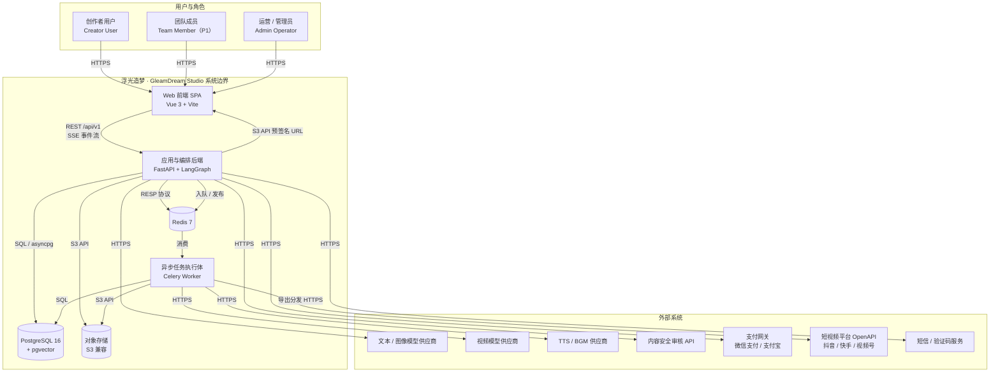

**边界说明**

- 用户仅通过浏览器访问系统，所有生成与调度在服务端完成；前端不直连模型供应商与数据库。
- 前端通过**预签名 URL**直传/直读 OSS（见 11.4），避免媒体流量穿过应用层带宽瓶颈。
- 模型供应商、审核 API 属**不可控外部依赖**，其故障由降级机制吸收（见 14.3）。
- 支付网关与平台 OpenAPI 的凭据均加密存储，且**全链路走境内节点**（00 契约 Q7）。

---

## 三、逻辑架构分层图（C4 Container）

这是本文档的核心视图。系统自顶向下划分为**七层**：接入层 → 应用层 → 智能体编排层 → Agent 运行时层 → 任务执行层 → 数据层 → 外部适配层。

```mermaid
flowchart TB
    subgraph L0["接入层 Access Layer"]
        CDN["CDN<br/>静态资源与媒体加速"]
        ING["Nginx / K8s Ingress<br/>TLS 终止 / 反向代理 / IP 限流"]
        GW["网关能力集<br/>JWT 校验 / 路由 / 版本 / 幂等 / 限流"]
    end

    subgraph L1["应用层 Application Layer · FastAPI 异步"]
        S_AUTH["auth 认证与身份"]
        S_USER["user 用户与团队"]
        S_BILL["billing 计费与订单"]
        S_PROJ["project 项目与版本"]
        S_SCRIPT["script 剧本"]
        S_ASSET["asset 资产"]
        S_BOARD["storyboard 分镜"]
        S_RENDER["render 生成执行"]
        S_POST["post 后期"]
        S_EXPORT["export 导出分发"]
        S_NOTIF["notification 通知"]
        S_ADMIN["admin 管理后台"]
        S_ORCH["orchestrator 编排入口<br/>图调度 API"]
        S_SSE["realtime SSE 网关"]
    end

    subgraph L2["智能体编排层 Orchestration · LangGraph"]
        MAIN["主图 Main Graph<br/>路由 / 状态机 / 计费守卫 / HITL"]
        SUB_SCRIPT["编剧子图<br/>Script Subgraph"]
        SUB_ASSET["资产子图<br/>Asset Subgraph"]
        SUB_BOARD["分镜子图<br/>Storyboard Subgraph"]
        SUB_RENDER["渲染子图<br/>Render Subgraph"]
        SUB_POST["后期子图<br/>Post Subgraph"]
        SUB_DIST["发行子图<br/>Distribution Subgraph"]
        CP[("Postgres Checkpointer<br/>checkpoints 三表")]
    end

    subgraph L3["Agent 运行时层 Runtime · DeepAgents"]
        AG_SCREEN["编剧 Agent<br/>Screenwriter"]
        AG_PARSER["解析 Agent<br/>Parser"]
        AG_ART["美术 Agent<br/>ArtDirector"]
        AG_DIRECT["导演 Agent<br/>Director + 子代理"]
        AG_PROD["制片 Agent<br/>Producer"]
        AG_QC["质检 Agent<br/>QC"]
        AG_COMP["审核 Agent<br/>Compliance"]
        AG_POST["后期 Agent<br/>Post"]
        AG_DIST["发行 Agent<br/>Distributor"]
        VFS[("虚拟文件系统 Virtual FS<br/>/project/ 工作区 · project_files 索引")]
    end

    subgraph L4["任务执行层 Task Layer · Celery"]
        Q_TEXT["q_text 文本队列"]
        Q_IMAGE["q_image 图像队列"]
        Q_VIDEO["q_video 视频队列"]
        Q_AUDIO["q_audio 音频队列"]
        Q_COMPOSE["q_compose 合成队列"]
        Q_MAINT["q_maintenance 维护队列"]
    end

    subgraph L5["数据层 Data Layer"]
        PGDB[("PostgreSQL 16 + pgvector")]
        REDIS[("Redis 7<br/>缓存 / 锁 / 限流 / Pub-Sub / Broker")]
        OBJ[("对象存储 S3<br/>媒体 / 快照 / 导出")]
    end

    subgraph L6["外部适配层 Adapter Layer"]
        AD_LLM["模型网关 Model Gateway<br/>能力抽象 / 路由 / 降级 / 记账"]
        AD_CSP["内容安全审核适配"]
        AD_PAY["支付网关适配"]
        AD_PLAT["平台分发适配"]
        AD_SMS["短信服务适配"]
    end

    CDN --> ING --> GW
    GW -->|"HTTP"| S_AUTH
    GW -->|"HTTP"| S_USER
    GW -->|"HTTP"| S_BILL
    GW -->|"HTTP"| S_PROJ
    GW -->|"HTTP"| S_SCRIPT
    GW -->|"HTTP"| S_ASSET
    GW -->|"HTTP"| S_BOARD
    GW -->|"HTTP"| S_RENDER
    GW -->|"HTTP"| S_POST
    GW -->|"HTTP"| S_EXPORT
    GW -->|"HTTP"| S_NOTIF
    GW -->|"HTTP"| S_ADMIN
    GW -->|"HTTP"| S_SSE

    S_ORCH -->|"invoke / resume"| MAIN
    S_SSE -->|"SUBSCRIBE"| REDIS

    MAIN -->|"StateGraph 嵌套"| SUB_SCRIPT
    MAIN -->|"StateGraph 嵌套"| SUB_ASSET
    MAIN -->|"StateGraph 嵌套"| SUB_BOARD
    MAIN -->|"StateGraph 嵌套"| SUB_RENDER
    MAIN -->|"StateGraph 嵌套"| SUB_POST
    MAIN -->|"StateGraph 嵌套"| SUB_DIST
    MAIN -->|"checkpoint 读写"| CP

    SUB_SCRIPT -->|"create_deep_agent"| AG_SCREEN
    SUB_SCRIPT -->|"create_deep_agent"| AG_PARSER
    SUB_ASSET -->|"create_deep_agent"| AG_ART
    SUB_BOARD -->|"create_deep_agent"| AG_DIRECT
    SUB_RENDER -->|"create_deep_agent"| AG_PROD
    SUB_RENDER -->|"create_deep_agent"| AG_QC
    SUB_POST -->|"create_deep_agent"| AG_POST
    SUB_DIST -->|"create_deep_agent"| AG_DIST
    SUB_SCRIPT -->|"create_deep_agent"| AG_COMP
    AG_SCREEN -->|"读写"| VFS
    AG_ART -->|"读写"| VFS
    AG_DIRECT -->|"读写"| VFS
    AG_POST -->|"读写"| VFS

    S_RENDER -->|"delay 入队"| Q_VIDEO
    S_POST -->|"delay 入队"| Q_COMPOSE
    MAIN -->|"确定性节点入队"| Q_IMAGE
    MAIN -->|"确定性节点入队"| Q_TEXT
    MAIN -->|"确定性节点入队"| Q_AUDIO

    Q_TEXT -->|"消费"| AG_LLM_CALL["任务执行：模型调用"]
    Q_IMAGE --> AG_LLM_CALL
    Q_VIDEO --> AG_LLM_CALL
    Q_AUDIO --> AG_LLM_CALL
    Q_COMPOSE -->|"消费"| FFMPEG["任务执行：媒体合成"]
    Q_MAINT -->|"消费"| MAINT_JOB["计划任务：对账 / 解冻 / 归档"]

    AG_LLM_CALL --> AD_LLM
    FFMPEG --> OBJ
    MAINT_JOB --> REDIS

    S_AUTH -->|"SQL"| PGDB
    S_BILL -->|"SQL + 事务"| PGDB
    S_PROJ -->|"SQL"| PGDB
    S_ASSET -->|"SQL"| PGDB
    S_BOARD -->|"SQL"| PGDB
    S_ORCH -->|"SQL"| PGDB
    S_SSE -->|"SQL"| PGDB

    MAIN -->|"SQL"| PGDB
    AG_QC -->|"SQL 写质检"| PGDB
    VFS -->|"SQL 索引"| PGDB

    S_BILL -->|"RESP"| REDIS
    MAIN -->|"RESP 分布式锁"| REDIS
    S_ASSET -->|"S3 API"| OBJ
    S_EXPORT -->|"S3 API"| OBJ
    S_ASSET -->|"SQL 向量检索"| PGDB

    AD_LLM -->|"HTTPS"| EXT_MODEL["模型供应商"]
    AG_COMP -->|"调审核"| AD_CSP
    S_BILL -->|"调支付"| AD_PAY
    S_EXPORT -->|"调平台"| AD_PLAT
    S_AUTH -->|"调短信"| AD_SMS
```

**各容器职责与协议一览**

| 层 | 容器 | 技术栈 | 职责 | 对外协议 |
|---|---|---|---|---|
| 接入层 | CDN | 云 CDN | 静态资源与媒体分发加速 | HTTPS |
| 接入层 | Nginx / Ingress | Nginx / K8s Ingress | TLS 终止、反向代理、IP 层限流 | HTTPS |
| 接入层 | 网关能力集 | FastAPI 中间件 | JWT 校验、路由、版本、幂等、令牌桶限流 | HTTP |
| 应用层 | auth/user/billing/project/script/asset/storyboard/render/post/export/notification/admin | FastAPI + SQLAlchemy 2.0 | 各业务域 REST 服务（详见第四章） | HTTP（JSON） |
| 应用层 | orchestrator | FastAPI + LangGraph Client | 触发/恢复图、HITL 审批接口 | HTTP |
| 应用层 | realtime SSE | FastAPI + sse-starlette | 连接管理、事件推送、补偿 | SSE |
| 编排层 | 主图 + 6 子图 | LangGraph `StateGraph` | 状态机、路由、HITL、计费守卫 | 进程内 + SQL |
| 编排层 | Checkpointer | LangGraph Postgres Saver | 图状态快照 | SQL |
| 运行时层 | 9 个 Agent | DeepAgents `create_deep_agent` | LLM 专职执行 | 进程内 + 模型网关 |
| 运行时层 | 虚拟文件系统 | 对象存储 + `project_files` | Agent 间产物交换 | S3 API + SQL |
| 任务层 | 6 个 Celery 队列 | Celery 5.4 + Redis | 长任务执行 | Redis 协议 |
| 数据层 | PG/pgvector | PostgreSQL 16 | 结构化数据 + 向量检索 | SQL |
| 数据层 | Redis | Redis 7 | 缓存/锁/限流/Pub-Sub/Broker | RESP |
| 数据层 | OSS | S3 兼容 | 媒体与导出文件 | S3 API |
| 适配层 | 模型网关 | FastAPI 内部模块 / SDK | 能力抽象、路由、降级、记账 | HTTPS（对内 HTTP） |
| 适配层 | 审核/支付/平台/短信适配 | 适配器模式 | 三方集成隔离 | HTTPS |

---

## 四、模块划分（FastAPI 应用层）

应用层按业务域（对应 00 契约十大业务域）划分为 13 个模块，每个模块遵循「Router → Service → Repository」三层结构，跨模块调用只经 Service 层公共接口，禁止直接跨模块访问对方 Repository。

| 模块 | 对应业务域 | 主要职责 | 关键对外接口 | 依赖模块 |
|---|---|---|---|---|
| `auth` | IAM | 手机号/三方登录、JWT 签发与刷新、风控频控 | `/api/v1/auth/*` | user、notification |
| `user` | IAM | 用户资料、团队、成员、项目级授权（view/edit/export） | `/api/v1/users`、`/api/v1/teams` | auth、audit |
| `billing` | Billing | 积分账户、冻结/结算/返还、订单、支付回调、套餐权益 | `/api/v1/credit-accounts`、`/api/v1/orders`、`/api/v1/payments/callback` | user、audit |
| `project` | Project | 项目 CRUD、状态机、快照、回滚、虚拟文件索引 | `/api/v1/projects` | billing、orchestrator |
| `script` | Script | 文档上传解析、剧本结构、集/场/台词、HITL 剧本确认 | `/api/v1/projects/{id}/scripts` | orchestrator、asset |
| `asset` | Asset | 角色/场景/道具/音色、三视图、锚点、人脸授权 | `/api/v1/assets`、`/api/v1/projects/{id}/assets` | render、billing |
| `storyboard` | Storyboard | 分镜板、镜头、版本、画布布局、草稿模式 | `/api/v1/projects/{id}/storyboards` | asset、render |
| `render` | Render | 渲染任务、模型注册/路由、产物、调用日志 | `/api/v1/render-tasks` | billing、asset、gateway |
| `post` | Post | 时间线、片段、字幕样式、BGM、合成 | `/api/v1/projects/{id}/timelines` | render、billing |
| `export` | Distribution | 导出任务、平台授权、分发记录、元数据 | `/api/v1/export-jobs` | billing、user、gateway |
| `notification` | Collaboration | 站内通知、待办、SSE 事件分发 | `/api/v1/notifications` | realtime |
| `admin` | 全域 | 配置中心、敏感词库、模型注册维护、审计查询 | `/api/v1/admin/*` | 全域只读 |
| `orchestrator` | Collaboration | 图触发/恢复、HITL 审批、Agent 运行查询 | `/api/v1/orchestration/*` | project、billing |

**跨切面组件（横切模块）**

| 组件 | 职责 |
|---|---|
| `core.security` | JWT 解析、ACL 校验器（供 Rest 与 Agent 工具共用） |
| `core.idempotency` | `Idempotency-Key` 请求头与节点幂等键的统一校验 |
| `core.tracing` | OpenTelemetry 上下文注入、trace_id/request_id 生成 |
| `core.errors` | 统一响应包络与错误码段映射（00 契约 8.3） |
| `core.ratelimit` | Redis 令牌桶限流（按用户/套餐并发数） |
| `infra.model_gateway` | 模型网关客户端（见第八章） |
| `infra.storage` | OSS 预签名 URL、生命周期管理 |
| `infra.db` / `infra.redis` | AsyncSession 工厂、Redis 连接池 |

**模块依赖规则**

- 严格单向依赖，禁止循环依赖；`admin` 对全域为只读依赖。
- 计费相关写操作**只允许** `billing` 模块执行，其他模块一律通过 `billing` 的 Service 接口申请冻结/结算。
- `orchestrator` 是唯一允许直接持有 LangGraph 图对象的模块，其他模块不得绕过它触发图。

---

## 五、LangGraph 编排架构

### 5.1 编排总体设计

- **编排器（Orchestrator）不是 LLM**，是 LangGraph 图本体，负责路由、状态机、中断、计费守卫、ACL 守卫。
- **确定性节点**（纯代码）：路由、计费预检/结算/返还、Schema 校验、ACL、导出参数、任务入队。
- **LLM 节点**（DeepAgents）：编剧、解析、美术、导演（含子代理）、制片、质检、审核、后期、发行。
- **状态契约**：主图 State 即 PRD V2 的 `ProjectState`（见 5.2），字段命名保持 `snake_case`。
- **持久化**：LangGraph Postgres Checkpointer，落 `checkpoints` / `checkpoint_blobs` / `checkpoint_writes`（框架管理 3 表），每步自动快照，支持断点续跑与版本回滚。

### 5.2 主图（Main Graph）

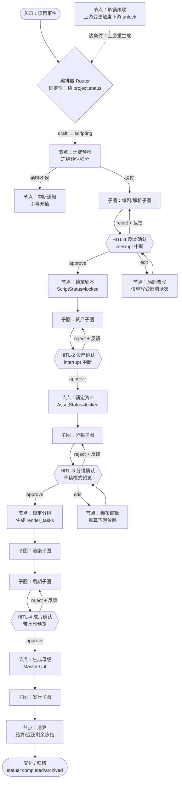

**主图关键节点**

| 节点 | 类型 | 说明 |
|---|---|---|
| `router` | 确定性 | 依据 `project.status` 与用户操作路由到对应子图 |
| `billing_precheck` | 确定性 | 校验 `credit_spent + estimated_cost ≤ budget`，否则中断 |
| `billing_settle` / `billing_refund` | 确定性 | 成功结算、失败/审核拒绝返还 |
| `schema_validate` | 确定性 | 按输出契约 JSON Schema 校验，非法打回 Agent 自修 |
| `acl_guard` | 确定性 | Agent 工具调用前的权限校验，越权写 `audit_logs` |
| `hitl_script/asset/storyboard/final` | 中断 | 四个 `interrupt()` 断点 |
| `lock_*` | 确定性 | 状态置 `locked`，触发下游解锁/重算 |
| `unlock_cascade` | 确定性 | 上游变更时级联解锁下游受影响单元 |

### 5.3 六条子图

**5.3.1 编剧 / 解析子图**

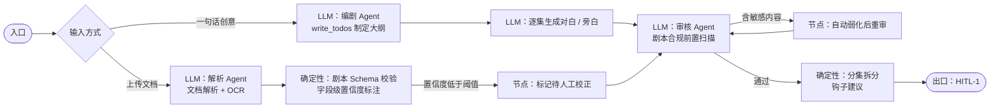

**5.3.2 资产子图**

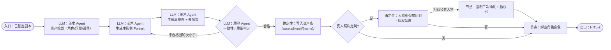

**5.3.3 分镜子图**

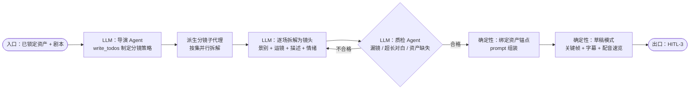

**5.3.4 渲染子图**

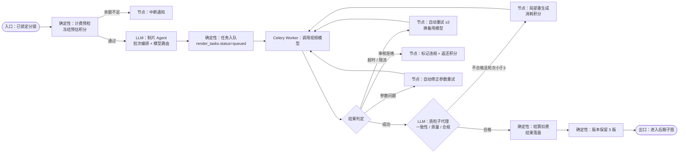

**5.3.5 后期子图**

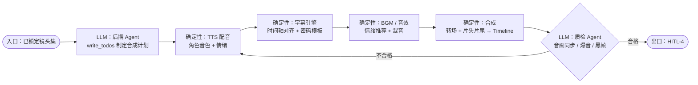

**5.3.6 发行子图**

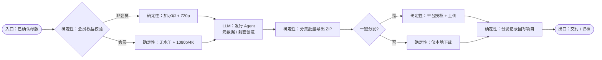

### 5.4 循环边与中断边

| 循环/中断 | 位置 | 边条件 | 上限 |
|---|---|---|---|
| 质检重生成 | 资产/分镜/渲染/后期子图 | `qc.passed == false && retries < 3` | 3 轮，超限转 `manual_required` |
| HITL 驳回 | 主图四处 | `human_decision == "reject"` | 无硬上限，受审批单 7 天过期限制 |
| HITL 编辑 | 剧本/分镜 | `human_decision == "edit"` | 局部重写，避免全量重跑 |
| 解锁级联 | 主图 | 上游产物版本变更 | 一次级联，防震荡 |
| 模型重试 | 渲染子图 | `failure_type in (timeout, rate_limited)` | ≤ 2 次，换备用模型 |

### 5.5 Checkpointer 持久化策略

- **写时机**：每个节点执行完毕自动 checkpoint（`thread_id = project_id`），HITL `interrupt()` 前强制持久化。
- **恢复**：进程崩溃或服务重启后，按 `thread_id` 恢复最新 checkpoint，仅重跑未完成节点。
- **回滚**：项目快照 = 指定 `checkpoint_id` 的副本；上限 30 个（00 契约术语表·快照）。
- **清理**：`completed`/`archived` 项目的 checkpoint 保留 90 天后归档回收【假设待确认】。

---

## 六、Agent 运行时架构（DeepAgents）

### 6.1 虚拟文件系统目录规范

虚拟文件系统是**Agent 之间唯一的产物交换介质**（P2 原则），落库索引为 `project_files`，物理文件存 OSS。

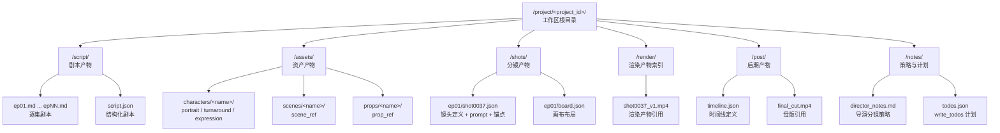

**目录规范约束**

| 规则 | 说明 |
|---|---|
| 路径大小写 | 全小写 + 下划线，禁止中文拼音以外的特殊字符 |
| 命名对齐 | `/script/ep{n}.md`、`/shots/ep{n}/shot{4位序号}.json`（与 00 契约 4.4 一致） |
| 索引落库 | 每次写入同步登记 `project_files`（路径、etag、尺寸、哈希、归属节点） |
| 大文件 | 媒体文件实体在 OSS，工作区仅持引用与元数据 |
| 只读保护 | `locked` 后对应目录内容只读，修改须先 `unlock` |

### 6.2 Agent 间交换介质与子代理派生

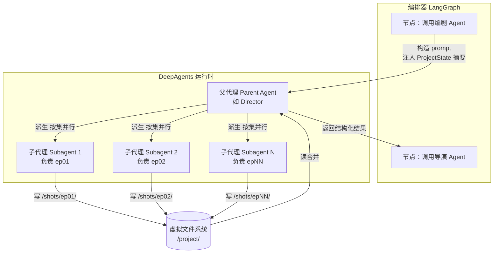

**子代理派生规则**

| 规则 | 说明 |
|---|---|
| 派生主体 | 仅导演 Agent（按集）与制片 Agent（按镜头质检）允许派生子代理 |
| 并行度 | ≤ 单项目集数上限（30），实际并行度受 Celery 并发与模型配额约束 |
| 写冲突 | 子代理只写各自负责的子目录，父代理负责合并与去重（场次边界重叠检测） |
| 生命周期 | 子代理为一次性执行体，任务完成即销毁，不跨节点复用 |
| 失败隔离 | 单个子代理失败不阻塞其余，失败单元进入重试或 `manual_required` |

### 6.3 上下文压缩策略

| 场景 | 策略 |
|---|---|
| 10 万字剧本解析 | Parser 只把结构化结果写入 `/script/script.json`，后续 Agent 按需分段读取，不整本携带 |
| 多集分镜 | 导演 Agent 每集只加载该集剧本 + 资产清单，跨集仅共享 `/notes/director_notes.md` 策略 |
| 长对话历史 | 按「系统提示词五段式」（PRD V2 附录 B）重建上下文，丢弃原始 token 历史 |
| 质检循环 | 携带最近一轮质检报告，丢弃更早轮次的完整输出，仅保留结论摘要 |

### 6.4 输出契约校验位置

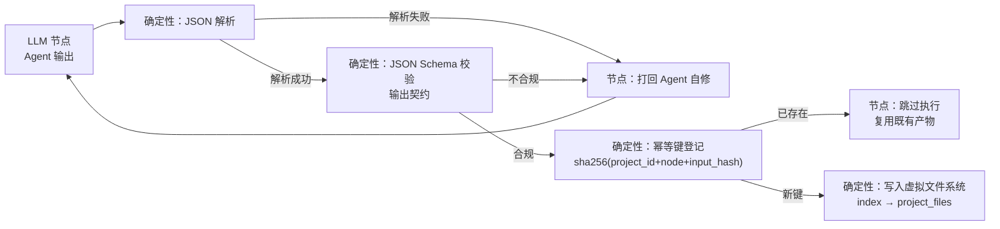

- 校验位置固定于**LLM 节点下游的确定性校验节点**，非法输出**不进入人工环节**，直接打回 Agent 自修。
- 校验通过后立即登记幂等键，保证同输入重跑不重复扣费、不重复生成。

### 6.5 Agent 与编排层的职责边界

| 事项 | 编排器（LangGraph） | Agent（DeepAgents） |
|---|---|---|
| 状态流转 | 负责 | 不接触 |
| 计费冻结/结算 | 负责（ADR-06） | 只上报 `estimated_cost` |
| 模型路由决策 | 负责（ADR-07，确定性查表） | 只给策略建议 |
| ACL 校验 | 负责（工具调用前校验） | 调用前被校验 |
| 内容创作 | 不参与 | 负责 |
| 输出契约 | 校验 | 生成 |

---

## 七、任务队列与并发模型

### 7.1 队列划分

采用 Celery 5.4 + Redis Broker（ADR-01，**不引入 Kafka**），按任务资源特性划分 6 个队列，避免长视频任务阻塞短文本任务。

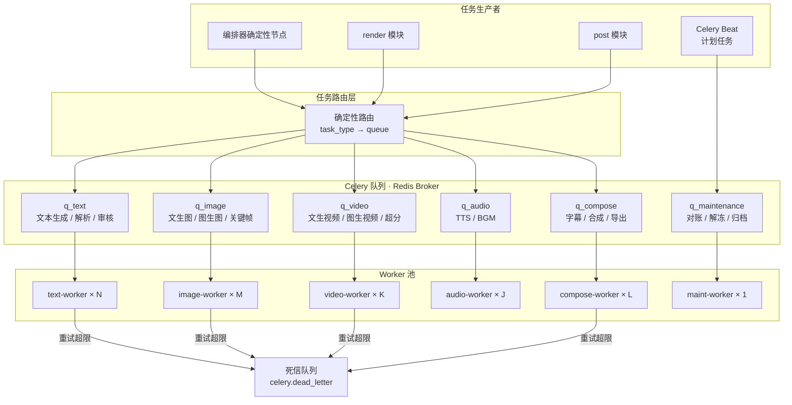

### 7.2 队列与任务类型映射

| 队列 | 覆盖 `render_tasks.task_type` | 典型耗时 | 优先级 |
|---|---|---|---|
| `q_text` | 文本类（编剧/解析/审核，走 LLM） | 秒级 ~ 分钟级 | 高 |
| `q_image` | `text_to_image` / `image_to_image` | 10–60 秒 | 中高 |
| `q_video` | `text_to_video` / `image_to_video` / `upscale` | 1–10 分钟 | 中 |
| `q_audio` | `tts` / `bgm` | 10–60 秒 | 中高 |
| `q_compose` | `subtitle` / `compose` | 1–5 分钟 | 中 |
| `q_maintenance` | 对账、冻结解冻、归档（计划任务） | 不定 | 低 |

### 7.3 优先级策略

- Celery 优先级 0（最高）~ 9（最低）。**投影优先级**：用户当前前台查看的集/镜头任务优先。
- 「先出每集前 3 镜」策略（PRD V2 F5.2）通过动态权重实现：`priority = base - front_shot_bonus`。
- 同一项目内按镜头序号升序，保证时间线连续呈现。
- 队列级隔离：`q_maintenance` 使用独立 worker，避免影响用户任务。

### 7.4 并发度配置【假设待确认】

| 队列 | 建议 worker 数 | 单 worker 并发 | 依据 |
|---|---|---|---|
| `q_text` | 2 | 8 | LLM 调用为主，IO 密集 |
| `q_image` | 4 | 4 | 图像 API 配额受限 |
| `q_video` | 10 | 4 | 视频 API 配额与成本双约束 |
| `q_audio` | 3 | 6 | TTS 并发稳定 |
| `q_compose` | 4 | 2 | CPU/IO 密集（FFmpeg） |
| `q_maintenance` | 1 | 2 | 低频 |

> 实际并发度由**模型供应商配额**与**单用户并发上限**（free 2 / pro 5 / studio 10）共同决定，上表为 MVP 建议起点，需压测后校准。

### 7.5 限流：Redis 令牌桶

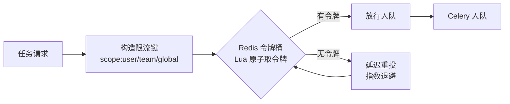

- **三级限流键**：`rl:user:{user_id}`（套餐并发数）、`rl:model:{model_key}`（供应商配额）、`rl:global`（平台保护）。
- **原子性**：令牌桶用 Lua 脚本在 Redis 单线程内原子执行，避免并发超发。
- **限流响应**：触发时返回 429（00 契约 8.1），任务侧延迟重投不报错。

### 7.6 幂等、重试与死信

| 机制 | 实现 |
|---|---|
| 幂等 | 任务入队前登记 `idempotency_keys`（`sha256(project_id + node_name + input_hash)`）；worker 执行前二次校验，命中即复用产物 |
| 自动重试 | `self.retry(max_retries=2, countdown=exponential_backoff)`；仅对 `timeout` / `rate_limited` / `model_unavailable` 重试 |
| 换模型重试 | 重试时按路由表切备用模型（`failure_type` 驱动） |
| 不重试 | `moderation_rejected` / `param_invalid` 直接终止并返还积分 |
| 死信 | 超过重试上限进入 `celery.dead_letter`，`render_tasks.status = manual_required`，推 SSE 通知 |
| 可见性 | 任务状态写入 `render_tasks` 并推 SSE，用户可见 |

---

## 八、模型网关（Model Gateway）架构

### 8.1 设计目标

模型网关是**统一适配层**，屏蔽各供应商 API 差异，为上层提供能力抽象、确定性路由、降级熔断、成本记账、调用日志。

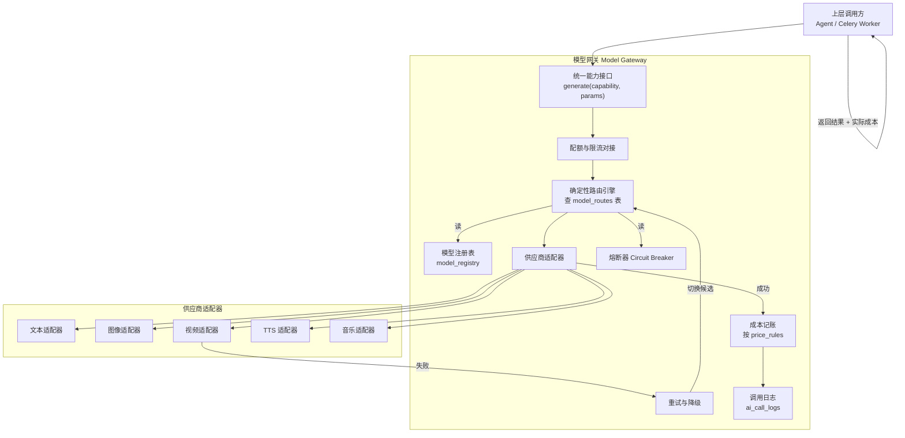

### 8.2 能力抽象

| 能力（capability） | 对应 `render_tasks.task_type` | 输入 | 输出 |
|---|---|---|---|
| `text` | 文本类 | prompt + 上下文 | 文本 / JSON |
| `image` | `text_to_image` / `image_to_image` | prompt + 条件图（锚点） | 图像 URL |
| `video` | `text_to_video` / `image_to_video` / `upscale` | prompt + 首帧 + 运镜 | 视频 URL |
| `tts` | `tts` | 文本 + 音色 + 情绪 | 音频 URL |
| `music` | `bgm` | 情绪标签 + 时长 | 音频 URL |

### 8.3 确定性路由决策（伪代码）

```python
def route(capability: str, ctx: RouteContext) -> ModelSpec:
    # 1. 用户锁定模型优先（用户显式指定则直接用）
    if ctx.user_locked_model and is_available(ctx.user_locked_model):
        return ctx.user_locked_model

    # 2. 查表：model_routes 给出候选模型优先级列表（确定性，非 LLM 决策）
    candidates = load_routes(capability, ctx.project.style_preset_key)

    # 3. 过滤：能力匹配 + 熔断器为闭 + 未超配额 + 满足时长/分辨率约束
    healthy = [m for m in candidates
               if registry[m].supports(capability)
               and not breaker[m].is_open()
               and not quota[m].exceeded()
               and registry[m].satisfies(ctx.constraints)]

    if not healthy:
        raise ModelUnavailable("80001")   # 触发上层降级

    # 4. 排序：确定性打分 = 质量分权重 - 价格权重 - 排队时长权重
    #    （权重来自 model_routes.route_weights，业务可配置）
    scored = sorted(
        healthy,
        key=lambda m: (
            ctx.w_quality * registry[m].quality_score
            - ctx.w_price * unit_price(m, ctx)
            - ctx.w_latency * queue_latency(m)
        ),
        reverse=True,
    )
    return scored[0]   # 返回首选模型


def call(capability: str, params: dict, ctx: RouteContext) -> Result:
    spec = route(capability, ctx)
    record_call_start(spec, params)          # 写 ai_call_logs（含 trace_id）
    try:
        result = adapter[spec.provider].invoke(spec, params)
        breaker[spec].record_success()
        cost = billing.compute_cost(spec, result.usage)   # 按 price_rules 计价
        log_call(spec, result, cost)          # token / 时长 / 成本 / trace_id
        return Result(data=result, cost=cost, model=spec.key)
    except ProviderError as e:
        breaker[spec].record_failure()
        if e.retryable and ctx.retry_left > 0:
            ctx.retry_left -= 1
            return call(capability, params, ctx.with_next_candidate())  # 降级切换
        log_call_failure(spec, e)
        raise
```

> 路由为**确定性查表 + 打分排序**（ADR-07），LLM 只提供策略建议，不参与选择。

### 8.4 降级与熔断

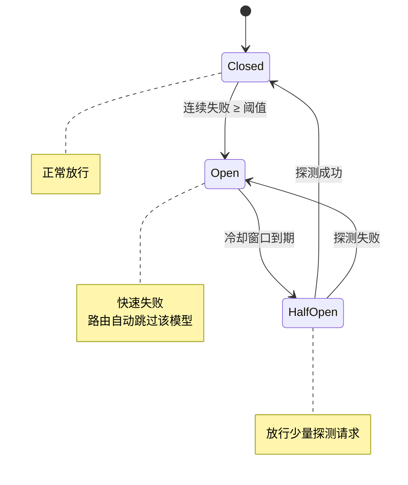

| 机制 | 说明 |
|---|---|
| 熔断器粒度 | 按 `model_registry` 中的模型 key 独立计数 |
| 熔断阈值 | 连续失败 ≥ 5 次或失败率 ≥ 50%（滑动窗口）【假设待确认】 |
| 冷却窗口 | 60 秒后进入 Half-Open 探测【假设待确认】 |
| 降级顺序 | 候选模型 → 同能力降规格模型 → 上报 80001 触发上层挂起/通知 |
| 全部不可用 | 整体挂起，冻结积分不解冻，推通知直至恢复或用户取消（PRD V2 F5.4） |

### 8.5 成本记账与调用日志

- **计价来源**：`price_rules` 表（模型、能力、单位、单价）。
- **记账字段**：`ai_call_logs` 记录 token / 时长 / 成本 / `trace_id` / 模型 key / 能力 / 成败。
- **结算依据**：渲染子图结算节点按 `ai_call_logs` 实际成本汇总结算，确保「实际与预估偏差 ≤ 15%」可归因。
- **对账**：`q_maintenance` 每日对账任务核对模型账单与本地记账差异。

---

## 九、实时通道架构（SSE）

### 9.1 通道设计

| 通道 | 协议 | 端点 | 用途 |
|---|---|---|---|
| 项目事件流 | SSE | `/api/v1/projects/{project_id}/events` | 生成进度、任务状态、审批待办推送 |
| 通知流 | SSE | `/api/v1/notifications/stream` | 站内通知（P1） |
| 画布协同 | WebSocket | 暂不实现（P2） | 多人同时编辑分镜画布 |

### 9.2 实时推送架构

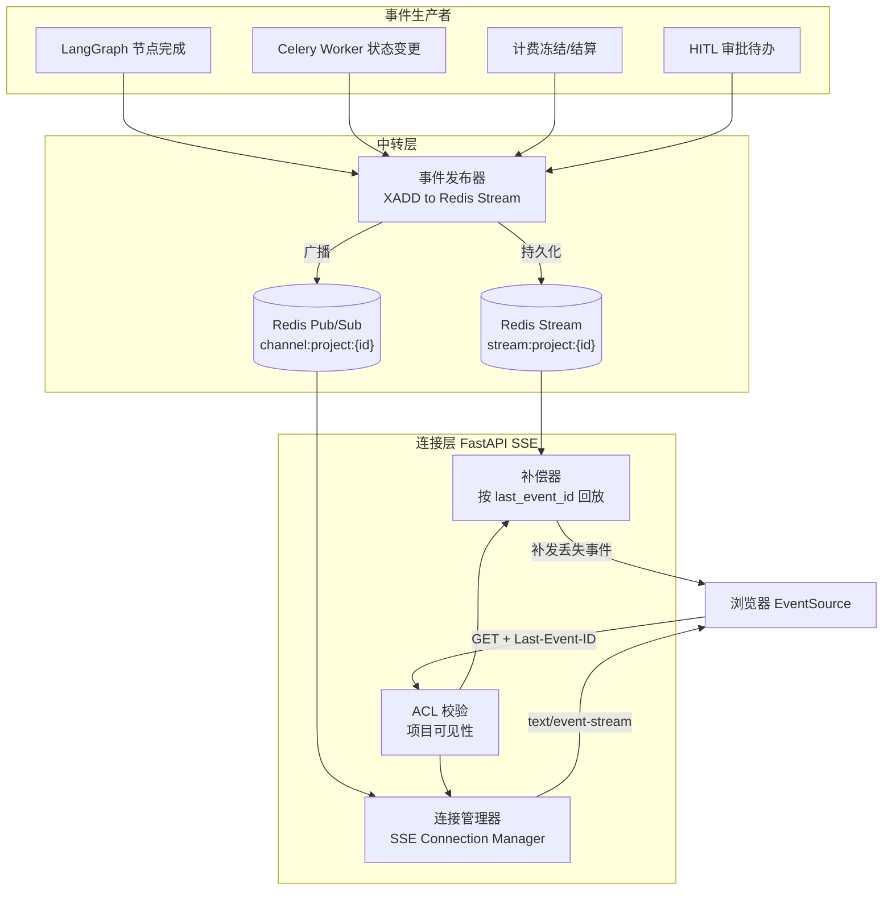

### 9.3 连接管理与断线重连

| 要点 | 方案 |
|---|---|
| 连接建立 | 前端 `EventSource`，携带 JWT（Cookie 或 query token），网关校验 ACL 后建连 |
| 事件编号 | 事件 `id` 采用 ULID（单调），与 `request_id` 规范一致 |
| 中转选型 | **持久化用 Redis Stream**（支持 `XREAD` 回放），**广播用 Pub/Sub**（低延迟）；双写保证「不丢 + 快」 |
| 断线重连 | 浏览器自动重连并携带 `Last-Event-ID`；服务端从 Stream 回放该 id 之后的事件（补偿） |
| 心跳 | 每 15 秒发送注释行 `: ping`，防代理层断连【假设待确认】 |
| 连接上限 | 单实例连接数上限受 FD 约束，超限水平扩容（无状态） |
| 多实例 | 通过 Redis Pub/Sub 使任一实例均可推送，连接不绑定实例 |

### 9.4 事件补偿时序

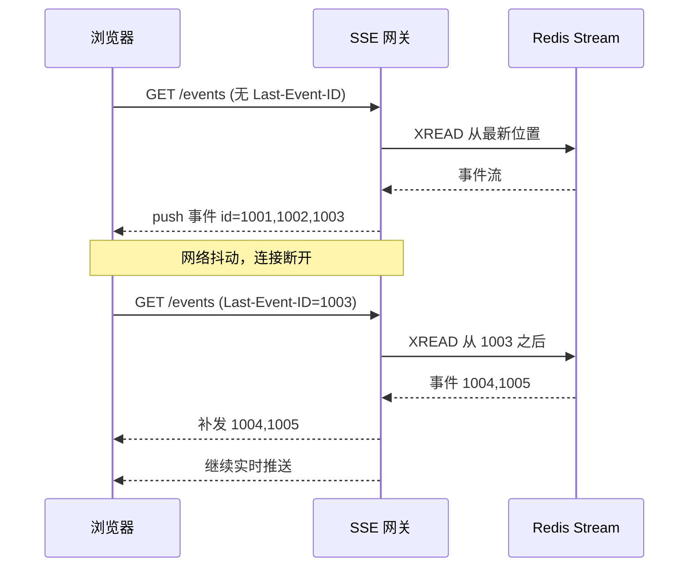

---

## 十、计费与配额在架构中的位置

### 10.1 冻结-结算模型

计费是**确定性节点**（ADR-06），置于消耗型子图入口与出口：

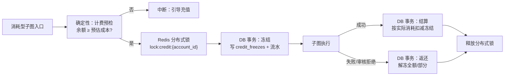

### 10.2 并发不透支保证

| 层次 | 手段 |
|---|---|
| 应用层 | 单用户并发上限（free 2 / pro 5 / studio 10）由令牌桶限流保障 |
| 账户层 | **Redis 分布式锁** `lock:credit:{account_id}` 串行化同一账户的冻结操作 |
| 数据层 | **DB 事务**内 `SELECT ... FOR UPDATE` 锁定 `credit_accounts` 行，校验 `available = balance - frozen ≥ estimated_cost` 后更新 `frozen_credits` |
| 幂等层 | 冻结操作绑定节点幂等键，重跑不重复冻结 |
| 兜底 | 冻结额上限 = 账户余额；同一项目同任务 hash 去重（PRD V2 F1.4） |

> **锁 + 事务双保险**：分布式锁防跨实例并发，DB 行锁防同实例并发与锁失效，二者叠加确保不透支。

### 10.3 冻结超时解冻

- **超时时限**：30 分钟（00 契约 `credit_freezes` 说明）。
- **执行者**：Celery Beat 定时任务，投递至 `q_maintenance`。
- **扫描策略**：每 5 分钟扫描 `credit_freezes` 中 `status = frozen` 且 `frozen_at < now() - 30min` 的记录。
- **处理**：事务内解冻、写 `credit_transactions`（`transaction_type = unfreeze`）、更新账户 `frozen_credits`、推 SSE 通知。
- **补偿**：解冻前二次确认对应任务是否已进入终态，避免误解冻执行中任务。

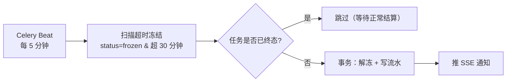

### 10.4 支付回调幂等入账（详见 15.3 时序图）

- **幂等键**：`payments.out_trade_no` 唯一索引。
- 重复回调：命中唯一约束即丢弃并返回成功（00 契约 8.4）。
- 到账：事务内更新 `payments.status = success`、写 `credit_transactions`（`recharge`）、更新账户余额与 `orders.status`。

---

## 十一、存储架构

### 11.1 数据分类（热 / 温 / 冷）

```mermaid
flowchart TB
    subgraph HOT["热数据 · 高频读写"]
        H1["用户 / 会话 / 权限"]
        H2["项目当前状态 / 镜头当前版本"]
        H3["积分账户 / 冻结"]
        H4["缓存 / 锁 / 限流"]
    end
    subgraph WARM["温数据 · 中频读取"]
        W1["剧本 / 资产元数据"]
        W2["渲染任务 / 质检报告"]
        W3["审批单 / 操作日志"]
    end
    subgraph COLD["冷数据 · 低频归档"]
        C1["历史快照 / 历史镜头版本"]
        C2["审计日志 / 调用日志"]
        C3["成片母版 / 导出文件"]
    end
    HOT -->|"PG 主表 + Redis"| PG[("PostgreSQL")]
    WARM -->|"PG 主表"| PG
    COLD -->|"OSS + PG 分区"| OSS[("对象存储")]
    HOT -->|"选"| REDIS[("Redis")]
```

| 分类 | 存储介质 | 保留策略 |
|---|---|---|
| 热 | PG 主表 + Redis 缓存 | 常驻 |
| 温 | PG 主表 | 常驻，索引优化 |
| 冷 | OSS（媒体）+ PG 分区表（日志） | 分级归档 |

### 11.2 PostgreSQL 分区与归档

| 表 | 分区键 | 分区方式 | 归档策略 |
|---|---|---|---|
| `ai_call_logs` | `created_at` | 按月 RANGE 分区 | 保留 6 个月热，之后转冷【假设待确认】 |
| `credit_transactions` | `created_at` | 按月 RANGE 分区 | 只追加，永久保留（账本不可变） |
| `operation_logs` | `created_at` | 按月 RANGE 分区 | 保留 12 个月【假设待确认】 |
| `audit_logs` | `created_at` | 按月 RANGE 分区 | 永久保留（合规要求） |
| `checkpoints`（框架表） | 由库管理 | 不变更 | `archived` 项目 90 天后归档 |

> 分区以应用层维护（`system_configs` 驱动），使用 `CREATE TABLE ... PARTITION OF`，不引入额外扩展。

### 11.3 Redis key 命名空间与 TTL

| 命名空间 | 用途 | 示例 | TTL |
|---|---|---|---|
| `cache:` | 读缓存 | `cache:project:{id}:state` | 5–30 分钟 |
| `lock:` | 分布式锁 | `lock:credit:{account_id}` | 30 秒（自动续期） |
| `rl:` | 令牌桶限流 | `rl:user:{user_id}` | 与窗口同步 |
| `stream:` | SSE 事件流 | `stream:project:{id}` | 24 小时 |
| `channel:` | Pub/Sub 频道 | `channel:project:{id}` | 无（瞬时） |
| `broker:` | Celery Broker | Celery 内部命名 | Celery 管理 |
| `sess:` | 会话/临时态 | `sess:upload:{token}` | 15 分钟 |

- 所有 key 前缀统一注册于 `core.redis.constants`，禁止散落硬编码。
- 无 TTL 的 key 必须在评审中显式说明原因，防止内存泄漏。

### 11.4 OSS 路径规范与生命周期

```mermaid
flowchart TB
    BUCKET["bucket: gleamdream-media"] --> P1["/projects/{project_id}/"]
    BUCKET --> P2["/assets/{asset_id}/"]
    BUCKET --> P3["/users/{user_id}/uploads/"]
    BUCKET --> P4["/temp/"]
    P1 --> P1A["/script/"]
    P1 --> P1B["/shots/{ep}/v{n}/"]
    P1 --> P1C["/render/{shot_id}/"]
    P1 --> P1D["/post/"]
    P1 --> P1E["/export/"]
    P2 --> P2A["/portrait/"]
    P2 --> P2B["/turnaround/"]
    P2 --> P2C["/expression/"]
```

| 目录 | 内容 | 生命周期规则 |
|---|---|---|
| `/temp/` | 上传中转、临时处理文件 | 7 天自动删除 |
| `/projects/{id}/render/` | 渲染中间产物 | 30 天后转低频存储 |
| `/projects/{id}/export/` | 导出文件 | 永久（用户可删） |
| `/assets/{id}/` | 资产图（跨项目复用） | 永久 |
| 历史版本 | 镜头保留 3 版之外 | 转冷存储（PRD V2 F5.7） |

- **CDN 加速**：资产图、预览视频经 CDN 分发；导出母版走 OSS 预签名 URL 直链。
- **直传/直读**：前端通过预签名 URL 直传 OSS，媒体流量不经应用层。

### 11.5 向量库：pgvector 而非独立向量库的理由

| 维度 | pgvector（选用） | 独立向量库（未选用） |
|---|---|---|
| 数据规模 | 人脸向量（`face_embeddings`）与业务表同库，量级可控 | 需独立运维组件 |
| 事务一致性 | 与 `assets` 同事务，避免跨库不一致 | 跨库同步复杂 |
| 运维成本 | 复用 PG 备份/高可用 | 额外集群成本 |
| 检索性能 | IVF/HNSW 索引满足一致性比对（单角色三视图比对） | 大规模 ANN 场景更优 |
| 触发独立化条件 | — | 向量规模超千万或 QPS 超阈值时再评估（见 17.3） |

---

## 十二、安全架构

### 12.1 认证与授权

```mermaid
flowchart TB
    LOGIN["登录"] --> T1["手机号 + 验证码"]
    LOGIN --> T2["微信登录换 unionid"]
    LOGIN --> T3["Apple 登录（预留）"]
    T1 --> ISSUE["签发 JWT"]
    T2 --> ISSUE
    T3 --> ISSUE
    ISSUE --> AT["Access Token<br/>短效 2 小时"]
    ISSUE --> RT["Refresh Token<br/>长效 30 天"]
    AT --> API["API 请求<br/>Authorization: Bearer"]
    API --> VALIDATE{"网关校验 JWT"}
    VALIDATE -->|"过期"| REFRESH["用 Refresh 换新 AT"]
    VALIDATE -->|"有效"| ACL["ACL 校验点"]
    REFRESH --> VALIDATE
```

| 项 | 方案 |
|---|---|
| Access Token | JWT，HS256（或 RS256），有效期 2 小时【假设待确认】 |
| Refresh Token | 长效 30 天，可撤销（Redis 黑名单/白名单） |
| 三方登录 | 微信 unionid/openid 落 `user_identities` |
| 鉴权失败 | 401（未登录/过期）、403（无权限）（00 契约 8.1） |

### 12.2 ACL 校验点

ACL（Access Control List，访问控制列表）在**三处**统一校验，Agent **也走同一 ACL**（00 契约 7.2）：

```mermaid
flowchart LR
    R1["REST 请求"] --> G1["网关/依赖注入层<br/>项目级权限 view/edit/export"]
    G1 --> S1["Service 层二次校验"]
    R2["Agent 工具调用"] --> G2["编排器 ACL 节点<br/>Agent 工具调用前"]
    G2 -->|"越权"| AUDIT["写 audit_logs + 拒绝"]
    R3["导出/分发"] --> G3["确定性节点<br/>校验 export 权限 + 套餐权益"]
```

| 校验点 | 位置 | 校验内容 |
|---|---|---|
| 请求入口 | 网关 + FastAPI 依赖 | 用户身份、项目成员身份、三级权限（view/edit/export） |
| Agent 工具调用 | 编排器 `acl_guard` 节点 | 团队角色 `team_acl`、项目授权；越权拒绝并写 `audit_logs` |
| 敏感操作 | 导出/分发/管理节点 | `export` 权限 + 套餐权益状态位（4K/去水印） |

### 12.3 敏感数据加密与密钥管理

| 数据 | 加密方式 | 密钥来源 |
|---|---|---|
| 平台授权 token（`platform_accounts`） | 对称加密（AES-256-GCM）密文存储 | KMS 主密钥 |
| 支付密钥/证书 | KMS 托管，运行时解密 | KMS |
| 数据库连接串、Redis 密码 | 环境变量分级注入 | 密钥管理平台 |
| 人脸向量（`face_embeddings`） | 应用层不落明文图像，仅存向量 | — |

**密钥分级**

| 级别 | 内容 | 存放 |
|---|---|---|
| L1 | 数据库/Redis 连接凭据 | 环境变量（K8s Secret） |
| L2 | 模型供应商 API Key | 密钥管理平台 / KMS 密文 |
| L3 | 支付密钥、平台 token | KMS 托管，最小权限访问 |
| L4 | KMS 主密钥 | 云 KMS，不落应用 |

### 12.4 内容安全三重审核位置

```mermaid
flowchart LR
    SCRIPT["剧本产物"] --> AU1["审核 1：剧本合规<br/>前置审核（省成本）"]
    AU1 --> GEN["生成流程"]
    GEN --> IMG["画面产物"] --> AU2["审核 2：画面审核<br/>合规扫描"]
    AU2 --> POST["后期合成"]
    POST --> CUT["成片"] --> AU3["审核 3：成片审核<br/>三重把关"]
    AU1 -->|"block"| STOP1["终止 + 明确告知"]
    AU2 -->|"block"| STOP2["标记违规 + 返还积分"]
    AU3 -->|"block"| STOP3["拦截导出"]
```

| 审核关口 | 位置 | 触发时机 | 拦截行为 |
|---|---|---|---|
| 审核 1 | 编剧子图 | 剧本生成后、HITL 前 | 涉政/色情/未成年人/侵权扫描，block 则终止不重试（Q3） |
| 审核 2 | 渲染子图质检 | 每次画面生成后 | 命中则标记 `compliance_flags`、返还积分 |
| 审核 3 | 发行子图前 | 成片生成后、导出前 | block 则禁止导出与分发 |

- **审核结果落库** `moderation_records`（请求/响应快照）、`compliance_flags`（类型/等级/位置/建议）。
- **未成年人题材硬拦截**，不提供绕过重试（Q3）。

### 12.5 真人授权与数据合规

| 项 | 方案 |
|---|---|
| 真人照片授权 | `face_authorizations` 记录授权人、类型（self/authorized_other）、时间戳、IP、协议版本 |
| 公共人物识别 | 人脸比对公共人物库，命中则强制二次确认 + 授权书（PRD V2 F3 S4） |
| 数据出境 | 全部境内存储，模型调用走境内节点（Q7） |
| 越权留痕 | 越权、敏感操作写 `audit_logs`（不可篡改） |

---

## 十三、可观测性架构

### 13.1 trace_id 全链路贯穿

```mermaid
flowchart TB
    FE["前端<br/>生成 request_id (ULID)"] -->|"Header: X-Request-ID"| GW["网关<br/>校验/透传"]
    GW --> API["FastAPI<br/>注入 OTel Span"]
    API --> LG["LangGraph 节点<br/>子 Span"]
    LG --> AGENT["DeepAgent<br/>LLM 调用 Span"]
    LG --> CELERY["Celery 任务<br/>透传 traceparent"]
    CELERY --> MGW["模型网关<br/>记录 ai_call_logs.trace_id"]
    API --> DB[("PG<br/>request_id 落库")]
    AGENT --> LOG["Loki<br/>结构化日志"]
    CELERY --> LOG
    MGW --> LOG
    API --> METRIC["Prometheus<br/>指标"]
    LG --> RUNS[("agent_runs<br/>步数/耗时/token/成本")]
    ALL["链路聚合：trace_id 关联<br/>前端 → API → 图 → 队列 → 模型"] -.-> FE
    ALL -.-> MGW
```

| 环节 | 传递载体 |
|---|---|
| 前端 → 网关 | `X-Request-ID`（ULID） |
| 网关 → FastAPI | 同 Header，注入 OpenTelemetry Context |
| FastAPI → LangGraph | 图调用参数携带 `trace_id`，节点创建子 Span |
| LangGraph → Celery | Celery 任务头透传 `traceparent`（W3C Trace Context） |
| Celery → 模型网关 | 调用参数携带 `trace_id`，写 `ai_call_logs` |
| Agent 运行 | 写 `agent_runs`（步数/耗时/token/成本） |

### 13.2 指标清单

| 类别 | 指标（Prometheus） | 类型 | 用途 |
|---|---|---|---|
| 业务 | `gd_render_tasks_total{status}` | Counter | 任务成功率 |
| 业务 | `gd_credit_frozen_amount` | Gauge | 冻结总额 |
| 业务 | `gd_generation_duration_seconds` | Histogram | 单集生成时长 |
| 业务 | `gd_qc_pass_rate` | Gauge | 质检通过率 |
| 业务 | `gd_model_cost_total{model}` | Counter | 成本归因 |
| 技术 | `http_request_duration_seconds` | Histogram | API 延迟（SLI） |
| 技术 | `sse_active_connections` | Gauge | SSE 连接数 |
| 技术 | `celery_queue_length{queue}` | Gauge | 队列积压 |
| 技术 | `circuit_breaker_state{model}` | Gauge | 熔断状态 |
| 技术 | `redis_ops_total` / `db_pool_usage` | Counter/Gauge | 资源水位 |

### 13.3 日志规范（结构化 JSON）

```json
{
  "timestamp": "2026-10-08T12:00:00.000Z",
  "level": "INFO",
  "service": "render-worker",
  "trace_id": "01J9Z8K3M2N4P5Q6R7S8T9V0W1",
  "request_id": "01J9Z8K3M2N4P5Q6R7S8T9V0W1",
  "project_id": 12345,
  "node_name": "render_shot",
  "model_key": "video_model_a",
  "cost_credits": 120,
  "duration_ms": 4200,
  "message": "shot rendered successfully",
  "extra": {"retry": 0, "db_backend": "postgres"}
}
```

- 字段命名对齐 00 契约（`snake_case`）；`timestamp` 为 UTC。
- 采集链：应用 → Loki；`trace_id` 与 Trace 后端关联。

### 13.4 告警分级与阈值【假设待确认】

| 级别 | 触发条件 | 通知 |
|---|---|---|
| P0 | API 可用性跌破 99% / 支付回调全失败 | 电话 + 群 |
| P1 | 队列积压 > 1000 / 熔断模型占比 > 50% | 群 + 值班 |
| P2 | 单集生成 P95 > 90 分钟 / 冻结超时解冻失败 | 群 |
| P3 | 磁盘水位 > 80% / 缓存命中率 < 60% | 看板 |

### 13.5 Agent 运行可视化

- `agent_runs` 表落库：每次 Agent 执行记录步数、耗时、token、成本、`trace_id`、节点名。
- 前端「生成进度可解释」：基于 `write_todos` 计划与 `agent_runs` 呈现当前步骤、预计剩余、已耗积分。

---

## 十四、高可用与容灾

### 14.1 无状态化

| 组件 | 状态处理 |
|---|---|
| FastAPI 应用 | 完全无状态，JWT 无服务端会话，可任意水平扩容 |
| Celery Worker | 无状态，任务幂等 + Redis Broker，可任意扩缩 |
| SSE 网关 | 连接态经 Redis Pub/Sub 共享，实例可替换 |
| 有状态组件 | PG、Redis、OSS 为托管或有状态集，独立保障高可用 |

### 14.2 断点续跑

```mermaid
flowchart LR
    RUN["图执行中"] --> CRASH["服务崩溃/重启"]
    CRASH --> RECOVER["按 thread_id 恢复 checkpoint"]
    RECOVER --> SKIP{"节点幂等键已存在?"}
    SKIP -->|"是"| REUSE["复用产物，跳过重跑"]
    SKIP -->|"否"| RERUN["重跑该节点"]
    REUSE --> RESUME["从断点继续"]
    RERUN --> RESUME
```

### 14.3 降级预案

| 故障 | 降级动作 |
|---|---|
| 模型不可用（单模型） | 熔断切换候选模型（第八章） |
| 模型全部不可用 | 项目挂起，冻结不解冻，推通知（PRD V2 F5.4） |
| 存储（OSS）异常 | 重试 + 告警；导出降级为延迟处理【假设待确认】 |
| 支付网关异常 | 回调重试 + T+1 对账补单（PRD V2 F1.4） |
| PG 主库不可用 | 切换到只读副本，写操作降级排队 |
| Redis 不可用 | 限流降级为本地近似、SSE 回退轮询 |

### 14.4 备份策略【假设待确认】

| 对象 | 备份方式 | 频率 | RPO | RTO |
|---|---|---|---|---|
| PostgreSQL | 全备 + WAL 归档 | 全备每日，WAL 持续 | ≤ 5 分钟 | ≤ 30 分钟 |
| Redis | RDB + AOF | AOF 每秒 | ≤ 1 秒（缓存可丢失，重算） | ≤ 10 分钟 |
| OSS | 跨区域复制 | 异步 | ≤ 15 分钟 | ≤ 1 小时 |
| 配置/密钥 | KMS + 配置版本化 | 变更即备 | 0 | ≤ 30 分钟 |

### 14.5 故障演练场景

| 场景 | 验证点 |
|---|---|
| 在 HITL 断点关闭服务并重启 | 状态完整恢复（00 契约验收要点 1） |
| 重复触发同一生成任务 | 不重复扣费、不重复生成（验收要点 2） |
| 成员 A 越权访问项目 B | 编排器拦截 + Agent 工具调用留痕（验收要点 3） |
| 主模型强制熔断 | 自动切换备用模型且成本可归因 |
| Redis 主节点宕机 | SSE 降级为轮询，普通请求不受影响 |

---

## 十五、核心链路时序图

### 15.1 时序一：一句话 → 剧本生成 → HITL 确认

```mermaid
sequenceDiagram
    autonumber
    participant U as 用户
    participant FE as 前端 SPA
    participant API as FastAPI orchestrator
    participant LG as LangGraph 主图
    participant AG as 编剧 Agent
    participant GW as 模型网关
    participant PG as PostgreSQL
    participant SSE as SSE 网关

    U->>FE: 输入一句话创意
    FE->>API: POST /api/v1/projects/{id}/generate-script
    API->>PG: 校验项目状态 + ACL
    API->>LG: invoke(project_id, thread_id)
    LG->>LG: 确定性节点：计费预检 + 冻结
    LG->>PG: 写 credit_freezes + 流水
    LG->>AG: 调用编剧子图
    AG->>GW: LLM 调用（大纲 → 分集 → 对白）
    GW->>PG: 写 ai_call_logs + 成本
    GW-->>AG: 结构化剧本
    AG->>PG: 写 /script/ 索引 + project_files
    LG->>AG: 审核 Agent 合规扫描
    AG-->>LG: 合规通过
    LG->>PG: 写 approval_requests（status=pending）
    LG->>SSE: 发布待办事件
    SSE-->>FE: SSE 推送剧本待确认
    LG->>PG: checkpoint 持久化 + interrupt()
    FE-->>U: 展示剧本，等待确认
    U->>FE: approve
    FE->>API: POST /orchestration/approval/{id}/approve
    API->>PG: 更新 approval_requests = approved
    API->>LG: resume(thread_id)
    LG->>PG: ScriptStatus = locked
    LG->>PG: 结算冻结
    LG-->>API: 进入资产子图
```

### 15.2 时序二：分镜锁定 → 计费冻结 → 批量生成 → 质检 → 结算

```mermaid
sequenceDiagram
    autonumber
    participant U as 用户
    participant API as FastAPI render
    participant LG as LangGraph 渲染子图
    participant RD as Redis 锁
    participant PG as PostgreSQL
    participant MQ as Celery q_video
    participant WK as Worker
    participant GW as 模型网关
    participant QC as 质检子代理
    participant SSE as SSE 网关

    U->>API: POST /render-tasks（锁定分镜后批量提交）
    API->>LG: 渲染子图入口
    LG->>PG: 计费预检（余额 ≥ 预估成本）
    LG->>RD: 获取 lock:credit:{account_id}
    LG->>PG: 事务冻结 + 写 credit_freezes
    LG->>PG: 批量写 render_tasks（status=queued）
    LG->>MQ: 逐任务入队（按优先级）
    loop 每个镜头任务
        MQ->>WK: 消费任务
        WK->>PG: 二次校验幂等键
        WK->>GW: 调用视频模型（含锚点条件图）
        GW-->>WK: 视频 URL
        WK->>PG: 写 render_outputs + ai_call_logs
        WK->>QC: 派生质检子代理
        QC->>PG: 人脸 embedding 比对 + 合规
        QC-->>WK: 质检报告 qc_reports
        alt 质检合格
            WK->>PG: render_tasks.status = succeeded
        else 不合格且轮次小于3
            WK->>MQ: 局部重生成入队
        end
        WK->>SSE: 推送任务状态
    end
    SSE-->>U: 实时进度
    LG->>PG: 按实际成功镜头结算
    LG->>RD: 释放 lock
    LG->>PG: 写 credit_transactions（settle）
    LG-->>API: 进入后期子图
```

### 15.3 时序三：支付回调幂等入账

```mermaid
sequenceDiagram
    autonumber
    participant PGW as 支付网关
    participant API as FastAPI billing
    participant RD as Redis
    participant PG as PostgreSQL
    participant SSE as SSE 网关
    participant U as 用户

    PGW->>API: POST /payments/callback（含签名 out_trade_no）
    API->>API: 校验签名
    API->>RD: 幂等锁 callback:{out_trade_no}
    API->>PG: 查询 payments（out_trade_no）
    alt 已存在成功记录
        PG-->>API: 重复回调
        API-->>PGW: 返回成功（丢弃）
    else 首次回调
        API->>PG: BEGIN 事务
        API->>PG: 更新 payments.status = success
        API->>PG: 写 credit_transactions（recharge）
        API->>PG: 更新 credit_accounts 余额
        API->>PG: 更新 orders.status = paid
        API->>PG: COMMIT
        API->>SSE: 推送积分到账通知
        SSE-->>U: 实时到账提示
        API-->>PGW: 返回成功
    end
    Note over API,PG: T+1 对账任务核对网关账单，补丢失回调
```

---

## 十六、部署拓扑

### 16.1 开发环境（Docker Compose）

```mermaid
flowchart TB
    subgraph DEV["开发环境 · Docker Compose 单机"]
        FE_DEV["frontend<br/>Vite dev server :5173"]
        API_DEV["api<br/>FastAPI uvicorn :8000"]
        WORKER_DEV["worker<br/>Celery :无端口"]
        BEAT_DEV["beat<br/>Celery Beat :无端口"]
        FLOWER["flower<br/>Celery 监控 :5555"]
        PG_DEV[("postgres:16<br/>:5432")]
        REDIS_DEV[("redis:7<br/>:6379")]
        MINIO["minio<br/>S3 兼容 :9000 / :9001"]
        LOKI["loki :3100"]
        PROM["prometheus :9090"]
        GRAF["grafana :3000"]
    end
    DEV_HOST["开发主机"] --> FE_DEV
    FE_DEV -->|"proxy /api"| API_DEV
    API_DEV --> PG_DEV
    API_DEV --> REDIS_DEV
    API_DEV --> MINIO
    WORKER_DEV --> REDIS_DEV
    WORKER_DEV --> PG_DEV
    WORKER_DEV --> MINIO
    BEAT_DEV --> REDIS_DEV
    FLOWER --> REDIS_DEV
    API_DEV --> LOKI
    WORKER_DEV --> LOKI
    PROM --> API_DEV
    GRAF --> PROM
```

**服务清单与端口**

| 服务 | 镜像/来源 | 端口 | 说明 |
|---|---|---|---|
| `frontend` | node:20 + Vite | 5173 | 前端开发服务器 |
| `api` | python:3.11 + uvicorn | 8000 | FastAPI 应用 |
| `worker` | 同 api 镜像 | — | Celery Worker |
| `beat` | 同 api 镜像 | — | Celery Beat 定时任务 |
| `flower` | mher/flower | 5555 | Celery 可视化 |
| `postgres` | postgres:16 + pgvector | 5432 | 主库 |
| `redis` | redis:7 | 6379 | 缓存/Broker |
| `minio` | minio/minio | 9000/9001 | 本地 S3 兼容存储 |
| `prometheus` | prom/prometheus | 9090 | 指标采集 |
| `grafana` | grafana/grafana | 3000 | 看板 |
| `loki` | grafana/loki | 3100 | 日志聚合 |

### 16.2 生产环境（K8s）

```mermaid
flowchart TB
    USER["用户"] --> CDN_P["CDN"]
    CDN_P --> ING_P["Ingress + TLS"]
    ING_P --> SVC_FE["Service: frontend<br/>Deployment 静态资源"]
    ING_P --> SVC_API["Service: api<br/>Deployment × N<br/>HPA"]

    SVC_API --> PGX[("托管 PostgreSQL<br/>主备 + 只读副本")]
    SVC_API --> RDX[("托管 Redis<br/>主从 + 哨兵")]
    SVC_API --> OSSX[("对象存储<br/>多副本")]

    subgraph K8S["Kubernetes 集群"]
        SVC_FE
        SVC_API
        SVC_WK["Service/无: worker<br/>Deployment × N<br/>按队列分组"]
        SVC_BEAT["Deployment: beat<br/>单副本 + 租约"]
        SVC_SSE["Service: sse-gw<br/>Deployment × M<br/>长连接"]
        SVC_MON["监控栈<br/>Prometheus/Grafana/Loki"]
    end

    SVC_WK --> PGX
    SVC_WK --> RDX
    SVC_WK --> OSSX
    SVC_SSE --> RDX
    SVC_BEAT --> RDX
    SVC_MON -.->|"采集"| SVC_API
    SVC_MON -.->|"采集"| SVC_WK

    SVC_API -->|"HTTPS"| EXT_ALL["模型供应商 / 审核 / 支付 / 平台"]
    SVC_WK -->|"HTTPS"| EXT_ALL
```

**K8s 资源规格建议【假设待确认】**

| 工作负载 | 副本 | 请求/限制（CPU/内存） | 说明 |
|---|---|---|---|
| api | 3 → 30（HPA） | 500m/1Gi → 2/4Gi | 无状态，按 QPS 扩 |
| sse-gw | 2 → M | 500m/512Mi → 2/2Gi | 长连接，按连接数扩 |
| worker q_text | 2 | 500m/1Gi → 2/2Gi | — |
| worker q_video | 10 | 1/2Gi → 4/8Gi | 需较大内存 |
| worker q_compose | 4 | 2/4Gi → 4/8Gi | FFmpeg CPU 密集 |
| beat | 1 | 200m/256Mi → 500m/512Mi | 单副本 + 租约防重复 |
| postgres | 托管 | 4C16G 起 | 主备 + 只读副本 |
| redis | 托管 | 2C8G 起 | 主从 + 哨兵 |

**PG 部署取舍**

| 方案 | 取舍 |
|---|---|
| 托管 PG（建议） | 免运维、自动备份与高可用、支持 pgvector；成本略高 |
| 自建 StatefulSet | 可控成本、可深度调优；需自行处理主从、备份、故障转移，运维成本高 |
| 结论 | **MVP 与 P1 采用托管 PG**；若成本敏感或合规要求自建，再评估 StatefulSet + Patroni【假设待确认】 |

---

## 十七、扩展性演进路径

演进的原则是**以触发条件驱动**，不拍脑袋提前拆分。

### 17.1 MVP → P1

| 演进点 | 触发条件 | 动作 |
|---|---|---|
| 团队与 ACL | P1 支持 5 人团队 | 启用 `teams`/`team_members`/`project_members`/`audit_logs` |
| 通知中心 | P1 需求 | 启用 `notifications` + SSE 通知流 |
| 平台分发 | P1 需求 | 启用 `platform_accounts`/`distribution_records` |

### 17.2 P1 → P2

```mermaid
flowchart LR
    M1["MVP：模块化单体"] -->|"团队协作需求"| M2["P1：启用团队域<br/>ACL + 审计"]
    M2 -->|"并发峰值 > 5000<br/>且热点模块互相拖累"| M3["P2：拆分热点服务<br/>如 render 独立服务"]
    M3 -->|"消息量 > 5 万并发<br/>或需事件回放/多消费者"| M4["P2+：评估引入消息中间件<br/>替换/补充 Celery"]
    M3 -->|"向量规模 > 千万 或 ANN QPS 高"| M5["P2+：评估独立向量库"]
    M4 --> M6["服务网格 / 多可用区"]
    M5 --> M6
```

### 17.3 关键触发条件（量化）

| 演进动作 | 触发条件 |
|---|---|
| 拆分 `render` 为独立服务 | 视频任务并发持续 > 5,000 且拖累其他域【假设待确认】 |
| 引入消息中间件（评估 Kafka） | 并发任务持续 > 50,000（ADR-01 约定）或需要事件溯源/多消费者组 |
| 独立向量库 | 向量规模 > 1,000 万 或 ANN QPS 超 PG 承载【假设待确认】 |
| 引入服务网格 | 服务数 > 15 或需细粒度流量治理 |
| 多可用区部署 | 可用性 SLA 提升至 99.95% 诉求 |
| 读写分离 | PG 读 QPS 超主库承载，启用只读副本分流【假设待确认】 |

---

## 十八、架构决策记录（ADR）

承接 00 契约 ADR-01 ~ ADR-08，逐条展开。

### ADR-01 任务队列选型：Celery + Redis，不引入 Kafka

- **背景**：渲染/解析等长任务需要可靠的异步执行与重试。
- **决策**：使用 Celery 5.4 + Redis Broker。
- **取舍**：Kafka 适合超大规模事件流与多消费者，但运维成本高；本项目峰值并发在千级任务量内，Redis 已足够。
- **后果**：运维简单、生态成熟；当并发超 5 万时需重新评估（见 17.3）。代价是缺乏 Kafka 的事件回放与多消费者组能力，SSE 回放由 Redis Stream 单独承担。

### ADR-02 主键类型：`BIGINT IDENTITY` 自增

- **背景**：主键需在性能、调试、安全间权衡。
- **决策**：统一 `BIGINT GENERATED ALWAYS AS IDENTITY`。
- **取舍**：自增主键索引体积小、调试直观、API 路径短；但可被枚举，存在越权探测风险。
- **后果**：越权由 JWT + ACL 在三处校验兜底（12.2），不依赖主键不可猜；`audit_logs` 记录越权尝试。

### ADR-03 幂等键：三元组落 `idempotency_keys`

- **背景**：重跑需保证不重复扣费、不重复生成。
- **决策**：`sha256(project_id + node_name + input_hash)` 三元组登记，支持重跑复用。
- **取舍**：粒度到节点，避免全局幂等锁的性能损耗。
- **后果**：断点续跑与手动重跑安全；输入变更即产生新键，符合预期。

### ADR-04 HITL 实现：`interrupt()` + `approval_requests` 双写

- **背景**：四个质量关口需人工确认，且要可查询待办、可恢复。
- **决策**：LangGraph `interrupt()` 挂起图状态，同时写 `approval_requests` 表。
- **取舍**：图内中断保证状态可恢复；表记录保证业务可查询与统计。
- **后果**：审批单默认 7 天过期；服务重启后从 checkpoint 恢复，审批通过后 `resume()`。

### ADR-05 一致性方案：资产锚点而非纯 prompt

- **背景**：纯 prompt 描述角色会导致形象漂移。
- **决策**：以 `asset_id` 锚点（三视图条件图）强制注入生成参数。
- **取舍**：锚点可复现、可收敛；但需维护资产版本与锚点绑定关系。
- **后果**：一致性达标率目标 ≥ 95%（00 契约验收要点 4）；改锚点需级联提示影响 N 个镜头。

### ADR-06 计费位置：确定性节点，LLM 不接触扣费

- **背景**：模型幻觉可能导致资金错误。
- **决策**：扣费在 LangGraph 确定性计费节点执行，Agent 只上报 `estimated_cost`。
- **取舍**：牺牲少量灵活性，换取资金安全与可审计。
- **后果**：所有资金变动可归因、可对账；预算护栏在编排器层统一生效。

### ADR-07 模型路由：确定性代码查表，LLM 只给建议

- **背景**：模型选择影响成本与质量，需可控。
- **决策**：路由为确定性查表 + 打分排序（`model_routes`），LLM 仅提供策略建议。
- **取舍**：避免幻觉选错模型；规则更新需改配置而非提示词。
- **后果**：成本与质量可预测、可复现；路由权重可业务配置。

### ADR-08 前端画布：Konva 而非 DOM 拖拽

- **背景**：分镜画布需承载百级镜头拖拽。
- **决策**：使用 Konva.js（`vue-konva`）。
- **取舍**：Canvas 渲染性能优于 DOM 拖拽；但组件化与无障碍支持弱于 DOM。
- **后果**：百级镜头交互保持 60fps；复杂交互需在 Canvas 内自实现。

### ADR-09 编排实现路线：编剧子图 LangGraph 图编排，资产/分镜/渲染/后期/发行走域服务同步管线（2026-11 确认）

- **背景**：《09 MVP 验收总结报告》7.1 指出：资产/分镜/渲染/后期/发行 5 个子图未图化（当前为域服务同步管线实现），仅编剧链路（大纲→逐集→审核）真正基于 LangGraph checkpoint 图编排 + HITL-1 interrupt 恢复，需要二选一拍板。
- **决策**（业务方 2026-11 复核确认）：**正式确认同步管线为目标架构**——
  1. 编剧链路保留 LangGraph 图编排（唯一长程多 Agent 链路，checkpoint 断点续跑有真实价值）；
  2. 资产/分镜/渲染/后期/发行维持域服务同步管线 + asyncio 执行器（`app/tasks/executor.py` 模拟 Celery 语义），HITL-2/3/4 以域 decide 接口 + `approval_requests` 双写实现（与图内 interrupt 等价，验收报告偏差 #6 已定性为等价实现）；
  3. 不再补全 5 个子图，tasks.md Task 6b 相关条目按本决策关闭。
- **取舍**：五条链路均为"单域内有限步骤、状态可由业务表完整表达"，图化的收益（跨节点 checkpoint 恢复）低于改造成本与稳定性风险；代价是放弃这些链路的图级断点续跑，重试语义由执行器重试 + 幂等键（ADR-03）承担。
- **后果**：架构与代码实现不再漂移，验收偏差 #5 关闭；未来若出现"跨域长程编排"或"多 Agent 竞争/协商"需求，再评估将对应链路图化（迁移点：域服务入口替换为图入口，审批双写语义不变）。

---

## 十九、修订记录

| 版本 | 日期 | 修订人 | 修订内容 |
|---|---|---|---|
| V3.0 | 2026-10-08 | 系统架构师 | 首次建立架构基线：C4 Context / Container 分层、模块划分、LangGraph 编排、Agent 运行时、队列并发、模型网关、SSE、计费位置、存储、安全、可观测、高可用、时序图、部署拓扑、演进路径、ADR-01~08 展开 |
| V3.1 | 2026-11-05 | 研发 | ADR-09 确认编排实现路线（编剧图编排 + 五域同步管线），关闭验收偏差 #5；模型网关推理模型稳定性防护（空内容自适应重试/reasoning 计量）；新增埋点域（analytics_events）与 /health/models 探针 |
| V4.0 | 2026-10-15 | 系统架构师 | 对齐 PRD V4.0（见文末「附 B：V4.0 架构增量」）：超时/退避全局基线落地、渲染队列优先级合成规则（插队 > 前 3 镜 > 批次序）、四重预算护栏触发顺序固化（GR-3 > NFR-K3 > 批次 100% 暂停 > 80% 提醒）、AI 标识渲染管线接入导出链路、Agent 输入/输出契约对齐 PRD F2.8–F7.8 |

---

## 附：需业务方确认的假设清单

下列假设在本文档中标【假设待确认】，与 00 契约第十章（Q1–Q8）互补，业务方拍板后需同步回改本文档与 `06_API接口文档`、`07_技术方案文档`。

| 编号 | 假设内容 | 影响章节 | 建议默认值 |
|---|---|---|---|
| A1 | 应用层月度可用性 99.9%，MVP 单可用区 | 1.2、16.2 | 99.9% |
| A2 | 日活 5,000、日创建项目 500、峰值并发视频任务 500 | 1.3、7.4 | 如上 |
| A3 | 单项目平均 120 镜头、单镜头 1080p 约 8 MB | 1.3、11.4 | 如上 |
| A4 | 各队列 worker 数与并发度起点 | 7.4 | 见表 7.4 |
| A5 | 熔断阈值（连续失败 ≥5 / 失败率 ≥50%）、冷却 60 秒 | 8.4 | 如上 |
| A6 | SSE 心跳 15 秒、单实例连接上限按 FD 约束 | 9.3 | 15 秒 |
| A7 | 冻结超时 30 分钟、扫描周期 5 分钟 | 10.3 | 30 分钟 |
| A8 | 日志分区保留期（调用日志 6 个月、操作日志 12 个月） | 11.2 | 如上 |
| A9 | JWT Access 2 小时 / Refresh 30 天 | 12.1 | 如上 |
| A10 | 备份 RPO/RTO（PG ≤5 分钟 / ≤30 分钟） | 14.4 | 如上 |
| A11 | K8s 资源规格与副本数起点 | 16.2 | 见表 16.2 |
| A12 | 生产采用托管 PG（含 pgvector） | 16.2、11.5 | 托管 |
| A13 | 服务拆分/消息中间件/独立向量库触发条件阈值 | 17.3 | 如上 |
| A14 | 告警分级阈值 | 13.4 | 见表 13.4 |

---

## 附 B：V4.0 架构增量（对齐 PRD V4.0，2026-10-15）

### B.1 队列优先级合成规则（渲染队列）

| 优先级 | 来源 | 说明 |
|---|---|---|
| 1（最高） | `queue_jump` 插队 | 用户显式操作，≤ 3 次/批（AC-F5-01-3） |
| 2 | `first3` 每集前 3 镜 | 既有快速预览编排（AC-F5-01-1） |
| 3 | `batch_order` 批次序 | 默认排队顺序 |

Celery 队列按 `priority_source` 落 `render_tasks.priority_source` 字段，调度对账与审计依据。

### B.2 预算护栏触发顺序（固化）

`GR-3 冻结 ≤ 可用余额（硬）` → `NFR-K3 实际消耗 ≤ 1.5× 预估（硬熔断）` → `批次消耗 100% 预估且仍有未执行 → 队列暂停待用户决策（软）` → `80% 站内提醒（软）`。实现位置：确定性计费节点，LLM 不参与（ADR-06 同源）。

### B.3 超时与重试

全局基线见 00 契约 §11.2（同步 10s + 1s/4s；异步按域：剧本 90s/集、单图 30s、视频 300s、TTS 5s/句、转码 10min/集【均假设待验证，依供应商 SLA 校准】）。所有重试经幂等键（ADR-03）。

### B.4 新增链路

| 链路 | 说明 | PRD 依据 |
|---|---|---|
| AI 标识渲染管线 | 导出转码前在片尾固定位置合成显式标识帧（配置化样式），`export_jobs.ai_label_applied` 强制 true，缺失视为导出缺陷告警 | NFR-C6、AC-F7-08-1 |
| 失败文案映射服务 | `failure_type + 平台码 → 用户语言` 运营配置表，F5/F7 共用 | AC-F5-02-4、AC-F7-09-1 |
| 转码缓存服务 | `cache_key = 成片版本 ID + 参数 hash`，命中免转码仅重打包 | AC-F7-06-2、DR-12 |
| 画布操作历史 | `storyboard_ops.op_history` 环形 ≤100 步，会话级回退（跨会话走项目快照） | AC-F4-09-1 |
| 场景变体生成 | 场景资产按时段/天气变体出图，分镜质检联动"变体缺失"提示 | AC-F3-08-1~2 |
