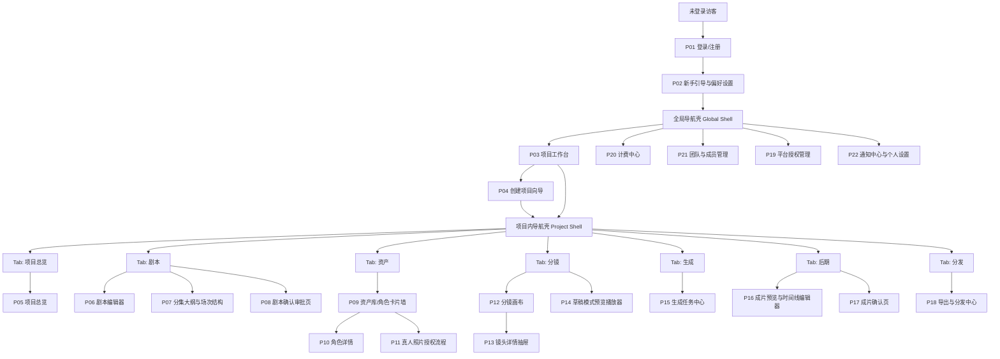
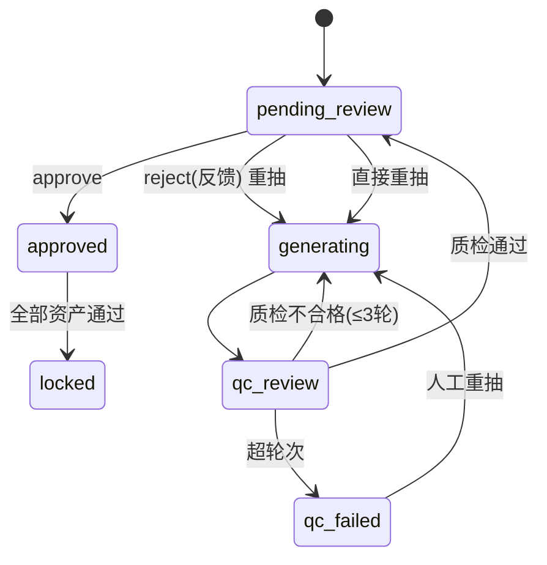
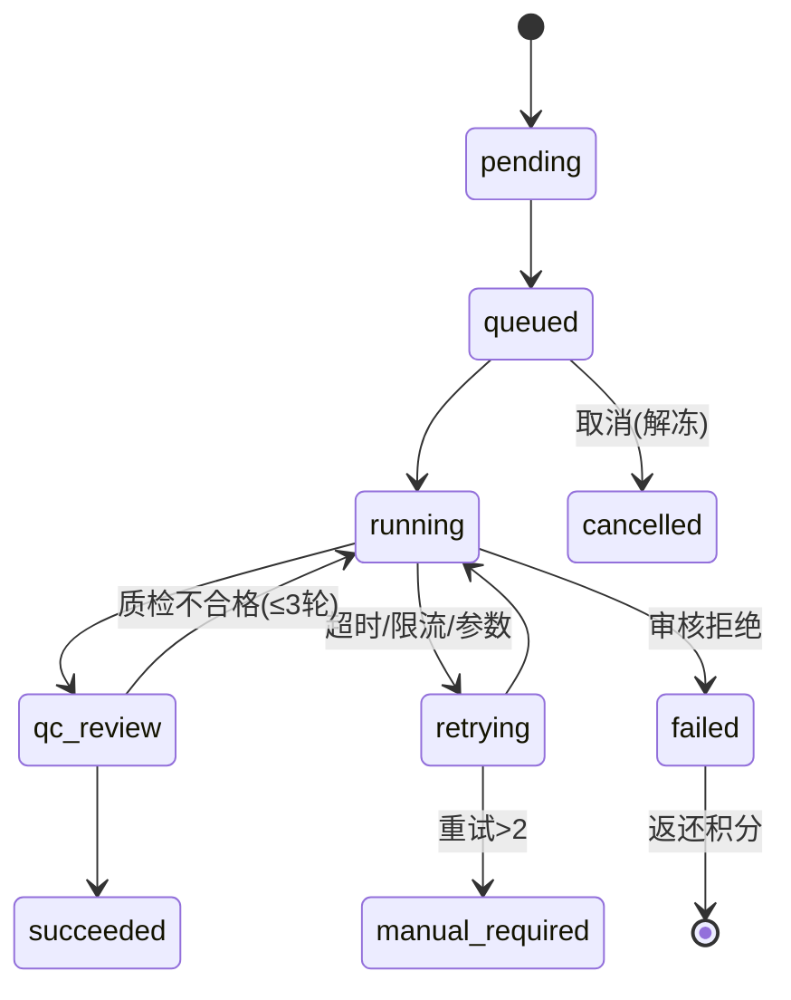

# 04 · 产品原型线框图（GleamDream Studio）

| 项目 | 内容 |
|---|---|
| 产品名称 | 浮光造梦 · AI 短剧创作工具（GleamDream Studio） |
| 文档版本 | V4.0 |
| 最近更新 | 2026-10-15 |
| 维护人 | 产品设计（信息架构 + 交互设计） |
| 主要读者 | 前端、后端、UI、测试、Agent 工程 |
| 术语基线 | 全文档术语、状态枚举、命名规范以 `00_文档总览与术语表.md` 为准 |
| 上游依据 | `00_文档总览与术语表.md`（契约）、`AI短剧创作工具_PRD_V2_多智能体版.md`（业务流程 / HITL / F1–F8） |

---

## 一、文档说明

### 1.1 目的

本文件定义 GleamDream Studio Web 端的**页面骨架、信息层级与交互路径**，作为前端实现、UI 视觉设计与测试用例编写的共同依据。本文件回答「每个页面有哪些区域、区域里放什么、用户从哪里来、能去哪里、什么情况下禁用或报错」，**不回答**「按钮是圆角还是直角、主色是哪一个」。

### 1.2 读者与用法

| 读者 | 用法 |
|---|---|
| 前端开发 | 依据路由表与线框图搭建页面骨架、划分组件边界 |
| 后端 / Agent 工程 | 依据区域说明表的「依赖数据」列与状态机节点对齐接口与推送 |
| UI 设计 | 以线框为骨架做高保真视觉，视觉细节见 `05_高保真页面描述清单.md` |
| 测试 | 依据「关键交互路径（正常流/异常流）」与状态机节点设计用例 |

### 1.3 线框图抽象层级约定

1. **只表达结构与路径**：线框图中出现的所有元素均为「区域 / 组件 / 控件 / 文本占位」，不表达颜色、字体、间距、图标风格、动效。
2. **文本线框图绘制规范**：边框一律使用 ASCII 字符（`+`、`-`、`|`）绘制，避免使用中文字符画边框导致宽度错位；框内填充文案可使用中文。
3. **状态标注约定**：线框中的 `{{ }}` 表示动态占位（如 `{{项目名}}`），`[ ]` 表示按钮或输入框，`( )`/`[ ]` 前缀表示单选/多选，`v` 表示下拉，`...` 表示溢出或省略区。
4. **响应式保真**：本文件以桌面端（≥ 1280px）线框为基准，窄屏降级策略统一见第九章，逐页线框不再重复绘制窄屏版本。
5. **分期标注**：每个页面标注 `M`（MVP 必须）/ `P1`（迭代一）/ `P2`（迭代二），与 `00` 文档第九章分期基线一致；同一页面若含分期不一致的子区域，在区域说明表中单独标注。

### 1.4 与 05 高保真清单的分工边界

| 维度 | 04 产品原型线框图（本文件） | 05 高保真页面描述清单 |
|---|---|---|
| 关注点 | 页面骨架、信息层级、导航与交互路径 | 视觉呈现、组件规格、字段级细节 |
| 粒度 | 区域级 / 组件级 | 组件级 / 控件级（尺寸、色值、状态） |
| 状态覆盖 | 空态/加载态/错误态的**文案与按钮策略** | 上述状态的具体样式与动画 |
| 数据字段 | 区域承载的**信息类别**与依赖的数据源 | 每个字段的类型、长度、校验规则、展示格式 |
| 生效方式 | 页面可被拆分、组件可被命名的依据 | 页面可被像素级切图还原的依据 |
| 冲突处理 | 骨架与路径以本文件为准 | 视觉与字段细节以 05 为准 |

> 边界原则：**凡是「放什么、能不能点」的争议看 04；凡是「长什么样、什么色」的争议看 05。**

### 1.5 全局路由与页面清单速览

| 编号 | 页面名称 | 路由路径 | 所属模块 | 分期 | 访问权限 |
|---|---|---|---|---|---|
| P01 | 登录 / 注册 | `/login`、`/register` | 账号与引导 | M | 公开 |
| P02 | 新手引导与偏好设置 | `/onboarding` | 账号与引导 | M | 已登录用户 |
| P03 | 项目工作台 | `/projects` | 工作台 | M | 已登录用户 |
| P04 | 创建项目向导 | `/projects/new` | 工作台 | M | 已登录（`guest` 不可） |
| P05 | 项目总览 | `/projects/:projectId/overview` | 项目流程 | M | `view`+ |
| P06 | 剧本编辑器 | `/projects/:projectId/script` | 剧本 | M | `edit`+ |
| P07 | 分集大纲与场次结构 | `/projects/:projectId/script/outline` | 剧本 | M | `view`+ |
| P08 | 剧本确认审批页 | `/projects/:projectId/script/review` | 剧本 | M | `edit`+ |
| P09 | 资产库 / 角色卡片墙 | `/projects/:projectId/assets` | 资产 | M | `view`+ |
| P10 | 角色详情 | `/projects/:projectId/assets/characters/:assetId` | 资产 | M | `view`+ |
| P11 | 真人照片授权流程 | `/projects/:projectId/assets/authorizations/new` | 资产 | M | `edit`+ |
| P12 | 分镜画布 | `/projects/:projectId/storyboard` | 分镜 | M | `view`+（编辑需 `edit`） |
| P13 | 镜头详情抽屉 | `/projects/:projectId/storyboard/shots/:shotId` | 分镜 | M | `view`+ |
| P14 | 草稿模式预览播放器 | `/projects/:projectId/storyboard/draft-preview` | 分镜 | M | `view`+ |
| P15 | 生成任务中心 | `/projects/:projectId/render-tasks` | 生成 | M | `view`+ |
| P16 | 成片预览与简易时间线编辑器 | `/projects/:projectId/post` | 后期 | M | `view`+（编辑需 `edit`） |
| P17 | 成片确认页 | `/projects/:projectId/post/review` | 后期 | M | `edit`+ |
| P18 | 导出与分发中心 | `/projects/:projectId/distribute` | 分发 | M（本地导出）/ P1（一键分发） | `export` |
| P19 | 平台授权管理 | `/settings/platform-accounts` | 分发 | P1 | `owner` / `admin` |
| P20 | 计费中心 | `/billing` | 计费与账户 | M | 已登录用户 / `owner`（团队） |
| P21 | 团队与成员管理 | `/settings/team` | 计费与账户 | P1 | `owner` / `admin` |
| P22 | 通知中心与个人设置 | `/notifications`、`/settings/profile` | 计费与账户 | M（个人设置）/ P1（通知中心） | 已登录用户 |

---

## 二、信息架构图

### 2.1 全局导航与页面层级



### 2.2 导航层级说明

| 层级 | 载体 | 覆盖范围 | 说明 |
|---|---|---|---|
| 一级：全局导航 | 左侧全局导航栏 | 跨项目 | 工作台、计费中心、团队、平台授权、通知、个人设置 |
| 二级：项目内导航 | 左侧项目导航（项目上下文激活后展开） | 单项目 | 总览、剧本、资产、分镜、生成、后期、分发 7 个 Tab |
| 三级：二级 Tab | 页面内容区顶部 | 单 Tab 内 | 如「剧本」下分「剧本编辑器 / 分集大纲 / 确认审批」；「资产」下分「角色 / 场景 / 道具 / 音色」 |
| 四级：叠加层 | 右侧抽屉 / 弹窗 | 单对象 | 如 P13 镜头详情抽屉、P11 授权弹窗，不改变当前 Tab |

---

## 三、核心用户旅程图

### 3.1 全路径与 HITL 断点

```mermaid
flowchart LR
    A[注册/登录] --> B[创建项目<br/>题材/画风/篇幅]
    B --> C[一句话生成剧本<br/>或上传文档解析]
    C --> D{{计费点: 剧本生成}}
    D --> E[[HITL-1 剧本确认]]
    E -->|approve| F[生成角色/场景资产]
    E -->|reject+反馈| C
    F --> G{{计费点: 资产生成}}
    G --> H[[HITL-2 资产确认]]
    H -->|approve| I[生成分镜]
    H -->|reject+反馈| F
    I --> J{{计费点: 分镜生成}}
    J --> K[草稿模式预览<br/>关键帧+配音+字幕]
    K --> L[[HITL-3 分镜确认]]
    L -->|approve| M[批量生成视频]
    L -->|reject+反馈| I
    M --> N{{计费点: 视频生成}}
    N --> O[后期合成<br/>TTS/字幕/BGM]
    O --> P{{计费点: 后期合成}}
    P --> Q[[HITL-4 成片确认]]
    Q -->|approve| R[导出与分发]
    Q -->|reject+反馈| O
    R --> S[归档/完成]
```



### 3.2 旅程节点与页面映射

| 阶段 | 用户动作 | 承载页面 | HITL | 计费发生点 | 对应状态（`projects.status`） |
|---|---|---|---|---|---|
| 账号 | 注册 / 登录 / 偏好设置 | P01、P02 | — | 注册赠 500 积分 | — |
| 建项 | 选择题材/画风/篇幅，设预算 | P03、P04 | — | 预检可用余额 | `draft` |
| 剧本 | 一句话生成或上传解析，编辑校对 | P06、P07 | — | 是 · 剧本生成 | `scripting` |
| 关口一 | 确认剧本 | P08 | **HITL-1** | — | `script_review` |
| 资产 | 生成角色/场景/道具，绑定音色 | P09、P10、P11 | — | 是 · 资产生成 | `asset_preparing` |
| 关口二 | 逐个确认角色卡 / 场景 | P09、P10 | **HITL-2** | — | `asset_review` |
| 分镜 | 生成镜头，画布调整 | P12、P13 | — | 是 · 分镜生成 + 草稿模式 | `storyboarding` |
| 关口三 | 草稿预览后确认分镜 | P14、P12 | **HITL-3** | — | `storyboard_review` |
| 生成 | 批量生成视频，处理失败重试 | P15 | — | 是 · 视频生成（冻结/结算/返还） | `rendering` |
| 后期 | 配音/字幕/配乐/合成，时间线微调 | P16 | — | 是 · 后期合成 | `post_producing` |
| 关口四 | 成片确认，生成母版 | P17 | **HITL-4** | — | `final_review` |
| 分发 | 导出母版、授权平台、一键分发 | P18、P19 | — | 导出算力（如 4K 升清） | `completed` |
| 归档 | 完成或归档 | P05、P18 | — | — | `archived` |

---

## 四、全局框架线框图

产品外壳在**所有已登录页面**共用，项目内页面在此基础上叠加「项目内导航」与「项目上下文」。

```text
+--------------------------------------------------------------------------------------+
| 顶部全局栏 Top Bar                                                                     |
| [Logo 浮光造梦] [项目/资产搜索........] [面包屑: 工作台 > 逆袭人生 > 分镜]              |
|                                        [积分余额 1,820] [通知(3)] [头像/菜单 v]         |
+-------------+--------------------------------------------------------+---------------+
| 左侧导航栏   | 内容区 Content Area（router-view 出口）                 | 右侧辅助面板   |
| (可折叠)     |                                                        | (上下文相关)   |
|             | +----------------------------------------------------+ |               |
| 全局导航     | | 页面标题区 Title Bar                                | | 属性/检查器    |
| - 工作台     | | 标题 + 页面级操作按钮 + 二级 Tab                    | | 预览/日志      |
| - 资产库     | +----------------------------------------------------+ | 审批待办       |
| - 计费中心   | |                                                    | |               |
| - 团队       | | 主内容区（线框主体，按页面变化）                     | | 可通过按钮     |
| - 平台授权   | |                                                    | | 展开/收起      |
| - 设置       | |                                                    | |               |
|             | |                                                    | |               |
| ------------ | |                                                    | |               |
| 项目内导航   | |                                                    | |               |
| - 总览       | |                                                    | |               |
| - 剧本       | |                                                    | |               |
| - 资产       | |                                                    | |               |
| - 分镜       | |                                                    | |               |
| - 生成       | |                                                    | |               |
| - 后期       | |                                                    | |               |
| - 分发       | +----------------------------------------------------+ |               |
|             | 底部行内操作区（可选：分页 / 批量操作 / 保存）           |               |
+-------------+--------------------------------------------------------+---------------+
| 底部状态条 Status Bar                                                                  |
| [SSE 连接: 已连接] [项目状态: 分镜待确认] [预算: 1,200/5,000 积分] [trace: 01J9...)     |
+--------------------------------------------------------------------------------------+
```

| 区域 | 承载信息 | 交互行为 | 依赖数据 |
|---|---|---|---|
| 顶部全局栏 | Logo、全局搜索、面包屑、积分余额、通知入口、账号菜单 | 搜索跳转；点击积分进入 P20；点击通知进入 P22；头像菜单含退出登录 | 余额接口、未读通知数、当前路由面包屑 |
| 左侧全局导航 | 跨项目入口（工作台/资产库/计费/团队/平台授权/设置） | 点击路由跳转；可折叠；`guest`/`member` 按权限隐藏部分入口 | 当前用户角色、套餐权益 |
| 左侧项目内导航 | 单项目 7 个 Tab | 项目上下文激活后展开；点击切换 Tab；含流程进度角标 | 项目状态、各阶段待办数 |
| 内容区 | 页面主体 | 由路由出口渲染；承载页面标题区、二级 Tab、主内容、行内操作 | 各页面自有接口 |
| 右侧辅助面板 | 属性/检查器、预览、审批待办、日志 | 随页面上下文切换；可展开/收起；不阻塞主内容 | 分镜画布/时间线等页面的选中对象 |
| 底部状态条 | SSE 连接态、项目状态、预算消耗、trace_id | 只读展示；点击预算进入 P20；点击状态进入 P05 | SSE 通道、项目预算、日志 trace |

> 权限提示：全局导航与项目内导航的**可见项由权限位决定**，不仅由前端隐藏控制；`guest` 仅可见被邀请项目，`member` 仅可见参与项目。第 8 章给出完整可见性矩阵。

---

## 五、逐页线框图（P01 – P22）

### P01 登录 / 注册

- **页面编号**：P01
- **页面名称**：登录 / 注册
- **路由路径**：`/login`、`/register`（同页切换，未注册手机号自动创建）
- **所属模块**：账号与引导
- **分期**：M
- **访问权限**：公开（未登录可访问；已登录访问则重定向至 P03）

```text
+------------------------------------------------------------------+
| [GleamDream 浮光造梦]                                   帮助  简体 |
+------------------------------------------------------------------+
|                                                                  |
|   左侧品牌区（约 55% 宽）        右侧表单区（约 45% 宽）           |
|   +----------------------+      +----------------------------+  |
|   |  品牌插画 / 视频预览  |      | 欢迎回来 / 创建账号          |  |
|   |  一句话 → 成片        |      | -------------------------- |  |
|   |  核心卖点三条:        |      | [ 手机号                ]  |  |
|   |   · 角色一致性        |      | [ 验证码      ] [获取验证码]|  |
|   |   · 草稿模式控成本    |      | [        登录 / 注册       ]|  |
|   |   · 一键分发          |      | -------------------------- |  |
|   |                      |      | 其他方式:                  |  |
|   |                      |      | [ 微信登录 ]  [ Apple 登录] |  |
|   |                      |      | 登录即代表同意             |  |
|   |                      |      | 《用户协议》《隐私政策》     |  |
|   +----------------------+      +----------------------------+  |
|                                                                  |
+------------------------------------------------------------------+
```

| 区域 | 承载信息 | 交互行为 | 依赖数据 |
|---|---|---|---|
| 品牌区 | 产品名、宣传插画/视频、核心卖点 | 只读；播放/暂停宣传视频 | 静态资源 |
| 账号输入区 | 手机号、验证码输入框 | 获取验证码（60s 倒计时）；提交登录/注册 | 发送验证码接口、登录接口 |
| 三方登录区 | 微信、Apple 登录按钮 | 拉起三方 OAuth；换取 unionid/openid | `user_identities`、三方回调接口 |
| 协议区 | 用户协议、隐私政策链接 | 点击打开协议弹窗 | 静态协议版本 |

**关键交互路径**

- 正常流：输入手机号 → 获取验证码 → 输入验证码 → 提交 → 风控通过 → 发放 500 积分、创建计费账户 → 首次登录跳 P02，老用户跳 P03。
- 异常流：验证码错误提示重输；手机号格式非法即时校验；风控拒绝则提示「当前环境存在风险，请稍后再试」并限制注册（对应 `F1` 异常分支）；三方登录回调失败提示「授权失败，请重试」。
- 边界：验证码 60 秒冷却；同一手机号连续请求频控。

**HITL / 状态机节点**：无 HITL。触发计费账户初始化与赠积分（`credit_transactions.transaction_type = grant`）。

---

### P02 新手引导与偏好设置

- **页面编号**：P02
- **页面名称**：新手引导与偏好设置
- **路由路径**：`/onboarding`
- **所属模块**：账号与引导
- **分期**：M
- **访问权限**：已登录用户（首次登录强制，之后可从 P22 进入）

```text
+------------------------------------------------------------------+
|  新手引导   步骤 1/3         进度:  [####----] 33%       [跳过 >>]  |
+------------------------------------------------------------------+
|  第一步：选择你的创作偏好（可多选）                                  |
|  [ ] 都市情感   [x] 悬疑逆袭   [ ] 古装宫斗   [ ] 科幻末世            |
|  [ ] 甜宠日常   [ ] 复仇逆袭   [ ] 重生复仇   [ ] 更多题材...         |
|                                                                  |
|  第二步：默认画风预设                                                |
|  [ 真人感 ] [ 二次元 ] [ 国风 ] [ 3D ]   （选中高亮，右侧实时示例帧）  |
|                                                                  |
|  第三步：默认篇幅                                                     |
|  画幅:  (o) 9:16 竖屏   ( ) 16:9 横屏   ( ) 1:1 方形                |
|  集数:  [ 10 ] 集     单集时长: [ 2 分钟 v ]                        |
|  预估单项目成本 ≈ 3,200 积分                                        |
|                                                                  |
|  [ < 上一步 ]                                [ 完成，进入工作台 > ]   |
+------------------------------------------------------------------+
|  右侧辅助面板: 模板推荐 / 案例预览（随选择动态刷新）                  |
+------------------------------------------------------------------+
```

| 区域 | 承载信息 | 交互行为 | 依赖数据 |
|---|---|---|---|
| 步骤条 | 当前步骤、进度百分比 | 点击「跳过」直达 P03；上一步/下一步切换 | 引导进度（本地 + 用户偏好表） |
| 题材选择 | 题材标签多选 | 选中写入用户偏好，影响后续创建项目默认值 | 题材字典 |
| 画风选择 | 4 类画风预设卡片 | 单选；右侧实时预览示例帧 | `style_presets` |
| 篇幅设置 | 画幅、集数、单集时长、预估成本 | 单/多选与步进输入；动态重算预估成本 | 计费单价规则、`projects.aspect_ratio` |
| 右侧推荐面板 | 基于偏好的模板与案例缩略图 | 点击案例可预览示例成片 | 模板库 |

**关键交互路径**

- 正常流：选择偏好 → 逐步前进 → 完成 → 写入用户偏好 → 进入 P03，新建项目时默认套用偏好。
- 异常流：网络失败时「完成」按钮给出失败提示，允许重试；跳过则使用系统默认（9:16、真人感、10 集、2 分钟）。

**HITL / 状态机节点**：无。写入用户默认偏好，供 P04 预填。

---

### P03 项目工作台

- **页面编号**：P03
- **页面名称**：项目工作台（项目列表 / 卡片墙）
- **路由路径**：`/projects`
- **所属模块**：工作台
- **分期**：M
- **访问权限**：已登录用户（`guest` 仅见被邀请项目；`member` 仅见参与项目）

```text
+------------------------------------------------------------------+
| 我的项目                                           [ + 新建项目 ]   |
| [ 搜索项目........ ] [ 状态 v ] [ 题材 v ] [ 排序: 最近更新 v ]      |
| 视图: [卡片墙][列表]   范围: [我参与][我创建][团队公开]  共 18 个     |
+------------------------------------------------------------------+
| +----------------+  +----------------+  +----------------+       |
| | [封面缩略图]    |  | [封面缩略图]    |  | [封面缩略图]    |       |
| | 逆袭人生        |  | 都市甜心        |  | 星际拾荒者      |       |
| | 状态: 分镜待确认|  | 状态: 已完成    |  | 状态: 剧本生成中|       |
| | 10集 · 9:16     |  | 8集 · 9:16      |  | 12集 · 16:9     |       |
| | 预算[####--]60% |  | 预算[######]100%|  | 预算[#-----]15% |       |
| | 更新: 2 小时前  |  | 更新: 昨天      |  | 更新: 3 天前    |       |
| | [继续][···菜单] |  | [查看][···菜单] |  | [继续][···菜单] |       |
| +----------------+  +----------------+  +----------------+       |
| ... 继续排列更多卡片 ...                                          |
+------------------------------------------------------------------+
| 分页: [<] 1 2 3 [>]                                               |
+------------------------------------------------------------------+
```

| 区域 | 承载信息 | 交互行为 | 依赖数据 |
|---|---|---|---|
| 页面标题与主操作 | 「我的项目」标题、新建项目按钮 | 点击进入 P04 | 项目配额（`member` 受配额限制） |
| 筛选工具条 | 搜索词、状态筛选、题材筛选、排序、视图切换、范围切换 | 即时过滤与排序；切换卡片墙/列表 | 项目列表接口分页参数 |
| 项目卡片 | 封面、名称、`ProjectStatus`、集数、画幅、预算进度、更新时间 | 点击「继续/查看」进入 P05；`···` 菜单含重命名、复制、归档、删除 | `projects`、预算消耗、封面媒体 |
| 分页区 | 页码 | 翻页 | 分页元数据 |

**关键交互路径**

- 正常流：进入工作台 → 浏览/筛选 → 点击项目卡片 → 进入 P05 项目总览。
- 异常流：无项目时展示空态（见第七章）；删除需二次确认；`guest` 无创建按钮，点击创建被拦截并提示无权限。
- 状态映射：卡片状态直接映射 `ProjectStatus` 中文（草稿/剧本生成中/剧本待确认/资产准备中/…/已完成/已归档/已挂起/失败）。

**HITL / 状态机节点**：无。卡片角标展示待确认关口（如 HITL-3 待办）。

---

### P04 创建项目向导

- **页面编号**：P04
- **页面名称**：创建项目向导
- **路由路径**：`/projects/new`
- **所属模块**：工作台
- **分期**：M
- **访问权限**：已登录（`owner`/`admin`/`member` 可创建，`member` 受配额；`guest` 不可访问）

```text
+------------------------------------------------------------------+
|  新建项目   步骤:  ①基本信息  ②题材  ③画风  ④篇幅与预算   [取消]    |
|              进度:  ●●○○                                            |
+------------------------------------------------------------------+
|  ① 基本信息                                                        |
|  项目名称 [________________________]                              |
|  画幅     (o) 9:16 竖屏   ( ) 16:9 横屏   ( ) 1:1 方形             |
|                                                                  |
|  ② 题材标签（多选，已套用偏好）                                     |
|  [x] 悬疑  [ ] 都市  [ ] 古装  [ ] 甜宠  [ ] 复仇  [ ] 科幻          |
|                                                                  |
|  ③ 画风预设  [ 真人感 ] [ 二次元 ] [ 国风 ] [ 3D ]                 |
|  +---------------------------+  右侧: 示例关键帧 + 风格说明          |
|  |  画风示例预览              |                                    |
|  +---------------------------+                                    |
|                                                                  |
|  ④ 篇幅与预算                                                      |
|  集数 [ 10 ]  单集时长 [ 2 分钟 v ]                                |
|  本项目预算上限 [ 5000 ] 积分（账户余额 6,000）                     |
|  预估总成本 ≈ 3,200 积分   [ 查看计费明细 ]                        |
|                                                                  |
|  [ < 上一步 ]                                  [ 创建项目 > ]       |
+------------------------------------------------------------------+
```

| 区域 | 承载信息 | 交互行为 | 依赖数据 |
|---|---|---|---|
| 步骤条 | 4 步进度 | 前进/后退；「取消」放弃创建返回 P03 | 本地表单 |
| 基本信息 | 项目名、画幅 | 输入校验（名称必填、长度限制） | `projects.aspect_ratio` |
| 题材选择 | 题材多选标签 | 选中集合写入项目元数据 | 题材字典 |
| 画风预设 | 4 类画风卡片 + 预览 | 单选，右侧预览联动 | `style_presets` |
| 篇幅与预算 | 集数、单集时长、预算上限、预估成本 | 动态重算预估成本；预算上限不得超余额 | `price_rules`、`credit_accounts` |
| 提交 | 「创建项目」 | 校验后创建，进入 P05 并启动剧本子图 | 创建项目接口（幂等） |

**关键交互路径**

- 正常流：逐步填写 → 创建 → 生成项目容器 → 进入 P05，项目状态置为 `draft`，可一键进入剧本环节。
- 异常流：名称重复提示；预算超余额时禁止提交并引导充值（跳 P20）；创建接口失败显示重试；`member` 超出并发项目配额时拦截。

**HITL / 状态机节点**：创建后 `projects.status = draft`，允许转 `scripting` 或 `archived`。

---

### P05 项目总览

- **页面编号**：P05
- **页面名称**：项目总览（流程进度 + 四关口状态 + 预算消耗）
- **路由路径**：`/projects/:projectId/overview`
- **所属模块**：项目流程
- **分期**：M
- **访问权限**：`view` 及以上

```text
+------------------------------------------------------------------+
| 逆袭人生   状态: 分镜待确认   画幅 9:16   画风 真人感              |
| [进入当前环节]  [快照历史]  [项目设置 v]                           |
+------------------------------------------------------------------+
| 流程 Stepper                                                       |
| (剧本 完成)--(资产 完成)--(分镜 *待确认)--(视频o)--(后期o)--(成片o)--(分发o)  |
+------------------------------------------------------------------+
| 四关口状态面板                                                      |
| +----------------+ +----------------+ +----------------+          |
| | HITL-1 剧本     | | HITL-2 资产     | | HITL-3 分镜     |          |
| | 已确认 10-08   | | 已确认 10-08   | | 待确认 2h 前    |          |
| | [查看审批]     | | [查看审批]     | | [去确认 >]      |          |
| +----------------+ +----------------+ +----------------+          |
| +----------------+ +----------------+ +----------------+          |
| | HITL-4 成片     | | 预算消耗        | | 待办与提醒      |          |
| | 未开始         | | 1,200/5,000 24% | | 3 条            |          |
| | [—]            | | [充值/明细]     | | [查看]          |          |
| +----------------+ +----------------+ +----------------+          |
+------------------------------------------------------------------+
| 最近活动: 导演 Agent 完成第 6 集分镜 · 冻结 260 积分 (10-08 14:20)   |
+------------------------------------------------------------------+
```

| 区域 | 承载信息 | 交互行为 | 依赖数据 |
|---|---|---|---|
| 项目头 | 项目名、`ProjectStatus`、画幅、画风、主操作 | 「进入当前环节」跳转对应 Tab；「快照历史」打开快照抽屉；项目设置菜单 | 项目详情、快照列表 |
| 流程 Stepper | 7 阶段与完成/进行/待办标记 | 点击已到达阶段跳转对应 Tab；未到达阶段禁用并有提示 | 项目状态、各阶段完成标记 |
| 四关口面板 | 4 个 HITL 的确认状态与时间 | 已确认可查看审批记录；待确认可直接跳转审批页 | `approval_requests` |
| 预算面板 | 已用/上限、占比 | 点击进入 P20 计费中心或充值 | 预算与消耗统计 |
| 待办面板 | 待处理事项数 | 展开待办列表，逐条跳转 | `notifications` / `approval_requests` |
| 活动流 | 最近操作与计费事件 | 只读；可展开更多 | `operation_logs`、SSE |

**关键交互路径**

- 正常流：从 P03 进入 → 查看进度 → 点击「去确认」进入当前 HITL 关口（如 P08/P10/P12/P17）。
- 异常流：`paused`/`failed` 状态在头部显示恢复/重试入口；`archived` 只读，主操作置灰。
- 回滚：快照抽屉选择历史快照 → 二次确认 → 回滚（LangGraph checkpoint 恢复），提示下游将解锁。

**HITL / 状态机节点**：总览映射全部 4 个 HITL 关口；`ProjectStatus` 14 态从此页可视。

---

### P06 剧本编辑器

- **页面编号**：P06
- **页面名称**：剧本编辑器（一句话生成 / 上传解析双入口）
- **路由路径**：`/projects/:projectId/script`
- **所属模块**：剧本
- **分期**：M
- **访问权限**：`edit` 及以上（`view` 只读）

```text
+------------------------------------------------------------------+
| 剧本  [编辑器] 大纲  [确认审批]        状态: 剧本待确认  字数 8,420  |
| [一句话生成] [上传剧本]  [保存] [版本 v] [提交确认 >]               |
+------------------------------------------------------------------+
| 左栏：分集导航        | 中栏：正文编辑区          | 右栏：辅助面板     |
| +------------------+ | +----------------------+ | +--------------+ |
| | 共 10 集          | | | 第1集 · 逆袭前夜      | | | 生成计划      | |
| | > 第1集 5场 3:20  | | | -------------------- | | | 大纲 完成     | |
| |   第2集 4场 2:50  | | | [苏婉] 你到底是谁？   | | | 人物 完成     | |
| |   第3集 ...       | | | [旁白] 夜色沉沉...    | | | 分集 完成     | |
| | ...              | | | [动作] 他握紧了拳头   | | | 对白 进行中   | |
| | +新增集           | | | -------------------- | | +--------------+ |
| |                  | | | 行类型: 对白/旁白/动作| | | 改写输入框:   | |
| |                  | | | /舞台提示             | | | [仅重写本场..]| |
| |                  | | | [插入行] [AI 续写]    | | | [开始局部改写]| |
| +------------------+ | +----------------------+ | +--------------+ |
|                      |  底部: 字数 / 场景数 / 钩子提示                 |
+------------------------------------------------------------------+
```

| 区域 | 承载信息 | 交互行为 | 依赖数据 |
|---|---|---|---|
| 顶部工具条 | 二级 Tab、脚本状态、字数、双入口按钮、保存/版本/提交 | 切换来源入口；保存草稿；查看版本；提交进入 P08 | `scripts.status`、`script_draft_versions` |
| 分集导航 | 集列表、场次数、时长、`+新增集` | 点击定位；新增集；拖拽排序（P1） | `episodes` |
| 正文编辑区 | 台词行（对白/旁白/动作/舞台提示） | 行内编辑；插入行；AI 续写；行类型切换；选中行触发局部改写 | `script_lines`、`scenes` |
| 辅助面板 | 生成计划（`write_todos` 可见）、局部改写输入框 | 展示 Agent 规划进度；输入改写要求 → 仅重写受影响场次 | `agent_runs`、撰写 Agent 输出 |
| 底部状态位 | 字数、场景数、钩子提示 | 只读提示 | 校验结果 |

**关键交互路径**

- 正常流（一句话生成）：输入一句话创意 → 编剧 Agent `write_todos` 出计划（右栏可见）→ 逐集生成对白 → 结构校验通过 → 合规审核通过 → 状态 `pending_confirm` → 用户编辑 → 提交确认（P08）。
- 正常流（上传解析）：上传文档（含扫描件 OCR）→ 解析 Agent 结构化 → 字段级置信度标注 → 低置信字段高亮待校正 → 结构与合规校验 → 进入确认。
- 异常流：解析置信度 < 阈值时标记「待人工校正」，逐字段提示；结构校验失败（`40002`）打回 Agent 自修，不进入人工环节；审核未通过（`rejected`）给出位置与修改建议，可再提交；题材硬拦截直接终止。
- 局部改写：选中场次 → 输入改写要求 → 仅重写受影响场次，其余引用原版本。

**HITL / 状态机节点**：`ScriptStatus`：`draft → validating → compliance_review → pending_confirm → confirmed → locked`；异常态 `needs_manual_fix`、`rejected`。提交后进入 **HITL-1**（P08）。

---

### P07 分集大纲与场次结构

- **页面编号**：P07
- **页面名称**：分集大纲与场次结构
- **路由路径**：`/projects/:projectId/script/outline`
- **所属模块**：剧本
- **分期**：M
- **访问权限**：`view` 及以上

```text
+------------------------------------------------------------------+
| 剧本  编辑器 [大纲] 确认审批      单项目 ≤ 30 集 · 单集 1–3 分钟     |
+------------------------------------------------------------------+
| 左栏：集-场树            | 右栏：场次详情                            |
| +---------------------+ | +--------------------------------------+ |
| | ▼ 第1集 (3:20)       | | | 场次 1-2 · 内景 · 夜 · 苏婉公寓      | |
| |   ● 场1-1 内 夜      | | | 出场角色: 苏婉, 林砚                  | |
| |   ● 场1-2 内 夜      | | | 关键道具: 旧照片                      | |
| |   ● 场1-3 外 日      | | | 情绪走向: 平静 → 紧张                 | |
| | ▶ 第2集 (2:50)       | | | 钩子建议: 「照片背后的人是谁」         | |
| | ▶ 第3集 ...          | | | 对白行: 6 条 / 旁白: 2 条 / 动作: 3 条 | |
| | ...                 | | | [定位到编辑器] [编辑此场]             | |
| +---------------------+ | +--------------------------------------+ |
+------------------------------------------------------------------+
| 底部: 集时长分布条形图 + 全剧节奏曲线（高潮密度提示）               |
+------------------------------------------------------------------+
```

| 区域 | 承载信息 | 交互行为 | 依赖数据 |
|---|---|---|---|
| 集-场树 | 集、场次层级、内外景、时段、时长 | 展开/折叠；点击定位场次 | `episodes`、`scenes` |
| 场次详情 | 场次属性、出场角色、道具、情绪走向、钩子建议、行统计 | 「定位到编辑器」跳 P06 对应场；「编辑此场」直接进入编辑 | `scenes`、`script_lines` |
| 节奏可视化 | 集时长分布、全剧节奏曲线 | 悬浮查看数据点；点击定位 | 分集拆分节点输出 |

**关键交互路径**

- 正常流：查看集-场结构 → 检查单集时长是否 1–3 分钟 → 检查钩子建议 → 定位回编辑器修改。
- 异常流：某集超长时该集标红并提示「超出目标时长，建议裁剪场次」；场次无对白提示补充。

**HITL / 状态机节点**：只读视图，映射 `ScriptStatus`；确认动作仍在 P08 完成。

---

### P08 剧本确认审批页（HITL）

- **页面编号**：P08
- **页面名称**：剧本确认审批页
- **路由路径**：`/projects/:projectId/script/review`
- **所属模块**：剧本
- **分期**：M
- **访问权限**：`edit` 及以上（`view` 可查看不可操作）

```text
+------------------------------------------------------------------+
| 剧本确认 (HITL-1)   审批单 #1024   状态: 待确认   剩余有效期 6 天    |
+------------------------------------------------------------------+
| 左：待审剧本摘要        | 右：审批操作面板                          |
| +---------------------+ | +--------------------------------------+ |
| | 题材: 悬疑逆袭       | | | 合规审查: 通过 (0 处高风险)           | |
| | 集数: 10  字数: 8,420| | | 结构校验: 通过                        | |
| | 一致性: 角色 6 / 场景 12| | 解析置信度: 98%                       | |
| | 钩子: 每集结尾已设计  | | | 涉及积分: 剧本生成 已结算 180 积分    | |
| | 封面/摘要预览        | | | ------------------------------------ | |
| | [展开完整剧本]       | | | 反馈输入框: (reject 必填)             | |
| |                     | | | [__________________________]          | |
| +---------------------+ | | ------------------------------------ | |
|                        | | | [ 通过并进入资产 ]  [ 驳回 ]  [ 编辑 ] | |
|                        | | +--------------------------------------+ |
+------------------------------------------------------------------+
```

| 区域 | 承载信息 | 交互行为 | 依赖数据 |
|---|---|---|---|
| 头部 | 审批类型、审批单号、状态、剩余有效期（默认 7 天） | 展示；临期高亮 | `approval_requests` |
| 剧本摘要 | 题材、集数、字数、角色/场景数、钩子、预览 | 展开完整剧本；跳 P06 查看 | `scripts`、`episodes` |
| 质量与合规面板 | 合规结论、结构校验、解析置信度、已发生积分 | 只读；点击查看合规明细 | `compliance_flags`、`qc_reports` |
| 审批操作 | 反馈输入、通过/驳回/编辑按钮 | 通过 → 流转资产；驳回 → 写 `human_feedback` 并重入编剧；编辑 → 跳 P06 | 审批接口 |

**关键交互路径**

- 正常流：核对摘要与合规 → 点击「通过并进入资产」→ 审批单置 `approved` → `projects.status` 由 `script_review` 转 `asset_preparing`。
- 异常流：驳回必填反馈，否则禁用按钮；驳回后审批单置 `rejected`，编剧 Agent 按反馈重生成受影响场次；选择「编辑」进入 P06，改动后需重新提交。
- 超时：7 天未处理置 `expired`，项目挂起保留 30 天，快照不删除。

**HITL / 状态机节点**：**HITL-1**。`ApprovalStatus`：`pending → approved / rejected / edited / expired`。`ScriptStatus` 由 `pending_confirm` 转 `confirmed` 并最终 `locked`。

---

### P09 资产库 / 角色卡片墙

- **页面编号**：P09
- **页面名称**：资产库 / 角色卡片墙
- **路由路径**：`/projects/:projectId/assets`
- **所属模块**：资产
- **分期**：M
- **访问权限**：`view` 及以上（approve/reject 需 `edit`）

```text
+------------------------------------------------------------------+
| 资产库  [角色] 场景  道具  音色      状态: 资产待确认 (HITL-2)       |
| [全部 v] [待确认 v] [已通过]   搜索 [______]      [批量通过所选]     |
+------------------------------------------------------------------+
| +----------------+  +----------------+  +----------------+       |
| | [主形象缩略图]  |  | [主形象缩略图]  |  | [主形象缩略图]  |       |
| | 苏婉 (主角)     |  | 林砚 (男主)     |  | 王管家 (配角)   |       |
| | 三视: 正/侧/背  |  | 三视: 正/侧/背  |  | 三视: 3/3       |       |
| | 情绪 5/5 · 音色已绑|  | 情绪 4/5        |  | 情绪 5/5        |       |
| | 状态: 待确认    |  | 状态: 待确认    |  | 状态: 已通过    |       |
| | [通过][驳回][重抽]| | [通过][驳回][重抽]| | [查看详情]     |       |
| +----------------+  +----------------+  +----------------+       |
| ... 场景/道具 Tab 同构 ...                                        |
+------------------------------------------------------------------+
```

| 区域 | 承载信息 | 交互行为 | 依赖数据 |
|---|---|---|---|
| Tab 与筛选 | 角色/场景/道具/音色切换、状态筛选、搜索、批量通过 | 切换 Tab；过滤；批量 approve | `assets.asset_type`、`AssetStatus` |
| 资产卡片 | 主形象、三视图完成度、表情集完成度、音色绑定、状态 | 通过/驳回/重抽三态操作；点击进入 P10 | `assets`、`asset_versions`、`tts_voices` |
| 卡片操作区 | 三态按钮 | 见第六章专题 6.2 | 审批接口、重抽接口 |

**关键交互路径**

- 正常流：资产子图生成 → 质检通过写入资产库 → 卡片墙逐个确认 → 全部 approve 后资产 `locked`，进入分镜。
- 异常流：卡片 `qc_failed` 显示质检原因与重抽入口；真人照片资产需先完成 P11 授权；表情集部分失败允许带缺失通过（缺失情绪在分镜层降级）。
- 重抽：带反馈重抽（如「太老/换发型」）仅重生成该资产。

**HITL / 状态机节点**：**HITL-2**。`AssetStatus`：`planning → generating → qc_review → pending_review → approved → locked`；异常态 `qc_failed`、`rejected`、`deprecated`。

---

### P10 角色详情

- **页面编号**：P10
- **页面名称**：角色详情（主形象 + 三视图 + 表情集 + 音色绑定）
- **路由路径**：`/projects/:projectId/assets/characters/:assetId`
- **所属模块**：资产
- **分期**：M
- **访问权限**：`view` 及以上（编辑需 `edit`）

```text
+------------------------------------------------------------------+
| < 返回资产库   苏婉 · 主角   状态: 待确认   一致性分 96.2           |
| [通过] [驳回] [重抽] [编辑属性]                                    |
+------------------------------------------------------------------+
| 左：主形象与三视图          | 中：表情集           | 右：属性/音色   |
| +-------------------------+ | +-----------------+ | +------------+ |
| | [   主形象大图   ]      | | | [喜][怒][哀]     | | | 年龄: 26   | |
| | ----------------------- | | | [惊][平]         | | | 外形: ...  | |
| | [正][侧][背] 三视图     | | | (5/5)            | | | 戏份: 主   | |
| | 三张并排缩略图          | | | [重抽缺失情绪]   | | | 音色:      | |
| | [重抽三视图]            | | +-----------------+ | | [温柔女声v]| |
| +-------------------------+ |                    | | [试听 30s] | |
|                             |                    | | 锚点图: 3 张| |
|                             |                    | | [查看引用] | |
|                             |                    | +------------+ |
+------------------------------------------------------------------+
| 底部: 该角色引用统计: 分镜 42 个 · 场景 12 个 · [替换锚点将影响 N 镜] |
+------------------------------------------------------------------+
```

| 区域 | 承载信息 | 交互行为 | 依赖数据 |
|---|---|---|---|
| 头部 | 角色名、角色定位、`AssetStatus`、一致性分、操作按钮 | 通过/驳回/重抽；编辑属性 | `assets`、`qc_reports` |
| 主形象与三视图 | 主形象大图、正/侧/背三视图、重抽入口 | 点击放大；单张重抽；整组重抽 | `asset_versions` |
| 表情集 | 5 类情绪表情、完成度 | 重抽缺失情绪；单张替换 | `asset_versions`（`expression_set`） |
| 属性/音色 | 年龄、外形描述、戏份权重、音色绑定、试听 | 绑定/更换音色；试听 30s 样音 | `tts_voices`、`media_files` |
| 引用统计条 | 该资产被分镜/场景引用数 | 提示替换锚点的级联影响范围 | `shots` 引用索引 |

**关键交互路径**

- 正常流：查看一致性分与三视图 → 绑定音色并试听 → 通过 → 资产 `approved`。
- 异常流：三视图与主形象相似度过低 → 建议改用图生图重抽；引用锚点变更时提示「影响 N 个镜头」，需确认后级联更新。
- 音色下架：推荐最近似音色并提示确认替换。

**HITL / 状态机节点**：**HITL-2** 明细页。approve 后角色绑定音色并 `locked`。

---

### P11 真人照片授权流程

- **页面编号**：P11
- **页面名称**：真人照片授权流程
- **路由路径**：`/projects/:projectId/assets/authorizations/new`
- **所属模块**：资产
- **分期**：M
- **访问权限**：`edit` 及以上

```text
+------------------------------------------------------------------+
| 真人照片定制授权   步骤: ①上传  ②检测  ③授权确认  ④提交             |
+------------------------------------------------------------------+
| +--------------------------------------------------------------+ |
| | ① 上传照片                                                    | |
| | [ 拖拽或点击上传 ]  支持 JPG/PNG, 单人正面清晰照片             | |
| | [缩略图1] [缩略图2]                                          | |
| +--------------------------------------------------------------+ |
| | ② 人脸检测与相似度                                             | |
| | 检测结果: 有效人脸    相似度: 88.4                            | |
| | {相似真人? 是 → 需强制二次确认}                               | |
| +--------------------------------------------------------------+ |
| | ③ 授权声明                                                    | |
| | 授权类型: (o) 本人  ( ) 获得他人授权                          | |
| | [x] 我确认已获得肖像使用授权，并同意《肖像授权协议 v1.2》      | |
| | 协议版本: v1.2   留存: 时间戳 / IP / 用户 ID                   | |
| +--------------------------------------------------------------+ |
| | [ 上一步 ]                          [ 提交并生成角色形象 > ]   | |
| +--------------------------------------------------------------+ |
+------------------------------------------------------------------+
```

| 区域 | 承载信息 | 交互行为 | 依赖数据 |
|---|---|---|---|
| 上传区 | 拖拽/点击上传、格式提示、缩略图 | 上传校验（非人脸/模糊前置打回） | `media_files` |
| 检测区 | 人脸有效性、相似度、公共人物库比对结果 | 展示检测结论；命中时触发强制二次确认 | `face_embeddings`、公共人物库 |
| 授权区 | 授权类型单选、协议勾选、协议版本 | 必须勾选方可提交；本人/他人授权分支 | `face_authorizations.authorization_type` |
| 提交区 | 上一步/提交 | 提交留痕并触发定制生成 | 授权接口 |

**关键交互路径**

- 正常流：上传 → 检测通过 → 选择授权类型 → 勾选协议 → 提交 → 留痕（时间戳/IP/协议版本）→ 生成角色形象。
- 异常流：非人脸/模糊照片前置打回（`50004`）；相似度过低（`50002`）提示更换照片；未完成授权（`50003`）阻断生成并提示完成授权；命中公共人物库强制二次确认 + 授权书。
- 合规：未成年人题材硬拦截，不提供绕过。

**HITL / 状态机节点**：授权节点为确定性合规节点；完成后回到 `AssetStatus` 流程并进入 **HITL-2**。

---

### P12 分镜画布

- **页面编号**：P12
- **页面名称**：分镜画布（Konva 画布，镜头卡片拖拽）
- **路由路径**：`/projects/:projectId/storyboard`
- **所属模块**：分镜
- **分期**：M
- **访问权限**：`view` 及以上（拖拽/增删需 `edit`）

```text
+------------------------------------------------------------------+
| 分镜  [画布] 草稿预览  确认   集: [第1集 v]  镜: 18  | 总时长 3:12 |
| [自动布局] [缩放- 100% 缩放+] [重算依赖] [锁定分镜 >]               |
+------------------------------------------------+-----------------+
| Konva 画布区（可按集 / 按场分组，镜头卡片可拖拽排序）                | 右栏抽屉:       |
| +--------+   +--------+   +--------+   +--------+                 | (选中镜头时)    |
| |镜 1    |   |镜 2    |   |镜 3    |   |镜 4    |                 | 镜头详情       |
| |[关键帧]|   |[关键帧]|   |[关键帧]|   |[关键帧]|                 | 见 P13          |
| |中景 推 |   |近景 静 |   |特写 摇 |   |全景 移 |                 |                 |
| |2.5s    |   |1.8s    |   |2.0s    |   |3.0s    |                 |                 |
| +--------+   +--------+   +--------+   +--------+                 |                 |
|      v            v            v            v                     |                 |
| +--------+   +--------+   +--------+                             |                 |
| |镜 5    |   |镜 6    |   | + 新增镜|                             |                 |
| |...     |   |...     |   |         |                             |                 |
| +--------+   +--------+   +--------+                             |                 |
+------------------------------------------------+-----------------+
| 底部工具条: [撤销][重做] 选中 2 个镜头 [删除][复制][批量生成所选]    |
+------------------------------------------------------------------+
```

| 区域 | 承载信息 | 交互行为 | 依赖数据 |
|---|---|---|---|
| 顶部工具条 | 二级 Tab、集选择、镜头数、总时长、自动布局、缩放、重算依赖、锁定 | 切换集；自动布局；缩放；手动触发依赖重算；锁定分镜 | `storyboards`、`storyboard_layouts`（P1） |
| 画布区 | 镜头卡片（关键帧、景别、运镜、时长），按集/场分组 | 拖拽排序；框选多选；新增/删除/复制镜头；双击打开 P13 | `shots`、`shot_versions` |
| 右栏抽屉 | 选中镜头的详情（复用 P13） | 展开/收起 | `shots` |
| 底部工具条 | 撤销/重做、选中计数、批量操作 | 删除/复制/批量生成所选 | 本地历史、`render_tasks` |

**关键交互路径**

- 正常流：导演 Agent 拆镜 → 画布展示 → 用户拖拽调整顺序/增删 → 自动或手动重算依赖 → 生成草稿预览（P14）→ 确认锁定。
- 异常流：增删镜头导致集时长与钩子变化 → 顶部提示「依赖已变更，点击重算」；改动资产锚点 → 提示「影响 N 个镜头」；`view` 用户拖拽被禁用并提示只读。
- 锁定前置：存在未绑定资产锚点的镜头时禁止锁定（`60005`）。

**HITL / 状态机节点**：**HITL-3** 前置视图。`ShotStatus` 从 `draft → qc_review → pending_review`；锁定后转 `approved → locked → render_queued`。编辑后自动重算依赖。

---

### P13 镜头详情抽屉

- **页面编号**：P13
- **页面名称**：镜头详情抽屉（生成参数 / 锚点 / 版本对比）
- **路由路径**：`/projects/:projectId/storyboard/shots/:shotId`（以右侧抽屉形式叠加在 P12 上）
- **所属模块**：分镜
- **分期**：M
- **访问权限**：`view` 及以上（编辑需 `edit`）

```text
+------------------------------------------------------------------+
| 镜头 0037 · 第1集 场1-2        状态: 待确认        [关闭 X]        |
+------------------------------------------------------------------+
| [ 画面生成参数 ]                                                    |
| 景别: [近景 v]   运镜: [dolly_in v]   情绪: [紧张 v]                |
| 时长: [2.4] s   画面描述: [___________________________]            |
| 对白: 「你到底是谁？」(1.6s)                                        |
| ------------------------------------------------------------------ |
| [ 资产锚点 ]                                                        |
| 角色: [苏婉 x] [林砚 x]   场景: [公寓客厅 x]   道具: [旧照片 x]      |
| 锚点图: [缩略图][缩略图][缩略图]   [编辑锚点(影响 N 镜)]            |
| ------------------------------------------------------------------ |
| [ Prompt 预览（对用户可见可改）]                                    |
| +--------------------------------------------------------------+  |
| | asset:苏婉/三视图 + scene:公寓客厅 + 近景 + dolly_in + 紧张 ... |  |
| +--------------------------------------------------------------+  |
| ------------------------------------------------------------------ |
| [ 版本对比 ]  共 3 版                                              |
| [v1 缩略图] [v2 缩略图] [v3 选中缩略图]   [锁定此版] [重抽]         |
| ------------------------------------------------------------------ |
| [ 保存 ]  [加入生成队列]                                            |
+------------------------------------------------------------------+
```

| 区域 | 承载信息 | 交互行为 | 依赖数据 |
|---|---|---|---|
| 头部 | 镜头编号、所属集/场、`ShotStatus` | 关闭抽屉 | `shots` |
| 生成参数 | 景别、运镜、情绪、时长、画面描述、对白 | 修改参数（仅影响本镜）；对白时长校验 | `shots.shot_size/camera_move/emotion_tag` |
| 资产锚点 | 角色/场景/道具锚点、锚点图 | 增删锚点；「编辑锚点」提示级联影响 | `assets`、`face_embeddings` |
| Prompt 预览 | 组装后的 prompt（可见可改） | 直接编辑 prompt | 确定性组装节点输出 |
| 版本对比 | 3 个生成版本 | 切换对比；锁定某版；重抽 | `shot_versions`（保留 3 版） |
| 底部操作 | 保存、加入生成队列 | 保存参数；加入渲染队列 | `render_tasks` |

**关键交互路径**

- 正常流：画布双击镜头 → 抽屉打开 → 调参/换锚点/对比版本 → 保存 → 加入生成队列。
- 异常流：对白超镜头时长提示裁剪或延长；锚点缺失阻止加入队列（`60005`）；锚点变更级联提示。
- 版本：锁定版之外的版本进入冷存储。

**HITL / 状态机节点**：映射 `ShotStatus`；`shot_versions` 3 版管理与锁定。

---

### P14 草稿模式预览播放器

- **页面编号**：P14
- **页面名称**：草稿模式预览播放器
- **路由路径**：`/projects/:projectId/storyboard/draft-preview`
- **所属模块**：分镜
- **分期**：M
- **访问权限**：`view` 及以上

```text
+------------------------------------------------------------------+
| 草稿预览  第1集 · 3:12 · 关键帧+配音+字幕    [返回画布]             |
+------------------------------------------------------------------+
| +--------------------------------------------+  +--------------+ |
| |                                            |  | 播放列表      | |
| |        草稿样片播放区                       |  | 镜1 ...      | |
| |        (静态关键帧序列 + 配音 + 字幕)       |  | 镜2 ...      | |
| |                                            |  | 镜3 ← 当前   | |
| |                                            |  | 镜4 ...      | |
| +--------------------------------------------+  +--------------+ |
| 播放控制: [<<][>][>>] 00:42 / 03:12   [音轨 v]   [全屏]            |
+------------------------------------------------------------------+
| 成本提示: 本片为草稿模式（约 40 积分）。正式生成视频预估 3,200 积分。 |
| [逐镜反馈]  [整体同意草稿，去确认分镜 >]                             |
| 逐镜标记: 镜1[好][差] 镜2[好][差] ... (差评累计将触发策略重制)        |
+------------------------------------------------------------------+
```

| 区域 | 承载信息 | 交互行为 | 依赖数据 |
|---|---|---|---|
| 播放区 | 关键帧 + 配音 + 字幕拼成的节奏样片 | 播放/暂停/进度拖动/全屏；音轨切换（对白/BGM） | `render_tasks`（`tts`/`subtitle`）+ 关键帧 |
| 播放列表 | 分镜顺序列表、当前播放镜 | 点击定位；跳转某镜 | `shots` |
| 成本提示条 | 草稿成本 vs 正式生成预估 | 只读；点击查看计费明细 | `price_rules`、预估成本 |
| 逐镜反馈 | 每镜好/差标记 | 标记；差评比例达阈值提示重制策略 | 反馈数据、导演 Agent |

**关键交互路径**

- 正常流：播放草稿 → 逐镜反馈 → 整体同意 → 进入 P12 执行「锁定分镜」→ 触发 HITL-3 确认。
- 异常流：约 70% 镜头差评 → 触发导演 Agent 重新制定分镜策略（而非逐镜重抽）；某镜无配音提示缺失。
- 成本守卫：正式生成前展示预估成本与余额对比，不足则引导充值。

**HITL / 状态机节点**：**HITL-3** 预览支撑页。反馈写入后进入分镜确认流。

---

### P15 生成任务中心

- **页面编号**：P15
- **页面名称**：生成任务中心（队列 / 进度 / 预估成本 / 失败重试）
- **路由路径**：`/projects/:projectId/render-tasks`
- **所属模块**：生成
- **分期**：M
- **访问权限**：`view` 及以上（重试/取消需 `edit`）

```text
+------------------------------------------------------------------+
| 生成任务   队列 12 运行 3 完成 96 失败 2   [全部 v] [刷新]          |
| 本次生成上限 [______] 积分   预估合计 3,200  已冻结 260             |
+------------------------------------------------------------------+
| ▤ 汇总条: [====----] 96/110 完成   预估偏差: +6%   [取消未执行]     |
+------------------------------------------------------------------+
| 任务列表                                                           |
| +------+--------+--------+--------+--------+--------+-----------+ |
| | 镜头 | 类型   | 模型   | 状态   | 进度   | 成本   | 操作       | |
| +------+--------+--------+--------+--------+--------+-----------+ |
| | 0037 | i2v    | M-A    | 生成中 | [###-] | 24.0   | [取消]    | |
| | 0038 | i2v    | M-A    | 队列中 | [----] | 24.0   | [取消]    | |
| | 0039 | i2v    | M-B    | 失败   | [####] | 0      | [重试][详情]| |
| | 0040 | upscale| M-C    | 已完成 | [####] | 8.0    | [查看]    | |
| | ...  |        |        |        |        |        |            | |
| +------+--------+--------+--------+--------+--------+-----------+ |
+------------------------------------------------------------------+
| 失败详情: 0039 失败类型=rate_limited, 已自动重试 2/2 → 待人工/退积分 |
+------------------------------------------------------------------+
```

| 区域 | 承载信息 | 交互行为 | 依赖数据 |
|---|---|---|---|
| 头部统计 | 各状态计数、本次生成上限、预估合计、已冻结 | 设置上限；刷新 | `render_tasks`、`credit_freezes` |
| 汇总条 | 总进度、预估偏差、取消未执行 | 一键取消未执行队列 | 队列聚合、SSE |
| 任务列表 | 镜头、任务类型、模型、`RenderTaskStatus`、进度、成本、操作 | 单任务取消/重试/查看；批量操作 | `render_tasks`、`ai_call_logs` |
| 失败详情条 | 失败类型、重试次数、后续处理 | 转人工或退积分；查看日志 | `render_tasks.failure_type` |

**关键交互路径**

- 正常流：进入任务中心 → 实时进度（SSE）→ 完成后进入后期。
- 异常流：失败按类型处理——超时/限流自动重试 ≤ 2 次并换备用模型；审核拒绝标记违规并返还积分；参数问题自动修正重试；重试超限转「待人工」（`60004`）。
- 取消：仅未执行任务可取消并解冻，执行中任务等待结算。
- 全模型不可用：整体挂起，冻结不解冻直至恢复或用户取消。

**HITL / 状态机节点**：`RenderTaskStatus`：`pending → queued → running → qc_review → succeeded`；异常/终态 `failed`、`cancelled`、`retrying`、`manual_required`。计费走冻结/结算/返还。

---

### P16 成片预览与简易时间线编辑器

- **页面编号**：P16
- **页面名称**：成片预览与简易时间线编辑器
- **路由路径**：`/projects/:projectId/post`
- **所属模块**：后期
- **分期**：M
- **访问权限**：`view` 及以上（编辑需 `edit`）

```text
+------------------------------------------------------------------+
| 后期  预览  [时间线]  确认      时长 3:12   画幅 9:16   [生成母版>] |
+------------------------------------------------------------------+
| +--------------------------------------------+  +--------------+ |
| |            成片预览播放器（带水印）          |  | 音轨设置      | |
| |                                            |  | 对白 -6dB    | |
| |                                            |  | BGM 自动闪避 | |
| +--------------------------------------------+  | 字幕样式 v    | |
| 播放控制: [<<][>][>>] 00:42/03:12  音量 ▮▮▮▯  | | 安全区检测 通过| |
|                                                | +--------------+ |
+------------------------------------------------------------------+
| 时间线（Konva）                                                    |
| 视频轨: [镜1 ====][镜2 ===][镜3 ======][镜4 ====]                  |
| 音频轨: [  对白 ==== ][ 对白 == ][   BGM ================ ]        |
| 字幕轨: [苏婉: 你...][林砚: 我...][旁白: 夜色...]                  |
| 音乐轨: [BGM-A =============================] [SFX ==]            |
|         |0s      30s      60s      90s     120s|                  |
+------------------------------------------------------------------+
| 底部: [撤销][重做] 选中片段 [剪切][删除][对齐字幕][应用样式]         |
+------------------------------------------------------------------+
```

| 区域 | 承载信息 | 交互行为 | 依赖数据 |
|---|---|---|---|
| 顶部工具条 | 二级 Tab、时长、画幅、生成母版 | 切换预览/时间线；生成母版（需先通过 HITL-4） | `timelines` |
| 预览区 | 带水印成片播放 | 播放/暂停/进度/音量；字幕开关 | 成片媒体、`media_files` |
| 音轨设置 | 对白音轨增益、BGM 闪避、字幕样式、安全区检测 | 调节增益；切换字幕样式；重跑安全区检测 | `subtitle_styles`、`bgm_tracks` |
| 时间线 | 视频/音频/字幕/音乐四轨片段 | 拖动片段；剪切/删除；对齐字幕；缩放时间轴 | `timeline_clips`、`timelines` |
| 底部工具条 | 撤销/重做、片段操作 | 见第六章专题 6.6 | 本地历史 |

**关键交互路径**

- 正常流：后期合成完成 → 预览 → 时间线微调（音量/字幕/卡点）→ 生成母版 → 进入 HITL-4（P17）。
- 异常流：音画同步误差 ≥ 100ms 提示重合成（`70001`）；字幕错位/截断提示重新对齐；爆音/黑帧提示定位时间码。
- 字幕对齐：拖动字幕片段吸附音频波峰；「对齐字幕」按 TTS 音频强制对齐。

**HITL / 状态机节点**：**HITL-4** 前置视图。`projects.status = post_producing`；母版生成后进 `final_review`。

---

### P17 成片确认页（HITL）

- **页面编号**：P17
- **页面名称**：成片确认页
- **路由路径**：`/projects/:projectId/post/review`
- **所属模块**：后期
- **分期**：M
- **访问权限**：`edit` 及以上

```text
+------------------------------------------------------------------+
| 成片确认 (HITL-4)  审批单 #1088  状态: 待确认  有效期剩余 5 天      |
+------------------------------------------------------------------+
| +--------------------------------------------+  +--------------+ |
| |         成片试看（带水印预览）               |  | 质检报告      | |
| |                                            |  | 音画同步 通过  | |
| |                                            |  | 爆音/黑帧 通过 | |
| |                                            |  | 字幕截断 通过  | |
| +--------------------------------------------+  | 合规审核 通过  | |
| 播放控制 + 分集切换 [第1集 v] ... [第10集]      | +--------------+ |
|                                                | | 积分结算      | |
|                                                | | 本次合计      | |
|                                                | | 2,980 积分    | |
|                                                | +--------------+ |
+------------------------------------------------------------------+
| 反馈: [__________________________]  (reject 必填)                   |
| [ 通过并生成母版 ]   [ 驳回并返回后期 ]   [ 进入时间线编辑 ]          |
+------------------------------------------------------------------+
```

| 区域 | 承载信息 | 交互行为 | 依赖数据 |
|---|---|---|---|
| 头部 | 审批类型、审批单号、状态、有效期 | 展示 | `approval_requests` |
| 试看区 | 带水印成片、分集切换 | 试看；切换分集 | 成片媒体 |
| 质检面板 | 音画同步、爆音/黑帧、字幕、合规结论 | 只读；点击查看详情 | `qc_reports`、`compliance_flags` |
| 结算面板 | 本次积分合计 | 只读；点击查看流水 | `credit_transactions` |
| 审批操作 | 反馈、通过/驳回/编辑 | 通过 → 生成母版；驳回 → 写反馈回后期；编辑 → 跳 P16 | 审批接口 |

**关键交互路径**

- 正常流：试看 → 核对质检与合规 → 通过 → 生成母版（`Master Cut`）→ `projects.status = completed` → 进入分发。
- 异常流：驳回必填反馈，返回后期子图；质检不达标提示重合成；`expired` 后项目挂起保留 30 天。

**HITL / 状态机节点**：**HITL-4**。`ApprovalStatus` 流转；通过后生成母版并置 `completed`（可再 `archived` 或 `rendering` 重新生成）。

---

### P18 导出与分发中心

- **页面编号**：P18
- **页面名称**：导出与分发中心
- **路由路径**：`/projects/:projectId/distribute`
- **所属模块**：分发
- **分期**：M（本地导出）/ P1（一键分发）
- **访问权限**：`export` 及以上

```text
+------------------------------------------------------------------+
| 导出与分发   成片已就绪   母版: 1080p 无水印（pro 权益）           |
+------------------------------------------------------------------+
| [ 导出设置 ]                                                        |
| 分辨率: (o)720p  (o)1080p  (x)4K(需 studio 权益)  水印: [开关]      |
| 编码: [H.264 v]   格式: [MP4 v]   范围: (o)全集 ( )选集             |
| [ 开始导出 ]   预估耗时 2 分钟 · 消耗 60 积分                       |
| ------------------------------------------------------------------ |
| [ 元数据（发行 Agent 生成，可改）]                                  |
| 标题: [__________________]  话题: [#逆袭#悬疑...]                    |
| 简介: [______________________]  封面: [封面A][封面B][封面C]          |
| ------------------------------------------------------------------ |
| [ 分集批量导出 ]  [导出 ZIP]  [下载全部]                            |
| ------------------------------------------------------------------ |
| [ 一键分发 ]  (P1)                                                  |
| 平台: [抖音 已授权] [B站 未授权→去授权] [视频号 已授权]              |
| [ 分发所选 ]   分发记录: 抖音 已发布 · 链接回写项目                  |
+------------------------------------------------------------------+
```

| 区域 | 承载信息 | 交互行为 | 依赖数据 |
|---|---|---|---|
| 导出设置 | 分辨率、水印、编码、格式、范围 | 选择参数；权益不足项禁用并提示；开始导出 | `export_jobs.resolution`、套餐权益 |
| 元数据 | 标题、话题、简介、封面 3 选 1 | 编辑元数据；选择封面 | 发行 Agent 输出 |
| 分集批量导出 | ZIP / 下载全部 | 批量导出，文件名自动编号 | `export_jobs` |
| 一键分发（P1） | 平台授权状态、分发按钮、分发记录 | 未授权平台跳 P19；分发所选；查看回链 | `platform_accounts`、`distribution_records` |

**关键交互路径**

- 正常流：选择导出参数 → 开始导出 → 任务中心跟踪进度 → 下载；或授权平台后一键分发 → 回链写回项目。
- 异常流：权益不足（4K/去水印，`70003`）提示升级套餐；导出参数非法（`70002`）即时校验；导出失败可重试。
- 会员差异：非会员加平台水印 + 720p；会员无水印可选 1080p/4K（权益由后端状态位判断，不靠前端隐藏）。

**HITL / 状态机节点**：`export_jobs.status`：`pending → running → succeeded / failed`。导出/分发需 `completed` 及 `export` 权限。

---

### P19 平台授权管理

- **页面编号**：P19
- **页面名称**：平台授权管理
- **路由路径**：`/settings/platform-accounts`
- **所属模块**：分发
- **分期**：P1
- **访问权限**：`owner` / `admin`

```text
+------------------------------------------------------------------+
| 平台授权管理                        团队: 星火工作室                |
+------------------------------------------------------------------+
| 平台           | 状态      | 授权账号      | 到期       | 操作      |
| ---------------|-----------|---------------|------------|-----------|
| 抖音           | 已授权    | @xinghuo      | 2027-03-01 | [重新授权]|
| 哔哩哔哩       | 未授权    | —             | —          | [去授权]  |
| 微信视频号     | 已授权    | 星火工作室    | 2026-12-15 | [重新授权]|
| 快手           | 授权失效  | @xh_old       | 已过期     | [重新授权]|
+------------------------------------------------------------------+
| 提示: token 加密存储; 授权失效将推送提醒并暂停自动分发。             |
| [一键检查全部授权状态]                                              |
+------------------------------------------------------------------+
```

| 区域 | 承载信息 | 交互行为 | 依赖数据 |
|---|---|---|---|
| 授权列表 | 平台、状态、账号、到期、操作 | 去授权/重新授权（OAuth）；查看授权详情 | `platform_accounts`（token 加密） |
| 状态提示条 | token 安全策略、失效影响 | 只读 | 系统说明 |
| 检查按钮 | 一键检查授权状态 | 触发批量校验 | 平台 OpenAPI |

**关键交互路径**

- 正常流：进入 → 选择平台授权 → OAuth 回调完成 → 状态置已授权 → 可在 P18 分发。
- 异常流：授权失效显示警告并暂停自动分发，提供一键重新授权；回调失败提示重试；非 `owner`/`admin` 访问被拦截。

**HITL / 状态机节点**：无 HITL。授权失效触发 `notifications` 提醒。

---

### P20 计费中心

- **页面编号**：P20
- **页面名称**：计费中心（余额 / 流水 / 套餐 / 充值）
- **路由路径**：`/billing`
- **所属模块**：计费与账户
- **分期**：M
- **访问权限**：已登录用户（个人）；团队计费仅 `owner`

```text
+------------------------------------------------------------------+
| 计费中心   [账户概览] 流水  套餐  充值                              |
+------------------------------------------------------------------+
| +----------------+ +----------------+ +----------------+          |
| | 可用余额        | | 冻结中          | | 累计消耗        |          |
| | 1,820 积分     | | 260 积分       | | 12,480 积分    |          |
| | ≈ ¥18.20       | | (任务执行中)   | | 本月            |          |
| +----------------+ +----------------+ +----------------+          |
| [ 立即充值 ]                                                       |
| ------------------------------------------------------------------ |
| 积分流水（只追加）                                                  |
| 时间        | 类型     | 说明            | 变动    | 余额    | 项目  |
| 10-08 14:20 | freeze   | 第6集批量生成   | -260    | 1,820   | 逆袭  |
| 10-08 14:10 | settle   | 第5集结算       | -74     | 2,080   | 逆袭  |
| 10-08 13:50 | refund   | 镜头0039失败返还| +24     | 2,154   | 逆袭  |
| 10-08 09:00 | recharge | 充值 pro 套餐   | +2,000  | 2,130   | —     |
| 10-07 20:00 | grant    | 注册赠送        | +500    | 630     | —     |
| [类型筛选 v] [项目筛选 v] [导出流水] [加载更多]                       |
+------------------------------------------------------------------+
```

| 区域 | 承载信息 | 交互行为 | 依赖数据 |
|---|---|---|---|
| 概览卡片 | 可用余额、冻结中、累计消耗 | 点击余额查看构成；充值入口 | `credit_accounts` |
| 充值入口 | 立即充值 | 进入套餐/充值流程 | `orders`、`payments` |
| 流水列表 | 时间、`transaction_type`、说明、变动、余额、项目 | 筛选（类型/项目）；导出；加载更多（只追加不可改） | `credit_transactions` |
| 套餐区 | 当前套餐、权益、续费 | 切换套餐；查看权益位 | `plans`、`subscriptions` |

**关键交互路径**

- 正常流：查看余额与流水 → 充值 → 支付回调（`out_trade_no` 幂等）→ 到账 < 1 分钟 → 权益生效。
- 异常流：积分不足（`30001`）在生成入口引导充值；预算超限（`30002`）拒绝执行提示改预算；重复回调丢弃并返回成功；支付失败提示重试。
- 团队：团队计费从团队池划拨，仅 `owner` 可操作。

**HITL / 状态机节点**：无 HITL。展示冻结/结算/返还全生命周期（见第六章专题 6.7）。

---

### P21 团队与成员管理

- **页面编号**：P21
- **页面名称**：团队与成员管理
- **路由路径**：`/settings/team`
- **所属模块**：计费与账户
- **分期**：P1
- **访问权限**：`owner` / `admin`（`admin` 不可管理 `owner`）

```text
+------------------------------------------------------------------+
| 团队与成员    团队: 星火工作室   成员 6/10                         |
| [邀请成员] [团队设置] [团队积分池: 8,000]                           |
+------------------------------------------------------------------+
| 成员            | 角色      | 项目权限   | 最近活跃   | 操作       |
| ---------------|-----------|------------|------------|-----------|
| 张* (我)       | owner     | 全部       | 现在       | [—]       |
| 李*            | admin     | 全部       | 1 小时前   | [改角色][移除]|
| 王*            | member    | 参与项目   | 昨天       | [改角色][移除]|
| 赵*            | guest     | 受邀项目   | 3 天前     | [移除]     |
+------------------------------------------------------------------+
| 邀请成员: 手机号/邮箱 [__________]  角色 [member v]  [发送邀请]      |
| ------------------------------------------------------------------ |
| 项目级授权: 项目 [逆袭人生 v]                                       |
|  成员 | view | edit | export |                                      |
|  李*  |  x   |  x   |   x    |                                      |
|  王*  |  x   |  x   |        |                                      |
+------------------------------------------------------------------+
```

| 区域 | 承载信息 | 交互行为 | 依赖数据 |
|---|---|---|---|
| 团队头 | 团队名、成员数/上限、团队积分池、主操作 | 邀请；团队设置 | `teams`、`credit_accounts`（团队池） |
| 成员列表 | 成员、`team_members.role`、项目权限、活跃、操作 | 改角色；移除（资产权限级联变更）；`admin` 不可动 `owner` | `team_members`、`audit_logs` |
| 邀请区 | 手机号/邮箱、角色、邀请 | 发送邀请 | 邀请接口 |
| 项目级授权 | 项目 × 成员 × view/edit/export 三级 | 勾选授权；写 `project_members` | `project_members` |

**关键交互路径**

- 正常流：邀请成员 → 分配角色 → 项目级授权 → 成员登录后可访问被授权项目。
- 异常流：超出成员上限提示升级；`admin` 尝试改 `owner` 被拦截（`20003`）；移除成员触发资产权限级联变更并写审计日志。
- 越权：成员访问未授权项目由编排器 ACL 拦截（对应验收「越权测试」）。

**HITL / 状态机节点**：无 HITL。所有授权/移除写 `audit_logs`。

---

### P22 通知中心与个人设置

- **页面编号**：P22
- **页面名称**：通知中心与个人设置
- **路由路径**：`/notifications`、`/settings/profile`
- **所属模块**：计费与账户
- **分期**：M（个人设置）/ P1（通知中心）
- **访问权限**：已登录用户

```text
+------------------------------------------------------------------+
| 通知中心   [全部][审批待办][任务][计费][系统]         [全部已读]     |
+------------------------------------------------------------------+
| +--------------------------------------------------------------+ |
| | ● 分镜待确认 (HITL-3): 逆袭人生 第1集分镜已就绪  2 小时前 [去处理]| |
| | ● 生成失败: 镜头0039 已自动重试 2 次仍失败      3 小时前 [查看]  | |
| |   冻结 260 积分将于 30 分钟后自动解冻           4 小时前        | |
| | ● 授权失效提醒: 快手平台授权已过期              昨天    [去授权]| |
| | ○ 充值到账: pro 套餐 2,000 积分已到账           昨天           | |
| +--------------------------------------------------------------+ |
+------------------------------------------------------------------+
| 个人设置   [资料] [偏好] [安全] [登录设备]                          |
| 头像 [上传]   昵称 [____________]                                  |
| 手机号 138****8888 [更换]   绑定: 微信 已绑  Apple 未绑              |
| 默认偏好: 画风 [真人感 v] 画幅 [9:16 v] 通知 [站内 开 / 邮件 关]      |
| [保存]   危险操作: [注销账号]                                       |
+------------------------------------------------------------------+
```

| 区域 | 承载信息 | 交互行为 | 依赖数据 |
|---|---|---|---|
| 通知筛选 | 全部/审批待办/任务/计费/系统 分类 | 切换分类；全部已读 | `notifications`（P1） |
| 通知列表 | 通知项、类型、时间、跳转 | 点击跳转对应页面（如审批、任务中心、P19） | `notifications`、SSE 推送 |
| 个人设置 | 资料、偏好、安全、登录设备 | 编辑资料；更换手机号；改偏好；注销 | `users`、`user_identities` |
| 偏好设置 | 默认画风、画幅、通知方式 | 保存写入用户偏好 | 用户偏好 |

**关键交互路径**

- 正常流：接收通知 → 点击跳转处理（审批 → P08/P10/P12/P17；失败 → P15；授权 → P19）→ 已读。
- 异常流：通知推送依赖 SSE，断线时降级为轮询；更换手机号需验证码；注销需二次确认并提示资产处理。
- 偏好：修改默认偏好影响 P04 预填。

**HITL / 状态机节点**：无 HITL。承载 4 类审批待办与计费/任务提醒的推送入口。

---

## 六、关键交互细节专题

### 6.1 专题一：剧本编辑器的双入口与局部改写

**双入口**：`/projects/:projectId/script` 顶部并列「一句话生成」与「上传剧本」两个入口，均落同一 `Script` 结构，仅来源不同。

```text
+------------------------------------------------------------------+
| [ 一句话生成 ]                    | [ 上传剧本 ]                    |
| 输入: [一句创意............]      | [拖拽上传] 支持 docx/txt/pdf     |
| [ 生成 ]                          | 含扫描件 → OCR, 置信度降档提示    |
+-----------------------------------+--------------------------------+
|                v                       v                           |
|        编剧 Agent (write_todos)    解析 Agent (结构化抽取)          |
|                v                       v                           |
|        逐集生成对白/旁白           字段级置信度标注                 |
|                \                     /                            |
|                 v                   v                             |
|              确定性 Schema 校验 → 合规审核 → pending_confirm         |
+------------------------------------------------------------------+
```

**局部改写交互**：在正文区选中一个或多个场次 → 右栏输入改写要求 → 仅重写受影响场次，其余引用原版本（省 token、保一致性）。改写不复用整本上下文，只带受影响场次的上下文与角色设定。

```text
选中 场1-2 → [改写要求: 让对白更克制] → [开始局部改写]
   ├─ 正常: 仅场1-2 重写, 其余场次不变, 标记「本场已改写」
   └─ 异常: 改写后结构校验失败 → 提示保留原版 / 重新改写
```

| 场景 | 处理 |
|---|---|
| 全量生成 | 编剧 Agent 通读，逐集生成 |
| 局部改写 | 只重写选中场次，引用原版本其余内容 |
| 上传解析 | 低置信字段高亮，逐字段人工校正 |
| 校验失败 | 打回 Agent 自修，不进入人工 HITL |

---

### 6.2 专题二：角色卡片墙的 approve / reject（带反馈）/ 重抽 三态交互



```text
+----------------+   approve   → 卡片转「已通过」，进入下一资产/锁定
|  角色卡片       |   reject    → 弹出反馈框，反馈必填 → 带反馈重抽
| [通过][驳回][重抽]|  重抽      → 无需反馈直接重抽（换种子/图生图）
+----------------+
```

| 操作 | 前置 | 结果 | 异常 |
|---|---|---|---|
| approve | 质检通过 | `AssetStatus = approved` | — |
| reject（带反馈） | 反馈必填 | 重入 `generating`，反馈写入 | 反馈为空按钮禁用 |
| 重抽 | — | 换策略重生成，`generating` | 超 3 轮转 `qc_failed` |

---

### 6.3 专题三：分镜画布的拖拽排序、增删镜、依赖重算提示

```text
[拖拽排序] 镜3 ←→ 镜4
   └─ 松手 → 顺序更新 → 集时长重算 → 若影响钩子位置 → 顶栏提示「依赖已变更」

[新增镜] + → 插入空镜（未绑定锚点）
   └─ 若未绑锚点就锁定 → 拦截 (60005) 并高亮待补锚点镜头

[删除镜] 选中 → 删除 → 提示「删除将影响第X集时长与钩子」→ 二次确认

[改锚点] 角色/场景锚点变更 → 提示「影响 N 个镜头」→ 确认后级联重算
```

| 操作 | 自动行为 | 提示 |
|---|---|---|
| 拖拽排序 | 更新时间轴顺序与集时长 | 影响钩子时提示重算 |
| 新增镜 | 生成空镜占位 | 未绑锚点禁止锁定 |
| 删除镜 | 重算集时长 | 二次确认 + 影响提示 |
| 改锚点 | 级联更新引用镜头 | 「影响 N 个镜头」 |

---

### 6.4 专题四：草稿模式与正式生成的成本提示交互

```text
+------------------------------------------------------------------+
| 草稿模式（便宜）          →        正式生成（贵）                   |
| 关键帧 + 配音 + 字幕            视频模型逐镜头生成                  |
| ≈ 40 积分                        ≈ 3,200 积分                      |
| [播放草稿] [逐镜反馈]            [确认后批量生成]                    |
+------------------------------------------------------------------+
| 成本守卫: 冻结前校验  已用 + 预估 ≤ 预算?                            |
|   是 → 冻结并放行      否 → 中断，提示充值/改预算                    |
+------------------------------------------------------------------+
```

| 节点 | 成本量级 | 用户提示 |
|---|---|---|
| 剧本生成 | 低 | 结算后流水可见 |
| 资产生成 | 中 | 每批预估展示 |
| 分镜生成 + 草稿 | 低 | 草稿成本 vs 正式预估对比 |
| 视频生成 | 高 | 生成前确认框展示预估与余额 |

---

### 6.5 专题五：生成任务中心的进度、失败重试、取消队列



| 情形 | 处理 | 积分 |
|---|---|---|
| 成功 | 结算扣费 | settle |
| 超时/限流 | 自动重试 ≤ 2，换备用模型 | 保持冻结 |
| 审核拒绝 | 标记违规 | 全额返还 |
| 参数问题 | 自动修正参数重试 | 保持冻结 |
| 重试超限 | 转待人工 | 视结果结算/返还 |
| 取消未执行 | 取消队列 | 解冻 |
| 取消执行中 | 等待结算 | settle |

---

### 6.6 专题六：时间线编辑器的轨道与字幕对齐

```text
视频轨  [镜1 =====][镜2 ===][镜3 ======][镜4 ====]
音频轨  [ 对白 ==== ][ 对白 == ][   BGM =========== ]
字幕轨  [苏婉: 你...][林砚: 我...]
        |0s        30s       60s        90s      120s|
对齐方式:
  · 拖动字幕片段 → 吸附到音频波峰/词边界
  · [对齐字幕] → 按 TTS 音频时间轴强制对齐
  · 样式模板 → 逐字/逐句 + 竖屏安全区检测
```

| 操作 | 行为 | 校验 |
|---|---|---|
| 拖动片段 | 吸附对齐 | 音画同步 < 100ms |
| 剪切/删除 | 重排时间轴 | 无黑帧/静音段 |
| 应用字幕样式 | 套用模板 | 安全区检测 |
| 对齐字幕 | 强制对齐音频 | 字幕无截断 |

---

### 6.7 专题七：计费中心的充值与冻结/扣费/返还流水展示

```text
充值:     用户支付 → 支付回调(幂等) → credit_transactions: recharge (+)
生成开始: 预检余额 → credit_transactions: freeze (-)  → 冻结中金额上升
生成成功: 按实际消耗 → credit_transactions: settle (-) → 余额实扣
生成失败: 解冻归还  → credit_transactions: refund (+) → 余额恢复
超时未结算:30 分钟自动 → credit_transactions: unfreeze (+)

+-------------------------------------------------------------+
| 类型      | 方向 | 含义            | 余额影响                 |
| grant     | +    | 注册/活动赠送    | 余额 +                  |
| recharge  | +    | 充值到账        | 余额 +                  |
| freeze    | -    | 任务前预留      | 可用 - / 冻结 +         |
| unfreeze  | +    | 解冻            | 可用 + / 冻结 -         |
| settle    | -    | 成功后实扣      | 冻结 -                  |
| refund    | +    | 失败/拒绝返还    | 余额 +                  |
| expire    | -    | 过期失效        | 余额 -                  |
| adjust    | ±    | 人工调整        | 余额 ±                  |
+-------------------------------------------------------------+
```

| 状态 | 触发 | 流水 | 用户可见 |
|---|---|---|---|
| 冻结 | 任务执行前预检通过 | freeze | 冻结中金额上升 |
| 结算 | 任务成功 | settle | 冻结转实扣 |
| 返还 | 失败/审核拒绝 | refund | 余额恢复 |
| 自动解冻 | 冻结 30 分钟未结算 | unfreeze | 冻结归零 |

---

## 七、空态、加载态、错误态的统一规范

三类状态在**所有列表型与画布型页面统一**，文案与按钮策略如下。

### 7.1 空态（Empty）

| 状态 | 触发场景 | 文案 | 按钮策略 |
|---|---|---|---|
| 无项目 | P03 首次进入 | 「还没有项目，从一句话开始你的第一部短剧」 | 主按钮「创建第一个项目」→ P04 |
| 无剧本 | P06 未生成 | 「还没有剧本，选择一种方式开始」 | 「一句话生成」「上传剧本」 |
| 无资产 | P09 资产生成前 | 「资产尚未生成，确认剧本后自动开始」 | 主按钮「去确认剧本」（跳上一关口），次按钮「手动触发生成」 |
| 无分镜 | P12 生成前 | 「分镜尚未生成，先完成资产确认」 | 主按钮「去确认资产」 |
| 无生成任务 | P15 首入 | 「暂无生成任务，锁定分镜后自动入队」 | 主按钮「去锁定分镜」 |
| 无成片 | P16 合成前 | 「成片尚未合成，请先完成视频生成」 | 主按钮「查看生成任务」 |
| 无流水 | P20 无记录 | 「暂无积分流水」 | 次按钮「去充值」（引导） |
| 无通知 | P22 无未读 | 「暂时没有新通知」 | 无按钮 |
| 空搜索结果 | 各列表筛选无结果 | 「没有符合条件的{项目/资产/镜头}」 | 「清除筛选」 |

### 7.2 加载态（Loading）

| 状态 | 触发场景 | 表现 | 说明 |
|---|---|---|---|
| 首屏骨架 | 列表/详情初次加载 | 骨架屏（Skeleton） | 不用全屏转圈，保留布局 |
| 分片加载 | 卡片墙/画布分批 | 骨架卡片依次占位 | 避免跳动 |
| 长任务进度 | 生成/解析/导出 | 进度条 + 百分比 + 当前阶段文案 | 由 SSE 推送，断线降级轮询 |
| 阻塞加载 | 提交/支付等关键动作 | 按钮转 loading 并禁用重复点击 | 防重复提交 |
| Agent 规划可见 | 剧本/分镜生成 | 右栏展示 `write_todos` 计划进度 | 生成进度可解释 |
| 空等待上限 | 队列排队 | 「排队中，预计等待 {n} 秒」 | 超阈值提示高峰期 |

### 7.3 错误态（Error）

| 状态 | 触发场景 | 文案 | 按钮策略 |
|---|---|---|---|
| 网络断开 | SSE/请求失败 | 「网络连接已断开」 | 「重试」+ 自动重连 |
| 无权限 | 访问越权资源 | 「你没有访问该资源的权限」 | 「返回工作台」 |
| 资源不存在 | 404 | 「页面或资源不存在」 | 「返回工作台」 |
| 项目状态冲突 | 状态不允许操作（`40001`） | 「当前项目状态不支持该操作」 | 「查看项目总览」 |
| 积分不足 | `30001` | 「积分不足，无法执行」 | 主按钮「去充值」，次按钮「取消」 |
| 预算超限 | `30002` | 「超出项目预算上限」 | 「调整预算」（`edit`+） |
| 生成失败 | `render_failed` | 「生成失败：{原因}」 | 「重试」「查看详情」「申请退积分」 |
| 审核拒绝 | `moderation_rejected` | 「内容未通过审核，积分已返还」 | 「查看原因」「修改后重试」 |
| 重试超限 | `60004` | 「自动重试已达上限，已转人工处理」 | 「转人工」「取消」 |
| 权益不足 | `70003` | 「当前套餐不支持该能力（如 4K / 去水印）」 | 「升级套餐」「降级导出」 |
| 解析置信度低 | `40003` | 「部分字段识别置信度偏低，请人工校正」 | 「定位到待校正字段」 |
| 授权缺失 | `50003` | 「请先完成真人照片授权」 | 「去授权」 |
| 服务异常 | `10003` / `80001` | 「服务暂时不可用，请稍后重试」 | 「重试」 |

> 通用原则：错误态给**明确的下一步**，不给无出路的死胡同；涉及资金的失败必须给出「返还/退积分」去向；触及合规硬拦截（如未成年人题材）时**不给绕过入口**。

---

## 八、权限可见性矩阵

角色：`owner` / `admin` / `member` / `guest`（P1 团队角色）；项目级权限：`view` / `edit` / `export`。
符号：`V` = 可见仅读；`E` = 可见可编辑；`X` = 可导出/分发；`—` = 不可见/不可访问。

### 8.1 页面 × 团队角色

| 页面 | owner | admin | member | guest |
|---|---|---|---|---|
| P01 登录/注册 | 公开 | 公开 | 公开 | 公开 |
| P02 新手引导 | E | E | E | E |
| P03 项目工作台 | V（全部） | V（全部） | V（仅参与） | V（仅受邀） |
| P04 创建项目向导 | E | E | E（受配额） | — |
| P05 项目总览 | V | V | V | V |
| P06 剧本编辑器 | E | E | E（若 `edit`） | —（`view` 可读） |
| P07 分集大纲 | V | V | V | V |
| P08 剧本确认审批 | E | E | E（若 `edit`） | — |
| P09 资产库/卡片墙 | E | E | E（若 `edit`） | V |
| P10 角色详情 | E | E | E（若 `edit`） | V |
| P11 真人照片授权 | E | E | E | — |
| P12 分镜画布 | E | E | E（若 `edit`） | V |
| P13 镜头详情抽屉 | E | E | E（若 `edit`） | V |
| P14 草稿预览 | V | V | V | V |
| P15 生成任务中心 | E | E | E（若 `edit`） | V |
| P16 时间线编辑器 | E | E | E（若 `edit`） | V |
| P17 成片确认 | E | E | E（若 `edit`） | — |
| P18 导出与分发 | X | X | X（若有权限） | — |
| P19 平台授权管理 | X | X | — | — |
| P20 计费中心 | V（团队计费） | V（不可操作团队计费） | V（个人） | V（个人） |
| P21 团队与成员管理 | E | E（除 owner） | — | — |
| P22 通知与个人设置 | E | E | E | E |

### 8.2 页面 × 项目级权限（`view` / `edit` / `export`）

| 页面 | view | edit | export |
|---|---|---|---|
| P05 项目总览 | V | V | V |
| P06 剧本编辑器 | V | E | E |
| P07 分集大纲 | V | V | V |
| P08 剧本确认审批 | V（不可操作） | E | E |
| P09 资产库/卡片墙 | V | E | E |
| P10 角色详情 | V | E | E |
| P11 真人照片授权 | — | E | E |
| P12 分镜画布 | V（只读） | E（拖拽增删） | E |
| P13 镜头详情抽屉 | V | E | E |
| P14 草稿预览 | V | V | V |
| P15 生成任务中心 | V | E（重试/取消） | E |
| P16 时间线编辑器 | V（只读） | E | E |
| P17 成片确认 | V（不可操作） | E | E |
| P18 导出与分发 | — | —（可导出预览带水印） | X（母版导出 + 分发） |
| P19 平台授权管理 | — | — | X |
| P20 计费中心 | V（个人余额） | V | V |
| P21 团队与成员管理 | — | — | — |
| P22 通知与个人设置 | V | E | E |

> 关键约束：`view` 权限仅可下载**带水印预览**；母版导出与分发需 `export` 且受套餐权益（4K/去水印）约束；所有权限判断由后端状态位与编排器 ACL 执行，前端隐藏仅为体验优化，不作为安全边界。

---

## 九、响应式与断点策略

### 9.1 断点定义

| 断点 | 宽度 | 布局策略 | 说明 |
|---|---|---|---|
| XL（主设计基准） | ≥ 1600px | 左导航 + 内容区 + 右辅助面板 三栏并存 | 分镜/时间线画布最佳体验 |
| L | 1280–1599px | 三栏，右辅助面板默认收起为悬浮抽屉 | 常规桌面办公分辨率 |
| M | 1024–1279px | 左导航折叠为图标条，内容区满宽，右面板改为覆盖式抽屉 | 小笔记本 |
| S | 768–1023px | 左导航收起为抽屉，内容区满宽；画布类强制提示切换大屏 | 平板横屏 |
| XS | < 768px | **最小支持宽度 1024px**，低于此宽度提示「请使用桌面浏览器」 | 不保证可用 |

> 技术基线为「Web 优先（桌面浏览器，Chrome/Edge ≥ 120）」，首期不做桌面端与小程序；因此**最低保证可用宽度为 1024px**，移动端仅保证可登录与只读查看。

### 9.2 画布类页面的降级方案

| 页面 | 降级触发 | 降级策略 |
|---|---|---|
| P12 分镜画布 | < 1280px | 由自由画布降级为**分栏列表视图**（按顺序纵向排列镜头卡片），禁用自由拖拽，仅支持上下移序 |
| P12 分镜画布 | < 1024px | 只读预览，提示「请在 ≥ 1024px 设备编辑分镜」 |
| P16 时间线编辑器 | < 1280px | 时间线改为**隐藏式抽屉**，轨道默认折叠，点击轨道展开；字幕对齐改为列表式批量操作 |
| P16 时间线编辑器 | < 1024px | 只读预览播放器，编辑功能禁用并提示 |
| P09 资产卡片墙 | < 1024px | 卡片列数自适应（3→2→1），保持可操作 |
| P05 四关口面板 | < 1024px | 2×2 面板改为纵向堆叠 |

### 9.3 通用降级原则

1. **优先保功能可读**：窄屏下先收起辅助面板，再折叠导航，最后降级画布交互形式。
2. **画布不牺牲正确性**：任何降级视图下的增删改都必须回写同一 `shots` / `timeline_clips` 数据，保证多视图一致。
3. **不做功能裁剪**：除画布自由度外，窄屏不隐藏任何功能入口，仅改变呈现方式（列表化）。

---

## 十、修订记录

| 版本 | 日期 | 修订人 | 修订内容 |
|---|---|---|---|
| V3.0 | 2026-10-08 | 产品设计（信息架构 + 交互设计） | 首次发布：建立 22 个页面的线框图基线，含信息架构图、核心用户旅程图、全局框架线框图、7 个关键交互专题、空/加载/错误态规范、权限可见性矩阵、响应式断点策略；术语、状态枚举、分期范围与 `00_文档总览与术语表.md` 及 `AI短剧创作工具_PRD_V2_多智能体版.md` 对齐 |
| V4.0 | 2026-10-15 | 产品设计 | 对齐 PRD V4.0（详见文末「附：V4.0 新增页面与交互组件」）：新增/扩展 12 处页面区块与 4 个新页面骨架（生成仪表盘、待人工清单、导出历史、分发记录），空态文案与危险操作二次确认规范扩充 |

---

## 附：V4.0 新增页面与交互组件（对齐 PRD V4.0，2026-10-15）

### A.1 新增页面骨架（4 个，编号续接 P22 → P23–P26）

| 编号 | 页面 | 信息层级 | 来源 |
|---|---|---|---|
| P23 | 生成总览仪表盘 | 六态计数横排（点击筛选）→ 环形总进度 + ETA → 实时消耗 → 按集展开任务列表 | AC-F5-07-1 |
| P24 | 待人工清单 | 排序（轮次多→消耗高）→ 行内三操作（标记合格/重生成/放弃）→ 空态"全部处理完毕 ✓" | AC-F5-05-2~3 |
| P25 | 导出历史 | 页签（参数区/历史）→ 行（时间/集数/参数摘要/状态/消耗）→ 双按钮（重下/复用参数） | AC-F7-06-1~2 |
| P26 | 真人授权记录 | 表格（角色/时间/IP/协议版本/状态）→ 撤回（输入角色名确认） | AC-F3-12-1~2 |

### A.2 既有页面新增区块（8 处）

| 页面 | 新增区块 | 来源 |
|---|---|---|
| 项目创建 | 组合模板库卡片流（≥ 8 包，填充高亮/偏离标记） | AC-F2-09-1~2 |
| 剧本编辑器 | 解析预检卡片（五行 + 预估积分）；审核问题清单（n/m 进度 + 定位跳转）；撤销/重做与会话历史侧栏 | AC-F2-02-3、AC-F2-06、AC-F2-07-2 |
| 资产卡片墙 | 状态筛选条 + 搜索框（>10 资产）；重抽成本双行数字（本次预估/已累计消耗）；关口二一致性得分面板 | AC-F3-03-2、AC-F3-07-2 |
| 分镜画布 | 操作历史抽屉（≤100 步回退）；批量编辑浮层；锁定后 prompt 引导弹窗（三步图示 + 成本） | AC-F4-09、AC-F4-08-2、AC-F4-05-3 |
| 生成页 | 批次确认单模态（范围/成本/路由/上限 + 余额差预警）；失败详情卡（用户语言主文案 + 折叠原始码）；强制通过红框弹窗（声明勾选 + 理由 ≥5 字） | AC-F5-01-2、AC-F5-02-4、AC-F5-09-1 |
| 后期工作台 | 配音工作台（逐角色试听调参）；字幕逐条面板 + 批量样式编辑器；混音轨道头滑杆 + 响度标准化开关；成片版本对比双窗口 | AC-F6-07、AC-F6-08、AC-F6-10、AC-F6-06-3 |
| 导出确认页 | 权益区三行式（是否计费/预估/匹配结果）；规格自检面板（✓/⚠/✗）；合规标识预览区（无关闭入口） | AC-F7-01-2、AC-F7-07-1、AC-F7-08-1 |
| 分发记录 | 状态徽标六态（草稿/提交中/确认中/成功/失败/已撤回）+ 失败行内三操作；授权临期黄色横幅 | AC-F7-09-1、AC-F7-04-3 |

### A.3 通用交互规范补充

- **危险操作二次确认**统一为三档：输入确认（撤回授权）、红色描边 + 勾选声明（强制合格、终止生成）、普通确认（删除镜头/恢复版本）。
- **成本透明组件**（`gd-cost-note`）：两行式"本次预估 X / 已累计 Y"，重抽、批量生成、合成确认页复用（SF-F3-12、SF-F5-14）。
- **失败详情组件**（`gd-fail-card`）：用户语言主文案 + 建议动作按钮 + 折叠技术码，F5/F7 共用（AC-F5-02-4）。

---

> 本文档为 `04_产品原型线框图.md`，与 `05_高保真页面描述清单.md` 分工见第一章 1.4 节；如与 `00_文档总览与术语表.md` 存在术语或状态冲突，以 `00` 为准并同步回改本文档。
