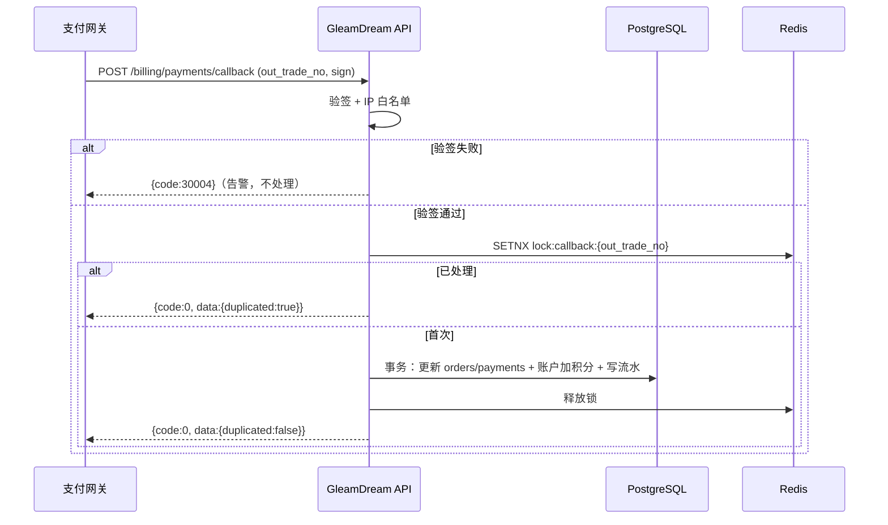
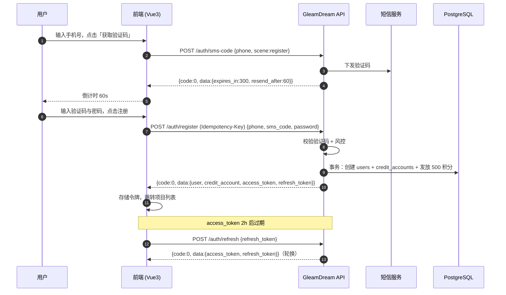
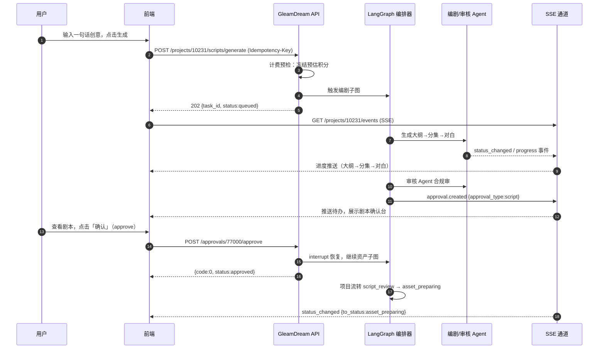
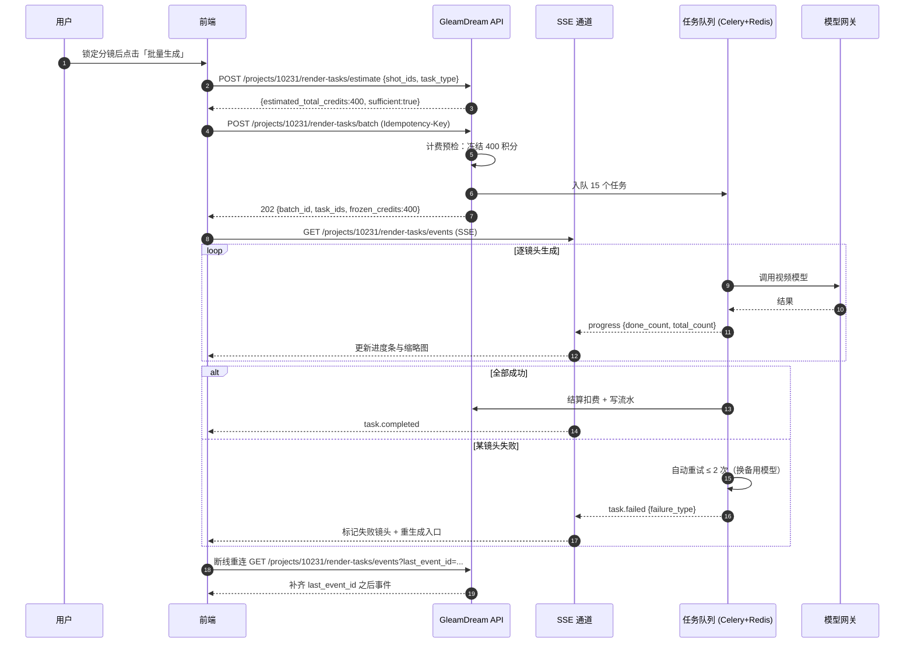

# 06 · API 接口文档（前后端联调契约）

> 本文件是「浮光造梦 · AI 短剧创作工具（GleamDream Studio）」前后端联调的**唯一接口契约**。
> 术语、实体名、状态枚举、命名规范、错误码段，全部以 `00_文档总览与术语表.md`（以下简称「00 契约」）为唯一事实来源；若本文件与 00 契约冲突，以 00 契约为准并回改本文件。
> 字段名一律 `snake_case`（与数据库一致，**不做驼峰转换**）。

| 项目 | 内容 |
|---|---|
| 文档名称 | API 接口文档 |
| 文档版本 | V2.0 |
| 协议基线 | REST + SSE，FastAPI 0.116+ / Pydantic 2 / JWT |
| 契约基线 | 对齐 00 契约 V4.0 |
| 最近更新 | 2026-10-15 |
| 主要读者 | 前端、后端、Agent 工程、测试 |

---

## 一、文档说明

### 1.1 版本策略

| 项 | 规则 |
|---|---|
| 前缀 | `/api/v1`；路径版本号为主版本号 |
| 破坏性变更 | 新增 `/api/v2`，`v1` 与 `v2` 并存；仅当 00 契约明确废弃时才移除旧版本 |
| 非破坏性变更 | 在原版本内增量发布：新增可选请求字段、新增响应字段、新增枚举取值、新增端点 |
| 废弃流程 | ① 在本文「十一、接口变更记录」登记为「已废弃」；② 响应头返回 `Deprecation: true` 与 `Sunset: <HTTP-date>`；③ 至少保留 **180 天** 双跑期；④ 到期后移除并在变更记录登记「已移除」 |
| 兼容性红线 | 不得改变既有字段语义、不得改变枚举既有取值含义、不得把可选字段改为必填 |

### 1.2 Base URL 与环境

| 环境 | Base URL | 说明 |
|---|---|---|
| dev | `https://api-dev.gleamdream.local/api/v1` | 开发联调；数据可随时清空 |
| staging | `https://api-staging.gleamdream.com/api/v1` | 预发验收；与生产同构 |
| prod | `https://api.gleamdream.com/api/v1` | 生产 |

- 所有请求与响应体：`Content-Type: application/json; charset=utf-8`，字符编码统一 **UTF-8**。
- 文件上传的二进制直传不经过本 API 域名（走对象存储预签名 URL，见 2.8）。

### 1.3 时间、金额与积分单位

| 类型 | 约定 |
|---|---|
| 时间格式 | ISO 8601 **带时区偏移**，如 `2026-10-08T15:04:05+08:00`；数据库内部统一存 UTC（`TIMESTAMPTZ`） |
| 时间字段命名 | 后缀 `_at`（与 00 契约 4.1 一致），如 `created_at`、`approved_at` |
| 时长 | 需毫秒精度的镜头/时间线字段统一为整数**毫秒**，后缀 `_ms`（如 `shots.duration_ms`、`timeline_clips.start_ms`，与 02 数据库文档一致）；业务/计划时长用整数**秒**，后缀 `_seconds`（如 `episodes.target_duration_seconds`） |
| 金额 | 整数存「分」，后缀 `_amount_cents`，如 `amount_cents = 9900` 表示 ¥99.00 |
| 积分 | 整数，后缀 `_credits`；**1 积分 = ¥0.01 计费基准**（00 契约 Q1 建议默认值） |
| 百分比/分数 | `confidence` / `score` 统一为 `0.0–1.0` 浮点；展示层自行乘 100 |

### 1.4 通用请求头

| 请求头 | 必填 | 说明 |
|---|---|---|
| `Authorization` | 除公开端点外必填 | `Bearer <access_token>` |
| `X-Request-Id` | 否 | 前端可自带；缺省由服务端生成 ULID 并回写响应 `request_id` |
| `Idempotency-Key` | 幂等写必填 | UUID v4，见 2.5 |
| `Accept-Language` | 否 | 仅影响提示文案语言，默认 `zh-CN` |
| `X-Client-Version` | 否 | 前端版本号，用于灰度与埋点 |

---

## 二、通用约定

### 2.1 统一响应包络

所有 JSON 响应体统一为四字段包络（对齐 00 契约 8.1）：

```json
{
  "code": 0,
  "message": "ok",
  "data": {},
  "request_id": "01J9Z8K3M2N4P5Q6R7S8T9V0W1"
}
```

| 字段 | 类型 | 说明 |
|---|---|---|
| `code` | integer | `0` 表示业务成功；非 0 见 2.9 错误码总表 |
| `message` | string | 人类可读提示；成功固定 `ok`，失败为可展示文案 |
| `data` | object / array / null | 业务数据；无返回体时为 `null` |
| `request_id` | string | ULID，每请求生成，贯穿日志与 Agent trace |

**HTTP 状态码与业务码解耦**（对齐 00 契约 8.1）：业务失败一般仍返回 `200`，鉴权失败返回 `401/403`，限流返回 `429`，请求体校验失败返回 `422`（FastAPI 默认）。前端应以 **`code` 字段**判断业务结果，以 HTTP 状态码判断传输/通道层结果。

**成功示例（分页）**

```json
{
  "code": 0,
  "message": "ok",
  "data": {
    "items": [
      { "project_id": "10231", "name": "都市逆袭短剧", "status": "draft" }
    ],
    "page": 1,
    "page_size": 20,
    "total": 137
  },
  "request_id": "01J9Z8K3M2N4P5Q6R7S8T9V0W1"
}
```

**业务失败示例（积分不足，HTTP 200）**

```json
{
  "code": 30001,
  "message": "积分不足，当前可用 120，所需 500",
  "data": { "available_credits": 120, "required_credits": 500 },
  "request_id": "01J9Z8K3M2N4P5Q6R7S8T9V0W2"
}
```

**鉴权失败示例（HTTP 401）**

```json
{
  "code": 20002,
  "message": "登录状态已过期，请重新登录",
  "data": null,
  "request_id": "01J9Z8K3M2N4P5Q6R7S8T9V0W3"
}
```

**状态不允许示例（HTTP 200）**

```json
{
  "code": 40001,
  "message": "项目当前状态 storyboard_review 不允许执行渲染",
  "data": { "current_status": "storyboard_review", "allowed_status": ["rendering"] },
  "request_id": "01J9Z8K3M2N4P5Q6R7S8T9V0W4"
}
```

### 2.2 分页约定

| 参数 | 位置 | 类型 | 默认 | 约束 | 说明 |
|---|---|---|---|---|---|
| `page` | query | integer | 1 | ≥ 1 | 页码，从 1 起 |
| `page_size` | query | integer | 20 | 1–100 | 每页条数 |
| `sort` | query | string | `-created_at` | 白名单字段 | 排序字段，`-` 前缀表示降序 |

响应 `data` 固定结构：`{ "items": [], "page": 1, "page_size": 20, "total": 137 }`。

### 2.3 排序约定

- `sort=-created_at` 表示按 `created_at` 降序；`sort=order_index` 表示升序。
- 多字段排序以逗号分隔：`sort=-status,order_index`（先按状态降序，再按 `order_index` 升序）。
- 各端点「可排序字段」在端点定义中明确列出；未在白名单内的字段返回 `10001 参数校验失败`。
- 未指定 `sort` 时默认 `-created_at`；分镜/台词行等有序资源默认 `order_index` 升序。

### 2.4 鉴权与令牌

| 令牌 | 载体 | 有效期 | 说明 |
|---|---|---|---|
| `access_token` | `Authorization: Bearer <token>` | 2 小时 | JWT，载荷含 `user_id`、`plan`、`exp`、`jti` |
| `refresh_token` | 请求体字段 | 30 天 | 一次性轮换（rotation）：每次刷新发放新的 refresh_token，旧 token 立即失效 |
| `sms_code` | 请求体字段 | 5 分钟 | 手机验证码，一次性使用 |

- **刷新**：`POST /api/v1/auth/refresh`；成功返回新 `access_token` + 新 `refresh_token`。
- **登出**：`POST /api/v1/auth/logout`；服务端将 `refresh_token` 的 `jti` 写入吊销名单（Redis，TTL 与 refresh 有效期一致）。`access_token` 因无状态特性在有效期内仍可用，登出后前端须立即清除本地令牌。
- **强制吊销**：账号封禁（`users.status = suspended/banned`）时，服务端主动吊销该用户全部 refresh_token，并在鉴权中间件拒绝其 access_token（返回 `20004`）。

### 2.5 幂等

| 接口类别 | 幂等机制 | 冲突行为 |
|---|---|---|
| 创建生成任务 / 生成类写操作 | 请求头 `Idempotency-Key`（UUID v4） | 同 key 且请求体一致 → 返回首次结果（`code=0`）；同 key 请求体不一致 → `10005 幂等键冲突` |
| 支付回调 | `out_trade_no` 唯一索引 | 重复回调直接丢弃并返回成功 |
| Agent 节点产物 | `idempotency_keys` 表 `sha256(project_id + node + input_hash)`（00 契约 ADR-03） | 命中则复用既有产物，不重复扣费 |

`Idempotency-Key` 服务端保留 24 小时；前端在重试同一逻辑操作时必须复用同一 key。

- **`out_trade_no` 生成规则**：`GD` + `yyyyMMddHHmmss` + 6 位随机数字，全局唯一，长度 ≤ 32，示例 `GD20261008150405123456`。

### 2.6 限流

| 维度 | 默认阈值（示例） | 说明 |
|---|---|---|
| 用户维度 | 创建生成任务按套餐并发：free 2 / pro 5 / studio 10（00 契约 Q8） | 超限返回 `60006 并发任务超限` |
| 接口维度 | 读接口 120 次/分钟；写接口 30 次/分钟 | 按 `user_id` + `endpoint` 计数 |
| IP 维度 | 未登录接口 60 次/分钟；验证码 20 次/小时 | 防刷 |
| 手机号维度 | 验证码 1 次/60 秒、10 次/天 | 对齐 F1 风控 |

**限流响应头**（每次响应均携带）：

| 响应头 | 说明 |
|---|---|
| `X-RateLimit-Limit` | 当前窗口额度 |
| `X-RateLimit-Remaining` | 剩余额度 |
| `X-RateLimit-Reset` | 窗口重置的 Unix 时间戳（秒） |
| `Retry-After` | 仅在触发限流（429）时返回，建议重试秒数 |

**429 处理建议**：前端读取 `Retry-After` 指数退避重试；连续 3 次 429 时给出「操作过于频繁」提示，不与业务错误码混淆。

### 2.7 乐观锁与并发冲突

- 资源响应体统一携带 `updated_at`（ISO 8601 带时区）。
- 更新类请求（`PATCH`/`PUT`）可选携带 `If-Unmodified-Since: <updated_at>`，或请求体携带 `expected_updated_at`。
- 若服务端当前 `updated_at` 与客户端携带值不一致，返回 **HTTP 409**：

```json
{
  "code": 10006,
  "message": "数据已被他人修改，请刷新后重试",
  "data": { "current_updated_at": "2026-10-08T15:10:00+08:00" },
  "request_id": "01J9Z8K3M2N4P5Q6R7S8T9V0W5"
}
```

- 前端处理：展示冲突提示 + 拉取最新数据（F8 流程图「后写覆盖 + 冲突提示」的接口层实现）。
- 无并发编辑场景的资源（如积分账户）不使用乐观锁。

### 2.8 文件上传（OSS 预签名直传）

统一三段式：**申请签名 → 直传对象存储 → 回调确认**。二进制内容不经过本 API 服务，仅元数据经过。

#### 2.8.1 申请预签名

`POST /api/v1/files/presign`

| 位置 | 名称 | 类型 | 必填 | 约束 | 说明 |
|---|---|---|---|---|---|
| body | `purpose` | string | 是 | 枚举见下 | 上传用途 |
| body | `file_name` | string | 是 | 1–255 字符 | 原始文件名，用于取扩展名 |
| body | `file_size_bytes` | integer | 是 | 见 2.8.3 | 文件大小，服务端校验上限 |
| body | `content_type` | string | 是 | MIME 白名单 | 如 `image/png`、`video/mp4` |
| body | `multipart` | boolean | 否 | 默认 `false` | 是否走分片上传 |
| body | `project_id` | string | 否 | — | 归属项目（`purpose=script_document` 等必填） |

`purpose` 取值：`script_document`（剧本文档）、`character_photo`（真人定制照片）、`asset_ref`（资产参考图）、`avatar`（用户头像）、`bgm_upload`（自定义配乐）、`subtitle_style_font`（字幕字体）。

**请求示例**

```json
{
  "purpose": "script_document",
  "file_name": "都市逆袭_第1-10集.docx",
  "file_size_bytes": 2048576,
  "content_type": "application/vnd.openxmlformats-officedocument.wordprocessingml.document",
  "multipart": false,
  "project_id": "10231"
}
```

**成功响应示例**

```json
{
  "code": 0,
  "message": "ok",
  "data": {
    "upload_id": "up_9f2a1c",
    "object_key": "script_document/10231/2026/10/up_9f2a1c.docx",
    "upload_url": "https://oss.gleamdream.com/gd-bucket/script_document/10231/2026/10/up_9f2a1c.docx?signature=...&expires=1800",
    "method": "PUT",
    "expires_in": 1800,
    "multipart": false,
    "part_urls": [],
    "max_size_bytes": 52428800
  },
  "request_id": "01J9Z8K3M2N4P5Q6R7S8T9V0W6"
}
```

**错误码**：`10001`、`50004`（文件非法：超出大小/格式）、`80003`（存储服务异常）。

#### 2.8.2 回调确认

`POST /api/v1/files/confirm`

| 位置 | 名称 | 类型 | 必填 | 约束 | 说明 |
|---|---|---|---|---|---|
| body | `upload_id` | string | 是 | — | 预签名返回的 `upload_id` |
| body | `object_key` | string | 是 | 与预签名一致 | 对象键 |
| body | `etag` | string | 否 | — | 对象存储返回的 ETag；分片上传必填 |
| body | `parts` | array | 否 | 分片上传必填 | `[{ "part_number": 1, "etag": "..." }]` |

服务端校验 `object_key` 归属当前用户后，落 `media_files` 记录并返回 `file_id`（后续业务使用该 `file_id` 引用，不再暴露 `object_key`）。

**成功响应示例**

```json
{
  "code": 0,
  "message": "ok",
  "data": {
    "file_id": "55120",
    "object_key": "script_document/10231/2026/10/up_9f2a1c.docx",
    "size_bytes": 2048576,
    "sha256": "b3f1...9a2c",
    "status": "ready"
  },
  "request_id": "01J9Z8K3M2N4P5Q6R7S8T9V0W7"
}
```

#### 2.8.3 大小与格式限制

| purpose | 允许格式 | 单文件上限 | 分片阈值 |
|---|---|---|---|
| `script_document` | `.txt .md .docx .pdf`（含扫描件 OCR） | 50 MB | > 10 MB 强制分片 |
| `character_photo` | `.jpg .jpeg .png .webp` | 10 MB | 不分片 |
| `asset_ref` | `.jpg .jpeg .png .webp` | 10 MB | 不分片 |
| `avatar` | `.jpg .jpeg .png .webp` | 5 MB | 不分片 |
| `bgm_upload` | `.mp3 .wav .m4a` | 50 MB | > 20 MB 分片 |
| `subtitle_style_font` | `.ttf .otf` | 20 MB | 不分片 |

分片规则：分片大小默认 5 MB，最大分片数 1000；所有分片上传完成后必须调用 `/files/confirm` 携带 `parts` 合并。

### 2.9 错误码总表

> 段位划分对齐 00 契约 8.3。下表列出 00 契约已定义码 + 本接口文档为落地补充的扩展码（**标注【扩展】**，扩展码不改变 00 契约段位语义，仅在同一段位内新增具体码）。

#### 2.9.1 成功

| code | 含义 | HTTP | 触发条件 | 前端处理建议 |
|---|---|---|---|---|
| 0 | 成功 | 200 / 201 / 202 | 业务成功 | 正常渲染 `data` |

#### 2.9.2 通用/系统（10000–19999）

| code | 含义 | HTTP | 触发条件 | 前端处理建议 |
|---|---|---|---|---|
| 10001 | 参数校验失败 | 422 | 字段类型/必填/约束/排序白名单不通过 | 定位到 `data.fields` 高亮表单 |
| 10002 | 资源不存在 | 404 | 资源 ID 不存在或已软删除 | 提示并返回上级列表 |
| 10003 | 服务内部错误 | 500 | 未捕获异常 | 提示「系统繁忙」+ 上报 `request_id` |
| 10004 | 请求过于频繁 | 429 | 触发 2.6 限流 | 读 `Retry-After` 退避重试 |
| 10005 | 幂等键冲突【扩展】 | 409 | 同 `Idempotency-Key` 请求体不一致 | 换新 key 重试并提示 |
| 10006 | 数据版本冲突【扩展】 | 409 | 乐观锁 `updated_at` 不匹配 | 拉最新数据 + 冲突提示（见 2.7） |
| 10007 | 请求体过大【扩展】 | 413 | 超出端点 body 上限 | 压缩/分批 |

#### 2.9.3 认证与授权（20000–29999）

| code | 含义 | HTTP | 触发条件 | 前端处理建议 |
|---|---|---|---|---|
| 20001 | 未登录 | 401 | 缺 `Authorization` 头 | 跳登录页 |
| 20002 | token 过期 | 401 | access_token 失效 | 静默 refresh，失败则跳登录 |
| 20003 | 无权限 | 403 | ACL 不满足（项目级 view/edit/export 或角色） | 提示无权限，禁用入口 |
| 20004 | 账号被封禁 | 403 | `users.status = suspended/banned` | 展示封禁说明页 |
| 20005 | 刷新令牌无效或已吊销【扩展】 | 401 | refresh_token 过期/已轮换/在吊销名单 | 跳登录页 |

#### 2.9.4 计费（30000–39999）

| code | 含义 | HTTP | 触发条件 | 前端处理建议 |
|---|---|---|---|---|
| 30001 | 积分不足 | 200 | 可用积分 < 冻结所需 | 弹充值引导 |
| 30002 | 预算超限 | 200 | `credit_spent + 预估 > budget` | 提示调整项目预算或充值 |
| 30003 | 订单已支付 | 200 | 对已完成订单重复支付 | 展示订单已完成 |
| 30004 | 支付回调签名错误 | 200 | 回调验签失败 | 不处理（服务端记录告警） |
| 30005 | 冻结记录不存在 | 200 | 结算/解冻时冻结单不存在 | 刷新账户后重试 |

#### 2.9.5 项目与剧本（40000–49999）

| code | 含义 | HTTP | 触发条件 | 前端处理建议 |
|---|---|---|---|---|
| 40001 | 项目状态不允许该操作 | 200 | 违反状态机流转（见第八章矩阵） | 刷新项目状态 + 提示 |
| 40002 | 剧本结构校验失败 | 200 | Schema 校验不通过 | 展示待校正字段 |
| 40003 | 解析置信度过低 | 200 | 整体置信度 < 阈值 | 进入人工校正流程 |
| 40004 | 项目已归档 | 200 | `status = archived` 下写操作 | 提示需先取消归档 |
| 40005 | 快照数量超上限【扩展】 | 200 | 已存在 30 个快照 | 提示删除旧快照 |

#### 2.9.6 资产（50000–59999）

| code | 含义 | HTTP | 触发条件 | 前端处理建议 |
|---|---|---|---|---|
| 50001 | 资产未锁定 | 200 | 下游操作要求资产已锁定 | 先完成资产确认与锁定 |
| 50002 | 人脸相似度过低 | 200 | 上传照片与生成结果相似度 < 阈值 | 提示重传清晰正脸照 |
| 50003 | 未完成真人授权 | 200 | 使用真人形象但无授权记录 | 弹出授权协议 |
| 50004 | 上传文件非法 | 422 | 格式/大小/内容不合法 | 按提示重新选择文件 |
| 50005 | 真人授权协议版本过期【扩展】 | 200 | 授权协议版本低于当前要求 | 重新签署协议 |

#### 2.9.7 分镜与生成（60000–69999）

| code | 含义 | HTTP | 触发条件 | 前端处理建议 |
|---|---|---|---|---|
| 60001 | 分镜未锁定 | 200 | 渲染前分镜未锁定 | 先锁定分镜 |
| 60002 | 任务不存在 | 404 | `task_id` 不存在 | 返回任务列表 |
| 60003 | 质检未通过 | 200 | 结果质检不合格 | 展示质检报告 + 重生成入口 |
| 60004 | 重试次数超限 | 200 | 自动重试已达 2 次 / 修正达 3 轮 | 转人工处理 |
| 60005 | 资产锚点缺失 | 200 | 镜头引用资产未生成/未锁定 | 引导补齐资产 |
| 60006 | 并发任务超限【扩展】 | 200 | 超过套餐并发生成上限 | 提示排队或升级套餐 |

#### 2.9.8 后期与导出（70000–79999）

| code | 含义 | HTTP | 触发条件 | 前端处理建议 |
|---|---|---|---|---|
| 70001 | 音画同步不达标 | 200 | 合成质检时间误差 ≥ 100ms | 展示定位时间码 |
| 70002 | 导出参数非法 | 422 | 分辨率/水印/编码参数非法 | 高亮非法参数 |
| 70003 | 权益不足 | 200 | 如 4K/去水印非当前套餐权益 | 引导升级会员 |
| 70004 | 母版尚未生成【扩展】 | 200 | 成片未确认即请求导出 | 先完成成片确认 |

#### 2.9.9 外部依赖（80000–89999）

| code | 含义 | HTTP | 触发条件 | 前端处理建议 |
|---|---|---|---|---|
| 80001 | 模型不可用 | 200 | 模型网关全部候选不可用 | 展示稍后重试 |
| 80002 | 三方审核失败 | 200 | 内容安全 API 异常 | 提示重试，不绕过 |
| 80003 | 存储服务异常 | 502 | OSS/COS 异常 | 稍后重试 |
| 80004 | 支付网关异常 | 502 | 下单/查询支付网关失败 | 稍后重试 |
| 80005 | 平台授权失效【扩展】 | 200 | 三方平台 token 过期/吊销 | 引导重新授权 |

#### 2.9.10 管理后台（90000–99999）

| code | 含义 | HTTP | 触发条件 | 前端处理建议 |
|---|---|---|---|---|
| 90001 | 配置冲突 | 200 | 配置唯一约束冲突 | 提示冲突项 |
| 90002 | 敏感词库导入失败 | 200 | 词库格式/解析失败 | 下载模板重试 |

### 2.10 SSE 事件规范

SSE 为长任务进度、审批待办推送的实时通道（对齐 00 契约 8.5）。

| 通道 | 端点 | 用途 |
|---|---|---|
| 项目事件流 | `GET /api/v1/projects/{project_id}/events` | 生成进度、任务状态、审批待办 |
| 任务进度流 | `GET /api/v1/render-tasks/{task_id}/events` | 单任务/批量任务的逐项进度 |
| 通知流 | `GET /api/v1/notifications/stream` | 站内通知（P1） |

**协议要求**

| 项 | 规则 |
|---|---|
| 响应头 | `Content-Type: text/event-stream; charset=utf-8`、`Cache-Control: no-cache`、`X-Accel-Buffering: no` |
| 心跳 | 每 **15 秒** 发送一次注释行 `: heartbeat`，用于保活与探测断线 |
| 鉴权 | SSE 使用 `Authorization` 头鉴权；浏览器 EventSource 不支持自定义头时，改用 `?access_token=` 查询参数（仅 SSE 端点允许，且在服务端日志脱敏） |
| 断线补偿 | 每个事件携带 `id:`；重连时浏览器自动发送 `Last-Event-ID` 请求头（或查询参数 `last_event_id`），服务端从该事件之后补齐（服务端保留最近 **5 分钟** / **1000 条** 事件） |
| 重连 | 服务端可下发 `retry: 3000` 建议 3 秒重连；前端实现指数退避上限 30 秒 |
| 结束 | 长任务终态时下发 `event: task.completed` 或 `event: task.failed`，前端可主动关闭连接 |

**事件类型总表**

| 事件类型（`event:`） | 触发时机 | `data` 关键字段 |
|---|---|---|
| `connected` | 连接建立 | `project_id` / `task_id`、`server_time` |
| `progress` | 进度更新 | `task_id`、`progress`（0–100）、`stage`、`done_count`、`total_count` |
| `status_changed` | 状态机流转 | `entity_type`、`entity_id`、`from_status`、`to_status` |
| `task.completed` | 任务成功 | `task_id`、`output_count` |
| `task.failed` | 任务失败 | `task_id`、`failure_type`、`message` |
| `approval.created` | 新增待办 | `approval_id`、`approval_type` |
| `notification` | 站内通知 | `notification_id`、`title` |
| `ping` | 心跳 | `server_time` |

**事件示例**

```
id: 0000000000000042
event: progress
retry: 3000
data: {"task_id":"83012","progress":45,"stage":"video_generating","done_count":9,"total_count":20}

: heartbeat
```

**`data` 结构约定**

| 事件 | data 示例 |
|---|---|
| `progress` | `{"task_id":"83012","progress":45,"stage":"video_generating","done_count":9,"total_count":20}` |
| `status_changed` | `{"entity_type":"project","entity_id":"10231","from_status":"rendering","to_status":"post_producing"}` |
| `task.completed` | `{"task_id":"83012","output_count":20}` |
| `approval.created` | `{"approval_id":"77001","approval_type":"storyboard"}` |

> 说明：SSE 仅用于**服务端 → 前端**推送；前端主动操作（approve/reject/取消）仍走普通 REST 写接口。

---

## 三、接口总览

| # | 模块 | 端点数 | 前缀 |
|---|---|---|---|
| 1 | 认证与账号 | 15 | `/auth`、`/users` |
| 2 | 计费与订阅 | 13 | `/billing` |
| 3 | 项目 | 16 | `/projects` |
| 4 | 剧本 | 19 | `/scripts`、`/episodes`、`/scenes`、`/lines` |
| 5 | 资产 | 14 | `/assets` |
| 6 | 分镜 | 17 | `/storyboards`、`/shots` |
| 7 | 生成任务 | 10 | `/render-tasks` |
| 8 | 质检与合规 | 5 | `/qc-reports`、`/compliance-flags` |
| 9 | 后期 | 11 | `/episodes`、`/timelines` |
| 10 | 导出与分发 | 10 | `/exports`、`/distribution` |
| 11 | 审批 | 6 | `/approvals` |
| 12 | 模型与配置 | 6 | `/models`、`/style-presets` 等 |
| 13 | 通知与系统 | 6 | `/notifications`、`/health` |
| — | **合计** | **148** | — |

> 另有通用文件端点 2 个（`/files/presign`、`/files/confirm`），见 2.8，不计入业务模块。
> 权限列取值：`公开`（无需登录）、`登录`（任意登录用户）、`view` / `edit` / `export`（项目级 ACL，见 00 契约 7.2）、`管理员`。

---

## 四、模块一 · 认证与账号

### 4.1 端点总览

| # | 方法 | 路径 | 用途 | 权限 | 幂等 | 限流 |
|---|---|---|---|---|---|---|
| A1 | POST | `/auth/sms-code` | 发送短信验证码 | 公开 | 天然（60s 频控） | 手机号 1/60s，IP 20/h |
| A2 | POST | `/auth/register` | 手机号注册 | 公开 | `Idempotency-Key` | IP 10/h |
| A3 | POST | `/auth/login/password` | 密码登录 | 公开 | 否 | IP 30/min |
| A4 | POST | `/auth/login/sms` | 验证码登录 | 公开 | 否 | IP 30/min |
| A5 | POST | `/auth/wechat/login` | 微信登录 | 公开 | 否 | IP 30/min |
| A6 | POST | `/auth/wechat/bind` | 绑定微信身份 | 登录 | 否 | 用户 5/min |
| A7 | POST | `/auth/refresh` | 刷新令牌 | 公开 | 否 | IP 60/min |
| A8 | POST | `/auth/logout` | 登出并吊销 | 登录 | 是 | 用户 10/min |
| A9 | POST | `/auth/password/reset` | 重置密码 | 公开 | 否 | IP 10/h |
| A10 | GET | `/users/me` | 当前用户信息 | 登录 | — | 读接口 |
| A11 | PATCH | `/users/me` | 更新个人资料 | 登录 | 否 | 写接口 |
| A12 | GET | `/users/me/preferences` | 查询偏好设置 | 登录 | — | 读接口 |
| A13 | PUT | `/users/me/preferences` | 更新偏好设置 | 登录 | 否 | 写接口 |
| A14 | GET | `/users/me/identities` | 三方身份列表 | 登录 | — | 读接口 |
| A15 | DELETE | `/users/me/identities/{identity_id}` | 解绑三方身份 | 登录 | 是 | 用户 5/min |

### 4.2 端点定义

#### A1 发送短信验证码

- **方法与路径**：`POST /api/v1/auth/sms-code`
- **用途**：向手机号发送登录/注册/重置密码用验证码。
- **权限**：公开
- **幂等**：天然幂等（同手机号 60 秒内只发一次，重复请求返回同一 `expires_in`）
- **限流**：手机号 1 次/60 秒、10 次/天；IP 20 次/小时
- **状态机前置**：无

**请求体**

| 位置 | 名称 | 类型 | 必填 | 约束 | 说明 |
|---|---|---|---|---|---|
| body | `phone` | string | 是 | `^1[3-9]\d{9}$` | 手机号 |
| body | `scene` | string | 是 | `register` / `login` / `reset_password` | 使用场景 |

```json
{ "phone": "13800138000", "scene": "login" }
```

**成功响应**

```json
{
  "code": 0,
  "message": "ok",
  "data": { "expires_in": 300, "resend_after": 60 },
  "request_id": "01J9Z8K3M2N4P5Q6R7S8T9V0W8"
}
```

**错误码**：`10001` 参数校验失败、`10004` 请求过于频繁。

#### A2 手机号注册

- **方法与路径**：`POST /api/v1/auth/register`
- **用途**：手机号 + 验证码注册，同时创建积分账户并发放首充赠送积分（00 契约 Q1 建议：首充赠 500 积分）。
- **权限**：公开
- **幂等**：是（`Idempotency-Key` 必填；同 key 返回首次结果）
- **限流**：IP 10 次/小时
- **状态机前置**：无

**请求体**

| 位置 | 名称 | 类型 | 必填 | 约束 | 说明 |
|---|---|---|---|---|---|
| body | `phone` | string | 是 | 手机号正则 | 手机号 |
| body | `sms_code` | string | 是 | 6 位数字 | 验证码 |
| body | `password` | string | 是 | 8–32 位，含字母与数字 | 登录密码 |
| body | `nickname` | string | 否 | 1–32 字符 | 昵称，缺省按手机号掩码生成 |
| body | `invite_code` | string | 否 | ≤ 16 字符 | 邀请码【假设待确认】 |

```json
{
  "phone": "13800138000",
  "sms_code": "123456",
  "password": "Passw0rd123",
  "nickname": "浮光用户"
}
```

**成功响应（HTTP 201）**

```json
{
  "code": 0,
  "message": "ok",
  "data": {
    "user": {
      "user_id": "88001",
      "phone": "138****8000",
      "nickname": "浮光用户",
      "avatar_url": null,
      "status": "active",
      "plan": "free",
      "created_at": "2026-10-08T15:04:05+08:00"
    },
    "credit_account": { "balance_credits": 500, "frozen_credits": 0 },
    "access_token": "eyJhbGciOi...",
    "refresh_token": "eyJhbGciOi...",
    "token_type": "Bearer",
    "expires_in": 7200
  },
  "request_id": "01J9Z8K3M2N4P5Q6R7S8T9V0W9"
}
```

**错误码**：`10001`、`10004`、`10005`、`90002`（涉及昵称敏感词时）。

#### A3 密码登录

- **方法与路径**：`POST /api/v1/auth/login/password`
- **用途**：手机号 + 密码登录。
- **权限**：公开
- **幂等**：否
- **限流**：IP 30 次/分钟；同账号连续失败 5 次锁定 15 分钟
- **状态机前置**：无

**请求体**

| 位置 | 名称 | 类型 | 必填 | 约束 | 说明 |
|---|---|---|---|---|---|
| body | `phone` | string | 是 | 手机号正则 | 手机号 |
| body | `password` | string | 是 | 8–32 位 | 密码 |
| body | `device_id` | string | 否 | ≤ 64 字符 | 设备指纹，用于风控 |

```json
{ "phone": "13800138000", "password": "Passw0rd123", "device_id": "web-9f2a1c" }
```

**成功响应**：结构同 A2 的 `data`（含 `user`、`credit_account`、令牌三件套）。

**错误码**：`10001`、`10004`、`20004`（账号被封禁）。

#### A4 验证码登录

- **方法与路径**：`POST /api/v1/auth/login/sms`
- **用途**：手机号 + 短信验证码登录；手机号未注册时自动注册（合并注册/登录流程）。
- **权限**：公开
- **幂等**：否
- **限流**：IP 30 次/分钟
- **状态机前置**：无

**请求体**

| 位置 | 名称 | 类型 | 必填 | 约束 | 说明 |
|---|---|---|---|---|---|
| body | `phone` | string | 是 | 手机号正则 | 手机号 |
| body | `sms_code` | string | 是 | 6 位数字 | 验证码 |
| body | `device_id` | string | 否 | ≤ 64 字符 | 设备指纹 |
| body | `auto_register` | boolean | 否 | 默认 `true` | 未注册时是否自动注册 |

```json
{ "phone": "13800138000", "sms_code": "123456", "auto_register": true }
```

**成功响应**：结构同 A2 的 `data`；若为新注册用户，`data` 额外含 `is_new_user": true`。

**错误码**：`10001`、`10004`、`20004`。

#### A5 微信登录

- **方法与路径**：`POST /api/v1/auth/wechat/login`
- **用途**：使用微信授权 `code` 换取 openid/unionid，完成登录或注册（`user_identities` 落身份）。
- **权限**：公开
- **幂等**：否
- **限流**：IP 30 次/分钟
- **状态机前置**：无

**请求体**

| 位置 | 名称 | 类型 | 必填 | 约束 | 说明 |
|---|---|---|---|---|---|
| body | `code` | string | 是 | ≤ 128 字符 | 微信授权临时凭证 |
| body | `state` | string | 否 | ≤ 64 字符 | 防 CSRF，前端回传校验 |

```json
{ "code": "081xY0Ga1...", "state": "gd-web" }
```

**成功响应**：结构同 A2 的 `data`；未绑手机号的微信新用户返回 `data.need_bind_phone = true` 且不发放长期令牌（仅发一次性 `bind_ticket`）。

```json
{
  "code": 0,
  "message": "ok",
  "data": {
    "need_bind_phone": true,
    "bind_ticket": "bt_7c1f...",
    "openid_masked": "oX3***9f"
  },
  "request_id": "01J9Z8K3M2N4P5Q6R7S8T9V0WA"
}
```

**错误码**：`10001`、`10004`、`20004`、`80002`（微信侧校验失败）。

#### A6 绑定微信身份

- **方法与路径**：`POST /api/v1/auth/wechat/bind`
- **用途**：登录用户绑定微信身份（写入 `user_identities`）；也用于 A5 返回 `need_bind_phone` 场景下用 `bind_ticket` + 手机验证码完成绑定登录。
- **权限**：登录（`bind_ticket` 场景为公开）
- **幂等**：否
- **限流**：用户 5 次/分钟
- **状态机前置**：无

**请求体**

| 位置 | 名称 | 类型 | 必填 | 约束 | 说明 |
|---|---|---|---|---|---|
| body | `code` | string | 否 | ≤ 128 字符 | 微信授权 `code`（已登录场景） |
| body | `bind_ticket` | string | 否 | — | A5 返回的一次性票据（新用户场景） |
| body | `phone` | string | 否 | 手机号正则 | 新用户场景必填 |
| body | `sms_code` | string | 否 | 6 位数字 | 新用户场景必填 |

> `code` 与 `bind_ticket` 二选一必填。

```json
{ "bind_ticket": "bt_7c1f...", "phone": "13800138000", "sms_code": "123456" }
```

**成功响应**：`data` 为绑定后的 `user` 与令牌（结构同 A2）。已存在同 `unionid` 账号时直接登录并返回该账号令牌。

**错误码**：`10001`、`10004`、`20003`（身份已绑定其他账号）。

#### A7 刷新令牌

- **方法与路径**：`POST /api/v1/auth/refresh`
- **用途**：以 `refresh_token` 换取新的令牌对（轮换式）。
- **权限**：公开
- **幂等**：否（refresh_token 一次性）
- **限流**：IP 60 次/分钟
- **状态机前置**：无

**请求体**

| 位置 | 名称 | 类型 | 必填 | 约束 | 说明 |
|---|---|---|---|---|---|
| body | `refresh_token` | string | 是 | — | 当前 refresh_token |

```json
{ "refresh_token": "eyJhbGciOi..." }
```

**成功响应**

```json
{
  "code": 0,
  "message": "ok",
  "data": {
    "access_token": "eyJhbGciOi...",
    "refresh_token": "eyJhbGciOi...",
    "token_type": "Bearer",
    "expires_in": 7200
  },
  "request_id": "01J9Z8K3M2N4P5Q6R7S8T9V0WB"
}
```

**错误码**：`10001`、`20001`、`20005`。

#### A8 登出

- **方法与路径**：`POST /api/v1/auth/logout`
- **用途**：吊销当前 refresh_token；`all_devices=true` 时吊销该用户全部 refresh_token。
- **权限**：登录
- **幂等**：是（重复登出仍返回成功）
- **限流**：用户 10 次/分钟
- **状态机前置**：无

**请求体**

| 位置 | 名称 | 类型 | 必填 | 约束 | 说明 |
|---|---|---|---|---|---|
| body | `refresh_token` | string | 是 | — | 待吊销令牌 |
| body | `all_devices` | boolean | 否 | 默认 `false` | 是否吊销全部设备 |

```json
{ "refresh_token": "eyJhbGciOi...", "all_devices": false }
```

**成功响应**

```json
{ "code": 0, "message": "ok", "data": { "revoked": true }, "request_id": "01J9Z8K3M2N4P5Q6R7S8T9V0WC" }
```

**错误码**：`10001`、`20001`。

#### A9 重置密码

- **方法与路径**：`POST /api/v1/auth/password/reset`
- **用途**：凭手机验证码重置密码，成功后吊销该用户全部会话。
- **权限**：公开
- **幂等**：否
- **限流**：IP 10 次/小时
- **状态机前置**：无

**请求体**

| 位置 | 名称 | 类型 | 必填 | 约束 | 说明 |
|---|---|---|---|---|---|
| body | `phone` | string | 是 | 手机号正则 | 手机号 |
| body | `sms_code` | string | 是 | 6 位数字 | 验证码 |
| body | `new_password` | string | 是 | 8–32 位，含字母与数字 | 新密码 |

```json
{ "phone": "13800138000", "sms_code": "123456", "new_password": "NewPass123" }
```

**成功响应**：`data: { "reset": true }`。

**错误码**：`10001`、`10004`。

#### A10 当前用户信息

- **方法与路径**：`GET /api/v1/users/me`
- **用途**：获取当前登录用户资料与套餐概要。
- **权限**：登录
- **幂等**：—（读）
- **限流**：读接口
- **状态机前置**：无

**请求参数**：无。

**成功响应**

```json
{
  "code": 0,
  "message": "ok",
  "data": {
    "user_id": "88001",
    "phone": "138****8000",
    "nickname": "浮光用户",
    "avatar_url": "https://cdn.gleamdream.com/avatar/88001.png",
    "status": "active",
    "plan": "pro",
    "benefits": { "max_resolution": "1080p", "no_watermark": true, "max_concurrency": 5 },
    "created_at": "2026-10-08T15:04:05+08:00",
    "updated_at": "2026-10-08T16:00:00+08:00"
  },
  "request_id": "01J9Z8K3M2N4P5Q6R7S8T9V0WD"
}
```

**错误码**：`20001`、`20002`。

#### A11 更新个人资料

- **方法与路径**：`PATCH /api/v1/users/me`
- **用途**：更新昵称、头像。
- **权限**：登录
- **幂等**：否（可用 `If-Unmodified-Since` 做乐观锁）
- **限流**：写接口
- **状态机前置**：无

**请求体**

| 位置 | 名称 | 类型 | 必填 | 约束 | 说明 |
|---|---|---|---|---|---|
| body | `nickname` | string | 否 | 1–32 字符 | 昵称 |
| body | `avatar_file_id` | string | 否 | 已确认的媒体文件 ID | 头像，需先经 2.8 上传 |

```json
{ "nickname": "浮光用户", "avatar_file_id": "55120" }
```

**成功响应**：`data` 为更新后的 `user`（同 A10）。**错误码**：`10001`、`10006`、`20001`、`50004`。

#### A12 查询偏好设置

- **方法与路径**：`GET /api/v1/users/me/preferences`
- **用途**：查询默认画风、默认分辨率、语言、通知开关等。
- **权限**：登录
- **幂等**：—（读）
- **限流**：读接口
- **状态机前置**：无

**成功响应**

```json
{
  "code": 0,
  "message": "ok",
  "data": {
    "default_style_preset_key": "live_action",
    "default_aspect_ratio": "9:16",
    "default_resolution": "1080p",
    "language": "zh-CN",
    "notification": { "task": true, "approval": true, "billing": true, "marketing": false }
  },
  "request_id": "01J9Z8K3M2N4P5Q6R7S8T9V0WE"
}
```

**错误码**：`20001`。

#### A13 更新偏好设置

- **方法与路径**：`PUT /api/v1/users/me/preferences`
- **用途**：整体覆盖偏好设置（未传字段保持默认）。
- **权限**：登录
- **幂等**：是（PUT 幂等）
- **限流**：写接口
- **状态机前置**：无

**请求体**：字段同 A12 响应 `data`。`default_style_preset_key` 取值须为 00 契约 6.7 中 `projects.style_preset_key` 的合法值；`default_aspect_ratio` 取值 `9:16` / `16:9` / `1:1`。

```json
{
  "default_style_preset_key": "anime",
  "default_aspect_ratio": "9:16",
  "default_resolution": "1080p",
  "language": "zh-CN",
  "notification": { "task": true, "approval": true, "billing": true, "marketing": false }
}
```

**成功响应**：`data` 为保存后的偏好设置。**错误码**：`10001`、`20001`。

#### A14 三方身份列表

- **方法与路径**：`GET /api/v1/users/me/identities`
- **用途**：查询已绑定的三方登录身份。
- **权限**：登录
- **幂等**：—（读）
- **限流**：读接口
- **状态机前置**：无

**成功响应**

```json
{
  "code": 0,
  "message": "ok",
  "data": {
    "items": [
      { "identity_id": "66001", "provider": "wechat", "provider_uid_masked": "oX3***9f", "bound_at": "2026-10-08T15:10:00+08:00" }
    ]
  },
  "request_id": "01J9Z8K3M2N4P5Q6R7S8T9V0WF"
}
```

`provider` 取值：`wechat` / `apple`（对齐 00 契约域 A `user_identities`）。

**错误码**：`20001`。

#### A15 解绑三方身份

- **方法与路径**：`DELETE /api/v1/users/me/identities/{identity_id}`
- **用途**：解绑三方身份；若解绑后账号无任何可用登录方式（无密码且无其他身份）则拒绝。
- **权限**：登录
- **幂等**：是（已解绑返回成功）
- **限流**：用户 5 次/分钟
- **状态机前置**：无

**路径参数**

| 位置 | 名称 | 类型 | 必填 | 约束 | 说明 |
|---|---|---|---|---|---|
| path | `identity_id` | string | 是 | 数字串 | 身份 ID |

**成功响应**：`data: { "unbound": true }`。

**错误码**：`10001`、`10002`、`20001`、`20003`（解绑后无可用登录方式）。

---

## 五、模块二 · 计费与订阅

### 5.1 端点总览

| # | 方法 | 路径 | 用途 | 权限 | 幂等 | 限流 |
|---|---|---|---|---|---|---|
| B1 | GET | `/billing/plans` | 套餐列表 | 登录 | — | 读接口 |
| B2 | GET | `/billing/subscription` | 当前订阅 | 登录 | — | 读接口 |
| B3 | POST | `/billing/subscription` | 订阅/变更套餐 | 登录 | `Idempotency-Key` | 用户 5/min |
| B4 | DELETE | `/billing/subscription` | 取消订阅 | 登录 | 是 | 用户 5/min |
| B5 | GET | `/billing/credits/account` | 积分账户 | 登录 | — | 读接口 |
| B6 | GET | `/billing/credits/transactions` | 积分流水 | 登录 | — | 读接口 |
| B7 | GET | `/billing/credits/freezes` | 冻结记录 | 登录 | — | 读接口 |
| B8 | POST | `/billing/orders` | 充值下单 | 登录 | `Idempotency-Key` | 用户 10/min |
| B9 | GET | `/billing/orders` | 订单列表 | 登录 | — | 读接口 |
| B10 | GET | `/billing/orders/{order_id}` | 订单详情 | 登录 | — | 读接口 |
| B11 | POST | `/billing/payments/callback` | 支付回调 | 公开（验签） | `out_trade_no` | 网关白名单 |
| B12 | POST | `/billing/orders/{order_id}/reconcile` | 对账补单 | 登录 | 是 | 用户 5/min |
| B13 | GET | `/billing/price-rules` | 计费单价规则 | 登录 | — | 读接口 |

### 5.2 端点定义

#### B1 套餐列表

- **方法与路径**：`GET /api/v1/billing/plans`
- **用途**：列出 free/pro/studio 三档套餐及月/年价格与权益位。
- **权限**：登录
- **幂等**：—（读）
- **限流**：读接口
- **状态机前置**：无

**查询参数**

| 位置 | 名称 | 类型 | 必填 | 约束 | 说明 |
|---|---|---|---|---|---|
| query | `billing_cycle` | string | 否 | `monthly` / `yearly` | 过滤周期，缺省返回全部 |

**成功响应**

```json
{
  "code": 0,
  "message": "ok",
  "data": {
    "items": [
      {
        "plan_key": "free",
        "name": "免费版",
        "billing_cycle": "monthly",
        "price_amount_cents": 0,
        "benefits": { "max_resolution": "720p", "no_watermark": false, "max_concurrency": 2 },
        "monthly_credits": 0,
        "features": ["草稿模式", "720p 导出（带水印）"]
      },
      {
        "plan_key": "pro",
        "name": "专业版",
        "billing_cycle": "monthly",
        "price_amount_cents": 9900,
        "benefits": { "max_resolution": "1080p", "no_watermark": true, "max_concurrency": 5 },
        "monthly_credits": 20000,
        "features": ["1080p 无水印导出", "5 路并发"]
      }
    ]
  },
  "request_id": "01J9Z8K3M2N4P5Q6R7S8T9V0WG"
}
```

`plan_key` 取值对齐 00 契约 3.2：`free` / `pro` / `studio`。**错误码**：`20001`。

#### B2 当前订阅

- **方法与路径**：`GET /api/v1/billing/subscription`
- **用途**：查询当前生效订阅（`subscriptions`）。
- **权限**：登录
- **幂等**：—（读）
- **限流**：读接口
- **状态机前置**：无

**成功响应**

```json
{
  "code": 0,
  "message": "ok",
  "data": {
    "subscription_id": "44001",
    "plan_key": "pro",
    "status": "active",
    "current_period_start": "2026-10-01T00:00:00+08:00",
    "current_period_end": "2026-11-01T00:00:00+08:00",
    "auto_renew": true,
    "cancel_at_period_end": false
  },
  "request_id": "01J9Z8K3M2N4P5Q6R7S8T9V0WH"
}
```

未订阅时返回 free 档默认值（`subscription_id` 为 `null`，`plan_key` 为 `free`）。**错误码**：`20001`。

#### B3 订阅/变更套餐

- **方法与路径**：`POST /api/v1/billing/subscription`
- **用途**：订阅或升级/降级套餐；生成订单并返回支付参数（支付成功后由 B11 回调激活）。
- **权限**：登录
- **幂等**：是（`Idempotency-Key` 必填）
- **限流**：用户 5 次/分钟
- **状态机前置**：无

**请求体**

| 位置 | 名称 | 类型 | 必填 | 约束 | 说明 |
|---|---|---|---|---|---|
| body | `plan_key` | string | 是 | `pro` / `studio` | 目标套餐 |
| body | `billing_cycle` | string | 是 | `monthly` / `yearly` | 计费周期 |
| body | `pay_channel` | string | 是 | `wechat` / `alipay` | 支付渠道（00 契约 Q5 建议双通道） |

```json
{ "plan_key": "pro", "billing_cycle": "yearly", "pay_channel": "wechat" }
```

**成功响应（HTTP 201）**

```json
{
  "code": 0,
  "message": "ok",
  "data": {
    "order_id": "71001",
    "out_trade_no": "GD20261008150405123456",
    "amount_cents": 99000,
    "pay_channel": "wechat",
    "status": "created",
    "pay_params": { "prepay_id": "wx201410272009395522657a690389285100", "nonce_str": "abc123", "sign": "..." },
    "expires_at": "2026-10-08T15:19:05+08:00"
  },
  "request_id": "01J9Z8K3M2N4P5Q6R7S8T9V0WI"
}
```

**错误码**：`10001`、`10005`、`30003`（已有同套餐有效订阅）、`80004`。

#### B4 取消订阅

- **方法与路径**：`DELETE /api/v1/billing/subscription`
- **用途**：取消自动续费；`immediate=true` 时立即降级（当前周期剩余权益仍保留至周期末，除非指定立即降级）。
- **权限**：登录
- **幂等**：是
- **限流**：用户 5 次/分钟
- **状态机前置**：无

**请求体**

| 位置 | 名称 | 类型 | 必填 | 约束 | 说明 |
|---|---|---|---|---|---|
| body | `immediate` | boolean | 否 | 默认 `false` | 是否立即降级为 free |
| body | `cancel_at_period_end` | boolean | 否 | 默认 `true` | 周期末取消 |

```json
{ "cancel_at_period_end": true, "immediate": false }
```

**成功响应**

```json
{
  "code": 0,
  "message": "ok",
  "data": { "status": "active", "cancel_at_period_end": true, "current_period_end": "2026-11-01T00:00:00+08:00" },
  "request_id": "01J9Z8K3M2N4P5Q6R7S8T9V0WJ"
}
```

**错误码**：`10001`、`20001`。

#### B5 积分账户

- **方法与路径**：`GET /api/v1/billing/credits/account`
- **用途**：查询积分账户余额、冻结额、累计消耗。
- **权限**：登录
- **幂等**：—（读）
- **限流**：读接口
- **状态机前置**：无

**成功响应**

```json
{
  "code": 0,
  "message": "ok",
  "data": {
    "account_id": "33001",
    "balance_credits": 18250,
    "frozen_credits": 2000,
    "available_credits": 16250,
    "total_consumed_credits": 15800,
    "currency_base": "1 积分 = ¥0.01",
    "updated_at": "2026-10-08T16:00:00+08:00"
  },
  "request_id": "01J9Z8K3M2N4P5Q6R7S8T9V0WK"
}
```

> `available_credits = balance_credits - frozen_credits`（对齐 00 契约术语：冻结 ≠ 扣除）。

**错误码**：`20001`。

#### B6 积分流水

- **方法与路径**：`GET /api/v1/billing/credits/transactions`
- **用途**：分页查询积分流水（只追加账本）。
- **权限**：登录
- **幂等**：—（读）
- **限流**：读接口
- **状态机前置**：无

**查询参数**

| 位置 | 名称 | 类型 | 必填 | 约束 | 说明 |
|---|---|---|---|---|---|
| query | `transaction_type` | string | 否 | `grant` / `recharge` / `freeze` / `unfreeze` / `settle` / `refund` / `expire` / `adjust` | 类型过滤 |
| query | `project_id` | string | 否 | — | 按项目过滤 |
| query | `start_at` | string | 否 | ISO 8601 | 起始时间 |
| query | `end_at` | string | 否 | ISO 8601 | 结束时间 |
| query | `page` / `page_size` / `sort` | — | 否 | 白名单 `-created_at` | 分页排序 |

**成功响应**

```json
{
  "code": 0,
  "message": "ok",
  "data": {
    "items": [
      {
        "transaction_id": "99001",
        "transaction_type": "settle",
        "delta_credits": -120,
        "balance_after_credits": 18250,
        "project_id": "10231",
        "render_task_id": "83012",
        "model_key": "video_std_v2",
        "unit_price_credits_per_second": 8,
        "duration_seconds": 15,
        "remark": "镜头 #37 生成结算",
        "created_at": "2026-10-08T15:42:10+08:00"
      }
    ],
    "page": 1, "page_size": 20, "total": 214
  },
  "request_id": "01J9Z8K3M2N4P5Q6R7S8T9V0WL"
}
```

**错误码**：`10001`、`20001`。

#### B7 冻结记录

- **方法与路径**：`GET /api/v1/billing/credits/freezes`
- **用途**：查询冻结记录（含 30 分钟自动解冻状态，`credit_freezes`）。
- **权限**：登录
- **幂等**：—（读）
- **限流**：读接口
- **状态机前置**：无

**查询参数**

| 位置 | 名称 | 类型 | 必填 | 约束 | 说明 |
|---|---|---|---|---|---|
| query | `status` | string | 否 | `frozen` / `settled` / `released` / `expired` | 冻结状态【假设待确认：状态枚举由 02 数据库文档最终定义】 |
| query | `project_id` | string | 否 | — | 项目过滤 |

**成功响应**

```json
{
  "code": 0,
  "message": "ok",
  "data": {
    "items": [
      {
        "freeze_id": "66012",
        "project_id": "10231",
        "render_task_id": "83012",
        "frozen_credits": 2000,
        "status": "frozen",
        "expires_at": "2026-10-08T16:12:10+08:00",
        "created_at": "2026-10-08T15:42:10+08:00"
      }
    ],
    "page": 1, "page_size": 20, "total": 8
  },
  "request_id": "01J9Z8K3M2N4P5Q6R7S8T9V0WM"
}
```

**错误码**：`10001`、`20001`。

#### B8 充值下单

- **方法与路径**：`POST /api/v1/billing/orders`
- **用途**：创建积分充值订单（`orders.status = created`），返回支付参数。
- **权限**：登录
- **幂等**：是（`Idempotency-Key` 必填）
- **限流**：用户 10 次/分钟
- **状态机前置**：无

**请求体**

| 位置 | 名称 | 类型 | 必填 | 约束 | 说明 |
|---|---|---|---|---|---|
| body | `package_key` | string | 是 | 充值包枚举 | 积分充值包标识 |
| body | `credits` | integer | 否 | ≥ 100 | 自定义积分数量（与 `package_key` 二选一） |
| body | `pay_channel` | string | 是 | `wechat` / `alipay` | 支付渠道 |

```json
{ "package_key": "credits_20000", "pay_channel": "alipay" }
```

**成功响应（HTTP 201）**

```json
{
  "code": 0,
  "message": "ok",
  "data": {
    "order_id": "71002",
    "out_trade_no": "GD20261008150500112233",
    "order_type": "credit_recharge",
    "credits": 20000,
    "bonus_credits": 2000,
    "amount_cents": 20000,
    "pay_channel": "alipay",
    "status": "created",
    "pay_params": { "trade_no": "2026100822001...", "pay_url": "https://..." },
    "expires_at": "2026-10-08T15:20:00+08:00"
  },
  "request_id": "01J9Z8K3M2N4P5Q6R7S8T9V0WN"
}
```

**错误码**：`10001`、`10005`、`80004`。

#### B9 订单列表

- **方法与路径**：`GET /api/v1/billing/orders`
- **用途**：分页查询订单（`orders.status`：`created` / `paying` / `paid` / `failed` / `refunded` / `closed`）。
- **权限**：登录
- **幂等**：—（读）
- **限流**：读接口
- **状态机前置**：无

**查询参数**

| 位置 | 名称 | 类型 | 必填 | 约束 | 说明 |
|---|---|---|---|---|---|
| query | `status` | string | 否 | 枚举见上 | 状态过滤 |
| query | `order_type` | string | 否 | `subscription` / `credit_recharge` | 类型过滤 |
| query | `page` / `page_size` / `sort` | — | 否 | 白名单 `-created_at` | 分页排序 |

**成功响应**：`data.items[]` 元素结构同 B10。

**错误码**：`10001`、`20001`。

#### B10 订单详情

- **方法与路径**：`GET /api/v1/billing/orders/{order_id}`
- **用途**：查询单个订单与最新支付状态。
- **权限**：登录（仅本人/本团队订单）
- **幂等**：—（读）
- **限流**：读接口
- **状态机前置**：无

**成功响应**

```json
{
  "code": 0,
  "message": "ok",
  "data": {
    "order_id": "71002",
    "order_type": "credit_recharge",
    "out_trade_no": "GD20261008150500112233",
    "credits": 20000,
    "bonus_credits": 2000,
    "amount_cents": 20000,
    "status": "paid",
    "pay_channel": "alipay",
    "paid_at": "2026-10-08T15:06:12+08:00",
    "created_at": "2026-10-08T15:05:00+08:00"
  },
  "request_id": "01J9Z8K3M2N4P5Q6R7S8T9V0WO"
}
```

**错误码**：`10001`、`10002`、`20003`。

#### B11 支付回调

- **方法与路径**：`POST /api/v1/billing/payments/callback`
- **用途**：接收微信/支付宝异步通知，验签通过且幂等校验后完成积分到账/订阅激活。
- **权限**：公开（验签 + IP 白名单）
- **幂等**：是（`out_trade_no` 唯一索引；重复回调丢弃并返回成功）
- **限流**：不适用（网关白名单）
- **状态机前置**：无

> 详细验签算法、重试策略见第十七章 Webhook 与回调规范。

**请求体（微信支付示例）**

| 位置 | 名称 | 类型 | 必填 | 约束 | 说明 |
|---|---|---|---|---|---|
| body | `out_trade_no` | string | 是 | ≤ 32，匹配订单 | 商户订单号 |
| body | `transaction_id` | string | 是 | — | 网关流水号 |
| body | `trade_state` | string | 是 | `SUCCESS` 等 | 交易状态 |
| body | `amount_cents` | integer | 是 | 与订单一致 | 实付金额（分） |
| body | `sign` | string | 是 | — | 签名 |

```json
{
  "out_trade_no": "GD20261008150500112233",
  "transaction_id": "4200001234202610081111222333",
  "trade_state": "SUCCESS",
  "amount_cents": 20000,
  "sign": "9A0B...FF"
}
```

**成功响应（网关要求返回成功标识）**

```json
{ "code": 0, "message": "ok", "data": { "received": true, "duplicated": false }, "request_id": "01J9Z8K3M2N4P5Q6R7S8T9V0WP" }
```

**错误码**：`10001`、`30004`（签名错误；服务端记录告警并返回失败）、`30003`（已支付，幂等返回成功）。

#### B12 对账补单

- **方法与路径**：`POST /api/v1/billing/orders/{order_id}/reconcile`
- **用途**：对支付回调丢失的订单主动向网关查询并补单（F1 异常分支「T+1 拉取网关账单补单」）。
- **权限**：登录（仅本人/本团队订单）
- **幂等**：是（对同一订单重复调用返回同一结果）
- **限流**：用户 5 次/分钟
- **状态机前置**：无

**成功响应**

```json
{
  "code": 0,
  "message": "ok",
  "data": { "order_id": "71002", "status": "paid", "reconciled": true, "gateway_trade_state": "SUCCESS" },
  "request_id": "01J9Z8K3M2N4P5Q6R7S8T9V0WQ"
}
```

**错误码**：`10001`、`10002`、`20003`、`80004`。

#### B13 计费单价规则

- **方法与路径**：`GET /api/v1/billing/price-rules`
- **用途**：查询模型计费单价规则（`price_rules`），供成本预估与流水解释。
- **权限**：登录
- **幂等**：—（读）
- **限流**：读接口
- **状态机前置**：无

**查询参数**

| 位置 | 名称 | 类型 | 必填 | 约束 | 说明 |
|---|---|---|---|---|---|
| query | `task_type` | string | 否 | 见 00 契约 6.7 `render_tasks.task_type` | 任务类型过滤 |
| query | `model_key` | string | 否 | — | 模型过滤 |

**成功响应**

```json
{
  "code": 0,
  "message": "ok",
  "data": {
    "items": [
      {
        "rule_id": "22001",
        "task_type": "image_to_video",
        "model_key": "video_std_v2",
        "unit": "credit_per_second",
        "unit_price_credits": 8,
        "min_charge_credits": 10,
        "effective_from": "2026-10-01T00:00:00+08:00"
      }
    ]
  },
  "request_id": "01J9Z8K3M2N4P5Q6R7S8T9V0WR"
}
```

`unit` 取值：`credit_per_second`（按秒）、`credit_per_call`（按次）、`credit_per_1k_tokens`（按 token，文本类）。

**错误码**：`10001`、`20001`。

---

## 六、模块三 · 项目

### 6.1 端点总览

| # | 方法 | 路径 | 用途 | 权限 | 幂等 | 限流 |
|---|---|---|---|---|---|---|
| C1 | POST | `/projects` | 创建项目 | 登录 | `Idempotency-Key` | 用户 20/min |
| C2 | GET | `/projects` | 项目列表 | 登录 | — | 读接口 |
| C3 | GET | `/projects/{project_id}` | 项目详情 | view | — | 读接口 |
| C4 | PATCH | `/projects/{project_id}` | 更新项目 | edit | 否 | 写接口 |
| C5 | POST | `/projects/{project_id}/transition` | 状态流转 | edit | 否 | 写接口 |
| C6 | POST | `/projects/{project_id}/pause` | 挂起项目 | edit | 是 | 写接口 |
| C7 | POST | `/projects/{project_id}/resume` | 恢复项目 | edit | 是 | 写接口 |
| C8 | POST | `/projects/{project_id}/archive` | 归档项目 | edit | 是 | 写接口 |
| C8b | POST | `/projects/{project_id}/unarchive` | 恢复归档项目（V3.2 新增） | Owner | 是 | 写接口 |
| C9 | DELETE | `/projects/{project_id}` | 删除项目 | edit | 是 | 写接口 |
| C10 | GET | `/projects/{project_id}/snapshots` | 快照列表 | view | — | 读接口 |
| C11 | POST | `/projects/{project_id}/snapshots` | 创建快照 | edit | `Idempotency-Key` | 写接口 |
| C12 | POST | `/projects/{project_id}/snapshots/{snapshot_id}/rollback` | 快照回滚 | edit | 是 | 写接口 |
| C13 | GET | `/projects/{project_id}/members` | 成员授权列表 | view | — | 读接口 |
| C14 | POST | `/projects/{project_id}/members` | 添加成员授权 | edit | 否 | 写接口 |
| C14b | DELETE | `/projects/{project_id}/members/{user_id}` | 撤销成员授权（V3.2 新增） | edit | 是 | 写接口 |
| C15 | PATCH | `/projects/{project_id}/members/{member_id}` | 更新成员权限 | edit | 否 | 写接口 |
| C16 | GET | `/projects/{project_id}/events` | 项目事件流 SSE | view | — | SSE |

> **归档只读守卫（V3.2）**：`status = archived` 的项目对 edit/export 档全部端点
> 统一返回 `40004`（含 Owner；view 读取放行）——修复第二轮测试报告 D13/D15
> "归档可写 + 编排静默丢弃"的不一致。归档恢复走 C8b。
> 成员授权撤销（D14 修复）落 `audit_logs`（action=project.permission_revoke）。

### 6.2 端点定义

#### C1 创建项目

- **方法与路径**：`POST /api/v1/projects`
- **用途**：创建项目容器（`projects.status = draft`）；可同时写入预算与画风。
- **权限**：登录（`guest` 角色禁止，见 00 契约 7.1）
- **幂等**：是（`Idempotency-Key` 必填）
- **限流**：用户 20 次/分钟
- **状态机前置**：无

**请求体**

| 位置 | 名称 | 类型 | 必填 | 约束 | 说明 |
|---|---|---|---|---|---|
| body | `name` | string | 是 | 1–64 字符 | 项目名 |
| body | `synopsis` | string | 否 | ≤ 500 字符 | 一句话创意/简介 |
| body | `genre` | string | 否 | ≤ 32 字符 | 题材 |
| body | `aspect_ratio` | string | 否 | `9:16` / `16:9` / `1:1` | 默认 `9:16` |
| body | `style_preset_key` | string | 否 | `live_action` / `anime` / `chinese_style` / `three_d` | 画风预设 |
| body | `budget_credits` | integer | 否 | ≥ 0 | 项目积分预算；缺省不限制 |
| body | `team_id` | string | 否 | — | 归属团队（P1） |

```json
{
  "name": "都市逆袭短剧",
  "synopsis": "一个外卖员意外获得亿万遗产后逆袭人生",
  "genre": "都市逆袭",
  "aspect_ratio": "9:16",
  "style_preset_key": "live_action",
  "budget_credits": 50000
}
```

**成功响应（HTTP 201）**

```json
{
  "code": 0,
  "message": "ok",
  "data": {
    "project_id": "10231",
    "name": "都市逆袭短剧",
    "status": "draft",
    "aspect_ratio": "9:16",
    "style_preset_key": "live_action",
    "budget_credits": 50000,
    "spent_credits": 0,
    "owner_user_id": "88001",
    "created_at": "2026-10-08T15:04:05+08:00",
    "updated_at": "2026-10-08T15:04:05+08:00"
  },
  "request_id": "01J9Z8K3M2N4P5Q6R7S8T9V0WS"
}
```

**错误码**：`10001`、`10005`、`20001`、`20003`。

#### C2 项目列表

- **方法与路径**：`GET /api/v1/projects`
- **用途**：分页查询当前用户可见项目（本人 + 被授权 + 团队）。
- **权限**：登录
- **幂等**：—（读）
- **限流**：读接口
- **状态机前置**：无

**查询参数**

| 位置 | 名称 | 类型 | 必填 | 约束 | 说明 |
|---|---|---|---|---|---|
| query | `status` | string | 否 | 见 00 契约 6.1 | 状态过滤，可多值逗号分隔 |
| query | `keyword` | string | 否 | ≤ 64 字符 | 按名称/简介模糊匹配 |
| query | `role` | string | 否 | `owner` / `member` | 归属过滤 |
| query | `include_archived` | boolean | 否 | 默认 `false` | 是否含已归档 |
| query | `page` / `page_size` / `sort` | — | 否 | 白名单 `-created_at` / `-updated_at` | 分页排序 |

**成功响应**

```json
{
  "code": 0,
  "message": "ok",
  "data": {
    "items": [
      {
        "project_id": "10231", "name": "都市逆袭短剧", "status": "storyboard_review",
        "cover_url": "https://cdn.gleamdream.com/proj/10231/cover.jpg",
        "genre": "都市逆袭", "episode_count": 10, "spent_credits": 12800,
        "updated_at": "2026-10-08T16:00:00+08:00"
      }
    ],
    "page": 1, "page_size": 20, "total": 6
  },
  "request_id": "01J9Z8K3M2N4P5Q6R7S8T9V0WT"
}
```

**错误码**：`10001`、`20001`。

#### C3 项目详情

- **方法与路径**：`GET /api/v1/projects/{project_id}`
- **用途**：获取项目完整元数据、当前状态、预算消耗与阶段进度。
- **权限**：view
- **幂等**：—（读）
- **限流**：读接口
- **状态机前置**：无

**成功响应**

```json
{
  "code": 0,
  "message": "ok",
  "data": {
    "project_id": "10231",
    "name": "都市逆袭短剧",
    "synopsis": "一个外卖员意外获得亿万遗产后逆袭人生",
    "genre": "都市逆袭",
    "status": "storyboard_review",
    "status_changed_at": "2026-10-08T15:40:00+08:00",
    "aspect_ratio": "9:16",
    "style_preset_key": "live_action",
    "budget_credits": 50000,
    "spent_credits": 12800,
    "frozen_credits": 2000,
    "episode_count": 10,
    "asset_count": 12,
    "shot_count": 148,
    "pending_approval": { "approval_id": "77001", "approval_type": "storyboard" },
    "owner_user_id": "88001",
    "my_permission": "edit",
    "created_at": "2026-10-08T15:04:05+08:00",
    "updated_at": "2026-10-08T16:00:00+08:00"
  },
  "request_id": "01J9Z8K3M2N4P5Q6R7S8T9V0WU"
}
```

**错误码**：`10002`、`20001`、`20003`。

#### C4 更新项目

- **方法与路径**：`PATCH /api/v1/projects/{project_id}`
- **用途**：更新项目名称、简介、题材、画风、预算等；仅允许在未进入不可逆阶段的字段上修改。
- **权限**：edit
- **幂等**：否（支持乐观锁，见 2.7）
- **限流**：写接口
- **状态机前置**：`status` 为 `archived` 时返回 `40004`；画风在剧本锁定后修改返回 `40001`【假设待确认：画风可改窗口由 01 PRD 定义】

**请求体**（字段均可选，至少一项）

| 位置 | 名称 | 类型 | 必填 | 约束 | 说明 |
|---|---|---|---|---|---|
| body | `name` | string | 否 | 1–64 字符 | 项目名 |
| body | `synopsis` | string | 否 | ≤ 500 字符 | 简介 |
| body | `genre` | string | 否 | ≤ 32 字符 | 题材 |
| body | `style_preset_key` | string | 否 | 同 C1 | 画风预设 |
| body | `budget_credits` | integer | 否 | ≥ 已消耗积分 | 项目预算 |
| body | `expected_updated_at` | string | 否 | ISO 8601 | 乐观锁依据 |

```json
{ "name": "都市逆袭短剧（修订）", "budget_credits": 80000, "expected_updated_at": "2026-10-08T15:04:05+08:00" }
```

**成功响应**：`data` 为更新后的项目对象（结构同 C3）。**错误码**：`10001`、`10002`、`10006`、`20003`、`40001`、`40004`。

#### C5 状态流转

- **方法与路径**：`POST /api/v1/projects/{project_id}/transition`
- **用途**：按状态机触发流转（如 `script_review → asset_preparing`）。用户主动确认类流转使用此端点。
- **权限**：edit
- **幂等**：否
- **限流**：写接口
- **状态机前置**：目标状态必须为当前状态在 00 契约 6.1 中「允许的下一状态」之一，否则返回 `40001`。

**请求体**

| 位置 | 名称 | 类型 | 必填 | 约束 | 说明 |
|---|---|---|---|---|---|
| body | `to_status` | string | 是 | 见 00 契约 6.1 | 目标状态 |
| body | `reason` | string | 否 | ≤ 200 字符 | 流转原因（审计用） |

```json
{ "to_status": "asset_preparing", "reason": "用户确认剧本，进入资产准备" }
```

**成功响应**

```json
{
  "code": 0,
  "message": "ok",
  "data": { "project_id": "10231", "from_status": "script_review", "to_status": "asset_preparing", "status_changed_at": "2026-10-08T15:45:00+08:00" },
  "request_id": "01J9Z8K3M2N4P5Q6R7S8T9V0WV"
}
```

**错误码**：`10001`、`10002`、`20003`、`40001`、`40004`。

#### C6 挂起项目

- **方法与路径**：`POST /api/v1/projects/{project_id}/pause`
- **用途**：将项目置为 `paused`，暂停生成任务；记录挂起前状态用于恢复。
- **权限**：edit
- **幂等**：是
- **限流**：写接口
- **状态机前置**：`paused` 之外的非终态均可挂起；`archived` 返回 `40004`。

**成功响应**：`data: { "project_id": "10231", "status": "paused", "previous_status": "rendering" }`。

**错误码**：`10002`、`20003`、`40001`、`40004`。

#### C7 恢复项目

- **方法与路径**：`POST /api/v1/projects/{project_id}/resume`
- **用途**：从 `paused` 恢复到挂起前状态（对齐 00 契约 6.1「回到挂起前状态」）。
- **权限**：edit
- **幂等**：是（非 `paused` 状态调用返回 `40001`）
- **限流**：写接口
- **状态机前置**：`status = paused`。

**成功响应**：`data: { "project_id": "10231", "status": "rendering" }`。

**错误码**：`10002`、`20003`、`40001`。

#### C8 归档项目

- **方法与路径**：`POST /api/v1/projects/{project_id}/archive`
- **用途**：将项目置为 `archived`（只读，不可再写；归档前状态存入 config 供 C8b 恢复）。
- **权限**：edit
- **幂等**：是
- **限流**：写接口
- **状态机前置**：`draft` 或 `completed` 可归档（依 00 契约 6.1：`draft → archived`、`completed → archived`）。

**成功响应**：`data: { "project_id": "10231", "status": "archived" }`。

**错误码**：`10002`、`20003`、`40001`。

#### C8b 恢复归档项目（V3.2 新增 · D16 修复）

- **方法与路径**：`POST /api/v1/projects/{project_id}/unarchive`
- **用途**：将归档项目还原到归档前状态（历史归档无记录时回退 `draft`），清空 `archived_at`；归档仍是流转终态，恢复必须走本专用入口（操作留痕 `operation_logs` + SSE `status_changed`）。
- **权限**：**仅项目 Owner**（归档态为只读，本端点不走 edit 档守卫，服务端显式校验 Owner）
- **幂等**：是
- **限流**：写接口
- **状态机前置**：`status = archived`（非归档状态返回 `40001`）。

**成功响应**：`data: { ...项目详情, "status": "<归档前状态>", "archived_at": null }`。

**错误码**：`10002`、`20003`（非 Owner）、`40001`（非归档状态）。

#### C9 删除项目

- **方法与路径**：`DELETE /api/v1/projects/{project_id}`
- **用途**：软删除项目（写 `deleted_at`）；存在未结算冻结时拒绝。
- **权限**：edit（仅 owner 可删，见 00 契约 7.2 语义扩展）【假设待确认：是否仅 owner 可删】
- **幂等**：是（已删除返回成功）
- **限流**：写接口
- **状态机前置**：无（任意状态可删，除有活跃冻结）

**成功响应**：`data: { "project_id": "10231", "deleted": true }`。

**错误码**：`10002`、`20003`、`30005`（有未结算冻结）。

#### C10 快照列表

- **方法与路径**：`GET /api/v1/projects/{project_id}/snapshots`
- **用途**：列出项目版本快照（上限 30，`project_snapshots`）。
- **权限**：view
- **幂等**：—（读）
- **限流**：读接口
- **状态机前置**：无

**查询参数**：`page` / `page_size` / `sort`（白名单 `-created_at`）。

**成功响应**

```json
{
  "code": 0,
  "message": "ok",
  "data": {
    "items": [
      {
        "snapshot_id": "51001",
        "label": "分镜确认后",
        "status_at_snapshot": "storyboard_review",
        "created_by_user_id": "88001",
        "created_at": "2026-10-08T15:40:00+08:00"
      }
    ],
    "page": 1, "page_size": 20, "total": 4
  },
  "request_id": "01J9Z8K3M2N4P5Q6R7S8T9V0WW"
}
```

**错误码**：`10002`、`20003`。

#### C11 创建快照

- **方法与路径**：`POST /api/v1/projects/{project_id}/snapshots`
- **用途**：手动创建项目状态快照（对齐 F8：任意回滚 = LangGraph checkpoint 恢复）。
- **权限**：edit
- **幂等**：是（`Idempotency-Key` 必填）
- **限流**：写接口
- **状态机前置**：快照数量已达 30 时返回 `40005`。

**请求体**

| 位置 | 名称 | 类型 | 必填 | 约束 | 说明 |
|---|---|---|---|---|---|
| body | `label` | string | 否 | ≤ 64 字符 | 快照备注 |

```json
{ "label": "分镜确认后" }
```

**成功响应（HTTP 201）**：`data` 为新建快照对象（结构同 C10）。

**错误码**：`10001`、`10002`、`10005`、`20003`、`40005`。

#### C12 快照回滚

- **方法与路径**：`POST /api/v1/projects/{project_id}/snapshots/{snapshot_id}/rollback`
- **用途**：以指定快照恢复项目状态（底层为 LangGraph checkpoint 恢复）；回滚前自动创建保护性快照。
- **权限**：edit
- **幂等**：是（对同一快照重复回滚返回当前已回滚状态）
- **限流**：写接口
- **状态机前置**：任意非 `archived` 状态；`archived` 返回 `40004`。

**成功响应**

```json
{
  "code": 0,
  "message": "ok",
  "data": {
    "project_id": "10231",
    "rolled_back_to_snapshot_id": "51001",
    "restored_status": "storyboard_review",
    "pre_rollback_snapshot_id": "51005",
    "affected_downstream": ["shots", "render_tasks"]
  },
  "request_id": "01J9Z8K3M2N4P5Q6R7S8T9V0WX"
}
```

**错误码**：`10002`、`20003`、`40004`。

#### C13 成员授权列表

- **方法与路径**：`GET /api/v1/projects/{project_id}/members`
- **用途**：列出项目级授权成员与权限级别（`view` / `edit` / `export`）。
- **权限**：view
- **幂等**：—（读）
- **限流**：读接口
- **状态机前置**：无

**成功响应**

```json
{
  "code": 0,
  "message": "ok",
  "data": {
    "items": [
      { "member_id": "52001", "user_id": "88001", "nickname": "站长", "permission": "edit", "is_owner": true, "granted_at": "2026-10-08T15:04:05+08:00" },
      { "member_id": "52002", "user_id": "88009", "nickname": "剪辑师小李", "permission": "view", "is_owner": false, "granted_at": "2026-10-08T15:30:00+08:00" }
    ]
  },
  "request_id": "01J9Z8K3M2N4P5Q6R7S8T9V0WY"
}
```

**错误码**：`10002`、`20003`。

#### C14 添加成员授权

- **方法与路径**：`POST /api/v1/projects/{project_id}/members`
- **用途**：按手机号邀请成员并授予项目级权限（P1）。
- **权限**：edit
- **幂等**：否（同一用户重复邀请返回 `10005`）
- **限流**：写接口
- **状态机前置**：无

**请求体**

| 位置 | 名称 | 类型 | 必填 | 约束 | 说明 |
|---|---|---|---|---|---|
| body | `phone` | string | 是 | 手机号正则 | 被邀请人手机号 |
| body | `permission` | string | 是 | `view` / `edit` / `export` | 权限级别 |

```json
{ "phone": "13900139000", "permission": "view" }
```

**成功响应（HTTP 201）**：`data` 为新增成员对象（结构同 C13）。

**错误码**：`10001`、`10002`、`10005`、`20003`。

#### C15 更新/移除成员权限

- **方法与路径**：`PATCH /api/v1/projects/{project_id}/members/{member_id}`
- **用途**：更新成员权限级别；`action = remove` 时移除授权（等价 `DELETE`）。
- **权限**：edit
- **幂等**：否
- **限流**：写接口
- **状态机前置**：无；不得移除/降级项目 owner（返回 `20003`）。

**请求体**

| 位置 | 名称 | 类型 | 必填 | 约束 | 说明 |
|---|---|---|---|---|---|
| body | `action` | string | 是 | `update` / `remove` | 操作类型 |
| body | `permission` | string | 否 | `view` / `edit` / `export` | `action=update` 时必填 |

```json
{ "action": "update", "permission": "edit" }
```

**成功响应**

```json
{ "code": 0, "message": "ok", "data": { "member_id": "52002", "permission": "edit", "action": "update" }, "request_id": "01J9Z8K3M2N4P5Q6R7S8T9V0WZ" }
```

移除时 `data: { "member_id": "52002", "removed": true }`。

**错误码**：`10001`、`10002`、`20003`。

#### C14b 撤销成员授权（V3.2 新增 · D14 修复）

- **方法与路径**：`DELETE /api/v1/projects/{project_id}/members/{user_id}`
- **用途**：移除目标用户的 `project_members` 授权记录，其项目访问立即失效（后续按 ACL 判定 20003）；操作落 `audit_logs`（`action=project.permission_revoke`）。补齐权限生命周期"授予→升级→**撤销**"闭环（PR-4 成员管理）。
- **权限**：edit
- **幂等**：是（重复撤销返回 `10002`）
- **限流**：写接口
- **状态机前置**：无（归档项目先 C8b 恢复再管理成员，归档写守卫同样适用）。

**成功响应**

```json
{ "code": 0, "message": "成员授权已撤销", "data": { "revoked": true, "project_id": 10231, "user_id": 328, "removed_permission": "view" }, "request_id": "01J9Z8K3M2N4P5Q6R7S8T9V0X0" }
```

**错误码**：`10002`（非项目成员）、`20003`（目标为 Owner / 操作者权限不足）、`40004`（归档只读）。

#### C16 项目事件流（SSE）

- **方法与路径**：`GET /api/v1/projects/{project_id}/events`
- **用途**：订阅项目级事件（生成进度、状态流转、审批待办）。
- **权限**：view
- **幂等**：—（长连接）
- **限流**：每用户最多 3 条并发 SSE 连接
- **状态机前置**：无

**查询参数**

| 位置 | 名称 | 类型 | 必填 | 约束 | 说明 |
|---|---|---|---|---|---|
| query | `last_event_id` | string | 否 | — | 断线补偿游标（EventSource 亦可用 `Last-Event-ID` 头） |
| query | `access_token` | string | 否 | — | EventSource 无法带自定义头时的替代鉴权方式 |

**响应**：`text/event-stream`；事件类型见 2.10。示例：

```
id: 0000000000000148
event: status_changed
data: {"entity_type":"project","entity_id":"10231","from_status":"storyboarding","to_status":"storyboard_review"}

id: 0000000000000149
event: approval.created
data: {"approval_id":"77001","approval_type":"storyboard"}

: heartbeat
```

**错误码**：连接建立前返回 `20001`、`10002`、`20003`。

---

## 七、模块四 · 剧本

> 剧本状态机（`scripts.status`）对齐 00 契约 6.2：`draft → validating → compliance_review → pending_confirm → confirmed → locked`；异常态 `needs_manual_fix` / `rejected`。

### 7.1 端点总览

| # | 方法 | 路径 | 用途 | 权限 | 幂等 | 限流 |
|---|---|---|---|---|---|---|
| D1 | POST | `/projects/{project_id}/scripts/generate` | 一句话生成剧本 | edit | `Idempotency-Key` | 用户 5/min |
| D2 | POST | `/projects/{project_id}/scripts/upload` | 上传剧本解析 | edit | `Idempotency-Key` | 用户 5/min |
| D3 | GET | `/documents/{document_id}/parse-progress` | 解析进度 | view | — | 读接口 |
| D4 | GET | `/documents/{document_id}/confidence` | 解析置信度 | view | — | 读接口 |
| D5 | GET | `/projects/{project_id}/scripts` | 剧本版本列表 | view | — | 读接口 |
| D6 | GET | `/scripts/{script_id}` | 剧本详情 | view | — | 读接口 |
| D7 | GET | `/scripts/{script_id}/episodes` | 集列表 | view | — | 读接口 |
| D8 | GET | `/episodes/{episode_id}` | 集详情 | view | — | 读接口 |
| D9 | GET | `/episodes/{episode_id}/scenes` | 场次列表 | view | — | 读接口 |
| D10 | GET | `/scenes/{scene_id}/lines` | 台词行列表 | view | — | 读接口 |
| D11 | POST | `/scenes/{scene_id}/lines` | 新增台词行 | edit | 否 | 写接口 |
| D12 | PATCH | `/lines/{line_id}` | 修改台词行 | edit | 否 | 写接口 |
| D13 | DELETE | `/lines/{line_id}` | 删除台词行 | edit | 是 | 写接口 |
| D14 | POST | `/scripts/{script_id}/rewrite` | 局部改写 | edit | `Idempotency-Key` | 用户 5/min |
| D15 | POST | `/scripts/{script_id}/submit-review` | 提交审核 | edit | 是 | 写接口 |
| D16 | POST | `/scripts/{script_id}/confirm` | 确认剧本 | edit | 是 | 写接口 |
| D17 | POST | `/scripts/{script_id}/reject` | 拒绝剧本 | edit | 是 | 写接口 |
| D18 | POST | `/scripts/{script_id}/lock` | 锁定剧本 | edit | 是 | 写接口 |
| D19 | GET | `/scripts/{script_id}/diff` | 版本对比 | view | — | 读接口 |

### 7.2 端点定义

#### D1 一句话生成剧本

- **方法与路径**：`POST /api/v1/projects/{project_id}/scripts/generate`
- **用途**：以一句话创意触发编剧 Agent 生成结构化剧本（异步长任务，返回 `202` + `task_id`）。
- **权限**：edit
- **幂等**：是（`Idempotency-Key` 必填；命中 `idempotency_keys` 不重复扣费）
- **限流**：用户 5 次/分钟
- **状态机前置**：项目 `status` 为 `draft` 或 `scripting`（生成后自动流转至 `script_review`）。

**请求体**

| 位置 | 名称 | 类型 | 必填 | 约束 | 说明 |
|---|---|---|---|---|---|
| body | `prompt` | string | 是 | 5–1000 字符 | 一句话创意 |
| body | `genre` | string | 否 | ≤ 32 字符 | 题材 |
| body | `target_episode_count` | integer | 否 | 1–30 | 目标集数（00 契约 Q6：单项目 ≤ 30 集） |
| body | `episode_target_duration_seconds` | integer | 否 | 60–180 | 单集目标时长（1–3 分钟） |
| body | `style_preset_key` | string | 否 | 同 C1 | 画风 |
| body | `ending_direction` | string | 否 | `happy` / `open` / `tragic` | 结局走向【假设待确认：取值由 01 PRD 定】 |

```json
{
  "prompt": "一个外卖员意外获得亿万遗产后逆袭人生，最终揭穿幕后黑手",
  "genre": "都市逆袭",
  "target_episode_count": 10,
  "episode_target_duration_seconds": 120,
  "style_preset_key": "live_action",
  "ending_direction": "happy"
}
```

**成功响应（HTTP 202）**

```json
{
  "code": 0,
  "message": "accepted",
  "data": {
    "task_id": "61001",
    "task_type": "script_generate",
    "project_id": "10231",
    "status": "queued",
    "estimated_cost_credits": 300,
    "sse_url": "/api/v1/projects/10231/events",
    "created_at": "2026-10-08T15:05:00+08:00"
  },
  "request_id": "01J9Z8K3M2N4P5Q6R7S8T9V0X1"
}
```

**错误码**：`10001`、`10005`、`20003`、`30001`、`30002`、`40001`、`40004`。

#### D2 上传剧本解析

- **方法与路径**：`POST /api/v1/projects/{project_id}/scripts/upload`
- **用途**：提交已上传文档（`file_id`）触发解析 Agent 结构化解析（异步，返回 `202`）。
- **权限**：edit
- **幂等**：是（`Idempotency-Key` 必填）
- **限流**：用户 5 次/分钟
- **状态机前置**：项目 `status` 为 `draft` 或 `scripting`。

**请求体**

| 位置 | 名称 | 类型 | 必填 | 约束 | 说明 |
|---|---|---|---|---|---|
| body | `file_id` | string | 是 | 经 2.8 确认的 `script_document` 文件 | 剧本文档 |
| body | `parse_mode` | string | 否 | `auto` / `ocr` | 默认 `auto`；扫描件走 OCR |
| body | `default_style_preset_key` | string | 否 | 同 C1 | 缺省画风 |

```json
{ "file_id": "55120", "parse_mode": "auto", "default_style_preset_key": "live_action" }
```

**成功响应（HTTP 202）**

```json
{
  "code": 0,
  "message": "accepted",
  "data": {
    "document_id": "46001",
    "task_id": "61002",
    "status": "parsing",
    "estimated_cost_credits": 200,
    "progress_url": "/api/v1/documents/46001/parse-progress"
  },
  "request_id": "01J9Z8K3M2N4P5Q6R7S8T9V0X2"
}
```

**错误码**：`10001`、`10005`、`20003`、`40001`、`50004`。

#### D3 解析进度

- **方法与路径**：`GET /api/v1/documents/{document_id}/parse-progress`
- **用途**：查询解析进度（轮询；等同进度亦可经项目 SSE 获取）。
- **权限**：view
- **幂等**：—（读）
- **限流**：读接口
- **状态机前置**：无

**成功响应**

```json
{
  "code": 0,
  "message": "ok",
  "data": {
    "document_id": "46001",
    "status": "parsing",
    "progress": 62,
    "stage": "scene_extraction",
    "pages_total": 48,
    "pages_done": 30,
    "error_message": null,
    "updated_at": "2026-10-08T15:06:00+08:00"
  },
  "request_id": "01J9Z8K3M2N4P5Q6R7S8T9V0X3"
}
```

`status` 取值：`pending` / `parsing` / `succeeded` / `failed` / `needs_manual_fix`。**错误码**：`10002`、`20003`。

#### D4 解析置信度

- **方法与路径**：`GET /api/v1/documents/{document_id}/confidence`
- **用途**：返回逐字段解析置信度标注（`parse_confidence_items`），供人工校正定位。
- **权限**：view
- **幂等**：—（读）
- **限流**：读接口
- **状态机前置**：无

**查询参数**

| 位置 | 名称 | 类型 | 必填 | 约束 | 说明 |
|---|---|---|---|---|---|
| query | `below_threshold` | boolean | 否 | 默认 `false` | 仅返回低于阈值的字段 |

**成功响应**

```json
{
  "code": 0,
  "message": "ok",
  "data": {
    "document_id": "46001",
    "overall_confidence": 0.87,
    "threshold": 0.75,
    "items": [
      { "item_id": "47001", "field_type": "character_attribution", "location": "ep1/sc2", "confidence": 0.52, "suggested_value": "苏婉", "needs_manual_fix": true },
      { "item_id": "47002", "field_type": "dialogue_boundary", "location": "ep1/sc3", "confidence": 0.68, "suggested_value": null, "needs_manual_fix": true }
    ]
  },
  "request_id": "01J9Z8K3M2N4P5Q6R7S8T9V0X4"
}
```

`field_type` 取值（对齐 F2 S3 说明）：`character_attribution` / `dialogue_boundary` / `scene_sequence` / `episode_split`。

> 整体置信度低于阈值时，相关接口返回 `40003 解析置信度过低`。

**错误码**：`10001`、`10002`、`20003`、`40003`。

#### D5 剧本版本列表

- **方法与路径**：`GET /api/v1/projects/{project_id}/scripts`
- **用途**：列出项目下剧本版本（`scripts` 多版本）。
- **权限**：view
- **幂等**：—（读）
- **限流**：读接口
- **状态机前置**：无

**成功响应**

```json
{
  "code": 0,
  "message": "ok",
  "data": {
    "items": [
      { "script_id": "39001", "version": 3, "status": "pending_confirm", "episode_count": 10, "source": "generated", "created_at": "2026-10-08T15:20:00+08:00" },
      { "script_id": "39000", "version": 2, "status": "rejected", "episode_count": 10, "source": "generated", "created_at": "2026-10-08T15:10:00+08:00" }
    ]
  },
  "request_id": "01J9Z8K3M2N4P5Q6R7S8T9V0X5"
}
```

`source` 取值：`generated`（生成）/ `uploaded`（上传解析）/ `edited`（人工编辑）。

**错误码**：`10002`、`20003`。

#### D6 剧本详情

- **方法与路径**：`GET /api/v1/scripts/{script_id}`
- **用途**：获取剧本结构化根对象与集/场概览。
- **权限**：view
- **幂等**：—（读）
- **限流**：读接口
- **状态机前置**：无

**成功响应**

```json
{
  "code": 0,
  "message": "ok",
  "data": {
    "script_id": "39001",
    "project_id": "10231",
    "version": 3,
    "status": "pending_confirm",
    "source": "generated",
    "title": "逆袭",
    "logline": "外卖员的逆袭之路",
    "episode_count": 10,
    "scene_count": 64,
    "character_names": ["苏婉", "林强"],
    "compliance_summary": { "result": "passed", "flagged_count": 0 },
    "created_at": "2026-10-08T15:20:00+08:00",
    "updated_at": "2026-10-08T15:20:00+08:00"
  },
  "request_id": "01J9Z8K3M2N4P5Q6R7S8T9V0X6"
}
```

**错误码**：`10002`、`20003`。

#### D7 集列表

- **方法与路径**：`GET /api/v1/scripts/{script_id}/episodes`
- **用途**：列出剧本下所有集（`episodes`）。
- **权限**：view
- **幂等**：—（读）
- **限流**：读接口
- **状态机前置**：无

**成功响应**

```json
{
  "code": 0,
  "message": "ok",
  "data": {
    "items": [
      { "episode_id": "40001", "episode_no": 1, "title": "天降遗产", "target_duration_seconds": 118, "scene_count": 7, "hook": "神秘人现身", "status": "confirmed" }
    ]
  },
  "request_id": "01J9Z8K3M2N4P5Q6R7S8T9V0X7"
}
```

**错误码**：`10002`、`20003`。

#### D8 集详情

- **方法与路径**：`GET /api/v1/episodes/{episode_id}`
- **用途**：获取单集详情（含钩子、场次概览）。
- **权限**：view
- **幂等**：—（读）
- **限流**：读接口
- **状态机前置**：无

**成功响应**

```json
{
  "code": 0,
  "message": "ok",
  "data": {
    "episode_id": "40001",
    "script_id": "39001",
    "episode_no": 1,
    "title": "天降遗产",
    "summary": "林强在送外卖途中救下老人，意外获得遗产继承权。",
    "target_duration_seconds": 118,
    "hook": "神秘人现身",
    "scene_count": 7,
    "status": "confirmed",
    "updated_at": "2026-10-08T15:22:00+08:00"
  },
  "request_id": "01J9Z8K3M2N4P5Q6R7S8T9V0X8"
}
```

**错误码**：`10002`、`20003`。

#### D9 场次列表

- **方法与路径**：`GET /api/v1/episodes/{episode_id}/scenes`
- **用途**：列出集内场次（`scenes`），按 `order_index` 升序。
- **权限**：view
- **幂等**：—（读）
- **限流**：读接口
- **状态机前置**：无

**成功响应**

```json
{
  "code": 0,
  "message": "ok",
  "data": {
    "items": [
      { "scene_id": "41001", "order_index": 1, "slug": "街头-日-外", "location": "城市街头", "time_of_day": "day", "line_count": 6 }
    ]
  },
  "request_id": "01J9Z8K3M2N4P5Q6R7S8T9V0X9"
}
```

**错误码**：`10002`、`20003`。

#### D10 台词行列表

- **方法与路径**：`GET /api/v1/scenes/{scene_id}/lines`
- **用途**：列出场次下台词/旁白/动作/舞台提示行（`script_lines`）。
- **权限**：view
- **幂等**：—（读）
- **限流**：读接口
- **状态机前置**：无

**成功响应**

```json
{
  "code": 0,
  "message": "ok",
  "data": {
    "items": [
      { "line_id": "42001", "order_index": 1, "line_type": "action", "character_name": null, "content": "林强骑着电动车穿过车流。", "emotion_tag": null },
      { "line_id": "42002", "order_index": 2, "line_type": "dialogue", "character_name": "林强", "content": "再送完这单就收工。", "emotion_tag": "calm" }
    ]
  },
  "request_id": "01J9Z8K3M2N4P5Q6R7S8T9V0XA"
}
```

`line_type` 取值对齐 00 契约 6.7：`dialogue` / `narration` / `action` / `stage_direction`；`emotion_tag` 复用 `shots.emotion_tag` 枚举。**错误码**：`10002`、`20003`。

#### D11 新增台词行

- **方法与路径**：`POST /api/v1/scenes/{scene_id}/lines`
- **用途**：在指定位置插入台词行；后续行 `order_index` 自动顺延。
- **权限**：edit
- **幂等**：否
- **限流**：写接口
- **状态机前置**：剧本 `status` 不得为 `locked`；`locked` 返回 `40001`。

**请求体**

| 位置 | 名称 | 类型 | 必填 | 约束 | 说明 |
|---|---|---|---|---|---|
| body | `line_type` | string | 是 | 见 D10 | 行类型 |
| body | `content` | string | 是 | 1–2000 字符 | 行内容 |
| body | `character_name` | string | 否 | ≤ 32 字符 | `dialogue` 必填 |
| body | `emotion_tag` | string | 否 | 见 00 契约 6.7 | 情绪标签 |
| body | `insert_after_line_id` | string | 否 | — | 插入锚点；缺省追加到末尾 |

```json
{ "line_type": "dialogue", "character_name": "苏婉", "content": "你终于来了。", "emotion_tag": "tension", "insert_after_line_id": "42002" }
```

**成功响应（HTTP 201）**：`data` 为新增行对象（结构同 D10）。

**错误码**：`10001`、`10002`、`20003`、`40001`。

#### D12 修改台词行

- **方法与路径**：`PATCH /api/v1/lines/{line_id}`
- **用途**：修改行内容/角色/情绪。
- **权限**：edit
- **幂等**：否（支持乐观锁）
- **限流**：写接口
- **状态机前置**：剧本非 `locked`。

**请求体**：`content`（≤ 2000 字符）、`character_name`、`emotion_tag`、`expected_updated_at`（均可选，至少一项）。

```json
{ "content": "你终于回来了。", "emotion_tag": "joy" }
```

**成功响应**：`data` 为更新后行对象。**错误码**：`10001`、`10002`、`10006`、`20003`、`40001`。

#### D13 删除台词行

- **方法与路径**：`DELETE /api/v1/lines/{line_id}`
- **用途**：删除台词行；后续行 `order_index` 自动前移。
- **权限**：edit
- **幂等**：是
- **限流**：写接口
- **状态机前置**：剧本非 `locked`。

**成功响应**：`data: { "line_id": "42001", "deleted": true }`。

**错误码**：`10002`、`20003`、`40001`。

#### D14 局部改写

- **方法与路径**：`POST /api/v1/scripts/{script_id}/rewrite`
- **用途**：对指定场次/范围局部重写（F2 S7：仅重生成受影响场次，其余引用原版本），异步返回 `202`。
- **权限**：edit
- **幂等**：是（`Idempotency-Key` 必填）
- **限流**：用户 5 次/分钟
- **状态机前置**：剧本 `status` 为 `pending_confirm` / `needs_manual_fix` / `rejected`；其余返回 `40001`。

**请求体**

| 位置 | 名称 | 类型 | 必填 | 约束 | 说明 |
|---|---|---|---|---|---|
| body | `target_type` | string | 是 | `scene` / `episode` / `lines` | 改写粒度 |
| body | `target_id` | string | 是 | — | 目标 ID（`scene_id` / `episode_id` / `line_id`） |
| body | `instruction` | string | 是 | 1–500 字符 | 改写要求（如「让台词更口语化」） |

```json
{ "target_type": "scene", "target_id": "41001", "instruction": "把这场对白改得更紧张，突出冲突" }
```

**成功响应（HTTP 202）**：`data: { "task_id": "61003", "status": "queued", "script_id": "39001", "estimated_cost_credits": 60, "sse_url": "/api/v1/projects/10231/events" }`。

**错误码**：`10001`、`10002`、`10005`、`20003`、`30001`、`40001`。

#### D15 提交审核

- **方法与路径**：`POST /api/v1/scripts/{script_id}/submit-review`
- **用途**：将剧本提交合规审核（`status: draft/needs_manual_fix → validating → compliance_review`）。
- **权限**：edit
- **幂等**：是
- **限流**：写接口
- **状态机前置**：`status` 为 `draft` / `needs_manual_fix` / `rejected`。

**成功响应**

```json
{ "code": 0, "message": "ok", "data": { "script_id": "39001", "status": "compliance_review" }, "request_id": "01J9Z8K3M2N4P5Q6R7S8T9V0XB" }
```

**错误码**：`10002`、`20003`、`40001`、`40002`。

#### D16 确认剧本

- **方法与路径**：`POST /api/v1/scripts/{script_id}/confirm`
- **用途**：人工确认剧本（HITL approve），`status: pending_confirm → confirmed`；同时触发项目流转至 `asset_preparing` 前置。
- **权限**：edit
- **幂等**：是
- **限流**：写接口
- **状态机前置**：`status = pending_confirm`。

**请求体**

| 位置 | 名称 | 类型 | 必填 | 约束 | 说明 |
|---|---|---|---|---|---|
| body | `approval_id` | string | 否 | — | 对应 HITL 审批单 ID（若由审批台发起） |

```json
{ "approval_id": "77000" }
```

**成功响应**：`data: { "script_id": "39001", "status": "confirmed", "confirmed_at": "2026-10-08T15:25:00+08:00" }`。

**错误码**：`10002`、`20003`、`40001`。

#### D17 拒绝剧本

- **方法与路径**：`POST /api/v1/scripts/{script_id}/reject`
- **用途**：人工拒绝并附反馈（HITL reject），`status: pending_confirm → rejected`，反馈写入 `human_feedback` 触发编剧 Agent 重入。
- **权限**：edit
- **幂等**：是
- **限流**：写接口
- **状态机前置**：`status = pending_confirm`。

**请求体**

| 位置 | 名称 | 类型 | 必填 | 约束 | 说明 |
|---|---|---|---|---|---|
| body | `feedback` | string | 是 | 1–500 字符 | 拒绝原因/修改要求 |
| body | `approval_id` | string | 否 | — | 审批单 ID |

```json
{ "feedback": "第 3 集节奏太慢，请压缩到 90 秒内并加强结尾钩子" }
```

**成功响应**：`data: { "script_id": "39001", "status": "rejected", "rewrite_task_id": "61004" }`。

**错误码**：`10001`、`10002`、`20003`、`40001`。

#### D18 锁定剧本

- **方法与路径**：`POST /api/v1/scripts/{script_id}/lock`
- **用途**：锁定已确认剧本（`confirmed → locked`），锁定后不可编辑，作为下游资产/分镜的基线。
- **权限**：edit
- **幂等**：是
- **限流**：写接口
- **状态机前置**：`status = confirmed`。

**成功响应**：`data: { "script_id": "39001", "status": "locked", "locked_at": "2026-10-08T15:26:00+08:00" }`。

**错误码**：`10002`、`20003`、`40001`。

#### D19 版本对比

- **方法与路径**：`GET /api/v1/scripts/{script_id}/diff`
- **用途**：对比两个剧本版本的结构化差异（场次/台词行增删改）。
- **权限**：view
- **幂等**：—（读）
- **限流**：读接口
- **状态机前置**：无

**查询参数**

| 位置 | 名称 | 类型 | 必填 | 约束 | 说明 |
|---|---|---|---|---|---|
| query | `base_script_id` | string | 是 | 同项目其他版本 | 基准版本 |
| query | `target_script_id` | string | 是 | 同项目其他版本 | 目标版本 |

**成功响应**

```json
{
  "code": 0,
  "message": "ok",
  "data": {
    "base_script_id": "39000",
    "target_script_id": "39001",
    "summary": { "added_lines": 3, "removed_lines": 1, "modified_lines": 5 },
    "changes": [
      { "change_type": "modified", "location": "ep1/sc1/line2", "base_content": "再送完这单就收工。", "target_content": "再送两单，就够房租了。" }
    ]
  },
  "request_id": "01J9Z8K3M2N4P5Q6R7S8T9V0XC"
}
```

`change_type` 取值：`added` / `removed` / `modified`。**错误码**：`10001`、`10002`、`20003`。

---

## 八、模块五 · 资产

> 资产状态机（`assets.status`）对齐 00 契约 6.3：`planning → generating → qc_review → pending_review → approved → locked`；异常态 `qc_failed` / `rejected` / `deprecated`。

### 8.1 端点总览

| # | 方法 | 路径 | 用途 | 权限 | 幂等 | 限流 |
|---|---|---|---|---|---|---|
| E1 | POST | `/projects/{project_id}/assets/plan` | 资产规划 | edit | `Idempotency-Key` | 用户 5/min |
| E2 | GET | `/projects/{project_id}/assets` | 资产列表 | view | — | 读接口 |
| E3 | GET | `/assets/{asset_id}` | 资产详情 | view | — | 读接口 |
| E4 | POST | `/assets/{asset_id}/portrait/generate` | 生成主形象 | edit | `Idempotency-Key` | 用户 10/min |
| E5 | POST | `/assets/{asset_id}/turnaround/generate` | 生成三视图 | edit | `Idempotency-Key` | 用户 10/min |
| E6 | POST | `/assets/{asset_id}/expressions/generate` | 生成表情集 | edit | `Idempotency-Key` | 用户 10/min |
| E7 | POST | `/assets/{asset_id}/regenerate` | 重抽 | edit | `Idempotency-Key` | 用户 10/min |
| E8 | POST | `/assets/{asset_id}/approve` | 通过资产 | edit | 是 | 写接口 |
| E9 | POST | `/assets/{asset_id}/reject` | 拒绝资产 | edit | 是 | 写接口 |
| E10 | POST | `/assets/{asset_id}/voice` | 绑定音色 | edit | 否 | 写接口 |
| E11 | POST | `/assets/{asset_id}/face-authorization` | 真人授权提交 | edit | 是 | 写接口 |
| E12 | GET | `/assets/{asset_id}/versions` | 资产版本列表 | view | — | 读接口 |
| E13 | POST | `/assets/{asset_id}/lock` | 锁定资产 | edit | 是 | 写接口 |
| E14 | POST | `/projects/{project_id}/assets/import` | 跨项目复用 | edit | 否 | 写接口 |

### 8.2 端点定义

#### E1 资产规划

- **方法与路径**：`POST /api/v1/projects/{project_id}/assets/plan`
- **用途**：从已确认剧本提取角色/场景/道具清单并给出生成优先级（F3 S1），异步返回 `202`。
- **权限**：edit
- **幂等**：是（`Idempotency-Key` 必填）
- **限流**：用户 5 次/分钟
- **状态机前置**：项目 `status` 为 `asset_preparing`。

**请求体**

| 位置 | 名称 | 类型 | 必填 | 约束 | 说明 |
|---|---|---|---|---|---|
| body | `asset_types` | array | 否 | 子集：`character` / `scene` / `prop` | 默认全部 |
| body | `style_preset_key` | string | 否 | 同 C1 | 覆盖项目画风 |

```json
{ "asset_types": ["character", "scene", "prop"], "style_preset_key": "live_action" }
```

**成功响应（HTTP 202）**：`data: { "task_id": "61005", "status": "queued", "estimated_cost_credits": 120 }`。

**错误码**：`10001`、`10002`、`10005`、`20003`、`40001`。

#### E2 资产列表

- **方法与路径**：`GET /api/v1/projects/{project_id}/assets`
- **用途**：按类型/状态分页查询项目资产。
- **权限**：view
- **幂等**：—（读）
- **限流**：读接口
- **状态机前置**：无

**查询参数**

| 位置 | 名称 | 类型 | 必填 | 约束 | 说明 |
|---|---|---|---|---|---|
| query | `asset_type` | string | 否 | `character` / `scene` / `prop` / `voice` | 类型过滤 |
| query | `status` | string | 否 | 见 00 契约 6.3 | 状态过滤 |
| query | `page` / `page_size` / `sort` | — | 否 | 白名单 `-created_at` | 分页排序 |

**成功响应**

```json
{
  "code": 0,
  "message": "ok",
  "data": {
    "items": [
      {
        "asset_id": "36001", "asset_type": "character", "name": "苏婉",
        "status": "approved", "style_preset_key": "live_action",
        "portrait_url": "https://cdn.gleamdream.com/asset/36001/portrait.png",
        "has_turnaround": true, "has_expressions": true, "voice_id": "21001",
        "role_weight": "lead", "updated_at": "2026-10-08T15:50:00+08:00"
      }
    ],
    "page": 1, "page_size": 20, "total": 12
  },
  "request_id": "01J9Z8K3M2N4P5Q6R7S8T9V0XD"
}
```

`role_weight` 取值：`lead` / `supporting` / `extra`【假设待确认：由 01 PRD 定】。

**错误码**：`10001`、`10002`、`20003`。

#### E3 资产详情

- **方法与路径**：`GET /api/v1/assets/{asset_id}`
- **用途**：获取资产主形象、三视图、表情集、音色绑定与版本概览。
- **权限**：view
- **幂等**：—（读）
- **限流**：读接口
- **状态机前置**：无

**成功响应**

```json
{
  "code": 0,
  "message": "ok",
  "data": {
    "asset_id": "36001",
    "project_id": "10231",
    "asset_type": "character",
    "name": "苏婉",
    "status": "approved",
    "style_preset_key": "live_action",
    "description": "女主，28 岁，职场精英，外表冷漠内心柔软",
    "portrait": { "version_id": "37001", "file_url": "https://cdn.gleamdream.com/asset/36001/portrait.png", "qc_result": "passed" },
    "turnarounds": [
      { "version_id": "37002", "version_type": "turnaround_front", "file_url": "https://cdn.gleamdream.com/asset/36001/front.png" }
    ],
    "expressions": [
      { "version_id": "37005", "emotion_tag": "joy", "file_url": "https://cdn.gleamdream.com/asset/36001/joy.png" }
    ],
    "voice": { "voice_id": "21001", "voice_name": "温婉女声" },
    "face_authorization": { "authorization_type": "self", "authorized_at": "2026-10-08T15:48:00+08:00" },
    "is_locked": true,
    "created_at": "2026-10-08T15:30:00+08:00",
    "updated_at": "2026-10-08T15:50:00+08:00"
  },
  "request_id": "01J9Z8K3M2N4P5Q6R7S8T9V0XE"
}
```

`version_type` 取值对齐 00 契约 6.7：`portrait` / `turnaround_front` / `turnaround_side` / `turnaround_back` / `expression_set` / `scene_ref` / `prop_ref`。**错误码**：`10002`、`20003`。

#### E4 生成主形象

- **方法与路径**：`POST /api/v1/assets/{asset_id}/portrait/generate`
- **用途**：生成角色主形象（基准一致性锚点），异步返回 `202`。
- **权限**：edit
- **幂等**：是（`Idempotency-Key` 必填）
- **限流**：用户 10 次/分钟
- **状态机前置**：资产 `status` 为 `planning` / `generating` / `qc_failed` / `rejected`。

**请求体**

| 位置 | 名称 | 类型 | 必填 | 约束 | 说明 |
|---|---|---|---|---|---|
| body | `prompt_extra` | string | 否 | ≤ 500 字符 | 追加描述 |
| body | `reference_file_id` | string | 否 | 已确认媒体文件 | 图生图参考（真人定制） |
| body | `model_key` | string | 否 | `model_registry` 已注册 | 锁定模型 |

```json
{ "prompt_extra": "职场女性，短发，眼神坚定", "model_key": "image_char_v1" }
```

**成功响应（HTTP 202）**：`data: { "task_id": "61010", "asset_id": "36001", "version_type": "portrait", "status": "queued", "estimated_cost_credits": 40 }`。

**错误码**：`10001`、`10002`、`10005`、`20003`、`30001`、`40001`、`80001`。

#### E5 生成三视图

- **方法与路径**：`POST /api/v1/assets/{asset_id}/turnaround/generate`
- **用途**：基于主形象生成正面/侧面/背面三视图（条件图注入）。
- **权限**：edit
- **幂等**：是（`Idempotency-Key` 必填）
- **限流**：用户 10 次/分钟
- **状态机前置**：资产已存在主形象（`portrait` 版本）。

**请求体**

| 位置 | 名称 | 类型 | 必填 | 约束 | 说明 |
|---|---|---|---|---|---|
| body | `views` | array | 否 | 子集 `front` / `side` / `back` | 默认全三视图 |
| body | `portrait_version_id` | string | 否 | 主形象版本 | 条件图来源，缺省用最新主形象 |

```json
{ "views": ["front", "side", "back"], "portrait_version_id": "37001" }
```

**成功响应（HTTP 202）**：`data: { "task_id": "61011", "version_type": "turnaround_front", "status": "queued", "estimated_cost_credits": 60 }`。

**错误码**：`10001`、`10002`、`10005`、`20003`、`60005`（缺少主形象锚点）、`80001`。

#### E6 生成表情集

- **方法与路径**：`POST /api/v1/assets/{asset_id}/expressions/generate`
- **用途**：生成情绪表情组（喜/怒/哀/惊/平至少 5 种）。
- **权限**：edit
- **幂等**：是（`Idempotency-Key` 必填）
- **限流**：用户 10 次/分钟
- **状态机前置**：资产已有主形象。

**请求体**

| 位置 | 名称 | 类型 | 必填 | 约束 | 说明 |
|---|---|---|---|---|---|
| body | `emotion_tags` | array | 否 | 见 00 契约 6.7 `shots.emotion_tag`，默认 `["calm","joy","anger","sadness","surprise"]` | 目标情绪 |
| body | `portrait_version_id` | string | 否 | — | 条件图来源 |

```json
{ "emotion_tags": ["calm", "joy", "anger", "sadness", "surprise"] }
```

**成功响应（HTTP 202）**：`data: { "task_id": "61012", "version_type": "expression_set", "status": "queued", "estimated_cost_credits": 80 }`。

**错误码**：`10001`、`10002`、`10005`、`20003`、`60005`、`80001`。

#### E7 重抽

- **方法与路径**：`POST /api/v1/assets/{asset_id}/regenerate`
- **用途**：带反馈重抽指定版本类型（F3 S5 用户 reject 后重生成）。
- **权限**：edit
- **幂等**：是（`Idempotency-Key` 必填）
- **限流**：用户 10 次/分钟
- **状态机前置**：资产 `status` 为 `pending_review` / `rejected` / `qc_failed`；`locked` 返回 `40001`。

**请求体**

| 位置 | 名称 | 类型 | 必填 | 约束 | 说明 |
|---|---|---|---|---|---|
| body | `version_type` | string | 是 | 见 E3 | 重抽目标 |
| body | `feedback` | string | 否 | ≤ 300 字符 | 反馈（如「太老/换发型」） |

```json
{ "version_type": "portrait", "feedback": "太老了，再年轻一点，换成长发" }
```

**成功响应（HTTP 202）**：`data: { "task_id": "61013", "status": "queued", "estimated_cost_credits": 40 }`。

**错误码**：`10001`、`10002`、`10005`、`20003`、`30001`、`40001`、`80001`。

#### E8 通过资产

- **方法与路径**：`POST /api/v1/assets/{asset_id}/approve`
- **用途**：人工通过资产（F3 S5 HITL approve），`status: pending_review → approved`。
- **权限**：edit
- **幂等**：是
- **限流**：写接口
- **状态机前置**：`status = pending_review`。

**请求体**（可选）：`{ "approval_id": "77002" }`

**成功响应**：`data: { "asset_id": "36001", "status": "approved", "approved_at": "2026-10-08T15:50:00+08:00" }`。

**错误码**：`10002`、`20003`、`40001`、`50001`。

#### E9 拒绝资产

- **方法与路径**：`POST /api/v1/assets/{asset_id}/reject`
- **用途**：人工拒绝资产并附反馈，`status: pending_review → rejected`。
- **权限**：edit
- **幂等**：是
- **限流**：写接口
- **状态机前置**：`status = pending_review`。

**请求体**

| 位置 | 名称 | 类型 | 必填 | 约束 | 说明 |
|---|---|---|---|---|---|
| body | `feedback` | string | 是 | 1–300 字符 | 拒绝原因 |

```json
{ "feedback": "五官与三视图不一致，请重抽" }
```

**成功响应**：`data: { "asset_id": "36001", "status": "rejected" }`。**错误码**：`10001`、`10002`、`20003`、`40001`。

#### E10 绑定音色

- **方法与路径**：`POST /api/v1/assets/{asset_id}/voice`
- **用途**：为角色资产绑定 TTS 音色（F3 S6，全剧 TTS 统一引用）。
- **权限**：edit
- **幂等**：否（重复绑定直接覆盖）
- **限流**：写接口
- **状态机前置**：资产 `status` 为 `approved`；`asset_type = character`。

**请求体**

| 位置 | 名称 | 类型 | 必填 | 约束 | 说明 |
|---|---|---|---|---|---|
| body | `voice_id` | string | 是 | `tts_voices.status = available` | 音色 ID |

```json
{ "voice_id": "21001" }
```

**成功响应**：`data: { "asset_id": "36001", "voice_id": "21001", "voice_name": "温婉女声" }`。

**错误码**：`10001`、`10002`、`20003`、`40001`、`80001`（音色下架需替换）。

#### E11 真人授权提交

- **方法与路径**：`POST /api/v1/assets/{asset_id}/face-authorization`
- **用途**：提交真人照片使用授权留痕（时间戳/IP/协议版本，写入 `face_authorizations`）；相似真人脸时强制二次确认。
- **权限**：edit
- **幂等**：是
- **限流**：写接口
- **状态机前置**：无（生成前置校验）

**请求体**

| 位置 | 名称 | 类型 | 必填 | 约束 | 说明 |
|---|---|---|---|---|---|
| body | `authorization_type` | string | 是 | `self` / `authorized_other` | 授权类型 |
| body | `agreement_version` | string | 是 | — | 协议版本 |
| body | `agreement_accepted` | boolean | 是 | 必须 `true` | 是否勾选同意 |
| body | `photo_file_id` | string | 是 | `character_photo` 文件 | 真人照片 |
| body | `second_confirm` | boolean | 否 | 默认 `false` | 相似真人脸时的二次确认 |

```json
{
  "authorization_type": "self",
  "agreement_version": "v2026-10-01",
  "agreement_accepted": true,
  "photo_file_id": "55121",
  "second_confirm": false
}
```

**成功响应（HTTP 201）**：`data: { "authorization_id": "53001", "similar_real_person": false, "authorized_at": "2026-10-08T15:48:00+08:00" }`。

**错误码**：`10001`、`10002`、`20003`、`50002`（相似度过低）、`50004`、`50005`（协议版本过期）。

#### E12 资产版本列表

- **方法与路径**：`GET /api/v1/assets/{asset_id}/versions`
- **用途**：列出资产版本（主形象/三视图/表情集等，`asset_versions`）。
- **权限**：view
- **幂等**：—（读）
- **限流**：读接口
- **状态机前置**：无

**查询参数**

| 位置 | 名称 | 类型 | 必填 | 约束 | 说明 |
|---|---|---|---|---|---|
| query | `version_type` | string | 否 | 见 E3 | 版本类型过滤 |

**成功响应**

```json
{
  "code": 0,
  "message": "ok",
  "data": {
    "items": [
      { "version_id": "37001", "version_type": "portrait", "file_url": "https://cdn.gleamdream.com/asset/36001/portrait.png", "qc_result": "passed", "is_current": true, "created_at": "2026-10-08T15:32:00+08:00" }
    ]
  },
  "request_id": "01J9Z8K3M2N4P5Q6R7S8T9V0XF"
}
```

**错误码**：`10001`、`10002`、`20003`。

#### E13 锁定资产

- **方法与路径**：`POST /api/v1/assets/{asset_id}/lock`
- **用途**：锁定资产（`approved → locked`），锁定后不可修改，作为分镜锚点使用。
- **权限**：edit
- **幂等**：是
- **限流**：写接口
- **状态机前置**：`status = approved`。

**请求体**

| 位置 | 名称 | 类型 | 必填 | 约束 | 说明 |
|---|---|---|---|---|---|
| body | `voice_id` | string | 否 | — | 锁定时一并固定音色 |

```json
{ "voice_id": "21001" }
```

**成功响应**：`data: { "asset_id": "36001", "status": "locked", "locked_at": "2026-10-08T15:52:00+08:00" }`。

**错误码**：`10002`、`20003`、`40001`。

#### E14 跨项目复用资产

- **方法与路径**：`POST /api/v1/projects/{project_id}/assets/import`
- **用途**：将其他项目中已锁定资产导入当前项目复用（P2，F3.7 资产与项目解耦）。
- **权限**：edit
- **幂等**：否（重复导入返回 `10005`）
- **限流**：写接口
- **状态机前置**：目标项目非 `archived`；源资产 `status = locked`。

**请求体**

| 位置 | 名称 | 类型 | 必填 | 约束 | 说明 |
|---|---|---|---|---|---|
| body | `asset_ids` | array | 是 | 1–50 个 | 待导入资产 ID |
| body | `share_voice` | boolean | 否 | 默认 `true` | 是否连同音色绑定导入 |

```json
{ "asset_ids": ["36001", "36002"], "share_voice": true }
```

**成功响应（HTTP 201）**

```json
{
  "code": 0,
  "message": "ok",
  "data": {
    "imported": [ { "source_asset_id": "36001", "new_asset_id": "36050", "name": "苏婉（复用）" } ],
    "failed": []
  },
  "request_id": "01J9Z8K3M2N4P5Q6R7S8T9V0XG"
}
```

**错误码**：`10001`、`10002`、`10005`、`20003`、`40004`、`50001`（源资产未锁定）。

---

## 九、模块六 · 分镜

> 镜头状态机（`shots.status`）对齐 00 契约 6.4：`draft → qc_review → pending_review → approved → locked → render_queued → rendering → rendered`；异常态 `qc_failed` / `render_failed` / `needs_manual`。

### 9.1 端点总览

| # | 方法 | 路径 | 用途 | 权限 | 幂等 | 限流 |
|---|---|---|---|---|---|---|
| F1 | POST | `/projects/{project_id}/storyboards/generate` | 生成分镜 | edit | `Idempotency-Key` | 用户 5/min |
| F2 | GET | `/episodes/{episode_id}/storyboard` | 分镜板详情 | view | — | 读接口 |
| F3 | GET | `/storyboards/{storyboard_id}/shots` | 镜头列表 | view | — | 读接口 |
| F4 | GET | `/shots/{shot_id}` | 镜头详情 | view | — | 读接口 |
| F5 | POST | `/storyboards/{storyboard_id}/shots` | 新增镜头 | edit | 否 | 写接口 |
| F6 | PATCH | `/shots/{shot_id}` | 修改镜头 | edit | 否 | 写接口 |
| F7 | DELETE | `/shots/{shot_id}` | 删除镜头 | edit | 是 | 写接口 |
| F8 | POST | `/storyboards/{storyboard_id}/shots/reorder` | 镜头排序 | edit | 否 | 写接口 |
| F9 | POST | `/shots/batch-delete` | 批量删除镜头 | edit | 否 | 写接口 |
| F10 | GET | `/shots/{shot_id}/prompt` | prompt 预览 | view | — | 读接口 |
| F11 | PUT | `/shots/{shot_id}/prompt` | prompt 修改 | edit | 否 | 写接口 |
| F12 | PUT | `/shots/{shot_id}/asset-anchors` | 资产锚点更换 | edit | 否 | 写接口 |
| F13 | POST | `/storyboards/{storyboard_id}/draft-preview` | 草稿模式生成 | edit | `Idempotency-Key` | 用户 5/min |
| F14 | POST | `/storyboards/{storyboard_id}/lock` | 锁定分镜 | edit | 是 | 写接口 |
| F15 | GET | `/storyboards/{storyboard_id}/diff` | 分镜版本对比 | view | — | 读接口 |
| F16 | POST | `/storyboards/{storyboard_id}/versions/{version_id}/lock` | 锁定版本 | edit | 是 | 写接口 |
| F17 | PUT | `/storyboards/{storyboard_id}/layout` | 画布布局保存 | edit | 否 | 写接口 |

### 9.2 端点定义

#### F1 生成分镜

- **方法与路径**：`POST /api/v1/projects/{project_id}/storyboards/generate`
- **用途**：由导演 Agent 将已锁定剧本拆解为镜头（按集并行子代理），异步返回 `202`。
- **权限**：edit
- **幂等**：是（`Idempotency-Key` 必填）
- **限流**：用户 5 次/分钟
- **状态机前置**：项目 `status` 为 `storyboarding`，且剧本 `status = locked`、相关资产 `status = locked`。

**请求体**

| 位置 | 名称 | 类型 | 必填 | 约束 | 说明 |
|---|---|---|---|---|---|
| body | `episode_ids` | array | 否 | — | 指定集；缺省全剧 |
| body | `shot_duration_ms` | integer | 否 | 2000–4000（对白镜头 ≤ 6000） | 默认镜头时长（毫秒） |
| body | `strategy_notes` | string | 否 | ≤ 500 字符 | 额外导演要求 |

```json
{ "episode_ids": ["40001", "40002"], "shot_duration_ms": 3000, "strategy_notes": "高潮段落多用特写" }
```

**成功响应（HTTP 202）**：`data: { "task_id": "61020", "status": "queued", "estimated_cost_credits": 200, "sse_url": "/api/v1/projects/10231/events" }`。

**错误码**：`10001`、`10002`、`10005`、`20003`、`30001`、`40001`、`50001`、`60005`。

#### F2 分镜板详情

- **方法与路径**：`GET /api/v1/episodes/{episode_id}/storyboard`
- **用途**：获取某集分镜板（`storyboards`）详情含布局与统计。
- **权限**：view
- **幂等**：—（读）
- **限流**：读接口
- **状态机前置**：无

**成功响应**

```json
{
  "code": 0,
  "message": "ok",
  "data": {
    "storyboard_id": "34001",
    "episode_id": "40001",
    "episode_no": 1,
    "status": "pending_review",
    "shot_count": 15,
    "estimated_duration_ms": 118000,
    "draft_preview_ready": true,
    "current_version": 2,
    "layout": { "canvas_width": 1920, "canvas_height": 1080, "zoom": 1.0 },
    "updated_at": "2026-10-08T15:55:00+08:00"
  },
  "request_id": "01J9Z8K3M2N4P5Q6R7S8T9V0XH"
}
```

**错误码**：`10002`、`20003`。

#### F3 镜头列表

- **方法与路径**：`GET /api/v1/storyboards/{storyboard_id}/shots`
- **用途**：列出镜头（`shots`），按 `order_index` 升序。
- **权限**：view
- **幂等**：—（读）
- **限流**：读接口
- **状态机前置**：无

**查询参数**

| 位置 | 名称 | 类型 | 必填 | 约束 | 说明 |
|---|---|---|---|---|---|
| query | `status` | string | 否 | 见 00 契约 6.4 | 状态过滤 |
| query | `scene_id` | string | 否 | — | 按场次过滤 |
| query | `page` / `page_size` / `sort` | — | 否 | 白名单 `order_index` | 分页排序 |

**成功响应**

```json
{
  "code": 0,
  "message": "ok",
  "data": {
    "items": [
      {
        "shot_id": "35001", "order_index": 1, "scene_id": "41001",
        "shot_size": "medium", "camera_move": "dolly_in", "emotion_tag": "tension",
        "duration_ms": 3000, "status": "approved",
        "thumbnail_url": "https://cdn.gleamdream.com/shot/35001/thumb.jpg",
        "asset_anchor_count": 2
      }
    ],
    "page": 1, "page_size": 50, "total": 15
  },
  "request_id": "01J9Z8K3M2N4P5Q6R7S8T9V0XI"
}
```

**错误码**：`10001`、`10002`、`20003`。

#### F4 镜头详情

- **方法与路径**：`GET /api/v1/shots/{shot_id}`
- **用途**：获取单镜头完整参数、锚点、版本与质检摘要。
- **权限**：view
- **幂等**：—（读）
- **限流**：读接口
- **状态机前置**：无

**成功响应**

```json
{
  "code": 0,
  "message": "ok",
  "data": {
    "shot_id": "35001",
    "storyboard_id": "34001",
    "scene_id": "41001",
    "order_index": 1,
    "shot_size": "medium",
    "camera_move": "dolly_in",
    "emotion_tag": "tension",
    "duration_ms": 3000,
    "description": "林强推开写字楼旋转门，目光坚定。",
    "dialogue": "从今天起，我不再是外卖员。",
    "status": "approved",
    "asset_anchors": [
      { "asset_id": "36001", "anchor_role": "character", "version_type": "turnaround_front" },
      { "asset_id": "36010", "anchor_role": "scene", "version_type": "scene_ref" }
    ],
    "current_version": 3,
    "version_count": 3,
    "locked_version_id": null,
    "created_at": "2026-10-08T15:53:00+08:00",
    "updated_at": "2026-10-08T15:54:00+08:00"
  },
  "request_id": "01J9Z8K3M2N4P5Q6R7S8T9V0XJ"
}
```

`shot_size` / `camera_move` / `emotion_tag` 取值对齐 00 契约 6.7。**错误码**：`10002`、`20003`。

#### F5 新增镜头

- **方法与路径**：`POST /api/v1/storyboards/{storyboard_id}/shots`
- **用途**：在指定位置插入镜头；编辑后自动重算集时长与钩子位置（F4 S6）。
- **权限**：edit
- **幂等**：否
- **限流**：写接口
- **状态机前置**：分镜板未锁定（`storyboard.status != locked`）；`locked` 返回 `40001`。

**请求体**

| 位置 | 名称 | 类型 | 必填 | 约束 | 说明 |
|---|---|---|---|---|---|
| body | `scene_id` | string | 是 | — | 所属场次 |
| body | `shot_size` | string | 是 | 见 00 契约 6.7 | 景别 |
| body | `camera_move` | string | 是 | 见 00 契约 6.7 | 运镜 |
| body | `emotion_tag` | string | 否 | 见 00 契约 6.7 | 情绪标签 |
| body | `duration_ms` | integer | 是 | 2000–6000 | 时长（毫秒） |
| body | `description` | string | 是 | 1–1000 字符 | 画面描述 |
| body | `dialogue` | string | 否 | ≤ 500 字符 | 对白 |
| body | `asset_anchors` | array | 否 | — | 锚点 `[{ "asset_id": "36001", "anchor_role": "character" }]` |
| body | `insert_after_shot_id` | string | 否 | — | 插入锚点；缺省追加末尾 |

```json
{
  "scene_id": "41001", "shot_size": "close_up", "camera_move": "static",
  "emotion_tag": "joy", "duration_ms": 3000, "description": "苏婉微微一笑。",
  "dialogue": "欢迎回来。", "asset_anchors": [{ "asset_id": "36001", "anchor_role": "character" }],
  "insert_after_shot_id": "35002"
}
```

**成功响应（HTTP 201）**：`data` 为新增镜头对象（结构同 F4）。

**错误码**：`10001`、`10002`、`20003`、`40001`、`60005`。

#### F6 修改镜头

- **方法与路径**：`PATCH /api/v1/shots/{shot_id}`
- **用途**：修改镜头参数（景别/运镜/情绪/时长/描述/对白）。
- **权限**：edit
- **幂等**：否（支持乐观锁）
- **限流**：写接口
- **状态机前置**：分镜未锁定；镜头非 `locked` / `rendered`。

**请求体**：字段同 F5（均可选，至少一项），另支持 `expected_updated_at`。

```json
{ "camera_move": "tracking", "duration_ms": 4000, "expected_updated_at": "2026-10-08T15:54:00+08:00" }
```

**成功响应**：`data` 为更新后镜头对象。**错误码**：`10001`、`10002`、`10006`、`20003`、`40001`。

#### F7 删除镜头

- **方法与路径**：`DELETE /api/v1/shots/{shot_id}`
- **用途**：删除镜头；重算后续 `order_index` 与集时长。
- **权限**：edit
- **幂等**：是
- **限流**：写接口
- **状态机前置**：分镜未锁定。

**成功响应**：`data: { "shot_id": "35001", "deleted": true, "affected_shot_count": 14 }`。

**错误码**：`10002`、`20003`、`40001`。

#### F8 镜头排序

- **方法与路径**：`POST /api/v1/storyboards/{storyboard_id}/shots/reorder`
- **用途**：整体重排镜头顺序（画布拖拽后提交）。
- **权限**：edit
- **幂等**：否
- **限流**：写接口
- **状态机前置**：分镜未锁定。

**请求体**

| 位置 | 名称 | 类型 | 必填 | 约束 | 说明 |
|---|---|---|---|---|---|
| body | `ordered_shot_ids` | array | 是 | 必须覆盖该板全部镜头 ID | 目标顺序 |

```json
{ "ordered_shot_ids": ["35003", "35001", "35002"] }
```

**成功响应**：`data: { "storyboard_id": "34001", "reordered": true, "shot_count": 3 }`。

**错误码**：`10001`、`10002`、`20003`、`40001`。

#### F9 批量删除镜头

- **方法与路径**：`POST /api/v1/shots/batch-delete`
- **用途**：跨分镜批量删除镜头（画布多选删除）。
- **权限**：edit
- **幂等**：否
- **限流**：写接口
- **状态机前置**：所有目标分镜均未锁定；任一锁定则整体拒绝返回 `40001`。

**请求体**

| 位置 | 名称 | 类型 | 必填 | 约束 | 说明 |
|---|---|---|---|---|---|
| body | `shot_ids` | array | 是 | 1–200 个 | 待删除镜头 |

```json
{ "shot_ids": ["35010", "35011"] }
```

**成功响应**：`data: { "deleted_count": 2, "failed": [] }`。

**错误码**：`10001`、`10002`、`20003`、`40001`。

#### F10 prompt 预览

- **方法与路径**：`GET /api/v1/shots/{shot_id}/prompt`
- **用途**：预览镜头生成 prompt（锚点图 + 场景图 + 画面描述 + 运镜词 + 情绪 + 首帧图组装结果，F4 S4）。
- **权限**：view
- **幂等**：—（读）
- **限流**：读接口
- **状态机前置**：无

**成功响应**

```json
{
  "code": 0,
  "message": "ok",
  "data": {
    "shot_id": "35001",
    "assembled_prompt": "medium shot, dolly in, tense atmosphere, a determined young man pushing a revolving door, cinematic lighting",
    "negative_prompt": "blurry, extra fingers, watermark",
    "components": {
      "scene_ref_url": "https://cdn.gleamdream.com/asset/36010/scene.png",
      "character_anchor_urls": ["https://cdn.gleamdream.com/asset/36001/front.png"],
      "first_frame_url": null,
      "camera_move": "dolly_in",
      "emotion_tag": "tension"
    }
  },
  "request_id": "01J9Z8K3M2N4P5Q6R7S8T9V0XK"
}
```

**错误码**：`10002`、`20003`。

#### F11 prompt 修改

- **方法与路径**：`PUT /api/v1/shots/{shot_id}/prompt`
- **用途**：人工修改镜头 prompt（仅影响该镜头，F4 S7）。
- **权限**：edit
- **幂等**：是（PUT 幂等）
- **限流**：写接口
- **状态机前置**：分镜未锁定。

**请求体**

| 位置 | 名称 | 类型 | 必填 | 约束 | 说明 |
|---|---|---|---|---|---|
| body | `assembled_prompt` | string | 是 | 1–2000 字符 | 最终 prompt |
| body | `negative_prompt` | string | 否 | ≤ 1000 字符 | 负向 prompt |

```json
{ "assembled_prompt": "medium shot, dolly in, a determined young man pushing a revolving door, warm cinematic light", "negative_prompt": "blurry, watermark" }
```

**成功响应**：`data: { "shot_id": "35001", "updated": true, "updated_at": "2026-10-08T15:56:00+08:00" }`。

**错误码**：`10001`、`10002`、`20003`、`40001`。

#### F12 资产锚点更换

- **方法与路径**：`PUT /api/v1/shots/{shot_id}/asset-anchors`
- **用途**：更换镜头引用的资产锚点；级联提示受影响镜头数（F4 S7「改资产锚点则级联提示影响 N 个镜头」）。
- **权限**：edit
- **幂等**：是（PUT 幂等）
- **限流**：写接口
- **状态机前置**：分镜未锁定。

**请求体**

| 位置 | 名称 | 类型 | 必填 | 约束 | 说明 |
|---|---|---|---|---|---|
| body | `asset_anchors` | array | 是 | `[{ "asset_id": "36001", "anchor_role": "character", "version_type": "turnaround_front" }]` | 锚点集合 |
| body | `cascade` | boolean | 否 | 默认 `false` | 是否级联应用到引用同锚点的其他镜头 |

```json
{ "asset_anchors": [{ "asset_id": "36002", "anchor_role": "character", "version_type": "turnaround_front" }], "cascade": false }
```

**成功响应**

```json
{
  "code": 0,
  "message": "ok",
  "data": { "shot_id": "35001", "affected_shot_count": 5, "cascaded": false },
  "request_id": "01J9Z8K3M2N4P5Q6R7S8T9V0XL"
}
```

**错误码**：`10001`、`10002`、`20003`、`40001`、`50001`（资产未锁定）、`60005`。

#### F13 草稿模式生成

- **方法与路径**：`POST /api/v1/storyboards/{storyboard_id}/draft-preview`
- **用途**：低成本草稿预览（静态关键帧 + TTS 配音 + 字幕拼成节奏样片，< 3 分钟），异步返回 `202`。
- **权限**：edit
- **幂等**：是（`Idempotency-Key` 必填）
- **限流**：用户 5 次/分钟
- **状态机前置**：分镜板 `status` 为 `draft` / `qc_review` / `pending_review`。

**请求体**

| 位置 | 名称 | 类型 | 必填 | 约束 | 说明 |
|---|---|---|---|---|---|
| body | `include_tts` | boolean | 否 | 默认 `true` | 是否含配音 |
| body | `include_subtitle` | boolean | 否 | 默认 `true` | 是否含字幕 |

```json
{ "include_tts": true, "include_subtitle": true }
```

**成功响应（HTTP 202）**：`data: { "task_id": "61021", "status": "queued", "estimated_cost_credits": 60, "sse_url": "/api/v1/projects/10231/events" }`。

**错误码**：`10001`、`10002`、`10005`、`20003`、`30001`、`40001`。

#### F14 锁定分镜

- **方法与路径**：`POST /api/v1/storyboards/{storyboard_id}/lock`
- **用途**：锁定分镜（HITL approve 后），生成渲染任务清单（F4 S7）。
- **权限**：edit
- **幂等**：是
- **限流**：写接口
- **状态机前置**：分镜板 `status = pending_review`，且所有镜头状态为 `approved`（存在 `qc_failed` 镜头返回 `60003`）。

**请求体**

| 位置 | 名称 | 类型 | 必填 | 约束 | 说明 |
|---|---|---|---|---|---|
| body | `approval_id` | string | 否 | — | 审批单 ID |
| body | `generate_render_tasks` | boolean | 否 | 默认 `true` | 是否同步生成渲染任务清单 |

```json
{ "approval_id": "77001", "generate_render_tasks": true }
```

**成功响应**

```json
{
  "code": 0,
  "message": "ok",
  "data": { "storyboard_id": "34001", "status": "locked", "render_task_count": 15, "locked_at": "2026-10-08T16:00:00+08:00" },
  "request_id": "01J9Z8K3M2N4P5Q6R7S8T9V0XM"
}
```

**错误码**：`10002`、`20003`、`40001`、`60003`、`60005`。

#### F15 分镜版本对比

- **方法与路径**：`GET /api/v1/storyboards/{storyboard_id}/diff`
- **用途**：对比分镜两个版本的镜头差异。
- **权限**：view
- **幂等**：—（读）
- **限流**：读接口
- **状态机前置**：无

**查询参数**

| 位置 | 名称 | 类型 | 必填 | 约束 | 说明 |
|---|---|---|---|---|---|
| query | `base_version` | integer | 是 | — | 基准版本号 |
| query | `target_version` | integer | 是 | — | 目标版本号 |

**成功响应**

```json
{
  "code": 0,
  "message": "ok",
  "data": {
    "storyboard_id": "34001",
    "base_version": 1,
    "target_version": 2,
    "summary": { "added_shots": 2, "removed_shots": 1, "modified_shots": 4 },
    "changes": [
      { "change_type": "modified", "shot_id": "35001", "field": "camera_move", "base_value": "static", "target_value": "dolly_in" }
    ]
  },
  "request_id": "01J9Z8K3M2N4P5Q6R7S8T9V0XN"
}
```

`change_type`：`added` / `removed` / `modified`。**错误码**：`10001`、`10002`、`20003`。

#### F16 锁定版本

- **方法与路径**：`POST /api/v1/storyboards/{storyboard_id}/versions/{version_id}/lock`
- **用途**：将指定分镜版本设为锁定版本（作为后续渲染/回滚基线）。
- **权限**：edit
- **幂等**：是
- **限流**：写接口
- **状态机前置**：分镜非 `locked`（若整体已锁定，需先解锁或走回滚）。

**成功响应**：`data: { "storyboard_id": "34001", "locked_version_id": "61021", "locked_at": "2026-10-08T16:01:00+08:00" }`。

**错误码**：`10002`、`20003`、`40001`。

#### F17 画布布局保存

- **方法与路径**：`PUT /api/v1/storyboards/{storyboard_id}/layout`
- **用途**：保存分镜画布布局元数据（`storyboard_layouts`，P1）。
- **权限**：edit
- **幂等**：是（PUT 幂等）
- **限流**：写接口
- **状态机前置**：无

**请求体**

| 位置 | 名称 | 类型 | 必填 | 约束 | 说明 |
|---|---|---|---|---|---|
| body | `canvas_width` | integer | 是 | ≥ 320 | 画布宽 |
| body | `canvas_height` | integer | 是 | ≥ 320 | 画布高 |
| body | `zoom` | number | 否 | 0.1–4.0 | 缩放 |
| body | `node_positions` | array | 否 | `[{ "shot_id": "35001", "x": 100, "y": 200 }]` | 镜头节点坐标 |

```json
{
  "canvas_width": 1920, "canvas_height": 1080, "zoom": 1.0,
  "node_positions": [{ "shot_id": "35001", "x": 100, "y": 200 }]
}
```

**成功响应**：`data: { "storyboard_id": "34001", "saved": true, "updated_at": "2026-10-08T16:02:00+08:00" }`。

**错误码**：`10001`、`10002`、`20003`。

---

## 十、模块七 · 生成任务

> 任务状态机（`render_tasks.status`）对齐 00 契约 6.5：`pending → queued → running → qc_review → succeeded`；异常/终态 `failed` / `cancelled` / `retrying` / `manual_required`。

### 10.1 端点总览

| # | 方法 | 路径 | 用途 | 权限 | 幂等 | 限流 |
|---|---|---|---|---|---|---|
| G1 | POST | `/projects/{project_id}/render-tasks/batch` | 创建批量生成 | edit | `Idempotency-Key` | 用户 5/min |
| G2 | GET | `/projects/{project_id}/render-tasks` | 任务列表 | view | — | 读接口 |
| G3 | GET | `/render-tasks/{task_id}` | 任务详情 | view | — | 读接口 |
| G4 | GET | `/render-tasks/{task_id}/events` | 任务进度 SSE | view | — | SSE |
| G5 | POST | `/render-tasks/{task_id}/cancel` | 取消任务 | edit | 是 | 写接口 |
| G6 | POST | `/render-tasks/{task_id}/retry` | 重试任务 | edit | 是 | 写接口 |
| G7 | POST | `/shots/{shot_id}/regenerate` | 单镜头重生成 | edit | `Idempotency-Key` | 用户 10/min |
| G8 | POST | `/projects/{project_id}/render-tasks/estimate` | 成本预估 | view | — | 读接口 |
| G9 | GET | `/render-tasks/{task_id}/outputs` | 任务输出 | view | — | 读接口 |
| G10 | GET | `/projects/{project_id}/render-tasks/events` | 项目级批量 SSE | view | — | SSE |

### 10.2 端点定义

#### G1 创建批量生成

- **方法与路径**：`POST /api/v1/projects/{project_id}/render-tasks/batch`
- **用途**：为已锁定镜头批量创建渲染任务；入口执行计费预检与冻结（F5 S1），异步返回 `202`。
- **权限**：edit
- **幂等**：是（`Idempotency-Key` 必填；`idempotency_keys` 去重防重复扣费）
- **限流**：用户 5 次/分钟
- **状态机前置**：项目 `status` 为 `rendering`，分镜板 `status = locked`，否则 `60001`。

**请求体**

| 位置 | 名称 | 类型 | 必填 | 约束 | 说明 |
|---|---|---|---|---|---|
| body | `shot_ids` | array | 是 | 1–200 个 | 目标镜头 |
| body | `task_type` | string | 是 | `text_to_video` / `image_to_video` | 生成类型 |
| body | `model_key` | string | 否 | `model_registry` 已注册 | 锁定模型；缺省按路由表 |
| body | `max_credits` | integer | 否 | ≥ 0 | 本次生成积分上限 |
| body | `priority` | integer | 否 | 1–9（1 最高，9 最低），默认 5 | 优先级 |

```json
{ "shot_ids": ["35001", "35002", "35003"], "task_type": "image_to_video", "model_key": "video_std_v2", "max_credits": 800, "priority": 5 }
```

**成功响应（HTTP 202）**

```json
{
  "code": 0,
  "message": "accepted",
  "data": {
    "batch_id": "82001",
    "task_ids": ["83001", "83002", "83003"],
    "frozen_credits": 400,
    "estimated_total_credits": 400,
    "status": "queued",
    "sse_url": "/api/v1/render-tasks/83001/events"
  },
  "request_id": "01J9Z8K3M2N4P5Q6R7S8T9V0XO"
}
```

**错误码**：`10001`、`10002`、`10005`、`20003`、`30001`、`30002`、`40001`、`60001`、`60006`。

#### G2 任务列表

- **方法与路径**：`GET /api/v1/projects/{project_id}/render-tasks`
- **用途**：分页查询项目渲染任务。
- **权限**：view
- **幂等**：—（读）
- **限流**：读接口
- **状态机前置**：无

**查询参数**

| 位置 | 名称 | 类型 | 必填 | 约束 | 说明 |
|---|---|---|---|---|---|
| query | `status` | string | 否 | 见 00 契约 6.5 | 状态过滤 |
| query | `batch_id` | string | 否 | — | 批次过滤 |
| query | `task_type` | string | 否 | 见 00 契约 6.7 | 类型过滤 |
| query | `page` / `page_size` / `sort` | — | 否 | 白名单 `-created_at` | 分页排序 |

**成功响应**

```json
{
  "code": 0,
  "message": "ok",
  "data": {
    "items": [
      { "task_id": "83001", "batch_id": "82001", "shot_id": "35001", "task_type": "image_to_video", "status": "running", "progress": 45, "model_key": "video_std_v2", "estimated_cost_credits": 40, "created_at": "2026-10-08T16:03:00+08:00" }
    ],
    "page": 1, "page_size": 20, "total": 15
  },
  "request_id": "01J9Z8K3M2N4P5Q6R7S8T9V0XP"
}
```

**错误码**：`10001`、`10002`、`20003`。

#### G3 任务详情

- **方法与路径**：`GET /api/v1/render-tasks/{task_id}`
- **用途**：获取单任务状态、进度、模型、成本与失败信息。
- **权限**：view
- **幂等**：—（读）
- **限流**：读接口
- **状态机前置**：无

**成功响应**

```json
{
  "code": 0,
  "message": "ok",
  "data": {
    "task_id": "83001",
    "batch_id": "82001",
    "project_id": "10231",
    "shot_id": "35001",
    "task_type": "image_to_video",
    "status": "running",
    "progress": 45,
    "stage": "video_generating",
    "model_key": "video_std_v2",
    "retry_count": 0,
    "max_retries": 2,
    "failure_type": null,
    "failure_reason": null,
    "estimated_cost_credits": 40,
    "actual_cost_credits": null,
    "frozen_credits": 40,
    "started_at": "2026-10-08T16:03:05+08:00",
    "finished_at": null,
    "created_at": "2026-10-08T16:03:00+08:00"
  },
  "request_id": "01J9Z8K3M2N4P5Q6R7S8T9V0XQ"
}
```

`failure_type` 取值对齐 00 契约 6.7：`timeout` / `rate_limited` / `moderation_rejected` / `param_invalid` / `model_unavailable` / `unknown`。**错误码**：`10002`、`20003`、`60002`。

#### G4 任务进度 SSE

- **方法与路径**：`GET /api/v1/render-tasks/{task_id}/events`
- **用途**：订阅单任务/批次进度与终态。
- **权限**：view
- **幂等**：—（长连接）
- **限流**：每用户最多 3 条并发 SSE 连接
- **状态机前置**：无

**查询参数**：`last_event_id`、`access_token`（同 C16）。

**响应流示例**

```
id: 0000000000000100
event: connected
data: {"task_id":"83001","server_time":"2026-10-08T16:03:00+08:00"}

id: 0000000000000101
event: progress
data: {"task_id":"83001","progress":45,"stage":"video_generating","done_count":1,"total_count":3}

id: 0000000000000102
event: task.completed
data: {"task_id":"83001","output_count":1}
```

**错误码**：连接建立前返回 `10002`、`60002`。

#### G5 取消任务

- **方法与路径**：`POST /api/v1/render-tasks/{task_id}/cancel`
- **用途**：取消未执行/执行中任务；未执行任务解冻积分，执行中任务等待结算（F5 异常分支）。
- **权限**：edit
- **幂等**：是
- **限流**：写接口
- **状态机前置**：`status` 为 `pending` / `queued` / `running` / `retrying`；终态返回 `40001`。

**成功响应**

```json
{
  "code": 0,
  "message": "ok",
  "data": { "task_id": "83001", "status": "cancelled", "released_credits": 40 },
  "request_id": "01J9Z8K3M2N4P5Q6R7S8T9V0XR"
}
```

**错误码**：`10002`、`20003`、`40001`、`60002`。

#### G6 重试任务

- **方法与路径**：`POST /api/v1/render-tasks/{task_id}/retry`
- **用途**：手动重试失败任务（自动重试 ≤ 2 次已由系统执行，超出后手动触发）。
- **权限**：edit
- **幂等**：是
- **限流**：写接口
- **状态机前置**：`status` 为 `failed` / `manual_required`；`retry_count ≥ 2` 时返回 `60004`（除非 `force=true` 且用户有权限）。

**请求体**

| 位置 | 名称 | 类型 | 必填 | 约束 | 说明 |
|---|---|---|---|---|---|
| body | `model_key` | string | 否 | — | 换模型重试 |
| body | `force` | boolean | 否 | 默认 `false` | 超限强制重试 |

```json
{ "model_key": "video_pro_v2", "force": false }
```

**成功响应（HTTP 202）**：`data: { "task_id": "83001", "status": "retrying", "retry_count": 1, "new_task_id": "83011" }`。

**错误码**：`10001`、`10002`、`20003`、`30001`、`60002`、`60004`。

#### G7 单镜头重生成

- **方法与路径**：`POST /api/v1/shots/{shot_id}/regenerate`
- **用途**：对单个镜头局部重生成（F5 S5 修正循环，带质检报告重生成，≤ 3 轮）。
- **权限**：edit
- **幂等**：是（`Idempotency-Key` 必填）
- **限流**：用户 10 次/分钟
- **状态机前置**：项目 `status` 为 `rendering`；镜头 `status` 为 `rendered` / `render_failed` / `needs_manual` / `approved`。

**请求体**

| 位置 | 名称 | 类型 | 必填 | 约束 | 说明 |
|---|---|---|---|---|---|
| body | `feedback` | string | 否 | ≤ 300 字符 | 修正要求（换种子/调运动幅度/降复杂度） |
| body | `model_key` | string | 否 | — | 换模型 |

```json
{ "feedback": "角色脸部与三视图不一致，请保持一致性", "model_key": "video_pro_v2" }
```

**成功响应（HTTP 202）**：`data: { "task_id": "83020", "shot_id": "35001", "status": "queued", "estimated_cost_credits": 40 }`。

**错误码**：`10001`、`10002`、`10005`、`20003`、`30001`、`40001`、`60003`、`60004`。

#### G8 成本预估

- **方法与路径**：`POST /api/v1/projects/{project_id}/render-tasks/estimate`
- **用途**：生成前成本预估（用于冻结额度与用户确认，偏差目标 ≤ 15%）。
- **权限**：view
- **幂等**：—（读语义，POST 仅为承载查询参数）
- **限流**：读接口
- **状态机前置**：无

**请求体**

| 位置 | 名称 | 类型 | 必填 | 约束 | 说明 |
|---|---|---|---|---|---|
| body | `shot_ids` | array | 是 | 1–200 个 | 目标镜头 |
| body | `task_type` | string | 是 | 见 00 契约 6.7 | 类型 |
| body | `model_key` | string | 否 | — | 指定模型 |

```json
{ "shot_ids": ["35001", "35002"], "task_type": "image_to_video", "model_key": "video_std_v2" }
```

**成功响应**

```json
{
  "code": 0,
  "message": "ok",
  "data": {
    "estimated_total_credits": 80,
    "estimated_total_amount_cents": 80,
    "breakdown": [ { "shot_id": "35001", "duration_ms": 3000, "unit_price_credits": 8, "estimated_credits": 40 } ],
    "available_credits": 16250,
    "sufficient": true
  },
  "request_id": "01J9Z8K3M2N4P5Q6R7S8T9V0XS"
}
```

**错误码**：`10001`、`10002`、`20003`。

#### G9 任务输出

- **方法与路径**：`GET /api/v1/render-tasks/{task_id}/outputs`
- **用途**：获取任务产物（`render_outputs`，关联 `media_files`），含多版本。
- **权限**：view
- **幂等**：—（读）
- **限流**：读接口
- **状态机前置**：无

**成功响应**

```json
{
  "code": 0,
  "message": "ok",
  "data": {
    "items": [
      {
        "output_id": "84001", "shot_id": "35001", "version_no": 3,
        "file_url": "https://cdn.gleamdream.com/render/83001/v3.mp4",
        "thumbnail_url": "https://cdn.gleamdream.com/render/83001/v3.jpg",
        "duration_ms": 3000, "resolution": "1080x1920", "has_watermark": false,
        "qc_result": "passed", "is_locked_version": false,
        "created_at": "2026-10-08T16:05:00+08:00"
      }
    ]
  },
  "request_id": "01J9Z8K3M2N4P5Q6R7S8T9V0XT"
}
```

**错误码**：`10002`、`20003`、`60002`。

#### G10 项目级批量 SSE

- **方法与路径**：`GET /api/v1/projects/{project_id}/render-tasks/events`
- **用途**：订阅项目内全部渲染任务的聚合进度（批量生成场景一条连接）。
- **权限**：view
- **幂等**：—（长连接）
- **限流**：每用户最多 3 条并发 SSE 连接
- **状态机前置**：无

**事件示例**

```
id: 0000000000000200
event: progress
data: {"batch_id":"82001","progress":60,"done_count":9,"total_count":15,"stage":"video_generating"}

id: 0000000000000201
event: task.failed
data: {"task_id":"83007","failure_type":"moderation_rejected","message":"内容审核未通过"}
```

**错误码**：连接建立前返回 `10002`、`20003`。

---

## 十一、模块八 · 质检与合规

### 11.1 端点总览

| # | 方法 | 路径 | 用途 | 权限 | 幂等 | 限流 |
|---|---|---|---|---|---|---|
| H1 | GET | `/shots/{shot_id}/qc-report` | 镜头质检报告 | view | — | 读接口 |
| H2 | GET | `/render-tasks/{task_id}/qc-report` | 任务质检报告 | view | — | 读接口 |
| H3 | GET | `/assets/{asset_id}/qc-report` | 资产质检报告 | view | — | 读接口 |
| H4 | GET | `/projects/{project_id}/compliance-flags` | 合规标记查询 | view | — | 读接口 |
| H5 | GET | `/compliance-flags/{flag_id}` | 审核明细 | view | — | 读接口 |

### 11.2 端点定义

#### H1 镜头质检报告

- **方法与路径**：`GET /api/v1/shots/{shot_id}/qc-report`
- **用途**：获取镜头最新质检报告（`qc_reports`：一致性分/质量缺陷/结论）。
- **权限**：view
- **幂等**：—（读）
- **限流**：读接口
- **状态机前置**：无

**成功响应**

```json
{
  "code": 0,
  "message": "ok",
  "data": {
    "report_id": "48001",
    "shot_id": "35001",
    "result": "warning",
    "consistency_score": 0.82,
    "quality_defects": [
      { "defect_type": "hand_artifact", "severity": "low", "location": "right_hand", "suggestion": "调整手部姿态" }
    ],
    "face_similarity": 0.93,
    "round_no": 1,
    "created_at": "2026-10-08T16:04:30+08:00"
  },
  "request_id": "01J9Z8K3M2N4P5Q6R7S8T9V0XU"
}
```

`result` 取值对齐 00 契约 6.7：`passed` / `failed` / `warning`。**错误码**：`10002`、`20003`。

#### H2 任务质检报告

- **方法与路径**：`GET /api/v1/render-tasks/{task_id}/qc-report`
- **用途**：获取任务维度质检报告（含逐镜头汇总）。
- **权限**：view
- **幂等**：—（读）
- **限流**：读接口
- **状态机前置**：无

**成功响应**

```json
{
  "code": 0,
  "message": "ok",
  "data": {
    "report_id": "48010",
    "task_id": "83001",
    "shot_id": "35001",
    "result": "passed",
    "consistency_score": 0.95,
    "quality_defects": [],
    "face_similarity": 0.96,
    "created_at": "2026-10-08T16:04:40+08:00"
  },
  "request_id": "01J9Z8K3M2N4P5Q6R7S8T9V0XV"
}
```

**错误码**：`10002`、`20003`、`60002`。

#### H3 资产质检报告

- **方法与路径**：`GET /api/v1/assets/{asset_id}/qc-report`
- **用途**：获取资产（主形象/三视图/表情集）质检报告。
- **权限**：view
- **幂等**：—（读）
- **限流**：读接口
- **状态机前置**：无

**查询参数**：`version_type`（可选，见 E3）。

**成功响应**

```json
{
  "code": 0,
  "message": "ok",
  "data": {
    "report_id": "48020",
    "asset_id": "36001",
    "version_type": "turnaround_front",
    "result": "passed",
    "consistency_score": 0.91,
    "face_similarity": 0.94,
    "quality_defects": [],
    "round_no": 1,
    "created_at": "2026-10-08T15:48:30+08:00"
  },
  "request_id": "01J9Z8K3M2N4P5Q6R7S8T9V0XW"
}
```

**错误码**：`10002`、`20003`。

#### H4 合规标记查询

- **方法与路径**：`GET /api/v1/projects/{project_id}/compliance-flags`
- **用途**：分页查询项目内合规标记（`compliance_flags`：类型/等级/位置/建议）。
- **权限**：view
- **幂等**：—（读）
- **限流**：读接口
- **状态机前置**：无

**查询参数**

| 位置 | 名称 | 类型 | 必填 | 约束 | 说明 |
|---|---|---|---|---|---|
| query | `flag_type` | string | 否 | 见 00 契约 6.7 `compliance_flags.flag_type` | 类型过滤 |
| query | `level` | string | 否 | `low` / `medium` / `high` / `block` | 等级过滤 |
| query | `entity_type` | string | 否 | `script` / `asset` / `shot` / `final_cut` | 实体类型 |
| query | `page` / `page_size` / `sort` | — | 否 | 白名单 `-created_at` | 分页排序 |

**成功响应**

```json
{
  "code": 0,
  "message": "ok",
  "data": {
    "items": [
      {
        "flag_id": "49001", "flag_type": "sensitive_word", "level": "low",
        "entity_type": "script", "entity_id": "39001", "location": "ep3/sc2/line5",
        "snippet": "…此处包含敏感词…", "suggestion": "替换为更中性的表达", "resolved": false,
        "created_at": "2026-10-08T15:18:00+08:00"
      }
    ],
    "page": 1, "page_size": 20, "total": 2
  },
  "request_id": "01J9Z8K3M2N4P5Q6R7S8T9V0XX"
}
```

`level = block` 的标记对应硬拦截题材（00 契约 Q3：硬拦截，不提供绕过重试），相关生成接口返回 `80002`。

**错误码**：`10001`、`10002`、`20003`。

#### H5 审核明细

- **方法与路径**：`GET /api/v1/compliance-flags/{flag_id}`
- **用途**：获取单个合规标记的完整审核明细（含三方审核记录快照 `moderation_records`）。
- **权限**：view
- **幂等**：—（读）
- **限流**：读接口
- **状态机前置**：无

**成功响应**

```json
{
  "code": 0,
  "message": "ok",
  "data": {
    "flag_id": "49001",
    "flag_type": "sensitive_word",
    "level": "low",
    "entity_type": "script",
    "entity_id": "39001",
    "location": "ep3/sc2/line5",
    "snippet": "…此处包含敏感词…",
    "suggestion": "替换为更中性的表达",
    "provider": "tencent_cms",
    "provider_raw_label": "Normal",
    "resolved": false,
    "created_at": "2026-10-08T15:18:00+08:00"
  },
  "request_id": "01J9Z8K3M2N4P5Q6R7S8T9V0XY"
}
```

**错误码**：`10002`、`20003`。

---

## 十二、模块九 · 后期

> 后期在项目 `status = post_producing` 阶段执行（F6）。时间线含母版/预览版两类（`timelines`）。

### 12.1 端点总览

| # | 方法 | 路径 | 用途 | 权限 | 幂等 | 限流 |
|---|---|---|---|---|---|---|
| I1 | POST | `/episodes/{episode_id}/tts/preview` | TTS 试听生成 | edit | `Idempotency-Key` | 用户 10/min |
| I2 | POST | `/episodes/{episode_id}/tts` | 配音生成 | edit | `Idempotency-Key` | 用户 5/min |
| I3 | POST | `/episodes/{episode_id}/subtitles/generate` | 字幕生成 | edit | `Idempotency-Key` | 用户 5/min |
| I4 | GET | `/episodes/{episode_id}/subtitles` | 字幕轨详情 | view | — | 读接口 |
| I5 | GET | `/subtitle-styles` | 字幕样式列表 | 登录 | — | 读接口 |
| I6 | POST | `/episodes/{episode_id}/bgm/recommend` | BGM 推荐 | edit | — | 读接口 |
| I7 | PUT | `/episodes/{episode_id}/bgm` | 配乐设置 | edit | 是 | 写接口 |
| I8 | GET | `/episodes/{episode_id}/timeline` | 时间线详情 | view | — | 读接口 |
| I9 | PUT | `/episodes/{episode_id}/timeline` | 时间线更新 | edit | 否 | 写接口 |
| I10 | POST | `/episodes/{episode_id}/master-cut` | 母版合成 | edit | `Idempotency-Key` | 用户 5/min |
| I11 | GET | `/timelines/{timeline_id}/clips` | 时间线片段列表 | view | — | 读接口 |

### 12.2 端点定义

#### I1 TTS 试听生成

- **方法与路径**：`POST /api/v1/episodes/{episode_id}/tts/preview`
- **用途**：生成 30 秒样音供试听（F6 S2：确认后全剧应用）。
- **权限**：edit
- **幂等**：是（`Idempotency-Key` 必填）
- **限流**：用户 10 次/分钟
- **状态机前置**：项目 `status` 为 `post_producing`。

**请求体**

| 位置 | 名称 | 类型 | 必填 | 约束 | 说明 |
|---|---|---|---|---|---|
| body | `voice_id` | string | 是 | `tts_voices.status = available` | 音色 |
| body | `text` | string | 是 | 1–200 字符 | 试听文本 |
| body | `emotion_tag` | string | 否 | 见 00 契约 6.7 | 情绪 |

```json
{ "voice_id": "21001", "text": "从今天起，我不再是外卖员。", "emotion_tag": "tension" }
```

**成功响应（HTTP 202）**：`data: { "task_id": "61030", "status": "queued", "estimated_cost_credits": 2, "preview_url": null }`；完成后 `preview_url` 经 SSE 或轮询获取。

**错误码**：`10001`、`10002`、`10005`、`20003`、`40001`、`80001`。

#### I2 配音生成

- **方法与路径**：`POST /api/v1/episodes/{episode_id}/tts`
- **用途**：按角色音色 + 情绪标签为整集生成配音轨。
- **权限**：edit
- **幂等**：是（`Idempotency-Key` 必填）
- **限流**：用户 5 次/分钟
- **状态机前置**：项目 `status` 为 `post_producing`；镜头已锁定。

**请求体**

| 位置 | 名称 | 类型 | 必填 | 约束 | 说明 |
|---|---|---|---|---|---|
| body | `voice_overrides` | array | 否 | `[{ "character_name": "苏婉", "voice_id": "21002" }]` | 角色音色覆盖 |

```json
{ "voice_overrides": [{ "character_name": "苏婉", "voice_id": "21002" }] }
```

**成功响应（HTTP 202）**：`data: { "task_id": "61031", "status": "queued", "estimated_cost_credits": 120 }`。

**错误码**：`10001`、`10002`、`10005`、`20003`、`30001`、`40001`、`80001`。

#### I3 字幕生成

- **方法与路径**：`POST /api/v1/episodes/{episode_id}/subtitles/generate`
- **用途**：字幕引擎与音轨强制对齐（逐字/逐句 + 样式模板，F6 S3）。
- **权限**：edit
- **幂等**：是（`Idempotency-Key` 必填）
- **限流**：用户 5 次/分钟
- **状态机前置**：项目 `status` 为 `post_producing`；配音轨已生成。

**请求体**

| 位置 | 名称 | 类型 | 必填 | 约束 | 说明 |
|---|---|---|---|---|---|
| body | `subtitle_style_id` | string | 是 | 见 I5 | 字幕样式 |
| body | `mode` | string | 否 | `word` / `sentence` | 逐字/逐句，默认 `sentence` |

```json
{ "subtitle_style_id": "24001", "mode": "sentence" }
```

**成功响应（HTTP 202）**：`data: { "task_id": "61032", "status": "queued", "estimated_cost_credits": 30 }`。

**错误码**：`10001`、`10002`、`10005`、`20003`、`40001`。

#### I4 字幕轨详情

- **方法与路径**：`GET /api/v1/episodes/{episode_id}/subtitles`
- **用途**：获取整集字幕轨（含时间码与样式）。
- **权限**：view
- **幂等**：—（读）
- **限流**：读接口
- **状态机前置**：无

**成功响应**

```json
{
  "code": 0,
  "message": "ok",
  "data": {
    "episode_id": "40001",
    "subtitle_style_id": "24001",
    "mode": "sentence",
    "items": [
      { "index": 1, "start_ms": 1200, "end_ms": 3400, "text": "从今天起，我不再是外卖员。", "speaker": "林强" }
    ]
  },
  "request_id": "01J9Z8K3M2N4P5Q6R7S8T9V0XZ"
}
```

**错误码**：`10002`、`20003`。

#### I5 字幕样式列表

- **方法与路径**：`GET /api/v1/subtitle-styles`
- **用途**：列出字幕样式模板（`subtitle_styles`），供 I3 引用。
- **权限**：登录
- **幂等**：—（读）
- **限流**：读接口
- **状态机前置**：无

**成功响应**

```json
{
  "code": 0,
  "message": "ok",
  "data": {
    "items": [
      { "subtitle_style_id": "24001", "name": "默认-竖屏安全区", "font_family": "思源黑体", "font_size": 42, "color": "#FFFFFF", "position": "bottom", "safe_area": "9:16" }
    ]
  },
  "request_id": "01J9Z8K3M2N4P5Q6R7S8T9V0Y1"
}
```

**错误码**：`20001`。

#### I6 BGM 推荐

- **方法与路径**：`POST /api/v1/episodes/{episode_id}/bgm/recommend`
- **用途**：按情绪标签从曲库推荐 BGM（F6 S4）。
- **权限**：edit
- **幂等**：—（读语义）
- **限流**：读接口
- **状态机前置**：无

**请求体**

| 位置 | 名称 | 类型 | 必填 | 约束 | 说明 |
|---|---|---|---|---|---|
| body | `emotion_tag` | string | 是 | 见 00 契约 6.7 | 情绪标签 |
| body | `limit` | integer | 否 | 1–20，默认 5 | 返回条数 |

```json
{ "emotion_tag": "tension", "limit": 5 }
```

**成功响应**

```json
{
  "code": 0,
  "message": "ok",
  "data": {
    "items": [
      { "bgm_track_id": "25001", "title": "暗涌", "mood": "tension", "duration_ms": 120000, "license_until": "2027-10-01T00:00:00+08:00", "preview_url": "https://cdn.gleamdream.com/bgm/25001.mp3" }
    ]
  },
  "request_id": "01J9Z8K3M2N4P5Q6R7S8T9V0Y2"
}
```

**错误码**：`10001`、`10002`、`20003`。

#### I7 配乐设置

- **方法与路径**：`PUT /api/v1/episodes/{episode_id}/bgm`
- **用途**：设置 BGM 与混音参数（对白优先，BGM 侧链闪避，F6 S4）。
- **权限**：edit
- **幂等**：是（PUT 幂等）
- **限流**：写接口
- **状态机前置**：项目 `status` 为 `post_producing`。

**请求体**

| 位置 | 名称 | 类型 | 必填 | 约束 | 说明 |
|---|---|---|---|---|---|
| body | `bgm_track_id` | string | 是 | `bgm_tracks` 有效 | 选曲 |
| body | `volume_db` | number | 否 | -30–0 | BGM 音量，默认 -12 |
| body | `dialogue_priority` | boolean | 否 | 默认 `true` | 对白优先（-6dB） |
| body | `ducking` | boolean | 否 | 默认 `true` | 侧链闪避 |

```json
{ "bgm_track_id": "25001", "volume_db": -12, "dialogue_priority": true, "ducking": true }
```

**成功响应**：`data: { "episode_id": "40001", "bgm_track_id": "25001", "updated_at": "2026-10-08T16:10:00+08:00" }`。

**错误码**：`10001`、`10002`、`20003`、`40001`。

#### I8 时间线详情

- **方法与路径**：`GET /api/v1/episodes/{episode_id}/timeline`
- **用途**：获取后期时间线（`timelines`：母版/预览版）。
- **权限**：view
- **幂等**：—（读）
- **限流**：读接口
- **状态机前置**：无

**查询参数**：`timeline_type`（可选，`master` / `preview`）。

**成功响应**

```json
{
  "code": 0,
  "message": "ok",
  "data": {
    "timeline_id": "56001",
    "episode_id": "40001",
    "timeline_type": "preview",
    "duration_ms": 118000,
    "has_watermark": true,
    "clip_count": 22,
    "tracks": { "video": 15, "audio": 4, "subtitle": 1, "bgm": 1, "sfx": 1 },
    "updated_at": "2026-10-08T16:12:00+08:00"
  },
  "request_id": "01J9Z8K3M2N4P5Q6R7S8T9V0Y3"
}
```

**错误码**：`10001`、`10002`、`20003`。

#### I9 时间线更新

- **方法与路径**：`PUT /api/v1/episodes/{episode_id}/timeline`
- **用途**：更新时间线片段结构（简易编辑器二次调整：转场/片头片尾/片段裁剪）。
- **权限**：edit
- **幂等**：否（支持乐观锁）
- **限流**：写接口
- **状态机前置**：项目 `status` 为 `post_producing`。

**请求体**

| 位置 | 名称 | 类型 | 必填 | 约束 | 说明 |
|---|---|---|---|---|---|
| body | `timeline_id` | string | 是 | — | 目标时间线 |
| body | `clips` | array | 是 | — | 片段列表 `[{ "clip_type": "video", "shot_id": "35001", "start_ms": 0, "end_ms": 3000, "order_index": 1 }]` |
| body | `transition` | string | 否 | — | 转场类型 |
| body | `expected_updated_at` | string | 否 | ISO 8601 | 乐观锁 |

```json
{
  "timeline_id": "56001",
  "clips": [{ "clip_type": "video", "shot_id": "35001", "start_ms": 0, "end_ms": 3000, "order_index": 1 }],
  "transition": "crossfade"
}
```

**成功响应**：`data: { "timeline_id": "56001", "clip_count": 22, "updated_at": "2026-10-08T16:13:00+08:00" }`。

**错误码**：`10001`、`10002`、`10006`、`20003`、`40001`。

#### I10 母版合成

- **方法与路径**：`POST /api/v1/episodes/{episode_id}/master-cut`
- **用途**：拼接镜头 + 转场 + 片头片尾，合成并质检（音画同步 < 100ms），异步返回 `202`。
- **权限**：edit
- **幂等**：是（`Idempotency-Key` 必填）
- **限流**：用户 5 次/分钟
- **状态机前置**：项目 `status` 为 `post_producing`；时间线存在。

**请求体**

| 位置 | 名称 | 类型 | 必填 | 约束 | 说明 |
|---|---|---|---|---|---|
| body | `include_intro_outro` | boolean | 否 | 默认 `true` | 含片头片尾 |
| body | `resolution` | string | 否 | `720p` / `1080p` | 合成分辨率 |

```json
{ "include_intro_outro": true, "resolution": "1080p" }
```

**成功响应（HTTP 202）**：`data: { "task_id": "61040", "status": "queued", "estimated_cost_credits": 80 }`；合成完成触发项目 `post_producing → final_review`。

**错误码**：`10001`、`10002`、`10005`、`20003`、`30001`、`40001`、`70001`（音画同步不达标）、`80001`。

#### I11 时间线片段列表

- **方法与路径**：`GET /api/v1/timelines/{timeline_id}/clips`
- **用途**：列出时间线片段（`timeline_clips`：视频/音频/字幕轨元素）。
- **权限**：view
- **幂等**：—（读）
- **限流**：读接口
- **状态机前置**：无

**查询参数**：`track_type`（可选：`video` / `audio` / `subtitle` / `bgm` / `sfx`）。

**成功响应**

```json
{
  "code": 0,
  "message": "ok",
  "data": {
    "items": [
      { "clip_id": "57001", "track_type": "video", "shot_id": "35001", "start_ms": 0, "end_ms": 3000, "order_index": 1, "source_url": "https://cdn.gleamdream.com/render/83001/v3.mp4" }
    ]
  },
  "request_id": "01J9Z8K3M2N4P5Q6R7S8T9V0Y4"
}
```

**错误码**：`10001`、`10002`、`20003`。

---

## 十三、模块十 · 导出与分发

> 导出状态机（`export_jobs.status`）对齐 00 契约 6.7：`pending → running → succeeded / failed`；分辨率 `720p` / `1080p` / `4k`。

### 13.1 端点总览

| # | 方法 | 路径 | 用途 | 权限 | 幂等 | 限流 |
|---|---|---|---|---|---|---|
| J1 | POST | `/episodes/{episode_id}/exports` | 创建导出 | export | `Idempotency-Key` | 用户 5/min |
| J2 | GET | `/exports/{export_job_id}` | 导出进度 | view | — | 读接口 |
| J3 | GET | `/exports/{export_job_id}/download` | 导出下载链接 | export | — | 读接口 |
| J4 | POST | `/projects/{project_id}/exports/batch` | 分集批量打包 | export | `Idempotency-Key` | 用户 5/min |
| J5 | GET | `/projects/{project_id}/platform-accounts` | 平台授权列表 | view | — | 读接口 |
| J6 | POST | `/projects/{project_id}/platform-accounts/authorize` | 发起平台授权 | edit | `Idempotency-Key` | 写接口 |
| J7 | POST | `/distribution/callback` | 平台授权回调 | 公开（验签） | 是 | 平台白名单 |
| J8 | POST | `/distribution/records` | 一键分发 | export | `Idempotency-Key` | 用户 5/min |
| J9 | GET | `/distribution/records` | 分发记录列表 | view | — | 读接口 |
| J10 | GET | `/distribution/records/{record_id}` | 分发记录详情 | view | — | 读接口 |

### 13.2 端点定义

#### J1 创建导出

- **方法与路径**：`POST /api/v1/episodes/{episode_id}/exports`
- **用途**：创建成片导出任务（分辨率/水印/编码参数，F7）；会员权益由确定性节点校验。
- **权限**：export
- **幂等**：是（`Idempotency-Key` 必填）
- **限流**：用户 5 次/分钟
- **状态机前置**：项目 `status` 为 `final_review` 或 `completed`；母版已生成，否则 `70004`。

**请求体**

| 位置 | 名称 | 类型 | 必填 | 约束 | 说明 |
|---|---|---|---|---|---|
| body | `resolution` | string | 是 | `720p` / `1080p` / `4k` | 分辨率 |
| body | `has_watermark` | boolean | 否 | 默认按套餐 | 是否加水印 |
| body | `codec` | string | 否 | `h264` / `h265` | 编码，默认 `h264` |
| body | `timeline_id` | string | 否 | — | 指定时间线（母版优先） |

```json
{ "resolution": "1080p", "has_watermark": false, "codec": "h264", "timeline_id": "56001" }
```

**成功响应（HTTP 202）**

```json
{
  "code": 0,
  "message": "accepted",
  "data": {
    "export_job_id": "58001",
    "status": "pending",
    "resolution": "1080p",
    "has_watermark": false,
    "estimated_cost_credits": 50,
    "sse_url": "/api/v1/projects/10231/events"
  },
  "request_id": "01J9Z8K3M2N4P5Q6R7S8T9V0Y5"
}
```

**错误码**：`10001`、`10002`、`10005`、`20003`、`20005`（无 export 权限实为 `20003`）、`30001`、`70002`、`70003`、`70004`。

#### J2 导出进度

- **方法与路径**：`GET /api/v1/exports/{export_job_id}`
- **用途**：查询导出任务进度与结果。
- **权限**：view
- **幂等**：—（读）
- **限流**：读接口
- **状态机前置**：无

**成功响应**

```json
{
  "code": 0,
  "message": "ok",
  "data": {
    "export_job_id": "58001",
    "episode_id": "40001",
    "status": "running",
    "progress": 40,
    "resolution": "1080p",
    "has_watermark": false,
    "file_url": null,
    "size_bytes": null,
    "created_at": "2026-10-08T16:20:00+08:00",
    "finished_at": null
  },
  "request_id": "01J9Z8K3M2N4P5Q6R7S8T9V0Y6"
}
```

**错误码**：`10002`、`20003`。

#### J3 导出下载链接

- **方法与路径**：`GET /api/v1/exports/{export_job_id}/download`
- **用途**：获取导出的临时下载链接（预签名，`expires_in` 有效）。
- **权限**：export
- **幂等**：—（读）
- **限流**：读接口
- **状态机前置**：导出 `status = succeeded`，否则 `70004`【扩展语义：导出未完成】。

**成功响应**

```json
{
  "code": 0,
  "message": "ok",
  "data": {
    "export_job_id": "58001",
    "file_url": "https://oss.gleamdream.com/gd-bucket/export/58001.mp4?signature=...&expires=900",
    "file_name": "都市逆袭短剧_EP01_1080p.mp4",
    "size_bytes": 52428800,
    "expires_in": 900,
    "has_watermark": false
  },
  "request_id": "01J9Z8K3M2N4P5Q6R7S8T9V0Y7"
}
```

**错误码**：`10002`、`20003`、`70004`、`80003`。

#### J4 分集批量打包

- **方法与路径**：`POST /api/v1/projects/{project_id}/exports/batch`
- **用途**：分集批量导出并打包为 ZIP（文件名自动编号，F7）。
- **权限**：export
- **幂等**：是（`Idempotency-Key` 必填）
- **限流**：用户 5 次/分钟
- **状态机前置**：项目 `status` 为 `final_review` / `completed`；母版已生成。

**请求体**

| 位置 | 名称 | 类型 | 必填 | 约束 | 说明 |
|---|---|---|---|---|---|
| body | `episode_ids` | array | 否 | — | 指定集；缺省全剧 |
| body | `resolution` | string | 是 | `720p` / `1080p` / `4k` | 分辨率 |
| body | `has_watermark` | boolean | 否 | — | 水印 |

```json
{ "episode_ids": ["40001", "40002"], "resolution": "720p", "has_watermark": true }
```

**成功响应（HTTP 202）**：`data: { "batch_export_job_id": "58010", "export_job_ids": ["58011", "58012"], "status": "pending", "estimated_cost_credits": 60 }`。

**错误码**：`10001`、`10002`、`10005`、`20003`、`70002`、`70003`、`70004`。

#### J5 平台授权列表

- **方法与路径**：`GET /api/v1/projects/{project_id}/platform-accounts`
- **用途**：列出已授权三方平台账号（`platform_accounts`，token 加密存储，仅返回状态与掩码）。
- **权限**：view
- **幂等**：—（读）
- **限流**：读接口
- **状态机前置**：无

**成功响应**

```json
{
  "code": 0,
  "message": "ok",
  "data": {
    "items": [
      { "platform_account_id": "59001", "platform": "douyin", "platform_user_id": "open_9f2a1c", "status": "active", "token_expires_at": "2027-01-01T00:00:00+08:00", "authorized_at": "2026-10-08T16:25:00+08:00" }
    ]
  },
  "request_id": "01J9Z8K3M2N4P5Q6R7S8T9V0Y8"
}
```

`status` 取值：`active` / `expired` / `revoked`【假设待确认：枚举由 02 数据库文档最终定义】。**错误码**：`10002`、`20003`。

#### J6 发起平台授权

- **方法与路径**：`POST /api/v1/projects/{project_id}/platform-accounts/authorize`
- **用途**：发起平台 OAuth 授权，返回授权跳转 URL（P1，F7）。
- **权限**：edit
- **幂等**：是（`Idempotency-Key` 必填）
- **限流**：写接口
- **状态机前置**：无

**请求体**

| 位置 | 名称 | 类型 | 必填 | 约束 | 说明 |
|---|---|---|---|---|---|
| body | `platform` | string | 是 | `douyin` / `kuaishou` / `wechat_channels` / `jianying` | 目标平台 |

```json
{ "platform": "douyin" }
```

**成功响应（HTTP 201）**

```json
{
  "code": 0,
  "message": "ok",
  "data": {
    "authorize_url": "https://open.douyin.com/platform/oauth/connect?client_key=...&state=gd_9f2a",
    "state": "gd_9f2a",
    "expires_in": 600
  },
  "request_id": "01J9Z8K3M2N4P5Q6R7S8T9V0Y9"
}
```

**错误码**：`10001`、`10002`、`10005`、`20003`。

#### J7 平台授权回调

- **方法与路径**：`POST /api/v1/distribution/callback`
- **用途**：接收平台 OAuth 授权回调，验签后落 `platform_accounts`；也用于平台侧分发状态回调。
- **权限**：公开（验签 + state 校验）
- **幂等**：是（按 `state` + 平台账号唯一）
- **限流**：平台白名单
- **状态机前置**：无

> 详细验签与重试策略见第十七章 Webhook 与回调规范。

**请求体**

| 位置 | 名称 | 类型 | 必填 | 约束 | 说明 |
|---|---|---|---|---|---|
| body | `state` | string | 是 | — | J6 下发的一次性 state |
| body | `code` | string | 是 | — | 平台授权码 |
| body | `platform` | string | 是 | 见 J6 | 平台 |
| body | `sign` | string | 是 | — | 签名 |

```json
{ "state": "gd_9f2a", "code": "auth_code_xxx", "platform": "douyin", "sign": "..." }
```

**成功响应**

```json
{ "code": 0, "message": "ok", "data": { "platform_account_id": "59001", "status": "active" }, "request_id": "01J9Z8K3M2N4P5Q6R7S8T9V0YA" }
```

**错误码**：`10001`、`80005`、`90003`（回调验签失败）。

#### J8 一键分发

- **方法与路径**：`POST /api/v1/distribution/records`
- **用途**：将已导出成片一键分发至指定平台（F7 S：API 上传/剪映草稿），异步返回 `202`。
- **权限**：export
- **幂等**：是（`Idempotency-Key` 必填）
- **限流**：用户 5 次/分钟
- **状态机前置**：项目 `status = completed`；平台账号 `status = active`，否则 `80005`。

**请求体**

| 位置 | 名称 | 类型 | 必填 | 约束 | 说明 |
|---|---|---|---|---|---|
| body | `export_job_id` | string | 是 | 已完成导出 | 待分发成片 |
| body | `platform_account_ids` | array | 是 | 1–5 个 | 目标平台账号 |
| body | `metadata` | object | 否 | `{ "title": "", "description": "", "topics": [] }` | 元数据（发行 Agent 生成，可覆盖） |
| body | `cover_file_id` | string | 否 | — | 封面（三选一） |

```json
{
  "export_job_id": "58001", "platform_account_ids": ["59001"],
  "metadata": { "title": "逆袭 EP01", "description": "外卖员的逆袭之路", "topics": ["短剧", "逆袭"] }
}
```

**成功响应（HTTP 202）**：`data: { "record_ids": ["60001"], "status": "pending", "sse_url": "/api/v1/projects/10231/events" }`。

**错误码**：`10001`、`10002`、`10005`、`20003`、`70004`、`80005`。

#### J9 分发记录列表

- **方法与路径**：`GET /api/v1/distribution/records`
- **用途**：分页查询分发记录与回链（`distribution_records`）。
- **权限**：view
- **幂等**：—（读）
- **限流**：读接口
- **状态机前置**：无

**查询参数**

| 位置 | 名称 | 类型 | 必填 | 约束 | 说明 |
|---|---|---|---|---|---|
| query | `project_id` | string | 否 | — | 项目过滤 |
| query | `platform` | string | 否 | 见 J6 | 平台过滤 |
| query | `page` / `page_size` / `sort` | — | 否 | 白名单 `-created_at` | 分页排序 |

**成功响应**

```json
{
  "code": 0,
  "message": "ok",
  "data": {
    "items": [
      { "record_id": "60001", "export_job_id": "58001", "platform": "douyin", "title": "逆袭 EP01", "status": "succeeded", "publish_url": "https://www.douyin.com/video/xxx", "distributed_at": "2026-10-08T16:32:00+08:00" }
    ],
    "page": 1, "page_size": 20, "total": 1
  },
  "request_id": "01J9Z8K3M2N4P5Q6R7S8T9V0YB"
}
```

`status` 取值：`pending` / `uploading` / `succeeded` / `failed`【假设待确认：枚举由 02 数据库文档最终定义】。**错误码**：`10001`、`20003`。

#### J10 分发记录详情

- **方法与路径**：`GET /api/v1/distribution/records/{record_id}`
- **用途**：获取分发记录详情与回链、失败原因。
- **权限**：view
- **幂等**：—（读）
- **限流**：读接口
- **状态机前置**：无

**成功响应**

```json
{
  "code": 0,
  "message": "ok",
  "data": {
    "record_id": "60001",
    "export_job_id": "58001",
    "platform": "douyin",
    "platform_account_id": "59001",
    "title": "逆袭 EP01",
    "status": "succeeded",
    "external_video_id": "7xxxxxxxxxx",
    "publish_url": "https://www.douyin.com/video/xxx",
    "error_reason": null,
    "distributed_at": "2026-10-08T16:32:00+08:00"
  },
  "request_id": "01J9Z8K3M2N4P5Q6R7S8T9V0YC"
}
```

**错误码**：`10002`、`20003`。

---

## 十四、模块十一 · 审批

> 审批单类型（`approval_requests.approval_type`）对齐 00 契约 6.7：`script` / `asset` / `storyboard` / `final_cut`；状态 `pending → approved / rejected / edited / expired`（默认 7 天过期）。

### 14.1 端点总览

| # | 方法 | 路径 | 用途 | 权限 | 幂等 | 限流 |
|---|---|---|---|---|---|---|
| K1 | GET | `/approvals` | 待办列表 | 登录 | — | 读接口 |
| K2 | GET | `/approvals/{approval_id}` | 审批详情 | 登录 | — | 读接口 |
| K3 | POST | `/approvals/{approval_id}/approve` | 通过审批 | edit | 是 | 写接口 |
| K4 | POST | `/approvals/{approval_id}/reject` | 拒绝审批 | edit | 是 | 写接口 |
| K5 | POST | `/approvals/{approval_id}/edit` | 提交编辑 | edit | 是 | 写接口 |
| K6 | GET | `/approvals/{approval_id}/history` | 审批操作历史 | view | — | 读接口 |

### 14.2 端点定义

#### K1 待办列表

- **方法与路径**：`GET /api/v1/approvals`
- **用途**：查询当前用户待处理/已处理审批单（跨项目聚合）。
- **权限**：登录
- **幂等**：—（读）
- **限流**：读接口
- **状态机前置**：无

**查询参数**

| 位置 | 名称 | 类型 | 必填 | 约束 | 说明 |
|---|---|---|---|---|---|
| query | `status` | string | 否 | `pending` / `approved` / `rejected` / `edited` / `expired` | 状态过滤 |
| query | `approval_type` | string | 否 | 见上 | 类型过滤 |
| query | `project_id` | string | 否 | — | 项目过滤 |
| query | `page` / `page_size` / `sort` | — | 否 | 白名单 `-created_at` | 分页排序 |

**成功响应**

```json
{
  "code": 0,
  "message": "ok",
  "data": {
    "items": [
      { "approval_id": "77001", "approval_type": "storyboard", "project_id": "10231", "project_name": "都市逆袭短剧", "status": "pending", "expires_at": "2026-10-15T16:00:00+08:00", "created_at": "2026-10-08T16:00:00+08:00" }
    ],
    "page": 1, "page_size": 20, "total": 1
  },
  "request_id": "01J9Z8K3M2N4P5Q6R7S8T9V0YD"
}
```

**错误码**：`10001`、`20001`。

#### K2 审批详情

- **方法与路径**：`GET /api/v1/approvals/{approval_id}`
- **用途**：获取审批单详情（含待审对象摘要与图/文预览引用）。
- **权限**：登录（须对该项目有 view 权限）
- **幂等**：—（读）
- **限流**：读接口
- **状态机前置**：无

**成功响应**

```json
{
  "code": 0,
  "message": "ok",
  "data": {
    "approval_id": "77001",
    "approval_type": "storyboard",
    "project_id": "10231",
    "entity_id": "34001",
    "status": "pending",
    "summary": "第 1 集分镜共 15 镜，草稿预览已就绪",
    "review_payload": { "episode_no": 1, "shot_count": 15, "draft_preview_url": "https://cdn.gleamdream.com/draft/34001.mp4" },
    "required_permission": "edit",
    "expires_at": "2026-10-15T16:00:00+08:00",
    "created_at": "2026-10-08T16:00:00+08:00"
  },
  "request_id": "01J9Z8K3M2N4P5Q6R7S8T9V0YE"
}
```

**错误码**：`10002`、`20001`、`20003`。

#### K3 通过审批

- **方法与路径**：`POST /api/v1/approvals/{approval_id}/approve`
- **用途**：HITL approve，触发对应子图继续（如剧本确认、资产确认、分镜锁定、成片确认）。
- **权限**：edit（且 `approval_type` 所需权限）
- **幂等**：是
- **限流**：写接口
- **状态机前置**：`status = pending`。

**请求体**（可选）：`{ "comment": "通过" }`

**成功响应**

```json
{
  "code": 0,
  "message": "ok",
  "data": { "approval_id": "77001", "status": "approved", "affected_entity": { "entity_type": "storyboard", "entity_id": "34001", "to_status": "locked" } },
  "request_id": "01J9Z8K3M2N4P5Q6R7S8T9V0YF"
}
```

**错误码**：`10002`、`20001`、`20003`、`40001`。

#### K4 拒绝审批

- **方法与路径**：`POST /api/v1/approvals/{approval_id}/reject`
- **用途**：HITL reject 并附反馈，反馈写入 `human_feedback` 触发子图重入。
- **权限**：edit
- **幂等**：是
- **限流**：写接口
- **状态机前置**：`status = pending`。

**请求体**

| 位置 | 名称 | 类型 | 必填 | 约束 | 说明 |
|---|---|---|---|---|---|
| body | `feedback` | string | 是 | 1–500 字符 | 拒绝原因 |

```json
{ "feedback": "第 5、6 镜景别跳跃过大，请调整" }
```

**成功响应**：`data: { "approval_id": "77001", "status": "rejected", "rewrite_task_id": "61050" }`。

**错误码**：`10001`、`10002`、`20001`、`20003`、`40001`。

#### K5 提交编辑

- **方法与路径**：`POST /api/v1/approvals/{approval_id}/edit`
- **用途**：HITL edit 提交（用户在编辑器手动修改后提交），`status → edited`，编排器按 diff 重算下游依赖。
- **权限**：edit
- **幂等**：是
- **限流**：写接口
- **状态机前置**：`status = pending`。

**请求体**

| 位置 | 名称 | 类型 | 必填 | 约束 | 说明 |
|---|---|---|---|---|---|
| body | `changes` | object | 是 | 结构化变更集 | 编辑内容（按 `approval_type` 定义结构） |
| body | `comment` | string | 否 | ≤ 300 字符 | 备注 |

```json
{ "changes": { "shots_modified": [{ "shot_id": "35005", "duration_ms": 4000 }] }, "comment": "拉长第 5 镜" }
```

**成功响应**

```json
{
  "code": 0,
  "message": "ok",
  "data": { "approval_id": "77001", "status": "edited", "recalc_task_id": "61051" },
  "request_id": "01J9Z8K3M2N4P5Q6R7S8T9V0YG"
}
```

**错误码**：`10001`、`10002`、`20001`、`20003`、`40001`。

#### K6 审批操作历史

- **方法与路径**：`GET /api/v1/approvals/{approval_id}/history`
- **用途**：获取审批单的操作留痕（who/when/what，对齐 `operation_logs`）。
- **权限**：view
- **幂等**：—（读）
- **限流**：读接口
- **状态机前置**：无

**成功响应**

```json
{
  "code": 0,
  "message": "ok",
  "data": {
    "items": [
      { "action": "created", "actor_user_id": "88001", "comment": null, "created_at": "2026-10-08T16:00:00+08:00" },
      { "action": "rejected", "actor_user_id": "88001", "comment": "第 5、6 镜景别跳跃过大", "created_at": "2026-10-08T16:02:00+08:00" }
    ]
  },
  "request_id": "01J9Z8K3M2N4P5Q6R7S8T9V0YH"
}
```

`action` 取值：`created` / `approved` / `rejected` / `edited` / `expired`。**错误码**：`10002`、`20003`。

---

## 十五、模块十二 · 模型与配置

> 说明：字幕样式列表统一由「模块九 后期」的 `I5 GET /subtitle-styles` 提供，本模块不重复定义。

### 15.1 端点总览

| # | 方法 | 路径 | 用途 | 权限 | 幂等 | 限流 |
|---|---|---|---|---|---|---|
| L1 | GET | `/models` | 模型注册表查询 | 登录 | — | 读接口 |
| L2 | GET | `/models/{model_key}` | 模型详情 | 登录 | — | 读接口 |
| L3 | GET | `/style-presets` | 画风预设 | 登录 | — | 读接口 |
| L4 | GET | `/tts-voices` | 可用音色 | 登录 | — | 读接口 |
| L5 | GET | `/bgm-tracks` | BGM 曲库 | 登录 | — | 读接口 |
| L6 | GET | `/prompt-templates` | 提示词模板 | 登录 | — | 读接口 |

### 15.2 端点定义

#### L1 模型注册表查询

- **方法与路径**：`GET /api/v1/models`
- **用途**：查询模型注册表（`model_registry`：能力/单价/质量分/并发），供前端展示可锁模型与成本参考。
- **权限**：登录
- **幂等**：—（读）
- **限流**：读接口
- **状态机前置**：无

**查询参数**

| 位置 | 名称 | 类型 | 必填 | 约束 | 说明 |
|---|---|---|---|---|---|
| query | `capability` | string | 否 | 见 00 契约 6.7 `render_tasks.task_type` | 能力过滤 |
| query | `status` | string | 否 | `available` / `offline` | 状态过滤 |

**成功响应**

```json
{
  "code": 0,
  "message": "ok",
  "data": {
    "items": [
      {
        "model_key": "video_std_v2", "display_name": "标准视频 v2", "provider": "provider_a",
        "capabilities": ["text_to_video", "image_to_video"],
        "unit_price_credits": 8, "unit": "credit_per_second",
        "quality_score": 0.86, "max_concurrency": 5, "status": "available"
      }
    ]
  },
  "request_id": "01J9Z8K3M2N4P5Q6R7S8T9V0YI"
}
```

**错误码**：`10001`、`20001`。

#### L2 模型详情

- **方法与路径**：`GET /api/v1/models/{model_key}`
- **用途**：获取单个模型能力、参数约束与路由优先级。
- **权限**：登录
- **幂等**：—（读）
- **限流**：读接口
- **状态机前置**：无

**成功响应**

```json
{
  "code": 0,
  "message": "ok",
  "data": {
    "model_key": "video_std_v2", "display_name": "标准视频 v2", "provider": "provider_a",
    "capabilities": ["text_to_video", "image_to_video"],
    "unit_price_credits": 8, "unit": "credit_per_second", "quality_score": 0.86,
    "max_concurrency": 5, "status": "available",
    "param_constraints": { "duration_ms": { "min": 2000, "max": 6000 }, "resolutions": ["720p", "1080p"] }
  },
  "request_id": "01J9Z8K3M2N4P5Q6R7S8T9V0YJ"
}
```

**错误码**：`10002`、`20001`。

#### L3 画风预设

- **方法与路径**：`GET /api/v1/style-presets`
- **用途**：列出画风预设（`style_presets`），键值与 00 契约 6.7 一致。
- **权限**：登录
- **幂等**：—（读）
- **限流**：读接口
- **状态机前置**：无

**成功响应**

```json
{
  "code": 0,
  "message": "ok",
  "data": {
    "items": [
      { "style_preset_key": "live_action", "name": "真人感", "preview_url": "https://cdn.gleamdream.com/style/live_action.jpg" },
      { "style_preset_key": "anime", "name": "二次元", "preview_url": "https://cdn.gleamdream.com/style/anime.jpg" },
      { "style_preset_key": "chinese_style", "name": "国风", "preview_url": "https://cdn.gleamdream.com/style/chinese_style.jpg" },
      { "style_preset_key": "three_d", "name": "3D", "preview_url": "https://cdn.gleamdream.com/style/three_d.jpg" }
    ]
  },
  "request_id": "01J9Z8K3M2N4P5Q6R7S8T9V0YK"
}
```

**错误码**：`20001`。

#### L4 可用音色

- **方法与路径**：`GET /api/v1/tts-voices`
- **用途**：列出音色库（`tts_voices`，仅 `status = available`）。
- **权限**：登录
- **幂等**：—（读）
- **限流**：读接口
- **状态机前置**：无

**查询参数**：`gender`（可选 `male` / `female`）、`emotion_supported`（可选布尔）。

**成功响应**

```json
{
  "code": 0,
  "message": "ok",
  "data": {
    "items": [
      { "voice_id": "21001", "voice_name": "温婉女声", "gender": "female", "sample_url": "https://cdn.gleamdream.com/voice/21001.mp3", "status": "available", "emotions": ["calm", "joy", "sadness"] }
    ]
  },
  "request_id": "01J9Z8K3M2N4P5Q6R7S8T9V0YL"
}
```

**错误码**：`10001`、`20001`。

#### L5 BGM 曲库

- **方法与路径**：`GET /api/v1/bgm-tracks`
- **用途**：分页查询 BGM 曲库（`bgm_tracks`：含版权信息与到期字段）。
- **权限**：登录
- **幂等**：—（读）
- **限流**：读接口
- **状态机前置**：无

**查询参数**

| 位置 | 名称 | 类型 | 必填 | 约束 | 说明 |
|---|---|---|---|---|---|
| query | `mood` | string | 否 | 见 00 契约 6.7 `shots.emotion_tag` | 情绪过滤 |
| query | `keyword` | string | 否 | ≤ 64 字符 | 标题模糊 |
| query | `page` / `page_size` / `sort` | — | 否 | 白名单 `title` | 分页排序 |

**成功响应**

```json
{
  "code": 0,
  "message": "ok",
  "data": {
    "items": [
      { "bgm_track_id": "25001", "title": "暗涌", "mood": "tension", "duration_ms": 120000, "source": "self_built", "license_until": "2027-10-01T00:00:00+08:00", "preview_url": "https://cdn.gleamdream.com/bgm/25001.mp3" }
    ],
    "page": 1, "page_size": 20, "total": 200
  },
  "request_id": "01J9Z8K3M2N4P5Q6R7S8T9V0YM"
}
```

`source` 取值：`self_built`（自建）/ `third_party`（三方授权），对齐 00 契约 Q4。**错误码**：`10001`、`20001`。

#### L6 提示词模板

- **方法与路径**：`GET /api/v1/prompt-templates`
- **用途**：查询提示词模板库（`prompt_templates`，可版本化，P1）。
- **权限**：登录
- **幂等**：—（读）
- **限流**：读接口
- **状态机前置**：无

**查询参数**：`template_type`（可选：`script` / `asset` / `shot` / `rewrite`）。

**成功响应**

```json
{
  "code": 0,
  "message": "ok",
  "data": {
    "items": [
      { "template_id": "26001", "template_type": "shot", "name": "竖屏特写镜头", "version": 2, "content": "close up, {emotion}, {description}", "updated_at": "2026-10-01T00:00:00+08:00" }
    ]
  },
  "request_id": "01J9Z8K3M2N4P5Q6R7S8T9V0YN"
}
```

**错误码**：`10001`、`20001`。

---

## 十六、模块十三 · 通知与系统

### 16.1 端点总览

| # | 方法 | 路径 | 用途 | 权限 | 幂等 | 限流 |
|---|---|---|---|---|---|---|
| M1 | GET | `/notifications` | 通知列表 | 登录 | — | 读接口 |
| M2 | POST | `/notifications/{notification_id}/read` | 标记已读 | 登录 | 是 | 写接口 |
| M3 | POST | `/notifications/read-all` | 全部已读 | 登录 | 是 | 写接口 |
| M4 | GET | `/notifications/unread-count` | 未读数 | 登录 | — | 读接口 |
| M5 | GET | `/notifications/stream` | 通知流 SSE | 登录 | — | SSE |
| M6 | GET | `/health` | 健康检查 | 公开 | — | 无 |

### 16.2 端点定义

#### M1 通知列表

- **方法与路径**：`GET /api/v1/notifications`
- **用途**：分页查询站内通知（`notifications`，P1）。
- **权限**：登录
- **幂等**：—（读）
- **限流**：读接口
- **状态机前置**：无

**查询参数**

| 位置 | 名称 | 类型 | 必填 | 约束 | 说明 |
|---|---|---|---|---|---|
| query | `is_read` | boolean | 否 | — | 已读过滤 |
| query | `notification_type` | string | 否 | `task` / `approval` / `billing` / `system` | 类型过滤 |
| query | `page` / `page_size` / `sort` | — | 否 | 白名单 `-created_at` | 分页排序 |

**成功响应**

```json
{
  "code": 0,
  "message": "ok",
  "data": {
    "items": [
      { "notification_id": "62001", "notification_type": "approval", "title": "分镜待确认", "content": "《都市逆袭短剧》第 1 集分镜待你确认", "is_read": false, "link": "/projects/10231/storyboard", "created_at": "2026-10-08T16:00:00+08:00" }
    ],
    "page": 1, "page_size": 20, "total": 3
  },
  "request_id": "01J9Z8K3M2N4P5Q6R7S8T9V0YO"
}
```

**错误码**：`10001`、`20001`。

#### M2 标记已读

- **方法与路径**：`POST /api/v1/notifications/{notification_id}/read`
- **用途**：将单条通知标记为已读。
- **权限**：登录（仅本人通知）
- **幂等**：是
- **限流**：写接口
- **状态机前置**：无

**成功响应**：`data: { "notification_id": "62001", "is_read": true }`。

**错误码**：`10002`、`20001`、`20003`。

#### M3 全部已读

- **方法与路径**：`POST /api/v1/notifications/read-all`
- **用途**：将当前用户全部未读通知标记为已读。
- **权限**：登录
- **幂等**：是
- **限流**：写接口
- **状态机前置**：无

**请求体**（可选）：`{ "notification_type": "approval" }` 仅清指定类型。

**成功响应**：`data: { "updated_count": 3 }`。**错误码**：`10001`、`20001`。

#### M4 未读数

- **方法与路径**：`GET /api/v1/notifications/unread-count`
- **用途**：获取未读通知数与分类聚合（用于角标）。
- **权限**：登录
- **幂等**：—（读）
- **限流**：读接口
- **状态机前置**：无

**成功响应**

```json
{
  "code": 0,
  "message": "ok",
  "data": { "total": 3, "by_type": { "task": 1, "approval": 1, "billing": 1, "system": 0 } },
  "request_id": "01J9Z8K3M2N4P5Q6R7S8T9V0YP"
}
```

**错误码**：`20001`。

#### M5 通知流（SSE）

- **方法与路径**：`GET /api/v1/notifications/stream`
- **用途**：实时推送站内通知（P1）。
- **权限**：登录
- **幂等**：—（长连接）
- **限流**：每用户最多 3 条并发 SSE 连接
- **状态机前置**：无

**查询参数**：`last_event_id`、`access_token`（同 C16）。

**响应流示例**

```
id: 0000000000000300
event: notification
data: {"notification_id":"62001","title":"分镜待确认","notification_type":"approval"}

: heartbeat
```

**错误码**：连接建立前返回 `20001`。

#### M6 健康检查

- **方法与路径**：`GET /api/v1/health`
- **用途**：探活与依赖健康检查（供 K8s liveness/readiness 与运维使用）。
- **权限**：公开
- **幂等**：是
- **限流**：无
- **状态机前置**：无

**成功响应**

```json
{
  "code": 0,
  "message": "ok",
  "data": {
    "status": "healthy",
    "version": "1.0.0",
    "time": "2026-10-08T16:40:00+08:00",
    "dependencies": { "postgres": "up", "redis": "up", "oss": "up", "model_gateway": "degraded" }
  },
  "request_id": "01J9Z8K3M2N4P5Q6R7S8T9V0YQ"
}
```

`dependencies.*` 取值：`up` / `down` / `degraded`。任一核心依赖 `down` 时返回 HTTP `503` 且 `data.status = unhealthy`。

**错误码**：`10003`（内部错误）、`80003`、`80001`。

---

## 十六B、模块十四 · 埋点与观测（V3.1 新增）

> 对应《09 MVP 验收总结报告》7.1 P0「埋点最小集」。服务端自动埋点
> （注册/激活/四关口/导出漏斗）在服务层挂钩，本模块提供客户端补充上报
> 与管理端漏斗查询。

### 16B.1 端点总览

| # | 方法 | 路径 | 用途 | 权限 | 幂等 | 限流 |
|---|---|---|---|---|---|---|
| AN1 | POST | `/analytics/events` | 客户端事件上报 | 登录 | 否（只追加） | 写接口 |
| AN2 | GET | `/analytics/funnel` | 平台漏斗摘要 | 管理端口令（`X-Admin-Token`） | — | 读接口 |
| AN3 | GET | `/health/models` | 模型提供商配置探针 | 公开 | — | 读接口 |

### 16B.2 端点定义

#### AN1 客户端事件上报

- **方法与路径**：`POST /api/v1/analytics/events`
- **用途**：上报前端行为事件（补充服务端自动埋点），落 `analytics_events` 只追加。
- **权限**：登录（事件归属自动取当前用户，客户端不可伪造他人）
- **幂等**：否（埋点语义）
- **限流**：写接口

**请求体**

| 字段 | 类型 | 必填 | 约束 | 说明 |
|---|---|---|---|---|
| `event_name` | string | 是 | snake_case，字母开头 3~64 位 | 事件名 |
| `project_id` | int | 否 | ≥1 | 关联项目 |
| `session_id` | string | 否 | ≤64 字符 | 漏斗会话 ID |
| `props` | object | 否 | 序列化后 ≤2KB | 事件属性（扁平） |
| `occurred_at` | string | 否 | ISO 8601 | 客户端时间（缺省服务端时刻） |

**成功响应**：HTTP 202，`data: { "accepted": true }`。

**错误码**：`10001`（事件名/属性校验失败）、`20001`（未登录）。

#### AN2 平台漏斗摘要

- **方法与路径**：`GET /api/v1/analytics/funnel?days=30`
- **用途**：窗口内注册/激活去重人数与激活率、四关口（script/asset/storyboard/master）通过率、导出漏斗完成率——北极星 CCCR 与 M1–M13 观测数据源。
- **权限**：`X-Admin-Token` 请求头须等于服务端 `ADMIN_TOKEN`；未配置口令时端点恒禁用。
- **幂等**：—（读）
- **限流**：读接口

**成功响应**

```json
{
  "code": 0,
  "message": "ok",
  "data": {
    "window_days": 30,
    "registered_users": 128,
    "activated_users": 74,
    "activation_rate": 0.5781,
    "gates": {
      "script":     { "passed": 90,  "rejected": 21, "total": 111, "pass_rate": 0.8108 },
      "asset":      { "passed": 0, "rejected": 0, "total": 0, "pass_rate": null },
      "storyboard": { "passed": 0, "rejected": 0, "total": 0, "pass_rate": null },
      "master":     { "passed": 0, "rejected": 0, "total": 0, "pass_rate": null }
    },
    "export_funnel": { "started": 60, "completed": 55, "failed": 2, "completion_rate": 0.9167 }
  },
  "request_id": "01J9Z8K3M2N4P5Q6R7S8T9V0YR"
}
```

**错误码**：`20003`（口令缺失/不匹配或管理端未启用）。

#### AN3 模型提供商配置探针

- **方法与路径**：`GET /api/v1/health/models`
- **用途**：校验 DeepSeek / GLM 两个 LLM 提供商配置完整性（密钥是否注入、base_url / 模型名）；**不发起真实模型调用**（零费用），连通性验证用 `backend/scripts/probe_llm.py`。
- **权限**：公开（密钥仅返回是否已配置布尔位，不泄露明文）
- **幂等**：—（读）

**成功响应**

```json
{
  "code": 0,
  "message": "ok",
  "data": {
    "status": "ok",
    "all_configured": true,
    "providers": [
      { "name": "deepseek", "base_url": "https://api.deepseek.com", "model": "deepseek-flash", "api_key_configured": true },
      { "name": "glm", "base_url": "https://open.bigmodel.cn/api/paas/v4/chat/completions", "model": "GLM-5.3-Flash", "api_key_configured": true }
    ]
  },
  "request_id": "01J9Z8K3M2N4P5Q6R7S8T9V0YS"
}
```

**错误码**：无业务错误码（探针恒 200，降级以 `data.status = degraded` 表达）。

> **OpenAPI 全量规范**：`docs/openapi.json`（`backend/scripts/export_openapi.py` 生成），
> 交互式文档 `/docs`（Swagger UI）/ `/redoc`。

---

## 十七、Webhook 与回调规范

### 17.1 通用要求

| 项 | 约定 |
|---|---|
| 传输 | HTTPS，仅接受 POST，`Content-Type: application/json` |
| 鉴权 | 验签（见各类），并叠加来源 IP 白名单（网关 IP 段） |
| 幂等 | 按业务唯一键去重（支付用 `out_trade_no`，授权用 `state`） |
| 响应 | 必须返回 HTTP 200 与本文标准包络 `{ "code": 0, ... }`；否则视为处理失败 |
| 重试 | 上游按策略重试；服务端对重复回调必须幂等 |
| 超时 | 服务端须在 **5 秒** 内返回；超时上游判定失败并发起重试 |

### 17.2 支付回调

- **端点**：`POST /api/v1/billing/payments/callback`
- **验签算法**（微信支付 APIv3 风格）：

1. 取请求头 `Wechatpay-Timestamp`、`Wechatpay-Nonce`、`Wechatpay-Signature`、`Wechatpay-Serial`。
2. 拼接待验签串：`timestamp\n nonce\n body\n`（body 为原始请求体字节）。
3. 用平台证书公钥按对应序列号验签 `SHA256withRSA`；支付宝通道按 `RSA2` 验签 `sorted_params`。
4. 验签失败返回 `30004`，记录告警，**不更新业务状态**。

- **幂等**：以 `out_trade_no` 唯一索引；命中已支付订单直接返回成功并置 `data.duplicated = true`。
- **重试策略**（上游）：首次失败后按 `15s / 30s / 3m / 30m / 1h / 2h / 6h / 15h` 共 8 次；全部失败转为 T+1 主动对账（B12）。

**回调处理时序**



### 17.3 内容审核回调

- **用途**：三方内容安全服务异步回传审核结果（如异步图片/视频审核）。
- **端点**：【假设待确认】若三方要求独立回调入口，则新增 `POST /api/v1/compliance/callback`；本轮以服务端**主动轮询**三方审核结果为主（对应 `moderation_records`），暂不开放公网回调。
- **验签**：HMAC-SHA256，密钥由系统配置中心管理；请求头 `X-Signature`。
- **幂等**：以 `moderation_request_id` 去重。
- **落库**：写 `moderation_records` 与 `compliance_flags`；`level = block` 时触发终态拦截（对应 `80002`）。

### 17.4 平台分发回调

- **端点**：`POST /api/v1/distribution/callback`
- **用途**：① 平台 OAuth 授权结果回传（`state` + `code`）；② 分发上传状态回传（成功/失败 + 回链）。
- **验签**：按平台要求在服务端用 `client_secret` 计算 HMAC-SHA256，请求头 `X-Signature`；`state` 一次性且 10 分钟有效。
- **幂等**：授权按 `state` 去重；分发状态按 `external_video_id` 去重。
- **失败处理**：`80005 平台授权失效` 时置账号 `status = expired` 并推送通知。

---

## 十八、状态机与接口的对应关系

> 下表给出「项目状态 × 可调用接口」矩阵。标注「40001」表示该接口在当前项目状态下会返回 `40001 项目状态不允许该操作`；标注「√」表示允许；标注「—」表示与该状态无直接关联（不因项目状态拦截）。

### 18.1 项目状态 × 生成/编辑类接口

| 接口 | draft | scripting | script_review | asset_preparing | asset_review | storyboarding | storyboard_review | rendering | post_producing | final_review | completed | archived | paused | failed |
|---|---|---|---|---|---|---|---|---|---|---|---|---|---|---|
| D1 生成剧本 | √ | √ | 40001 | 40001 | 40001 | 40001 | 40001 | 40001 | 40001 | 40001 | 40001 | 40001 | 40001 | √ |
| D2 上传解析 | √ | √ | 40001 | 40001 | 40001 | 40001 | 40001 | 40001 | 40001 | 40001 | 40001 | 40001 | 40001 | √ |
| D14 局部改写 | — | — | √ | — | — | — | — | — | — | — | — | 40001 | — | — |
| D15 提交审核 | — | — | √ | — | — | — | — | — | — | — | — | 40001 | — | — |
| D16 确认剧本 | — | — | √ | — | — | — | — | — | — | — | — | 40001 | — | — |
| D18 锁定剧本 | — | — | √ | — | — | — | — | — | — | — | — | 40001 | — | — |
| E1 资产规划 | 40001 | 40001 | 40001 | √ | 40001 | 40001 | 40001 | 40001 | 40001 | 40001 | 40001 | 40001 | 40001 | √ |
| E4/E5/E6 资产生成 | 40001 | 40001 | 40001 | √ | √ | 40001 | 40001 | 40001 | 40001 | 40001 | 40001 | 40001 | 40001 | √ |
| E8 资产通过 | — | — | — | — | √ | — | — | — | — | — | — | 40001 | — | — |
| E13 锁定资产 | — | — | — | — | √ | — | — | — | — | — | — | 40001 | — | — |
| F1 生成分镜 | 40001 | 40001 | 40001 | 40001 | 40001 | √ | 40001 | 40001 | 40001 | 40001 | 40001 | 40001 | 40001 | √ |
| F14 锁定分镜 | — | — | — | — | — | — | √ | — | — | — | — | 40001 | — | — |
| G1 创建批量生成 | 40001 | 40001 | 40001 | 40001 | 40001 | 40001 | 40001 | √ | 40001 | 40001 | √（重新生成） | 40001 | 40001 | √ |
| G7 单镜头重生成 | 40001 | 40001 | 40001 | 40001 | 40001 | 40001 | 40001 | √ | 40001 | 40001 | √（重新生成） | 40001 | 40001 | √ |
| I1/I2/I3 后期生成 | 40001 | 40001 | 40001 | 40001 | 40001 | 40001 | 40001 | 40001 | √ | √ | 40001 | 40001 | 40001 | √ |
| I10 母版合成 | 40001 | 40001 | 40001 | 40001 | 40001 | 40001 | 40001 | 40001 | √ | √ | 40001 | 40001 | 40001 | 40001 |
| J1 创建导出 | 40001 | 40001 | 40001 | 40001 | 40001 | 40001 | 40001 | 40001 | 40001 | √ | √ | 40001 | 40001 | 40001 |
| J8 一键分发 | 40001 | 40001 | 40001 | 40001 | 40001 | 40001 | 40001 | 40001 | 40001 | 40001 | √ | 40001 | 40001 | 40001 |

### 18.2 状态流转接口

| 接口 | 允许调用的当前状态 | 目标状态 |
|---|---|---|
| C5 transition → `scripting` | `draft` | `scripting` |
| C5 transition → `script_review` | `scripting` | `script_review` |
| C5 transition → `asset_preparing` | `script_review` | `asset_preparing` |
| C5 transition → `asset_review` | `asset_preparing` | `asset_review` |
| C5 transition → `storyboarding` | `asset_review` | `storyboarding` |
| C5 transition → `storyboard_review` | `storyboarding` | `storyboard_review` |
| C5 transition → `rendering` | `storyboard_review` / `completed` | `rendering` |
| C5 transition → `post_producing` | `rendering` | `post_producing` |
| C5 transition → `final_review` | `post_producing` | `final_review` |
| C5 transition → `completed` | `final_review` | `completed` |
| C6 pause | 任意非终态 | `paused` |
| C7 resume | `paused` | 挂起前状态 |
| C8 archive | `draft` / `completed` | `archived` |
| C8b unarchive | `archived` | 归档前状态（无记录回退 `draft`，仅 Owner） |

> 失败态 `failed` 通过 C5 transition「回到失败前状态」恢复；`paused`/`failed` 的写接口在未恢复前一律返回 `40001`（`archived` 额外返回 `40004`）。

---

## 十九、前端调用时序示例

### 19.1 手机号注册登录流程



### 19.2 一句话生成剧本并审批



### 19.3 批量生成视频并通过 SSE 接收进度



---

## 二十、OpenAPI 落地约定

### 20.1 组织方式

| 项 | 约定 |
|---|---|
| 前缀 | 全局 `APIRouter(prefix="/api/v1")`，按模块拆 `router` 文件 |
| tag | 每个模块一个 tag（中文短名，与本文模块一致），如 `tags=["认证与账号"]` |
| 版本 | 路径版本为主版本，禁止把版本写入 tag 或函数名 |
| 入参 DTO | Pydantic 2 `BaseModel`，命名 `XxxRequest`；出参命名 `XxxVO`（前端 TS 对应 `XxxDTO`/`XxxVO`，见 00 契约 4.3） |
| `response_model` | 每个业务端点声明 `Envelope[XxxVO]`，禁止返回裸 `dict` |
| 错误响应 | 声明 `responses={422: {"model": ErrorEnvelope}, 401: {...}, 409: {...}}`，全局异常处理器产出标准包络 |
| 鉴权 | 依赖注入 `Depends(get_current_user)` 与 `Depends(require_project_permission("edit"))` |
| snake_case | Pydantic 模型字段直接使用 `snake_case`，禁用 alias 驼峰转换 |
| 分页 | 统一 `PageParams` 依赖 + `paginate()` 工具，返回 `PageVO[T]` |
| 幂等 | `Depends(idempotency_guard)` 装饰生成类写端点，读取 `Idempotency-Key` 头 |
| 长任务 | 返回 `status_code=202` 且 `response_model=Envelope[TaskAcceptedVO]` |

### 20.2 通用基类与包络

```python
# app/schemas/envelope.py
from typing import Generic, TypeVar, Optional, List
from pydantic import BaseModel, Field

T = TypeVar("T")

class Envelope(BaseModel, Generic[T]):
    code: int = 0
    message: str = "ok"
    data: Optional[T] = None
    request_id: str = Field(..., description="ULID，每请求生成")

class ErrorEnvelope(BaseModel):
    code: int
    message: str
    data: Optional[dict] = None
    request_id: str

class PageVO(BaseModel, Generic[T]):
    items: List[T]
    page: int
    page_size: int
    total: int

class TaskAcceptedVO(BaseModel):
    task_id: str
    task_type: str
    status: str
    estimated_cost_credits: Optional[int] = None
    sse_url: Optional[str] = None
```

### 20.3 路由文件示例（认证模块）

```python
# app/api/v1/routers/auth.py
from fastapi import APIRouter, Depends, Header, status
from pydantic import BaseModel, Field, field_validator
from typing import Optional

from app.schemas.envelope import Envelope, ErrorEnvelope
from app.core.security import create_token_pair
from app.services.auth_service import AuthService
from app.deps import get_auth_service

router = APIRouter(prefix="/auth", tags=["认证与账号"])

PHONE_PATTERN = r"^1[3-9]\d{9}$"

class SmsCodeRequest(BaseModel):
    phone: str = Field(..., pattern=PHONE_PATTERN)
    scene: str = Field(..., pattern="^(register|login|reset_password)$")

class SmsCodeVO(BaseModel):
    expires_in: int
    resend_after: int

class RegisterRequest(BaseModel):
    phone: str = Field(..., pattern=PHONE_PATTERN)
    sms_code: str = Field(..., min_length=6, max_length=6)
    password: str = Field(..., min_length=8, max_length=32)
    nickname: Optional[str] = Field(None, max_length=32)
    invite_code: Optional[str] = Field(None, max_length=16)

    @field_validator("password")
    @classmethod
    def password_strength(cls, v: str) -> str:
        if not (any(c.isdigit() for c in v) and any(c.isalpha() for c in v)):
            raise ValueError("密码需同时包含字母与数字")
        return v

class UserVO(BaseModel):
    user_id: str
    phone: str
    nickname: str
    avatar_url: Optional[str] = None
    status: str
    plan: str
    created_at: str

class CreditAccountBriefVO(BaseModel):
    balance_credits: int
    frozen_credits: int

class RegisterVO(BaseModel):
    user: UserVO
    credit_account: CreditAccountBriefVO
    access_token: str
    refresh_token: str
    token_type: str = "Bearer"
    expires_in: int

@router.post(
    "/sms-code",
    response_model=Envelope[SmsCodeVO],
    status_code=status.HTTP_200_OK,
    responses={422: {"model": ErrorEnvelope}, 429: {"model": ErrorEnvelope}},
    summary="发送短信验证码",
)
async def send_sms_code(
    body: SmsCodeRequest,
    svc: AuthService = Depends(get_auth_service),
) -> Envelope[SmsCodeVO]:
    result = await svc.send_sms_code(phone=body.phone, scene=body.scene)
    return Envelope[SmsCodeVO](data=SmsCodeVO(**result))

@router.post(
    "/register",
    response_model=Envelope[RegisterVO],
    status_code=status.HTTP_201_CREATED,
    responses={
        409: {"model": ErrorEnvelope},
        422: {"model": ErrorEnvelope},
        429: {"model": ErrorEnvelope},
    },
    summary="手机号注册",
)
async def register(
    body: RegisterRequest,
    idempotency_key: str = Header(..., alias="Idempotency-Key"),
    svc: AuthService = Depends(get_auth_service),
) -> Envelope[RegisterVO]:
    user, account, tokens = await svc.register(
        phone=body.phone,
        sms_code=body.sms_code,
        password=body.password,
        nickname=body.nickname,
        invite_code=body.invite_code,
        idempotency_key=idempotency_key,
    )
    return Envelope[RegisterVO](
        data=RegisterVO(
            user=UserVO(**user),
            credit_account=CreditAccountBriefVO(**account),
            access_token=tokens["access_token"],
            refresh_token=tokens["refresh_token"],
            expires_in=tokens["expires_in"],
        )
    )
```

### 20.4 应用装配与错误处理

```python
# app/main.py
from fastapi import FastAPI, Request
from fastapi.exceptions import RequestValidationError
from fastapi.responses import JSONResponse

from app.api.v1.router import api_router   # 汇总各模块 router
from app.core.errors import BizError
from app.core.request_id import new_ulid

app = FastAPI(title="GleamDream Studio API", version="1.0.0")

@app.middleware("http")
async def attach_request_id(request: Request, call_next):
    request_id = request.headers.get("X-Request-Id") or new_ulid()
    request.state.request_id = request_id
    response = await call_next(request)
    response.headers["X-Request-Id"] = request_id
    return response

@app.exception_handler(BizError)
async def biz_error_handler(request: Request, exc: BizError):
    # 业务失败统一 HTTP 200 + 业务码（鉴权类由 exc.http_status 覆盖为 401/403）
    return JSONResponse(
        status_code=exc.http_status,
        content={
            "code": exc.code,
            "message": exc.message,
            "data": exc.data,
            "request_id": getattr(request.state, "request_id", ""),
        },
    )

@app.exception_handler(RequestValidationError)
async def validation_handler(request: Request, exc: RequestValidationError):
    return JSONResponse(
        status_code=422,
        content={
            "code": 10001,
            "message": "参数校验失败",
            "data": {"fields": exc.errors()},
            "request_id": getattr(request.state, "request_id", ""),
        },
    )

app.include_router(api_router)  # 内部 API_PREFIX = "/api/v1"
```

> 说明：`BizError(code, message, data, http_status)` 由业务层抛出；`code`/`message` 严格取自第 2.9 节错误码总表；`http_status` 默认为 200，鉴权类（`20001–20005`）为 401/403，限流类为 429，资源不存在为 404，乐观锁冲突为 409。

---

## 二十一、接口变更记录

| 变更日期 | 版本 | 变更类型 | 影响端点 | 变更内容 | 兼容性说明 |
|---|---|---|---|---|---|
| 2026-10-08 | v1.0 | 初始发布 | 全部 | 首次建立 API 契约：147 个业务端点 + 2 个通用文件端点；统一响应包络、错误码总表、SSE 规范、Webhook 规范、状态机矩阵 | 无历史版本 |
| 2026-10-08 | v1.0 | 扩展码登记 | 全局 | 新增扩展码 `10005` 幂等键冲突、`10006` 数据版本冲突、`10007` 请求体过大、`20005` 刷新令牌无效、`40005` 快照超上限、`50005` 授权协议版本过期、`60006` 并发任务超限、`70004` 母版未生成、`80005` 平台授权失效、`90003` 平台回调验签失败 | 仅在 00 契约既有段位内新增具体码，不改变段位语义 |
| 2026-10-08 | v1.1 | 字段口径对齐 02 | D3/F1–F6/G1/G3/G8/G9/I8/J1–J10/K5/L2/E1 | 镜头与时间线时长统一为 `duration_ms`（毫秒）；`max_retry`→`max_retries`；`priority` 由字符串改整数 1–9；导出作业标识统一 `export_job_id`；分发记录字段改为 `external_video_id`/`publish_url`/`error_reason`/`distributed_at`；平台账号字段改为 `token_expires_at`/`platform_user_id`，平台枚举改 `douyin/kuaishou/wechat_channels/jianying` | 字段改名为破坏性变更，v1 未上线，前后端按本版同步即可 |
| 2026-10-08 | v1.2 | 集目标时长口径对齐 02 | D1/D7/D8 | `episodes.duration_seconds` → `target_duration_seconds`；D1 生成参数 `episode_duration_seconds` → `episode_target_duration_seconds`；§1.3 与 §21.3 同步说明（实际输出时长由 `timelines.duration_ms` 承载） | 字段改名，与 02 完全对齐 |
| 2026-10-08 | v1.3 | 分镜合计时长字段对齐 02 | F2 | 分镜板详情 `total_duration_ms` → `estimated_duration_ms`（对齐 02 `storyboards.estimated_duration_ms`）；确认 `bgm_tracks.duration_ms` 与 02 一致 | 字段改名，时长字段口径全部闭环 |
| 2026-11-05 | v1.4 | 新增模块十四 · 埋点与观测 | AN1/AN2/AN3 | 新增 `POST /analytics/events`、`GET /analytics/funnel`（X-Admin-Token 管理端鉴权）、`GET /health/models`；`ai_call_logs.call_type` CHECK 扩展纳入 `llm_text`（迁移 a7c1d2e94b05） | 纯新增端点，存量接口不受影响 |
| 2026-11-05 | v1.5 | 缺陷修复（第二轮测试报告 D13–D16） | C8b/C14b 新增；归档守卫全局 | 新增 `POST /projects/{id}/unarchive`（D16，仅 Owner）与 `DELETE /projects/{id}/members/{user_id}`（D14）；归档项目 edit/export 全端点统一 40004 只读守卫（D13/D15：导出/分镜生成不再放行或静默丢弃）；分镜生成受理前置校验 paused → 40001 | 行为变更：归档项目此前可用的写端点（导出/编排等）现返回 40004——归档语义收敛为"纯只读 + 显式恢复"；前端 `http.ts` 401 时先 `/auth/refresh` 静默续期重放一次（D12），过期不再直接踢登录 |

### 21.1 待业务方拍板项（对齐 00 契约第十章）

| 编号 | 事项 | 本文件处理方式 |
|---|---|---|
| Q1 | 积分与人民币兑换基准 | 按 1 积分 = ¥0.01、首充赠 500 积分写入 A2/B8 |
| Q2 | 三方模型供应商名单 | 抽象为 `model_registry`，L1/L2 暴露可配置模型 |
| Q3 | 未成年人题材硬拦截 | `level = block` 标记对应 `80002`，不提供绕过 |
| Q4 | BGM 曲库来源 | L5 `source` 区分 `self_built` / `third_party`，含 `license_until` |
| Q5 | 支付渠道 | B3/B8 的 `pay_channel` 支持 `wechat` / `alipay` |
| Q6 | 单项目最大集数与单集时长 | D1 约束 `target_episode_count ≤ 30`、`episode_target_duration_seconds 60–180` |
| Q7 | 存储地域与合规 | 2.8 预签名直传，境内对象存储 |
| Q8 | 单用户并发生成上限 | 2.6 与 G1 返回 `60006`，free 2 / pro 5 / studio 10 |

### 21.2 【假设待确认】汇总

| 位置 | 假设内容 | 状态 |
|---|---|---|
| 4.2 A2 | 邀请码字段 `invite_code` 是否存在及规则 | 待业务方确认 |
| 4.2 A2 | 注册即发放 500 积分的到账时机 | 待业务方确认 |
| 6.2 C4 | 画风 `style_preset_key` 可修改的时间窗口 | 待 01 PRD 确认 |
| 6.2 C9 | 删除项目是否仅限 owner | 待业务方确认 |
| 5.2 B7 | 冻结记录状态枚举 | 已对齐 02（`frozen/settled/released/expired`） |
| 7.2 D1 | `ending_direction` 结局走向取值 | 待 01 PRD 确认 |
| 8.2 E2 | `role_weight` 戏份权重取值 | 待 01 PRD 确认 |
| 13.2 J5 | `platform_accounts.status` 枚举 | 已对齐 02（`active/expired/revoked`） |
| 13.2 J9 | `distribution_records.status` 枚举 | 已对齐 02（`pending/uploading/succeeded/failed`） |
| 17.3 | 内容审核是否需要独立公网回调端点 | 待业务方确认 |

### 21.3 与 02 数据库文档字段口径对齐说明

| 字段/表 | 06 采用口径 | 来源 |
|---|---|---|
| `shots.duration_ms` / `storyboards.estimated_duration_ms` | 整数毫秒（镜头时长、分镜预估合计）；`shot_duration_ms` 生成参数、`timeline.duration_ms` 时间线；`media_files.duration_ms`、`bgm_tracks.duration_ms` 媒体时长 | 对齐 02 |
| `credit_freezes.status` | `frozen` / `settled` / `released` / `expired` | 对齐 02 |
| `platform_accounts` | `token_expires_at`（非 `expires_at`）、`platform_user_id`（非 `account_name_masked`）；`platform` ∈ `douyin/kuaishou/wechat_channels/jianying` | 对齐 02 |
| `distribution_records` | `export_job_id` / `external_video_id` / `publish_url` / `error_reason` / `distributed_at` | 对齐 02 |
| `render_tasks` | `max_retries`（默认 2）、`failure_type` + `failure_reason`、`priority`（整数 1–9，1 最高） | 对齐 02 |
| 导出作业标识 | 端点路径与载荷统一使用 `export_job_id`（对齐 `export_jobs` 外键命名 `export_job_id`） | 对齐 02 |
| `episodes.target_duration_seconds` | 单集「计划时长」保留秒（业务/计划时长，非毫秒精度字段）；实际输出时长由 `timelines.duration_ms` 承载 | 对齐 02 |
| 积分流水计费时长 | `credit_transactions` 无计费时长列，B6 流水以 `duration_seconds` + `unit_price_credits_per_second` 承载「按秒计费数量」，与媒体时长 `_ms` 不冲突 | 对齐 02 §2.9 |

---

## 二十二、V4.0 接口增量（对齐 PRD V4.0，2026-10-15）

> 增量原则：既有端点路径与字段**不删不改**，仅新增；新增错误码语义经 `error_detail` 区分（如 `10001 + error_detail=episode_limit_exceeded / upload_size_exceeded`）。

### 22.1 新增端点

| 方法与路径 | 说明 | PRD 依据 |
|---|---|---|
| `POST /projects/{id}/script/runs/{run_id}/cancel` | 生成中终止（保留已完成集，按集解冻结算） | AC-F2-12-1 |
| `POST /projects/{id}/script/versions/{vid}/restore` | 历史版本设为当前（生成新版本） | AC-F2-11-2 |
| `GET /projects/{id}/script/export?format=md\|docx\|txt` | 剧本导出（免费） | AC-F2-10-1 |
| `GET /templates/script-packs` · `POST /projects/{id}/apply-template` | 模板包列表 / 套用 | AC-F2-09-1~2 |
| `POST /assets/batch-regenerate` | 批量重抽（多角色同反馈） | AC-F3-10-1 |
| `PATCH /assets/{id}/labels` · `GET /assets?search=&labels=` | 资产标签与搜索 | AC-F3-11-1 |
| `GET /face-authorizations` · `POST /face-authorizations/{id}/revoke` | 授权记录与撤回 | AC-F3-12-1~2 |
| `PATCH /shots/{id}/frame/redraw` | 草稿静帧重出（≤3 次） | AC-F4-03-3 |
| `PATCH /shots/batch` | 批量修改镜头参数 | AC-F4-08-2 |
| `GET /storyboard/ops-history` · `POST /storyboard/rollback` | 画布操作历史与回退 | AC-F4-09-1~2 |
| `POST /render-queues/{batch}/jump` | 单镜头插队（≤3 次/批） | AC-F5-01-3 |
| `POST /render-tasks/batch-retry` | 失败批量重试（支持 `delay_minutes`） | AC-F5-08-1~2 |
| `POST /render-tasks/{id}/manual-pass` | 人工标记合格（body: `reason ≥5 字`，写审计） | AC-F5-09-1 |
| `POST /episodes/{id}/lock-versions` | 按集批量锁定版本 | AC-F5-10-1 |
| `PATCH /voices/{character_id}/params` | 逐角色语速/语调调参 + 重试听 | AC-F6-07-1~2 |
| `PATCH /subtitles/{id}` · `POST /subtitles/batch-style` | 字幕逐条编辑 / 批量样式 | AC-F6-08-1~3 |
| `POST /timeline/{id}/bgm/replace` | BGM 手动替换（含授权范围校验） | AC-F6-09-1 |
| `GET /export-jobs?history=1` · `POST /export-jobs/{id}/reuse` | 导出历史与参数复用（`cache_key` 命中免转码） | AC-F7-06-1~2 |
| `POST /export-jobs/prespec-check` | 目标平台规格自检 | AC-F7-07-1 |
| `POST /distributions/{id}/retry` · `POST /distributions/{id}/withdraw` | 分发重试 / 撤回（P1，撤回依平台能力） | AC-F7-09-1 |

### 22.2 既有端点字段扩展

| 端点/对象 | 扩展 | 依据 |
|---|---|---|
| 通用错误响应 | 新增 `error_detail` 字段（区分 `10001` 双语义、`50003 + authorization_revoked`） | P-F2-3、AC-F3-12-2 |
| `POST /render-batches` 确认单 | 响应增加 `route_summary / est_total_credits / est_total_seconds / per_batch(50)` | AC-F5-01-2 |
| `render_tasks` 对象 | 增加 `priority_source / manual_pass / manual_pass_reason / user_language_error` | §13.5（02 文档） |
| `POST /export-jobs` | 请求增加 `preset_id / name_template`；响应增加 `ai_label{visible, position}`；`moderation` 前置含 `target_type=cover` | AC-F7-01-3、AC-F7-08-1 |
| `distribution_records` 对象 | 增加 `status ∈ {…, confirming, withdrawn} / fail_reason_user / metadata_snapshot` | AC-F7-05-2、AC-F7-09-1 |
| SSE 事件流 | 新增 `todo_updated`（剧本计划节点）、`render_eta_updated`（仪表盘 ETA） | AC-F2-01-5、AC-F5-07-1 |

### 22.3 修订记录（本文件新增章节）

| 版本 | 日期 | 修订人 | 修订内容 |
|---|---|---|---|
| V1.0 | 2026-10-08 | 后端 | 首版接口基线（9 路由域 / 52 接口） |
| V1.1–V1.2 | 2026-10-08 | 后端 | 跨文档一致性对齐（字段口径见 §21.3） |
| V2.0 | 2026-10-15 | 后端 | 对齐 PRD V4.0：新增 21 个端点（§22.1）、6 组字段扩展（§22.2）、`error_detail` 通用字段；既有端点不删不改 |
| V3.0 | 2026-10-20 | 后端 | **实现后回填**（见 §22.4）：§22.1 的 21 个端点全部交付，另按 US 补 30 个端点；6 组字段扩展全部落地；标注 9 处路径归属口径偏差。全量接口计数 **111 → 162** |

### 22.4 实现回填与路径口径说明（2026-10-20）

> 本节为**代码实测回填**（`app.openapi()` 导出），与 §22.1 的差异集中在此说明，
> 正文历史表述不改（保留追溯）。完整实现清单见《15_V4功能落地完成报告》§三。

#### 22.4.1 交付结论

- §22.1 的 **21 个端点全部交付**（21/21）；
- 依据 US 需要**补充 30 个端点**（版本列表/命名、续写、扩写、运行态列表、重抽预估、
  变体列表、导演策略读写、镜头复制、分镜模板读写、生成仪表盘、放弃、版本标签、
  延迟重试查询与取消、逐条字幕、混音画像读写、角色试听、导出预设 CRUD 等）；
- 后端接口总数：**111 → 162**（147 条路径）。

#### 22.4.2 RESTful 归属口径统一（9 处偏差）

§22.1 部分路径不含项目上下文。实现时统一采用**由资源反查归属项目 → 校验 ACL**，
不在 URL 中塞 `?project_id=` 伪参数：

| 端点 | 项目来源 |
|---|---|
| `PATCH /voices/{character_id}/params`、`POST /voices/{character_id}/preview` | 角色资产 `assets.project_id` |
| `PATCH /subtitles/{line_id}` | 字幕行 `subtitle_lines.project_id` |
| `POST /subtitles/batch-style` | 字幕样式 `subtitle_styles.project_id`（全局样式须显式传 `project_id` 查询参数） |
| `POST /timeline/{timeline_id}/bgm/replace` | 时间线 `timelines.project_id` |
| `POST /assets/batch-regenerate` | 首个资产 `assets.project_id` |
| `PATCH /shots/batch` | 首个镜头 `shots.storyboard_id` → 分镜板所属项目 |
| `POST /render-tasks/batch-retry`、`POST /render-queues/{batch_key}/jump` | 首个任务 `render_tasks.project_id` |
| `POST /episodes/{episode_id}/lock-versions` | 集 `episodes.project_id` |
| `POST /export-jobs/prespec-check` | 显式 `project_id` 查询参数（自检按项目成片时长判定） |

#### 22.4.3 端点路径微调（2 处）

| §22.1 原路径 | 实际路径 | 原因 |
|---|---|---|
| `GET /export-jobs?history=1` | `GET /projects/{project_id}/export-jobs?history=1` | 导出历史是项目级资源，且既有 `GET /exports/{id}` 已占用平铺命名空间 |
| ——（新增防冲突） | `GET /render-delayed-retries` · `DELETE /render-delayed-retries/{job_id}` | 延迟重试清单/取消；置于独立前缀避免与 `GET /render-tasks/{task_id}` 冲突 |

#### 22.4.4 字段扩展落地情况（§22.2 六组）

| 扩展项 | 落地字段 |
|---|---|
| 通用错误响应 | 顶层 `error_detail`（如 `episode_limit_exceeded` / `authorization_revoked` / `manual_pass_ack_required` / `av_sync_exceeded` / `queue_jump_exhausted` / `export_preset_limit_exceeded` / `variant_limit_exceeded` 等） |
| 批次确认单 | `batch_key` `strategy_tier` `per_batch=50` `est_total_credits` `est_total_seconds` `route_summary{primary,fallback,task_type}` `available_credits` |
| `render_tasks` 对象 | `priority_source` `manual_pass` `manual_pass_reason` `manual_pass_by` `manual_pass_at` `user_language_error` `failure_detail{user_message,failure_type,error_code,raw_reason,retryable}` |
| `POST /exports` | 请求 `preset_id` `name_template`；响应 `ai_label{visible{enabled,text,position,style,closable:false},implicit{metadata}}` `ai_label_applied` `ai_label_text` `cache_key` `expires_at` `preset_id` |
| `distribution_records` 对象 | `status ∈ {draft,pending,submitting,uploading,confirming,succeeded,failed,withdrawn}` `status_label` `fail_reason_user` `metadata_snapshot` `retry_count` `retryable` |
| SSE 事件流 | 新增 `todo_updated`（剧本计划节点：`todo_id/node_name/status/elapsed_ms`）；`run.cancelled`、`distribution.retried`、`distribution.withdrawn`、`render.batch.retried`。**`render_eta_updated` 未新增**——ETA 改由 `GET /projects/{id}/render-dashboard` 提供（计算集中在服务端，供轮询/按需刷新） |

---

## 二十三、V6.4 接口增量（对齐 PRD V6.4，2026-10-22）

> 本节为 M0「契约冻结」的接口限定稿，覆盖 F2.12、F9、F4.13、F10、F11、
> 5A、F2.13、F3.13 与 F3.14，共 **66 个端点**。实现位置：
> `backend/app/api/{lines,voice,composition,params,continuity,anchor,photo_characters}.py`。
>
> 通用约定不变：所有路径以 `/api/v1` 为前缀；响应统一包络
> `{code, message, data, request_id}`；写操作需项目 ACL `edit+`，读操作
> `view+`；业务失败仍返回 HTTP 200（鉴权 401/403、限流 429 例外）；
> 写操作支持 `Idempotency-Key` 幂等键。

### 23.1 通用状态与错误码

| 场景 | 业务码 | 说明 |
|---|---|---|
| 参数非法（边界/类型/集数上限） | `10001` | `error_detail` 细分，如 `episode_limit_exceeded` |
| 资源不存在（台词/镜头/轨道/身份档） | `10002` | — |
| 合规锁定参数被修改 | `20003` | HTTP 403 |
| 项目状态不允许（批次阻断、可用照片不足） | `40001` | `error_detail=F314_BATCH_BLOCKED / F314_NOT_ENOUGH_PHOTOS` |
| 内容闸拒绝（模糊/姿态/人脸数） | `50002` | `error_detail=F314_CONTENT` |
| 合规闸拒绝（公众人物/未成年/授权） | `50003` | `error_detail=F314_COMPLIANCE` |
| 静态闸拒绝（格式/大小/分辨率） | `50004` | `error_detail=F314_STATIC` |
| 关口 V 未全部完成 | `60003` | 配音未全部 `voiced` 时拒绝审批 |
| 音画同步不达标 | `70001` | 时长漂移超阈值 |
| 模型不可用 | `80001` | 路由失败或提供商失败 |

### 23.2 F2.12 台词清单（9）

| 方法 | 路径 | 权限 | 请求要点 | 响应要点 |
|---|---|---|---|---|
| GET | `/projects/{pid}/episodes/{ep_no}/lines` | view | `scene_no?`、`include_deleted?` | `items[]`（`line_key/est_ms/actual_ms/voice_status`） |
| PATCH | `/projects/{pid}/lines/{line_id}` | edit | `content?/speaker_name?/character_asset_id?/emotion_tag?` | 更新后台词；文本变化重算 `est_ms` |
| POST | `/projects/{pid}/lines/{line_id}/split` | edit | `position?` 或 `content?` | `{source, created}`，后续行号顺延 |
| POST | `/projects/{pid}/lines/{line_id}/estimate` | view | `content?`、`rate?` | `{line_id, est_ms, actual_ms}` |
| GET | `/projects/{pid}/shots/{shot_id}/line-bindings` | view | — | `{bindings[], candidates[], duration_ms, line_coverage_pct}` |
| PUT | `/projects/{pid}/shots/{shot_id}/line-bindings` | edit | `bindings[{line_id, offset_ms, order_index}]` | 全量重建并重算镜头时长 |
| POST | `/projects/{pid}/shots/{shot_id}/recalculate-duration` | edit | `force_manual?`、`max_shot_ms?` | `{changed, bindings, duration_ms, long_line}` |
| POST | `/projects/{pid}/episodes/{ep_no}/recalculate-duration` | edit | 同上 | `{changed_shot_ids[], report}` |
| GET | `/projects/{pid}/episodes/{ep_no}/duration-report` | view | — | `{target_ms, actual_ms, unbound_lines[], long_line_shots[]}` |

**GR-11 规则**：有实测音频时长时按实测；否则按 `est_ms`；单镜头上限默认
15000ms（参数 `storyboard.max_shot_ms`），超限钳制并置 `long_line=true`；
`duration_manual=true` 的镜头默认不被覆盖（除非 `force_manual=true`）。

### 23.3 F9 配音轨（10）

| 方法 | 路径 | 权限 | 请求要点 | 响应要点 |
|---|---|---|---|---|
| POST | `/projects/{pid}/characters/{asset_id}/voice/sample` | edit | `text`、`rate?`、`pitch?` | `{audio_url, duration_ms, align_degraded, words[]}` |
| GET | `/projects/{pid}/characters/{asset_id}/voice-params` | view | — | 当前 active 参数或 `null` |
| PUT | `/projects/{pid}/characters/{asset_id}/voice-params` | edit | `voice_id/rate/pitch/emotion_default?` | 新版本参数（旧版本 superseded） |
| GET | `/projects/{pid}/episodes/{ep_no}/voice/track` | view | — | 轨道 + `clips[]`（含 `words`、`align_degraded`）+ 汇总 |
| POST | `/projects/{pid}/episodes/{ep_no}/voice/generate` | edit | `line_ids?[]`、`force?` | `{generated, skipped, failed, track}`，同步回写 `actual_ms` |
| PATCH | `/projects/{pid}/episodes/{ep_no}/voice/track` | edit | `gap_ms?`、`pipeline_mode?` | 更新后轨道 |
| POST | `/projects/{pid}/voice/clips/{clip_id}/regenerate` | edit | `rate?`、`pitch?`、`reason?` | `{clip, drift}`，登记漂移分级 |
| POST | `/projects/{pid}/voice/drifts/{drift_id}/decide` | edit | `action=apply|dismiss`、`level?` | `{applied, affected_shot_ids[]}` |
| POST | `/projects/{pid}/episodes/{ep_no}/voice/approve` | edit | `decision=approve|reject`、`comment?` | **关口 V**；通过后 `voice_locked` |
| GET | `/projects/{pid}/episodes/{ep_no}/voice/report` | view | — | `{line_count, voiced_count, coverage_pct, degraded_count, drift_count}` |

**时长回报**：生成/重配成功后写 `script_lines.actual_ms`；漂移分级阈值
120ms（absorb）/500ms 或 10%（recalc）/超出则 `regenerate`。

### 23.4 F10 合成编排（12）

| 方法 | 路径 | 权限 | 请求要点 | 响应要点 |
|---|---|---|---|---|
| POST | `/projects/{pid}/episodes/{ep_no}/composition/sync` | edit | `force?` | 从分镜生成线性图（`source=storyboard`），旧图归档 |
| GET | `/projects/{pid}/episodes/{ep_no}/composition` | view | `view=track|node` | `{nodes, edges, layout, validation, total_duration_ms}` |
| POST | `/projects/{pid}/episodes/{ep_no}/composition/view` | edit | `to_view` | 图详情 + `lossless`；节点→轨道可能折叠 `branch/compose/group` |
| POST | `/projects/{pid}/episodes/{ep_no}/composition/nodes` | edit | `{node_type,label,params,ref_id?}` | 新节点（渲染锁定期拒绝） |
| PATCH | `/projects/{pid}/composition/nodes/{node_id}` | edit | 部分字段 | 更新后节点 |
| DELETE | `/projects/{pid}/composition/nodes/{node_id}` | edit | — | `{deleted_node, deleted_edges}` |
| POST | `/projects/{pid}/episodes/{ep_no}/composition/edges` | edit | `{from_node_id,to_node_id,transition?,duration_ms?}` | 新边 |
| DELETE | `/projects/{pid}/composition/edges/{edge_id}` | edit | — | `{deleted, edge_id}` |
| POST | `/projects/{pid}/episodes/{ep_no}/composition/compile` | edit | `preview?`、`force?` | `{plan, plan_hash, reused}`；相同图 `plan_hash` 复用 |
| POST | `/projects/{pid}/episodes/{ep_no}/composition/apply-order` | edit | `confirm_impacts` | 未确认返回 `{requires_confirmation:true, impacts[]}`；确认后写 `shots.order_index` |
| POST | `/projects/{pid}/episodes/{ep_no}/composition/compose` | edit | `plan_hash?` | V6.12 合成入口：先编译/复用计划再装配时间线，返回 `{episode_no, plan_hash, reused, compose}` |
| GET | `/projects/{pid}/episodes/{ep_no}/composition/plans` | view | `limit?` | 历史计划（`plan_hash/reused_count/status`） |

**结构守卫 N1–N8**：空图、单入口、出口存在、无悬空边、无自环、无环、
引用镜头存在、禁用节点告警。校验失败返回 `validation.valid=false` 与
`issues[]`（`code/message`）。

### 23.5 F11 参数中心（8）

| 方法 | 路径 | 权限 | 请求要点 | 响应要点 |
|---|---|---|---|---|
| GET | `/projects/{pid}/params` | view | `ep_no?`、`include_defs?` | `{values, groups[], version}` |
| PUT | `/projects/{pid}/params` | edit | `changes{}`、`reason?`、`scope`、`scope_id` | `{version, changed, ignored, warnings}`；危险参数需 ≥10 字理由 |
| GET | `/projects/{pid}/params/versions` | view | `limit?` | `{items[], total}` |
| POST | `/projects/{pid}/params/rollback` | edit | `version_no`、`reason` | 以新版本落库 |
| POST | `/projects/{pid}/params/restore` | edit | `param_keys?[]`、`reason` | 恢复默认并生成新版本 |
| GET | `/projects/{pid}/params/audits` | view | `limit?` | `{items[], total}` |
| POST | `/projects/{pid}/params/reassess` | view | `ep_no`、`target=shot` | 只读重评估对照（`diff_count/items`） |
| POST | `/projects/{pid}/params/reassess/adopt` | edit | `check_ids[]` | 写回阈值与裁决，`reviewer=human_override` |

**参数组**：A 剧本解析、B 分镜时长、C 资产一致性、D 生成模型、E 配音、
F 后期、G 合规、H 连续性。`is_locked=true` 为合规锁定，写入返回 `20003`。

### 23.6 5A Story Bible / 连续性 / 反馈 + F2.13（16）

| 方法 | 路径 | 权限 | 请求要点 | 响应要点 |
|---|---|---|---|---|
| GET | `/projects/{pid}/story-bible` | view | `ep_no?` | `{characters, scenes, props, completeness, warning}` |
| PUT | `/projects/{pid}/story-bible/characters` | edit | `char_key` 幂等 | 角色 + 完整度 |
| PUT | `/projects/{pid}/episodes/{ep_no}/scenes/{scene_no}/story-bible` | edit | 场景字段 | 场景 + 完整度 |
| PUT | `/projects/{pid}/story-bible/props` | edit | `prop_key` 幂等 | 道具 + 完整度 |
| POST | `/projects/{pid}/continuity/facts/rebuild` | edit | `ep_no`、`overwrite?` | 按场重建事实（版本递增，人工编辑默认保护） |
| GET | `/projects/{pid}/continuity/facts` | view | `ep_no?`、`latest_only?` | `{items[], total}` |
| PUT | `/projects/{pid}/episodes/{ep_no}/scenes/{scene_no}/continuity-facts` | edit | `facts`、`source=edit` | 人工修正版本 |
| POST | `/projects/{pid}/continuity/checks` | edit | `ep_no`、`shot_ids?[]`、`use_bible?` | `{summary{pass,fail,unavailable}, checks[], degraded, config_version}` |
| GET | `/projects/{pid}/continuity/report` | view | `ep_no?` | 按维度/层级汇总 + 最近校验 |
| POST | `/projects/{pid}/episodes/{ep_no}/logic-check` | edit | `rule_codes?[]` | `{issues[], counts, waived}`；规则 LR-1~LR-6 |
| POST | `/projects/{pid}/logic-waivers` | edit | `rule_code`、`target_ref`、`reason≥10` | 豁免记录 |
| GET | `/projects/{pid}/logic-waivers` | view | — | `{items[], total}` |
| POST | `/projects/{pid}/feedback` | edit | `target_type/target_id/dimensions/expectation/text` | 反馈 + 路由策略；同维度 ≥3 次自动生成反例 |
| GET | `/projects/{pid}/feedback` | view | `target_type?`、`target_id?` | `{items[], total}` |
| POST | `/projects/{pid}/negative-examples` | edit | 反例字段 | 反例记录 |
| GET | `/projects/{pid}/negative-examples` | view | `dimension?` | `{items[], total}` |

**L1/L2 裁决**：L2 需要对镜头最终产出或 prompt 做比对；缺产出时记
`verdict=unavailable` 且 `degraded=true`，不得以 `pass` 冒充通过。
L2 维度：人脸、服装、场景、道具、光照；相邻镜头另做连续性检查。

**逻辑规则**：LR-1 死亡角色再出场、LR-2 场景跳切、LR-3 道具持有人变化、
LR-4 时间倒流、LR-5 服装突变、LR-6 台词说话人缺失。

### 23.7 F3.14 照片合成角色（9）

| 方法 | 路径 | 权限 | 请求要点 | 响应要点 |
|---|---|---|---|---|
| POST | `/projects/{pid}/photo-batches/uploads` | edit | 文件元数据 + `declaration` + `analysis{}` + `batch_key?` | `{photo, batch}`；四道闸串行，拒绝抛 50002/50003/50004 |
| GET | `/projects/{pid}/photo-batches` | view | `batch_key?` | `{items[], total, batches[]}` |
| GET | `/projects/{pid}/photo-batches/{batch_key}` | view | — | 批次统计（`usable/blocked/ready/photos[]`） |
| DELETE | `/projects/{pid}/photo-uploads/{photo_id}` | edit | — | `{id, status=removed}` |
| POST | `/projects/{pid}/identity-profiles` | edit | `batch_key`、`name`、`photo_ids?[]`、`main_photo_id?` | 身份档；可用 <3 张或批次阻断时 40001 |
| GET | `/projects/{pid}/identity-profiles` | view | — | `{items[], total}` |
| POST | `/projects/{pid}/character-compositions` | edit | `profile_id`、`style_preset_id?`、`stylization?` | `{id, status, preview_url, face_score, over_similarity, self_check}` |
| GET | `/projects/{pid}/character-compositions` | view | — | `{items[], total}` |
| POST | `/projects/{pid}/character-compositions/{id}/confirm` | edit | `name?` | `{composition, asset_id}`；落 `assets`（`pending_review`） |

**四道闸顺序**：static（格式/大小/分辨率）→ dedup（同项目 `sha256`）→
content（人脸数/清晰度/姿态/光照）→ compliance（公众人物/未成年/敏感/
授权）。合规闸命中时同批次全部照片置 `batch_blocked=true`，整批不可用。

**M1 合成自检**：`face_score ≥ 0.72` 且 `stylization ≤ 10` 视为
`over_similarity`；合成失败返回 `F314_FACE_DRIFT`。

### 23.8 F3.13 多维锚点包（2）

| 方法 | 路径 | 权限 | 请求要点 | 响应要点 |
|---|---|---|---|---|
| GET | `/projects/{pid}/shots/{shot_id}/anchor-pack` | view | — | `{shot_id, ep_no, scene_no, items[], missing[], degradation, pack_hash}` |
| GET | `/projects/{pid}/episodes/{ep_no}/anchor-packs` | view | — | `{items[], total}`（按镜头顺序） |

锚点项统一结构：`{ref_type, ref_id, ref_kind, asset_id?, source, label, ...}`，
`ref_type ∈ {face, outfit, scene, prop, explicit}`，`ref_kind ∈ {embedding,
image, text, state, asset_version}`。缺项按 **人脸 → 服装 → 场景 → 道具**
优先级降级，`degradation.level` 为最先缺失的类型，`missing[]` 逐项说明原因。
渲染任务 `input_params.anchor_pack` 携带同一对象，`pack_hash` 纳入
`input_hash`（生成约束变化会触发新任务而非幂等复用）。

### 23.9 兼容说明

- 以上端点均为 V6 新增，不修改 V4 端点签名；`POST /post/compose` 保留为
  兼容入口，新增 `POST /composition/compose` 按编译计划发起合成
  （V6.12 合成入口迁移，旧入口在过渡期继续可用）；
- `POST /composition/sync` 支持存量项目从 `storyboards/shots` 自动生成
  线性编排图，等价 V5→V6 兼容模式（E2E-20）；
- 新增协议 `agnes_image` / `agnes_video` / `qwen_tts` 已纳入模型配置页；
  媒体路由 priority 1 指向 Agnes 图片/视频与千问 TTS，百炼为降级候选。

---

> 文档结束。若本文件与 `00_文档总览与术语表.md` 冲突，以 00 契约为准；字段口径以 `02_数据库设计文档_ER图与数据字典.md` 为落地依据。

