# 07 · 技术方案文档（GleamDream Studio）

> 本文件是「浮光造梦 · AI 短剧创作工具」的**实现级技术方案**，面向后端工程、Agent 工程与运维。
> 术语、实体名、状态枚举、命名规范、技术基线**全部以 `00_文档总览与术语表.md` 为唯一事实来源**；若发现冲突，以 00 为准并回改本文件。
> 本文件回答"**怎么做**"；系统"**长什么样**"（分层、部署拓扑、组件边界）见 `03_系统架构设计文档.md`，两者不重复。

| 项目 | 内容 |
|---|---|
| 文档名称 | 技术方案文档 |
| 文档版本 | V2.0 |
| 对应契约版本 | 00 文档 V4.0（契约基线版） |
| 最近更新 | 2026-10-15 |
| 作者 | 技术负责人（Tech Lead） |
| 主要读者 | 后端工程、Agent 工程、测试、运维 |
| 上游输入 | `00_文档总览与术语表.md`、`AI短剧创作工具_PRD_V2_多智能体版.md`、`01_..._V4.0`（需求口径）、`03_系统架构设计文档.md`（拓扑） |

---

## 一、方案总览

### 1.1 技术目标

本方案要同时满足五个"必须"，任何选型都以此为判据：

| 编号 | 目标 | 可验证判据 |
|---|---|---|
| G1 | **流程可恢复**：任意长任务（渲染、解析、合成）在进程崩溃/部署重启/网络中断后可断点续跑，不重复扣费、不重复生成 | 断点测试、重跑测试通过（PRD 附录 C-1/C-2） |
| G2 | **成本可预期**：生成前可预估、执行中可熔断、结束后可对账，全流程积分消耗与预估偏差 ≤ 15% | 成本测试通过（PRD 附录 C-5） |
| G3 | **一致性可复现**：同一角色跨镜头、跨批次保持人脸/形象一致，达标率 ≥ 95% | 一致性抽检通过（PRD 附录 C-4） |
| G4 | **越权可拦截**：人类用户与 Agent 走同一套 ACL，越权在编排器层拦截并留痕 | 越权测试通过（PRD 附录 C-3） |
| G5 | **Agent 可观测**：每一次 LLM 调用的模型、token、耗时、成本、输入输出摘要、步数可查询、可回放 | `ai_call_logs` / `agent_runs` 字段完整率 100% |

### 1.2 约束条件

| 类别 | 约束 | 来源 |
|---|---|---|
| 组织约束 | 团队为 Python 生态为主的小型团队，人数有限，拒绝为"未来可能的高并发"提前引入重型中间件 | ADR-01 |
| 技术基线 | 客户端 Web 优先（Chrome/Edge ≥ 120）；前端 Vue 3.4 + Vite 5 + TS strict；后端 FastAPI 0.116+ / Python 3.11+；编排 LangGraph 0.2+；运行时 DeepAgents；主库 PostgreSQL 16 + pgvector；缓存 Redis 7；队列 Celery 5.4+ | 00 第二章 |
| 成本约束 | 模型调用是真金白银，必须"先估后做、超限熔断"；草稿模式（静帧预览）必须是默认路径 | PRD 0.6 |
| 合规约束 | 全部数据境内存储，模型调用走境内节点；内容安全审核（涉政/色情/暴力/未成年人/侵权）不可绕过 | Q3/Q7 |
| 确定性约束 | 计费、权限、模型路由、导出参数**不得由 LLM 决定** | ADR-03/06/07 |
| 幂等约束 | 幂等键 = `project_id + node_name + input_hash`，落 `idempotency_keys` 表 | ADR-03 |
| 命名约束 | 数据库/API/前端/Agent 命名严格遵循 00 第四章；枚举一律 `VARCHAR(32)` + 应用层校验，不用 PG enum | 00 第四章 |

### 1.3 方案边界

**本方案覆盖**：后端与 Agent 侧的工程结构、运行时实现、选型论证、算法与硬约束、测试与部署、风险登记。

**本方案不覆盖**（由其他文档负责，避免重复与冲突）：

| 内容 | 归属文档 |
|---|---|
| 需求范围、验收标准、Feature 拆解 | `01_..._V4.0` |
| 表结构、字段口径、索引、ER 图 | `02_数据库设计文档` |
| 系统整体分层、部署拓扑、网络与容量规划 | `03_系统架构设计文档` |
| 页面骨架、交互路径 | `04_产品原型线框图` |
| 页面组件/状态/字段细节 | `05_高保真页面描述清单` |
| 前后端接口契约、错误码明细 | `06_API接口文档` |

### 1.4 与 03 架构文档的分工

| 维度 | 03 系统架构文档 | 07 技术方案文档（本文件） |
|---|---|---|
| 回答的问题 | 系统"长什么样" | 系统"怎么做" |
| 内容粒度 | 分层图、组件图、部署拓扑、数据流、容量估算 | 代码结构、库表交互顺序、算法、配置参数、代码骨架 |
| 读者视角 | 架构评审、运维 | 写代码的工程师 |
| 关键产出 | C4 图、K8s 拓扑、中间件清单 | 目录树、State 定义、幂等时序、限流实现、JSON Schema |
| 变更频率 | 低频（架构稳定后少动） | 中频（实现细节随迭代调整） |

> 分工原则：**03 定边界，07 定实现**。若 07 的实现需要突破 03 定义的边界（如新增中间件），须先变更 03 并登记 ADR。

---

## 二、技术选型论证

### 2.1 Agent 编排：LangGraph vs 自研状态机 vs AutoGen / CrewAI

| 对比维度 | LangGraph 0.2+ | 自研状态机 | AutoGen / CrewAI |
|---|---|---|---|
| **状态持久化** | 原生 checkpointer（Postgres 实现落 3 张框架表），每步自动快照，天然支持断点续跑/回滚 | 需自建快照序列化 + 恢复协议，工作量大且易漏 | 弱，多为内存态；长期任务恢复需自行封装 |
| **HITL（人机协同）** | 原生 `interrupt()` + `Command(resume=...)`，图可在节点内挂起并等待外部输入后恢复 | 需自研"暂停/恢复"机制，与状态持久化耦合 | 支持有限，多为"人工输入函数"回调，不具备图级挂起 |
| **子图（Subgraph）** | 原生支持 `StateGraph` 嵌套与状态共享，剧本/资产/分镜/渲染/后期/发行可各建子图 | 需自研组合与命名空间隔离 | 支持嵌套团队，但状态隔离与共享语义不如图清晰 |
| **可观测** | 与 LangSmith / OpenTelemetry 打通，每个节点、每次工具调用可视 | 需自研埋点 | 有基础日志，缺乏统一 trace |
| **学习曲线** | 中（需理解 State/reducer/checkpointer 概念），社区文档成熟 | 高（框架全自研，长期维护成本高） | 低（几行代码起一个 Crew），但复杂流程易失控 |
| **生态** | LangChain 生态，工具/回调/存储适配器齐全 | 无 | 生态活跃，但与本项目"确定性主导"理念冲突 |
| **确定性流程表达** | 强（边条件、`add_messages`、reducer 均为代码） | 强 | 弱（强调 Agent 自治，难保证计费/权限不出错） |

**结论：选 LangGraph。**

- **选择理由**：本产品是"**确定性编排 + 局部智能**"的形态（PRD 0.1 原则 1），LangGraph 的图语义天然表达状态流转、循环边、子图、HITL 中断，且 Postgres checkpointer 直接满足 G1（断点续跑）与 F8.2（回滚 = checkpoint 恢复）。
- **放弃理由（自研状态机）**：断点恢复、HITL、回滚三件事 LangGraph 已解决，自研等于把 LangGraph 的 checkpointer 重写一遍，投入产出比极低，且长期维护成本高。
- **放弃理由（AutoGen/CrewAI）**：两者更偏向"多 Agent 自由对话/自治"，不擅长表达"LLM 绝不接触扣费"这类硬约束；状态持久化与 HITL 能力弱于 LangGraph。
- **迁移成本**：State 为 `TypedDict` + reducer，与框架耦合度中等。若未来迁移到自研，`ProjectState` 与节点签名（输入 state、输出 partial state）是良好抽象层，节点函数体可复用，预估改造量集中在"编排/中断/checkpointer"三处，业务节点代码可保留。**可控**。

### 2.2 Agent 运行时：DeepAgents vs 裸调 LLM + 手写工具循环

| 对比维度 | DeepAgents（`create_deep_agent`） | 裸调 LLM + 手写工具循环 |
|---|---|---|
| 规划能力 | 内置 `write_todos`，计划对用户可见（进度可解释） | 需自研 todo/plan 结构与其注入 |
| 虚拟文件系统 | 内置，`/project/` 读写统一 | 需自研文件工具 + 权限 + 索引落库 |
| 子代理 | 内置 subagents 派生机制 | 需自研派生/回收/并行控制 |
| 自检循环 | 内置 iterate 工具链（生成→质检→修正） | 需自研循环与上限控制 |
| 上下文压缩 | 内置长任务压缩 | 需自研摘要与裁剪 |
| 可控性 | 中（受框架行为约束，但可配置提示词/工具） | 高（全部自己写） |
| 开发效率 | 高 | 低（重复造轮子） |
| 成本可视 | 需自行接管回调记账（本方案统一走模型网关） | 天然可控 |

**结论：选 DeepAgents，但**所有模型调用**强制经过自研"模型网关"（见第七章）而非直接使用框架的 LLM 客户端。**

- **选择理由**：`write_todos`（可解释进度）、虚拟文件系统（Agent 间唯一交换介质，符合 00 术语）、子代理（按集并行）、自检循环、上下文压缩，五者正好对应 PRD 0.5 的能力映射，直接复用可节省大量工程。
- **放弃理由（裸调）**：等于重写 DeepAgents 的核心能力，且无法保证"计划可见、文件统一、子代理受控"这些产品级体验。
- **关键约束**：DeepAgents 的模型客户端必须替换为模型网关适配器，使**成本记账、限流、熔断、降级、trace** 全部收敛在一处；否则成本不可控（违反 G2）。
- **迁移成本**：低。DeepAgents 是"运行时"，位于节点内部；节点对外仍是 `(state) -> partial_state`。更换运行时不影响图结构。

### 2.3 后端框架：FastAPI vs Django vs NestJS

| 对比维度 | FastAPI 0.116+ | Django 5 | NestJS |
|---|---|---|---|
| 语言生态 | Python（Agent 生态主场） | Python | Node/TS |
| 异步 | 原生 `async/await` | ASGI 支持但生态偏同步 | 原生异步 |
| 与 Agent 生态亲和 | **极高**（LangGraph / DeepAgents / pgvector / 图像处理均 Python） | 高 | 低（需跨语言调 Python 服务） |
| 数据校验 | Pydantic 2.x（与 Agent 出参校验同栈） | DRF Serializer | class-validator |
| 自动 OpenAPI | 原生，直接产出 06 文档契约 | 需 drf-spectacular | 需 @nestjs/swagger |
| 长任务模型 | 与 Celery/asyncio 配合自然 | 与 Celery 配合自然 | BullMQ |
| 学习曲线（团队） | 低 | 中（重型全家桶） | 中高（TS 团队才划算） |

**结论：选 FastAPI。**

- **选择理由**：① 本项目大部分"智能"在 Python 侧（LangGraph、DeepAgents、embedding、图像处理、OCR），后端与 Agent 同语言同进程边界最省事；② Pydantic 2.x 同时承担"API DTO"与"Agent 输出契约校验"两个职责，一套 Schema 两处复用；③ 原生 OpenAPI 可直接作为 06 接口文档的实现来源（契约测试用）。
- **放弃理由（Django）**：ORM/Admin 能力我们不需要（已定 SQLAlchemy 2.0 async + 自研后台），反而带来同步生态与异步混用的复杂度。
- **放弃理由（NestJS）**：会引入 Node 与 Python 双栈，Agent 侧无法复用，跨语言调用增加延迟与故障面。
- **迁移成本**：中等偏高（框架替换涉及全局），但本项目已把领域逻辑收敛在 `services/` 与 `graphs/`，router 层很薄，替换成本集中在 HTTP 层。**可接受**。

### 2.4 任务队列：Celery + Redis vs Kafka vs 纯 LangGraph 状态驱动

| 对比维度 | Celery + Redis（ADR-01） | Kafka | 纯 LangGraph 状态驱动 |
|---|---|---|---|
| 适用量级 | 千级并发任务 | 万级以上、需要消息回放/多消费者 | 中低量、流程内任务 |
| 运维成本 | 低（Redis 已在用） | 高（ZooKeeper/KRaft、分区规划） | 最低（无额外组件） |
| 任务重试/延迟/优先级 | 原生支持 | 支持（需自建消费幂等） | 需自研 |
| 与 LangGraph 关系 | 互补：图负责"流程"，Celery 负责"重 IO 的长任务" | 同上 | 替代：任务即图的节点 |
| 消息持久化/回放 | Redis 可配置持久化，回放能力弱 | 强 | 依赖 checkpointer |
| 崩溃恢复 | Celery `acks_late` + 幂等键 | 消费位点 | checkpointer 恢复 |

**结论：Celery + Redis 承载"重 IO 长任务"，LangGraph 承载"流程编排"，二者是分工而非二选一。**

- **选择理由**：渲染、文档解析、TTS、合成、导出等任务特点是"耗时长、可拆、需重试、需限流"，用 Celery 的队列/重试/延迟/优先级最自然；流程状态（到哪一步、待人工、待结算）由 LangGraph 掌管。ADR-01 明确峰值在千级任务量，Redis 做 broker 足够。
- **放弃理由（Kafka）**：本项目不需要多消费者组、消息回放、超大吞吐；引入 Kafka 的运维与学习成本大于收益。00 契约已明确"不引入 Kafka"。
- **放弃理由（纯 LangGraph 状态驱动）**：把长任务放在图节点里同步执行会阻塞图推进，且无法利用队列的独立扩缩容与优先级。
- **边界与迁移成本**：Migration 触发条件写入 ADR-01——**当峰值常驻并发 > 5 万**时重新评估 Kafka/专用队列。迁移时"任务提交/回调"接口保持不变（`enqueue_task()` / `on_task_result()` 抽象），替换 broker 不影响上层。

### 2.5 数据库：PostgreSQL vs MySQL

| 对比维度 | PostgreSQL 16 + pgvector | MySQL 8 |
|---|---|---|
| 向量检索 | 原生 pgvector（`face_embeddings` 直接同库） | 无原生向量，需外挂 |
| JSONB | 原生，支持 GIN 索引与路径查询 | JSON 类型，索引与查询能力弱 |
| 分区表 | 声明式分区，适合大日志表（`ai_call_logs`） | 支持范围分区，但表达式索引弱 |
| 并发控制 | MVCC + `SELECT ... FOR UPDATE` 语义清晰，适合冻结-结算 | 支持，但间隙锁行为更易踩坑 |
| 行级锁/跳过锁读 | `FOR UPDATE SKIP LOCKED` 抢单原生 | 8.0 支持但生态实践较少 |
| LangGraph checkpointer | **官方 `PostgresSaver` 直接依赖 PG** | 无官方适配 |
| 扩展生态 | pgvector/pg_trgm/pgcrypto/PostGIS 等 | 相对有限 |

**结论：选 PostgreSQL 16。**

- **选择理由**：① LangGraph 官方 checkpointer 只提供 `PostgresSaver`，选 PG 即"零适配"满足 G1；② `face_embeddings` 用 pgvector 与业务同库，省一个组件，事务一致性更好；③ 大表分区、JSONB、`SKIP LOCKED` 全部契合本项目的日志/队列/抢单场景。
- **放弃理由（MySQL）**：无官方 checkpointer、无 pgvector，需要额外引入向量库和自研 checkpointer，反向增加工作量。
- **迁移成本**：高（换数据库是重决策）。但本项目大量使用标准 SQL + SQLAlchemy 抽象，且预期不会迁移；风险可接受。**Q7 要求境内存储，需确认云 PG 支持 pgvector 扩展。**

### 2.6 向量检索：pgvector vs 独立向量库（Milvus / Qdrant）

| 对比维度 | pgvector（内嵌 PG） | Milvus / Qdrant（独立） |
|---|---|---|
| 数据量级适配 | 十万~千万级向量（人脸/风格） | 亿级以上、超大规模 |
| 一致性与事务 | 与业务同库，天然强一致 | 需跨库补偿，最终一致 |
| 运维成本 | 0（复用 PG） | 高（独立集群/资源） |
| 检索性能 | HNSW/IVFFlat 索引，百万级毫秒可接受 | 极致性能，但本项目用不到 |
| 更新/删除 | 标准 SQL | 需注意各自的 upsert/delete 语义 |
| 混合过滤 | SQL `WHERE` + 向量排序，非常方便 | 支持，但过滤语义另学 |

**结论：选 pgvector，不引入独立向量库。**

- **选择理由**：本项目向量仅用于"人脸一致性比对"与"风格相似度"，数据规模在**几十万条**量级（每个角色若干 embedding × 项目数），pgvector + HNSW 完全够用，且能与 `assets`/`face_embeddings` 同事务。
- **放弃理由（独立库）**：为不存在的"亿级规模"付出双写一致性与运维成本，性价比极低。
- **迁移成本**：低。向量读写封装在 `services/consistency/`（`embedding_store.py`），接口为 `upsert_embedding()` / `search_similar()`。若未来需迁移，替换实现即可，SQL 层不变。

### 2.7 前端画布：Konva vs DOM 拖拽 vs Fabric

| 对比维度 | Konva.js（vue-konva，ADR-08） | 纯 DOM 拖拽 | Fabric.js |
|---|---|---|---|
| 百级镜头渲染 | 单 Canvas，图层化，性能稳 | 大量 DOM 节点，重排重绘卡顿 | 单 Canvas，性能好 |
| 事件/命中检测 | 内置，精确 | 依赖 DOM 事件 | 内置 |
| 与 Vue 3 集成 | `vue-konva` 官方支持 | 原生 | 需自行封装 |
| 缩放/平移/时间线 | 内置 Stage/Layer/Transformer | 需自研 | 内置 |
| 学习曲线 | 中 | 低（但性能坑深） | 中（生态偏旧） |
| 维护活跃度 | 高 | — | 中 |

**结论：选 Konva.js（`vue-konva`）。**

- **选择理由**：ADR-08 已定；分镜画布是"百级镜头 + 缩略图 + 拖拽 + 缩放"的重交互场景，DOM 方案在中高镜头数下必然掉帧；Konva 单 Stage 分层渲染 + `Transformer` 变换器直接满足拖拽/缩放/吸附。
- **放弃理由（DOM 拖拽）**：性能不足，且需自研大量变换/命中逻辑。
- **放弃理由（Fabric）**：与 Vue 3 集成需自封装，生态不如 Konva 现代。
- **迁移成本**：中等。画布是相对独立模块（`components/canvas/`），业务数据在 Pinia store，若替换渲染库只改渲染层，store 与 API 层不动。**可控**。

### 2.8 选型结论速查表

| 决策点 | 选择 | 关键依据 | 对应 ADR |
|---|---|---|---|
| Agent 编排 | LangGraph | 原生 checkpointer/HITL/子图，契合确定性编排 | — |
| Agent 运行时 | DeepAgents（经模型网关） | `write_todos`/虚拟 FS/子代理/自检 | — |
| 后端框架 | FastAPI + Python 3.11 | Agent 生态同栈，Pydantic 一物两用 | — |
| 任务队列 | Celery + Redis | 千级并发够用，运维成本低 | ADR-01 |
| 主数据库 | PostgreSQL 16 | 官方 checkpointer + pgvector + JSONB + 分区 | — |
| 向量检索 | pgvector | 数据量小，同库强一致 | — |
| 前端画布 | Konva.js | 百级镜头性能 | ADR-08 |
| 计费位置 | 确定性节点 | LLM 不接触扣费 | ADR-06 |
| 模型路由 | 确定性查表 | LLM 只给建议 | ADR-07 |
| 一致性方案 | 资产锚点 | 可复现优于 prompt 漂移 | ADR-05 |
| 幂等键 | `project_id + node + input_hash` | 重跑不重复扣费 | ADR-03 |
| HITL | `interrupt()` + `approval_requests` 双写 | 图可恢复 + 业务可查 | ADR-04 |

> 本节选型结论已固化至 ADR-01/05/06/07/08，后续章节不得与之冲突。

---

## 三、后端工程结构

### 3.1 完整目录树

```
gleam-dream-backend/
├── app/
│   ├── main.py                      # FastAPI 应用入口（lifespan、中间件、路由挂载）
│   ├── api/
│   │   ├── deps.py                  # 依赖注入聚合（DB session、当前用户、ACL、分页）
│   │   ├── exceptions.py            # 业务异常体系与全局异常处理器
│   │   ├── middleware.py            # trace_id、请求日志、限流、CORS
│   │   └── routers/
│   │       ├── auth.py              # /auth 注册/登录/刷新
│   │       ├── users.py             # /users 用户信息
│   │       ├── projects.py          # /projects 项目 CRUD 与状态机
│   │       ├── scripts.py           # /scripts 剧本
│   │       ├── assets.py            # /assets 资产
│   │       ├── storyboards.py       # /storyboards 分镜
│   │       ├── render_tasks.py      # /render-tasks 渲染任务
│   │       ├── timelines.py         # /timelines 后期时间线
│   │       ├── export_jobs.py       # /export-jobs 导出
│   │       ├── approvals.py         # /approvals HITL 审批
│   │       ├── billing.py           # /billing 积分/订单/支付回调
│   │       ├── models.py            # /models 模型注册与路由（管理）
│   │       ├── events.py            # /projects/{id}/events SSE
│   │       ├── admin.py             # /admin 管理后台
│   │       └── health.py            # /health 健康检查
│   ├── schemas/                     # Pydantic DTO（出入参），按域分子包
│   │   ├── common.py                # 统一响应包络、分页、错误体
│   │   ├── project.py
│   │   ├── script.py
│   │   ├── asset.py
│   │   ├── storyboard.py
│   │   ├── render.py
│   │   ├── billing.py
│   │   ├── agent.py                 # Agent 输出契约 Schema（供校验节点复用）
│   │   └── ...
│   ├── models/                      # SQLAlchemy 2.0 ORM 模型（与 02 表一一对应）
│   │   ├── base.py                  # DeclarativeBase、公共 Mixin（时间戳/软删除）
│   │   ├── iam.py
│   │   ├── billing.py
│   │   ├── project.py
│   │   ├── script.py
│   │   ├── asset.py
│   │   ├── storyboard.py
│   │   ├── render.py
│   │   ├── qc.py
│   │   ├── post.py
│   │   ├── distribution.py
│   │   ├── runtime.py               # agent_runs / approval_requests / idempotency_keys
│   │   └── ...
│   ├── repositories/                # 数据访问层（唯一可直连 ORM 的层）
│   │   ├── base.py                  # 通用 CRUD / 分页 / 软删除过滤
│   │   ├── project_repo.py
│   │   ├── billing_repo.py          # 冻结/结算/流水（强事务）
│   │   ├── idempotency_repo.py
│   │   └── ...
│   ├── services/                    # 业务逻辑层（编排事务、调用多 repo / 外部服务）
│   │   ├── project_service.py
│   │   ├── script_service.py
│   │   ├── asset_service.py
│   │   ├── billing/
│   │   │   ├── freeze_service.py    # 冻结-结算-返还核心
│   │   │   ├── estimator.py         # 成本预估
│   │   │   └── ledger.py            # 流水记账
│   │   ├── consistency/
│   │   │   ├── anchor_injector.py   # 资产锚点注入
│   │   │   ├── face_matcher.py      # 人脸 embedding 比对
│   │   │   └── clip_scorer.py       # CLIP 相似度
│   │   ├── gateway/                 # 模型网关（见第七章）
│   │   │   ├── client.py
│   │   │   ├── router.py
│   │   │   ├── limiter.py
│   │   │   ├── circuit_breaker.py
│   │   │   └── fallback.py
│   │   ├── storage/
│   │   │   ├── oss_client.py        # 预签名、上传、下载
│   │   │   └── lifecycle.py
│   │   ├── security/
│   │   │   ├── jwt.py
│   │   │   ├── acl.py
│   │   │   ├── crypto.py            # AEAD 加解密封装
│   │   │   └── moderation.py        # 内容安全三重审核调用
│   │   └── observability/
│   │       ├── trace.py
│   │       └── metrics.py
│   ├── agents/                      # Agent 定义（DeepAgents 装配）
│   │   ├── base.py                  # create_agent 工厂、提示词装配、工具注册
│   │   ├── screenwriter.py          # 编剧 Agent
│   │   ├── parser.py                # 解析 Agent
│   │   ├── art_director.py          # 美术 Agent
│   │   ├── director.py              # 导演 Agent（含子代理）
│   │   ├── producer.py              # 制片 Agent
│   │   ├── qc.py                    # 质检 Agent
│   │   ├── compliance.py            # 审核 Agent
│   │   ├── post.py                  # 后期 Agent
│   │   ├── distributor.py           # 发行 Agent
│   │   └── prompts/                 # 系统提示词（版本化文本）
│   │       ├── screenwriter.md
│   │       ├── director.md
│   │       └── ...
│   ├── graphs/                      # LangGraph 图定义
│   │   ├── state.py                 # ProjectState 定义（TypedDict）
│   │   ├── builders/
│   │   │   ├── main_graph.py        # 主图
│   │   │   ├── script_graph.py      # 编剧子图
│   │   │   ├── asset_graph.py       # 资产子图
│   │   │   ├── storyboard_graph.py  # 分镜子图
│   │   │   ├── render_graph.py      # 渲染子图
│   │   │   ├── post_graph.py        # 后期子图
│   │   │   └── distribution_graph.py# 发行子图
│   │   ├── nodes/                   # 节点实现（确定性节点 + LLM 节点包装）
│   │   │   ├── deterministic/
│   │   │   │   ├── router.py
│   │   │   │   ├── billing_guard.py
│   │   │   │   ├── schema_validate.py
│   │   │   │   ├── acl_check.py
│   │   │   │   └── export_param.py
│   │   │   └── llm/
│   │   │       ├── n_screenwriter.py
│   │   │       ├── n_director.py
│   │   │       └── ...
│   │   ├── edges/                   # 边条件函数
│   │   │   ├── qc_loop.py
│   │   │   └── approval_branch.py
│   │   ├── hitl/                    # interrupt 与恢复
│   │   │   └── approval.py
│   │   └── checkpoint/              # checkpointer 装配
│   │       └── postgres_saver.py
│   ├── tools/                       # Agent 工具（见 5.4/5.5）
│   │   ├── registry.py              # 工具注册与权限映射
│   │   ├── fs_tools.py              # 虚拟文件系统读写
│   │   ├── render_tools.py          # 发起生成任务
│   │   ├── asset_tools.py           # 资产检索/绑定
│   │   ├── qc_tools.py              # 调质检
│   │   └── moderation_tools.py      # 内容审核
│   ├── tasks/                       # Celery 任务
│   │   ├── celery_app.py            # Celery 实例与配置
│   │   ├── render_tasks.py          # 渲染/解析/合成任务
│   │   ├── maintenance_tasks.py     # 冻结超时解冻、对账、清理
│   │   └── callbacks.py             # 任务结果回写图（resume/update_state）
│   ├── core/
│   │   ├── config.py                # pydantic-settings 多环境配置
│   │   ├── security.py              # 密码哈希、token 常量
│   │   ├── constants.py             # 枚举与常量（与 00 第六章一致）
│   │   ├── errors.py                # 业务错误码（与 00 8.3 一致）
│   │   ├── logging.py               # 结构化日志配置
│   │   └── ids.py                   # ULID 生成
│   ├── db/
│   │   ├── session.py               # async engine / sessionmaker
│   │   ├── base.py                  # 元数据、命名约定
│   │   └── redis.py                 # Redis 连接池
│   └── utils/
│       ├── hashing.py               # sha256、内容哈希
│       ├── text.py                  # 文本切分、敏感词归一化
│       └── time.py
├── alembic/
│   ├── env.py
│   └── versions/
├── tests/
│   ├── unit/
│   ├── contract/                    # OpenAPI 契约测试
│   ├── integration/
│   ├── e2e/
│   └── fixtures/
├── pyproject.toml
├── Dockerfile
└── .env.example
```

### 3.2 各目录职责

| 目录 | 职责 | 禁止事项 |
|---|---|---|
| `api/routers/` | HTTP 边界：解析请求、鉴权、调用 service、组装统一响应包络 | 禁止写业务逻辑、禁止直接操作 ORM |
| `api/deps.py` | 依赖注入：DB session、当前用户、ACL 上下文、分页参数 | 禁止查业务数据 |
| `schemas/` | Pydantic DTO / VO；Agent 输出契约 Schema 也放此处复用 | 禁止写业务逻辑 |
| `models/` | SQLAlchemy ORM 映射（1:1 对齐 02 表） | 禁止写业务逻辑、禁止发查询 |
| `repositories/` | 唯一数据访问层：查询、写入、锁、事务内的原子操作 | 禁止调外部服务、禁止发通知 |
| `services/` | 业务编排：跨 repo 事务、外部服务调用、领域规则 | 禁止直接 `await session.execute()`（必须经 repo） |
| `agents/` | Agent 装配：提示词、工具集、运行时参数 | 禁止在图节点外直接调用 Agent |
| `graphs/` | 图结构：State、节点、边、checkpointer、HITL | 禁止在确定性节点里调 LLM |
| `tools/` | Agent 可调用工具：入参校验、权限校验、留痕、幂等 | 禁止绕过权限直接写库 |
| `tasks/` | Celery 长任务与回调 | 禁止在任务里直接改图状态（须经 callbacks 抽象） |
| `core/` | 配置、常量、错误码、日志、ID | 禁止业务逻辑 |
| `db/` | 引擎/会话/Redis 连接 | 禁止业务逻辑 |
| `utils/` | 无状态纯函数 | 禁止依赖 DB/网络 |

### 3.3 分层调用规则（强制）

```
router  ──►  service  ──►  repository  ──►  ORM / DB
              │
              ├──►  gateway（模型调用）
              ├──►  storage（OSS）
              ├──►  security（ACL/加密/审核）
              └──►  graphs（触发/恢复 LangGraph 流程）
```

硬性规则：

1. **只能向下调用一层**：router → service → repository。**禁止跨层**（如 router 直接调 repository，或 service 直接 `session.execute()`）。
2. **repository 是唯一持有 `AsyncSession` 的层**；service 通过注入的 repo 操作数据，事务边界由 service 用 `async with session.begin()` 声明，或通过 `UnitOfWork` 统一提交。
3. **service 间可相互调用**（同层，如 billing_service 调 trace_service），但禁止形成环。
4. **Agent 只经 service/graphs 访问数据**：Agent 的 tool 是"薄壳"，内部调用 service，不做任何直接 DB 操作。
5. **反向依赖禁止**：`schemas` / `models` / `core` / `utils` 不得依赖 `services` / `api`。依赖方向单向朝内。

### 3.4 依赖注入与配置管理

**配置**：使用 `pydantic-settings`，单一 `Settings` 类 + 多环境文件叠加，环境变量优先级最高。

`app/core/config.py`：

```python
from functools import lru_cache
from typing import Literal

from pydantic import Field, PostgresDsn, RedisDsn, SecretStr
from pydantic_settings import BaseSettings, SettingsConfigDict


class Settings(BaseSettings):
    model_config = SettingsConfigDict(
        env_file=(".env", ".env.local"),
        env_file_encoding="utf-8",
        case_sensitive=False,
        extra="ignore",
    )

    # 运行环境
    env: Literal["dev", "staging", "prod"] = "dev"
    debug: bool = False
    api_prefix: str = "/api/v1"

    # 数据库 / 缓存
    database_url: PostgresDsn
    db_pool_size: int = 20
    db_max_overflow: int = 10
    db_pool_recycle: int = 1800
    redis_url: RedisDsn

    # 安全
    jwt_secret: SecretStr
    jwt_algorithm: str = "HS256"
    access_token_ttl_seconds: int = 3600
    refresh_token_ttl_seconds: int = 60 * 60 * 24 * 30
    platform_token_aead_key: SecretStr  # 平台 OAuth token 加密密钥（32B base64）

    # 对象存储
    oss_endpoint: str
    oss_bucket: str
    oss_access_key: SecretStr
    oss_secret_key: SecretStr
    oss_presign_ttl_seconds: int = 900

    # 模型网关
    model_gateway_timeout_seconds: int = Field(default=120, ge=1)
    model_gateway_max_retries: int = Field(default=2, ge=0)

    # 队列
    celery_broker_url: RedisDsn
    render_queue_concurrency_pro: int = 20


@lru_cache
def get_settings() -> Settings:
    return Settings()  # type: ignore[call-arg]
```

**依赖注入**：使用 FastAPI `Depends`。DB session 与当前用户走生成器函数，ACL 走依赖组合，避免在业务层重复鉴权。

`app/api/deps.py`：

```python
from collections.abc import AsyncGenerator

from fastapi import Depends, Header
from sqlalchemy.ext.asyncio import AsyncSession

from app.core.config import Settings, get_settings
from app.core.errors import BizError, ErrorCode
from app.db.session import async_session_factory
from app.models.iam import User
from app.services.security.jwt import decode_access_token
from app.services.security.acl import ACLContext


async def get_db() -> AsyncGenerator[AsyncSession, None]:
    async with async_session_factory() as session:
        try:
            yield session
            await session.commit()
        except Exception:
            await session.rollback()
            raise


async def get_current_user(
    authorization: str | None = Header(default=None),
    db: AsyncSession = Depends(get_db),
) -> User:
    if not authorization or not authorization.startswith("Bearer "):
        raise BizError(ErrorCode.UNAUTHENTICATED)  # 20001
    payload = decode_access_token(authorization.removeprefix("Bearer ").strip())
    user = await db.get(User, int(payload["sub"]))
    if user is None or user.status != "active":
        raise BizError(ErrorCode.ACCOUNT_BANNED)  # 20004
    return user


async def get_acl_context(
    project_id: int,
    user: User = Depends(get_current_user),
    db: AsyncSession = Depends(get_db),
) -> ACLContext:
    from app.services.security.acl import resolve_acl

    return await resolve_acl(db, project_id=project_id, user=user)
```

配置分环境矩阵（详见第十六章）：`dev`（本地 mock 模型、SQLite 禁用，仍用 PG）、`staging`（接测试模型配额、开全量 trace）、`prod`（正式网关、采样 trace）。敏感项（`jwt_secret`、`platform_token_aead_key`、OSS key）**只用环境变量/密钥管理注入，不落库不进 Git**。

---

## 四、前端工程结构

### 4.1 完整目录树

```
gleam-dream-web/
├── index.html
├── vite.config.ts
├── tsconfig.json
├── tailwind.config.ts
├── src/
│   ├── main.ts                       # 应用入口
│   ├── App.vue
│   ├── api/                          # 接口层：一域一文件，统一走 request 封装
│   │   ├── request.ts                # axios 实例、拦截器、统一包络解包、错误码映射
│   │   ├── project.ts
│   │   ├── script.ts
│   │   ├── asset.ts
│   │   ├── storyboard.ts
│   │   ├── render.ts
│   │   ├── post.ts
│   │   ├── export.ts
│   │   ├── billing.ts
│   │   ├── approval.ts
│   │   ├── event.ts                  # SSE 封装
│   │   └── auth.ts
│   ├── assets/                       # 静态资源（图片/字体/图标）
│   ├── components/                   # 通用组件（跨页面复用）
│   │   ├── base/                     # 原子组件（GdButton/GdModal/GdTable）
│   │   ├── canvas/                   # Konva 画布子模块
│   │   │   ├── StoryboardCanvas.vue
│   │   │   ├── ShotNode.vue
│   │   │   ├── CanvasToolbar.vue
│   │   │   └── useCanvasStage.ts
│   │   ├── shot/                     # ShotCard / ShotDetailPanel
│   │   ├── asset/                    # CharacterCardWall / AssetPicker
│   │   ├── script/                   # ScriptEditor / ScriptLineList
│   │   ├── billing/                  # CreditBadge / RechargeDialog
│   │   └── common/                   # EmptyState / LoadingBlock / ErrorRetry
│   ├── composables/                  # 组合式函数 useXxx.ts
│   │   ├── useProjectStore.ts        # 便捷访问（转发 Pinia）
│   │   ├── useRenderPolling.ts       # 渲染轮询/SSE 订阅
│   │   ├── useCanvasStage.ts
│   │   ├── useApproval.ts
│   │   └── usePermission.ts          # 前端权限位（仅 UI 层，后端为准）
│   ├── layouts/                      # 布局（DefaultLayout / ProjectLayout / BlankLayout）
│   ├── router/                       # Vue Router：懒加载 + 路由级守卫
│   │   ├── index.ts
│   │   ├── routes.ts
│   │   └── guards.ts
│   ├── stores/                       # Pinia：按域拆 store
│   │   ├── user.ts                   # useUserStore
│   │   ├── project.ts                # useProjectStore
│   │   ├── script.ts
│   │   ├── asset.ts
│   │   ├── storyboard.ts
│   │   ├── render.ts
│   │   ├── billing.ts
│   │   └── notification.ts
│   ├── types/                        # TS 类型：DTO / VO / 枚举
│   │   ├── dto/                      # 请求入参
│   │   ├── vo/                       # 响应出参
│   │   ├── enums.ts                  # 与 00 第六章一致的状态枚举
│   │   └── common.ts                 # ApiResponse<T> / PageResult<T>
│   ├── utils/
│   │   ├── format.ts                 # 时间/积分/时长格式化
│   │   ├── validate.ts
│   │   └── storage.ts
│   └── views/                        # 页面（与路由一一对应）
│       ├── auth/LoginView.vue
│       ├── dashboard/ProjectListView.vue
│       ├── project/ProjectDetailView.vue
│       ├── script/ScriptView.vue
│       ├── asset/AssetView.vue
│       ├── storyboard/StoryboardView.vue
│       ├── render/RenderMonitorView.vue
│       ├── post/PostView.vue
│       ├── export/ExportView.vue
│       ├── billing/BillingView.vue
│       └── approval/ApprovalCenterView.vue
└── env.d.ts
```

### 4.2 模块划分与命名规范

严格对齐 00 契约 4.3 前端命名规范：

| 对象 | 规范 | 示例 | 落地位置 |
|---|---|---|---|
| 组件文件 | `PascalCase.vue` | `ShotCard.vue` | `components/`、`views/` |
| 组合式函数 | `useXxx.ts` | `useRenderPolling.ts` | `composables/` |
| Pinia store | `use<Domain>Store` | `useBillingStore` | `stores/billing.ts` |
| 路由 name | `kebab-case` | `project-storyboard` | `router/routes.ts` |
| TS 类型 | `PascalCase`，接口后缀 `DTO`/`VO` | `ShotDTO`、`ShotVO` | `types/dto`、`types/vo` |
| CSS 变量 | `--gd-<语义>` | `--gd-color-primary` | 全局样式 + tailwind token |

**模块划分规则**：

1. **按域拆 store**：一个业务域一个 store，store 只负责"状态 + 异步 action（调 api 层）"，禁止在 store 里写 DOM/画布逻辑。
2. **画布独立成模块**：`components/canvas/` 内部自成闭环（Konva Stage 与节点），对外仅暴露 props / emits，与 store 通过 `useStoryboardStore` 交互。
3. **类型分层**：`DTO` 为请求入参、`VO` 为响应出参，与后端 `snake_case` 字段保持**不做驼峰转换**（00 契约 4.2 明确字段名与 DB 一致）。
4. **枚举单一来源**：`types/enums.ts` 的枚举值必须与 00 第六章逐字一致（如 `pending_review`、`draft`），禁止手写魔法字符串。
5. **权限只做 UI 收敛**：`usePermission.ts` 仅用于隐藏/禁用入口，**真实鉴权以后端 ACL 为准**（00 第七章：权益用状态位判断，不靠前端隐藏按钮）。
6. **`api/` 层不做业务判断**：只做"请求 + 包络解包 + 错误码→提示"，业务规则在 store/组件。

> 前端命名规范与 00 契约 4.3 逐条一致，评审时以 00 为准。

---

## 五、Agent 工程设计规范（核心章节）

本章是 Agent 工程师的"施工图"。所有 Agent 的提示词、输出契约、工具、文件系统、子代理与上下文策略均须遵守本章。

### 5.1 统一系统提示词五段式模板

每个 Agent 的系统提示词由五个固定段落组成，顺序不可变（对齐 PRD 附录 B）：

| 段号 | 段落名 | 作用 | 由谁注入 |
|---|---|---|---|
| 1 | 角色与目标 | 定义 Agent 身份、专业能力、成功标准 | 静态（`agents/prompts/*.md`） |
| 2 | 项目上下文 | 题材、画风、时长、已锁定资产 ID 清单、集数 | 动态（从 `ProjectState` 渲染） |
| 3 | 工作区约定 | 可读/写路径、产物命名、版本策略 | 静态 + 项目路径变量 |
| 4 | 预算与边界 | 剩余积分、允许操作白名单、禁止事项 | 动态（从计费服务取剩余预算） |
| 5 | 输出契约 | JSON Schema 或文件格式要求 | 静态（与 `schemas/agent.py` 同源） |

装配函数签名（`agents/base.py`）：

```python
def build_system_prompt(agent_key: str, ctx: PromptContext) -> str:
    """按五段式装配系统提示词。ctx 来自 ProjectState 与计费服务。"""
    tpl = load_prompt_template(agent_key)  # 读 prompts/<agent_key>.md
    return tpl.render(
        role_and_goal=tpl.role_and_goal,
        project_context=render_project_context(ctx),
        workspace_rules=render_workspace_rules(ctx.project_id),
        budget_and_limits=render_budget(ctx.credit_remaining, ctx.forbidden_ops),
        output_contract=tpl.output_contract,
    )
```

### 5.2 提示词实例（完整可用）

#### 5.2.1 编剧 Agent（screenwriter）

```text
【第一段 · 角色与目标】
你是"浮光造梦"的编剧 Agent（screenwriter），一名专攻竖屏短剧（9:16）的职业编剧。
你精通 1–3 分钟单集叙事：开场 3 秒必抓人、每 15–20 秒一个小反转、每集结尾留钩子。
你的目标是产出"可直接进入分镜"的结构化剧本：人物关系清晰、每场有明确戏剧目的、对白口语化且可配音。
成功标准：① 每集时长落在目标区间；② 每集结尾均有钩子；③ 输出通过《剧本质检》且不触发内容安全拦截。

【第二段 · 项目上下文】
- 项目题材：{genre}
- 画风预设：{style_preset}（live_action 真人感 / anime 二次元 / chinese_style 国风 / three_d 3D）
- 目标：共 {episode_count} 集，单集时长 {episode_duration_min}–{episode_duration_max} 分钟
- 结局走向：{ending_direction}
- 已锁定资产（后续分镜会引用，人物设定必须与之一致）：
  角色：{locked_characters}     场景：{locked_scenes}     道具：{locked_props}
- 若为"局部改写"任务：仅可修改场次 {affected_scene_ids}，其余场次必须逐字保留原内容。

【第三段 · 工作区约定】
你可读写项目工作区 /project/{project_id}/，只允许以下操作：
- 写：/project/script/ep{n}.md（每集正文，Markdown）
- 写：/project/script/ep{n}.meta.json（该集结构化对象，须符合下方输出契约）
- 写：/project/script/outline.md（总大纲：人物小传 + 分集纲 + 每集钩子）
- 读：/project/brief.md（用户一句话创意或需求）
- 读：/assets/**（已锁定资产，仅读，不得修改）
命名规范：集号两位补零（ep01、ep02）；不得创建约定之外的目录或文件。
禁止：直接写数据库、直接调用渲染/计费工具、修改资产文件。

【第四段 · 预算与边界】
- 本项目剩余积分：{credit_remaining}（1 积分 = ¥0.01 基准）
- 本次编剧任务预算上限：{task_budget}。若预估将超限，必须先输出精简方案再继续。
- 允许：调用 write_todos 规划、读写上述工作区文件、调用剧本结构自检工具。
- 禁止（硬边界，违反即失败）：
  1. 生成涉政、色情、暴力血腥、涉未成年人恋爱或性暗示的内容；
  2. 生成真实公众人物姓名/肖像的影射；
  3. 生成抄袭或高度雷同已公映作品的情节；
  4. 决定或猜测任何计费、权限、模型选择结果（这些由确定性节点处理）。
- 不确定时：宁可保守，输出"待人工确认"标记而非臆测。

【第五段 · 输出契约】
严格输出 JSON（不得包裹任何解释性文字、不得使用 Markdown 代码围栏）：
{screenwriter_output_schema}

流程要求：先调用 write_todos 输出计划（大纲→人物→分集→逐集对白），
用户可见该计划；随后逐集生成，每集生成后调用 validate_script_structure 自检；
自检通过才写入工作区并结束本集。全部完成后，输出最终汇总 JSON。
```

> 变量渲染由 `render_project_context` / `render_budget` 从 `ProjectState` 与计费服务注入；`{screenwriter_output_schema}` 即 5.3.1 的 Schema 文本。

#### 5.2.2 导演 Agent（director）

```text
【第一段 · 角色与目标】
你是"浮光造梦"的导演 Agent（director），一名竖屏短剧导演兼分镜师。
你精通：谁说话给谁镜头、情绪高潮处用特写、长对白用景别切分防止画面呆板。
你的目标是把"已锁定剧本 + 已锁定资产"拆解为可执行分镜：每镜头含景别、运镜、画面描述、对白/旁白引用、情绪标签、时长。
成功标准：① 每集镜头数合理（2–4 秒/镜头，对白镜头 ≤ 6 秒）；② 相邻镜头景别不连续跳跃；③ 每个镜头引用的资产均已存在；④ 通过《分镜质检》。

【第二段 · 项目上下文】
- 项目画风：{style_preset}    画幅：{aspect_ratio}（默认 9:16）
- 剧本：/project/script/ep{n}.md 与 ep{n}.meta.json（已锁定，只读）
- 可用资产锚点（分镜必须从此清单引用 asset_id）：
  角色：{locked_characters_with_ids}    场景：{locked_scenes_with_ids}    道具：{locked_props_with_ids}
- 分镜策略需先写入 /project/director_notes.md，供各集子代理遵循，包含：叙事节奏曲线、
  高潮段落特写密度、对话场机位规则、每集钩子对应的镜头处理。

【第三段 · 工作区约定】
只允许以下操作：
- 写：/project/director_notes.md（全剧分镜策略）
- 写：/project/shots/ep{n}.json（该集镜头数组，须符合下方输出契约）
- 读：/project/script/**、/assets/**
命名：集号两位补零；镜头在集内顺序编号，全局 shot_no 由系统确定性节点统一分配，你只负责集内顺序。
禁止：调用渲染工具、写资产、决定计费、直接改剧本。

【第四段 · 预算与边界】
- 本次分镜任务不直接消耗生成积分（分镜为文本产物），但你的每个镜头会转化为渲染任务，
  请控制镜头数量与时长在合理范围：单集镜头总时长 ≈ 目标集时长 ± 10%。
- 禁止：引用不存在的 asset_id；生成对白超出镜头时长的分镜；生成未在剧本出现的角色。
- 硬边界：内容安全同编剧 Agent（涉政/色情/暴力/未成年人/侵权/真实人物）。

【第五段 · 输出契约】
严格输出 JSON 数组（每集），元素结构：{director_output_schema}
流程：先 write_todos（通读全剧→写策略→按集拆解→自检），
按集派生分镜子代理并行拆解；每个子代理产出后由你汇总并调用 validate_storyboard 自检。
自检项：漏镜、对白超长、资产缺失、情绪标签缺失、相邻镜头景别跳跃。自检通过后写入工作区。
```

### 5.3 输出契约（JSON Schema，可直接使用）

所有 Schema 存放于 `app/schemas/agent.py`，既用于提示词渲染，也用于校验节点的 `jsonschema.validate`。非法输出由确定性校验节点打回 Agent 自修，不进入人工环节（PRD F2/S4）。

#### 5.3.1 编剧 Agent 输出契约（`screenwriter_output_schema`）

```json
{
  "$schema": "https://json-schema.org/draft/2020-12/schema",
  "title": "ScreenwriterOutput",
  "type": "object",
  "required": ["project_id", "outline", "episodes"],
  "additionalProperties": false,
  "properties": {
    "project_id": { "type": "string" },
    "outline": {
      "type": "object",
      "required": ["title", "genre", "logline", "characters"],
      "properties": {
        "title": { "type": "string", "maxLength": 60 },
        "genre": { "type": "string" },
        "logline": { "type": "string", "maxLength": 300 },
        "characters": {
          "type": "array", "minItems": 1,
          "items": {
            "type": "object",
            "required": ["name", "role", "appearance", "age_range"],
            "properties": {
              "name": { "type": "string" },
              "role": { "enum": ["protagonist", "antagonist", "supporting", "extra"] },
              "appearance": { "type": "string", "maxLength": 500 },
              "age_range": { "type": "string" },
              "gender": { "enum": ["male", "female", "other", "unspecified"] }
            }
          }
        }
      }
    },
    "episodes": {
      "type": "array", "minItems": 1,
      "items": {
        "type": "object",
        "required": ["episode_no", "title", "hook", "scenes"],
        "properties": {
          "episode_no": { "type": "integer", "minimum": 1 },
          "title": { "type": "string", "maxLength": 60 },
          "hook": { "type": "string", "maxLength": 200 },
          "scenes": {
            "type": "array", "minItems": 1,
            "items": {
              "type": "object",
              "required": ["scene_no", "location", "time_of_day", "lines"],
              "properties": {
                "scene_no": { "type": "integer", "minimum": 1 },
                "location": { "type": "string" },
                "time_of_day": { "enum": ["dawn", "morning", "noon", "afternoon", "dusk", "night"] },
                "lines": {
                  "type": "array", "minItems": 1,
                  "items": {
                    "type": "object",
                    "required": ["line_type", "content"],
                    "properties": {
                      "line_type": { "enum": ["dialogue", "narration", "action", "stage_direction"] },
                      "speaker": { "type": ["string", "null"] },
                      "content": { "type": "string", "maxLength": 500 },
                      "emotion": {
                        "enum": ["calm", "joy", "anger", "sadness", "fear", "surprise", "tension", "romance", null]
                      }
                    }
                  }
                }
              }
            }
          }
        }
      }
    }
  }
}
```

#### 5.3.2 分镜 Agent 输出契约（`director_output_schema`）

```json
{
  "$schema": "https://json-schema.org/draft/2020-12/schema",
  "title": "StoryboardOutput",
  "type": "object",
  "required": ["episode_no", "shots"],
  "additionalProperties": false,
  "properties": {
    "episode_no": { "type": "integer", "minimum": 1 },
    "shots": {
      "type": "array", "minItems": 1,
      "items": {
        "type": "object",
        "required": [
          "order_index", "shot_size", "camera_move", "duration_sec",
          "description", "emotion_tag", "asset_refs"
        ],
        "properties": {
          "order_index": { "type": "integer", "minimum": 1 },
          "scene_no": { "type": "integer", "minimum": 1 },
          "shot_size": {
            "enum": ["extreme_wide", "wide", "medium", "close_up", "extreme_close_up", "over_shoulder"]
          },
          "camera_move": {
            "enum": ["static", "pan", "tilt", "dolly_in", "dolly_out", "tracking", "orbit", "handheld", "crane"]
          },
          "duration_sec": { "type": "number", "minimum": 2, "maximum": 6 },
          "description": { "type": "string", "maxLength": 800 },
          "emotion_tag": {
            "enum": ["calm", "joy", "anger", "sadness", "fear", "surprise", "tension", "romance"]
          },
          "dialogue_line_no": { "type": ["integer", "null"] },
          "asset_refs": {
            "type": "array", "minItems": 1,
            "items": {
              "type": "object",
              "required": ["asset_id", "usage"],
              "properties": {
                "asset_id": { "type": "string" },
                "usage": { "enum": ["character", "scene", "prop"] }
              }
            }
          }
        }
      }
    }
  }
}
```

#### 5.3.3 质检 Agent 输出契约（`qc_output_schema`）

```json
{
  "$schema": "https://json-schema.org/draft/2020-12/schema",
  "title": "QCOutput",
  "type": "object",
  "required": ["target_type", "target_id", "result", "score", "checks"],
  "additionalProperties": false,
  "properties": {
    "target_type": { "enum": ["asset", "shot", "storyboard", "timeline"] },
    "target_id": { "type": "string" },
    "result": { "enum": ["passed", "failed", "warning"] },
    "score": { "type": "number", "minimum": 0, "maximum": 1 },
    "checks": {
      "type": "array", "minItems": 1,
      "items": {
        "type": "object",
        "required": ["check_key", "passed", "weight"],
        "properties": {
          "check_key": {
            "enum": [
              "face_consistency", "clip_similarity", "anatomy_defect",
              "shot_size_jump", "dialogue_duration", "missing_asset",
              "emotion_missing", "audio_sync", "black_frame", "subtitle_overflow"
            ]
          },
          "passed": { "type": "boolean" },
          "weight": { "type": "number", "minimum": 0, "maximum": 1 },
          "detail": { "type": "string", "maxLength": 500 }
        }
      }
    },
    "fix_suggestions": {
      "type": "array",
      "items": { "type": "string", "maxLength": 300 }
    },
    "retry_hint": {
      "type": "object",
      "properties": {
        "action": { "enum": ["regenerate", "change_seed", "lower_complexity", "swap_model", "manual"] },
        "reason": { "type": "string" }
      }
    }
  }
}
```

### 5.4 工具（Tool）设计规范

| 规范项 | 要求 |
|---|---|
| 命名 | 小写下划线动词短语，前缀表域：`fs_`（文件）、`asset_`（资产）、`render_`（生成）、`qc_`（质检）、`mod_`（审核）。如 `fs_read_file`、`render_submit_shot` |
| 入参 | 一律 Pydantic 模型，字段与 00 命名一致（`snake_case`）；禁止裸 `**kwargs` |
| 出参 | 统一 `ToolResult(ok, data, error_code, message)`；错误用错误码（与 00 8.3 一致），不抛裸异常给 LLM |
| 幂等 | 写操作必须计算 `input_hash` 并查 `idempotency_keys`；重复调用返回首次结果，不产生副作用 |
| 权限 | 每个工具在 `tools/registry.py` 登记 `required_permission`；执行前由 `acl_guard` 校验 ACL，越权写 `audit_logs` 并拒绝 |
| 失败返回 | 返回结构化失败原因 + `retryable` 布尔 + 建议动作，供 Agent 决策（换参/换模型/转人工） |
| 留痕 | 每次调用写 `operation_logs`（who=agent_key、when、what=tool+入参摘要、result）；LLM 相关写 `ai_call_logs` |
| 副作用隔离 | 工具不得直接改 LangGraph State；只能改工作区文件或落库，State 由节点读回 |
| 超时 | 每个工具声明超时；超时按失败处理并标记 `retryable=true`（网络类）或 `false`（校验类） |

工具注册表示意（`tools/registry.py` 片段）：

```python
from dataclasses import dataclass

@dataclass(frozen=True)
class ToolSpec:
    name: str
    required_permission: str  # "view" | "edit" | "export"
    timeout_seconds: int
    idempotent: bool


REGISTRY: dict[str, ToolSpec] = {
    "fs_read_file": ToolSpec("fs_read_file", "view", 10, True),
    "fs_write_file": ToolSpec("fs_write_file", "edit", 10, True),
    "asset_fetch_anchor": ToolSpec("asset_fetch_anchor", "view", 15, True),
    "render_submit_shot": ToolSpec("render_submit_shot", "edit", 30, False),  # 长任务入队，副作用由幂等键兜底
    "qc_run_consistency": ToolSpec("qc_run_consistency", "view", 60, True),
}
```

### 5.5 工具实现示例（3 个）

#### 5.5.1 `fs_read_file` —— 虚拟文件系统读取（带越权与路径校验）

```python
from pathlib import PurePosixPath

from app.core.errors import BizError, ErrorCode
from app.services.security.acl import ACLContext
from app.tools.registry import ToolResult
from app.repositories.project_repo import ProjectFileRepo


class FsReadFileTool:
    """读取项目工作区文件。只允许读 /project/<project_id>/ 与 /assets/ 只读区。"""

    name = "fs_read_file"

    def __init__(self, file_repo: ProjectFileRepo) -> None:
        self._repo = file_repo

    async def __call__(
        self,
        acl: ACLContext,
        project_id: int,
        path: str,
        max_bytes: int = 200_000,
    ) -> ToolResult:
        # 1) 权限：读操作要求至少 view
        if not acl.has_permission("view"):
            await self._repo.audit(acl.user_id, "fs_read_file", path, "denied")
            return ToolResult.fail(ErrorCode.NO_PERMISSION, "无权读取该项目", retryable=False)

        # 2) 路径规范化与越界校验（防 ../ 穿越、防跨项目）
        normalized = str(PurePosixPath(path))
        allowed_prefixes = (f"/project/{project_id}/", "/assets/")
        if not normalized.startswith(allowed_prefixes):
            await self._repo.audit(acl.user_id, "fs_read_file", path, "out_of_scope")
            return ToolResult.fail(ErrorCode.PARAM_INVALID, "路径超出允许范围", retryable=False)

        # 3) 从 project_files 索引取（虚拟 FS 落库索引，物理内容在 OSS）
        record = await self._repo.get_by_path(project_id, normalized)
        if record is None:
            return ToolResult.fail(ErrorCode.RESOURCE_NOT_FOUND, "文件不存在", retryable=False)

        content = await self._repo.read_content(record, max_bytes=max_bytes)
        return ToolResult.ok({"path": normalized, "content": content, "version": record.version})
```

#### 5.5.2 `asset_fetch_anchor` —— 获取资产锚点（一致性核心）

```python
from app.repositories.asset_repo import AssetRepo
from app.tools.registry import ToolResult
from app.services.security.acl import ACLContext


class AssetFetchAnchorTool:
    """返回某个资产的锚点图集（主形象 + 三视图），供生成时作为条件图注入。"""

    name = "asset_fetch_anchor"

    ANCHOR_TYPES = ("portrait", "turnaround_front", "turnaround_side", "turnaround_back")

    def __init__(self, asset_repo: AssetRepo) -> None:
        self._asset_repo = asset_repo

    async def __call__(self, acl: ACLContext, asset_id: str) -> ToolResult:
        if not acl.has_permission("view"):
            return ToolResult.fail(ErrorCode.NO_PERMISSION, "无权访问该资产", retryable=False)

        asset = await self._asset_repo.get_asset(asset_id)
        if asset is None:
            return ToolResult.fail(ErrorCode.ASSET_NOT_LOCKED, "资产不存在", retryable=False)
        # 只有 approved/locked 的资产可作为锚点（00 6.3 AssetStatus）
        if asset.status not in ("approved", "locked"):
            return ToolResult.fail(
                ErrorCode.ASSET_NOT_LOCKED,
                f"资产状态 {asset.status} 不可作为锚点",
                retryable=False,
            )

        versions = await self._asset_repo.list_current_versions(asset_id)
        anchors = {
            v.version_type: {"media_file_id": v.media_file_id, "oss_uri": v.oss_uri}
            for v in versions
            if v.version_type in self.ANCHOR_TYPES
        }
        if "portrait" not in anchors:
            return ToolResult.fail(ErrorCode.ANCHOR_MISSING, "缺少主形象，无法生成锚点", retryable=False)

        return ToolResult.ok({
            "asset_id": asset_id,
            "asset_type": asset.asset_type,
            "anchors": anchors,
            "primary": anchors["portrait"]["oss_uri"],
        })
```

#### 5.5.3 `render_submit_shot` —— 提交单镜头生成（幂等 + 权限 + 留痕）

```python
import hashlib
import json

from app.core.errors import BizError, ErrorCode
from app.repositories.idempotency_repo import IdempotencyRepo
from app.services.gateway.router import ModelRouter
from app.services.render_service import RenderService
from app.services.security.acl import ACLContext
from app.tools.registry import ToolResult


class RenderSubmitShotTool:
    """提交单镜头渲染任务：校验权限 → 幂等去重 → 确定性选模型 → 入队。

    注意：本工具只"入队"，不接触计费。计费由渲染子图的计费守卫节点在入队前完成冻结。
    工具仅断言"冻结已存在"（读 credit_freezes），不允许自行扣费。
    """

    name = "render_submit_shot"

    def __init__(
        self,
        render_service: RenderService,
        idem_repo: IdempotencyRepo,
        router: ModelRouter,
    ) -> None:
        self._render = render_service
        self._idem = idem_repo
        self._router = router

    def _compute_input_hash(self, payload: dict) -> str:
        canonical = json.dumps(payload, sort_keys=True, ensure_ascii=False, separators=(",", ":"))
        return hashlib.sha256(canonical.encode("utf-8")).hexdigest()

    async def __call__(
        self,
        acl: ACLContext,
        project_id: int,
        shot_id: int,
        task_type: str,
        gen_params: dict,
        freeze_id: int,
    ) -> ToolResult:
        # 1) 权限
        if not acl.has_permission("edit"):
            return ToolResult.fail(ErrorCode.NO_PERMISSION, "无权提交生成", retryable=False)

        # 2) 计费守卫前置断言：必须已有冻结记录（LLM 不接触扣费，ADR-06）
        if not await self._render.freeze_exists(project_id, freeze_id):
            return ToolResult.fail(ErrorCode.FREEZE_NOT_FOUND, "缺少有效冻结记录，请先经计费节点", retryable=False)

        # 3) 幂等键：project_id + node_name + input_hash（ADR-03）
        input_hash = self._compute_input_hash(
            {"shot_id": shot_id, "task_type": task_type, "gen_params": gen_params}
        )
        node_name = f"render_shot_{shot_id}"
        existing = await self._idem.get(project_id, node_name, input_hash)
        if existing is not None:
            # 重跑命中幂等键：直接返回首次产物，不再入队、不再扣费
            return ToolResult.ok({"task_id": existing.payload["task_id"], "deduplicated": True})

        # 4) 确定性路由选模型（LLM 不决策，ADR-07）
        model = await self._router.pick(task_type=task_type, gen_params=gen_params)

        # 5) 入队（Celery）并登记幂等键（同事务）
        task = await self._render.enqueue(
            project_id=project_id,
            shot_id=shot_id,
            task_type=task_type,
            model_key=model.model_key,
            gen_params=gen_params,
            freeze_id=freeze_id,
        )
        await self._idem.put(
            project_id=project_id,
            node_name=node_name,
            input_hash=input_hash,
            payload={"task_id": task.id},
        )
        return ToolResult.ok({"task_id": task.id, "model_key": model.model_key, "deduplicated": False})
```

### 5.6 虚拟文件系统目录规范与读写约定

虚拟文件系统（Virtual FS，`/project/`）是 Agent 之间**唯一的产物交换介质**（00 术语 3.3），物理内容落 OSS，元数据索引落 `project_files` 表。

```
/project/{project_id}/
├── brief.md                          # 用户一句话创意/需求（只读输入）
├── director_notes.md                  # 全剧分镜策略（导演 Agent 写）
├── script/
│   ├── outline.md                    # 总大纲（编剧 Agent）
│   ├── ep01.md                       # 第 1 集正文
│   ├── ep01.meta.json                # 第 1 集结构化对象（符合 ScreenwriterOutput）
│   └── ep02.md / ep02.meta.json
├── shots/
│   ├── ep01.json                     # 第 1 集镜头数组（符合 StoryboardOutput）
│   └── ep01.draft_frames/            # 草稿模式静帧（渲染子图产物）
└── qc/
    ├── ep01.qc.json                  # 该集质检报告（符合 QCOutput）
    └── asset_{asset_id}.qc.json

/assets/{asset_type}/{asset_slug}/
├── portrait.png                        # 主形象
├── turnaround_front.png / turnaround_side.png / turnaround_back.png
├── expressions/{joy,anger,sadness,fear,calm}.png
└── meta.json                           # 资产元数据（asset_id、版本、锚点清单）
```

**读写约定**：

| 规则 | 说明 |
|---|---|
| 路径命名 | 全小写 + 下划线 + 扩展名（00 契约 4.4）；集号两位补零 |
| 写入原子性 | 写文件 = 先写 OSS 得 `media_file_id`，再 upsert `project_files` 索引；两步在同一 service 事务内完成 |
| 版本策略 | 同路径重写**不覆盖**，`project_files.version` 递增；保留最近 3 版（对齐 `shot_versions`），更早版本转冷存 |
| 只读区 | `/assets/**` 对除美术 Agent 外的 Agent 只读；`/project/script/**` 在剧本锁定后全 Agent 只读 |
| 按需读取 | Agent 不得一次性读取整个 `/project/script/**`；须先读 `outline.md` 与目标集 `ep{n}.meta.json`，再按场景读 `ep{n}.md` 片段（见 5.8） |
| 并发写 | 同一路径并发写以 `version` 乐观锁拒绝后写（409），由 Agent 重读后再写 |

### 5.7 子代理派生规则与并行度控制

**可派生子代理的 Agent**：导演 Agent（按集派生）、制片 Agent（按镜头派生质检）、美术 Agent（按资产派生）。

| 规则 | 约束 |
|---|---|
| 派生触发 | 仅当任务可**完全独立**（输出写不同文件、不共享可变状态）时才派生 |
| 并行度上限 | 全局由 `asyncio.Semaphore` 控制；导演按集派生 ≤ `min(episode_count, 4)`；制片质检派生 ≤ `render_queue_concurrency`（见第十一章）；美术资产派生 ≤ 3 |
| 状态共享 | 子代理共享 `/assets/`（只读）与 `/project/`（各自写不同文件）；**禁止两个子代理写同一文件** |
| 合并与去重 | 子代理产物由父 Agent 汇总后交**确定性合并节点**：按 `order_index`/`episode_no` 排序、场次边界重叠检测去重（PRD F4 关键设计） |
| 失败隔离 | 单个子代理失败不影响其他；失败次数达上限（2 次）标记该集/该镜头 `manual_required` |
| 深度限制 | 子代理不得再派生子代理（深度 = 1），防止无限派生与成本失控 |
| 留痕 | 每次派生写 `agent_runs`（parent_run_id、child_run_id、作用域、耗时、token、成本） |

### 5.8 上下文压缩与"按需读取"策略

目标：**避免整本剧本（可达 10 万字）进入上下文**（PRD 0.5）。

| 策略 | 做法 |
|---|---|
| 摘要层 | 长文档解析后，只把**结构化结果**写入 `/project/script/ep{n}.meta.json`，Agent 默认读 meta 而非全文 |
| 分层读取 | 读顺序：`outline.md`（全剧概览）→ `ep{n}.meta.json`（单集结构）→ 按需读 `ep{n}.md` 的**场景片段**（按 `scene_no` 切片） |
| 工具化切片 | 提供 `fs_read_file(path, offset, limit)` 与按场景检索工具，禁止无界读取 |
| 上下文预算 | 单次 Agent 调用的输入上下文设 token 上限阈值（【假设待确认】默认 32k token），超限触发"先摘要再继续" |
| 压缩触发 | 当对话历史 + 工具结果超阈值，用确定性规则裁剪早期的工具原始输出，仅保留其摘要与结论 |
| 跨 Agent 传递 | Agent 间不传全文，只传"文件路径 + 版本号 + 摘要"，下游按需读取实际内容 |
| 幂等复用 | 已生成产物按幂等键复用，避免重复放入上下文重新生成 |

### 5.9 Agent 与确定性节点的职责边界清单

**绝对不能让 LLM 决定的事**（违反即为设计缺陷，评审重点）：

| 类别 | 必须由确定性节点负责 | 理由 |
|---|---|---|
| 计费 | 预检、冻结、结算、返还、流水；预算是否超限 | ADR-06，避免幻觉导致资金错误 |
| 权限 | ACL 校验、越权拦截、审计落库 | 00 第七章，Agent 与人类同 ACL |
| 模型路由 | 按质量分/价格/排队时长查表选模型 | ADR-07，LLM 幻觉会选错模型 |
| 状态流转 | `projects.status` 等状态机迁移合法性 | 00 第六章枚举与允许的下一状态 |
| 幂等 | 幂等键计算、去重、重跑短路 | ADR-03 |
| 导出参数 | 分辨率/水印/编码参数、会员权益校验 | PRD F7：由确定性节点执行 |
| Schema 校验 | 对 LLM 输出的结构性校验（jsonschema） | 非法输出打回，不进人工 |
| 时间戳/顺序 | `shot_no` 全局编号、`order_index` 合并排序 | 保证可复现 |
| 内容安全终判 | 三方审核 API 的硬拦截结论 | 审核不可绕过（Q3） |
| 文件版本 | `project_files.version` 递增与乐观锁 | 可复现、防覆盖 |

**LLM 可以做**：创意生成、文本改写、分镜创意、情绪判断、质检建议、元数据文案、封面创意、策略建议（不落地为最终决定）。

> 边界一句话：**LLM 负责"想内容"，代码负责"算钱、判权、定流程、保一致"。**

---

## 六、LangGraph 实现要点

### 6.1 State 定义（完整 TypedDict）

`app/graphs/state.py`。字段命名与 00 术语/枚举一致；所有产物以"引用 + 摘要"形式入 State，全文落虚拟 FS。

```python
from operator import add
from typing import Annotated, Any, Literal, TypedDict

from langchain_core.messages import AnyMessage
from langgraph.graph.message import add_messages

ApprovalType = Literal["script", "asset", "storyboard", "final_cut"]


class QCFlag(TypedDict):
    flag_type: str          # 见 00 6.7 compliance_flags.flag_type
    level: str              # low | medium | high | block
    location: str           # 文件/镜头/时间码
    suggestion: str


class FeatureState(TypedDict, total=False):
    """子域通用字段。"""


class ProjectState(TypedDict, total=False):
    # ---------- 身份与权限 ----------
    project_id: int
    user_id: int
    team_acl: dict[str, Any]                       # 成员角色/项目级权限
    credit_budget: int                             # 项目预算（积分为整数最小单位）
    credit_spent: int
    credit_frozen: int
    current_freeze_id: int | None                  # 当前活跃冻结记录

    # ---------- 创作产物（虚拟 FS 索引 + 摘要，非全文）----------
    script_ref: dict[str, Any] | None              # {"path": ..., "version": ...}
    script_summary: str | None
    script_versions: Annotated[list[dict[str, Any]], add]   # 追加版本历史
    assets_ref: dict[str, list[dict[str, Any]]]    # 按 asset_type 分组的引用（含 asset_id）
    shots_ref: dict[str, Any] | None               # {"path": "/project/.../shots/ep01.json"}
    shots: Annotated[list[dict[str, Any]], add]    # 分镜合并用 add（多子代理并行写回）
    shotboard: dict[str, Any]                      # 画布布局元数据

    # ---------- 执行态 ----------
    render_task_ids: Annotated[list[int], add]     # 入队任务 id 追加
    render_results: dict[str, Any]                 # task_id -> RenderOutput 摘要
    timeline_ref: dict[str, Any] | None
    final_cut_ref: dict[str, Any] | None

    # ---------- 质量与合规 ----------
    qc_reports: Annotated[dict[str, Any], lambda a, b: {**a, **b}]  # 合并（后写覆盖同 key）
    compliance_flags: Annotated[list[QCFlag], add]                  # 追加
    qc_retry_count: dict[str, int]                 # 按目标 id 记录质检重试轮次

    # ---------- 人机协同 ----------
    pending_approvals: Annotated[list[dict[str, Any]], add]         # 待人工确认项
    approval_type: ApprovalType | None
    human_feedback: str | None                     # 用户 reject 的反馈
    approved: bool | None                          # 最近一次 HITL 结论

    # ---------- 运行/观测 ----------
    trace_id: str
    messages: Annotated[list[AnyMessage], add_messages]  # LangGraph 内置消息合并
    errors: Annotated[list[dict[str, Any]], add]          # 追加错误（含重试留痕）

    # ---------- 阶段标记 ----------
    stage: Literal[
        "init", "scripting", "script_review", "asset_preparing", "asset_review",
        "storyboarding", "storyboard_review", "rendering", "post_producing",
        "final_review", "completed", "paused", "failed",
    ]
```

### 6.2 reducer 选择（关键，决定并行写回是否正确）

| State 字段 | reducer | 选择理由 |
|---|---|---|
| `script_versions` / `compliance_flags` / `errors` / `pending_approvals` / `render_task_ids` | `operator.add`（列表追加） | 多处产生、只追加不覆盖，需保留全部历史 |
| `shots` | `operator.add` | 导演按集派生子代理**并行写回**同一 `shots`，用 add 合并各集结果，再由确定性节点排序去重 |
| `render_task_ids` | `operator.add` | 制片按批次多次提交 |
| `messages` | `add_messages`（LangGraph 内置） | 消息按 id 去重合并，支持工具调用/结果配对，是对话型节点的标准选择 |
| `qc_reports` | 自定义 dict merge `lambda a, b: {**a, **b}` | 以 `target_id` 为 key，同 target 重跑时后写覆盖（保留最新结论） |
| `qc_retry_count` | 自定义 dict merge | 同上，按 target 记录轮次 |
| 标量字段（`stage`、`approved`、`current_freeze_id`…） | 默认（覆盖） | 单值语义，后写覆盖即为正确语义 |
| `assets_ref` | 默认覆盖 | 资产清单在资产子图内一次性产出，不需并行合并 |
| `credit_spent` / `credit_frozen` | 默认覆盖（由计费节点按 DB 真值回写） | **真值以 DB 为准**，State 只是镜像，防止并行累加导致漂移 |

> 设计原则：**可并行产生的"集合类"字段用 `add`/merge；单值状态用覆盖；涉及资金的字段以 DB 为唯一真值，State 仅镜像。**

### 6.3 checkpointer 配置（PostgresSaver）

使用 LangGraph 官方 `PostgresSaver`（包 `langgraph-checkpoint-postgres`），落 3 张框架表（`checkpoints` / `checkpoint_blobs` / `checkpoint_writes`，不自行设计，见 00 第五章脚注）。

`app/graphs/checkpoint/postgres_saver.py`：

```python
from contextlib import asynccontextmanager
from collections.abc import AsyncIterator

from langgraph.checkpoint.postgres.aio import AsyncPostgresSaver
from psycopg_pool import AsyncConnectionPool

from app.core.config import get_settings

_pool: AsyncConnectionPool | None = None
_saver: AsyncPostgresSaver | None = None


async def init_checkpointer() -> AsyncPostgresSaver:
    global _pool, _saver
    settings = get_settings()
    _pool = AsyncConnectionPool(
        conninfo=str(settings.database_url),
        min_size=2,
        max_size=10,
        open=False,
        kwargs={"autocommit": True, "row_factory": None},
    )
    await _pool.open()
    _saver = AsyncPostgresSaver(_pool)
    await _saver.setup()  # 幂等建表，仅首次生效
    return _saver


@asynccontextmanager
async def get_checkpointer() -> AsyncIterator[AsyncPostgresSaver]:
    assert _saver is not None, "checkpointer 未初始化，请检查 lifespan"
    yield _saver


async def close_checkpointer() -> None:
    global _pool, _saver
    if _pool is not None:
        await _pool.close()
    _pool = None
    _saver = None
```

- `thread_id` = `project_id`（一个项目一条主线程）；子图/子代理用 `f"{project_id}:{episode_no}"` 等派生 thread_id。
- 每步自动快照 → 支持断点续跑（G1）与回滚（F8.2：用历史 checkpoint 恢复 `ProjectState`）。
- `project_snapshots` 表存"用户可见快照"，其 checkpoint_id 指向某次图快照，二者解耦（业务快照上限 30）。

### 6.4 HITL：`interrupt()` 与 `Command(resume=...)`

四处 HITL 断点（剧本/资产/分镜/成片）统一实现（ADR-04：`interrupt()` + `approval_requests` 双写）。

节点内中断（`app/graphs/hitl/approval.py`）：

```python
from langgraph.types import interrupt

from app.graphs.state import ProjectState
from app.repositories.approval_repo import ApprovalRepo
from app.services.observability.trace import get_trace_id


def make_approval_node(approval_type: str, approval_repo: ApprovalRepo):
    async def approval_node(state: ProjectState) -> dict:
        acl = state["team_acl"]
        summary = build_approval_summary(state, approval_type)  # 供前端展示

        # 1) 双写：先落 approval_requests（pending），业务侧可查询待办
        approval = await approval_repo.create_pending(
            project_id=state["project_id"],
            approval_type=approval_type,
            payload=summary,
            trace_id=get_trace_id(),
        )

        # 2) 图内中断：挂起并等待外部 resume；返回值即 resume 传入的 payload
        decision = interrupt({
            "approval_id": approval.id,
            "approval_type": approval_type,
            "summary": summary,       # 前端渲染审批台
            "options": ["approve", "reject", "edit"],
        })

        action = decision.get("action")
        feedback = decision.get("feedback")
        await approval_repo.mark_decided(approval.id, action, feedback)

        return {
            "pending_approvals": [],              # 结清待办
            "approved": action == "approve",
            "human_feedback": feedback,
            "approval_type": approval_type,
        }

    return approval_node
```

外部恢复（API 侧，用户提交审批结论后）：

```python
from langgraph.types import Command
from app.graphs.builders.main_graph import compiled_main_graph
from app.graphs.checkpoint.postgres_saver import get_checkpointer


async def resume_after_approval(project_id: int, action: str, feedback: str | None) -> None:
    config = {"configurable": {"thread_id": str(project_id)}}
    async with get_checkpointer() as saver:
        graph = compiled_main_graph.with_config({"checkpointer": saver})
        await graph.ainvoke(
            Command(resume={"action": action, "feedback": feedback}),
            config=config,
        )
```

边条件（`app/graphs/edges/approval_branch.py`）：

```python
def after_approval(state: ProjectState) -> str:
    if state.get("approved"):
        return "approve"
    if state.get("human_feedback"):     # reject 带反馈 → 回到生成节点重做
        return "reject"
    return "edit"                        # edit → 进入人工编辑分支
```

### 6.5 循环边条件（自检闭环）

F3/F4/F5/F6 统一为"生成 → 质检 → 不合格修正（≤ N 轮）"。边条件（`app/graphs/edges/qc_loop.py`）：

```python
MAX_QC_ROUNDS = 3

def qc_loop_router(state: ProjectState) -> str:
    target = state.get("qc_target_id")
    report = state.get("qc_reports", {}).get(target, {})
    passed = report.get("result") == "passed"
    rounds = state.get("qc_retry_count", {}).get(target, 0)

    if passed:
        return "pass"
    if rounds < MAX_QC_ROUNDS:
        return "retry"           # 回生成节点，带 fix_suggestions
    return "exhausted"           # 第 3 轮仍失败 → 强制升级/转人工（PRD F5.4）
```

> 若质检与生成"拉锯"，第 `MAX_QC_ROUNDS` 轮后走 `exhausted` 边：换模型/换参数策略并通知用户，而非无限循环。

### 6.6 重试与 `retry_policy`

- **节点级重试**：对"外部依赖型"节点（调模型网关、调 OSS）配置 LangGraph `RetryPolicy`：

```python
from langgraph.pregel import RetryPolicy

MODEL_CALL_RETRY = RetryPolicy(
    max_attempts=3,
    initial_interval=1.0,
    backoff_factor=2.0,      # 1s, 2s, 4s
    jitter=True,
    retry_on=(TimeoutError, ConnectionError),  # 仅可重试错误
)
```

- **业务级重试**：`render_tasks` 的失败重试 ≤ 2 次（PRD 0.6/3），由 Celery 任务重试 + `render_tasks.retry_count` 控制，与图节点重试是两层。
- **不可重试错误**：`moderation_rejected`（审核拒绝）、`param_invalid`（参数非法）直接终止并返还积分，不进重试（00 6.5 `failure_type`）。
- **重试与幂等**：所有重试重入前先查幂等键，命中即短路返回首次结果，不重复扣费。

### 6.7 子图调用与状态共享

六个子图（编剧/资产/分镜/渲染/后期/发行）均为 `StateGraph`，通过父子共享的 `ProjectState` 字段通信（子集 schema 映射）。

```python
from langgraph.graph import StateGraph, START, END

def build_main_graph() -> StateGraph:
    g = StateGraph(ProjectState)
    g.add_node("router", router_node)
    g.add_node("script_subgraph", build_script_graph())      # 已编译子图可直接作为节点
    g.add_node("asset_subgraph", build_asset_graph())
    g.add_node("storyboard_subgraph", build_storyboard_graph())
    g.add_node("render_subgraph", build_render_graph())
    g.add_node("post_subgraph", build_post_graph())
    g.add_node("distribution_subgraph", build_distribution_graph())

    g.add_edge(START, "router")
    g.add_conditional_edges("router", route_to_subgraph, {
        "script": "script_subgraph",
        "asset": "asset_subgraph",
        "storyboard": "storyboard_subgraph",
        "render": "render_subgraph",
        "post": "post_subgraph",
        "distribution": "distribution_subgraph",
    })
    g.add_edge("script_subgraph", END)     # 子图完成回到主图调度（HITL 在子图内）
    # 其余子图同理
    return g
```

- 子图节点签名同样是 `(ProjectState) -> partial`，只返回自己负责的字段子集；未返回字段由 reducer 保持原值。
- **状态共享原则**：子图读写的是父 State 的**字段子集**；子代理用的是派生 thread_id 的独立轻量 State，产物经文件系统回流。

### 6.8 幂等键落库位置

幂等键 `sha256(project_id + node_name + input_hash)`（ADR-03，00 契约 4.4）：

| 落库点 | 时机 | 作用 |
|---|---|---|
| `idempotency_keys` 表 | 节点产出前先查、产出后写入（与业务写入同事务） | 重跑短路、不重复扣费 |
| `render_tasks`（`idempotency_key` 列可加索引） | 任务入队时 | 队列层去重 |
| LangGraph checkpoint | 每步 | 恢复时天然跳过已完成节点 |

节点内的标准写法：

```python
async def idempotent_node(state: ProjectState, *, repo: IdempotencyRepo) -> dict:
    node_name = "validate_script_schema"
    input_hash = compute_input_hash({...})   # 见 5.5.3
    hit = await repo.get(state["project_id"], node_name, input_hash)
    if hit:
        return hit.payload               # 短路，不重复执行副作用
    result = await do_work(state)
    await repo.put(state["project_id"], node_name, input_hash, {"payload": result})
    return result
```

---

## 七、模型网关实现

模型网关（Model Gateway）是**所有三方模型调用的唯一入口**，负责统一接口、能力路由、限流熔断、降级、成本记账与 trace。DeepAgents 与渲染任务的模型客户端全部替换为网关适配器。

### 7.1 统一接口抽象

`app/services/gateway/client.py`：

```python
from abc import ABC, abstractmethod
from typing import Any, Literal

from pydantic import BaseModel

TaskType = Literal[
    "text_to_image", "image_to_image", "text_to_video", "image_to_video",
    "tts", "bgm", "subtitle", "compose", "upscale", "chat",
]


class GenRequest(BaseModel):
    task_type: TaskType
    prompt: str | None = None
    negative_prompt: str | None = None
    condition_images: list[str] = []     # OSS URI（含资产锚点三视图）
    params: dict[str, Any] = {}          # 分辨率/时长/种子/运动幅度等
    model_key: str | None = None         # 由确定性路由填充
    trace_id: str
    project_id: int


class GenResult(BaseModel):
    ok: bool
    model_key: str
    oss_uri: str | None = None
    media_file_id: int | None = None
    cost_credits: int = 0
    latency_ms: int = 0
    error_code: int | None = None
    failure_type: str | None = None      # 见 00 6.5 failure_type
    raw: dict[str, Any] = {}


class ModelProvider(ABC):
    """所有三方模型供应商适配器实现该接口。"""

    provider_key: str
    supported_tasks: set[TaskType]

    @abstractmethod
    async def generate(self, req: GenRequest) -> GenResult: ...

    @abstractmethod
    async def health(self) -> bool: ...
```

各供应商（供应商名单见 Q2【假设待确认】，默认可配置接入 3 家）实现 `ModelProvider`，差异在适配器内部消化，上层只认 `GenRequest/GenResult`。

### 7.2 能力矩阵（`model_registry` 表驱动）

| 字段 | 含义 | 用途 |
|---|---|---|
| `model_key` | 模型唯一键 | 路由主键 |
| `provider_key` | 供应商 | 适配器选择 |
| `capabilities` | 支持的任务类型集合 | 路由过滤（`task_type ∈ capabilities`） |
| `quality_score` | 质量分 0–100 | 路由排序 |
| `unit_price_credits` | 单价（积分/次或积分/秒） | 成本预估与路由 |
| `max_concurrency` | 供应商侧并发上限 | 令牌桶容量 |
| `avg_latency_ms` | 历史平均耗时 | 排队时长估计 |
| `supports_condition_image` | 是否支持条件图（锚点） | 一致性方案前置条件 |
| `enabled` | 是否启用 | 运营开关 |

> `model_registry` 与 `model_routes` 表结构详见 02 文档；本方案规定其**语义与路由算法**。

### 7.3 路由算法（确定性，真实实现）

`app/services/gateway/router.py`。优先级 = 质量分 / 价格，在满足"能力 + 条件图 + 并发 + 未熔断"的候选里按综合得分选（ADR-07：LLM 不决策）。

```python
import math
from dataclasses import dataclass

from app.services.gateway.circuit_breaker import CircuitBreakerRegistry
from app.services.gateway.limiter import TokenBucketRegistry


@dataclass(frozen=True)
class ModelCandidate:
    model_key: str
    provider_key: str
    quality_score: float              # 0–100
    unit_price_credits: float         # 每单位积分
    avg_latency_ms: int
    max_concurrency: int
    supports_condition_image: bool
    enabled: bool
    capabilities: frozenset[str] = frozenset()   # 支持的任务类型集合（来自 model_registry）


class ModelRouter:
    """确定性模型路由。同一输入在相同模型注册状态下必须给出相同结果（可复现）。"""

    def __init__(
        self,
        candidates: list[ModelCandidate],
        breakers: CircuitBreakerRegistry,
        buckets: TokenBucketRegistry,
        *,
        quality_weight: float = 0.7,
        price_weight: float = 0.3,
    ) -> None:
        self._candidates = candidates
        self._breakers = breakers
        self._buckets = buckets
        self._wq = quality_weight
        self._wp = price_weight

    def _normalize(self, values: list[float]) -> list[float]:
        lo, hi = min(values), max(values)
        if math.isclose(hi, lo):
            return [0.5 for _ in values]
        return [(v - lo) / (hi - lo) for v in values]

    def _rank(self, pool: list[ModelCandidate]) -> list[ModelCandidate]:
        qualities = self._normalize([c.quality_score for c in pool])
        # 价格越低越好：取负后归一化
        prices = self._normalize([-c.unit_price_credits for c in pool])
        scored = [
            (self._wq * q + self._wp * p, c)
            for q, p, c in zip(qualities, prices, pool, strict=True)
        ]
        scored.sort(key=lambda t: (-t[0], t[1].model_key))  # 稳定：同分按 model_key 升序
        return [c for _, c in scored]

    async def pick(
        self,
        task_type: str,
        gen_params: dict,
        *,
        need_condition_image: bool = False,
        budget_remaining: int | None = None,
    ) -> ModelCandidate:
        pool = [
            c for c in self._candidates
            if c.enabled
            and task_type in c.capabilities
            and (not need_condition_image or c.supports_condition_image)
            and not self._breakers.is_open(c.model_key)
            and self._buckets.has_capacity(c.model_key)
        ]
        if not pool:
            raise NoAvailableModel(task_type)

        if budget_remaining is not None:
            # 预算感知：超预算的候选剔除；若全部超预算，保留最低价候选并交由计费节点熔断
            affordable = [c for c in pool if estimate_cost(c, task_type, gen_params) <= budget_remaining]
            if affordable:
                pool = affordable
            else:
                pool = [min(pool, key=lambda c: c.unit_price_credits)]

        ranked = self._rank(pool)
        return ranked[0]

    async def pick_fallback_chain(
        self, task_type: str, gen_params: dict, *, top_k: int = 3
    ) -> list[ModelCandidate]:
        pool = [
            c for c in self._candidates
            if c.enabled and task_type in c.capabilities
            and not self._breakers.is_open(c.model_key)
        ]
        return self._rank(pool)[:top_k]


def estimate_cost(candidate: ModelCandidate, task_type: str, gen_params: dict) -> int:
    """按候选模型单价估算本任务消耗（积分）。用量口径见第十章。"""
    if task_type in ("text_to_image", "image_to_image"):
        quantity = int(gen_params.get("count", 1))
    elif task_type in ("text_to_video", "image_to_video"):
        quantity = math.ceil(float(gen_params.get("duration_sec", 0)))
    elif task_type == "tts":
        quantity = math.ceil(int(gen_params.get("text_len", 0)) / 50)
    else:
        quantity = int(gen_params.get("count", 1))
    return math.ceil(candidate.unit_price_credits * quantity)
```

### 7.4 限流与熔断（令牌桶 + 半开）

**令牌桶限流**（`app/services/gateway/limiter.py`），按 `model_key` 维度，容量 = `max_concurrency`，Redis 存令牌数，保证多实例共享：

```python
import time

import redis.asyncio as redis


class TokenBucket:
    """Redis 令牌桶。Lua 保证原子性。"""

    _LUA = """
    local key = KEYS[1]
    local capacity = tonumber(ARGV[1])
    local refill_rate = tonumber(ARGV[2])   -- 每秒补充令牌数
    local now = tonumber(ARGV[3])           -- 毫秒
    local need = tonumber(ARGV[4])

    local data = redis.call('HMGET', key, 'tokens', 'ts')
    local tokens = tonumber(data[1])
    local ts = tonumber(data[2])
    if tokens == nil then tokens = capacity; ts = now end

    local delta = math.max(0, now - ts) / 1000.0
    tokens = math.min(capacity, tokens + delta * refill_rate)

    local allowed = 0
    if tokens >= need then
        tokens = tokens - need
        allowed = 1
    end
    redis.call('HMSET', key, 'tokens', tokens, 'ts', now)
    redis.call('EXPIRE', key, 120)
    return allowed
    """

    def __init__(self, client: redis.Redis, capacity: int, refill_per_sec: float) -> None:
        self._redis = client
        self._capacity = capacity
        self._refill = refill_per_sec
        self._script = client.register_script(self._LUA)

    async def acquire(self, key: str, need: int = 1) -> bool:
        now_ms = int(time.time() * 1000)
        rv = await self._script(
            keys=[f"tb:{key}"],
            args=[self._capacity, self._refill, now_ms, need],
        )
        return rv == 1


class TokenBucketRegistry:
    def __init__(self, client: redis.Redis) -> None:
        self._client = client
        self._buckets: dict[str, TokenBucket] = {}

    def register(self, model_key: str, capacity: int, refill_per_sec: float) -> None:
        self._buckets[model_key] = TokenBucket(self._client, capacity, refill_per_sec)

    def has_capacity(self, model_key: str) -> bool:
        return model_key in self._buckets
```

**熔断器（三态 + 半开）**（`app/services/gateway/circuit_breaker.py`）：

```python
import time
from enum import Enum


class BreakerState(str, Enum):
    CLOSED = "closed"        # 正常
    OPEN = "open"            # 熔断，直接拒绝
    HALF_OPEN = "half_open"  # 半开，放行探测流量


class CircuitBreaker:
    def __init__(
        self,
        failure_threshold: int = 5,
        open_seconds: float = 30.0,
        half_open_probes: int = 3,
        success_to_close: int = 2,
    ) -> None:
        self.failure_threshold = failure_threshold
        self.open_seconds = open_seconds
        self.half_open_probes = half_open_probes
        self.success_to_close = success_to_close

        self._state = BreakerState.CLOSED
        self._failures = 0
        self._opened_at = 0.0
        self._probes_left = 0
        self._successes = 0

    @property
    def state(self) -> BreakerState:
        if self._state is BreakerState.OPEN and time.monotonic() - self._opened_at >= self.open_seconds:
            self._state = BreakerState.HALF_OPEN
            self._probes_left = self.half_open_probes
            self._successes = 0
        return self._state

    def is_open(self) -> bool:
        return self.state is BreakerState.OPEN

    def allow(self) -> bool:
        st = self.state
        if st is BreakerState.CLOSED:
            return True
        if st is BreakerState.HALF_OPEN and self._probes_left > 0:
            self._probes_left -= 1
            return True
        return False

    def on_success(self) -> None:
        if self.state is BreakerState.HALF_OPEN:
            self._successes += 1
            if self._successes >= self.success_to_close:
                self._state = BreakerState.CLOSED
                self._failures = 0
        else:
            self._failures = 0

    def on_failure(self) -> None:
        if self.state is BreakerState.HALF_OPEN:
            self._trip()
            return
        self._failures += 1
        if self._failures >= self.failure_threshold:
            self._trip()

    def _trip(self) -> None:
        self._state = BreakerState.OPEN
        self._opened_at = time.monotonic()
```

### 7.5 降级链

调用主模型失败时，按 `pick_fallback_chain` 依次降级；再不行则整体降级策略：

| 层级 | 动作 | 触发 |
|---|---|---|
| L1 同能力换模型 | 取 fallback 链下一模型重试 | 主模型 `timeout`/`rate_limited`/`model_unavailable` |
| L2 降规格 | 降分辨率/时长/质量档（草稿模式） | 全部候选超时或超预算 |
| L3 排队等待 | 任务回队列延迟重试（指数退避） | 瞬时全局限流 |
| L4 挂起通知 | 整体挂起，冻结积分不解冻直至恢复或用户取消（PRD F5.4） | 全部模型不可用 |
| L5 人工 | 重试耗尽转 `manual_required` | 业务级重试达上限 |

降级链配置存 `model_routes`（任务类型 → 候选模型优先级），确定性读取。

### 7.6 成本记账（落 `ai_call_logs`）

每次网关调用（无论成败）在 `finally` 中写 `ai_call_logs`：`trace_id`、`project_id`、`task_type`、`model_key`、`provider_key`、输入/输出 token（chat 类）、时长、`cost_credits`、`latency_ms`、`status`、`failure_type`。记账是**唯一成本真值来源**，用于：

1. 结算时核对实际消耗（第八章冻结-结算）；
2. 偏差监控（实际 vs 预估，第十章）；
3. 模型质量分/平均耗时的在线更新（回写 `model_registry` 统计列）。

```python
async def call_with_logging(provider: ModelProvider, req: GenRequest, log_repo) -> GenResult:
    started = time.perf_counter()
    try:
        result = await provider.generate(req)
    except Exception:
        latency_ms = int((time.perf_counter() - started) * 1000)
        await log_repo.insert_ai_call(
            req=req, ok=False, latency_ms=latency_ms,
            cost_credits=0, model_key=req.model_key or provider.provider_key,
        )
        raise
    latency_ms = int((time.perf_counter() - started) * 1000)
    await log_repo.insert_ai_call(
        req=req, ok=result.ok, latency_ms=latency_ms,
        cost_credits=result.cost_credits, model_key=result.model_key,
    )
    return result
```

### 7.7 超时与重试策略（区分可重试错误）

| `failure_type`（00 6.5） | 可重试 | 策略 |
|---|---|---|
| `timeout` | 是 | L1 换模型或原模型退避重试（Celery + `retry_policy`） |
| `rate_limited` | 是 | 退避 + 令牌桶等待，换模型 |
| `model_unavailable` | 是 | 换模型，主模型熔断 |
| `param_invalid` | 否 | 自动修正参数后**仅一次**重试（修正不算重试额度），仍失败转人工 |
| `moderation_rejected` | 否 | 标记违规、返还积分、终止 |
| `unknown` | 视情况 | 谨慎重试一次，仍失败转人工 |

网关全局超时：`model_gateway_timeout_seconds`（默认 120s，按任务类型可覆盖，长视频生成更长）。**可重试错误**由网关抛出携带 `retryable=True` 的异常，由上层 `RetryPolicy`/Celery 决定退避。

---

## 八、一致性方案实现

一致性方案以**资产锚点（Asset Anchor）**为核心（ADR-05）：不靠纯 prompt，而是把 `asset_id` 对应的三视图作为**条件图**强制注入每次生成调用。

### 8.1 资产锚点注入的具体做法

三视图条件图如何进入每次生成调用：

1. **锚点获取**：分镜锁定后，确定性组装节点（PRD F4/S4）对每个镜头调用 `asset_fetch_anchor`（见 5.5.2），得到该镜头涉及资产的 `portrait/turnaround_front/side/back` 的 OSS URI。
2. **锚点入参**：组装 `GenRequest.condition_images`（顺序固定：主形象 → 正面 → 侧面 → 背面 → 场景图 → 首帧图），并写回 `shots` 记录的锚点字段（`shots` 含锚点，00 第五章 F 域）。
3. **路由前置条件**：若任务需要锚点，路由时 `need_condition_image=True`，只选 `supports_condition_image=true` 的模型（7.3）。
4. **注入频次**：**每一次生成调用都注入**（含重生成、局部重生成、版本重渲），保证跨批次、跨时间一致；重生成时若换了种子，锚点不变。
5. **多角色镜头**：一个镜头含多角色时，注入该镜头全部出场角色的主形象 + 正面视图，顺序按 `asset_refs` 在分镜中的出场顺序（确定性）。
6. **缺失处理**：任一锚点缺失 → 拒绝生成并返回错误码 `60005 资产锚点缺失`（00 8.3），不降级为纯文本生成（避免漂移）。

组装代码骨架（`app/services/consistency/anchor_injector.py`）：

```python
class AnchorInjector:
    def __init__(self, asset_tool) -> None:
        self._asset_tool = asset_tool

    async def build_condition_images(self, acl, shot: dict) -> list[str]:
        refs = sorted(shot["asset_refs"], key=lambda r: r["order_index"])
        images: list[str] = []
        for ref in refs:
            if ref["usage"] != "character":
                continue
            res = await self._asset_tool(acl, asset_id=ref["asset_id"])
            if not res.ok:
                raise BizError(ErrorCode.ANCHOR_MISSING)  # 60005
            a = res.data["anchors"]
            images.append(a["portrait"]["oss_uri"])
            if "turnaround_front" in a:
                images.append(a["turnaround_front"]["oss_uri"])
        for ref in refs:
            if ref["usage"] == "scene":
                res = await self._asset_tool(acl, asset_id=ref["asset_id"])
                if res.ok and "scene_ref" in res.data["anchors"]:
                    images.append(res.data["anchors"]["scene_ref"]["oss_uri"])
        return images
```

### 8.2 人脸 embedding 比对：阈值与打分公式

对生成结果的人脸区域提取 embedding，与锚点主形象的 embedding 比对。

- **抽取**：对生成图/视频关键帧做人脸检测 → 对齐 → 提取 embedding（`face_embeddings` 表，pgvector 存）。
- **相似度度量**：余弦相似度。

$$
\text{sim}(a, b) = \frac{a \cdot b}{\lVert a \rVert \, \lVert b \rVert} \in [-1, 1]
$$

- **多参考融合打分**：与"主形象 + 三视图"分别比对后取加权和（主形象权重最高）：

$$
\text{face\_score} = 0.5 \cdot \text{sim}(e_{gen}, e_{portrait}) + 0.2 \sum_{v \in \{\text{front}, \text{side}, \text{back}\}} \text{sim}(e_{gen}, e_{v})
$$

- **判定阈值**（初始建议，【假设待确认】，需用真实数据调优）：

| 档位 | `face_score` | 判定 |
|---|---|---|
| 通过 | ≥ 0.80 | `face_consistency` 检查 passed |
| 警告 | 0.68 ~ 0.80 | `warning`，视整体 `qc_reports.result` 决定 |
| 失败 | < 0.68 | 不合格，触发重生成（换种子/图生图） |

> 阈值调优方法见 8.4；`face_score` 作为 `qc_output_schema` 中 `face_consistency` 检查的 `score`。
>
> 本组阈值（`face_score` 0.80 / `clip_score` 0.72 / `qc_score` 0.80、警告区间 0.68）已固化进 `00_文档总览与术语表.md` §6.8「关键阈值默认值」，调整时须同步更新该表，避免与 PRD、高保真清单冲突。

### 8.3 CLIP 相似度（画面/风格/场景一致性）

FR 场景与风格用 CLIP 相似度校验：

- **场景一致性**：生成帧 vs 场景锚点图（`scene_ref`）的 CLIP 图像-图像相似度。
- **语义一致性**：生成帧 vs 镜头 `description` 文本的 CLIP 图像-文本相似度（校验"画的是不是描述的画面"）。
- **风格一致性**：生成帧 vs 画风预设参考图的 CLIP 相似度。

$$
\text{clip\_score} = \frac{\text{clip}(i_{gen}, i_{ref}) + \text{clip}(i_{gen}, t_{desc})}{2}
$$

判定阈值初始建议（【假设待确认】）：`≥ 0.72` 通过，`0.60 ~ 0.72` 警告，`< 0.60` 失败。

### 8.4 判定阈值组合与调优方法

**综合判定**（`qc_output_schema` 的加权）：

$$
\text{qc\_score} = \sum_{k} w_k \cdot s_k, \quad \sum_k w_k = 1
$$

参考权重：`face_consistency` 0.35、`clip_similarity` 0.25、`anatomy_defect` 0.20、其余结构类（景别跳跃/对白时长/资产缺失/情绪缺失）各 0.05。

- `result = passed` 当 `qc_score ≥ 0.80` 且无 `block` 级合规；`warning` 当 `0.68 ≤ qc_score < 0.80`；否则 `failed`。

**调优方法**：

1. **离线标定**：用一批人工标注"合格/不合格"的生成样本，绘制 ROC 曲线，选使 F1 最大的阈值。
2. **分层阈值**：不同画风（`live_action` vs `anime`）分开放阈值，避免二次元人脸 embedding 失真导致误判。
3. **在线校准**：采集"质检通过但被用户 reject"的样本，作为漏检正样本回溯调低阈值；采集"质检失败但用户认可"的样本调高阈值。目标：一致性抽检达标率 ≥ 95%（PRD 附录 C-4），人工 reject 中"质检应拦未拦"比例 ≤ 5%【假设待确认】。

### 8.5 相似度不达标的处置策略

| 情形 | 处置 |
|---|---|
| `face_score` 低于失败阈值 | 优先"图生图 + 姿态参考"而非文生图重抽（PRD F3.4 异常分支），并换种子 |
| 连续多轮不达标 | 第 3 轮后（`exhausted` 边）升级：换模型/调参数策略并通知用户 |
| 三视图与主形象相似度过低 | 回退到"以主形象为条件图生成三视图"（锚点自洽校验），仍不行列入 `manual_required` |
| 跨镜头一致性整体偏低 | 触发"资产锚点强化"：增加锚点图数量/提高条件图权重，必要时重生成锚点 |
| 场景/道具一致性不达标 | 换用场景锚点条件图重生成，或降级为旁白替代（PRD F3.4：表情集缺失时旁白代替） |

---

## 九、幂等与事务边界

### 9.1 冻结-结算完整时序

```
用户发起生成
   │
   ▼
[1] 计费预检（确定性节点 billing_guard）
   │   读 credit_accounts；检查 status / 预算 / 权益
   │   余额不足 → 中断，引导充值（error 30001/30002）
   ▼
[2] 冻结（freeze）—— Redis 分布式锁 + DB 事务
   │   lock("credit:{account_id}")
   │   BEGIN
   │     SELECT balance, frozen FROM credit_accounts WHERE id=? FOR UPDATE
   │     if balance - frozen < estimated_cost → 失败
   │     UPDATE credit_accounts SET frozen = frozen + estimated_cost
   │     INSERT credit_freezes(status='frozen', expire_at=now()+30min)
   │     INSERT credit_transactions(type='freeze', ...)
   │   COMMIT
   │   unlock
   ▼
[3] 执行生成（Celery 任务 / 图节点），落幂等键 idempotency_keys
   │
   ▼
[4a] 成功 → 结算（settle）
   │   lock("credit:{account_id}")
   │   BEGIN
   │     SELECT ... FOR UPDATE
   │     UPDATE credit_accounts SET frozen -= estimated, balance -= actual, spent += actual
   │     UPDATE credit_freezes SET status='settled', actual_cost=actual
   │     INSERT credit_transactions(type='settle', amount=-actual)
   │     if actual > estimated: 从 balance 扣差额（或超支熔断，见第十章）
   │     if actual < estimated: 差额解冻
   │   COMMIT
   │   unlock
   ▼
[4b] 失败/审核拒绝 → 返还（refund/unfreeze）
   │   BEGIN
   │     UPDATE credit_accounts SET frozen -= estimated
   │     UPDATE credit_freezes SET status='refunded'
   │     INSERT credit_transactions(type='unfreeze', amount=+estimated)
   │   COMMIT
   ▼
[5] 兜底：冻结 30 分钟未结算 → 定时任务自动解冻（credit_freezes.expire_at）
```

### 9.2 代码骨架（Redis 分布式锁 + DB 事务 + 幂等键）

`app/services/billing/freeze_service.py`：

```python
import hashlib
import json
from contextlib import asynccontextmanager
from collections.abc import AsyncIterator

import redis.asyncio as redis
from sqlalchemy import select, update
from sqlalchemy.ext.asyncio import AsyncSession

from app.core.errors import BizError, ErrorCode
from app.models.billing import CreditAccount, CreditFreeze, CreditTransaction
from app.services.billing.estimator import estimate_cost


class CreditLock:
    """基于 Redis 的分布式锁（SET NX PX + Lua 安全释放）。"""

    _RELEASE = """
    if redis.call('GET', KEYS[1]) == ARGV[1] then
        return redis.call('DEL', KEYS[1])
    else
        return 0
    end
    """

    def __init__(self, client: redis.Redis, ttl_ms: int = 10_000) -> None:
        self._redis = client
        self._ttl_ms = ttl_ms
        self._release = client.register_script(self._RELEASE)

    @asynccontextmanager
    async def acquire(self, key: str, token: str) -> AsyncIterator[None]:
        ok = await self._redis.set(key, token, nx=True, px=self._ttl_ms)
        if not ok:
            raise BizError(ErrorCode.TOO_MANY_REQUESTS, "账户操作繁忙，请重试")  # 10004
        try:
            yield
        finally:
            await self._release(keys=[key], args=[token])


class FreezeService:
    def __init__(self, redis_client: redis.Redis) -> None:
        self._lock = CreditLock(redis_client)

    async def freeze(
        self,
        db: AsyncSession,
        *,
        account_id: int,
        project_id: int,
        node_name: str,
        input_hash: str,
        task_type: str,
        gen_params: dict,
    ) -> CreditFreeze:
        key = f"credit:{account_id}"
        token = hashlib.sha256(f"{account_id}:{input_hash}".encode()).hexdigest()

        estimated = estimate_cost(task_type, gen_params)

        async with self._lock.acquire(key, token):
            async with db.begin():
                # 1) 幂等键：同一节点+输入重复请求，直接复用首次冻结
                idem = hashlib.sha256(
                    f"{project_id}|{node_name}|{input_hash}".encode("utf-8")
                ).hexdigest()
                existing = await db.scalar(
                    select(CreditFreeze).where(CreditFreeze.idempotency_key == idem)
                )
                if existing is not None:
                    return existing

                # 2) 行级锁读账户，防止并发透支
                account = await db.scalar(
                    select(CreditAccount).where(CreditAccount.id == account_id).with_for_update()
                )
                if account is None:
                    raise BizError(ErrorCode.RESOURCE_NOT_FOUND)
                available = account.balance - account.frozen
                if available < estimated:
                    raise BizError(ErrorCode.CREDIT_NOT_ENOUGH)  # 30001

                # 3) 冻结
                await db.execute(
                    update(CreditAccount)
                    .where(CreditAccount.id == account_id)
                    .values(frozen=CreditAccount.frozen + estimated)
                )
                freeze = CreditFreeze(
                    account_id=account_id, project_id=project_id,
                    estimated_cost=estimated, status="frozen",
                    idempotency_key=idem, node_name=node_name,
                )
                db.add(freeze)
                db.add(CreditTransaction(
                    account_id=account_id, transaction_type="freeze",
                    amount_credits=estimated, freeze_id=None, project_id=project_id,
                ))
                await db.flush()
                return freeze

    async def settle(
        self, db: AsyncSession, *, freeze_id: int, actual_cost: int
    ) -> None:
        async with db.begin():
            freeze = await db.scalar(
                select(CreditFreeze).where(CreditFreeze.id == freeze_id).with_for_update()
            )
            if freeze is None or freeze.status != "frozen":
                return  # 已结算/已返还，天然幂等
            account = await db.scalar(
                select(CreditAccount)
                .where(CreditAccount.id == freeze.account_id)
                .with_for_update()
            )
            delta = actual_cost - freeze.estimated_cost
            new_frozen = account.frozen - freeze.estimated_cost
            new_balance = account.balance - actual_cost
            if new_balance < 0:
                raise BizError(ErrorCode.BUDGET_EXCEEDED)  # 30002（超支熔断）
            await db.execute(
                update(CreditAccount).where(CreditAccount.id == account.id).values(
                    frozen=new_frozen, balance=new_balance,
                    spent=CreditAccount.spent + actual_cost,
                )
            )
            await db.execute(
                update(CreditFreeze).where(CreditFreeze.id == freeze_id).values(
                    status="settled", actual_cost=actual_cost
                )
            )
            db.add(CreditTransaction(
                account_id=account.id, transaction_type="settle",
                amount_credits=-actual_cost, freeze_id=freeze_id,
                project_id=freeze.project_id,
            ))
            if delta != 0:
                db.add(CreditTransaction(
                    account_id=account.id, transaction_type="adjust",
                    amount_credits=-delta, freeze_id=freeze_id,
                    project_id=freeze.project_id,
                ))

    async def refund(self, db: AsyncSession, *, freeze_id: int) -> None:
        async with db.begin():
            freeze = await db.scalar(
                select(CreditFreeze).where(CreditFreeze.id == freeze_id).with_for_update()
            )
            if freeze is None or freeze.status != "frozen":
                return
            await db.execute(
                update(CreditAccount)
                .where(CreditAccount.id == freeze.account_id)
                .values(frozen=CreditAccount.frozen - freeze.estimated_cost)
            )
            await db.execute(
                update(CreditFreeze).where(CreditFreeze.id == freeze_id).values(status="refunded")
            )
            db.add(CreditTransaction(
                account_id=freeze.account_id, transaction_type="unfreeze",
                amount_credits=freeze.estimated_cost, freeze_id=freeze_id,
                project_id=freeze.project_id,
            ))
```

### 9.3 并发透支的边界情况推演

| 场景 | 推演 | 防护 |
|---|---|---|
| 两请求同时冻结，余额仅够一个 | Redis 锁串行化；后到者 `available < estimated` → 拒绝（30001） | 分布式锁 + `FOR UPDATE` 双保险 |
| 锁超时释放但事务未提交 | TTL(10s) < 事务上限，且 DB 事务提交后释放；极端情况 `FOR UPDATE` 仍在 DB 层串行 | 锁 TTL 保守 + 行锁兜底 |
| 同一请求重复提交 | 幂等键命中，返回首次 `CreditFreeze`，不再扣冻结 | `idempotency_keys`/`credit_freezes.idempotency_key` 唯一 |
| 结算时 `actual > estimated` | 从 `balance` 补扣差额；若补扣后余额 < 0 → 超支熔断（30002） | 结算行锁 + 余额校验 |
| 结算时 `actual < estimated` | 差额 `adjust` 解冻 | 同上 |
| 冻结 30 分钟未结算（任务卡死） | 定时任务扫 `expire_at < now() AND status='frozen'` 自动返还 | 定时对账任务 |
| 进程在冻结后崩溃 | 冻结已持久化；恢复后按 `credit_freezes` 状态与幂等键续跑结算 | 持久化 + checkpointer |
| 同一账户并发多冻结累积 | 每次冻结都基于最新 `frozen` 增量；`available = balance - frozen` 始终受行锁保护 | `FOR UPDATE` |

> 关键不变量：**任意时刻 `balance - frozen ≥ 0`**，且 `frozen = Σ(未结算冻结的 estimated_cost)`。所有变更都在 `FOR UPDATE` 保护下进行。

### 9.4 任务重跑不重复扣费的验证方法

| 层次 | 验证方法 |
|---|---|
| 单元测试 | `freeze()` 用相同 `(project_id, node_name, input_hash)` 调两次，断言第二次返回同一 `freeze` 且账户 `frozen` 只加一次 |
| 集成测试 | 模拟"冻结→崩溃→重启→重跑节点"，断言 `credit_transactions` 中 `freeze` 仅 1 条、`settle` 仅 1 条 |
| 幂等键断言 | 重跑前后 `idempotency_keys` 行数不变，`render_tasks` 无新增 |
| 端到端（PRD 附录 C-2） | 对已完成项目整图重跑，账户 `spent` 不变，`ai_call_logs` 无新增成功记录 |
| 对账 | 日终任务对 `credit_transactions` 求和与 `credit_accounts` 余额比对，差额必须为 0 |

---

## 十、成本控制算法

### 10.1 成本预估公式

积分以整数最小单位存储（00 契约 4.1）。预估分两类：

**（1）按单价 × 用量**

$$
\text{est} = \left\lceil \text{unit\_price} \times \text{quantity} \right\rceil
$$

- 视频类：`quantity = ceil(duration_sec)`（按秒计价）；图片类：`quantity = 张数`；TTS：`quantity = ceil(text_len / 50)`；合成/导出：按分辨率档位固定价。

**（2）按 token（chat / 文本类）**

$$
\text{est} = \left\lceil \text{in\_price} \times \frac{\text{in\_tokens}}{1000} + \text{out\_price} \times \frac{\text{est\_out\_tokens}}{1000} \right\rceil
$$

其中 `est_out_tokens` 用该节点历史 P75 输出长度估计（冷启动用默认值，【假设待确认】默认 2000）。

`estimator.py`：

```python
import math

PRICE = {  # unit_price 来自 model_registry / price_rules，此处示意
    "text_to_image": 40,     # 积分/张
    "image_to_video": 30,    # 积分/秒
    "tts": 1,                # 积分/50字
}


def estimate_cost(task_type: str, gen_params: dict) -> int:
    if task_type == "text_to_image":
        return PRICE["text_to_image"] * int(gen_params.get("count", 1))
    if task_type == "image_to_video":
        return PRICE["image_to_video"] * math.ceil(float(gen_params["duration_sec"]))
    if task_type == "tts":
        return PRICE["tts"] * math.ceil(int(gen_params["text_len"]) / 50)
    if task_type == "compose":
        return int(gen_params.get("compose_credits", 5))
    return int(gen_params.get("fallback_credits", 10))
```

项目级预估 = Σ(所有渲染任务预估) + 后期合成预估 + 预留（重试余量）。冻结按"任务清单总预估"执行（PRD F5/S1）。

### 10.2 分档策略（低价草稿 → 高清重渲）

| 档位 | 用途 | 模型档 | 分辨率/时长 | 相对成本 |
|---|---|---|---|---|
| 草稿档 | 叙事确认（草稿模式静帧 + TTS + 字幕） | 低价模型 | 静帧关键帧 | 1x（基准） |
| 标准档 | 正式生成 | 中等模型 | 720p | 约 3x |
| 高清档 | 用户选定镜头重渲 | 高质模型 | 1080p/4K | 约 6x+ |

**核心路径**：先草稿档验证叙事（把"叙事错误"的发现成本从贵降到便宜，PRD F4.3）→ 用户确认 → 仅对选定镜头升档重渲。制片 Agent 的提示词注入剩余预算与单价表，编排时自动建议此路径（PRD F5.3）。

### 10.3 预算感知编排

1. **注入**：制片/导演 Agent 提示词第四段注入 `credit_remaining` 与单价表（5.2 提示词）。
2. **路由**：`ModelRouter.pick(..., budget_remaining=...)` 剔除超预算候选（7.3）。
3. **批次**：制片 Agent 分批入队，先出每集前 3 镜给用户快速看效果（PRD F5/S2），控制单次冻结规模。
4. **超预算拒绝**：Agent 侧若判断将超限，须先输出精简方案（减少镜头/降档），不得静默超支。

### 10.4 偏差监控（目标 ≤ 15%）与超支熔断

**偏差定义**：以项目为单位，

$$
\text{deviation} = \frac{\left| \text{actual} - \text{estimated} \right|}{\text{estimated}} \times 100\%
$$

目标：整片全流程 ≤ 15%（PRD 附录 C-5）。

**监控实现**：

- 每次结算写 `ai_call_logs`（实际）与 `credit_freezes`（预估），日终任务按项目聚合计算偏差。
- **滚动偏差告警**：单项目/单任务类型偏差 > 15% 触发告警（第十四章），并回写 `model_registry` 的 `avg_latency_ms` 与真实均价以修正后续预估。
- **即时熔断**：结算时 `new_balance < 0` 抛 `30002 预算超限`（9.2），任务终止并通知充值。
- **任务内熔断**：单任务实际消耗达预估的 `1.2 ×` 时，若为可中断任务（可取消的队列任务）则暂停并通知；不可中断任务（已提交模型）记录超支并完成（避免浪费已发生的成本）。
- **偏差根因修正**：偏差主要来源为"重试次数高于预估"与"输出长度超估"，通过提高预留余量与 P75 估计修正。

---

## 十一、并发与限流参数

### 11.1 队列并发配置建议表（按套餐分层）

用户侧并发生成任务上限（00 Q8 默认值）：`free 2 / pro 5 / studio 10`。队列 worker 侧按任务类型分层，避免长任务饿死短任务。

| 队列名 | 承载任务 | Worker 并发（单实例） | 说明 |
|---|---|---|---|
| `q_parse` | 文档解析、OCR | 4 | CPU 密集，另设独立 worker |
| `q_image` | text_to_image / image_to_image | 20 | 由模型侧 `max_concurrency` 令牌桶再限 |
| `q_video` | text_to_video / image_to_video | 10 | 长任务，超时上限高 |
| `q_tts` | tts / bgm / subtitle | 16 | 短任务、高吞吐 |
| `q_compose` | compose / upscale | 6 | 合成重 IO |
| `q_export` | 导出/打包 | 6 | 与 compose 隔离 |
| `q_maintenance` | 冻结解冻、对账、清理 | 2 | 低优先级、定时触发 |

> 参数为**初始建议，【假设待确认】**，需按真实峰值与模型配额压测后调整。用户级并发用 Redis 计数器限制（按 `user_id` 维度，上限取套餐值）。

### 11.2 令牌桶参数

| 维度 | 容量（capacity） | 补充速率 | 依据 |
|---|---|---|---|
| 全局每模型 | = `model_registry.max_concurrency` | `capacity / 10` 每秒 | 供应商侧并发上限 |
| 每用户 | = 套餐并发上限（2/5/10） | 同容量 | Q8 |
| 每项目 | 15 | 3/s | 防止单项目挤占 |
| 接口层（API） | 见 11.4 | 滑动窗口 | 防刷 |

### 11.3 PG 连接池

| 参数 | 建议值 | 说明 |
|---|---|---|
| `db_pool_size` | 20 | 每实例常驻连接 |
| `db_max_overflow` | 10 | 峰值溢出 |
| `db_pool_recycle` | 1800s | 防连接老化 |
| checkpointer 池 | min 2 / max 10 | 独立池，避免与业务池争抢（6.3） |
| Alembic 迁移 | 独立短连接 | 迁移不占业务池 |

> 总连接数 = 实例数 × (pool + overflow) + checkpointer 池，须 < PG `max_connections`。K8s 多副本时按副本数摊薄。

### 11.4 Redis 使用注意事项

| 用途 | 建议 | 注意 |
|---|---|---|
| 缓存 | 命名 `gd:{env}:{domain}:{key}`；TTL 显式设置 | 禁止无 TTL 的缓存键 |
| 分布式锁 | `SET NX PX` + Lua 释放，TTL 10s（9.2） | 锁 TTL 必须小于任务最坏耗时且大于事务耗时 |
| 令牌桶 | Lua 原子操作，`EXPIRE 120`（7.4） | 避免脚本内做重逻辑 |
| Celery broker | 独立 DB index（如 `db=1`） | 与业务缓存分离，防 `FLUSHDB` 误伤 |
| SSE 事件 | 用 Redis Pub/Sub 或 Streams 广播 | 多副本时事件须跨实例广播 |
| 内存策略 | `maxmemory-policy` 用 `volatile-lru` | 持久化键（锁/桶）不设淘汰误伤：用独立实例或 allkeys 谨慎 |

---

## 十二、存储与 CDN 实现

### 12.1 OSS 路径规范

存储桶按环境隔离：`gd-{env}-media`。对象键（key）规范（全部分媒体文件统一走 OSS，00 技术基线）：

```
gd-{env}-media/
├── projects/{project_id}/
│   ├── shots/{episode_no}/{shot_no}/v{version}/{kind}.{ext}     # 关键帧/短视频
│   ├── draft/{episode_no}/frame_{shot_no}.jpg                   # 草稿静帧
│   ├── audio/{episode_no}/{tts|bgm}_{id}.{mp3|wav}
│   ├── timeline/{timeline_id}/master_v{version}.{mp4|mov}
│   └── exports/{export_job_id}/{resolution}/output.{mp4|zip}
├── assets/{asset_type}/{asset_slug}/portrait_v{version}.png
├── assets/{asset_type}/{asset_slug}/turnaround_{front|side|back}_v{version}.png
├── uploads/{user_id}/{content_hash}.{ext}                        # 用户原始上传
└── temp/{trace_id}/{uuid}.{ext}                                  # 临时（生命周期 24h 清理）
```

命名规则：全小写 + 下划线；版本后缀 `_v{n}`：`media_files` 表记录 `oss_uri`、尺寸、时长、哈希。

### 12.2 预签名直传流程（前端直传，不过后端）

```python
# app/services/storage/oss_client.py
class OssClient:
    def __init__(self, s3_client, bucket: str, presign_ttl: int = 900) -> None:
        self._s3 = s3_client
        self._bucket = bucket
        self._ttl = presign_ttl

    def presign_put(self, *, user_id: int, filename: str, content_type: str, content_hash: str) -> dict:
        ext = filename.rsplit(".", 1)[-1].lower()
        key = f"uploads/{user_id}/{content_hash}.{ext}"
        url = self._s3.generate_presigned_url(
            "put_object",
            Params={"Bucket": self._bucket, "Key": key, "ContentType": content_type},
            ExpiresIn=self._ttl,
        )
        return {"upload_url": url, "object_key": key, "expires_in": self._ttl}

    def presign_get(self, object_key: str) -> str:
        return self._s3.generate_presigned_url(
            "get_object",
            Params={"Bucket": self._bucket, "Key": object_key},
            ExpiresIn=self._ttl,
        )
```

流程：前端请求 `POST /uploads/presign`（带 `filename/content_type/content_hash`）→ 后端校验类型/大小/权限 → 返回 `upload_url` + `object_key` → 前端 `PUT` 直传 OSS → 完成后 `POST /uploads/complete` 让后端登记 `media_files`（校验 OSS 上对象存在与哈希一致）。

### 12.3 生命周期规则

| 前缀 | 规则 |
|---|---|
| `temp/` | 24 小时后删除 |
| `projects/*/shots/*/v{旧版本}` | 保留 3 版；更早转低频存储，30 天后删除 |
| `projects/*/draft/` | 保留至项目成片确认后 7 天 |
| `projects/*/exports/` | 保留 90 天（可配置），会员可延长 |
| `uploads/` | 保留至被引用结束；无引用 30 天清理 |

### 12.4 CDN 缓存策略

| 资源类型 | 缓存 | 说明 |
|---|---|---|
| 资产锚点图/主形象 | `public, max-age=86400`，带内容哈希版本 | 可长缓存，版本变更即换 key |
| 分镜缩略图/草稿帧 | `public, max-age=3600` | 会变，中等缓存 |
| 成片预览（带水印） | `private, max-age=300` + 签名 URL | 私密，短缓存 |
| 成片母版/导出 | 不缓存，预签名直下 | 私密，防泄露 |
| 静态前端资源 | `public, max-age=31536000, immutable`（文件名带 hash） | 长缓存 |

> 私密资源一律走预签名 URL（`presign_get`），CDN 侧配置回源鉴权，禁止公开桶。

### 12.5 文件命名与去重（内容哈希）

- **去重键**：`sha256(content)`（`utils/hashing.py`），identical 内容只存一份（OSS key 用哈希），`media_files` 允许多行引用同一 `object_key`。
- **上传去重**：`presign_put` 的 key 含 `content_hash`，重复上传命中同一 key，`complete` 时若已存在仅登记引用不重复占空间。
- **生成去重**：生成产物哈希入 `media_files.content_hash`，与已有产物比对实现"重复生成短路"。

---

## 十三、安全实现

### 13.1 JWT 签发与校验

- **Access Token**：短寿命（默认 3600s），`HS256`（生产可换 `RS256`），载荷含 `sub`(user_id)、`exp`、`iat`、`jti`、`scope`。
- **Refresh Token**：长寿命（默认 30 天），仅存于 `HttpOnly + Secure + SameSite=Strict` Cookie，服务端存哈希以支持吊销。

```python
# app/services/security/jwt.py
import time
import uuid

import jwt

from app.core.config import get_settings
from app.core.errors import BizError, ErrorCode


def issue_access_token(user_id: int, *, scope: str = "user") -> str:
    s = get_settings()
    now = int(time.time())
    payload = {
        "sub": str(user_id), "scope": scope, "iat": now,
        "exp": now + s.access_token_ttl_seconds, "jti": uuid.uuid4().hex,
    }
    return jwt.encode(payload, s.jwt_secret.get_secret_value(), algorithm=s.jwt_algorithm)


def decode_access_token(token: str) -> dict:
    s = get_settings()
    try:
        return jwt.decode(token, s.jwt_secret.get_secret_value(), algorithms=[s.jwt_algorithm])
    except jwt.ExpiredSignatureError as exc:
        raise BizError(ErrorCode.TOKEN_EXPIRED) from exc      # 20002
    except jwt.InvalidTokenError as exc:
        raise BizError(ErrorCode.UNAUTHENTICATED) from exc     # 20001
```

### 13.2 Refresh 轮转与吊销

- **轮转**：每次刷新签发新的 refresh token 并作废旧 token（一次性），旧 token 再使用视为盗用，吊销该用户全部会话。
- **存储**：`refresh_token_hash = sha256(token)` 存 Redis（`gd:{env}:rt:{user_id}:{jti}`，TTL = refresh 寿命）或 DB；吊销即删 key。
- **登出/改密**：删除该用户所有 refresh 记录，并使已签发 access token 通过 `jti` 黑名单短暂失效（黑名单 TTL = access 剩余寿命）。

### 13.3 ACL 装饰器实现

服务层统一的权限校验装饰器，人类与 Agent 共用（00 第七章：Agent 也走同一 ACL）。

```python
# app/services/security/acl.py
from collections.abc import Awaitable, Callable
from functools import wraps
from typing import Any

from app.core.errors import BizError, ErrorCode


class ACLContext:
    def __init__(self, user_id: int, project_id: int, permissions: set[str], is_agent: bool = False) -> None:
        self.user_id = user_id
        self.project_id = project_id
        self.permissions = permissions       # {"view"} / {"view","edit"} / {"view","edit","export"}
        self.is_agent = is_agent

    def has_permission(self, perm: str) -> bool:
        return perm in self.permissions


def require_permission(perm: str):
    """用于 service / tool 方法的权限装饰器。acl 必须为第一个参数或关键字 acl=。"""

    def decorator(fn: Callable[..., Awaitable[Any]]):
        @wraps(fn)
        async def wrapper(*args, acl: ACLContext, **kwargs):
            if not acl.has_permission(perm):
                await audit_denied(acl, fn.__name__, perm)
                raise BizError(ErrorCode.NO_PERMISSION)   # 20003
            return await fn(*args, acl=acl, **kwargs)

        return wrapper

    return decorator


async def audit_denied(acl: ACLContext, action: str, perm: str) -> None:
    """越权审计：写 audit_logs（不可篡改），供安全审计与告警。"""
    await AuditLogRepo().insert(
        user_id=acl.user_id,
        project_id=acl.project_id,
        action=action,
        required_permission=perm,
        result="denied",
        actor_type="agent" if acl.is_agent else "user",
        trace_id=get_trace_id(),
    )
```

### 13.4 Agent 工具调用前的权限校验

编排器在每次工具调用前校验（PRD F8：Agent 工具调用前编排器校验 `team_acl`，越权拒绝并记录）：

```python
# app/tools/registry.py
class ToolRegistry:
    async def invoke(self, *, acl: ACLContext, name: str, **kwargs) -> ToolResult:
        spec = REGISTRY.get(name)
        if spec is None:
            return ToolResult.fail(ErrorCode.RESOURCE_NOT_FOUND, "未知工具", retryable=False)
        if not acl.has_permission(spec.required_permission):
            await audit_denied(acl, f"tool:{name}", spec.required_permission)
            return ToolResult.fail(ErrorCode.NO_PERMISSION, "越权调用", retryable=False)
        tool = self._tools[name]
        return await asyncio.wait_for(tool(acl=acl, **kwargs), timeout=spec.timeout_seconds)
```

- Agent 执行时的 `ACLContext.is_agent=True`，审计日志记录"Agent 代为操作"的 `agent_key`。
- 工具内部再做一次权限断言（纵深防御，如 5.5.1）。

### 13.5 平台 token 加密（AEAD）

三方平台 OAuth token（`platform_accounts`）用 AES-256-GCM（AEAD）：

```python
# app/services/security/crypto.py
import base64
import os

from cryptography.hazmat.primitives.ciphers.aead import AESGCM

from app.core.config import get_settings


def _key() -> bytes:
    raw = get_settings().platform_token_aead_key.get_secret_value()
    key = base64.b64decode(raw)
    if len(key) != 32:
        raise RuntimeError("platform_token_aead_key 必须为 32 字节（base64）")
    return key


def encrypt_token(plaintext: str, *, aad: str) -> str:
    nonce = os.urandom(12)
    ct = AESGCM(_key()).encrypt(nonce, plaintext.encode("utf-8"), aad.encode("utf-8"))
    return base64.b64encode(nonce + ct).decode("ascii")


def decrypt_token(blob: str, *, aad: str) -> str:
    data = base64.b64decode(blob)
    nonce, ct = data[:12], data[12:]
    pt = AESGCM(_key()).decrypt(nonce, ct, aad.encode("utf-8"))
    return pt.decode("utf-8")
```

`aad` 用 `f"{platform}:{account_id}"` 绑定上下文，防密文串用。

### 13.6 密钥分级管理

| 级别 | 密钥 | 存储 | 轮换 |
|---|---|---|---|
| L1 根密钥 | KMS 主密钥 | 云 KMS | 年 |
| L2 应用密钥 | `jwt_secret`、`platform_token_aead_key`、OSS `secret_key` | K8s Secret / 密钥管理服务，**不进 Git、不进镜像** | 季 / 泄露即换 |
| L3 会话密钥 | refresh token、access 密钥 | Redis | 短 |
| L4 数据密钥 | 用户上传/平台 token 密文 | DB（AEAD 密文） | 随 L2 轮换重加密 |

### 13.7 内容安全三重审核调用点

三重审核（剧本前置 → 画面 → 成片）调用点：

| 审核点 | 时机 | 调用 | 结果处理 |
|---|---|---|---|
| 剧本前置审核 | 剧本生成后、HITL 前（PRD F2/S5） | 审核 Agent + 内容安全 API + 敏感词库 | 命中 → 修改建议或阻断，不进入人工 |
| 画面审核 | 每次生成后质检环节 | 图像/视频内容安全 API | 命中 → 标记 `compliance_flags`，按 `level` 处置 |
| 成片审核 | 合成后、成片 HITL 前 | 音视频内容安全 API | 命中 `block` 级 → 拦截不可绕过（Q3） |

- 审核结论落 `compliance_flags` 与 `moderation_records`（三方审核请求/响应快照）。
- `flag_type` 见 00 6.7（涉政/色情/未成年人/暴力/侵权/敏感词/名人脸/真人相似）。
- 未成年人题材硬拦截：**不提供绕过重试**（Q3）。

---

## 十四、可观测实现

技术栈：OpenTelemetry + Prometheus + Loki，`trace_id` 全链路贯穿（00 技术基线）。

### 14.1 trace_id 生成与透传

- **生成**：入站请求在中间件生成 ULID 作为 `trace_id`（与 `request_id` 同源，00 8.1），注入 OpenTelemetry Span 与日志上下文 `contextvars`。
- **HTTP 透传**：出站调用（模型网关、OSS、三方审核、Celery）在 header 携带 `trace_id`。
- **Celery 透传**：任务入队时把 `trace_id` 放入 task headers，worker 侧从 header 恢复上下文。
- **LangGraph 节点透传**：`trace_id` 是 `ProjectState` 的字段（6.1），每个节点读取并写入当前 Span attribute；子图/子代理用 `trace_id` 派生子 Span（`parent_run_id` 关联 `agent_runs`）。

```python
# app/services/observability/trace.py
import contextvars
from ulid import ULID

_trace_ctx: contextvars.ContextVar[str] = contextvars.ContextVar("trace_id", default="")


def new_trace_id() -> str:
    tid = str(ULID())
    _trace_ctx.set(tid)
    return tid


def set_trace_id(tid: str) -> None:
    _trace_ctx.set(tid)


def get_trace_id() -> str:
    return _trace_ctx.get()


# Celery 透传示例
def enqueue_with_trace(celery_task, *, args, queue: str):
    return celery_task.apply_async(
        args=args, queue=queue, headers={"trace_id": get_trace_id()},
    )


# Celery worker 侧
def worker_prerun(trace_id: str) -> None:
    set_trace_id(trace_id)  # 从 headers 恢复上下文
```

### 14.2 结构化日志字段清单

| 字段 | 说明 |
|---|---|
| `ts` | 时间戳（ISO8601，UTC） |
| `level` | 日志级别 |
| `trace_id` | 全链路 ID（必填） |
| `span_id` / `parent_span_id` | 链路层级 |
| `logger` | 模块名 |
| `msg` | 消息 |
| `user_id` / `project_id` | 业务上下文（有则填） |
| `agent_key` / `node_name` | Agent 与节点（有则填） |
| `task_id` | Celery 任务 id |
| `model_key` | 模型调用相关 |
| `cost_credits` / `latency_ms` | 成本与耗时 |
| `error_code` / `failure_type` | 错误码与失败类型 |
| `extra` | 结构化附加（JSON） |

> 禁止打印敏感字段明文（token、密钥、原始人脸图 URI）；日志脱敏在 `core/logging.py` 的统一 filter 处理。

### 14.3 关键指标（业务 + 技术）与采集方式

| 类别 | 指标 | 采集 | 目标（见第十七章） |
|---|---|---|---|
| 业务 | 任务成功率（按 task_type） | Prometheus Counter，网关埋点 | ≥ 95%【假设待确认】 |
| 业务 | 全流程积分消耗偏差 | 日终聚合计算 + Gauge | ≤ 15% |
| 业务 | 一致性达标率 | 质检结果聚合 | ≥ 95% |
| 业务 | HITL 平均等待时长 | approval_requests 时间差 | 监控项 |
| 技术 | 接口 P95/P99 延迟 | OTel → Prometheus Histogram | 见第十七章 |
| 技术 | 模型调用 P95 延迟/错误率 | 网关埋点 | 监控项 |
| 技术 | 队列长度/积压 | Celery + Redis 指标 | 监控项 |
| 技术 | 冻结超时未结算数 | 定时扫描计数 | 应趋近 0 |
| 技术 | 熔断器状态 | CircuitBreaker 状态导出 | 监控项 |
| 技术 | PG 连接池使用率 | SQLAlchemy 池指标 | < 80% |

### 14.4 Agent 运行可视化（落 `agent_runs`）

每次 Agent/节点运行写 `agent_runs`：`run_id`、`parent_run_id`、`project_id`、`agent_key`/`node_name`、`trace_id`、`status`、`steps`、`started_at`/`ended_at`、`duration_ms`、`token_in`/`token_out`、`cost_credits`、`model_key`、`input_summary`、`output_summary`、`error`。

```python
# app/services/observability/metrics.py
async def record_agent_run(*, repo, run_id: str, parent_run_id: str | None,
                           project_id: int, agent_key: str, trace_id: str,
                           result: dict) -> None:
    await repo.insert_agent_run(
        run_id=run_id, parent_run_id=parent_run_id, project_id=project_id,
        agent_key=agent_key, trace_id=trace_id, status=result.get("status", "succeeded"),
        steps=result.get("steps", 0), duration_ms=result.get("duration_ms", 0),
        token_in=result.get("token_in", 0), token_out=result.get("token_out", 0),
        cost_credits=result.get("cost_credits", 0), model_key=result.get("model_key"),
        input_summary=result.get("input_summary", "")[:2000],
        output_summary=result.get("output_summary", "")[:2000],
    )
```

前端"生成进度可解释"直接读 `agent_runs` 的 `steps` 与 `write_todos` 计划。

### 14.5 告警规则示例

| 告警 | 条件 | 级别 | 动作 |
|---|---|---|---|
| 模型错误率飙升 | 某模型 5 分钟内错误率 > 20% | P1 | 触发熔断，通知值班 |
| 全部模型不可用 | 所有候选熔断 | P0 | 挂起流程，通知 |
| 任务积压 | `q_video` 队列长度 > 200 持续 10 分钟 | P1 | 扩容 worker |
| 结算偏差 | 单项目偏差 > 15% | P2 | 通知成本负责人复核 |
| 冻结堆积 | 冻结超时未结算数 > 50 | P1 | 排查任务卡死 |
| 支付对账差异 | 网关账单与 `payments` 差异 ≠ 0 | P0 | 立即人工介入 |
| 审核误杀率 | 审核拦截中申诉通过率 > 10% | P2 | 调优阈值/词库 |
| 接口 P95 超标 | `/render-tasks` P95 > 目标 2 倍 | P1 | 排查慢查询/依赖 |
| DB 连接池饱和 | 使用率 > 90% 持续 5 分钟 | P1 | 扩容/查慢查询 |

---

## 十五、测试策略

### 15.1 单元测试

- 覆盖：工具函数、repo、service 领域规则、幂等键计算、成本预估、路由打分、令牌桶/熔断器、ACL 校验、加解密。
- 工具：`pytest` + `pytest-asyncio` + `pytest-cov`（覆盖率门禁见第十六章）。
- 关键：**确定性代码是单元测试的主要目标**（计费、路由、幂等优先全覆盖）。
- 数据库用 `pytest-postgresql` 起临时 PG（**不 mock PG**，因依赖 `FOR UPDATE` 与 pgvector 行为）。

### 15.2 契约测试（OpenAPI 校验）

- 用 FastAPI 导出的 OpenAPI 作契约源，`schemathesis` 自动生成用例并用响应 schema 校验。
- 同时校验：统一响应包络（`code/message/data/request_id`）、错误码与 00 8.3 一致、分页参数（`page/page_size/sort`）、长任务返回 `202 + task_id`。
- CI 中若 06 接口文档与实际 OpenAPI 不一致则**红灯阻断**（防契约漂移）。
- Agent 输出契约（5.3）同样纳入：对 `schemas/agent.py` 的 Schema 用样例数据做 jsonschema 校验，确保可解析。

### 15.3 集成测试

- 覆盖跨层链路：`router → service → repo → DB`、`service → 模型网关（mock provider）`、`图节点 → Celery 任务 → 回调`。
- 依赖用 Testcontainers（PG/Redis）；模型供应商用可编排的 mock provider（返回固定产物、可注入超时/限流/拒绝）。
- 重点场景：冻结-结算全链路（9.2）、HITL 中断-恢复（6.4）、子图串联。

### 15.4 端到端测试

- 从"一句话创意"走到"下载成片"（MVP 交付判定），在 staging 环境跑，模型用舞台配额或 mock。
- 工具：Playwright 驱动前端 + 后端真实服务；或 `httpx` 直接打 API 编排全流程。
- 每夜定时跑，作为发布前门禁。

### 15.5 PRD 附录 C 五类专项测试实施方案

#### 15.5.1 断点测试（Checkpoint Resume）

- **目标**：任意 HITL 断点关闭服务，重启后状态完整恢复。
- **设计**：在剧本/资产/分镜/成片四处 HITL 分别构造"挂起"状态，`kubectl rollout restart` / SIGKILL worker，重启后用 `Command(resume=...)` 恢复，断言 `ProjectState` 与 DB 一致、无重复扣费。
- **工具**：集成测试 + 故障注入（重启 worker）；断言比对 checkpoint 恢复前后的 State 快照。

#### 15.5.2 重跑测试（Idempotency）

- **目标**：同一任务重复触发，不产生重复扣费与重复生成。
- **设计**：对已完成节点/任务整图重跑，断言 `credit_transactions`、`render_tasks`、`ai_call_logs` 无新增；`idempotency_keys` 命中计数 +1。
- **工具**：pytest（并发重复触发用 `asyncio.gather` 验证并发幂等）。

#### 15.5.3 越权测试（ACL）

- **目标**：成员 A 越权访问项目 B，编排器层拦截且 Agent 工具调用留痕。
- **设计**：以 A 的 JWT 访问 B 的资源（API 与 Agent 工具两条路径），断言返回 403（20003）、`audit_logs` 有记录、Agent 工具返回拒绝且留痕。
- **工具**：pytest + 多用户 fixture；Agent 路径通过直接调用 `ToolRegistry.invoke` 验证。

#### 15.5.4 一致性抽检（Consistency）

- **目标**：同一角色跨 50 个镜头，人脸相似度达标率 ≥ 95%。
- **设计**：构造 50 镜头的固定用例集，跑生成（或回放已存产物），逐镜头算 `face_score`，统计达标率；记录失败样本用于阈值调优。
- **工具**：离线评测脚本 + `face_embeddings` 比对；结果输出报告（含分布直方图）。

#### 15.5.5 成本测试（Cost）

- **目标**：一部 10 分钟短剧全流程积分消耗与预估偏差 ≤ 15%。
- **设计**：构造 10 分钟剧集的完整输入，跑全流程，记录 `estimated` vs `actual`，计算偏差；多轮取均值与最坏值。
- **工具**：e2e + 成本聚合脚本；CI 阶段跑"小型等效用例"以控制时间。

### 15.6 测试用例设计示例

```python
# tests/unit/test_freeze_idempotency.py
import pytest

from app.services.billing.freeze_service import FreezeService


@pytest.mark.asyncio
async def test_freeze_twice_same_input_only_once(db, redis_client, seed_account):
    svc = FreezeService(redis_client)
    kwargs = dict(
        account_id=seed_account.id, project_id=1, node_name="render_ep01",
        input_hash="hash-abc", task_type="image_to_video", gen_params={"duration_sec": 3},
    )
    f1 = await svc.freeze(db, **kwargs)
    f2 = await svc.freeze(db, **kwargs)
    assert f1.id == f2.id                                  # 幂等：同一冻结
    await db.refresh(seed_account)
    assert seed_account.frozen == f1.estimated_cost        # 只加一次
```

---

## 十六、CI/CD 与部署

### 16.1 流水线阶段

| 阶段 | 内容 | 门禁 |
|---|---|---|
| 1 checkout | 拉代码 | — |
| 2 lint | `ruff` + `black --check` + `mypy`（严格） | 有错即失败 |
| 3 test | `pytest`（单元 + 集成，PG/Redis via Testcontainers） | 覆盖率门禁 |
| 4 contract | OpenAPI 契约测试（schemathesis） | 不一致即失败 |
| 5 build | Docker 镜像构建（多阶段，非 root 运行） | 构建失败即停 |
| 6 scan | 依赖漏洞扫描（`pip-audit`）/ 镜像扫描 | 高危阻断 |
| 7 migrate | Alembic `upgrade head`（预发布先跑） | 迁移失败即停 |
| 8 deploy | 灰度发布（staging → prod） | 健康检查 + 冒烟 |
| 9 verify | 冒烟测试 + SLO 观察窗口 | 异常自动回滚 |

### 16.2 质量门禁

| 门禁 | 阈值（初始建议，【假设待确认】） |
|---|---|
| Lint / Type | 0 error |
| 单元 + 集成覆盖率 | 行覆盖 ≥ 80%，`services/billing` 与 `gateway` 分支覆盖 ≥ 90% |
| 契约测试 | 100% 通过 |
| 高危漏洞 | 0 |
| 冒烟 | 关键路径全通过 |

### 16.3 镜像构建

- 多阶段构建：builder（装依赖/编译）→ runtime（仅运行依赖），基础镜像固定 digest。
- 非 root 用户运行；只暴露必要端口；`.env` 不打入镜像（环境变量注入）。
- 镜像标签：`{git_sha}` + `{semver}`；配置固定 digest 便于回滚。

### 16.4 Alembic 迁移在部署中的执行顺序

严格顺序（避免新代码读旧结构）：

1. **向后兼容迁移先行**：新增列/表/索引（可空、带默认），使新旧代码都能运行。
2. 部署新版本代码（滚动更新，旧实例仍可用）。
3. **数据回填**：后台任务回填新列（分批，避免长事务锁表）。
4. **收紧约束**：确认无旧代码依赖后，加 `NOT NULL`/唯一约束（下一次发布）。
5. 迁移作为**独立 Job** 执行（非应用启动钩子），加分布式锁防多副本并发迁移。

```bash
# 部署脚本片段（伪 shell 结构示意，单次执行）
alembic upgrade head          # 步骤 1
# 滚动更新应用
alembic upgrade head          # 幂等，多副本安全
```

### 16.5 灰度与回滚

| 项 | 方案 |
|---|---|
| 灰度 | K8s 滚动 + 按流量比例（如 5% → 25% → 100%），观察 SLO 窗口 |
| 数据库回滚 | 迁移一律"向后兼容"，回滚应用即可，不做破坏性 downgrade（downgrade 需人工审批） |
| 应用回滚 | 切回上一镜像 digest；checkpointer/幂等键保证任务不重复 |
| 长任务 | 部署时优雅停机（drain worker，等待在途任务或转队列重投），避免任务丢失 |
| 特性开关 | 新功能用 `system_configs` 开关灰度，关闭即回退行为 |

### 16.6 环境变量与配置矩阵

| 变量 | dev | staging | prod |
|---|---|---|---|
| `env` | dev | staging | prod |
| `debug` | true | false | false |
| `database_url` | 本地 PG | 舞台 PG | 生产 PG（主从） |
| `redis_url` | 本地 | 舞台 | 生产集群 |
| 模型 provider | mock / 小额真实 | 舞台配额 | 生产（多供应商） |
| `oss_bucket` | gd-dev-media | gd-staging-media | gd-prod-media |
| trace 采样 | 100% | 100% | 采样（如 10%，错误全采） |
| 队列并发 | 低 | 中 | 按 11.1 |
| 密钥来源 | `.env.local` | K8s Secret | 密钥管理服务 |

---

## 十七、性能指标与 SLO

> **本章全部指标为【假设待确认】**，需在压测与真实模型配额确定后回填，并作为灰度放量的判据。

### 17.1 接口 P95 目标

| 接口类别 | P95 目标 | 备注 |
|---|---|---|
| 读接口（列表/详情） | < 300ms | 命中索引，无 N+1 |
| 写接口（非生成类 CRUD） | < 500ms | — |
| 生成任务提交（返回 202） | < 800ms | 仅入队，不含实际生成 |
| 审批提交（HITL resume） | < 1s | 触发图恢复，异步推进 |
| 预签名接口 | < 200ms | 纯签名计算 |

### 17.2 生成任务耗时基线（**假设待确认**）

> 强依赖三方模型性能与配额，以下为"编排与调度"侧的目标，不含模型自身耗时。

| 任务 | 编排/调度耗时目标 | 端到端（含模型）| 备注 |
|---|---|---|---|
| 文档解析（10 万字） | 排队 + 调度 < 10s | 分钟级 | 分段并行 |
| 单镜头关键帧（草稿） | 调度 < 5s | 秒~十秒级 | 草稿档 |
| 单镜头视频生成 | 调度 < 5s | 分钟级 | 标准档 |
| TTS 单集 | 调度 < 3s | 与文本量相关 | — |
| 成片合成（单集） | 调度 < 5s | 分钟级 | 与时长相关 |

### 17.3 SSE 延迟

| 指标 | 目标 |
|---|---|
| 事件产生 → 前端收到 | P95 < 1s |
| 断线重连恢复 | < 3s，且不漏关键事件（基于事件序号补齐） |

### 17.4 可用性目标

| 指标 | 目标（【假设待确认】） |
|---|---|
| 核心 API 可用性 | 99.9%（月度） |
| 生成成功率 | ≥ 95%（不含审核拒绝） |
| 数据持久性 | 99.999%（PG + OSS 多副本） |
| 崩溃恢复 RTO | < 5 分钟 |
| 数据 RPO | < 1 分钟（checkpoint + 流水） |

---

## 十八、风险登记册

| # | 风险描述 | 类别 | 概率 | 影响 | 缓解措施 | 触发信号 | 负责人角色 |
|---|---|---|---|---|---|---|---|
| R1 | 三方模型价格波动导致成本超预估 | 成本 | 高 | 高 | 单价存 `price_rules` 可配置；草稿档优先；偏差监控 + 超支熔断；预留余量 | 单模型单价上调 / 偏差 > 15% | 成本负责人 |
| R2 | 一致性不达标（跨镜头人脸漂移） | 质量 | 中 | 高 | 资产锚点强制注入（ADR-05）；阈值调优；失败换图生图重抽 | 一致性抽检 < 95% / 用户大量 reject | Agent 工程负责人 |
| R3 | 内容审核误杀正常内容 | 合规 | 中 | 中 | 分层阈值 + 申诉通道；误杀样本回流调优；软拦截（warning）与硬拦截分级 | 申诉通过率 > 10% | 合规负责人 |
| R4 | 内容审核漏放（违禁内容流出） | 合规 | 低 | 极高 | 三重审核（剧本/画面/成片）；未成年人硬拦截不可绕过；三方 API 兜底 | 监管/用户举报 | 合规负责人 |
| R5 | 支付对账出现差异 | 计费 | 中 | 高 | `out_trade_no` 幂等；T+1 主动对账补单；差异告警 P0 | 对账差异 ≠ 0 | 计费负责人 |
| R6 | 存储成本失控（多版本 + 大文件） | 成本 | 中 | 中 | 生命周期规则（12.3）；保留 3 版；冷存；内容哈希去重 | 存储费用环比激增 | 运维负责人 |
| R7 | 上下文超限（长剧本撑爆 token） | 技术 | 中 | 中 | 按需读取 + 分层摘要（5.8）；上下文预算阈值；超限先摘要 | 单次调用 token 超阈值 | Agent 工程负责人 |
| R8 | 长任务超时/卡死 | 技术 | 中 | 中 | Celery 超时 + 重试；冻结 30 分钟自动解冻；卡死任务告警 | 冻结超时数上升 / 队列积压 | 运维负责人 |
| R9 | 版权风险（BGM/剧本/图片侵权） | 合规 | 中 | 高 | BGM 曲库版权字段 + 到期替换（Q4）；剧本抄袭检测；侵权扫描 | 版权投诉 / 曲库到期 | 法务/合规负责人 |
| R10 | 全部模型不可用（供应商故障） | 外部依赖 | 低 | 高 | 降级链 L4 整体挂起 + 通知；多供应商接入；冻结不解冻 | 所有候选熔断 | 运维负责人 |
| R11 | 越权访问数据泄露 | 安全 | 低 | 极高 | ACL 全链路（人类 + Agent）；审计日志；AEAD 加密；预签名私密资源 | 越权审计事件 | 安全负责人 |
| R12 | 计费并发透支（资金错误） | 计费 | 中 | 高 | Redis 锁 + `FOR UPDATE`；幂等键；定时对账；不变量校验 | 余额 < 0 / 对账不平 | 计费负责人 |
| R13 | LangGraph/DeepAgents 版本升级破坏兼容 | 技术 | 中 | 中 | 锁定版本；升级走契约测试 + 断点测试；镜像 digest 回滚 | 升级后 e2e 失败 | Agent 工程负责人 |
| R14 | 生成任务重跑导致重复扣费 | 计费 | 低 | 高 | 幂等键三元组（ADR-03）；重跑测试门禁；流水只追加 | 重跑测试失败 / 流水重复 | 计费负责人 |
| R15 | 数据库迁移锁表影响线上 | 运维 | 中 | 中 | 向后兼容迁移分步；回填分批；独立迁移 Job | 迁移期间 P95 飙升 / 锁等待 | 运维负责人 |
| R16 | 真人照片授权缺失引发肖像权纠纷 | 合规 | 中 | 高 | `face_authorizations` 留痕（时间戳/IP/协议版本）；相似真人脸二次确认；公共人物库比对 | 未授权相似度命中 | 合规负责人 |
| R17 | SSE 事件丢失导致前端状态不一致 | 技术 | 中 | 低 | 事件序号 + 重连补齐；状态以拉取为准的兜底 | 前端上报状态漂移 | 前端负责人 |
| R18 | 对象存储密钥泄露 | 安全 | 低 | 高 | 密钥分级（13.6）；最小权限；吊销即换；预签名短 TTL | 密钥扫描命中 / 异常访问 | 安全负责人 |

> 概率/影响等级为**初评【假设待确认】**，随项目推进复核。

---

## 十九、开发里程碑建议

按 MVP / P1 / P2 给出模块级开发顺序与依赖关系。依赖原则：**基础设施与契约先行 → 计费与权限底座 → Agent 与图 → 前端联调 → 专项验收**。

```mermaid
flowchart LR
    subgraph MVP
        A1[契约与骨架<br/>00/06 对齐, 工程结构] --> A2[IAM + 计费底座<br/>冻结-结算, 幂等键]
        A2 --> A3[模型网关<br/>路由/限流/熔断/记账]
        A3 --> A4[图与 State<br/>checkpointer + HITL]
        A4 --> A5[F2 剧本<br/>编剧/解析 Agent]
        A5 --> A6[F3 资产<br/>美术/质检 Agent, 锚点一致性]
        A6 --> A7[F4 分镜 + 草稿模式<br/>导演 Agent]
        A7 --> A8[F5 视频生成<br/>制片 Agent + Celery]
        A8 --> A9[F6 后期<br/>TTS/字幕/BGM/合成]
        A9 --> A10[F7 导出 720p/1080p]
        A10 --> A11[F8 快照与回滚]
        A11 --> A12[专项验收<br/>断点/重跑/越权/一致性/成本]
    end
    subgraph P1
        B1[团队与 ACL] --> B2[分发包与平台授权]
        B2 --> B3[多语言版本]
        B3 --> B4[通知中心 / 审计日志 / 提示词模板库]
    end
    subgraph P2
        C1[4K/去水印权益] --> C2[剪映草稿导出]
        C2 --> C3[跨项目资产复用 / 画布协同]
        C3 --> C4[管理后台深化 / 路由自动调优]
    end
    A12 --> B1
    B4 --> C1
```



**里程碑依赖说明**：

| 里程碑 | 依赖 | 关键交付 |
|---|---|---|
| M0 骨架 | 00/06 契约 | 工程结构、CI/CD、配置、健康检查 |
| M1 计费底座 | M0 | 冻结-结算、幂等键、流水、对账 |
| M2 网关 | M1 | 路由/限流/熔断/降级/记账 |
| M3 图与 HITL | M2 | State、checkpointer、interrupt/resume、四处断点 |
| M4–M6 F2/F3/F4 | M3 | 剧本、资产（一致性）、分镜（草稿模式） |
| M7 F5 | M6 | 制片编排、Celery 渲染、重试 |
| M8 F6/F7 | M7 | 后期、导出 |
| M9 F8 | M8 | 快照与回滚 |
| M10 专项验收 | M9 | 附录 C 五类测试全绿 |
| P1/P2 | M10 | 协作、分发、商业闭环 |

> 里程碑的具体排期（周/迭代）由项目经理结合人力确定；本方案只定**开发顺序与依赖**。

---

## 二十、修订记录

| 版本 | 日期 | 修订人 | 修订内容 |
|---|---|---|---|
| V1.0 | 2026-10-08 | 技术负责人 | 首版：技术选型论证、前后端工程结构、Agent 工程设计规范（提示词/Schema/工具/VFS/子代理）、LangGraph 实现要点、模型网关、一致性方案、幂等与事务、成本控制、并发限流、存储 CDN、安全、可观测、测试策略、CI/CD、SLO、风险登记册、里程碑 |
| V2.0 | 2026-10-15 | 技术负责人 | 对齐 PRD V4.0（见「二十一、V4.0 技术方案增量」）：超时/退避基线落地、渲染队列优先级合成、AI 标识渲染管线、转码缓存服务、失败文案映射服务、Agent 契约对齐 PRD F2.8–F7.8、Alembic 迁移增量（对齐 02 §13.5） |

---

## 二十一、V4.0 技术方案增量（对齐 PRD V4.0，2026-10-15）

### 21A.1 超时与重试实现基线

全局基线见 00 契约 §11.2。实现要点：同步调用走 `httpx.Timeout(10s)` + `tenacity` 指数退避（1s/4s，`retry_if_exception_type=TimeoutError|RateLimitError`）；异步任务超时由 Celery `soft_time_limit` 承载（剧本 90s/集、单图 30s、视频 300s、TTS 5s/句、转码 10min/集【假设待验证，依供应商 SLA 校准】），超时任务按失败类型分流（PRD 各模块 EX 表），重试全部经 `idempotency_keys`（ADR-03）。

### 21A.2 渲染队列优先级与护栏

- 优先级合成：`插队(1) > 每集前 3 镜(2) > 批次序(3)`，Celery priority 队列实现，`priority_source` 落库审计（03 附 B.1）。
- 护栏触发顺序：GR-3（硬）> NFR-K3 1.5×（硬）> 批次 100% 暂停（软）> 80% 提醒（软）；实现于确定性计费节点，LLM 不参与（ADR-06）。

### 21A.3 新增服务组件

| 组件 | 职责 | 关键实现 |
|---|---|---|
| AI 标识渲染管线 | 导出转码前片尾合成显式标识帧 | FFmpeg drawtext/配置化模板；`export_jobs.ai_label_applied` 强制校验，缺失触发告警（NFR-C6） |
| 失败文案映射服务 | `failure_type/平台码 → 用户语言` | 运营后台配置表 + 服务端渲染；F5/F7 共用（AC-F5-02-4） |
| 转码缓存服务 | 相同参数导出免转码 | `cache_key = 成片版本 ID + 参数 hash`，OSS 生命周期管理 90 天（AC-F7-06-2） |
| 画布操作历史 | 结构化操作日志 + 会话回退 | 前端命令模式 + `storyboard_ops.op_history`（环形 ≤100）；跨会话回退走项目快照 |
| ETA 估算器 | 生成仪表盘预计剩余时间 | 近 10 分钟完成速率滚动窗口；波动 > 50% 标注（AC-F5-07-1~2） |

### 21A.4 Agent 契约对齐

六个 Agent（编剧/美术/导演/制片/后期/发行）的输入契约（含缺失降级）、输出 JSON 关键字段、自检修正策略阶梯（换种子 → 调参数 → 换模型）与 `human_feedback` 注入格式，以 PRD V4.0 F2.8–F7.8 为准更新第 5 章 Schema 定义；差异点：制片 Agent 输出新增 `priority_source/regen_hint`，后期 Agent 输出新增 `loudness{lufs, true_peak}`，发行 Agent 输出新增 `ai_label{visible, position}`。

### 21A.5 数据库迁移增量

Alembic 迁移按 02 文档 §13.5 执行：新增 5 表（`script_runs/script_template_refs/storyboard_templates/export_presets/script_export_logs`）→ 35 字段 → 3 组 CHECK 扩展；`export_jobs(cache_key)` 唯一索引支撑缓存复用。

---

### 附录 · 与 00 契约的一致性核对清单

| 00 契约项 | 本文件落实位置 | 状态 |
|---|---|---|
| 技术基线（Vue3/FastAPI/PG16/Redis7/LangGraph/DeepAgents/Celery） | 二、三、四、六、七 | 一致 |
| ADR-01 任务队列 Celery+Redis 不引 Kafka | 2.4、十一章 | 一致 |
| ADR-02 主键 BIGINT（本文件不涉及主键设计） | 引用 02 | 一致 |
| ADR-03 幂等键三元组 | 6.8、9.2 | 一致 |
| ADR-04 HITL interrupt + approval_requests 双写 | 6.4 | 一致 |
| ADR-05 资产锚点 | 八章 | 一致 |
| ADR-06 计费在确定性节点 | 5.5.3、5.9、九章 | 一致 |
| ADR-07 模型路由确定性 | 7.3、5.9 | 一致 |
| ADR-08 Konva 画布 | 2.7、四章 | 一致 |
| 命名规范（DB/API/前端/Agent） | 3.1、4.2、5.4 | 一致 |
| 状态枚举（状态机/失败类型/任务类型） | 6.1、6.5、7.7 | 一致 |
| 错误码段 | 3.4、5.4、9.2、13.2 | 一致 |
| 术语（编排器/子代理/子图/虚拟 FS/质检/审核/幂等/快照） | 全文 | 一致 |
| 待拍板问题 Q1–Q8 | 各章标注引用 | 一致 |

### 附录 · 需业务方拍板方能最终定稿的假设清单

| 编号 | 假设 | 影响章节 | 建议默认 |
|---|---|---|---|
| A1 | 模型供应商名单与白名单 | 七章 | 抽象为 `model_registry`，默认接入 3 家（Q2） |
| A2 | 各任务端到端耗时基线 | 17.2 | 需真实模型配额压测后回填 |
| A3 | 接口 P95 与可用性目标 | 17.1/17.4 | 99.9% / 见 17.1 |
| A4 | 人脸/CLIP 判定阈值 | 8.2/8.3/8.4 | 0.80 / 0.72 起，数据标定后调优 |
| A5 | 队列并发与令牌桶参数 | 11.1/11.2 | 见表格，压测调整 |
| A6 | 覆盖率与质量门禁阈值 | 16.2 | 80% / 90% |
| A7 | 上下文 token 预算阈值 | 5.8 | 32k token |
| A8 | 单集/单项目时长上限 | 10.1 预留 | 单项目 ≤ 30 集，单集 1–3 分钟（Q6） |
| A9 | 定价与积分换算基准 | 10.1 | 1 积分 = ¥0.01（Q1） |
| A10 | 审核误杀率/漏检率目标 | 8.4/14.5 | 误杀 ≤ 5% |


