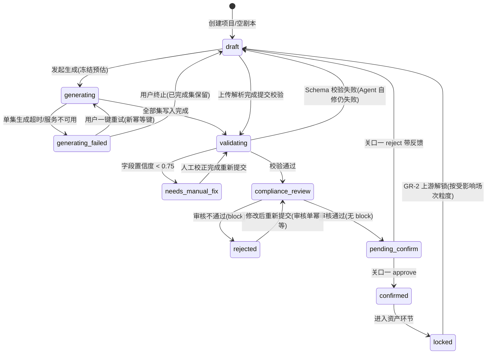
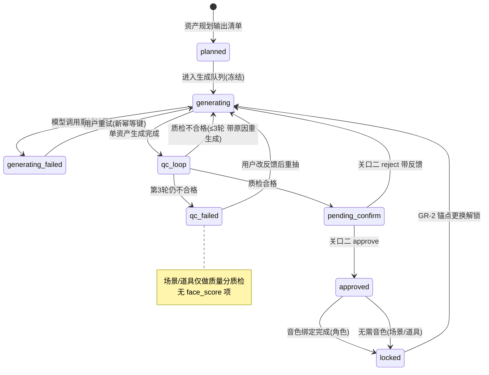
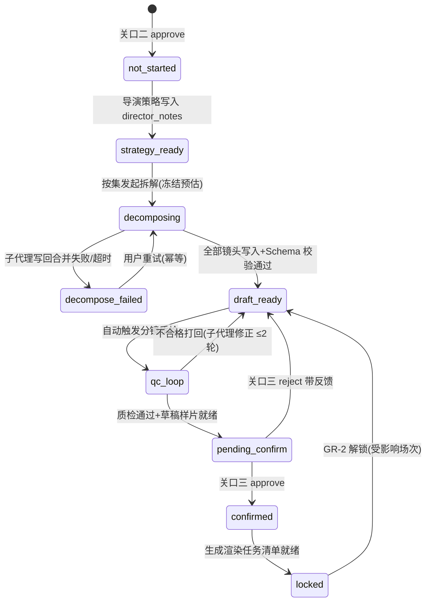
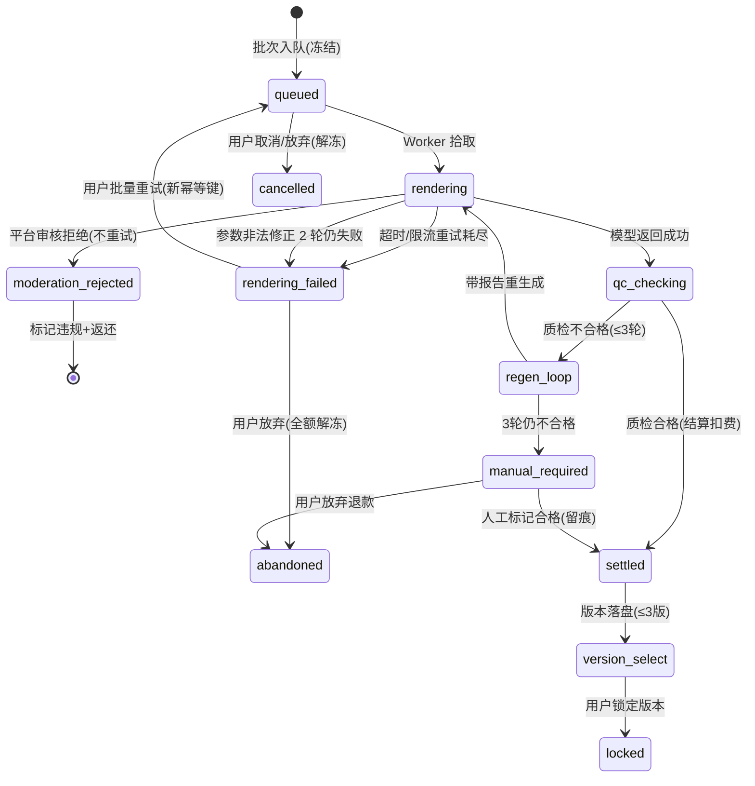
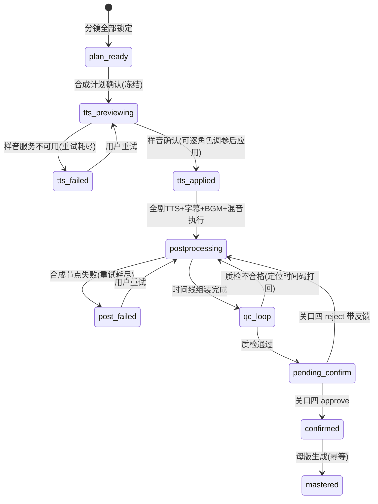
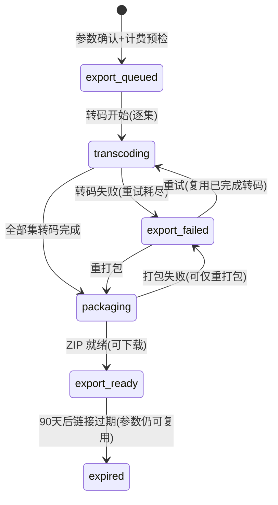
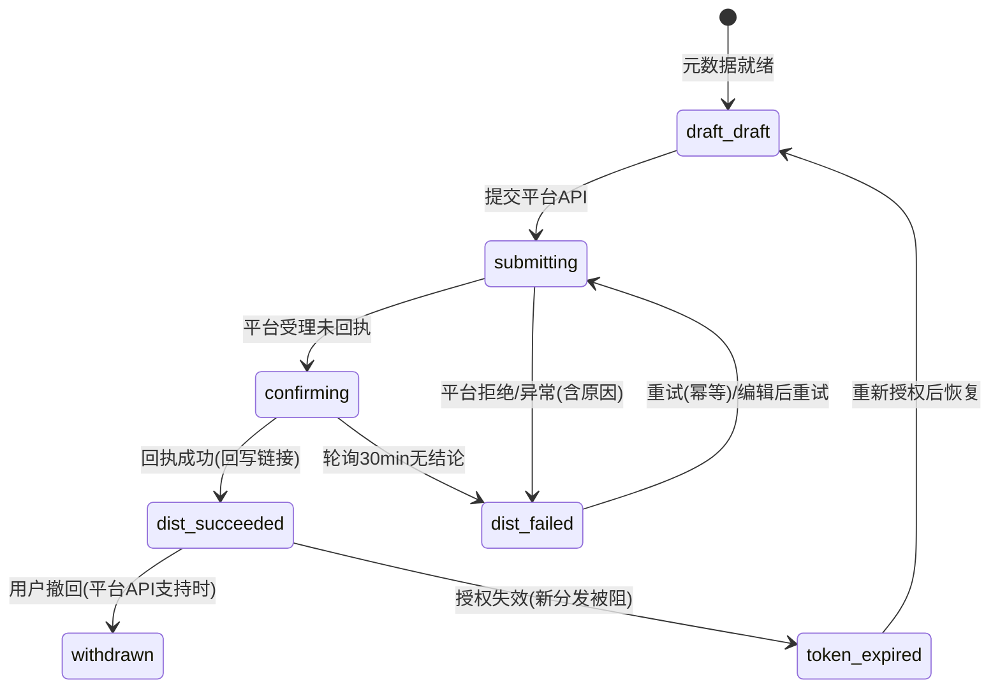

# 12 · PRD 深度细化（F2–F7 开发落地版）

| 项目 | 内容 |
|---|---|
| 产品名称 | 浮光造梦 · AI 短剧创作工具（GleamDream Studio） |
| 文档版本 | V1.0 |
| 文档状态 | 已合并：全部内容已于 2026-10-15 并入 PRD V4.0（`01_AI短剧创作工具_PRD_V4.0_开发落地版.md`），本文保留作为深度细化的过程稿与追溯依据 |
| 上游契约 | 01 PRD V3.0 全部既有 US/AC 保留；LangGraph + DeepAgents 架构、四 HITL 关口、冻结-结算计费模型不动 |
| 编号规则 | 新增 US 从各模块现有最大序号续编（F2→08 起、F3→08 起、F4→07 起、F5→07 起、F6→07 起、F7→06 起）；AC 子号从各 US 现有最大子号续编；异常场景启用 `EX-<Feature>-<序号>`（原文档未使用 EX 体系，本文首次定义，用于六查升级为决策树后的场景追溯） |
| 假设标注 | 所有推测性数值/规则标注【假设待验证】；原文档已标注的假设原样保留 |
| 最近更新 | 2026-10-15 |

## 阅读说明

1. 本文只做"细化"，不做"重写"：既有 AC 一律不动，仅新增。
2. 每模块按 7 个维度输出：用户故事补全 → AC 颗粒度下探 → 状态机细化 → Agent 内部工作流 → 异常决策树（六查升级）→ 数据与埋点补全 → 界面交互要点。
3. 状态机与 `ProjectStatus` 全局状态机的映射以 00 契约文档为准，本文给出的分段枚举名为建议值【假设待验证：以 00 契约正式枚举为准】。
4. 各模块超时与重试的统一基线（全局约定，模块内仅列差异）：
   - 同步工具调用（审核 API / 音色库 / 对象存储元数据）：超时 10s，指数退避重试 1s → 4s，最多 2 次【假设待验证：供应商 SLA】；
   - 异步任务（LLM 生成 / 模型调用 / 转码）：超时与重试见各模块决策树；
   - 所有重试均携带幂等键，重试不重复计费（GR-6）。

---

# F2 剧本模块

## 12.1.1 维度 1：用户故事补全

| ID | 用户故事 | 优先级 |
|---|---|---|
| US-F2-08 | 作为已有剧本的用户，我希望在已确认剧本基础上续写新集或扩写某场戏，以便系列化创作而不必从零新建项目 | M |
| US-F2-09 | 作为新用户，我希望从"题材 × 画风"组合模板库一键带入生成参数，以便不必从空白参数开始 | P1 |
| US-F2-10 | 作为用户，我希望把剧本导出为 md/docx/txt 文档，以便线下分享与备份 | M |
| US-F2-11 | 作为用户，我希望对比剧本任意两个版本并恢复历史版本，以便改乱后能回来 | M |
| US-F2-12 | 作为用户，我希望在逐集生成中途终止并保留已完成集，以便方向错了能及时止损 | M |

**新增用户故事验收标准**

| ID | 验收标准 |
|---|---|
| AC-F2-08-1 | Given 项目剧本已确认（`confirmed`/`locked`）且总集数 < 30，When 用户选择"续写 N 集"并输入续写要点，Then 编剧 Agent 仅基于既有大纲与最后一集生成第 n+1 集起的新集，原集内容零改动（版本 diff 为空可判定） |
| AC-F2-08-2 | Given 用户选中第 3 集某场次并输入扩写指令（≤ 200 字），When 扩写完成，Then 仅该场次产生新版本，且该集预估时长变化触发"分集时长重算"提示（不自动改分集边界） |
| AC-F2-08-3 | Given 续写后总集数将 > 30，When 提交续写请求，Then 拒绝并返回 `10001`，提示当前集数与上限 |
| AC-F2-09-1 | Given 用户进入项目创建参数页，When 展开"组合模板库"，Then 展示 ≥ 8 个预设包（题材 + 画风 + 默认单集字数 + 节奏倾向 + 结局走向），每个含 1 句适用说明【假设待验证：初始模板数量与题材覆盖】 |
| AC-F2-09-2 | Given 用户点选某模板包，When 参数回填，Then 被填充字段高亮且可覆盖；任一字段被手改后显示"已偏离预设"标记 |
| AC-F2-09-3 | Given 某模板包已被下线，When 用户打开引用它的历史项目，Then 项目参数保留原值，不因模板下线而变化 |
| AC-F2-10-1 | Given 剧本存在任一版本，When 用户选择导出格式（md / docx / txt），Then 按"集-场-对白/旁白/动作"结构生成文件并触发下载，文件名 = `{项目名}-剧本-{版本号}`，导出免费 |
| AC-F2-10-2 | Given 剧本状态为 `needs_manual_fix`，When 执行导出，Then 文件首行插入"⚠ 本版本含待人工校正字段（N 处）"提示 |
| AC-F2-10-3 | Given 项目无任何剧本内容，When 用户打开导出入口，Then 入口禁用并显示空态文案"生成或上传剧本后可导出" |
| AC-F2-11-1 | Given 剧本存在 ≥ 2 个版本，When 用户任选 2 版对比，Then 展示按场次维度的 diff（新增/删除/修改三色标注）+ 两版集数与字数统计差异 |
| AC-F2-11-2 | Given 用户在历史版本上点击"设为当前"，When 二次确认通过，Then 以该版本内容生成新版本（版本号 +1），版本链不破坏，原历史版本仍可访问 |
| AC-F2-11-3 | Given 剧本版本数已达上限 30，When 保存新版本，Then 按时间淘汰最旧的未被确认为"当前"的版本并提示【假设待验证：淘汰规则与 F8 快照策略对齐】 |
| AC-F2-12-1 | Given 逐集生成进行至第 k 集，When 用户点击"终止生成"并二次确认，Then 第 k+1 集起不再生成，已完成 k 集保留为 `draft`，未执行部分预估积分解冻返还 |
| AC-F2-12-2 | Given 终止请求与"第 k 集写入完成"事件竞态，When 二者几乎同时到达，Then 以先持久化者为准，按实际完成集数结算且不重复扣费（幂等键 = `project_id + script_run_id`） |
| AC-F2-12-3 | Given 用户终止后重新发起生成，When 提交新请求，Then 必须使用新 `Idempotency-Key`，并提供"保留已完成集，只生成缺集"选项（默认勾选） |

## 12.1.2 维度 2：验收标准颗粒度下探（既有 US 补充）

| ID | 验收标准 |
|---|---|
| AC-F2-01-3 | Given 一句话创意输入框，When 用户输入，Then 字段 `creative_text` 长度限制 5–500 字，实时计数；为空或超限时生成按钮禁用并提示（空态/极值） |
| AC-F2-01-4 | Given 逐集生成进行中，When 第 n 集写入完成，Then 集列表该集即时点亮"可阅读"，用户可点开阅读并添加备注（备注写入 `human_feedback`，非必填、不阻塞生成）（交互级） |
| AC-F2-01-5 | Given 编剧 Agent `write_todos` 执行，When 每个节点完成，Then 前端以 SSE 收到 `todo_updated` 事件（字段：`todo_id / node_name / status / elapsed_ms`），计划页无请求轮询 |
| AC-F2-02-3 | Given 用户选择上传，When 文件进入解析前，Then 执行 ≤ 30s 预检：格式白名单（txt/docx/pdf）、大小 ≤ 50MB、字数 ≤ 20 万字；超限直接打回 `10001` 不进入解析不计费（数值级） |
| AC-F2-02-4 | Given 上传为扫描件 PDF 且走 OCR 分支，When 解析完成，Then 整体置信度按字段置信度均值 × 0.9 折算【假设待验证：折算系数】，UI 顶部展示"扫描件解析，建议逐场核对"横幅 |
| AC-F2-03-2 | Given 某字段置信度 < 0.75 被标记待校正，When 用户修改该字段并保存，Then 该字段置信度置为 1.0（人工确认），全部待校正字段清零后剧本状态从 `needs_manual_fix` 回到 `draft` |
| AC-F2-03-3 | Given 待校正字段 > 50 处【假设待验证：阈值】，When 解析完成，Then 追加提示"低置信度字段过多，建议检查原文质量或重新上传更清晰的文件" |
| AC-F2-04-2 | Given 用户对第 2 集发起局部改写，When 提交指令，Then 改写范围默认锁定为单集（跨集改写需逐集发起）；反馈文本长度限制 5–200 字 |
| AC-F2-04-3 | Given 局部改写提交前，When 展示确认卡片，Then 显示受影响场次列表与预估 token 成本（计入剧本生成预估），确认后执行 |
| AC-F2-05-2 | Given 分集拆分执行，When 写入 `episodes`，Then 每集字段包含 `ep_no / title / hook_suggestion（≤ 50 字）/ est_duration_sec（60–180）`，钩子建议可被用户编辑后保存 |
| AC-F2-05-3 | Given 某集预估时长 > 180s，When 拆分完成，Then 该集标记黄色警示"建议拆分"，不阻断（分集边界可由用户手动调整后重新估算） |
| AC-F2-06-2 | Given 前置审核输出，When 结果返回，Then 风险等级枚举为 `block / review / info`【假设待验证：是否需要 info 级】：`block` 终止流程无绕过入口；`review` 逐条处理后可重新提交；`info` 仅提示不阻塞 |
| AC-F2-06-3 | Given 审核服务超时，When 重试 2 次（1s / 4s 退避）仍失败，Then 流程暂停（**不默认放行**），用户看到"审核服务暂不可用，已为你保存进度，稍后可一键重试"，恢复后从暂停点续跑 |
| AC-F2-07-2 | Given 用户在编辑器内编辑，When 按下 Ctrl+Z / Ctrl+Shift+Z，Then 撤销/重做生效，会话内步骤栈 ≥ 100 步【假设待验证：内存占用】；页面崩溃后恢复到最后一次自动保存草稿（间隔 10s） |
| AC-F2-07-3 | Given 两个成员（P1 团队）同时编辑同一场次，When 后保存者提交，Then 返回冲突提示并展示双方内容对比，后写者须选择"覆盖 / 基于最新重改"，不静默覆盖 |
| AC-F2-07-4 | Given 用户编辑 `speaker` 字段，When 保存，Then 触发剧本 Schema 校验：对白归属角色必须存在于人物表，否则保存失败并定位到该行 |

## 12.1.3 维度 3：状态机细化

| 状态 | 进入条件 | 可执行动作 | 出口条件 |
|---|---|---|---|
| generating | 用户确认预估并冻结 | 阅读/备注已完成集、终止生成 | 全部集写入完成 → validating；终止 → draft |
| generating_failed | 单集生成重试耗尽 | 重试 / 终止保留 | 重试成功回到 generating；终止 → draft |
| needs_manual_fix | 解析置信度不足 | 逐字段校正、导出（带警示）、放弃解析 | 全部校正 → validating |
| rejected | 审核 block | 修改后重新提交 | 审核通过 → pending_confirm |
| pending_confirm | 审核通过等待关口一 | approve / reject / edit | 见上 |
| locked | 关口一 approve 后进入资产 | 只读、"申请修改" | GR-2 解锁 → draft（仅受影响场次） |

**与 ProjectStatus 映射**【假设待验证：枚举名以 00 契约为准】：`draft/generating/generating_failed → SCRIPT_DRAFTING`；`validating/needs_manual_fix/rejected → SCRIPT_VALIDATING`；`compliance_review → SCRIPT_REVIEWING`；`pending_confirm → AWAITING_GATE_1`；`confirmed/locked → SCRIPT_LOCKED`。

## 12.1.4 维度 4：编剧 Agent 内部工作流

| 项 | 规格 |
|---|---|
| 输入契约（读取 ProjectState） | `script_brief`（`creative_text` 或上传文档引用 `uploaded_doc_ref`，二选一必填）、`params{genre, art_style, episode_target, word_target, ending}`、`style_template_id`（可选）、`human_feedback`（reject/edit 重入时必读） |
| 输入缺失降级 | `episode_target` 缺失 → 按单集 1–3 分钟与总字数自动估算集数并在计划页说明【假设待验证】；`art_style` 缺失 → 默认"真人感"；`creative_text` 与上传并存 → 不执行，返回让用户选择输入方式 |
| 输出契约（Script JSON 关键字段） | `project_id / version_id / episodes[{ep_no, title, hook_suggestion, est_duration_sec, scenes[{scene_no, location, int_ext, tod(时段), characters[], dialogues[{speaker, text, emotion_hint}], narrations[], actions[]}]}] / confidence{field_scores} / todos_status` |
| 自检循环 | ① Schema 校验失败 → Agent 自修（重新结构化）≤ 2 轮 → 仍失败置 `draft` 并记录失败原因；② 审核 `review` 级 → 自动弱化改写后重审 ≤ 1 轮，仍命中则交人工逐条处理（不自动放行）；③ 字段置信度抽检：对白归属/场序为必检项 |
| 人工反馈注入 | reject 反馈写入 `human_feedback`，结构化建议：`{scope: {ep_no, scene_no[]}, action: "rewrite"|"tone_fix"|"plot_fix", text, source: "gate_1"}`；注入位置：编剧 Agent 修订轮系统提示的「修订指令」区块，未命中 scope 的场次标记"引用原版本不得改动" |

## 12.1.5 维度 5：异常决策树（六查升级）

| EX 编号 | 场景 | 检测点 | 处置动作 | 用户可见反馈 | 计费影响 | 审计 |
|---|---|---|---|---|---|---|
| EX-F2-01 | 空提交（无创意无上传） | 前端参数校验 | 禁用按钮，不发请求 | 两种输入方式引导 | 无 | 否 |
| EX-F2-02 | 分集超限（> 30 集） | 提交参数校验节点 | 拒绝 | `10001` + 当前集数/上限 | 无冻结 | 是 |
| EX-F2-03 | 上传超限（> 50MB / > 20 万字） | 上传预检 | 打回并提示拆分 | `10001` | 无 | 否 |
| EX-F2-04 | 乱码 / 加密 PDF | 解析 Agent 首段探测 | 终止解析 | 明确失败原因 | 已冻结预估全额解冻 | 是 |
| EX-F2-05 | 单集生成超时（90s/集【假设待验证】） | 编剧子任务超时监控 | 指数退避重试 30s → 120s，≤ 2 次；仍失败 → `generating_failed` | 进度页标红该集 + 一键重试 | 未完成集按实际结算/解冻 | 是 |
| EX-F2-06 | 审核服务不可用 | 审核 API 超时 10s × 2 次重试 | 流程暂停（不放行） | "审核服务暂不可用，可稍后重试" | 冻结保留，恢复后续跑 | 是 |
| EX-F2-07 | 并发双击生成 | `Idempotency-Key` 去重 | 仅一个任务生效 | 首个任务进度页 | 单次冻结 | 否 |
| EX-F2-08 | 重复提交审核 | 审核单幂等键（版本号 + 内容 hash） | 返回已有审核单 | 无感知 | 不重复扣审核额度 | 否 |
| EX-F2-09 | `view` 成员编辑 | 服务端 ACL 中间件 | 拒绝 `20003`，编辑器只读 | 权限提示 | 无 | 是（越权尝试） |
| EX-F2-10 | 确认后再次进入 | 状态查询 | 只读视图 + "申请修改"入口 | 已确认版本标记 | 无 | 否 |
| EX-F2-11 | 局部改写重复触发 | 改写幂等键（场次 + 指令 hash） | 命中返回历史结果 | 无感知 | 不重复消耗 token | 否 |
| EX-F2-12 | 生成中用户关闭页面 | 服务端任务继续执行 | 回来后状态完整恢复（AC-F2-01-2） | 进度不丢失 | 不变 | 否 |

## 12.1.6 维度 6：数据与埋点补全

**新增字段**

| 实体.字段 | 类型 | 用途 |
|---|---|---|
| `scripts.version_label` | varchar(50) | 用户自定义版本名（如"加了第 3 集反转"），支持 SF 文档 11 的版本对比 |
| `scripts.confidence_overall` | decimal(3,2) | 解析整体置信度（字段均值 × OCR 折算），支撑 AC-F2-02-4 |
| `script_runs.run_status` | enum(generating/succeeded/failed/cancelled) | 一次生成任务的运行态，支撑终止保留（AC-F2-12-1）与结算对账 |
| `script_runs.completed_episodes` | int | 已完成集数，终止时按此结算 |
| `script_template_refs.template_id` | bigint | 项目引用的模板包，支撑 AC-F2-09-3 下线不受影响 |
| `human_feedback.feedback_scope` | jsonb | 结构化反馈作用域（集/场次），支撑 Agent 注入（维度 4） |
| `script_export_logs` | 新表 | 导出行为留痕（用户/时间/格式/版本号） |

**新增埋点**

| 埋点 | 关键属性 | 支撑指标 |
|---|---|---|
| `script_template_applied` | template_id、偏离字段数 | M1 激活率（模板是否提升创建完成率）、M3 |
| `script_generation_cancelled` | 已完成集数、返还积分 | M5 成本偏差、损耗分析 |
| `script_generation_failed` | 失败集号、失败类型 | M6 自动成功率 |
| `script_early_read_used` | 是否在生成中打开已完成集 | M2 TTFC 拆解（等待体验贡献） |
| `script_version_compare_used` | 对比版本对数 | M3（改写决策行为） |
| `script_export_triggered` | 格式、版本号 | 留存/内容外流分析（CCCR） |
| `script_continuation_started` | 续写集数 | 系列化创作留存（P-运营画像） |

## 12.1.7 维度 7：界面交互要点

1. **生成进度页**：`write_todos` 计划置顶（四节点状态条），集列表左"完成 ✓ / 生成中 ⟳ / 排队 ·"三态图标；已完成集卡片右上 💬 备注入口；终止按钮固定右下角，点击弹二次确认（显示"将保留 X 集，返还约 Y 积分"）。
2. **解析预检卡片**：文件名 / 字数 / 章节估计 / 预计耗时 / 预估积分 五行 + "开始解析"主按钮；预检失败整卡红色，无主按钮。
3. **审核结果清单**：顶部"n/m 已处理"进度条；每条含定位链接（点击跳转编辑器并黄色高亮问题文本）与"已处理"勾选；`block` 项红色且无勾选框。
4. **版本对比页**：左版本选择器、中 diff 正文（三色）、右统计卡（字数/集数）；"设为当前"按钮在对比页右下角，红色描边 + 二次确认。
5. **空态文案**：剧本空态——"用一句话开始，或上传你已有的小说/剧本"；版本空态——"还没有历史版本，第一次保存后即可对比"。

## 12.1.8 F2 变更清单

| 类型 | 数量 | 明细 |
|---|---|---|
| 新增 US | 5 | US-F2-08 ~ US-F2-12 |
| 新增 AC（新 US） | 15 | AC-F2-08-1~3、09-1~3、10-1~3、11-1~3、12-1~3 |
| 新增 AC（既有 US 下探） | 16 | AC-F2-01-3~5、02-3~4、03-2~3、04-2~3、05-2~3、06-2~3、07-2~4 |
| 状态机 | 1 处重绘 | 新增 `generating` / `generating_failed` 两态及出口路径，映射 ProjectStatus 分段 |
| Agent 工作流 | 1 套 | 编剧 Agent 输入/输出契约、自检循环、反馈注入格式 |
| 异常决策树 | 12 场景 | EX-F2-01 ~ EX-F2-12 |
| 数据字段 | 6 + 1 表 | 见维度 6 |
| 埋点 | 7 | 见维度 6 |

### ⚠️ F2 原文档问题清单

| 编号 | 问题 | 建议 |
|---|---|---|
| P-F2-1 | AC-F2-06-1 使用 `block` 等级，但全文未定义审核等级枚举全集（是否含 `review`/`info`）；本文按三级补全【假设待验证】 | 在 00 契约固化枚举：`block/review/info` |
| P-F2-2 | AC-F2-02-2 提到"整体置信度降档"，但只有字段级阈值 0.75，无整体置信度定义与降档规则 | 采纳本文 `confidence_overall` 定义并确认 OCR 折算系数 |
| P-F2-3 | `10001` 同时用于"集数超限"与"文件超限"两类语义（F2.6 两行） | 建议拆分错误码或加 `error_detail` 字段，避免客户端无法区分处理 |
| P-F2-4 | F2.5 状态机 `locked → draft` 标注"上游解锁"，但 GR-2 的解锁粒度（场次/集/整本）未定义 | 明确为"按受影响场次解锁，仅受影响场次回到可编辑"，与 AC-F4-06-2 对齐 |
| P-F2-5 | F2.5 状态机缺 `generating` 过程态，生成中刷新页面（AC-F2-01-2）无状态落点 | 采纳本文新增 `generating/generating_failed` 两态 |

---

# F3 资产模块

## 12.2.1 维度 1：用户故事补全

| ID | 用户故事 | 优先级 |
|---|---|---|
| US-F3-08 | 作为用户，我希望为场景资产生成时段/季节变体（白天/夜晚/雨天），以便不同剧情时段画面连贯 | M |
| US-F3-09 | 作为用户，我希望为关键道具生成特写资产，以便插入镜头有稳定参照 | P1 |
| US-F3-10 | 作为用户，我希望对多个角色应用同一条重抽反馈批量重抽，以便不用逐个操作 | M |
| US-F3-11 | 作为用户，我希望给资产打标签并按名称/标签搜索，以便角色多的项目快速定位 | P1 |
| US-F3-12 | 作为用户，我希望查看和管理我的真人授权记录（含撤回），以便合规可控（P1） | P1 |

**新增用户故事验收标准**

| ID | 验收标准 |
|---|---|
| AC-F3-08-1 | Given 场景清单含某场景（内外/时代/时段），When 用户为该场景勾选变体（时段：晨/昼/黄昏/夜；天气：晴/雨/雪，最多各选 2 项【假设待验证】），Then 每个变体生成独立 `asset_version` 并以场景 × 变体命名 |
| AC-F3-08-2 | Given 分镜引用某场景的"夜"变体，When 该变体未生成，Then 分镜质检报"场景变体缺失"并引导一键生成，不阻塞其它镜头 |
| AC-F3-09-1 | Given 资产清单标记某道具为"关键道具"（出场 ≥ 3 场【假设待验证：判定规则】），When 生成执行，Then 该道具生成正/侧 2 张特写图，纳入质检与锁定流程 |
| AC-F3-09-2 | Given 用户手动追加道具特写请求，When 提交，Then 按单资产计费并进入同一资产库目录 `/assets/props/` |
| AC-F3-10-1 | Given 用户多选 5 个角色并输入同一条重抽反馈，When 确认执行，Then 展示"N 个角色 × 单价 = 预估积分"并逐角色独立执行（独立版本与质检循环），单角色失败不阻塞其余 |
| AC-F3-10-2 | Given 批量重抽执行中，When 某角色命中"命中公共人物库"拦截，Then 仅该角色终止并说明原因，其余继续 |
| AC-F3-11-1 | Given 项目含 > 10 个资产【假设待验证：搜索入口出现阈值】，When 用户在资产墙顶部搜索框输入，Then 按 `name / label` 前缀匹配过滤（标签为多选 AND），500ms 内返回【假设待验证：前端过滤即可满足】 |
| AC-F3-11-2 | Given 用户给资产打标签，When 保存，Then 标签数上限 10 个/资产、单标签 ≤ 12 字 |
| AC-F3-12-1 | Given 用户存在真人授权记录，When 打开"真人授权记录"页，Then 列出角色、授权时间、IP、协议版本、状态（`active/revoked`） |
| AC-F3-12-2 | Given 用户对某角色执行"撤回授权"，When 输入角色名二次确认，Then 该角色状态置 `revoked`、禁止发起新的镜头生成（返回 `50003` 同源语义），已生成内容保留，撤回写入 `audit_logs` |
| AC-F3-12-3 | Given 被撤回角色存在进行中的生成任务，When 撤回生效，Then 进行中任务照常完成并结算（已冻结），后续新任务被拒 |

## 12.2.2 维度 2：验收标准颗粒度下探（既有 US 补充）

| ID | 验收标准 |
|---|---|
| AC-F3-01-2 | Given 资产规划执行，When 输出清单，Then 每个角色含 `name / age_desc / appearance / screen_weight(0–1, 两位小数) / voice_gender_hint`；场景含 `int_ext / era / tod`；戏份权重 = 角色对白场次数 ÷ 总场次数（保留两位小数），按权重降序生成【假设待验证：权重公式】 |
| AC-F3-01-3 | Given 提取角色数 > 30，When 规划完成，Then 提示超限并按戏份权重排序给出"前 30 优先生成"的分批建议，其余置为 `pending` |
| AC-F3-02-3 | Given 主形象生成，When 输出，Then 主形象为 1024×1024 PNG【假设待验证：分辨率与格式，依模型能力】；三视图为同分辨率竖排三联图，均可单独下载 |
| AC-F3-02-4 | Given 三视图逐张质检，When 任一视图 `face_score` < 0.80，Then 仅重生成该视图（不重跑主形象），并附具体视图名与得分返回美术 Agent |
| AC-F3-03-2 | Given 用户对角色发起重抽，When 确认弹窗展示，Then 显示"本次预估 X 积分 + 该角色已累计消耗 Y 积分 / 已重抽 N 次"；Y > 成本基线 2 倍时【假设待验证：阈值】追加"建议换描述策略"提示（不阻断） |
| AC-F3-03-3 | Given 重抽反馈文本，When 注入生成参数，Then 反馈长度限制 5–100 字，以 `revision_notes` 字段拼入美术 Agent 提示词的「修改要求」区块 |
| AC-F3-04-2 | Given 音色绑定工作台，When 用户试听候选音色，Then 每角色提供 3 句试听样音（取该角色台词量最多的 3 句【假设待验证：选句规则】），绑定前必须完成 ≥ 1 次试听（交互防呆） |
| AC-F3-04-3 | Given 音色 V 下架，When 用户进入受影响项目，Then 资产页角色卡显示"音色已下架"徽标 + 推荐最近似音色（性别/年龄匹配）一键替换，替换前必须试听 |
| AC-F3-05-3 | Given 授权确认完成，When 写入 `face_authorizations`，Then 字段含 `user_id / character_id / auth_time / ip / agreement_version / photo_hash / status`，photo_hash 用于后续一致性核验 |
| AC-F3-05-4 | Given 上传照片命中公共人物库，When 拦截，Then 直接拒绝（不走二次确认通道），提示"照片与公众人物高度相似，不可用于定制"，写入 `audit_logs` |
| AC-F3-07-2 | Given 关口二审批页，When 展示角色卡片墙，Then 顶部一致性面板显示：平均 `face_score` 分布柱状图、低于阈值 +5% 的"踩线角色"清单（可一键筛选）、整体通过率；面板不阻塞 approve |

## 12.2.3 维度 3：状态机细化

| 状态 | 进入条件 | 可执行动作 | 出口条件 |
|---|---|---|---|
| generating | 队列调度 + 冻结成功 | 用户可预览已完成产物 | 完成进入 qc_loop |
| qc_loop | 生成完成 | 无用户动作（≤ 3 轮自动） | 合格 → pending_confirm；3 轮失败 → qc_failed |
| qc_failed | 修正循环耗尽 | 改反馈重抽 / 接受降级（表情缺失类 AD-4） | 重抽 → generating；接受 → pending_confirm |
| pending_confirm | 质检合格 | approve / reject(反馈) / 重抽 | 见上 |
| locked | 绑定/确认完成 | 查看、历史版本恢复（触发 GR-2） | 锚点更换 → generating |

**与 ProjectStatus 映射**【假设待验证】：`planned → ASSET_PLANNED`；`generating/generating_failed → ASSET_GENERATING`；`qc_loop/qc_failed → ASSET_GENERATING`；`pending_confirm → AWAITING_GATE_2`；`approved/locked → ASSET_LOCKED`。

## 12.2.4 维度 4：美术 Agent 内部工作流

| 项 | 规格 |
|---|---|
| 输入契约 | `assets_plan`（角色/场景/道具清单，来自规划子任务）、`art_style`（画风枚举）、`assets[id].anchor_version`（重抽时必读三视图锚点）、`human_feedback.revision_notes`（重抽时）、`assets[id].variant_req`（场景变体，US-F3-08） |
| 输入缺失降级 | `art_style` 缺失 → 默认"真人感"并提示；锚点缺失（首次生成）→ 走文生图；锚点存在 → 强制图生图 + 姿态参考（AD-1，禁止退回文生图）；`appearance` 描写 < 10 字 → 先补全描写再出图（补全结果回写设定卡供用户确认） |
| 输出契约（Asset JSON 关键字段） | `asset_id / asset_type(character|scene|prop) / name / current_version_id / versions[{version_id, gen_params{model, seed, style, revision_notes}, files{main, views[], expressions[], variants[]}, qc{face_score, clip_score, hard_flaws[], round}}]` |
| 自检循环修正策略阶梯 | 第 1 轮不合格 → 同模型换种子重生成；第 2 轮 → 调整生成参数（降低复杂度/提高参考图权重）；第 3 轮 → 切换备用模型或改用"图生图 + 姿态参考"（F3.6 失败分支的固化）；3 轮后仍失败 → `qc_failed` 交用户 |
| 人工反馈注入 | `revision_notes` 拼入提示词「修改要求」区块 + 作为图生图的负向约束词；命中"太老/太年轻"类年龄词时同步微调 `age_desc` 参数【假设待验证：年龄词解析表】 |

## 12.2.5 维度 5：异常决策树（六查升级）

| EX 编号 | 场景 | 检测点 | 处置动作 | 用户可见反馈 | 计费影响 | 审计 |
|---|---|---|---|---|---|---|
| EX-F3-01 | 纯旁白剧本无角色 | 规划 Agent 输出为空 | 跳过资产环节，标记"无需资产" | 提示 + 直接进入分镜入口 | 无 | 否 |
| EX-F3-02 | 角色 > 30 | 规划输出计数 | 分批建议（权重 Top30 先行） | 分批卡片 | 仅实际生成计费 | 否 |
| EX-F3-03 | 同批 10 角色并发生成 | 队列并发闸门（套餐 free 2 / pro 5 / studio 10，Q8 同源） | 排队 | 队列位置可见 | 冻结后排队，未执行可取消解冻 | 否 |
| EX-F3-04 | 三视图与主形象相似度过低 | 质检 `face_score` | 改"图生图 + 姿态参考"重抽（不换文生图） | 无感（自动），qc_failed 时可见轮次 | 修正轮计入该资产结算 | 是（超 3 轮） |
| EX-F3-05 | 表情集部分失败 | 质检子项 | 带缺失通过（AD-4），缺失情绪登记 | 资产卡"缺失 n 种情绪"角标 | 按实际成功数结算 | 否 |
| EX-F3-06 | 上传非人脸/模糊照片 | 人脸质量前置校验 | 打回 `50004` | 明确原因 | 不扣费 | 否 |
| EX-F3-07 | 照片命中公共人物库 | 人物库比对 | 直接拒绝（不走二次确认） | 拒绝说明 | 不扣费 | 是 |
| EX-F3-08 | 重抽模型服务超时（单图 30s【假设待验证】） | 生成子任务超时监控 | 重试 2 次（15s / 60s 退避）→ `generating_failed` | 资产卡红色 + 重试按钮 | 未完成部分解冻 | 是 |
| EX-F3-09 | `view` 成员重抽 | ACL 中间件 | 拒绝 `20003` | 权限提示 | 无 | 是 |
| EX-F3-10 | 同角色重复触发生成 | 幂等键（asset_id + 参数 hash） | 返回进行中任务 | 无感知 | 不重复冻结 | 否 |
| EX-F3-11 | 批量重抽中单角色被合规拦截 | 逐角色审核 | 该角色终止，其余继续 | 逐角色状态行 | 仅成功部分结算 | 是 |
| EX-F3-12 | 历史版本恢复时锚点被引用 | GR-2 引用计数 | 弹"影响 N 个镜头"二次确认后解锁受影响镜头 | 确认弹窗 | 已生成镜头不退费，重新生成另计 | 是 |

## 12.2.6 维度 6：数据与埋点补全

**新增字段**

| 实体.字段 | 类型 | 用途 |
|---|---|---|
| `assets.labels` | jsonb（string[]） | 标签（≤ 10 个/资产），支撑搜索 US-F3-11 |
| `assets.voice_status` | enum(bound/delisted/pending) | 音色绑定状态，支撑下架替换流程 |
| `asset_versions.variant_tag` | varchar(20) | 场景变体标记（如 night_rain），支撑 US-F3-08 |
| `asset_versions.revision_notes` | varchar(200) | 重抽反馈原文，支撑 Agent 注入与复现 |
| `asset_versions.cumulative_cost` | int | 该资产累计消耗积分，支撑 AC-F3-03-2 透明提示 |
| `face_authorizations.status` | enum(active/revoked) | 支撑 US-F3-12 撤回 |
| `asset_search_logs` | 新表 | 搜索词与命中数，评估搜索入口价值 |

**新增埋点**

| 埋点 | 关键属性 | 支撑指标 |
|---|---|---|
| `asset_variant_created` | asset_type、variant_tag | 场景变体使用率（需求验证） |
| `asset_batch_regenerated` | 角色数、反馈长度 | 批量功能采纳率、M10 |
| `asset_qc_rounds` | asset_id、轮次、失败原因 | M4/M6（修正循环效率） |
| `asset_regenerate_cost_warning_shown` | 累计消耗、倍数 | M11（重抽成本感知） |
| `asset_voice_replaced` | 原音色/新音色 | 音色下架处理率 |
| `asset_search_used` | 命中数 | 资产墙可用性（>10 资产项目占比） |
| `real_person_auth_revoked` | 角色、存量镜头数 | 合规审计（CCCR） |

## 12.2.7 维度 7：界面交互要点

1. **资产卡片墙**：顶部状态筛选条（全部/生成中/待确认/质检未过/已锁定）+ 搜索框（> 10 资产时出现）；卡片左上状态徽标，质检未过显示原因摘要，hover 显示得分明细。
2. **重抽确认弹窗**：反馈输入框（5–100 字）+ 两行成本数字加粗（本次预估 / 已累计消耗）；批量重抽时弹窗追加"该反馈将应用于全部选中角色"警示。
3. **音色绑定工作台**：左角色列（候选音色预筛 3 个）右试听器；行内 ▶ 试听、✓ 绑定；顶部"全部应用推荐"（每行仍需 ≥ 1 次试听后才可批量确认）。
4. **授权记录页**：表格列（角色/时间/IP/协议版本/状态）；撤回为红色文字按钮，需输入角色名确认。
5. **空态文案**：资产空态——"剧本确认后，角色、场景、道具会自动出现在这里"；搜索空态——"没有找到匹配资产，试试清除筛选"。

## 12.2.8 F3 变更清单

| 类型 | 数量 | 明细 |
|---|---|---|
| 新增 US | 5 | US-F3-08 ~ US-F3-12 |
| 新增 AC（新 US） | 11 | AC-F3-08-1~2、09-1~2、10-1~2、11-1~2、12-1~3 |
| 新增 AC（既有 US 下探） | 11 | AC-F3-01-2~3、02-3~4、03-2~3、04-2~3、05-3~4、07-2 |
| 状态机 | 1 处重绘 | 新增 `generating_failed/qc_failed` 及质检轮次出口 |
| Agent 工作流 | 1 套 | 美术 Agent 契约 + 修正策略三阶梯 |
| 异常决策树 | 12 场景 | EX-F3-01 ~ EX-F3-12 |
| 数据字段 | 6 + 1 表 | 见维度 6 |
| 埋点 | 7 | 见维度 6 |

### ⚠️ F3 原文档问题清单

| 编号 | 问题 | 建议 |
|---|---|---|
| P-F3-1 | AC-F3-02-2 质检阈值仅覆盖角色（face_score），场景/道具的质检项与阈值全文未定义 | 在 00 契约 §6.8 补充：场景/道具走 CLIP 质量分（阈值 0.75【假设待验证】），无 face_score 项 |
| P-F3-2 | F3.6 写"表情集缺失允许通过（AD-4）"，但 `pending_confirm` 状态机未表达"带缺失通过"的落点 | 增补 `qc_loop` 出口"接受降级 → pending_confirm"，采纳本文状态机 |
| P-F3-3 | `50003`（未完成真人授权）与 `50004`（照片质量不合格）覆盖了授权前置，但"授权撤回后新建生成被拒"复用哪个码未定义 | 明确撤回后复用 `50003`，`error_detail` 标注 `authorization_revoked` |
| P-F3-4 | 戏份权重仅说"按戏份权重给出生成优先级"，无计算口径 | 采纳本文公式（对白场次数占比），技术评估后固化【假设待验证】 |
| P-F3-5 | US-F3-06 跨项目复用无任何 AC | 建议随 P1 团队版补充：复用资产在目标项目只读引用、源项目删除时目标项目降级为静态图 |

---

# F4 智能分镜

## 12.3.1 维度 1：用户故事补全

| ID | 用户故事 | 优先级 |
|---|---|---|
| US-F4-07 | 作为用户，我希望拆解前选择叙事节奏模式（快节奏爽剧/均衡/慢节奏情感剧），以便分镜节奏匹配题材 | P1 |
| US-F4-08 | 作为用户，我希望复制镜头并把多个镜头批量修改参数，以便整段戏统一调整 | M |
| US-F4-09 | 作为用户，我希望画布操作有历史时间轴并可回退到任意一步，以便误操作可恢复 | M |
| US-F4-10 | 作为用户，我希望套用分镜模板（对话戏/动作戏/转场），以便不懂分镜也能有专业机位 | P2 |

**新增用户故事验收标准**

| ID | 验收标准 |
|---|---|
| AC-F4-07-1 | Given 拆解发起页，When 用户选择节奏模式，Then 三选一（快节奏/均衡/慢节奏）写入 `director_notes.md` 的 `pacing_mode` 字段，拆解参数按模式取值：快节奏（镜头均值 2000–3000ms、特写占比 ≥ 40%）、慢节奏（均值 3000–4000ms、空镜占比上调）【假设待验证：具体参数值】 |
| AC-F4-07-2 | Given 项目题材为"赘婿/重生"类爽剧，When 打开拆解发起页，Then 默认预选"快节奏"（题材推荐映射表【假设待验证】），用户可改 |
| AC-F4-07-3 | Given 某集已手动调整过，When 重新按新模式拆解该集，Then 保留手动版本为 F8 手动快照并提示，不静默覆盖 |
| AC-F4-08-1 | Given 用户在镜头 ⋯ 菜单选择"复制"，When 选择粘贴位置（选中镜头后/集尾），Then 复制体继承 `final_prompt/camera_move/duration_ms/emotion_tag/asset_anchor_ids`，`order_index` 自动重算，`shot_id` 全新 |
| AC-F4-08-2 | Given 用户多选 ≥ 2 个镜头并批量修改运镜/时长/情绪，When 确认保存，Then 展示"N 个镜头将修改"与逐项变更摘要，保存后受影响镜头自动重跑分镜质检相关项 |
| AC-F4-08-3 | Given 批量修改导致某镜头对白超时长，When 保存，Then 该镜头质检标红单独提示（对白 ≤ 6s 规则），其余镜头修改不受回滚 |
| AC-F4-09-1 | Given 用户在画布执行增/删/移/批量改，When 打开"操作历史"抽屉，Then 时间轴按序列出结构化操作（类型/目标镜头/时间），保留最近 100 步【假设待验证：存储开销】，仅当次会话有效 |
| AC-F4-09-2 | Given 用户点击历史中任意一步"回退到此步"，When 二次确认，Then 画布恢复到该步状态（被删镜头以原参数恢复），后续历史步截断并提示 |
| AC-F4-10-1 | Given 用户发起拆解，When 勾选"套用分镜模板"，Then 模板以机位规则条目（≤ 10 条，每条 ≤ 50 字）注入导演 Agent 策略上下文；模板与硬性质检规则冲突时硬校验优先并在完成后列出冲突条目 |
| AC-F4-10-2 | Given 用户保存自定义分镜模板，When 命名保存，Then 模板跨项目可用、上限 20 个【假设待验证】，与 2.3 分期"提示词模板库"同族合并实现 |

## 12.3.2 维度 2：验收标准颗粒度下探（既有 US 补充）

| ID | 验收标准 |
|---|---|
| AC-F4-01-2 | Given 导演 Agent 制定策略，When 写入 `director_notes.md`，Then 结构化字段含 `pacing_mode / rhythm_curve / closeup_density / dialogue_camera_rule`，策略对用户只读可见（可解释性） |
| AC-F4-01-3 | Given 按集并行拆解，When 任一集完成，Then 该集在集切换器即时点亮"可编辑"，其余集生成中显示进度（n/m 镜头）；单集失败不阻塞已完成集编辑 |
| AC-F4-02-3 | Given 某集拆解完成，When 校验镜头字段，Then 枚举约束生效：`shot_size ∈ {extreme_wide, wide, medium, close, extreme_close, insert}`、`camera_move ∈ {static, pan, tilt, push, pull, handheld, dolly}`、`emotion_tag ∈ {calm, happy, angry, sad, shocked, fearful, smug, crying}`【假设待验证：枚举全集以 00 契约为准】 |
| AC-F4-02-4 | Given 镜头字段校验，When 数值越界，Then `final_prompt` ≤ 500 字、`duration_ms` ∈ [1000, 15000]、`order_index` 为集内连续正整数；越界字段打回子代理修正 ≤ 2 轮 |
| AC-F4-03-2 | Given 草稿样片生成，When 用户播放，Then 支持按集章节跳转、A-B 区间循环、单镜头循环与 0.5×/1×/2× 变速；样片超 3 分钟按集拆为多文件聚合播控 |
| AC-F4-03-3 | Given 用户对单镜头静帧不满意，When 点击"重出静帧"（可附反馈 ≤ 50 字），Then 仅重生成该关键帧（单帧计价），样片对应段替换，每镜头重出 ≤ 3 次后提示"建议改 prompt"【假设待验证：单帧生成耗时 ≤ 15s 与次数阈值】 |
| AC-F4-04-2 | Given 用户拖动镜头释放，When 落点判定，Then 拖拽命中吸附阈值 8px【假设待验证】，释放后 `order_index` 重算 ≤ 200ms，toast 显示集时长变化（AC-F4-04-1 同源） |
| AC-F4-04-3 | Given 用户删除镜头，When 确认弹窗展示，Then 实时显示"本集剩余 X 分 X 秒（Y 镜头），距目标时长差 Z 秒"（Z 为负差时黄色警示）；提示不阻断删除 |
| AC-F4-05-2 | Given 用户编辑 `final_prompt`，When 输入，Then 字数 ≤ 500 实时计数，达 480 字变黄警示；prompt 中引用的锚点占位符（`@角色名`）以高亮 chip 呈现，删除 chip 即移除锚点引用并触发影响提示 |
| AC-F4-05-3 | Given 分镜已锁定，When 用户点击 prompt 编辑器，Then 编辑器只读 + 弹引导："需解锁第 X 集 → 修改 → 重新走关口三；该集已生成 N 个镜头将标记需重生成，预估 X 积分"；确认后执行解锁 |
| AC-F4-06-3 | Given 分镜锁定后用户修改剧本第 2 集，When 保存剧本，Then 仅第 2 集受影响场次的镜头解锁；已生成视频版本保留（标记"上游已变更"），未生成任务取消并解冻 |

## 12.3.3 维度 3：状态机细化（集级分镜状态机）

| 状态 | 进入条件 | 可执行动作 | 出口条件 |
|---|---|---|---|
| decomposing | 拆解发起 + 冻结 | 查看已完成集、编辑已完成集 | 全部集写回合并 → draft_ready |
| decompose_failed | 合并冲突/超时 | 重试（幂等键 = project_id + ep_no + 拆解参数 hash） | 成功 → decomposing |
| qc_loop | 集内全部镜头校验通过 | 无用户动作 | 通过 → pending_confirm；2 轮打回未消 → 质检问题清单随样片展示，不阻塞进入关口三（关口三清单确认，见 EX-F4-12） |
| pending_confirm | 样片就绪 | approve / reject(反馈) / 画布编辑 | 见上 |
| locked | approve 后 | 只读 + 解锁引导（AC-F4-05-3） | 解锁 → draft_ready |

**与 ProjectStatus 映射**【假设待验证】：`not_started/strategy_ready → STORYBOARD_READY`；`decomposing/decompose_failed → STORYBOARD_GENERATING`；`draft_ready/qc_loop → STORYBOARD_DRAFT`；`pending_confirm → AWAITING_GATE_3`；`confirmed/locked → STORYBOARD_LOCKED`。

## 12.3.4 维度 4：导演 Agent 内部工作流

| 项 | 规格 |
|---|---|
| 输入契约 | `script`（locked 版本，逐集场次）、`assets`（可用角色/场景/道具及其锚点版本）、`director_notes`（既有策略，重拆时必读）、`pacing_mode`（US-F4-07）、`storyboard_template`（US-F4-10，可选）、`human_feedback`（关口三 reject） |
| 输入缺失降级 | 场景资产缺失 → 该镜头 `final_prompt` 以文生图描述兜底 + 质检标"场景未锚定"；`emotion_tag` 生成失败 → 置 `calm` 默认值并登记质检警告；`pacing_mode` 缺失 → 均衡模式 |
| 输出契约（Shot JSON 关键字段） | `shot_id / ep_no / scene_no / order_index / shot_size / camera_move / final_prompt / emotion_tag / duration_ms / asset_anchor_ids[] / dialogue_ref / gen_status(pending) / qc_flags[]` |
| 自检循环 | 子代理拆解 → 确定性校验（字段越界/场次边界重叠，SD-2）→ 打回自修 ≤ 2 轮；质检 Agent 四项（景别跳跃/对白超时/未锚定资产/情绪缺失）→ 打回导演统一修订 ≤ 2 轮，仍不合格随样片进关口三清单 |
| 人工反馈注入 | reject 反馈结构化：`{scope: {ep_no, shot_id[]}, action: "reshoot"|"re_pace"|"re_anchor", text}`；`re_pace` 类反馈（节奏/时长问题）路由到导演策略层重拆而非逐镜重抽（F4.6"70% reject 重定策略"的固化：reject 比例 ≥ 70% 自动走策略层） |

## 12.3.5 维度 5：异常决策树（六查升级）

| EX 编号 | 场景 | 检测点 | 处置动作 | 用户可见反馈 | 计费影响 | 审计 |
|---|---|---|---|---|---|---|
| EX-F4-01 | 剧本场次为空 | 拆解前置校验 | 拒绝进入分镜 | "请先补全剧本" | 无 | 否 |
| EX-F4-02 | 单集镜头数 > 200 | 拆解结果计数 | 提示拆分集数；画布虚拟化渲染 | 超限提示 | 无 | 否 |
| EX-F4-03 | 镜头时长越界 | 字段校验节点 | 打回子代理修正 ≤ 2 轮 | 无感（自动） | 无 | 否 |
| EX-F4-04 | 多集并行写回冲突 | 合并去重节点（SD-2） | 按场次边界裁剪去重，冲突场次重拆 | 进度页显示该集"整理中" | 无 | 否 |
| EX-F4-05 | 集间风格漂移 | 质检交叉比对 | 导演 Agent 统一修订该集 ≤ 2 轮 | 该集标记"策略修订中" | 无额外计费 | 是（超 2 轮） |
| EX-F4-06 | 草稿样片 reject ≥ 70% | 关口三反馈统计 | 自动触发导演策略层重拆（非逐镜重抽） | "将按你的反馈重新制定分镜策略" | 重拆按新预估冻结 | 是 |
| EX-F4-07 | 拆解子任务超时（单集 300s【假设待验证】） | 子任务超时监控 | 重试 2 次（60s / 180s 退避）→ `decompose_failed` | 该集红色 + 重试 | 未完成部分解冻 | 是 |
| EX-F4-08 | `export` 权限成员改分镜 | ACL 中间件 | 拒绝 `20003`，画布只读 | 权限提示 | 无 | 是 |
| EX-F4-09 | 重复触发同集拆解 | 幂等键命中 | 返回已有结果 | 无感知 | 不重复冻结 | 否 |
| EX-F4-10 | 锁定后改剧本（依赖回溯） | GR-2 监听剧本版本事件 | 受影响场次镜头解锁；已生成保留标记 | 影响范围弹窗（二次确认） | 未生成任务解冻；已生成不退费 | 是 |
| EX-F4-11 | 锚点更换级联 | 影响计数 | "影响 N 个镜头"确认后解锁受影响镜头 | 确认弹窗（AC-F4-06-1） | 同上 | 是 |
| EX-F4-12 | 带质检警告 approve | 关口三提交拦截 | 弹检查清单，逐条"已处理/忽略并留痕"后放行 | 清单逐条勾选 | 无 | 是（忽略留痕） |

## 12.3.6 维度 6：数据与埋点补全

**新增字段**

| 实体.字段 | 类型 | 用途 |
|---|---|---|
| `shots.locked` | boolean | 镜头级锁定位（若评审拍板单镜头解锁粒度；否则整集锁存于 episodes） |
| `shots.upstream_changed` | boolean | 上游（剧本/锚点）变更后已生成产物的标记，支撑 AC-F4-06-3 |
| `shots.redraft_count` | int | 静帧重出次数（≤ 3），支撑 AC-F4-03-3 |
| `director_notes.pacing_mode` | enum(fast/balanced/slow) | 节奏模式，支撑 US-F4-07 |
| `storyboard_ops.op_history` | jsonb（环形 ≤ 100） | 画布操作历史，支撑 US-F4-09 回退 |
| `storyboard_templates` | 新表 | 分镜模板（规则条目数组 + 命名 + 归属用户） |

**新增埋点**

| 埋点 | 关键属性 | 支撑指标 |
|---|---|---|
| `pacing_mode_selected` | 模式、是否沿用推荐 | US-F4-07 采纳率、M3 |
| `shot_batch_edited` | 镜头数、字段 | 批量功能采纳率 |
| `canvas_history_rollback_used` | 回退步数 | 画布误操作率（可用性） |
| `draft_frame_redrawn` | 镜头号、次数 | 草稿模式精细化打磨率（UV-1） |
| `storyboard_partial_decompose_used` | 选中集数/总集数 | 试错成本节约（M5 侧写） |
| `gate3_checklist_forced` | 警告数、忽略数 | M3 关口三通过率质量 |
| `storyboard_template_applied` | 模板 id、冲突条数 | P2 功能价值验证 |

## 12.3.7 维度 7：界面交互要点

1. **画布**：镜头卡缩略图 + 底部时长条（对白镜头显示对白占比红条）；多选态顶栏出现"批量修改 / 复制 / 删除"；删除确认弹窗内嵌集时长实时统计；右侧常驻可折叠统计面板（镜头数/总时长/距目标差值 + 筛选器）。
2. **操作历史抽屉**：左侧滑出，条目含操作图标 + 目标 + 时间；"回退到此步"红色描边按钮 + 二次确认；顶部提示"仅记录本次会话，跨会话请用项目快照"。
3. **草稿播放器**：底部镜头缩略图时间轴（点击跳播）；章节条按集分段；单镜循环按钮悬浮右下。
4. **锁定引导弹窗**：三步图示（解锁 → 修改 → 重新确认）+ 成本预估行；主按钮"解锁第 X 集"红色，次按钮"取消"。
5. **空态文案**：分镜空态——"资产确认后，点击'开始拆解'，AI 按你的节奏偏好出分镜"。

## 12.3.8 F4 变更清单

| 类型 | 数量 | 明细 |
|---|---|---|
| 新增 US | 4 | US-F4-07 ~ US-F4-10 |
| 新增 AC（新 US） | 10 | AC-F4-07-1~3、08-1~3、09-1~2、10-1~2 |
| 新增 AC（既有 US 下探） | 11 | AC-F4-01-2~3、02-3~4、03-2~3、04-2~3、05-2~3、06-3 |
| 状态机 | 1 处重绘 | 集级状态机（新增 decomposing/decompose_failed/qc_loop 显式态），映射 ProjectStatus |
| Agent 工作流 | 1 套 | 导演 Agent 契约 + 70% reject 策略层重拆固化 |
| 异常决策树 | 12 场景 | EX-F4-01 ~ EX-F4-12 |
| 数据字段 | 5 + 1 表 | 见维度 6 |
| 埋点 | 7 | 见维度 6 |

### ⚠️ F4 原文档问题清单

| 编号 | 问题 | 建议 |
|---|---|---|
| P-F4-1 | `shot_size/camera_move/emotion_tag` 三个枚举字段在 AC-F4-02-1 出现但全集未定义 | 在 00 契约固化枚举（本文给出建议值）【假设待验证】 |
| P-F4-2 | AC-F4-06-2 的解锁粒度（场次/集）未定义，影响 `shots` 锁定设计 | 评审拍板：默认整集解锁（实现简单），单镜头锁定位作为可选优化（本文已预留字段） |
| P-F4-3 | F4.6"70% reject 重定策略"缺少 reject 比例的统计口径（按镜头数还是按反馈次数） | 明确为按镜头数计（reject 镜头数 / 集内总镜头数），采纳本文固化 |
| P-F4-4 | 分镜质检四项中"情绪标签缺失"的处置（自动补默认值 vs 打回）两处描述不一致（S3 打回 vs 实际可降级） | 明确：缺失时置默认值 `calm` + 质检警告（可降级），仅结构非法才打回 |
| P-F4-5 | 关口三审批对象在"全剧策略先行 + 按集拆解"下未定义（一次审批全剧 or 逐集） | 建议逐集审批单（`approval_requests` 增加 `ep_no` 维度），00 契约补充 |

---

# F5 视频生成

## 12.4.1 维度 1：用户故事补全

| ID | 用户故事 | 优先级 |
|---|---|---|
| US-F5-07 | 作为用户，我希望在生成总览仪表盘看到六态计数、总进度与预计剩余时间，以便心中有数 | M |
| US-F5-08 | 作为用户，我希望筛选失败镜头并批量重试（可延迟），以便避开供应商限流一次恢复 | M |
| US-F5-09 | 作为用户，我希望对质检误杀的镜头人工标记合格强制通过，以便流程不被误判卡死 | M |
| US-F5-10 | 作为用户，我希望按集一键锁定全部镜头版本，以便快速进入后期 | M |

**新增用户故事验收标准**

| ID | 验收标准 |
|---|---|
| AC-F5-07-1 | Given 批量生成执行中，When 打开生成页，Then 仪表盘显示六态计数（排队/生成中/质检中/成功/失败/待人工）、总进度百分比、预计剩余时间（近 10 分钟完成速率滚动估算【假设待验证：ETA 算法】）、实时消耗积分；数据经 SSE 推送，点击计数即筛选任务列表 |
| AC-F5-07-2 | Given 队列拥塞导致速率波动 > 50%，When 计算 ETA，Then ETA 旁标注"波动较大"，不给出精确到秒的承诺 |
| AC-F5-08-1 | Given 失败列表含 ≥ 2 个同类型失败镜头，When 用户多选并点击"重试所选"，Then 统一以新幂等键建任务、按预估重新冻结；余额不足的镜头跳过并提示 |
| AC-F5-08-2 | Given 用户勾选"延迟 30 分钟重试"【假设待验证：默认延迟】，When 到时触发，Then 自动批量重试，倒计时可取消；`moderation_rejected` 类型不提供重试入口（GR-7） |
| AC-F5-09-1 | Given 镜头处于待人工/质检不合格，When 用户点击"人工标记合格"，Then 必须勾选确认声明并填写放行理由（≥ 5 字【假设待验证】），通过后镜头进入正常结算，原始质检得分保留，操作写入 `audit_logs`（who/when/理由） |
| AC-F5-09-2 | Given 镜头已强制通过，When 用户再次发起重生成，Then 走正常质检流程，不再提供强制通过入口（同一镜头仅一次） |
| AC-F5-09-3 | Given 强制通过镜头，When 统计 M4 一致性达标率，Then 该镜头单独标记 `manual_pass` 并从 M4 分母排除（避免指标失真）【假设待验证：口径需评审确认】 |
| AC-F5-10-1 | Given 某集全部镜头生成成功，When 用户点击"锁定本集全部镜头"，Then 默认锁定每镜头质检得分最高版本【假设待验证：最优版规则】，核对列表列出逐镜头版本号（仅 1 版可选的镜头置顶），可单项改选后确认 |
| AC-F5-10-2 | Given 集内含待人工或失败镜头，When 尝试一键锁定，Then 拒绝并提示先处理例外项（列出例外镜头） |

## 12.4.2 维度 2：验收标准颗粒度下探（既有 US 补充）

| ID | 验收标准 |
|---|---|
| AC-F5-01-2 | Given 发起批量生成，When 确认单展示，Then 字段含：总镜头数 / 分批数（批 50）/ 预估总积分 / 预计总耗时【假设待验证：估算模型】/ 模型路由摘要（主力+备用）/ 本次生成上限（可调，S1）；底部显示可用余额与冻结后余额 |
| AC-F5-01-3 | Given 排队中任务，When 用户点击"插队"，Then 该任务优先级升至当前批次队首；每批次免费插队 3 次【假设待验证：额度与是否计费】；已"生成中"的任务不可插队 |
| AC-F5-02-3 | Given 任务失败类型 ∈ {timeout, rate_limited}，When 自动重试，Then 退避间隔 30s → 120s（队列级指数退避【假设待验证：基线值】），第 2 次重试优先切换备用模型；重试沿用原冻结不追加 |
| AC-F5-02-4 | Given 任意失败任务，When 展示失败详情，Then 显示用户语言文案（运营可配置映射表：`timeout → "模型响应超时，已自动换备用模型重试"` 等）+ 折叠的原始错误码；未映射码兜底"生成出现异常，已返还积分，可联系客服并提供错误编号" |
| AC-F5-03-2 | Given 镜头有 ≥ 2 个版本，When 打开版本对比，Then 多版本缩略图并排 + 播放进度联动；弱网降级为仅首帧对比；锁定其余版本入冷存储可恢复 |
| AC-F5-03-3 | Given 用户给版本打标签/备注，When 保存，Then 预设标签枚举 {色彩好, 动作对, 表情自然, 其他}、备注 ≤ 100 字，随版本持久化（P1 团队可见并写审计） |
| AC-F5-04-2 | Given 用户取消批次，When 确认弹窗展示，Then 显示"未执行 X 个（返还约 Y 积分）/ 生成中 Z 个（等待结算）"；确认后未执行立即取消解冻，幂等键作废 |
| AC-F5-04-3 | Given 失败/待人工镜头，When 用户点击"放弃"，Then 二次确认（显示返还积分）后终止处理、全额解冻返还，画布该镜头显示"已放弃"角标，可随时以新幂等键重新发起 |
| AC-F5-05-2 | Given 存在待人工镜头，When 打开"待人工"清单页，Then 列表含失败轮次、质检报告摘要、已消耗积分，默认按"轮次多 → 消耗高"排序【假设待验证：排序策略】；逐个处理：标记合格 / 带反馈重生成 / 放弃退款 |
| AC-F5-05-3 | Given 待人工清单为空，When 用户打开，Then 显示"全部处理完毕 ✓"正反馈态（防漏处理的确认动线） |
| AC-F5-06-2 | Given 用户未锁模型，When 发起生成，Then 可选路由策略三档：速度优先 / 均衡（默认）/ 质量优先，作为路由权重输入【假设待验证：三档权重取值需路由实测调优】；已锁模型（AC-F5-06-1）优先级高于策略档 |

## 12.4.3 维度 3：状态机细化（渲染任务级）

| 状态 | 进入条件 | 可执行动作 | 出口条件 |
|---|---|---|---|
| queued | 冻结成功入队 | 插队（≤ 3 次/批）/ 取消 | 拾取 → rendering；取消 → cancelled |
| rendering | Worker 执行 | 查看（不可干预模型调用） | 成功 → qc_checking；失败按类型分流 |
| qc_checking | 模型产物落盘 | 无用户动作 | 合格 → settled；不合格 → regen_loop |
| regen_loop | 质检不合格 | 无用户动作（≤ 3 轮自动） | 通过 → settled；耗尽 → manual_required |
| manual_required | 修正循环耗尽 | 标记合格 / 带反馈重生成 / 放弃 | 见上 |
| settled | 结算完成 | 版本对比/标签/追加生成（SF） | 锁定 → locked |
| abandoned | 用户放弃 | 查看角标 | 重新发起 → 新 queued |

**与 ProjectStatus 映射**【假设待验证】：存在 `queued/rendering/qc_checking/regen_loop → RENDERING`；全部 settled 且未锁 → `RENDER_DONE`；存在 `manual_required → RENDER_MANUAL_REQUIRED`；全部 locked → `RENDER_LOCKED`。

## 12.4.4 维度 4：制片 Agent 内部工作流

| 项 | 规格 |
|---|---|
| 输入契约 | `render_tasks`（锁定分镜生成的任务清单，含每镜头预估成本）、`credit_budget / credit_spent`（预算护栏注入）、`model_routing_table`（质量分/价格/排队时长，确定性查询）、`user_pref.model_strategy`（三档）、`user_pref.locked_model`（锁模型优先级最高）、`human_feedback`（重生成反馈） |
| 输入缺失降级 | 路由表某模型缺质量分 → 该模型本轮不参与路由并在确认单标注；`model_strategy` 缺失 → 均衡档；预算字段缺失 → 拒绝执行（计费护栏硬前置，不可降级） |
| 输出契约（RenderTask JSON 关键字段） | `task_id / shot_id / idempotency_key / model / priority(前3镜>插队>批次序) / batch_no / est_cost / status / retry_count / fail_type / actual_cost / qc_report_id / version_id` |
| 自检循环 | 质检不合格修正策略：第 1 轮换种子；第 2 轮调运动幅度/降低画面复杂度；第 3 轮换备用模型（与 F5.6"第 3 轮强制升级"一致）；每轮修正计入该镜头结算，轮次与原因落 `qc_reports` |
| 人工反馈注入 | 待人工镜头"带反馈重生成"时，反馈（≤ 100 字）拼入重生成提示词「修正要求」区块 + 结构化字段 `regen_hint{seed_reset: bool, motion_scale: 0.5–1.5, simplify: bool}`【假设待验证：映射规则】 |

## 12.4.5 维度 5：异常决策树（六查升级）

| EX 编号 | 场景 | 检测点 | 处置动作 | 用户可见反馈 | 计费影响 | 审计 |
|---|---|---|---|---|---|---|
| EX-F5-01 | 无待生成任务 | 任务清单为空 | 任务中心空态 | "去锁定分镜"引导 | 无 | 否 |
| EX-F5-02 | 一次提交 500 镜头 | 提交参数校验 | 分批入队（批 50） | 总预估成本 + 预计耗时 | 按批冻结 | 否 |
| EX-F5-03 | 并发超套餐 | 队列配额闸门（free 2 / pro 5 / studio 10） | 排队 | 队列位置 | 已冻结排队，可取消解冻 | 否 |
| EX-F5-04 | 全部模型不可用 | 路由表全量探活失败 | 整体挂起 + 推送通知 | "模型服务恢复后自动继续" | 冻结保留直至恢复或用户取消 | 是 |
| EX-F5-05 | 质检与生成拉锯 | 修正轮次计数 | 第 3 轮强制升级（换模型/策略）并通知 | 通知 + 待人工兜底 | 修正轮计入结算（上限 1.5 倍预估，NFR-K3） | 是 |
| EX-F5-06 | 中途取消 | 用户操作 | 未执行取消解冻；执行中等待结算 | 取消确认弹窗（AC-F5-04-2） | 差异化结算 | 是 |
| EX-F5-07 | 非成员调任务接口 | ACL 中间件 | 拒绝 `20003`，详情不泄露 prompt/资产 | 权限提示 | 无 | 是 |
| EX-F5-08 | 幂等键重复提交 | 幂等中间件 | 返回首次任务 | 无感知 | 不重复冻结 | 否 |
| EX-F5-09 | Worker 崩溃重派 | Checkpoint 恢复（RC-3） | 仅重跑未完成镜头，幂等命中读回历史产物 | 进度无感续跑 | 不重复调用模型 | 是（崩溃事件） |
| EX-F5-10 | 实际消耗达预估 80% | 结算节点累计比对 | 站内提醒；达 100% 且有未执行镜头 → 队列暂停等待决策（硬护栏优先级：GR-3 > NFR-K3 > 本预警） | 预警 toast / 暂停决策弹窗 | 继续需追加冻结确认 | 是 |
| EX-F5-11 | 锁定模型不可用 | 探活 + 锁定标志 | 暂停该用户任务并通知（不静默换模型，AC-F5-06-1） | "模型 M 暂不可用，等待恢复或解锁模型" | 冻结保留 | 是 |
| EX-F5-12 | 审核拒绝 | 审核回调 | 标记违规、全额返还、不自动重试（AC-F5-02-2） | 失败原因（用户语言）+ 修改建议 | 全额解冻返还 | 是 |

**超时基线（F5 专用）**【假设待验证：依供应商 SLA 校准】：图生视频单镜头 300s；质检子代理单镜头 60s；修正轮间冷却 30s；批次整体无超时（由镜头级超时覆盖）。

## 12.4.6 维度 6：数据与埋点补全

**新增字段**

| 实体.字段 | 类型 | 用途 |
|---|---|---|
| `render_tasks.priority_source` | enum(first3/queue_jump/batch_order) | 优先级来源，支撑插队审计与调度对账 |
| `render_tasks.manual_pass` | boolean + `manual_pass_reason` varchar(100) | 强制通过标记与理由，支撑 AC-F5-09-1/3 |
| `render_tasks.user_language_error` | varchar(200) | 失败原因用户语言（映射表输出） |
| `render_batches.strategy_tier` | enum(speed/balanced/quality) | 三档策略档位 |
| `render_batches.warning_80_sent` | boolean | 80% 预警已发标记（防重复通知） |
| `shot_versions.label / note` | enum + varchar(100) | 版本标签与备注 |

**新增埋点**

| 埋点 | 关键属性 | 支撑指标 |
|---|---|---|
| `render_batch_confirmed` | 预估/实际差值 | M5 成本偏差 |
| `render_queue_jump_used` | 批次、剩余免费次数 | 插队功能负载与价值 |
| `render_eta_shown / render_eta_deviation` | 预估 vs 实际 | ETA 算法校准 |
| `render_manual_pass_forced` | 镜头、理由长度、质检分 | 质检误杀率（R-3 侧写）+ 审计 |
| `render_batch_retry_delayed` | 延迟时长、恢复成功数 | 失败恢复自助率（M6） |
| `render_batch_lock_all_used` | 集号、例外项数 | M2 TTFC（进后期的提速贡献） |
| `render_budget_warning_80` | 消耗/预估比 | M11 + 护栏有效性 |

## 12.4.7 维度 7：界面交互要点

1. **生成仪表盘**：六态计数横排（点击即筛选）+ 环形总进度 + ETA 与实时消耗；拥塞时 ETA 附"波动较大"灰字；断线重连后全量刷新一次。
2. **批次确认单**：模态卡片，字段分区（范围/成本/路由/上限）；余额差 < 10% 时黄色预警条 + "按集缩减范围"快捷入口；主按钮"确认生成"为唯一入队入口。
3. **失败详情**：用户语言主文案 + 建议动作按钮（直达重试/放弃/改 prompt）；原始错误码折叠在"详情"里。
4. **待人工清单**：默认排序轮次多→消耗高；每行三操作（标记合格·红框确认声明 / 重新生成 / 放弃退款）；空态"全部处理完毕 ✓"。
5. **强制通过弹窗**：红色警示样式 + 勾选声明（"我已确认画面质量与角色一致性"）+ 理由输入（≥ 5 字）+ 明示"强制通过后不可再以质检不合格为由退款"。

## 12.4.8 F5 变更清单

| 类型 | 数量 | 明细 |
|---|---|---|
| 新增 US | 4 | US-F5-07 ~ US-F5-10 |
| 新增 AC（新 US） | 9 | AC-F5-07-1~2、08-1~2、09-1~3、10-1~2 |
| 新增 AC（既有 US 下探） | 11 | AC-F5-01-2~3、02-3~4、03-2~3、04-2~3、05-2~3、06-2 |
| 状态机 | 1 处重绘 | 渲染任务全状态机（含 moderation_rejected / abandoned / manual_required），映射 ProjectStatus |
| Agent 工作流 | 1 套 | 制片 Agent 契约 + 修正策略阶梯 + regen_hint 注入 |
| 异常决策树 | 12 场景 | EX-F5-01 ~ EX-F5-12 |
| 数据字段 | 6 | 见维度 6 |
| 埋点 | 7 | 见维度 6 |

### ⚠️ F5 原文档问题清单

| 编号 | 问题 | 建议 |
|---|---|---|
| P-F5-1 | 重试退避策略未定义（AC-F5-02-1 只说"最多 2 次"） | 采纳本文队列级指数退避 30s → 120s【假设待验证】，与同步调用 1s/4s 区分 |
| P-F5-2 | "待人工"清单无管理操作定义（US-F5-05 只保证"知道"），处理动作（合格/重生成/放弃）散落 | 采纳本文待人工清单管理台（AC-F5-05-2） |
| P-F5-3 | 人工强制通过与 M4 指标口径冲突（强制通过是否计入达标率分母） | 采纳 `manual_pass` 单独标记并从 M4 分母排除【假设待验证：需评审确认】 |
| P-F5-4 | 三重护栏（GR-3 冻结上限 / NFR-K3 1.5 倍上限 / 批次预警）并存但触发顺序未定义 | 固化优先级：GR-3（硬）> NFR-K3（硬）> 100% 暂停（软）> 80% 提醒 |
| P-F5-5 | "低价出草稿 → 高清重渲"（RC-1）无用户侧入口 | 建议以生成档位（草稿/标准/混合）产品化，差额冻结需 06 API 支持，随文档 11 SF-F5-02 一并评审 |

---

# F6 后期合成

## 12.5.1 维度 1：用户故事补全

| ID | 用户故事 | 优先级 |
|---|---|---|
| US-F6-07 | 作为用户，我希望按角色单独试听并调整语速/语调后再全剧应用，以免一处不满意全剧重做 | M |
| US-F6-08 | 作为用户，我希望逐条修改字幕并批量调整字幕样式，以便修正错字与统一视觉 | M |
| US-F6-09 | 作为用户，我希望从候选列表手动指定/替换 BGM，以便配乐符合我的感觉 | M |
| US-F6-10 | 作为用户，我希望手动微调混音音量并自动统一全剧响度，以便跨集连刷体验一致 | P1 |

**新增用户故事验收标准**

| ID | 验收标准 |
|---|---|
| AC-F6-07-1 | Given 30s 样音确认后、全剧 TTS 应用前，When 用户进入角色配音卡，Then 可对该角色试听并调整：语速 0.80–1.50（步进 0.05）、语调偏移 ±3 档【假设待验证：档位粒度依 TTS 供应商参数】、情绪标签按场覆盖；参数按角色保存 |
| AC-F6-07-2 | Given 用户调整某角色参数并点击"重新试听该角色"，When 重合成完成（≤ 10s/句【假设待验证】），Then 试听更新且"全剧应用"按钮显示受影响台词数（仅该角色台词重合成，其余角色复用） |
| AC-F6-07-3 | Given 调慢语速导致台词超出镜头时长，When 参数保存，Then 质检（对白 ≤ 6s 同源）标红并给出两条出路提示："调回语速"或"解锁分镜改时长"，后期环节不自动改镜头 |
| AC-F6-08-1 | Given 字幕面板，When 用户点击某条字幕，Then 时间线跳转到对应位置并高亮；支持改文本（不改音频）、合并/拆分相邻条、出入点 ± 0.5s 微调【假设待验证：可调范围】 |
| AC-F6-08-2 | Given 出入点调整导致音画同步误差 > 100ms，When 保存，Then 警告并拒绝保存（与 AC-F6-02-1 质检口径一致） |
| AC-F6-08-3 | Given 用户批量修改字幕样式（字体/字号/颜色/描边/背景/九宫格位置），When 选择范围（全片/按集/按说话角色）并应用，Then 应用前实时预览样例句，应用后全片重跑安全区与截断质检，超安全区条目单独列出 |
| AC-F6-09-1 | Given 某情绪段落的推荐 BGM，When 用户展开"更多同情绪候选"（≤ 10 首）并逐曲试听，Then 试听免费，选中替换后自动重新卡点与侧链闪避，混音预览即时更新 |
| AC-F6-09-2 | Given 替换曲版权状态为临期，When 替换确认，Then 提示"该曲 X 天后到期，届时自动替换为同情绪替代曲"（与 F6.6 版权到期规则衔接） |
| AC-F6-10-1 | Given 时间线轨道头，When 用户调节对白/BGM/音效轨音量滑杆（相对自动混音值 ± 6dB【假设待验证】）或单轨静音，Then 当前段落实时重混预览；超 0dBFS 标红；"重置"一键恢复自动混音值 |
| AC-F6-10-2 | Given 母版生成前，When 响度标准化开启（默认开），Then 全剧统一至 -14 LUFS、真峰值 ≤ -1 dBTP【假设待验证：平台通行标准值】，混音面板可查看各集测量值；用户手动混音调整在标准化之后应用（手动优先） |

## 12.5.2 维度 2：验收标准颗粒度下探（既有 US 补充）

| ID | 验收标准 |
|---|---|
| AC-F6-01-2 | Given 30s 样音试听，When 播放失败或音色服务超时（10s），Then 重试 2 次（1s / 4s）后提示"试听生成失败，可稍后重试或更换音色"，不阻塞进入下一步但"全剧应用"需样音确认过 |
| AC-F6-01-3 | Given 30s 样音确认，When 用户确认，Then 确认记录（音色版本 + 参数快照）写入配音任务，后续全剧 TTS 与该快照一致（可追溯） |
| AC-F6-02-2 | Given 字幕生成，When 输出，Then 单句字幕 ≤ 20 字（超出自动断句【假设待验证：断句规则与字数上限】）、每条含 `start_ms / end_ms / text / speaker / style_ref`；样式模板字段含 `font / size / color / stroke / bg / position(九宫格)` |
| AC-F6-02-3 | Given 竖屏安全区检测，When 某条字幕出界，Then 该条自动下移至安全区内；仍无法满足（与画面元素冲突）时列出人工处理清单，不静默截断 |
| AC-F6-03-2 | Given 配乐执行，When 曲库推荐，Then 每段落推荐 3 首并展示授权范围标识（仅平台内 / 可随成片分发【假设待验证：授权档位依 D3 签约对齐】）；选择"仅平台内"曲目时 F7 分发前拦截提示 |
| AC-F6-03-3 | Given BGM 版权到期，When 检测命中，Then 自动替换同情绪替代曲并通知用户，替换前后版本均保留 |
| AC-F6-04-2 | Given 用户在时间线编辑并保存，When 保存成功，Then 生成新时间线版本（DR-3），版本下拉可回退；"恢复 Agent 初始版"入口在 ⋯ 菜单，恢复前当前手动版自动存为 F8 手动快照 |
| AC-F6-04-3 | Given 时间线编辑器，When 用户操作，Then 提供素材吸附（阈值 6px【假设待验证】）与常用快捷键（空格播放 / S 切分 / Del 删除），快捷键说明面板可呼出 |
| AC-F6-05-2 | Given 多语言生成（P1），When 翻译完成，Then 专有名词表进入校对界面（原文/译文/采纳状态三列），未校对完成不允许导出该语言版本 |
| AC-F6-06-2 | Given 成片预览，When 用户观看，Then 预览带平台水印且右上角显示"预览版"角标；母版仅 approve 后生成，母版任务幂等（重复触发返回同一母版） |
| AC-F6-06-3 | Given H4 reject 后重做完成，When 新成片产出，Then 保留历史成片版本（≤ 5 版【假设待验证：存储成本】）+ 自动变更摘要（重配音角色/换曲/字幕修改条数），支持双窗口对比 |

## 12.5.3 维度 3：状态机细化（后期管线状态机，按集）

| 状态 | 进入条件 | 可执行动作 | 出口条件 |
|---|---|---|---|
| tts_previewing | 计划确认 + 冻结 | 试听、逐角色调参（US-F6-07）、更换音色 | 确认样音 → tts_applied |
| tts_applied | 样音确认 | 无用户动作（全剧 TTS 执行） | 完成 → postprocessing |
| postprocessing | TTS/字幕/配乐执行 | 查看分段进度 | 组装完成 → qc_loop |
| qc_loop | 时间线就绪 | 无用户动作 | 通过 → pending_confirm；不合格定位时间码打回 |
| pending_confirm | 质检通过（带水印预览就绪） | approve / reject(反馈) / 时间线微调 | 见上 |
| mastered | 母版落盘 | 进入 F7 导出 | — |

**与 ProjectStatus 映射**【假设待验证】：`plan_ready/tts_previewing/tts_applied/postprocessing/post_failed/qc_loop → POSTPRODUCING`；`pending_confirm → AWAITING_GATE_4`；`confirmed/mastered → FINAL_CUT_READY`。

## 12.5.4 维度 4：后期 Agent 内部工作流

| 项 | 规格 |
|---|---|
| 输入契约 | `shots`（locked，含 `dialogue_ref / emotion_tag / duration_ms`）、`assets[id].voice_id`（角色音色绑定）、`voice_params{rate, pitch_shift, emotion_override}`（US-F6-07 调参）、`subtitle_style`（模板或自定义）、`bgm_pool`（曲库含授权范围）、`mix_profile`（混音规则）、`human_feedback`（关口四 reject） |
| 输入缺失降级 | 角色 `voice_id` 未绑定 → 该角色台词 TTS 阻塞并提示去绑定（**不可静默用默认音色**）；无台词集 → 跳过配音字幕（F6.5 空态同源）；BGM 池空 → 该段落无配乐继续并提示 |
| 输出契约（Timeline JSON 关键字段） | `timeline_id / version / tracks{voice[], bgm[], sfx[], subtitle[]} / clips[{shot_id, start_ms, end_ms, transition}] / mix{dialogue_db, bgm_db, ducking_ratio} / loudness{lufs, true_peak} / qc_flags[]` |
| 自检循环 | 质检四项（音画同步 < 100ms / 爆音静音段 / 黑帧 / 字幕截断）→ 定位时间码打回对应子任务（仅重做问题段落，不整体重合成）≤ 2 轮 → 仍不合格随预览进关口四由用户决策 |
| 人工反馈注入 | reject 反馈结构化：`{scope: {tc_start, tc_end} | {track}, action: "re_tts"|"re_bgm"|"re_mix"|"re_subtitle", text}`；注入位置：后期 Agent 修订计划的「打回项」清单，未涉及轨道标记"引用原版本" |

## 12.5.5 维度 5：异常决策树（六查升级）

| EX 编号 | 场景 | 检测点 | 处置动作 | 用户可见反馈 | 计费影响 | 审计 |
|---|---|---|---|---|---|---|
| EX-F6-01 | 无台词（纯画面） | 台词提取为空 | 跳过配音，字幕空态提示 | "本片无字幕，流程继续" | 无配音计费 | 否 |
| EX-F6-02 | 单集配音时长 > 3 分钟 | TTS 汇总校验 | 提示拆分（Q6 单集上限同源） | 超限提示 | 不执行 | 否 |
| EX-F6-03 | 多集同时合成 | 队列串行化闸门 | 受限并发排队 | 队列位置 | 已冻结可取消 | 否 |
| EX-F6-04 | 音画同步 > 100ms | 质检 Agent | 定位时间码打回对应子任务重做 | 问题清单（时间码跳转） | 仅问题段落重计费 | 是（超 2 轮） |
| EX-F6-05 | 音色下架 | 音色状态检查 | 推荐最近似音色，用户试听确认后替换 | 替换引导 | 替换重合成按新预估 | 是 |
| EX-F6-06 | BGM 版权到期 | 曲库版本巡检 | 自动替换同情绪替代曲 | 替换通知（前后版本保留） | 替代曲计费 | 是 |
| EX-F6-07 | `view` 成员调时间线 | ACL 中间件 | 拒绝 `20003`，编辑器只读 | 权限提示 | 无 | 是 |
| EX-F6-08 | 重复触发生成母版 | 母版幂等键（成片版本 + 参数 hash） | 返回同一母版 | 无感知 | 不重复消耗 | 否 |
| EX-F6-09 | TTS 单句超时（5s【假设待验证】） | TTS 任务超时监控 | 重试 2 次（2s / 8s）→ 标记失败句清单 | 失败句列表 + 重试按钮 | 失败句不计费 | 是 |
| EX-F6-10 | 合成节点失败（转码超时 10min/集【假设待验证】） | 合成任务超时监控 | 重试 2 次（2min / 8min 退避）→ `post_failed` | 红色 + 重试 | 未完成部分解冻 | 是 |
| EX-F6-11 | 语速调整致台词超镜头时长 | 参数保存校验 | 保存成功但质检标红，给出双出路（调回语速/解锁分镜） | 标红 + 出路提示 | 按实际重合成计费 | 否 |

## 12.5.6 维度 6：数据与埋点补全

**新增字段**

| 实体.字段 | 类型 | 用途 |
|---|---|---|
| `voice_bindings.params` | jsonb {rate, pitch_shift, emotion_override[]} | 逐角色调参快照（US-F6-07） |
| `voice_bindings.history` | jsonb（≤ 3 版） | 配音版本回退依据 |
| `subtitle_lines.edited` | boolean | 逐条编辑标记（与自动对齐区分） |
| `subtitle_templates.is_custom` | boolean + `owner_user_id` | 自定义字幕模板（跨项目） |
| `bgm_tracks.license_scope` | enum(platform_only/distribution_ok) + `expires_at` | 授权范围与临期，支撑分发拦截 |
| `timeline_versions.change_summary` | jsonb | 成片版本对比摘要（自动 diff） |
| `mix_profile.loudness_target` | decimal(4,1) 默认 -14.0 | 响度标准化目标【假设待验证】 |

**新增埋点**

| 埋点 | 关键属性 | 支撑指标 |
|---|---|---|
| `tts_param_adjusted` | 角色、语速/语调值、重合成台词数 | M3 关口四一次通过率侧写 |
| `subtitle_line_edited` | 修改类型（文本/断句/出入点） | TTS 对齐质量（上游优化依据） |
| `bgm_manual_replaced` | 原曲/新曲、替换段落 | 推荐采纳率（既有 `bgm_recommended` 的补充） |
| `mix_manual_adjusted` | 轨道、调整值 | 自动混音满意度 |
| `loudness_normalized` | 目标/实测 LUFS | 母版质量（平台过审率侧写） |
| `final_cut_version_compared` | 对比版本对 | reject 循环效率（HR-3） |
| `timeline_reset_to_agent` | 触发次数 | 时间线编辑可用性 |

## 12.5.7 维度 7：界面交互要点

1. **配音工作台**：角色卡左列（音色/参数/试听 ▶），调参滑杆即时生效于试听；"全剧应用"按钮显示受影响台词数；未绑定音色的角色卡置顶红色提示。
2. **字幕面板**：左列字幕条目（时间码 + 文本），点击跳转时间线高亮；批量样式编辑器带范围选择器（全片/集/角色）与样例句实时预览。
3. **混音区**：轨道头含音量滑杆 + 静音 + 重置；超 0dBFS 片段轨道上红色波形标识；响度标准化开关与各集实测值列表在混音面板底部。
4. **成片对比**：版本下拉 + 双窗口同步播放 + 自动变更摘要卡（重配音 n 句 / 换曲 m 段 / 字幕改 k 条）。
5. **空态文案**：时间线空态——"成片质检通过后，时间线会出现在这里，可微调后确认"。

## 12.5.8 F6 变更清单

| 类型 | 数量 | 明细 |
|---|---|---|
| 新增 US | 4 | US-F6-07 ~ US-F6-10 |
| 新增 AC（新 US） | 10 | AC-F6-07-1~3、08-1~3、09-1~2、10-1~2 |
| 新增 AC（既有 US 下探） | 11 | AC-F6-01-2~3、02-2~3、03-2~3、04-2~3、05-2、06-2~3 |
| 状态机 | 1 处重绘 | 后期管线状态机（新增 tts_previewing/post_failed 等显式态），映射 ProjectStatus |
| Agent 工作流 | 1 套 | 后期 Agent 契约 + 打回项清单注入 |
| 异常决策树 | 11 场景 | EX-F6-01 ~ EX-F6-11 |
| 数据字段 | 7 | 见维度 6 |
| 埋点 | 7 | 见维度 6 |

### ⚠️ F6 原文档问题清单

| 编号 | 问题 | 建议 |
|---|---|---|
| P-F6-1 | AC-F6-01-1"30s 样音"与逐角色调参的关系未定义（样音确认后调参是否需重新确认） | 明确：调参后必须重新试听该角色并可再次确认，参数快照随确认记录固化（AC-F6-01-3） |
| P-F6-2 | 响度/混音数值（对白 -6dB、侧链闪避）有规则但无响度标准化目标值 | 采纳 -14 LUFS / -1 dBTP【假设待验证】，按分发平台实测校准后写入 00 契约 |
| P-F6-3 | 音效（SFX）层全文未定义（仅 BGM），转场音效/重音音效无来源 | 标注为非目标或 P2 观察【假设待验证：需求频次与音效授权成本】 |
| P-F6-4 | BGM 授权范围字段缺失，分发环节无从判断"仅平台内"曲目 | 曲库表增加 `license_scope`，与 D3 签约对齐 |
| P-F6-5 | AC-F6-05-1 专有名词校对"待校对清单"无界面与阻塞规则 | 采纳本文：三列校对界面，未校对完成不允许导出该语言版本 |

---

# F7 导出与分发

## 12.6.1 维度 1：用户故事补全

| ID | 用户故事 | 优先级 |
|---|---|---|
| US-F7-06 | 作为用户，我希望查看导出历史并复用历史参数重新导出，以便不必重复配置 | M |
| US-F7-07 | 作为用户，我希望导出前按目标平台规格自检，以便不被平台拒稿反复折腾 | P1 |
| US-F7-08 | 作为用户，我希望导出与分发自动携带 AI 生成内容标识，以便符合监管要求（合规强制） | M |
| US-F7-09 | 作为用户，我希望分发记录有状态追踪、失败原因与重试，以便分发失败可自助恢复（P1） | P1 |

**新增用户故事验收标准**

| ID | 验收标准 |
|---|---|
| AC-F7-06-1 | Given 用户存在历史导出记录，When 打开"导出历史"页签，Then 列表含时间/集数/参数摘要/文件状态（链接有效期内可重下）/消耗；历史保留 90 天【假设待验证：保留期与存储成本】 |
| AC-F7-06-2 | Given 某历史记录，When 点击"复用参数重新导出"，Then 全部参数预填；同参数命中转码缓存（缓存键 = 成片版本 ID + 参数 hash）时仅重打包不重转码；成片版本已更新时提示"将导出当前最新成片" |
| AC-F7-07-1 | Given 用户选定目标平台，When 点击导出，Then 先执行规格自检：时长上限 / 文件大小 / 分辨率与码率区间 / 封面尺寸；阻断项 ✗ 时导出按钮禁用并列出修改建议（如"第 3 集 3 分 12 秒超平台 3 分钟上限"） |
| AC-F7-07-2 | Given 平台规则库不可用，When 自检执行，Then 降级为通用基线校验（时长 ≤ 3 分钟 / 文件 ≤ 500MB【假设待验证：基线值】）并提示"规则库未更新，结果仅供参考" |
| AC-F7-08-1 | Given 母版导出，When 渲染执行，Then 片尾固定位置嵌入"本内容由 AI 辅助生成"显式标识（样式与位置依监管规范配置【假设待验证：需法务出具口径，依据《人工智能生成合成内容标识办法》】），导出确认页明示且无关闭入口 |
| AC-F7-08-2 | Given 一键分发（P1），When 提交平台，Then 元数据隐式标识字段（AI 生成声明）随 API 上送；平台有专属标识格式要求时按平台规则适配（规则表可配置，与 EX-F7 自检同源） |
| AC-F7-09-1 | Given 分发已提交，When 查询分发记录，Then 状态机为 `草稿 → 提交中 → 确认中 → 成功 / 失败`；失败含用户语言原因（映射表复用 F5 体系）与操作按钮（重试 / 编辑后重试 / 重新授权） |
| AC-F7-09-2 | Given 平台接口超时未返回明确结果，When 轮询 30 分钟【假设待验证：轮询窗口】仍无结论，Then 状态置"失败（结果未知）"并提示"请到平台后台核实，避免重复发布"；重复成功回调幂等丢弃 |

## 12.6.2 维度 2：验收标准颗粒度下探（既有 US 补充）

| ID | 验收标准 |
|---|---|
| AC-F7-01-2 | Given 导出参数页，When 用户配置，Then 参数字段与枚举：`resolution ∈ {720p, 1080p, 4K}`、`aspect ∈ {9:16, 16:9, 1:1, 4:3}`、`watermark ∈ {on, off(权益)}`、`format ∈ {mp4}`【假设待验证：是否支持 mov/prores】；权益不足项（4K/去水印）标灰 + 升级引导，不静默降级 |
| AC-F7-01-3 | Given 用户保存当前配置为预设，When 命名保存，Then 预设上限 10 个【假设待验证】；套用预设时权益项按当下会员状态实时校验 |
| AC-F7-02-2 | Given 批量导出 30 集，When 任务执行，Then 拆分为多个导出任务异步转码 + 最终 ZIP 打包；逐集进度可见（转码 %/完成/失败+重试），已完成集支持"边导边下" |
| AC-F7-02-3 | Given 用户自定义命名模板，When 应用，Then 变量集 `{剧名}/{集号}/{集标题}/{日期}/{分辨率}`，非法字符过滤、重名追加序号（覆盖 AC-F7-02-1 无重名要求）；模板不影响分发标题 |
| AC-F7-03-2 | Given 元数据生成，When 输出，Then 标题 ≤ 30 字、简介 ≤ 100 字、话题标签 3–5 个【假设待验证：各平台字数上限需按平台规则表校准】；超限实时提示并计数 |
| AC-F7-03-3 | Given 用户对封面不满意，When 进入封面编辑器，Then 可从成片任意时间点截帧（时间轴拖动 + 逐帧微调）+ 叠加标题文字；封面带水印口径与成片一致；自定义封面纳入内容审核（`moderation_records.target_type = cover`） |
| AC-F7-04-2 | Given 用户已授权多平台，When 一键分发多选平台，Then 各平台按其规格自检独立执行，阻断项仅阻断该平台，其余照常提交；批量分发幂等（重复点击不重复上传） |
| AC-F7-04-3 | Given OAuth token 临期（剩余 < 24h【假设待验证：阈值】），When 用户进入分发页，Then 预警"授权即将过期，建议重新授权"；过期后分发入口置灰 + 一键重新授权（AC-F7-04-1 同源） |
| AC-F7-05-2 | Given 分发成功，When 回写项目详情，Then 记录字段含 `platform / distributed_at / url / metadata_snapshot / status`，metadata_snapshot 保留发布时元数据（追溯用） |

## 12.6.3 维度 3：状态机细化

**导出任务状态机：**

**分发记录状态机（P1）：**

**与 ProjectStatus 映射**【假设待验证】：`export_queued/transcoding/packaging/export_failed → EXPORTING`；`export_ready/expired → DELIVERED`；分发态不改变 ProjectStatus（独立记录域）。

## 12.6.4 维度 4：发行 Agent 内部工作流

| 项 | 规格 |
|---|---|
| 输入契约 | `final_cut`（母版引用与元信息：时长/分辨率/大小）、`platform_rules`（目标平台规格表）、`user_subscription`（权益位：分辨率上限/去水印）、`project_meta`（剧名/题材/集数）、`ai_label_config`（标识配置）、`human_feedback`（用户对元数据的编辑偏好） |
| 输入缺失降级 | `platform_rules` 不可用 → 通用基线校验（AC-F7-07-2）；`user_subscription` 缺失 → 按非会员最严口径处理（宁降勿错）；剧名缺失 → 以项目创建时间占位命名并提示 |
| 输出契约（ExportPlan / Metadata JSON 关键字段） | `export{resolution, aspect, watermark, per_ep_files[], ai_label{visible: true, position}}`；`metadata{title ≤30, synopsis ≤100, topics[3–5], covers[3], per_platform_overrides[]}` |
| 自检循环 | 元数据生成后跑规则校验（字数上限/话题数/封面尺寸）→ 不合格自修 ≤ 2 轮 → 仍不合格交用户编辑；规格自检阻断项不自动修复（涉及内容取舍，必须用户决策） |
| 人工反馈注入 | 用户编辑后的元数据保存为 `metadata_edited` 版本；下次生成时用户历史编辑偏好（标题风格/常用话题）作为 few-shot 示例注入【假设待验证：偏好学习范围，仅本项目内】 |

## 12.6.5 维度 5：异常决策树（六查升级）

| EX 编号 | 场景 | 检测点 | 处置动作 | 用户可见反馈 | 计费影响 | 审计 |
|---|---|---|---|---|---|---|
| EX-F7-01 | 无成片母版 | 导出前置校验 | 入口禁用 | "先通过成片确认" | 无 | 否 |
| EX-F7-02 | 30 集 × 4K 超大导出 | 任务拆分器 | 拆分异步转码 + 打包 | 预计耗时提示 | 计费点 K 按规则 | 否 |
| EX-F7-03 | 并发多导出 | 导出队列闸门 | 排队；相同参数命中缓存复用 | 队列位置 | 复用免转码费 | 否 |
| EX-F7-04 | 导出中断 | 转码任务失败 | 重试复用已完成转码产物；下载链接支持断点续传 | 进度 + 重试按钮 | 已完成部分不重复计费 | 是 |
| EX-F7-05 | 平台授权 token 失效 | 分发前置校验 | 标记失效 + 通知 + 一键重新授权 | 明确指引（不静默失败） | 无 | 是 |
| EX-F7-06 | `view` 成员导出母版 | ACL 中间件 | 拒绝 `20003`；仅可下载带水印预览 | 权限提示 | 无 | 是 |
| EX-F7-07 | 重复点击导出 | 幂等键（成片版本 + 参数 hash） | 返回同一导出任务 | 无感知 | 不重复扣费 | 否 |
| EX-F7-08 | 成片审核未通过即导出 | 合规检查 | 拒绝导出 `40001` | "先完成成片确认" | 无 | 是 |
| EX-F7-09 | 分发结果未知（超时） | 轮询 30min 无回执 | 状态置"失败（结果未知）" | 提示到平台后台核实，防重复发布 | 无 | 是 |
| EX-F7-10 | 权益中途降档（订阅到期） | 导出执行时权益复核 | 任务暂缓并通知确认（按降档 or 取消退费） | 确认弹窗 | 按确认结果处理 | 是 |

## 12.6.6 维度 6：数据与埋点补全

**新增字段**

| 实体.字段 | 类型 | 用途 |
|---|---|---|
| `export_jobs.cache_key` | varchar(64)（成片版本 + 参数 hash） | 转码缓存命中，支撑复用免转码 |
| `export_jobs.name_template` | varchar(100) | 自定义命名模板 |
| `export_presets` | 新表（≤ 10/用户） | 导出参数预设 |
| `export_jobs.expires_at` | datetime（+90 天） | 下载链接与历史过期 |
| `distributions.status` | enum(draft/submitting/confirming/succeeded/failed/withdrawn) + `fail_reason_user` | 分发状态机 |
| `distributions.metadata_snapshot` | jsonb | 发布时元数据快照（追溯） |
| `export_jobs.ai_label_applied` | boolean | 合规标识落片标记（强制 true，缺失视为导出缺陷） |

**新增埋点**

| 埋点 | 关键属性 | 支撑指标 |
|---|---|---|
| `export_preset_applied` | 预设 id、权益校验结果 | 批量用户效率（P-运营） |
| `export_spec_check_blocked` | 平台、阻断项类型 | 规则库命中率与维护需求 |
| `export_cache_hit` | 是否命中、节省耗时 | 成本节约量化 |
| `export_history_reused` | 复用记录 age | 参数复用率 |
| `distribution_retry_used` | 失败类型、恢复成功 | 分发自助恢复率 |
| `ai_label_rendered` | 导出任务、标识类型 | 合规覆盖审计（CCCR，100% 目标） |
| `distribution_result_unknown` | 轮询时长 | 平台 API 稳定性（P1 调研输入） |

## 12.6.7 维度 7：界面交互要点

1. **导出确认页**：参数区（分辨率/比例/水印/格式）+ 权益区三行式（本次是否计费/预估积分/当前权益匹配结果，不匹配红色标注 + 升级直达）+ 合规标识区（AI 标识预览缩略图，无关闭入口）。
2. **规格自检面板**：逐项 ✓/⚠/✗ 三态列表；阻断项 ✗ 时导出主按钮禁用；每项附修改建议文案。
3. **导出历史**：页签式（参数区 / 历史）；每行"重下 / 复用参数"双按钮；过期记录按钮置灰并提示。
4. **分发记录列表**：状态徽标（提交中⟳ / 确认中⏳ / 成功✓ / 失败✗ / 已撤回）；失败行内展示用户语言原因 + 三操作；授权临期页顶黄色横幅。
5. **空态文案**：导出空态——"通过成片确认后即可导出"；分发空态——"授权平台后，可一键分发并在这里追踪结果"。

## 12.6.8 F7 变更清单

| 类型 | 数量 | 明细 |
|---|---|---|
| 新增 US | 4 | US-F7-06 ~ US-F7-09 |
| 新增 AC（新 US） | 8 | AC-F7-06-1~2、07-1~2、08-1~2、09-1~2 |
| 新增 AC（既有 US 下探） | 9 | AC-F7-01-2~3、02-2~3、03-2~3、04-2~3、05-2 |
| 状态机 | 2 处新增 | 导出任务状态机、分发记录状态机（原文档均无显式状态机） |
| Agent 工作流 | 1 套 | 发行 Agent 契约 + 规则校验自检 |
| 异常决策树 | 10 场景 | EX-F7-01 ~ EX-F7-10 |
| 数据字段 | 5 + 2 表 | 见维度 6 |
| 埋点 | 7 | 见维度 6 |

### ⚠️ F7 原文档问题清单

| 编号 | 问题 | 建议 |
|---|---|---|
| P-F7-1 | **合规缺口**：NFR-C1–C5 未包含 AI 生成内容标识要求，而《人工智能生成合成内容标识办法》为强制规定 | 01 文档第 7.4 节增补 NFR-C6；显式标识样式/位置由法务出具口径【需法务确认】 |
| P-F7-2 | 目标平台规格（时长/大小/码率）与 API 能力矩阵全文无数据源定义 | 运营后台新增"平台规则配置"模块（与 F5 失败文案配置同批），P1 分发上线前完成主流平台调研 |
| P-F7-3 | F7.4"相同参数导出结果可复用"无缓存键定义 | 固化缓存键 = 成片版本 ID + 参数 hash；成片重新合成即失效 |
| P-F7-4 | 自定义封面是否过内容审核未定义（NFR-C1 三重审核未含封面） | 纳入成片审核一并检测，`moderation_records` 增加 `target_type = cover` |
| P-F7-5 | 分发撤回依赖平台删除能力，平台能力矩阵未调研 | 列入 P1 分发前置调研项；不支持的平台提供后台跳转引导 |

---

# 全文汇总

## 变更总量

| 模块 | 新增 US | 新增 AC（新 US） | 新增 AC（下探） | AC 合计 | 状态机 | Agent 工作流 | EX 场景 | 数据字段 | 埋点 |
|---|---|---|---|---|---|---|---|---|---|
| F2 剧本 | 5 | 15 | 16 | 31 | 1 重绘 | 1 | 12 | 6+1 表 | 7 |
| F3 资产 | 5 | 11 | 11 | 22 | 1 重绘 | 1 | 12 | 6+1 表 | 7 |
| F4 分镜 | 4 | 10 | 11 | 21 | 1 重绘 | 1 | 12 | 5+1 表 | 7 |
| F5 视频生成 | 4 | 9 | 11 | 20 | 1 重绘 | 1 | 12 | 6 | 7 |
| F6 后期 | 4 | 10 | 11 | 21 | 1 重绘 | 1 | 11 | 7 | 7 |
| F7 导出分发 | 4 | 8 | 9 | 17 | 2 新增 | 1 | 10 | 5+2 表 | 7 |
| **合计** | **26** | **63** | **69** | **132** | **7** | **6** | **69** | **35 + 5 表** | **42** |

## 跨模块统一约定（评审时一并拍板）

1. **错误码语义**：`10001` 在 F2 承担两类语义（集数/文件超限），建议增加 `error_detail` 字段区分（P-F2-3）。
2. **状态机分段映射**：各模块与 ProjectStatus 的分段枚举名均为建议值，最终以 00 契约为准【假设待验证】。
3. **超时/退避全局基线**：同步调用 10s 超时 + 1s/4s 指数退避；异步任务按模块决策树取值；全部重试幂等不计费。
4. **人工强制通过**（F5）与 **M4 指标口径**：`manual_pass` 单独标记并从 M4 分母排除，需评审确认。
5. **假设清单**：全文【假设待验证】约 45 处，建议汇总挂入 01 文档第 12 章待拍板问题，灰度期实测回填，不阻塞开发。

## 修订记录

| 版本 | 日期 | 编制 | 修订内容 |
|---|---|---|---|
| V1.0 | 2026-10-15 | 产品经理 | 初版：F2–F7 六模块 7 维度深度细化（26 US / 132 AC / 7 状态机 / 6 Agent 工作流 / 69 EX 场景 / 42 埋点），附 25 条原文档问题清单 |

