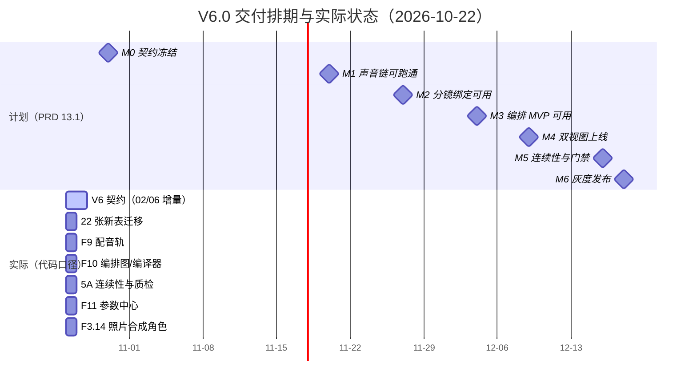

# 17 · GleamDream Studio 项目完成情况与进度分析报告

| 项 | 内容 |
|---|---|
| 产品 | 浮光造梦 · AI 短剧创作工具（GleamDream Studio） |
| 报告类型 | 需求—实现对齐的完成度与进度偏差分析（项目管理视角） |
| 评估基线 | 《01 PRD V6.4 照片合成角色定稿版》（2026-10-22）+《02 数据库设计》《03 系统架构设计》《06 API 接口文档》 |
| 评估日期 | 2026-10-22 |
| 证据来源 | 代码实测（端点/表/图/页面/测试计数 + 关键能力关键词全量检索）、仓库内测试与审计报告交叉验证 |
| 核心结论 | **V4.0 范围已基本交付（≈95%）；V6.0–V6.4 新增范围几乎未动工（≈8%）。按 PRD V6.4 的 MVP 口径，整体完成度 ≈62%，MVP 功能缺口 34%（33.5/99 US）** |
| 最大偏差 | ①V6 数据层 22 张新表 0 建成；②契约（02/06 文档）未升级到 V6，M0 里程碑（2026-10-30）实质未启动；③按 PRD 隐含人力（≈4.2 FTE）才能保住 2026-12-18 交付 |

---

## 一、结论摘要（30 秒版）

1. **项目不是"做了一半"，而是"上一版做完了、新版没开工"**。F1–F8 的 V3/V4 能力已端到端跑通（169 个端点、68 张表、12 步全旅程冒烟），但 V6.0 引入的三条新主线——**配音先行（F9）、合成编排（F10）、连续性/质检/反馈（第 5A 章）**，以及 V6.2 的**参数中心（F11）**、V6.3/6.4 的**照片合成角色（F3.14）**——在代码层**检索命中为 0**。
2. **完成度按口径分三档**：V4.0 口径 ≈95%；**V6.4 MVP 口径 ≈62%**；V6.4 全量（含 P1/P2）≈60%。
3. **进度偏差的性质是"范围单方面扩容 + 契约未跟上"**，不是执行效率问题：PRD 在 7 天内（2026-10-15 V4.0 → 2026-10-22 V6.4）4 次升版，新增约 48 条 US（占总量 36%）、22–23 张表、约 45 个端点、19 个 E2E 场景，而实现侧仍停留在 V4。
4. **最大阻塞不是写代码，而是"没有可写的契约"**：`02` 文档只到 §13.5（V4 增量），`06` 文档 200 个端点全是 V4 口径，**F9/F10/F11/5A/F3.14 均无字段与接口定义**。M0「契约冻结」原定 2026-10-30，当前完成度≈0。
5. **剩余工作量约 167 人日**（V6.0 96 + V6.1 28 + V6.2 19 + V6.4 24）：1 人 ≈ 2027-06 交付，2 人 ≈ 2027-02，4 人 ≈ 2026-12-23。**12-18 交付成立的前提是 ≥4 FTE 且 10-26 准时开工**。

---

## 二、评估口径与方法

### 2.1 基线拆解（来自 PRD V6.4）

| 基线维度 | 规模 | 出处 |
|---|---|---|
| 功能域 | **11 个**（F1–F11），**134 条 US**、**120 条 AC** | 第 5 章、第 2.1 节 |
| 横切能力 | **3 个**（M0 Story Bible / M1 三级质检 / M2 结构化反馈） | 第 5A 章 |
| MVP 范围 | **99 条 US**（F1–F11 的 M 级）+ M0/M1-L1L2/M2 + F3.14 仅 M1 | 第 2.3 节 |
| 业务规则 | GR-1~GR-24、5 个 HITL 关口（V6.0 由四关口扩为五） | 4.2、4.3 |
| 数据模型 | 02 文档 56 表 + V4 增量 **12 表** + **V6 增量 22–23 表** ≈ **90–91 表** | 第 8 章 DR-13~DR-26 |
| 接口 | 06 文档登记 **200 个**（V4 口径）+ V6 新增 **≈45 个** ≈ **245** | 06 文档、F9/F10/F11/F3.14 |
| 架构 | 13 个应用层模块、9 个 Agent、10 条 LangGraph 子图 | 03 文档第四、五章、附录 A |
| 验收 | E2E-01~12（V1–V4）+ **E2E-13~31（19 个 V6 场景）** | 第 10 章 |
| 排期 | 8 周：2026-10-26 开工 → M6 灰度 **2026-12-18** | 13.1、13.2 |

### 2.2 判定规则

| 状态 | 判定标准（满足其一即计入） |
|---|---|
| 已完成 | 代码中存在可调用端点/表/页面，且仓库内有对应测试或实测记录 |
| 进行中 | 存在部分字段/端点/页面，但主链路或关键 AC 未闭合（计 0.5） |
| 未开始 | 关键实体、端点、页面三者皆无（关键词全量检索命中 0） |
| 完成度算法 | 按 MVP US 加权：`Σ(已完成 1 / 进行中 0.5) ÷ MVP US 数`；P1/P2 不入 MVP 分母，另列 |

> **复测受限说明**：本次未能复跑后端 pytest——仓库 `.venv/Scripts/python.exe` 启动失败（读取 `pyvenv.cfg` 异常），且本会话无运行中的 PostgreSQL。测试结论引用仓库记录（12 个测试文件、**107 个测试函数**，文档记录"110 用例全绿"），并标注为"待复测"。凡引用历史报告处已注明出处与日期。

---

## 三、进度总览

### 3.1 三口径完成度

| 口径 | 完成度 | 计算与依据 |
|---|---|---|
| **V4.0 口径**（上一版全量，含 P1） | **≈95%** | V4 范围 86 US 中约 82 条有实现；15 号报告实测 162 端点/68 表/110 用例；本报告实测 169 端点/68 表 |
| **V6.4 MVP 口径**（当前应交付范围） | **≈62%** | 99 条 MVP US 折算完成 66.4（含 3 个横切模块按 8 US 当量加权）→ 66.4/107 |
| **V6.4 全量口径**（含 P1/P2） | **≈60%** | 134 US 折算完成 ≈78.4；V6 新增 48 US 中仅 2 条处于"进行中" |

### 3.2 关键数字对照

| 维度 | 基线 | 实测 | 覆盖率 | 证据 |
|---|---|---|---|---|
| 功能域 | 11（F1–F11） | 8 个有实现（F1–F8） | **8/11** | `backend/app/api/` 18 个路由文件 |
| MVP US | 99 | 完成 65.5 + 横切 0.9 | **≈62%** | 见第五章 |
| 后端端点 | ≈245 | **169** | ≈69% | `grep @router.` 计数 |
| 数据库表 | ≈90 | **68** | **≈76%** | `app/models/*.py` 68 个 `__tablename__` |
| V6 新增表 | 22–23 | **0** | **0%** | 关键词检索：`voice_tracks/voice_clips/shot_line_bindings/composition_graphs/render_plans/story_bible_*/continuity_*/param_configs/photo_uploads/identity_profiles/character_compositions` 均 0 命中 |
| LangGraph 子图 | 10 | **1**（编剧子图，9 节点） | 10% | `app/graphs/script_graph.py`；ADR-09 已确认同步管线路线 |
| 前端页面 | 22（P01–P22）+ 5 类 V6 页 | **22 + 1（V4 能力中心）** | 页面 22/27 | `frontend/src/views/` 28 个视图、32 条业务路由 |
| 测试用例 | — | **107** 个函数 / 12 文件 | 待复测 | `backend/tests/` |
| E2E 场景 | 31 | **12 步冒烟**（V3 链路） | 12 步 / 31 场景 | `backend/scripts/e2e_smoke.py` |
| 埋点 | 42 项 + V6 新增 | 最小集（2 端点 + 事件表） | ≈25% | `app/api/analytics.py` |

### 3.3 计划 vs 实际（截至 2026-10-22）

> 说明：图中"实际"各条仅 1 天，表示**当前进度为 0，尚未进入排期**，不是工期估算。

---

## 四、基线：功能清单与架构模块划分

### 4.1 功能需求清单（评估基线）

| 域 | 编号 | 能力要点 | MVP 必做项 | MVP US |
|---|---|---|---|---|
| 账号计费权限 | F1 | 手机号/微信登录、积分账户、套餐、冻结-结算-返还、预算、ACL | 全部（团队预算 P1） | 8 |
| 剧本 | F2 | 一句话生成、上传解析、分集、改写、前置审核、结构化编辑、**台词清单/时长预估/连续性事实** | 12 条 V4 基线 + 5 条 V6 | 17 |
| 配音轨 | **F9** | 断句与情绪标注、逐角色 TTS、词级对齐、配音轨、时长回报、**强制关口 V** | 全部（真人替换 P1） | 5 |
| 资产 | F3 | 清单/主形象/三视图/表情集/QC/音色/真人授权 + **多维锚点包 + 照片合成 M1** | 10 条 V4 + 5 条 V6 | 15 |
| 分镜 | F4 | 拆解、参数、画布、草稿、锁定、**台词绑定与音频驱动时长** | 9 条 V4 + 6 条 V6 | 15 |
| 视频生成 | F5 | 批量编排、路由、队列、质检闭环、版本、重试返还、**音画对齐输入** | 10 条 V4 + 1 条 V6 | 11 |
| 后期 | F6 | 字幕、BGM、混音、**音字轨加工**（合成移交 F10） | 8 | 8 |
| 合成编排 | **F10** | 编排图、轨道视图、节点视图、渲染计划编译、`plan_hash` 幂等 | 6（分组/分支 P1） | 6 |
| 导出分发 | F7 | 母版导出、分辨率水印、元数据、AI 标识、分发 | 5（分发 P1） | 5 |
| 项目管理 | F8 | 状态流转、快照回滚、成员 ACL、审计 | 3（团队 P1） | 3 |
| 参数中心 | **F11** | 六组约 40 项参数、即时生效、重评估、危险护栏、合规锁定 | 6 | 6 |
| 横切 M0 | 5A.2 | Story Bible、快照组装、字段级影响清单 | 事实登记 + 快照 | — |
| 横切 M1 | 5A.3 | L1 单镜 / L2 镜间 / L3 跨集 | L1 + L2 前五维 | — |
| 横切 M2 | 5A.4 | 结构化反馈 + 反例库 | 维度路由 + 项目内反例库 | — |

### 4.2 架构模块划分（03 文档 13 模块 + 编排）

| 层 | 设计内容 | 代码落点 | 状态 |
|---|---|---|---|
| 应用层 13 模块 | auth / user / billing / project / script / asset / storyboard / render / post / export / notification / admin / orchestrator | 12 个已建（`app/api/`），admin 裁剪为 P2、由 `model_configs` 部分替代 | 12/13 |
| 横切组件 | security / idempotency / tracing / errors / ratelimit / model_gateway / storage / db | 8 个中 6 个有实现，tracing（OTel）与 ratelimit（Redis 令牌桶）缺失 | 6/8 |
| Agent（9 + 编排器） | 编剧/解析/美术/导演/配音/制片/质检/审核/后期/发行 | 提示词文件仅 2 个（编剧、合规），其余以服务内同步调用模型网关实现 | 部分 |
| LangGraph 子图 | 10 条 | 1 条（编剧 + HITL-1） | 1/10 |
| 任务队列 | Celery + Redis 6 队列 | asyncio 内存执行器（ADR 允许裁剪） | 等价实现 |
| 实时通道 | Redis Stream + SSE | 进程内 EventBus + SSE | 等价实现（单实例） |
| 存储 | OSS + CDN 预签名 | 本地磁盘 + `/files` | 降级 |

---

## 五、分模块完成情况明细（F1–F11）

> 完成度按 MVP US 折算；"判断依据"列给出可复核的代码证据。

| 模块 | 完成度 | 状态 | 判断依据（已实现 → 缺口） |
|---|---|---|---|
| **F1 账号计费权限** | **94%** | 进行中 | ✅ 手机号验证码（60s 频控）、JWT 刷新、注册赠 500、冻结-结算-返还、支付回调幂等、预算超限 30002、团队 ACL；`app/api/{auth,billing,teams}.py`。⚠️ 微信登录为 Stub（`/auth/wechat` 用 `mock_unionid`）；支付渠道未真实开通（D2） |
| **F2 剧本** | **76%** | 进行中 | ✅ 一句话生成（202+SSE）、上传解析置信度、分集、改写、前置审核、续写/扩写、导出 md/docx/txt、版本 diff/恢复、生成终止按集结算、台词行编辑（`PATCH /script-lines/{line_id}`）。❌ V6：`script_lines` 无 `est_ms/voice_status`、无"一键生成台词清单/时长预估"、**F2.13 连续性事实与逻辑校验 LR-1~LR-6 全缺**（无 `story_bible_*` 表、无规则校验器） |
| **F3 资产** | **67%** | 进行中 | ✅ 清单提取、主形象+三视图+表情集、带反馈重抽、音色绑定、真人授权四步+撤回、一致性 QC（0.80/0.68）、锚点影响、变体、批量重抽、标签搜索。❌ **F3.13 多维锚点包（服装/场景/道具/光线）未做**（仅 `shots.asset_anchor_ids`）；**F3.14 照片合成角色 0%**（无 `photo_uploads/identity_profiles/character_compositions`，前端无六步流程页） |
| **F4 智能分镜** | **60%** | 进行中 | ✅ 自动拆镜、景别/运镜/描述、草稿预览、画布拖拽、prompt 编辑、上游影响提示、批量改、操作历史与回滚、锁定与 HITL-3、节奏模式、模板。❌ **F4.13 台词绑定（`shot_line_bindings`）、音频驱动时长 GR-11、`duration_source/duration_drift/line_coverage`、漏词抢词检查、连续性预检全部缺失**——V6 分镜能力的核心整块为空 |
| **F5 视频生成** | **91%** | 进行中 | ✅ 批量编排（前 3 镜优先）、模型路由与锁定、队列/插队、失败分类重试≤2、取消退款、版本保留、六态仪表盘、批量重试、人工强制通过（`manual_pass` 留痕）、一键锁版本。❌ **F5.11 时长严格等于台词时长、F5.13 音画对齐输入（`voice_clip_ids`/`duration_mismatch`）未实现** |
| **F6 后期合成** | **100%**（F6 自身 US） | 已完成（待 V6 收缩） | ✅ TTS 样音/全剧、字幕对齐与逐条编辑、BGM 推荐/替换、四轨时间线、混音画像（-14 LUFS）、成片 HITL-4。⚠️ **V6.12 要求"合成移入 F10、F6 收缩为音字轨加工"，当前合成仍在 `POST /post/compose`，职责未迁移** |
| **F7 导出分发** | **100%** | 已完成 | ✅ 分辨率/水印权益、分集 ZIP 编号、元数据 LLM 生成、导出历史复用、规格自检、**AI 生成标识（`ai_label.py` + 导出/分发元数据）**、分发重试/撤回 |
| **F8 项目管理** | **100%** | 已完成 | ✅ 14 态状态机白名单、快照上限 30 淘汰、回滚生成新快照、SSE 心跳+Last-Event-ID、成员三级 ACL、审计留痕、孤儿审批单补偿（D19） |
| **F9 配音轨** | **0%** | 未开始 | ❌ 无 `voice_tracks/voice_clips/voice_params`、无配音工作台、无关口 V、无词级对齐管道。现有 `post/tts` 是一次性整段合成 + 静音 WAV/百炼 TTS，不具备"逐句/增量/对齐/时长回报"能力 |
| **F10 合成编排** | **0%** | 未开始 | ❌ 无 `composition_graphs/cg_nodes/cg_edges/cg_layout/render_plans`，无 `plan_hash`、无结构守卫、无轨道/节点双视图。现有 `timeline_clips` 只是扁平时间线，**不构成编排图，无法支撑 E2E-15 双视图一致性门禁** |
| **F11 参数中心** | **0%** | 未开始 | ❌ 无 `param_defs/param_configs/config_versions/config_audit`、无参数中心页、无 `config_version` 回放。现有 `system_configs` + 模型配置页是"平台级运维配置"，不是项目级可调参数中心 |

**加权结果**：99 条 MVP US 折算完成 **65.5** + 横切折算 **0.9** → **≈62%**。

---

## 六、横切与工程维度

### 6.1 5A 连续性 / 质检 / 反馈

| 能力 | 基线 | 实际 | 完成度 |
|---|---|---|---|
| M0 Story Bible | 事实登记、快照组装、字段级影响清单 | 无相关表与端点；`consistency_service.py` 仅为**资产人脸 QC 的确定性伪向量**（sha256 派生 128 维），不涉及世界状态 | **0%** |
| M1 三级质检 | L1 单镜 / L2 镜间六维 / L3 跨集 | 仅 **L1 人脸相似度**（`qc_reports` + 阈值 0.80/0.68），无服装/场景/道具/光线维度、无证据链、无三级裁决 | **≈20%** |
| M2 结构化反馈 | 维度化表单 + 确定性路由 + 反例库 | 无 `human_feedback` 表、无 `negative_examples`；反馈为审批单自由文本（`approval_requests.feedback_scope`） | **≈10%** |
| 参数版本可回放 | `config_version` 贯穿质检报告 | 全链路无该字段 | **0%** |

### 6.2 数据与接口

| 项 | 结论 |
|---|---|
| 表 | 68 张（= 02 文档 56 + V4 增量 12），**V4 设计覆盖 100%**；V6 需 22–23 张，**0 张建成** → 全量数据基线 **≈76%** |
| 迁移 | Alembic 5 个版本，`alembic check` 零漂移（15 号报告记录）；V6 无迁移 |
| 接口 | 169 个端点 / 18 路由文件；06 文档 200 个（V4 口径）覆盖 ≈85%；**V6 约 45 个端点 0 交付**（F9 8 / F10 10 / F11 7 / F3.14 10 / 5A 10，估算） |
| 契约文档 | **02/06 均无 V6 章节**（02 最后一节为 §13.5 V4 增量）→ **M0「契约冻结」未启动** |

### 6.3 前端

| 项 | 结论 |
|---|---|
| 页面覆盖 | P01–P22 **22/22 已实现**（28 个视图、32 条业务路由），另加 V4 能力中心 |
| V6 新页面 | **0/5**：配音工作台、编排轨道视图、编排节点视图、参数中心、照片合成角色六步流程（连续性报告/反馈表单也未建） |
| 质量 | 2026-10-22 全局审计（606×554 窄屏）：**P0 2 项**（资产列表不可达、新增模型弹窗无 `max-height`）、**P1 7 项**（后期预览 59px 高、剧本正文 94–170px、HITL 卡遮挡画布等）；交互验证 6/6 通过 |
| 构建 | 10-20 记录 `vue-tsc` 0 error、`vite build` 通过（本轮未复跑） |

### 6.4 非功能与合规

| 项 | 状态 |
|---|---|
| NFR-C6 AI 生成内容标识 | ✅ 已落地（`ai_label.py`，导出与分发元数据双写） |
| 性能 P95 / 压测 | ❌ 仅有 `perf_smoke.py` 脚本，无报告与门禁数据 |
| 安全 | 部分：JWT、ACL、幂等键、错误码统一已做；`core/tracing`、Redis 限流、密钥加密未证实 |
| 部署形态 | 单实例：进程内 EventBus + asyncio 执行器 + 本地磁盘 → 灰度承载能力未验证 |
| 照片合成合规门禁 | ❌ QG-11/12/13（只拦不放、批次级联、M1 边界）全部未实现——**属发布硬门槛** |
| 真实模型 | ✅ 百炼已接入 text/image/video/TTS 四类（`app/infra/model_gateway/bailian.py`）；支付/短信/微信/审核/分发仍为 Stub |

---

## 七、偏差分析

### 7.1 范围偏差：V6 增量占比高，且集中在"未开工"区域

| 项 | 数值 |
|---|---|
| PRD 版本跃迁 | V4.0（10-15）→ V6.4（10-22），7 天内 4 次升版，新增 48/134 US（**36%**） |
| 新增内容实现率 | 48 条中约 2 条"进行中"（F2 台词行、F3 锚点引用）→ **≈4%** |
| 未完成 MVP US | **33.5 条（34%）**，其中 F9+F10+F11 = 17 条全空 |
| 新增表 | 0/22（0%） |
| 新增端点 | 0/≈45（0%） |
| 新增 E2E | 0/19（0%） |

### 7.2 进度偏差：M0 已实质逾期风险

| 里程碑 | 计划 | 判定 | 说明 |
|---|---|---|---|
| M0 契约冻结 | 2026-10-30 | **🔴 高风险** | 02/06 无 V6 章节；剩余 7 项待拍板（V6-03/05~10）无结论；距截止 8 天 |
| M1 声音链 | 2026-11-20 | **🔴 不可达** | T-02~T-09 需 ≈25 人日，且依赖 M0 契约；代码 0 行 |
| M2 分镜绑定 | 2026-11-27 | 🔴 不可达 | 依赖 F9 `actual_ms`，F9 未开工 |
| M3 编排 MVP | 2026-12-04 | 🔴 不可达 | T-16/T-17（4+6 人日）+ T-18（6 人日）为关键路径，尚未 begin |
| M4 双视图 | 2026-12-09 | 🔴 不可达 | 依赖 M3 |
| M5 连续性 | 2026-12-16 | 🔴 不可达 | 5A 全部未开始 |
| M6 灰度 | 2026-12-18 | 🔴 不可达（当前人力） | 见 7.3 |

### 7.3 人力—工期推演（剩余 167 人日）

> PRD 未给出团队规模（13.3 全部标注"待确认"）。以下按净工作日、无缓冲推算，起始日 2026-10-26。

| 投入 | 等效工期 | 预计完成 | 相对 12-18 |
|---|---|---|---|
| 1 FTE | 167 工作日 | **2027-06-16** | 延后 ≈26 周 |
| 1.5 FTE | 111 工作日 | 2027-03-30 | 延后 ≈15 周 |
| 2 FTE | 84 工作日 | 2027-02-19 | 延后 ≈9 周 |
| **4 FTE** | 42 工作日 | 2026-12-23 | 基本对齐（需 0 缓冲 + 并行无返工） |
| 5 FTE | 33 工作日 | 2026-12-11 | 可留 1 周缓冲 |

**结论**：PRD 的 8 周计划隐含 **4–5 FTE 全员并行且关键路径零延误**。若实际为 1–2 人，必须二选一：**砍范围**（保留 F9+F4.13+F10 主链路，F11/F3.14 后置）或**改交付日**。继续按 12-18 承诺而不调范围，是最坏选项。

### 7.4 口径偏差（文档治理问题）

1. 02/06 文档未随 PRD 升级，"设计基线"与"需求基线"错位一整个大版本。
2. 03 文档 ADR-09 记录日期为"2026-11 确认"、修订记录 V3.1 为"2026-11-05"，**晚于当前日期 2026-10-22**，版本时间线不可信。
3. 历史报告口径不一致：10 号报告 111 端点/57 表，15 号报告 162 端点/68 表/110 用例，本次实测 **169 端点/68 表/107 用例**——报告间无"统计时点"字段，易被误读为回退。

---

## 八、未完成关键事项（按阻塞性排序）

| # | 事项 | 影响 | 工作量 | 依赖 |
|---|---|---|---|---|
| 1 | **V6 契约冻结**：02 补 22 张表 DDL、06 补 ≈45 个端点、状态机与错误码 | 阻塞全部 V6 编码；越晚返工越大 | **4 d** | 剩余 7 项拍板 |
| 2 | **V6 数据迁移**（`voice_*`/`shot_line_bindings`/`composition_*`/`render_plans`/`story_bible_*`/`continuity_*`/`param_*`/`photo_*`/`identity_*`/`character_compositions`） | 无表即无功能 | **6 d** | #1 |
| 3 | **F9 配音轨**（逐句 TTS + 词级对齐 + 时长回写 + 关口 V） | M1/M2 前置；无 F9 则 D-02 强制关口不成立 | **≈25 d**（T-02~T-10） | #2 |
| 4 | **F4.13 台词绑定 + GR-11 音频驱动时长 + 漂移分流** | 无它则"按镜头解锁"退化为整集解锁（D-01 失效） | **≈16 d**（T-11~T-15） | #3 |
| 5 | **F10 编排图 + 编译器 + `plan_hash` + 轨道视图** | V6 立身之本；E2E-15 门禁与计费幂等均依赖 | **≈30 d**（T-16~T-22） | #2 |
| 6 | **5A：M0 事实源 + L2 三维校验 + 结构化反馈** | QG-1/M19/M20/M21 门禁不达标即不可发布 | **≈26 d**（T-23~T-25 + T-28~T-34） | #3 |
| 7 | **F11 参数中心**（40 项元数据 + 即时生效 + 重评估 + 审计） | 文案完整率 100%、可复现率 100% 为硬门禁 | **≈19 d** | #5 |
| 8 | **F3.14 照片合成 M1**（四道闸 + 身份档 + 合规拦截 + 授权留痕） | QG-11/12/13 合规红线；24 人日 | **≈24 d** | #2 + 法务口径 |
| 9 | **E2E-13~31 自动化 + 兼容模式回归（E2E-20）** | 无回归则存量项目断链 | **≈12 d** | #3~#8 |
| 10 | **前端 P0/P1 布局缺陷 + 窄屏适配** | 影响演示与试用转化 | **≈4 d** | — |

---

## 九、风险与阻塞登记表

| ID | 类型 | 描述 | 概率 | 影响 | 应对策略 | 负责人 | 触发信号 |
|---|---|---|---|---|---|---|---|
| **R-01** | 阻塞 | **契约未冻结**：02/06 无 V6 定义，建表与接口靠"猜" | 已发生 | 高 | 10-30 前出「V6 契约增量包」（表 DDL + 端点 + 状态机），评审后冻结 | 产品/技术负责人（待确认） | 10-27 仍无初稿 |
| **R-02** | 阻塞 | **人力与 167 人日不匹配** | 高 | 高 | 10-24 前确认 FTE；不足则按 §10.3 砍范围或改期 | 项目负责人（待确认） | 10-24 未确认 |
| **R-03** | 技术 | `plan_hash` 双视图一致性（E2E-15）未做 spike，编译器为最大不确定性 | 中 | 高 | 先做 2 人日 spike：1 集样片两视图各渲一次，逐帧 SSIM 比对 | 后端核心（待确认） | spike 失败或未做 |
| **R-04** | 技术 | WhisperX 词级对齐精度未知，直接影响 GR-11 与 M15 | 中 | 高 | 抽 50 句测误差分布；失败则降级"按字数估算 + 人工微调" | 算法（待确认） | 对齐误差 > 100ms 比例 > 10% |
| **R-05** | 技术 | 六维检测需自部署视觉模型，未选型未定标；阈值不定等于没做 | 中 | 高 | 先 30 组样片定标再开发；每维度独立降级 | 算法（待确认） | 检测成本 > 3% 或误杀 > 15% |
| **R-06** | 合规 | 照片合成"只拦不放"（QG-11/12/13）未实现，无拒绝码字典与法务口径 | 中 | **极高** | 拒绝码字典与授权文案先评审；批次级联拦截先做 | 产品 + 法务 | 上线前未过 40 例构造样本 |
| **R-07** | 质量 | 前端窄屏 2 项 P0 / 7 项 P1 布局缺陷 | 已发生 | 中 | 按"内容区最小高度 + 弹窗 max-height + sticky 让位"三条通用规则统一修 | 前端（待确认） | 606×554 视口仍不可达 |
| **R-08** | 存量 | 无兼容模式（E2E-20）：V5→V6 存量项目可能断链 | 中 | 高 | 编排图由扁平时间线自动转换 + 只读兼容层 | 后端（待确认） | 存量项目出片失败 |
| **R-09** | 商业 | 支付/短信/微信/审核仍 Stub，收费与合规上线不可行 | 高 | 高 | D2/D4 先于灰度；短信与微信仅影响注册漏斗 | 业务（待确认） | 灰度前未开通 |
| **R-10** | 工程 | 单实例架构（进程内 EventBus/asyncio 执行器/本地磁盘） | 中 | 中 | 灰度限流；生产前换 Redis + OSS | 后端（待确认） | 并发 > 10 或重启丢任务 |
| **R-11** | 治理 | 文档版本时间线错乱（ADR-09 记 2026-11）、历史报告口径不一 | 已发生 | 低 | 每份报告加"统计时点 + 口径 + 证据命令"三字段 | PM（待确认） | 评审时无法复现数字 |
| **R-12** | 测试 | 本轮无法复跑 pytest（venv/DB 环境问题），回归基线不可信 | 已发生 | 中 | 修复 `.venv` 或提供可复现测试镜像；CI 化 | 后端（待确认） | 交付前无一次全绿记录 |

---

## 十、后续工作优先级建议

### 10.1 优先级排序原则

按 **"拦截位置越靠前越优先 + 门禁阻塞优先 + 关键路径优先"** 三条排序：能挡住最贵返工的（F2.13 规则）> 能解锁后续链路的（F9/编排）> 合规硬门槛（F3.14）> 体验优化（前端布局/埋点）。

| 优先级 | 事项 | 为什么是它 |
|---|---|---|
| **P0（本周）** | ① V6 契约增量包（02/06）② 22 张表迁移骨架 ③ 人力与范围二选一 ④ 两个 spike（`plan_hash`、WhisperX） | 这四件不做，后面所有开发都是返工 |
| **P0（11-20 前）** | F9 配音轨（T-02~T-10）+ 关口 V + 时长报告 | 解锁 F4.13 与"配音先行"默认链路 |
| **P0（11-27 前）** | F4.13 绑定 + GR-11 + 漂移分流 | D-01"按镜头解锁"的唯一支撑 |
| **P1（12-04 前）** | F10 编排图 + 编译器 + 轨道视图 | E2E-15 门禁、计费幂等、缓存复用 |
| **P1（12-16 前）** | 5A M0 + L2 三维 + 结构化反馈 | QG-1/M19/M20 发布门禁 |
| **P1（并行）** | F3.14 照片合成 M1 + 合规拦截 | 合规红线，但不能抢关键路径人力 |
| **P2** | F11 参数中心、L3 跨集、前端布局修复、埋点补全、性能压测、Redis/OSS 生产化 | 门禁不阻塞或可灰度后补 |

### 10.2 30 天行动计划（2026-10-23 ~ 2026-11-20）

| # | 行动项 | 产出（可验收） | 负责人 | 截止 |
|---|---|---|---|---|
| 1 | 出 V6 契约增量包 v0.1（22 表 DDL + 45 端点 + 状态机 + 拒绝码字典） | 02/06 增量章节，评审通过 | 产品 + 后端 | **2026-10-27** |
| 2 | 确认 FTE 与范围：在"保 12-18 砍范围"与"保范围改期"中二选一 | 一页决策备忘（含受影响 US 清单） | 项目负责人 | **2026-10-24** |
| 3 | 冻结剩余 7 项（V6-03/05~10）默认值执行 | 结论表，写入 12.4.2 | 产品 | **2026-10-30（M0）** |
| 4 | V6 数据迁移骨架（22 表 + 索引 + 约束） | `alembic upgrade head` 通过 + 回滚通过 | 后端 | **2026-11-03** |
| 5 | Spike A：`plan_hash` 双视图等价性（1 集样片） | 比对报告（hash + SSIM） | 后端核心 | **2026-10-31** |
| 6 | Spike B：WhisperX 在自家 TTS 音频上的 50 句误差分布 | 误差表 + 是否降级的结论 | 算法 | **2026-10-31** |
| 7 | F9 逐句 TTS + 音频缓存（`text_hash+params_hash`） | 单句合成 + 缓存命中率实测 | 后端 + 算法 | **2026-11-10** |
| 8 | 配音工作台 + 关口 V + 时长报告 | 单集 100 句可配可审 | 前端 + 后端 | **2026-11-18** |
| 9 | 前端 P0/P1 布局缺陷修复（通用规则三条） | 606×554 与 1440×900 双视口截图全通 | 前端 | **2026-11-06** |
| 10 | 修复测试环境（`.venv` / PostgreSQL），恢复"一键全绿" | pytest 全绿记录 + 复现命令 | 后端 | **2026-11-06** |

### 10.3 若人力不足的缩范围方案（建议备选）

| 方案 | 保留 | 后置 | 交付日 | 代价 |
|---|---|---|---|---|
| A（推荐，2 FTE） | F9 + F4.13 + F10 轨道视图 + L1/L2 质检 + AI 标识 | F11、F3.14、节点视图、L3 | **2027-02** | 承诺日推后，但主链路与门禁成立 |
| B（保 12-18，4 FTE） | 全 MVP | P1 全部 | 2026-12-23 | 需 4 人并行 + 零返工，风险高 |
| C（保 12-18，1–2 FTE） | F9 + F4.13 + F10 线性节点（仅"能出片"） | F11、F3.14、5A-L2、双视图一致性 | 2026-12-18 | **E2E-15/QG-1 门禁不达标，不能对外称 MVP** |

### 10.4 建议立即做的 3 件事

1. **今天就把 02/06 的 V6 增量开出来**（哪怕只有表名 + 字段 + 端点签名）。契约晚一天，T-02/T-16 的建表返工就多一天，而这两项在关键路径上。
2. **本周内做两个 spike 并给结论**：`plan_hash` 等价性、WhisperX 对齐精度。这两项决定 V6.0 是"能承诺"还是"大概能"——现在两个都没有数据。
3. **10-24 前把"人力 × 范围 × 交付日"三角定下来**。167 人日的账已经很清楚：不砍范围也不加人，12-18 只是纸面日期，越晚承认代价越高。

---

## 附录：证据索引

| 证据 | 位置 / 命令 |
|---|---|
| 端点清单（169） | `backend/app/api/*.py`；`grep -rn "@router\.\(get\|post\|put\|patch\|delete\)" app/api \| wc -l` |
| 数据表（68） | `backend/app/models/*.py`；`grep -rn "__tablename__" app/models \| wc -l` |
| V6 表缺失 | `grep -rn "voice_tracks\|shot_line_bindings\|composition_graphs\|param_configs\|continuity_snapshots\|photo_uploads" app alembic` → 0 命中 |
| 编排图 | `backend/app/graphs/script_graph.py`（9 节点）；`app/graphs/prompts/`（2 个提示词） |
| 前端页面 | `frontend/src/views/`（28 个视图）、`frontend/src/router/index.ts`（32 条业务路由） |
| 测试 | `backend/tests/`（12 文件 / 107 用例函数） |
| 冒烟 | `backend/scripts/e2e_smoke.py`（12 步） |
| 需求基线 | `项目开发文档/01_AI短剧创作工具_PRD_V6.4_照片合成角色定稿版.md`（US 134 / AC 120 / 13 章 WBS 96 PD） |
| 设计基线 | `02_数据库设计文档_ER图与数据字典.md`（§13.5 止于 V4）、`03_系统架构设计文档.md`（13 模块、ADR-09）、`06_API接口文档.md`（200 端点） |
| 历史结论 | `09_MVP验收总结报告.md`、`10_开发进度评估报告_20261020.md`、`15_V4功能落地完成报告_20261020.md` |
| 质量现状 | `测试报告/前端界面全局测试报告_20261022.html`（2 P0 / 7 P1）、`测试报告/第三轮缺陷修复说明_D18-D32.md` |

---

*报告完 · 所有完成度结论以代码实测为准；涉及人力、预算、负责人处标注"待确认"，未作虚构。*
