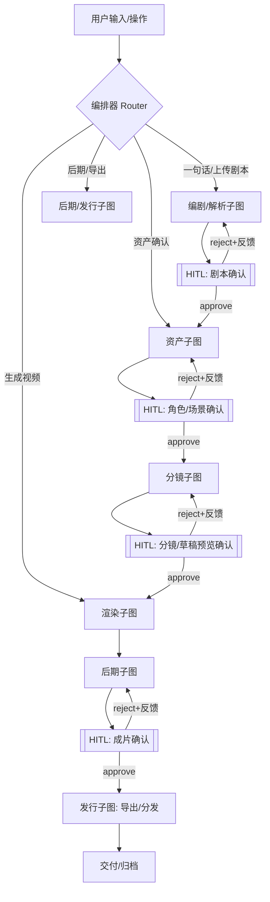
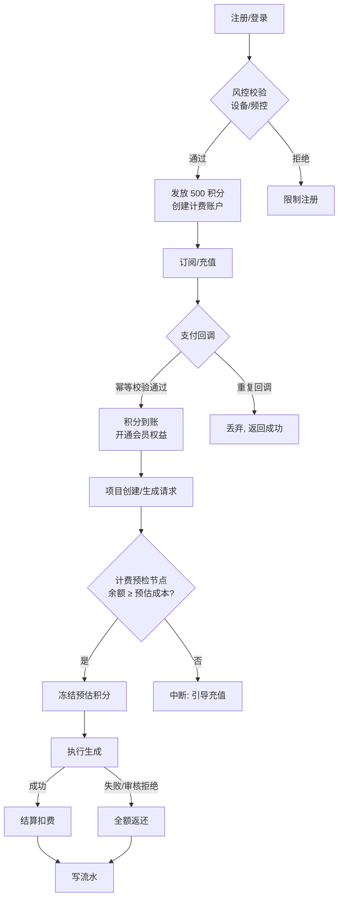
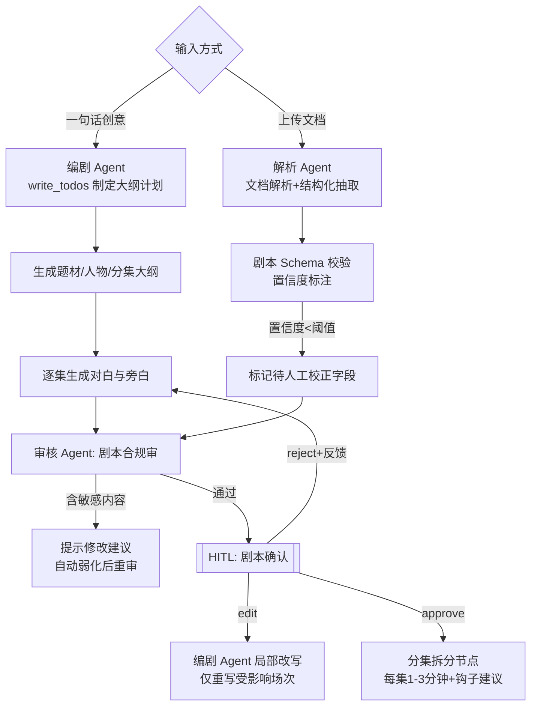
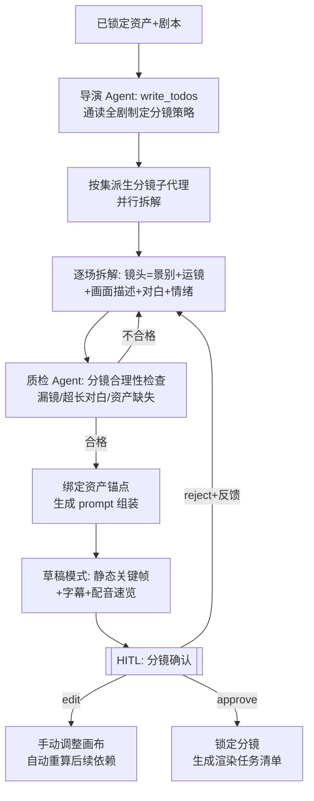
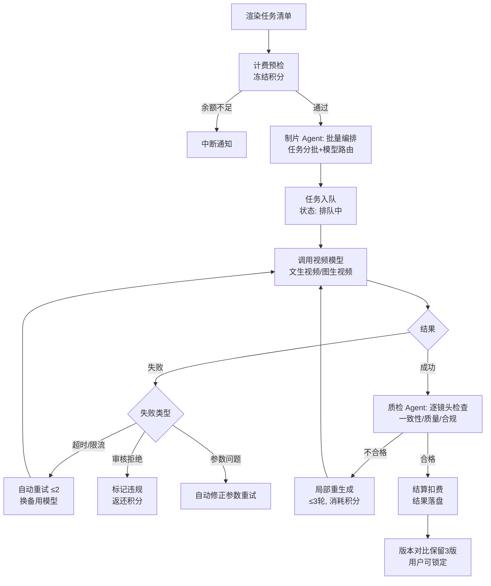
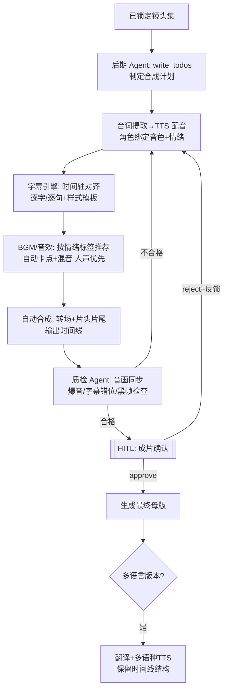
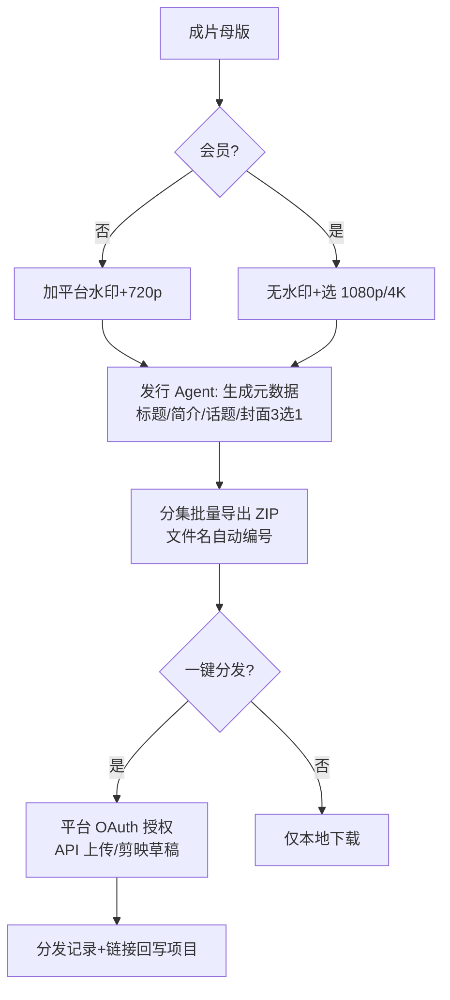
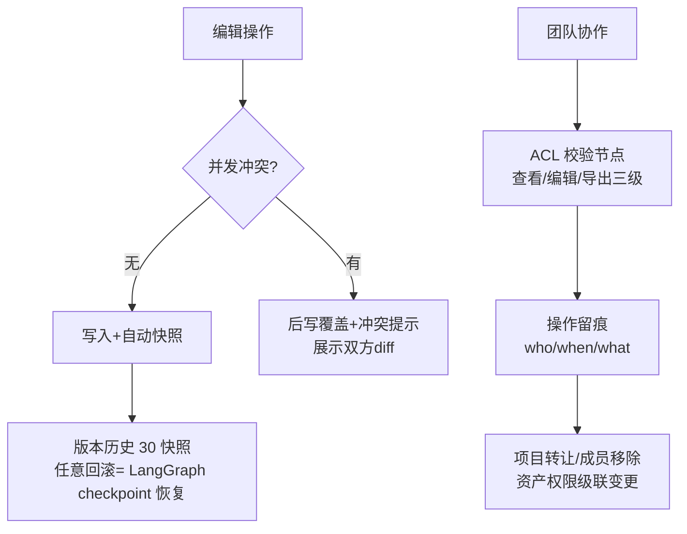

# AI 短剧创作工具 · 产品需求说明书 V2.0（多智能体架构版）

| 项目 | 内容 |
|---|---|
| 文档版本 | V2.0（基于 V1.0 升级） |
| 技术底座 | LangGraph（编排/状态机/人机协同）+ DeepAgents（专职 Agent 运行时） |
| 本次修订 | ① 新增第 0 章「多智能体总体架构」；② F1–F8 逐一展开为详细流程设计（流程图/Agent 分工/状态机/异常分支）；③ 明确 HITL（人工介入）断点 |

---

# 第 0 章 多智能体总体架构

## 0.1 设计原则

1. **编排与执行分离**：LangGraph 负责确定性流程（状态流转、计费、权限、中断），LLM Agent 只在"需要智能"的节点运行，不让 LLM 决定扣费、权限等确定性逻辑。
2. **专职 Agent + 共享工作区**：每个环节由专职 DeepAgent 负责，通过虚拟文件系统（`/project/`）交换产物，避免长上下文互相污染。
3. **自检闭环**：所有生成类节点统一采用「生成 → 质检 → 不合格则修正（最多 N 轮）」循环，质检 Agent 是独立节点，不与生成节点同模型。
4. **人在关键环节**：剧本、角色形象、分镜、成片四个质量关口设置 HITL 中断，用户 approve / reject(带反馈) / edit。

## 0.2 Agent 角色总表

| Agent | 运行时 | 职责 | 主要工具 |
|---|---|---|---|
| 编排器 Orchestrator | LangGraph 图（非 LLM） | 路由、状态机、中断、计费守卫 | — |
| 编剧 Agent Screenwriter | DeepAgent | 一句话生成剧本、局部改写、分集拆分 | plan(规划)、剧本模板库、write_todos |
| 解析 Agent Parser | DeepAgent | 上传剧本结构化解析、字段置信度标注 | 文档解析工具、剧本 Schema 校验 |
| 美术 Agent ArtDirector | DeepAgent | 角色形象/三视图/场景/道具生成与一致性维护 | 文生图、图生图、参考图注入 |
| 导演 Agent Director | DeepAgent（含子代理） | 剧本→分镜规划、机位逻辑、情绪节奏 | write_todos、分镜子代理（并行拆场） |
| 制片 Agent Producer | DeepAgent + 确定性队列 | 生成任务编排、模型路由、成本控制、失败重试 | 模型路由表、任务队列、比价器 |
| 质检 Agent QC | DeepAgent（视觉/文本双模态） | 角色一致性比对、画面质量、镜头合规 | CLIP 相似度、人脸比对、审核 API |
| 审核 Agent Compliance | DeepAgent | 剧本/画面/成片三重内容安全审核 | 内容安全 API、敏感词库 |
| 后期 Agent Post | DeepAgent | TTS 配音、字幕、配乐、混音、成片合成 | TTS、字幕引擎、音频混流 |
| 发行 Agent Distributor | DeepAgent | 导出参数、元数据生成、一键分发 | 导出服务、平台 OpenAPI |

> 计费不由 LLM Agent 处理：由 LangGraph 中的**确定性计费节点（积分预检/扣费/返还）**实现，Agent 只能申请任务预算。

## 0.3 全局状态设计（LangGraph State）

```python
class ProjectState(TypedDict):
    # 身份与权限
    project_id: str
    user_id: str
    team_acl: dict            # 成员角色/权限
    credit_budget: int        # 本项目积分预算
    credit_spent: int

    # 创作产物（即虚拟文件系统的索引）
    script: Script | None             # 结构化剧本（集-场-对白）
    script_draft_versions: list       # 剧本版本历史
    assets: dict[AssetType, list[Asset]]   # 角色/场景/道具/音色
    shots: list[Shot]                 # 分镜列表
    shotboard: dict                   # 画布布局元数据

    # 执行态
    render_tasks: list[RenderTask]    # 生成任务队列
    render_results: dict[str, RenderOutput]
    timeline: Timeline | None         # 后期时间线
    final_cut: MediaRef | None        # 成片

    # 质量与合规
    qc_reports: dict[str, QCReport]
    compliance_flags: list[Flag]

    # 人机协同
    pending_approvals: list[ApprovalRequest]   # 待人工确认项
    human_feedback: str | None                 # 用户 reject 时的反馈
```

- 所有节点幂等：节点输出按 `project_id + 节点名 + 输入 hash` 落盘，重跑不重复扣费。
- Checkpoint：LangGraph Postgres Checkpointer，每一步自动快照 → 支持断点续跑、崩溃恢复、版本回滚（对应 F8.2）。

## 0.4 主流程图（LangGraph 主图）



## 0.5 DeepAgents 能力映射

| DeepAgents 特性 | 在本产品中的用途 |
|---|---|
| `write_todos` 规划工具 | 编剧/导演/制片 Agent 对复杂任务先出计划，计划对用户可见（生成进度可解释） |
| 虚拟文件系统 | `/project/script.md`、`/assets/characters/苏婉/`（三视图+表情集）、`/shots/ep01/shot0037.json`，Agent 间唯一交换介质 |
| 子代理（subagents） | 导演 Agent 按"集"派生分镜子代理并行拆解；制片 Agent 派生逐镜头质检子代理 |
| 自检循环（iterate） | 美术/制片 Agent 内置 `生成→质检→修正` 工具链，不退出循环直到通过或达上限 |
| 长时任务上下文压缩 | 10 万字剧本解析时，Parser 只把结构化结果写入文件系统，后续 Agent 按需读取，不整本携带 |

## 0.6 成本控制护栏（Guardrails）

1. 每个渲染任务执行前必经**计费节点**：`credit_spent + 预估成本 ≤ budget` 才放行，否则中断提示充值。
2. 制片 Agent 的路由策略确定性执行：优先级 = 质量分/价格，用户可锁模型。
3. 单任务自动重试 ≤ 2 次，仍失败转人工或退积分（F5.5）。
4. 所有 Agent 的 prompt 注入项目预算与已消耗，超预算任务直接拒绝执行。

---

# 第 1 章 F1 账号、计费与权限——详细流程

## 1.1 流程图



## 1.2 流程步骤

| 步骤 | 处理方 | 说明 |
|---|---|---|
| S1 | 确定性服务 | 登录风控：同设备/手机号频控；微信登录换取 unionid |
| S2 | 计费服务 | 事务内创建账户+发积分，杜绝并发重复发放 |
| S3 | 支付网关 + 回调 | 回调以 `out_trade_no` 幂等；到账延迟目标 < 1 分钟 |
| S4 | **LangGraph 计费节点** | 每个消耗型子图入口执行预检→冻结；子图完成（或失败）后结算/返还。**LLM Agent 不接触扣费逻辑**，只上报 `estimated_cost` |
| S5 | 审计 | 流水含：project_id、任务类型、模型、时长、单价、消耗、冻结/结算/返还状态 |

## 1.3 关键设计

- 冻结-结算模式避免"并发生成导致透支"；冻结 30 分钟未结算自动解冻。
- 团队版：项目预算从团队池划拨，`team_acl` 在编排器层校验，Agent 工具调用前必过权限节点。
- 会员权益（4K、去水印）作为状态字段注入导出节点判断，而非前端隐藏按钮。

## 1.4 异常分支

| 异常 | 处理 |
|---|---|
| 支付回调丢失 | 主动对账任务 T+1 拉取网关账单补单 |
| 生成中服务重启 | 冻结记录持久化，重启后按 ProjectState 恢复结算 |
| 恶意并发刷积分 | 冻结上限 = 余额；同项目同任务 hash 去重 |

---

# 第 2 章 F2 剧本模块——详细流程

## 2.1 流程图



## 2.2 流程步骤

| 步骤 | Agent/节点 | 说明 |
|---|---|---|
| S1 | 编剧 Agent | 接收：题材、字数、风格、结局走向。先 `write_todos`（大纲→人物→分集→对白），计划对用户实时可见 |
| S2 | 编剧 Agent | 逐集生成，每集写入 `/project/script/ep{n}.md`，同时维护结构化 `Script` 对象 |
| S3 | 解析 Agent | 上传 10 万字剧本：分段解析→合并去重角色→场序还原；输出字段级置信度（角色归属/对白边界最易错） |
| S4 | 确定性校验节点 | 按剧本 Schema（集-场-角色-对白/旁白/动作）校验，非法结构直接打回 Agent 自修，不进入人工环节 |
| S5 | 审核 Agent | 前置审核（比生成后审省 90% 成本）：涉政/色情/未成年人/侵权要素扫描，输出"位置+风险等级+修改建议" |
| S6 | HITL 中断 | 用户可：approve / reject(反馈) / edit(进入编辑器手动改)。LangGraph `interrupt` 挂起，反馈写入 `human_feedback` 后从 reject 边重入 |
| S7 | 编剧 Agent | 局部改写：仅重生成受影响场次，其余内容引用原版本（省 token、保一致性） |
| S8 | 分集拆分节点 | 按目标单集时长估算场次，为每集生成"结尾钩子"建议，写入 `Script.episodes` |

## 2.3 状态机（剧本）

`草稿 → 待审核 → 待确认(HITL) → 已确认 → 已锁定(进入资产环节)`
补充状态：`待人工校正`（解析置信度不足时）、`审核未通过`（可再次提交）

## 2.4 异常分支

| 异常 | 处理 |
|---|---|
| 生成分集超长/超字数 | 校验节点打回，编剧 Agent 按场次裁剪 |
| 解析文档扫描件(图片PDF) | 走 OCR 工具，置信度整体降档并提示 |
| 用户 24h 未确认 | 项目挂起保留 30 天，快照不删除 |
| 审核拦截题材(如未成年人恋爱) | 直接终止并明确告知，不提供绕过重试 |

---

# 第 3 章 F3 资产模块——详细流程

## 3.1 流程图

```mermaid
flowchart TD
    A[已确认剧本] --> B[资产规划 Agent<br/>从剧本提取角色/场景/道具清单]
    B --> C{逐资产生成}
    C --> D[美术 Agent: 生成主形象]
    D --> E[美术 Agent: 生成三视图+表情集]
    E --> F[质检 Agent: 一致性/质量检查]
    F -->|不合格| D
    F -->|合格| G[写入资产库<br/>/assets/{type}/{name}/]
    G --> H[真人照片定制?]
    H -->|是| H1[授权确认节点<br/>相似度检测+弹窗留痕]
    H1 --> H2{相似真人脸?}
    H2 -->|是| H3[强制二次确认+授权书]
    H2 -->|否| G
    H -->|否| I[[HITL: 资产确认]]
    I -->|reject+反馈| D
    I -->|approve| J[绑定角色音色<br/>资产锁定]
```

## 3.2 流程步骤

| 步骤 | Agent/节点 | 说明 |
|---|---|---|
| S1 | 资产规划（美术 Agent 的规划子任务） | 从 `Script` 提取：角色清单（含年龄/外形描写/戏份权重）、场景清单（内外/时代/时段）、关键道具；输出生成优先级（戏份重的角色先生成） |
| S2 | 美术 Agent | 按用户选定画风（真人感/二次元/国风/3D）生成主形象；自检循环：主形象→三视图（正/侧/背）→表情集，每步由质检 Agent 比对"是否为同一人物" |
| S3 | 质检 Agent | 角色一致性：人脸 embedding 比对 + CLIP 相似度 ≥ 阈值；质量：肢体/手部/五官硬伤检测；不合格附具体原因返回美术 Agent 重生成（≤3 轮） |
| S4 | 合规节点 | 真人照片：人脸识别比对公共人物库 + 用户授权弹窗留痕（时间戳/IP/协议版本） |
| S5 | HITL 中断 | 角色卡片墙展示（主形象+三视图+表情），用户逐个 approve / reject(反馈如"太老/换发型") / 重抽 |
| S6 | 确定性绑定 | 角色→音色绑定写入 `assets`，全剧 TTS 统一引用 |

## 3.3 关键设计

- **一致性不靠 prompt 靠锚点**：所有该角色的后续生成强制注入三视图作为条件图；`asset_id` 进入每个分镜的生成参数。
- 资产库与项目解耦：资产写入 `/assets/`，项目通过引用使用 → 支持跨项目复用（F3.7）。
- DeepAgents 子代理：同批多个角色/场景可并行派生子代理生成，共享 `/assets/` 工作区。

## 3.4 异常分支

| 异常 | 处理 |
|---|---|
| 三视图与主形象相似度过低 | 美术 Agent 改用"图生图+姿态参考"而非文生图重抽 |
| 用户上传非人脸/模糊照片 | 前置校验打回，不进生成 |
| 表情集生成部分失败 | 允许带缺失通过，缺失情绪在分镜层降级处理（旁白代替） |

---

# 第 4 章 F4 智能分镜——详细流程

## 4.1 流程图



## 4.2 流程步骤

| 步骤 | Agent/节点 | 说明 |
|---|---|---|
| S1 | 导演 Agent | 制定全剧分镜策略：叙事节奏曲线、高潮段落特写密度、对话场景机位规则（谁说话给谁镜头）；策略写入 `/project/director_notes.md` 供分镜子代理遵循 |
| S2 | 导演 Agent → 子代理 | 按集并行派生子代理，每个子代理负责把场次拆成镜头（默认 2–4s/镜头，对白镜头 ≤ 6s） |
| S3 | 质检 Agent | 检查：相邻镜头景别跳跃过大、对白超出镜头时长、使用了未生成资产的元素、情绪标签缺失；输出问题清单打回 |
| S4 | 确定性组装节点 | 每个镜头组装最终生成参数：`asset_id 锚点图 + 场景图 + 画面描述 + 运镜词 + 情绪 + 首帧图`，写入 `shots[]`，prompt 对用户可见可改 |
| S5 | 草稿模式 | 低成本预览：每个镜头出 1 张关键帧 + TTS 配音 + 字幕，拼成节奏样片（< 3 分钟），让用户在花钱生成视频前先确认叙事 |
| S6 | HITL + 编辑 | 用户在画布上拖动/增删/改镜头；编辑后自动重算依赖（增删镜头影响集时长与钩子位置） |
| S7 | 锁定 | 生成 `render_tasks[]`：每镜头一项，含预估成本，进入计费预检 |

## 4.3 关键设计

- **草稿模式是成本控制核心**：把"叙事错误"的发现成本从视频生成（贵）降到静帧预览（便宜）。
- 分镜子代理并行度受集数限制，全部写回同一 `shots[]`，由校验节点合并去重（场次边界重叠检测）。
- 用户改 prompt 只影响该镜头；改资产锚点则级联提示"影响 N 个镜头"。

## 4.4 异常分支

| 异常 | 处理 |
|---|---|
| 某集拆解结果与其他集风格漂移 | 质检 Agent 交叉比对，导演 Agent 统一修订 |
| 草稿预览用户 70% 镜头 reject | 触发导演 Agent 重新制定分镜策略（而非逐镜头重抽） |
| 分镜锁定后用户想改剧本 | 编排器回溯：剧本改动 → 受影响场次分镜解锁，资产与已生成镜头尽量保留 |

---

# 第 5 章 F5 视频生成——详细流程

## 5.1 流程图



## 5.2 流程步骤

| 步骤 | Agent/节点 | 说明 |
|---|---|---|
| S1 | 计费节点 | 按任务清单预估总成本冻结；支持用户设"本次生成上限" |
| S2 | 制片 Agent | `write_todos` 制定批次计划（并发度、优先级：先出每集前 3 镜给用户快速看效果）；模型路由表确定性查询：质量分/价格/排队时长 |
| S3 | 确定性执行器 | 任务队列（Kafka），状态机：`排队中→生成中→质检中→待确认/失败/已锁定`；断线重连状态不丢 |
| S4 | 质检子代理（并行） | 每个成片镜头派生质检子代理：角色人脸 embedding vs 三视图锚点、场景 vs 场景图、画面硬伤、内容合规；输出结构化报告 |
| S5 | 修正循环 | 不合格镜头带质检报告重生成（换种子/调运动幅度/降低复杂度），≤3 轮后仍不合格则列入"待人工"清单 |
| S6 | 结算 | 按实际成功镜头数结算，失败全额返还；流水含实际调用模型与单价 |
| S7 | 版本管理 | 每镜头保留最近 3 版，用户锁定后其余版本进入冷存储 |

## 5.3 关键设计

- **制片 Agent 的"预算感知"**：其系统提示词注入剩余预算与单价表，编排时自动建议"先低价模型出草稿→选定后高清重渲"的省钱路径。
- 模型路由是**确定性代码**而非 LLM 决策，避免幻觉选错模型；LLM 只做策略建议。
- 生成中途崩溃：Checkpoint 恢复后仅重跑未完成镜头（幂等键去重）。

## 5.4 异常分支

| 异常 | 处理 |
|---|---|
| 全部模型不可用 | 整体挂起，推送通知，冻结积分不解冻直至恢复或用户取消 |
| 质检与生成"拉锯"（反复不合格） | 第 3 轮后强制升级：换模型/换参数策略并通知用户 |
| 用户中途取消队列 | 未执行任务取消并解冻，执行中任务等待结算 |

---

# 第 6 章 F6 后期合成——详细流程

## 6.1 流程图



## 6.2 流程步骤

| 步骤 | Agent/节点 | 说明 |
|---|---|---|
| S1 | 后期 Agent | 从 `shots[]` 提取台词/旁白/情绪，制定合成计划（配音→字幕→配乐→合成→质检） |
| S2 | TTS 节点 | 按角色音色 + 情绪标签（平静/愤怒/悲伤）合成；先出 30s 样音供试听，确认后全剧应用 |
| S3 | 字幕引擎 | 与音轨强制对齐（时间轴来自 TTS 音频），样式套用模板，竖屏安全区检测 |
| S4 | 配乐节点 | 情绪标签→正版曲库推荐；自动混音：对白 -6dB 优先，BGM 侧链闪避 |
| S5 | 合成节点 | 拼接镜头 + 转场 + 片头片尾，生成 `Timeline` 供简易编辑器二次调整 |
| S6 | 质检 Agent | 音画同步误差 < 100ms、无爆音/静音段、无黑帧、字幕无截断；问题定位到时间码打回 |
| S7 | HITL | 成片试看（带水印预览），approve 后生成母版 |
| S8 | 多语言 | 结构不变只换语音轨与字幕轨，专有名词表人工校对 |

## 6.3 异常分支

| 异常 | 处理 |
|---|---|
| 某角色 TTS 音色下架 | 推荐最近似音色并提示用户确认替换 |
| BGM 版权到期 | 曲库版本管理，自动替换同情绪替代曲 |

---

# 第 7 章 F7 导出与分发——详细流程



- 导出参数由确定性节点执行（会员权益校验来自 F1 状态）；发行 Agent 只做元数据与封面创意。
- 平台授权 token 加密存储，支持授权失效提醒与一键重新授权。

## 第 8 章 F8 项目管理与协作——详细流程



- 回滚实现：直接以历史 Checkpoint 恢复 ProjectState（LangGraph checkpointer 原生能力）。
- Agent 执行也走同一 ACL：Agent 工具调用前编排器校验 `team_acl`，越权调用拒绝并记录。

---

# 附录 A：LangGraph 节点清单（开发落地用）

| 节点类型 | 节点 | 实现 |
|---|---|---|
| 确定性节点 | 路由、计费预检/结算、Schema 校验、ACL、导出参数 | 纯代码 |
| LLM 节点 | 编剧、解析、美术、导演(+子代理)、制片、质检、审核、后期、发行 | DeepAgents `create_deep_agent` |
| HITL 中断 | 剧本/资产/分镜/成片 四处 | `interrupt()` + 前端审批台 |
| 子图 | 编剧子图、资产子图、分镜子图、渲染子图、后期子图、发行子图 | `StateGraph` 嵌套 |
| 循环边 | 质检→重生成（F3/F4/F5/F6） | 边条件：`qc.passed == false && retries < 3` |

# 附录 B：各 Agent 系统提示词框架（摘要）

每个 Agent 的系统提示词统一包含五段：
1. **角色与目标**（如导演：「你是竖屏短剧导演，精通 1-3 分钟叙事的钩子设计」）
2. **项目上下文**（从 ProjectState 注入：题材、画风、已锁定资产清单 ID）
3. **工作区约定**（可读/写路径、产物命名规范）
4. **预算与边界**（本项目剩余积分、不可执行的操作清单）
5. **输出契约**（结构化 JSON Schema，非法输出由校验节点打回）

# 附录 C：验收要点汇总

1. 断点测试：在任意 HITL 断点关闭服务，重启后状态完整恢复。
2. 重跑测试：同一任务重复触发，不产生重复扣费与重复生成。
3. 越权测试：成员 A 越权访问项目 B，编排器层拦截且 Agent 工具调用留痕。
4. 一致性抽检：同一角色跨 50 个镜头，人脸相似度达标率 ≥ 95%。
5. 成本测试：一部 10 分钟短剧全流程积分消耗与预估偏差 ≤ 15%。
